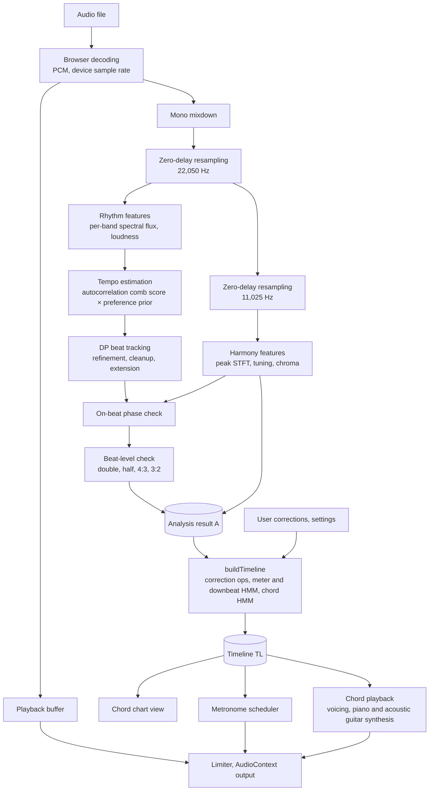
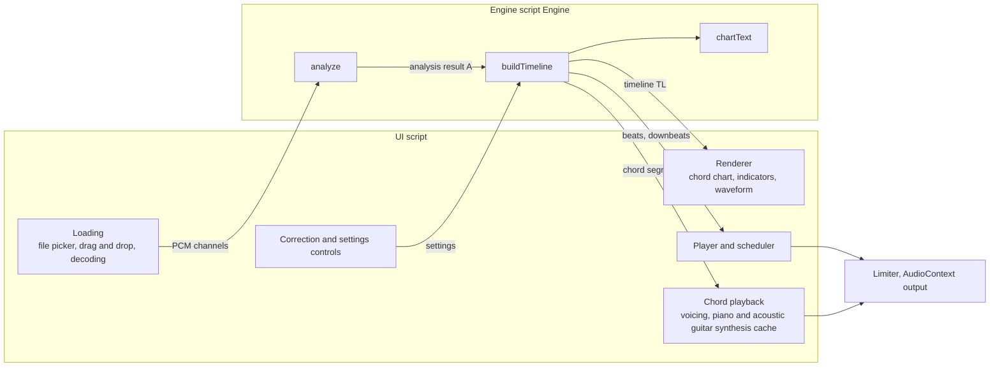
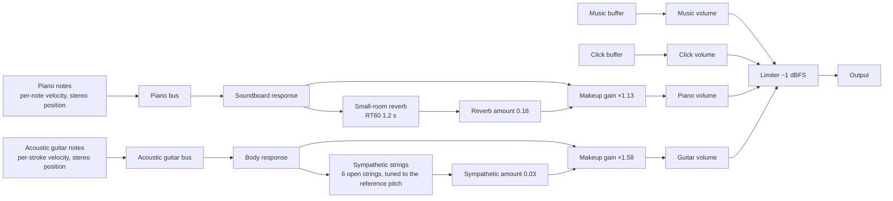

[한국어](README.md) · **English** · [日本語](README.ja.md) · [中文](README.zh.md) · [Français](README.fr.md) · [Español](README.es.md)

Version 1.11.11:

Contributors -

* 고쿠라주민 (118.220): suggested the idea of keeping the focus in place as the chords move on while the beat-correction panel or a bottom panel is open.

> If you have collaborated on or contributed to this project, or would like to, please contact me personally. This project is source-available software that anyone can use free of charge. For personal and non-commercial purposes, you may use it as is at no cost. However, copyright and ownership belong to the original author, collaborators and contributors: without the original author's permission you may not modify it or take any part of it and put it into your own program (even for your own use only), and you may not claim this program as your own or distribute or sell it elsewhere. Uploading modified versions to a GitHub fork is also not permitted. Use by organizations such as schools, private academies, clubs, churches, religious organizations and companies is not automatically free, so please contact me first. The full terms are in [LICENSE](LICENSE).

# Chordity <sup>v1.19.0</sup>

**Chordity is a web page that writes down the chords bar by bar when you give it a song file, and plays a metronome locked exactly to the beat of the song.**

At the moment a chord changes, a piano or an acoustic guitar, or both together, plays that chord, so you can check it by ear and play along. No installation, no sign-up and no internet connection are needed. Your music files never leave your computer.

The results can be wrong. The analysis principles, the reasoning behind its decisions, and how to check and correct the results are collected on the [help page](information.html) (in Korean). You can also open it by clicking the notice at the very bottom of the app.

*Chordity: per-measure chord recognition, a beat-locked metronome and synthesized piano chord playback in a single offline HTML file. No libraries, no uploads.*


## Contents

- **[Part 1. The easy overview](#part-1-the-easy-overview)**
  - [When it comes in handy](#when-it-comes-in-handy)
  - [How to use it](#how-to-use-it)
  - [How to read the screen](#how-to-read-the-screen)
  - [If the metronome sounds off](#if-the-metronome-sounds-off)
  - [Viewing chord names differently](#viewing-chord-names-differently)
    - [Note names](#viewing-in-note-names), [Camelot](#viewing-in-camelot), [Roman numerals](#viewing-in-roman-numerals)
  - [Hearing chords on the piano or acoustic guitar](#hearing-chords-on-the-piano-or-acoustic-guitar)
  - [Keyboard shortcuts](#keyboard-shortcuts)
  - [Songs that work well, songs that are hard](#songs-that-work-well-songs-that-are-hard)
  - [Good to know](#good-to-know)
- **[Part 2. Principles](#part-2-principles)**
  - [2-1. Turning sound into a picture](#2-1-turning-sound-into-a-picture)
  - [2-2. Finding the beat: the pattern of moments when new sounds start](#2-2-finding-the-beat-the-pattern-of-moments-when-new-sounds-start)
  - [2-3. Checking that it is the real beat](#2-3-checking-that-it-is-the-real-beat)
  - [2-4. Dividing into bars](#2-4-dividing-into-bars)
  - [2-5. Working out the chords](#2-5-working-out-the-chords)
  - [2-6. The rules of music as probabilities](#2-6-the-rules-of-music-as-probabilities)
  - [2-7. A metronome that does not drift](#2-7-a-metronome-that-does-not-drift)
  - [2-8. Playing the chords on the piano or acoustic guitar](#2-8-playing-the-chords-on-the-piano-or-acoustic-guitar)
  - [2-9. Finding where the key changes](#2-9-finding-where-the-key-changes)
- **[Part 3. How it works](#part-3-how-it-works)**
  - [3-1. Overall flow](#3-1-overall-flow)
  - [3-2. Loading and preprocessing](#3-2-loading-and-preprocessing)
  - [3-3. Rhythm features](#3-3-rhythm-features)
  - [3-4. Harmony features](#3-4-harmony-features)
  - [3-5. Tempo and beats](#3-5-tempo-and-beats)
  - [3-6. Meter, bars, chords (the lightweight stage)](#3-6-meter-bars-chords-the-lightweight-stage)
  - [3-7. Playback and metronome](#3-7-playback-and-metronome)
  - [3-8. What the correction buttons do](#3-8-what-the-correction-buttons-do)
  - [3-9. Chord playback](#3-9-chord-playback)
- **[Part 4. A closer look](#part-4-a-closer-look)**
  - [4-1. Algorithms and formulas](#4-1-algorithms-and-formulas)
    - [(1) Zero-delay resampling](#1-zero-delay-resampling), [(2) Real FFT](#2-real-fft), [(3) Per-band spectral flux and the onset envelope](#3-per-band-spectral-flux-and-the-onset-envelope), [(4) Tempo estimation](#4-tempo-estimation), [(5) DP beat tracking (Ellis, 2007)](#5-dp-beat-tracking-ellis-2007), [(6) Beat refinement](#6-beat-refinement), [(7) On-beat phase check](#7-on-beat-phase-check), [(8) Beat-level check](#8-beat-level-check), [(9) Beat subdivision decision](#9-beat-subdivision-decision), [(10) Spectral peaks, tuning, chroma](#10-spectral-peaks-tuning-chroma), [(11) Beat-synchronous pooling, bass floor, key](#11-beat-synchronous-pooling-bass-floor-key), [(12) Chord templates and emission scores](#12-chord-templates-and-emission-scores), [(13) Chord Viterbi: O(T·K)](#13-chord-viterbi-otk), [(14) Downbeat evidence and the meter HMM](#14-downbeat-evidence-and-the-meter-hmm), [(15) Metronome scheduling](#15-metronome-scheduling), [(16) Piano synthesis](#16-piano-synthesis), [(17) Voicing and striking](#17-voicing-and-striking), [(18) Modulation tracking](#18-modulation-tracking), [(19) Camelot notation](#19-camelot-notation), [(20) Roman numeral harmonic analysis](#20-roman-numeral-harmonic-analysis), [(21) Reinforcements by song type](#21-reinforcements-by-song-type), [(22) Held-over chords and change positions](#22-held-over-chords-and-change-positions), [(23) Acoustic guitar synthesis](#23-acoustic-guitar-synthesis), [(24) Follow the strumming](#24-follow-the-strumming)
  - [4-2. The physical world](#4-2-the-physical-world)
    - [Sound, pitch, equal temperament](#sound-pitch-equal-temperament), [Harmonics](#harmonics), [Frequency ranges by instrument](#frequency-ranges-by-instrument), [The time–frequency trade-off](#the-timefrequency-trade-off), [Sampling and aliasing](#sampling-and-aliasing), [Loudness, reverberation, logarithms](#loudness-reverberation-logarithms), [Human perception](#human-perception), [Piano strings](#piano-strings), [Acoustic guitar strings](#acoustic-guitar-strings), [Latency and distance](#latency-and-distance)
  - [4-3. System](#4-3-system)
    - [Components](#components), [Repository layout](#repository-layout), [Engine API](#engine-api), [Three clocks](#three-clocks), [Audio graph](#audio-graph), [Saved settings](#saved-settings)
  - [4-4. Issues and fixes](#4-4-issues-and-solutions)
  - [4-5. Optimization](#4-5-optimization)
  - [4-6. Verification](#4-6-verification)
    - [Unit tests](#unit-tests), [Synthetic song regression tests](#synthetic-song-regression-tests), [Modulation tests](#modulation-tests), [Camelot notation tests](#camelot-notation-tests), [Roman numeral tests](#roman-numeral-tests), [Real recording tests](#real-recording-test), [Real-browser end-to-end tests](#real-browser-end-to-end-tests), [Chord playback tests](#chord-playback-tests), [Acoustic guitar and new piano tests (1.12.0)](#acoustic-guitar-and-new-piano-tests-1120), [Unaccompanied opening tests (1.12.2)](#unaccompanied-opening-tests-1122), [Piano sound and acoustic guitar dynamics tests (1.13.0)](#piano-sound-and-acoustic-guitar-dynamics-tests-1130), [Acoustic guitar stroke mark tests (1.14.0)](#acoustic-guitar-stroke-mark-tests-1140), [Acoustic guitar upstroke and slow rake tests (1.15.0)](#acoustic-guitar-upstroke-and-slow-rake-tests-1150), [Song type expansion tests (1.5.0)](#extended-song-type-tests-150), [Meter change and tempo display tests (1.6.0)](#meter-change-and-tempo-display-tests-160), [Held-over chord and change position tests (1.8.4)](#held-over-and-change-position-tests-184)
  - [4-7. Strengths](#4-7-strengths)
  - [4-8. Limitations and future work](#4-8-limitations-and-future-work)
  - [4-9. References](#4-9-references)
- **[Changelog](#changelog)**
  - [Versioning rules](#versioning)
  - [Chordity 1.x](#chordity-1x)
    - [1.19.0](#1190-2026-10-31), [1.18.0](#1180-2026-10-31), [1.17.0](#1170-2026-10-30), [1.16.1](#1161-2026-10-30), [1.16.0](#1160-2026-10-30), [1.15.1](#1151-2026-10-29), [1.15.0](#1150-2026-10-29), [1.14.0](#1140-2026-10-29), [1.13.0](#1130-2026-10-26), [1.12.2](#1122-2026-10-26), [1.12.1](#1121-2026-10-26), [1.12.0](#1120-2026-10-25), [1.11.11](#11111-2026-10-25), [1.11.10](#11110-2026-10-21), [1.11.9](#1119-2026-10-18), [1.11.8](#1118-2026-10-18), [1.11.7](#1117-2026-10-15), [1.11.6](#1116-2026-10-14), [1.11.5](#1115-2026-10-14), [1.11.4](#1114-2026-10-14), [1.11.3](#1113-2026-10-14), [1.11.2](#1112-2026-10-13), [1.11.1](#1111-2026-10-13), [1.11.0](#1110-2026-10-13), [1.10.5](#1105-2026-10-11), [1.10.4](#1104-2026-10-11), [1.10.3](#1103-2026-10-11), [1.10.2](#1102-2026-10-11), [1.10.1](#1101-2026-10-11), [1.10.0](#1100-2026-10-11), [1.9.4](#194-2026-10-10), [1.9.3](#193-2026-10-10), [1.9.2](#192-2026-10-10), [1.9.1](#191-2026-09-30), [1.9.0](#190-2026-09-30), [1.8.4](#184-2026-09-30), [1.8.3](#183-2026-09-30), [1.8.2](#182-2026-09-30), [1.8.1](#181-2026-09-30), [1.8.0](#180-2026-09-30), [1.7.0](#170-2026-09-30), [1.6.0](#160-2026-09-30), [1.5.0](#150-2026-09-30), [1.4.2](#142-2026-09-27), [1.4.1](#141-2026-09-27), [1.4.0](#140-2026-09-26), [1.3.1](#131-2026-09-26), [1.3.0](#130-2026-09-26), [1.2.0](#120-2026-09-26), [1.1.1](#111-2026-09-26), [1.1.0](#110-2026-09-26), [1.0.0](#100-2026-09-26)
  - [Development versions 0.x (Madi Code)](#development-versions-0x-madi-code)
    - [0.4.1](#041-2026-09-26), [0.4.0](#040-2026-09-25), [0.3.1](#031-2026-09-25), [0.3.0](#030-2026-09-25), [0.2.1](#021-2026-09-25), [0.2.0](#020-2026-09-25), [0.1.0](#010-2026-09-25)


---

## Part 1. The easy overview

### When it comes in handy

- When you want to play along with a favorite song on guitar or piano
- When you need to figure out a song's chords but finding them one by one by ear is hard
- When you want to practice timing along with the original recording

### How to use it

1. Open the file `chordity.html` in a browser such as Chrome, Edge, Safari or Firefox.
2. Click **Open file** or drag a music file onto the window. After a few seconds the chord chart appears.
3. Press the **Play** button. Along with the music, the metronome sounds a "tock" on every beat (a high "tick" on the first beat of each bar, and when the chord change unit is ½ beat, a small "tik" between beats as well, or two "tik"s when it is ⅓ beat in a triplet song), a yellow highlighter box surrounds the chord now sounding, and that chord's name gets bigger. Inside the box, orange fills up like a progress bar as far as it has played, and when the chord changes the box springs over to the next chord. The piano plays the chord wherever the original song strikes it (it strikes again when the chord changes or the same chord is struck anew, and keeps ringing where the chord is held over).

Any file the browser can play will do, such as MP3, WAV, M4A, FLAC or OGG.

### How to read the screen

| What you see | Meaning |
|---|---|
| Yellow highlighter box | The chord now sounding. It covers from the beat where the chord was struck up to where the next chord comes in (if a grey held-over chord continues into the next bar, up to there; if the line wraps, one piece per line). When the chord changes, it springs over to the next chord |
| Orange fill inside the box | How much of that chord has been played so far (a progress bar). The end of the fill is the current playback position, and it reaches each beat's slash at the moment that beat begins |
| Enlarged chord name | The name of the chord now sounding (a newly struck chord). It pops up large as it comes in and slowly shrinks back to normal size once playback moves on to the next chord. It grows only as much as it can without touching the next name |
| Slash `/` | One beat. The slash that turns darker is the current beat |
| Thick slash | A beat where a chord is newly struck (a beat carrying a chord in black text). It shows the rhythm in which chords are struck. Grey chords and `N.C.` spots normally get an ordinary slash |
| `⊓` `V` above the slashes (with the acoustic guitar on) | The strokes the acoustic guitar plays. `⊓` is a downstroke (from top to bottom) and `V` an upstroke (from bottom to top), placed on the beat or between beats where the stroke falls. They change with the acoustic guitar playing mode. A `⊓` with a vertical wavy line on its left is a slow rake across all six strings (1.15.0). During playback each mark bounces as its stroke is played (1.15.0) |
| Bracket ┌─┐ marked `M` | A passage where the acoustic guitar strums with the strings muted by the left hand (mute, palm mute). The two ends of the bracket are the first and last strokes of that passage |
| `C` `Am` `G7` | Chord names. A name sitting right above a slash means the chord changes on that beat |
| `G/B` | A G chord whose lowest note is B |
| Small text, chord names placed on two rows (upper and lower) | When a bar has so many chords that a name would touch the next one, the text is made smaller; if it still does not fit, the names in that bar alternate between an upper and a lower row (the left edge of a name is the beat where that chord is struck). On a narrow screen, if a long name on the last beat of a bar does not fit even on two rows, the less important parts are dropped and `…` is added (`Bm7/F♯` → `Bm7…`). The full name appears when you hover the mouse over it, or in the current-chord box at the top during playback |
| Grey chord | The chord from the previous bar held over without being struck again. Even the same chord is shown in black text if it is struck anew on the first beat of the bar |
| `N.C.` | A part with no chord (only drums, silence, or vocals alone without accompaniment at the start of a song) |
| Bar 0 | The part where the song starts in the middle of a bar (a pickup, or anacrusis) |
| A label such as `2 beats` above a bar | Only that bar has a different number of beats (2 beats in this example) |
| Black label `to E major` | The key changes from that beat on (modulation); the label means "to E major", using the Korean directional suffix, romanized as ro/euro ("to"). The key box at the top also shows it, like `E♭ major → E major`. On the first bar of the song, the starting key and meter appear without the directional suffix (`C major` `4/4`, like the key signature and time signature in sheet music) |
| Black label `to 3/4` | The meter changes from that bar on (meter change); the label means "to 3/4". The meter box at the top also shows it, like `4/4 → 3/4 → 4/4` |
| White pill `72` `to 132` | The tempo from that beat on (BPM, rounded), on the line below the slashes. On the beat where the song starts, the starting tempo is shown as a bare number; where the tempo changes suddenly, the new tempo gets the directional suffix romanized as `ro/euro` ("to") |
| White hexagonal frame `up to here: 63` | A section where the tempo changes gradually (on the line below the slashes); the label gives the tempo reached at its end. The length the frame spans is the changing section, and when the playback position is inside the frame, it fills with the highlighter color as far as playback has gone and shows the current tempo, like `now 67`. When it is completely filled it fades to white, and the white pill on the beat after the end of the frame (the tempo arrived at) lights up briefly |
| Tempo (top box and playback bar) | The tempo at the playback position. When the tempo changes gradually, it follows along, like 120, 119, 118 …. The playback bar stays fixed at the very top of the screen even when you scroll, so it is always visible |
| Names like `8B` or `9A` with small letters attached | Chord names when Camelot notation is selected (see "Viewing in Camelot" below) |
| Roman numerals such as `I`, `vi`, `V7/ii` | Chord names when Roman numeral notation is selected (see "Viewing in Roman numerals" below) |
| Circle indicators | Which beat it is now. The largest circle is the first beat of the bar |
| "Next G" at the top | The chord coming up soon |
| Metronome, piano and acoustic guitar buttons | Toggle on and off each time you press them. The piano and the acoustic guitar are turned on and off separately; with both on, they play together |
| Music, click and chord sliders | Adjust the volume of the original song, the metronome and the chord playback (piano and acoustic guitar) separately |

### If the metronome sounds off

Most of the time it lines up on its own, but for some songs different people count the beat differently. Open **Beat not lining up? Correct it** and try the buttons below. Each takes effect the moment you press it.

| If it sounds like this | Press this button |
|---|---|
| The clicks fall between the beats | Shift ½ beat |
| The clicks are too dense | Halve ÷2 |
| The clicks are too sparse | Double speed ×2 |
| The song feels like 6/8 but there are too many clicks | Group in threes ÷3 |
| The start of the bar is off by one beat | Move one beat earlier, move one beat later |
| The clicks feel very slightly early or late | Click timing |
| You want to reset the beat corrections | Reset beat corrections |
| You want to reset settings such as chord type | Restore default settings |

What you have changed so far is shown under **Active** in the same panel, split into "beat corrections" and "settings". Even when the panel is collapsed, a summary is visible next to its title.

If you want simpler chords, choose "basic" under **Chord type**; if you also want to see chords that change within a beat, choose "half-beat". In half-beat mode the metronome also adds a small, high "tik" between beats (on the eighth notes), playing like "tick-tik-tock-tik-tock-tik-tock-tik". In triplet songs where the beat divides into three (12/8, 6/8, etc.), this option changes to "⅓-beat" and divides each beat into three (three eighth notes), and the metronome also puts two "tik"s between beats, playing like "tick-tik-tik-tock-tik-tik".

### Viewing chord names differently

With the **Chord notation** bar right above the chart, you can view the same chords in three ways. The chart, the current and next chord, and the text chart all change the moment you press it, and the chosen style is kept the next time you open the app. From the keyboard, focus the bar and switch with ← and →.

| Button | Example | Good for |
|---|---|---|
| Note names | E♭, B♭/D, Cm7 | Playing along right away while looking at the chords, or passing chords between players |
| Camelot | 5B, 6B, 3A⁷ | Finding keys and chords that go well together, or choosing DJ mix points |
| Roman numerals | I, V⁶, ii⁷/IV | Analyzing a song's harmonic progression, or transposing it to another key |

The three images below show the same 11 bars in E♭ major in each style.

#### Viewing in note names


These are the most familiar chord names. The root is written large, qualities such as m, sus and dim a little smaller, and extensions such as 7 and maj7 as superscripts, so even complex chords can be read at a glance.

- **Slash chords**: `B♭/D` in the second bar means play a B♭ chord with D as the lowest note. Chords with the 7th in the bass, like `B♭7/A♭` in the sixth bar, are written as they are.
- **♯/♭ that fit the key**: the same pitch is spelled to fit the key at that point. This song is in E♭ major, so it writes B♭ instead of A♯ and A♭ instead of G♯; when the song modulates to E major, from then on it uses sharps, as in G♯m7.
- A chord held over from the previous bar without being struck again is shown in grey, and a place with no chord is written `N.C.`. Even the same chord is written in black text if it is struck anew on the first beat of the bar.

#### Viewing in Camelot


Chords are written with the numbers of the Camelot wheel, which DJs use when blending one track into the next. Keys are placed on positions 1 to 12 in circle-of-fifths order, with B added for the major family and A for the minor family. Keys and chords with the same number or numbers one apart sound good together.

- **Reading chords**: a chord is written with the number of the key whose root and character (major or minor) match it, and the chord type is attached in small letters. E♭ is 5B, Cm is 5A, and B♭7 is 6B with a small 7 attached.
- **Chords outside the key stand out at a glance**: this song is in E♭ major (5B), so most chords cluster around 4 to 6. Only `3A⁷` (B♭m7) in the fourth bar is far away, because it is a chord borrowed briefly to lead to the IV, A♭maj7 (4B).
- The song's key is also shown with its number, like `E♭ major (5B)`.
- Camelot has no way to write a bass note, so the bass note of a slash chord is omitted (`B♭/D` → `6B`). Chord playback still plays the bass note as it is.

#### Viewing in Roman numerals


This is the Roman numeral harmonic analysis used in harmony textbooks. Instead of note names, chords are written as **the chord built on which degree of the key**, which reveals the skeleton the song moves along. The same progression looks the same in any key, so it is handy for transposing to another key or comparing progressions across songs.

- **The flow in the image**: the first three bars, `I – V⁶ – vi`, are a progression whose bass descends one step at a time, E♭ → D → C. The following `ii⁷/IV – V⁷/IV – IVᴹ⁷` briefly borrows the ii–V of A♭ major to reach IV (A♭maj7), and the final `ii⁷ – V⁷ – I` is the most basic cadence.
- **Inversion figures**: `V⁶` in the second bar is a chord with its 3rd (D) in the bass, and `V⁴₂` in the sixth bar has its 7th (A♭) in the bass.

| Notation | Meaning |
|---|---|
| I, IV, V (uppercase) | Chords of the major-triad family. The numeral is the degree of the key the chord is built on |
| i, ii, vi (lowercase) | Chords of the minor-triad family |
| °, ø, +, M | Diminished (°), half-diminished seventh (ø), augmented triad (+), major seventh (M7) |
| 7 | Seventh chord |
| 6, ⁶₄ | Inversions of a triad. 6 if the bass is the 3rd, ⁶₄ if it is the 5th |
| ⁶₅, ⁴₃, ⁴₂ | Inversions of a seventh chord, when the bass is the 3rd, 5th or 7th |
| V/x, vii°/x, ii/x | A chord used briefly to lead to x (secondary chord). V7/vi is the dominant seventh leading to vi |
| ♭VI, ♭VII, etc. | Degrees outside the scale of the key, such as chords borrowed from the parallel minor (borrowed chords) |

- The numerals are counted from the key at that point. After a modulation, they are counted again in the new key.
- If the dominant of the new key appears right before a modulation, it is written as V of the new key (e.g. B7 right before moving to E major is V7).
- If slash (bass) notation is turned off, chords are written in root position without inversion figures.

### Hearing chords on the piano or acoustic guitar

Turn on chord playback with the **Piano** and **Acoustic guitar** buttons at the top, and the recognized chords are played. The two buttons are turned on and off separately; with both on, the piano and the acoustic guitar play together (at first, only the piano is on). Listening to it layered over the original lets you check by ear right away whether the written chord is right, and it also guides you when playing along. The sound automatically matches the song's tuning, so it never sounds out of tune against the original.

- The volume of the music, the clicks and the chords is set separately with the three sliders at the top (the chord slider applies to both the piano and the acoustic guitar).
- Under **Piano playback** in **Correct it**, you can choose when the piano strikes: follow the song (default, restrikes only where the original strikes anew), when the chord changes, again every bar, every beat, or, from 1.19.0, **Singer-songwriter** (accompaniment fitted to the song) and **With character**. Singer-songwriter follows the same section loudness as the guitar's singer-songwriter mode: broken-chord arpeggios in quiet places, left-hand bass with short right-hand chords in loud ones, the right hand an octave above the guitar, and with the guitar on it strikes where the guitar does not. With character plays broken-chord arpeggios, short rising runs at the end of 4-bar phrases, and rolls the final chord one note at a time.
- Under **Acoustic guitar playback** in **Correct it**, you can choose how the acoustic guitar plays. The default, **Singer-songwriter** (1.16.0), plays the way an acoustic guitar accompanist would after listening to the song. It picks an eighth-note, sixteenth-note or triplet hand motion from the tempo and feel, chooses a strumming groove that suits the original (usually ↓ ↓↑ ↑↓↑, a sixteenth-note groove for slow songs), plays it sparser in quiet sections (↓↓↓↓ and so on) and fuller in loud ones, and plays repeated sections with the same pattern. Right before a section that gets much louder it fills the last beat, chords that change between beats are pushed, and beats 2 and 4 are accented. Even in a quiet section it keeps the main groove going softly when the original still has a backbeat or offbeat groove, and when the original is sparse it plays the whole section at one density (quarter notes, half notes, or one strum left ringing). The end of an 8-bar phrase is lightened only when the original is weak on that beat, a break where the chords stop is struck once and left, and the last chord of the song is rolled once and left ringing. From 1.17.0 it no longer repeats a single pattern: for each level it picks, bar by bar, the strumming shape that best fits the original's rhythm from several shapes real accompanists use, adds strokes on empty cells the original hits hard, leaves out cells where the original is nearly silent, and changes the shape at the end of a phrase when the same one has run for more than 4 bars (repeated sections are still played the same way). **Follow the strumming** finds the rhythm in which guitar, piano, drums and so on were played in the original, in sixteenth-note slots on each beat, and strums down and up at those spots. In bars where no strikes are found it strums once on the downbeat, and because it finds the original's rhythm from the sound, it may differ from the actual performance (4-8). **4-beat, 8-beat and 16-beat strum** picks, bar by bar, the strum variation taught in guitar method books (for 8-beat, ↓↑↓↑↓↑↓↑, ↓ ↓ ↓↑↓↑, ↓ ↓↑ ↑↓↑, etc.) that best fits the original's rhythm, and strums it in time with the song's beats. Following the basic technique of always swinging the hand up and down, strokes on the beat side are down and those in between are up, and the chosen patterns appear in the "acoustic guitar strum" row of **Analysis info**. **Swing strum** strums the two eighth notes of each beat long and short (↓·↑ ↓·↑), on the first and third notes of a triplet. If the original swings, it measures where the offbeat falls (the swing ratio) from the original and matches it; for straight songs or songs where it cannot be measured, it strums at the triplet position (⅔ of the beat). Swing plays only this rhythm, without variations, and the ratio used appears in the "acoustic guitar strum" row of the analysis info. In every mode it always strums where the chord newly changes (if it changes between slots to be strummed, on the first slot after it: for 4-beat the next beat, for swing that beat's offbeat); even where there is no chord (N.C.), if the original has drums or another rhythm, it plays a **mute** ("chik") with the strings damped, or, if the bass note is clear, a **palm mute** on that note (it does not play in quiet places), and the chords are held with real guitar fingerings (C is x32010, G is 320003, etc.). In every mode it strums softly where the original is quiet and hard where it is loud, and within a bar too it strums hard where the original was struck hard (1.13.0). From 1.15.1 it strums a little harder the louder the original gets and a little softer the quieter it gets, and the harder it strums the faster it sweeps the strings (up to 1.25 times the speed of a real acoustic guitar strum), the softer the slower (down to 0.8 times). In the ending part of the song, the last chord, the first beat of the bar leading into the outro, and chords held for more than a bar are not struck at once but raked slowly from the low strings, ringing out as a rolled chord, and the slower the song the slower the rake (half a beat, 0.12–0.5 s). It does not rake at the start or in the middle of the song (1.15.1). Follow the strumming also finds faint upstrokes buried under the drums in songs strummed densely in sixteenth notes. It also puts upstrokes in with the rhythm, following a hand that keeps moving up and down: fast songs (116 BPM or more) get eighth-note ↓↑ and slower songs a sixteenth-note ↓↑ right before the next beat, and if the downstroke leading into an added upstroke is missing, it is added too. They are added only where that spot in the original is on the loud side among the same spots in the song, so they follow the song's rhythm (1.15.0).
- With the acoustic guitar on, the strokes it plays appear as marks between the chord names and the slashes in the chart. Downstrokes are marked `⊓` and upstrokes `V` where they are played, and muted or palm-muted passages, where the strings are muted, get an `M` above a bracket joining their first and last strokes. When you change the acoustic guitar playing mode the marks follow it, and when you turn the acoustic guitar off the marks disappear and the chart returns to its normal height (1.14.0). A slow rake gets a vertical wavy line to the left of its `⊓`. During playback, 0.1 s before each stroke its mark swells and hops up slightly, squashes flat like a spring as it lands, then stands back up and returns to its normal size within 0.33 s (it stays still if your device is set to reduce motion, 1.15.0).
- The piano can also be turned on and off with the P key, and the acoustic guitar with the G key.

### Keyboard shortcuts

| Key | What it does |
|---|---|
| Space | Play, pause |
| M | Metronome on, off |
| P | Piano chord playback on, off |
| G | Acoustic guitar chord playback on, off |
| ← → | Previous bar, next bar |
| Home | Go to the beginning |

Clicking a bar jumps to that bar, and clicking or dragging on the waveform at the top also takes you wherever you want. The shortcuts work even when the keyboard is in Korean input mode.

### Songs that work well, songs that are hard

Songs with a clear beat, such as pop, rock, ballads, dance, hip-hop, K-pop and acoustic pop with drums, work well. It also recognizes songs whose tempo changes greatly partway through, odd meters such as 5/4 and 7/4, chords whose bass is a note outside the chord such as F/G, and rock power chords (E5). It can be wrong on songs with many tensions and a walking bass such as jazz, songs felt in two-beat units such as bossa nova (bars are written twice as long), metal with very heavy distortion, and songs whose beat can be counted in two ways such as reggae. In those cases, use the correction buttons above.

### Good to know

- Your file is not sent over the internet. All analysis happens inside the browser.
- Clicking the notice at the very bottom of the screen opens the [help page](information.html) (in Korean) in a new tab; it covers when results can be wrong and how to check them, plus the analysis principles and verification results.
- Settings such as the metronome, chord playback, volume, chord type and chord notation style are saved in the browser and stay the same next time.
- Even with Bluetooth earphones, the music, clicks and chord playback are all delayed together, so they do not drift apart from each other.
- If there is no sound on an iPhone, check whether silent mode is on.
- During playback the page scrolls to follow the current bar. While the correction/settings panel at the top or the text chord chart or analysis info panel at the bottom is open, it does not scroll, so you can keep reading the panel; close the panels and it follows again.

<p align="center"></p>

---

<p align="right"><a href="#contents">↑ Back to contents</a></p>

## Part 2. Principles

This program does not use a pretrained AI model. It works with **signal processing** and **probabilistic models** that turn the physical properties of sound and the rules of music into formulas. That is why every decision can be explained, and you can see the evidence yourself under **Analysis info** at the bottom of the screen.

### 2-1. Turning sound into a picture

Sound is a vibration of the air, and a recording is a sequence of numbers measuring that vibration tens of thousands of times per second. Since it is hard to tell which notes are sounding just from those numbers, the sound is cut into very short pieces, and for each piece we compute **how much sound of each pitch is mixed in** (the spectrum). Laying these out in time order gives a picture of the sound with time on the horizontal axis and pitch on the vertical axis (a spectrogram). All of the analysis that follows is the work of reading this picture.

There is an unavoidable trade-off here. Cutting short pieces tells you precisely **when** a sound occurred but blurs **which note** it is; cutting long pieces does the opposite. So short pieces are used for finding the beat, and long pieces separately for finding chords. The lowest bass notes need the longest pieces, because the frequency difference between semitones there is very small.

### 2-2. Finding the beat: the pattern of moments when new sounds start

When a drum is hit or a key is pressed, the sound energy suddenly increases at that moment. Such a moment is called an **onset**. If you add up only the parts of the spectrogram that got louder than just before, you get a curve that spikes at every onset.

The beat is the **skeleton of these onsets repeating at regular intervals**. First, the curve is slid along in time and overlapped with itself (autocorrelation) to find the interval at which it overlaps best, that is, the tempo. Then a row of beats that "passes through as many strong onsets as possible while keeping the spacing close to the tempo" is found across the whole song at once (dynamic programming). Because the whole thing is optimized together rather than deciding each beat separately, the row does not break even if a few weak beats are mixed in, and it follows the tempo even when the performance wavers a little. Here the standard for "regular intervals" is not the tempo of the whole song but a **local tempo** computed every few seconds. So it is not dragged along by places where the rhythm briefly gets complicated, like fills, yet it follows when the song actually slows down or speeds up.

### 2-3. Checking that it is the real beat

Finding a regular row is not the end. There are two common mistakes.

**Taking the offbeat as the beat.** When the hi-hat strongly fills in between beats, the row can be caught shifted by half a beat. But music has rules. The moments when the kick, snare and bass come in and the moments when chords change mostly cluster **on the beat**. So the strength of such events is compared at the found beat positions and at positions shifted by half a beat, and if the shifted side is clearly stronger, the whole row is moved by half a beat.

**Taking the tempo as double or half.** When a slow ballad has dense eighth-note arpeggios, it is easy to mistake each eighth note for a beat. In that case the beats are split into two groups by taking every other beat. If the kick and snare land on the real beats with only keyboard sounds in between, one group comes out much stronger than the other. Then the weak group is discarded and the tempo is corrected to half. Conversely, if a snare comes regularly right in the middle between beats, the tempo was caught too slow, so it is corrected to double. Doubling, if wrong, immediately produces offbeat clicks, so it is done only under much stricter conditions.

In real recordings, hi-hats and keyboards fill the offbeats, so the difference in strength between the two groups can come out small. So it also looks at **which group the kick and snare fall in**. At the correct tempo, the kick (beats 1 and 3) and the snare (beats 2 and 4) fall in different groups; if the tempo was caught double, both fall in the same group (the real beats). When correcting the tempo to half, it does not drop every other beat but tracks again from the start at the new tempo. That is because if the eighth-note-level tracking slips by just one slot somewhere in the middle of the song, every beat dropped after that point would be off by half a beat.

**Two shapes of a fast song caught at half tempo.** A fast song of around 160–180 BPM is easily caught one level slower, that is, at half tempo. The shape then differs depending on where the slow beat sits. If the slow beat sits on the snare (beats 2 and 4), a snare comes evenly on every beat and the kick comes between beats. In a slow song at its correct tempo, the kick comes on the beat (beats 1 and 3) and the snare every other beat, so this shape does not occur. If the slow beat sits on the kick (a half-time feel), snares come between beats as often as on them. In both cases the tempo is doubled only when tempo estimation gives the double tempo as a candidate of almost equal strength. If the slow beat is left sitting on the snare, the first beat of the bar is also off, so two chords get mixed into one beat and many seventh chords and slash chords appear.

The halving side is also checked once more. If eighth notes had been taken as beats, the middle between beats would be a sixteenth-note position, where low-pitched hits such as kick or bass are rare. So if low sounds often come between beats too, the beat is taken to be correct and is not halved. When trying to halve based only on the strength difference between the even and odd groups, if the snares cluster in the group opposite the kick (a backbeat), the beat is also correct and is not halved.

The way the "snare" is recognized is physical. When the wires under a snare drum rattle, they make a noise that grows louder **all at once** from the middle range up to very high frequencies. A keyboard note grows louder only at a few pitches, and a hi-hat only at the high end. So by measuring "did the middle range and the high range get louder at the same time" as the product of the two values, only the snare can be picked out. If either one is small, the product becomes small.

### 2-4. Dividing into bars

To group beats into bars, you need to know where **the first beat of the bar** (the downbeat) is. The downbeat leaves traces: the chord changes, the bass note changes, the kick hits hard, and the sound sometimes gets louder. Each beat gets a score for such traces, and the grouping with the highest score is found while keeping the rule that "bars usually repeat at the same length". Whether 4 beats or 3 beats fits the traces better is also decided this way. If the feeling of each beat splitting into three is strong, it is treated as a compound meter such as 6/8 or 12/8.

In songs where the drums play a backbeat, the even/odd shape of **kick on beats 1 and 3, snare on beats 2 and 4** is also used as a trace of the downbeat. In syncopated riffs where the chord changes an eighth note before the downbeat, the trace of the chord change is pulled one beat earlier, but the even/odd shape of the drums stays the same, so the bar is not shifted by a beat. Also, 3, 5 and 7 beats per bar are chosen only when the downbeat traces actually repeat at that length. This is to prevent a short song from looking like 7 beats just because a few rare, large traces were picked.

### 2-5. Working out the chords

The same note in different octaves (a low C and a high C) plays the same role in a chord. So if every note is folded into the **12 slots** C, C♯, D … B, you get a fingerprint of the notes sounding at that moment (chroma). For a C chord, the C, E and G slots stand out.

Real instruments do not produce just one tone. When you play C, **harmonics** such as the C an octave above, the G above that, C again, E … ring along with it. For example, a harmonic from the E of a C chord fills the B slot, so a comparison that ignores harmonics mistakes C for Cmaj7. That is why the chord fingerprints are also built to include harmonics before comparing.

The bass (the lowest note) is looked at separately. If the chord is C but the bass is E, it is written `C/E`.

Every recording has a slightly different reference pitch. Many songs do not have A at exactly 440 Hz. So first it measures how high or low the notes of the whole song are on average, corrects by that amount, and then puts them into the 12 slots.

### 2-6. The rules of music as probabilities

If you simply picked the most similar chord on every beat, the passing notes of the melody would make the chord flicker from beat to beat. So two pieces of common sense are added as probabilities: **chords do not change often**, and **when they change, it is most likely on the downbeat and unlikely between beats**. Weighing these rules together with how similar the sound is, it picks the most plausible chord sequence for the whole song at once (a hidden Markov model and the Viterbi algorithm). It also estimates the song's key and gives chords that fit the key a small bonus.

### 2-7. A metronome that does not drift

This metronome does not tick at a fixed interval like "97 ticks per minute"; it ticks **at the time of each beat it found**. So it follows along even when the performance speeds up or slows down a little.

The timing is precise too. If a timer fires a click by saying "play now!", it gets delayed by tens of ms whenever the computer is busy. So clicks are scheduled 0.2 seconds ahead on the **clock of the audio device** that plays the music. Because the music and the clicks use the same clock and the same output path, they mesh to the individual sample, and even on a device with delayed output, both come out late together and stay aligned with each other.

### 2-8. Playing the chords on the piano or acoustic guitar

Including recorded piano sounds would make the file large and require external files. So the piano sound is **built directly from the laws of physics**. A piano string is not an ideal string but a stiff steel wire, so its harmonics ring slightly higher than exact integer multiples (inharmonicity). The hammer strikes at about 1/7 of the string's length, so harmonics that do not move at that point ring weakly. Two or three strings sound one note together, and because they differ very slightly in pitch, the sound undulates slowly (beating), and a two-stage decay arises that falls quickly at first and then lingers. Higher harmonics die away faster, so the sound gradually becomes softer. These properties are layered as formulas to synthesize each note.

Since 1.12.0, more of the properties measured on real pianos have been added: a timbre that keeps more high harmonics the harder the hammer strikes, beating between the strings in all harmonics, and a low "thump" as the hammer strikes the string and knocks the soundboard; the sound is then sent out through a response that imitates the wooden resonance of the piano soundboard. When a key is released, the dampers come down differently in each register, and the very top register (strings without dampers) rings on for a long time.

In 1.13.0 the sound was refined again to match values measured on real piano recordings. Two sounds were added for the moment the hammer hits the string: a short, high noise made when the felt touches the string, and the wooden "tock" made when that force knocks the soundboard. The sound now decays quickly during the first second, like a real piano, which fixes the way it used to ring evenly until the next chord was played, as if the pedal were held down. The faint aftersound that lingers for a long time is left as it is, and the sound ends naturally once it has become quiet enough. The reverb was changed to the first reflections returning from the walls of a small room (reverberation time 1.2 seconds) and the reverberation that spreads out after them.

The acoustic guitar is made with the Karplus-Strong method, which imitates a plucked string. If noise one string period long is fed into a delay line and fed back again and again while being darkened slightly, it becomes a sound that, like a really plucked string, loses its high components first. The position and force with which the pick strikes the string and the air and top-plate resonances of the guitar body are added, and the chords are played with fingerings held by hand on a standard-tuned six-string. A downstroke strikes all strings starting from the lowest, and an upstroke strikes the upper 3–4 strings starting from the highest, a few ms apart. From 1.15.1 the gap between strings starts from the median of real acoustic guitar recordings (GuitarSet: 6.2 ms down, 7.0 ms up) and gets up to 1.25 times faster the harder the stroke and down to 0.8 times as fast the softer (up to 1.15.0 it was about 11 ms on downstrokes, sweeping the strings slowly). When to strum is decided by finding, in each slot obtained by dividing the beat into four (three for compound meters), the moments when the sound in the original's mid range (200–2,500 Hz) newly gets louder. A slow rake plays all strings from the lowest at even intervals spread over half a beat (0.12–0.5 s). From 1.15.0 only increases at spectral peaks (pitched partials) count toward this. From 1.15.0 each string has its own tone: the wound strings (E, A, D, G) are darker and the plain strings (B, E) brighter, set halfway between the per-string brightness measured in real acoustic guitar recordings (GuitarSet) and the earlier tone, so the thin strings are no longer harsh while the strum keeps its attack. The ring comes from the guitar itself instead of room reverb: besides the body resonance, the six open strings ring in sympathy with the harmonics of the notes played (tuned to the song's reference pitch).

From 1.13.0 the acoustic guitar adjusts how hard it strums. It strums softly where the original is quiet (verses, quiet interludes) and hard where it gets louder (choruses), and within a bar too it strums hard where the original was struck hard and softly on offbeats that were struck lightly. The song's loudness is judged from the overall level together with the level of the accompaniment spread left and right (the difference between the left and right stereo channels). This is because in mastered popular music, even when the overall level of the verse and the chorus is almost the same, the accompaniment spreads wide left and right in the chorus. Bars strummed softly are played with a soft timbre, but the timbre is kept to one per bar so that it does not flicker from stroke to stroke.

A chord is played split into one left-hand bass note and a right-hand chord. For the right hand, it chooses the inversion that moves the hand the least from the previous chord, so the sound does not jump around when the chord changes. The piano is tuned to the song's reference pitch found in the analysis and is scheduled on the same audio clock as the metronome, so it sounds exactly at the moment the chord changes. From 1.16.1 the piano has a brighter, crisper sound, as if the hammers struck the strings harder, with clearer upper harmonics (2–8 kHz) and the same overall loudness. From 1.18.0 it leans toward a Steinway grand: the hammer striking the strings is clearer (attack in the first 10 ms up 2–4.5 dB) and the sustain is a little longer.

### 2-9. Finding where the key changes

A song's key shows in "which notes are mainly used". A song in E♭ major mainly uses E♭, F, G, A♭, B♭, C and D, and if it moves to E major it uses E, F♯, G♯, A, B, C♯ and D♯. So for each beat, the note distribution of the few bars before and after is compared with the typical distributions of the 24 keys, and the rule that **keys do not change often** is added as a probability to find the most plausible flow of keys across the whole song. Chords from another key that pass by for a bar or two (e.g. E7 → Am in a song in C major) are not counted as modulation. Moves between relative major and minor keys that use the same notes (C major and A minor) are not counted as modulation either, because the key signature does not change.

The modulation position is refined to the beat. When the music passes through the dominant of the new key (e.g. B7 for E major), the position where the new tonic chord appears is taken as the modulation point, following the convention of changing the key signature in sheet music. The ♯/♭ spelling of chord names also follows the key at that point. In an E major section, it writes G♯m7, not A♭m7.

---

<p align="right"><a href="#contents">↑ Back to contents</a></p>

## Part 3. How it works

### 3-1. Overall flow



The analysis is split into a **heavy stage** and a **lightweight stage**.

- The **heavy stage** `analyze()` runs only once, when a file is opened. It does all of the signal processing and the automatic beat tracking. It usually takes a few seconds and yields control to the screen every 32 ms so the progress indicator does not freeze.
- The **lightweight stage** `buildTimeline()` runs every time a correction button or a setting is changed. It recalculates the meter, bars and chords, and takes about 40 ms even for a 5-minute song, so changes take effect the moment you press.

### 3-2. Loading and preprocessing

1. The browser's built-in decoder decodes the file to PCM. This one buffer is used **for both playback and analysis**. Decoding separately or going through the browser's resampler could make the time axes of the two results drift apart by several ms.
2. The channels are averaged into mono, and a self-implemented resampler produces 22,050 Hz (for rhythm) and 11,025 Hz (for harmony) signals. The filter kernel is symmetric, so the signal is not shifted by even one sample.
3. The peak amplitude is normalized to 1.

### 3-3. Rhythm features

| Step | What it does | Key values |
|---|---|---|
| Short-time Fourier transform | Turns each piece of the 22,050 Hz signal into a spectrum | Window 1024 points (46.4 ms), hop 256 points (11.6 ms, 86.13 frames per second) |
| Log compression | Makes changes in quiet sounds visible too | log(1 + 1000·\|X\|) |
| Maximum filter | Widens the spectrum from two frames earlier by ±1 bin along frequency before comparing | Keeps vibrato and pitch glides from being mistaken for onsets |
| Per-band flux | Averages only the increases, per band | Low 21–200 Hz (kick, bass), mid 200–2,500 Hz (snare body, keyboards), high 2.5–10 kHz (hi-hat, snare wires) |
| Onset envelope | Divides each band by its standard deviation and sums | High band weighted by half (reduces the influence of offbeat hi-hats) |
| Loudness | RMS per frame | Used to decide sounding sections and to draw the waveform |

### 3-4. Harmony features

| Step | What it does | Key values |
|---|---|---|
| Treble peak STFT | Spectral peaks for chord tones | Window 2048 points (186 ms), 110–4,200 Hz, up to 36 per frame |
| Bass peak STFT | For bass notes and tuning | Window 4096 points (372 ms), 32–1,400 Hz, up to 24 per frame |
| Peak conditions | Only distinct peaks | At least −45 dB relative to the frame maximum, at least 2× the average of the surrounding ±6 bins |
| Log-parabolic interpolation | Frequency and magnitude more precise than the bin spacing | Uses the log magnitudes of the peak and its neighboring bins |
| Reference pitch estimation | Averages the "fractional semitone part" of all peaks on a circle | e.g. +18 cent → A4 = 444.6 Hz |
| Chroma | Accumulates the corrected pitches into 12 slots | Larger weight the closer to the semitone center (cos²). Treble MIDI 48–96, bass 28–57 |
| Harmonic change curve | Cosine distance between chroma of the 4 frames before and after | Used in the on-beat phase check |

### 3-5. Tempo and beats

1. **Sounding sections**: sections at least −38 dB relative to the song's loud level (top 5%) are treated as sound.
2. **Tempo**: the onset curve is normalized by dividing by the ±3-second average loudness, and its autocorrelation is computed. Scanning 40–240 BPM in 0.25 BPM steps, a comb score that looks at 1, 2, 3 and 4 times the interval together is multiplied by a preference prior centered at 110 BPM, and the area around the maximum is interpolated with a parabola.
3. **DP beat tracking**: the method of Ellis (2007) is used with two changes. The spacing is compared with a local tempo curve computed with 8-second windows (a 7-second median to filter out fills), and the penalty strength is made proportional to the square of the beat period, so that the same jitter in ms gets the same penalty even in slow songs.
4. **Refinement**: each beat is moved to the onset peak within ±2 frames (±23 ms) and interpolated with a parabola. Beats with weak onsets are filled in by linear regression on neighboring beats. Finally, a detection delay of 6.5 ms is compensated.
5. **Cleanup**: beats outside sounding sections are removed, and the same spacing is extended forward and backward to cover all sounding sections.
6. **Checks**: the on-beat phase check and the beat-level check are done in turn (the principle in 2-3). If the beat level is corrected to half, steps 3–5 are redone at the new tempo and the phase is checked again. If beats appear to split into three, a tempo 4/3 times slower and a tempo 3/2 times faster are also checked (1.11.5, 1.11.6, (9) in 4-1).

### 3-6. Meter, bars, chords (the lightweight stage)

1. **Apply correction operations**: the ½ beat, ×2, ÷2 and ÷3 the user pressed are applied to the beat list in the order they were pressed. For ÷2 and ÷3, which beats to keep is decided by beat accent.
2. **Per-beat pooling**: the chroma within each beat interval is averaged with more weight in the middle. From the bass chroma, half of the whole-song median is subtracted to remove constantly present components such as a pitched kick drum.
3. **Key and modulation**: for each beat, the note distribution of ±6 beats around it is compared with the Krumhansl–Kessler key profiles, and the key sections are divided by an HMM whose states are the 12 key signatures. Sections shorter than 24 beats are absorbed into a neighboring section. If there is no modulation, a single key chosen from the whole-song distribution is used. After the chords are recognized, the key of each section is decided again using the chords. It looks at which key's scale the chords fit, the time the tonic chord occupies, V → I cadences, the first and last chords, and the chords on the first beats of 4-bar phrases, together with the note distribution.
4. **Preliminary chords**: a quick pass using only major and minor triads is solved once and used as downbeat evidence.
5. **Subdivision decision**: the onset strengths at the 1/2 point and at the 1/3 and 2/3 points within a beat are compared to see whether it is a compound meter.
6. **Downbeat HMM**: the meter is chosen automatically (4 beats vs 3 beats, or 4 vs 2 for compound meters), and the user's downbeat shifts are applied.
7. **Final chord HMM**: solved by Viterbi with up to 289 states including inversions, in units of 1 beat, ½ beat or ⅓ beat (triplet songs).
8. **Building bars**: bars are split at each downbeat, and each gets the positions and lengths of chord changes within the bar, whether a chord continues from the previous bar, the note names (♯ or ♭) that fit the key at that point, the Camelot code and the Roman numeral. The screen shows the one chosen in the chord notation bar above the chart, and changing the notation does not re-run the analysis. Modulation boundaries are refined to the beat with a slight preference for the downbeat (to the tonic chord's position when passing through the dominant), and the bar and beat number are recorded.

### 3-7. Playback and metronome

- **Music**: an `AudioBufferSourceNode` is started 60 ms after the current audio time.
- **Scheduler**: wakes every 25 ms and schedules on the audio clock the clicks for the beats coming within the next 0.2 seconds. When the tab is in the background, the browser slows timers down, so it schedules up to 1.5 seconds ahead.
- **Click sound**: a short sound prepared in advance (downbeat 1,850 Hz, other beats 1,250 Hz, and 2,600 Hz between beats in sub-beat (½-beat or ⅓-beat) mode). It sounds from the very first sample, so there is no attack delay.
- **Resynchronization**: when the position is moved or corrections or settings change, all scheduled clicks are cancelled and rescheduled starting from the beat after the current position.
- **Screen**: the playback position is computed every frame, minus the output latency reported by the browser, to match the moment it is actually heard. The screen is updated only when the bar, beat or chord changes.
- **Auto-scroll**: when the bar changes and the current bar is outside the view below the fixed transport bar, the page scrolls smoothly. If any collapsible panel (`details.panel`) is open, it does not scroll (1.11.11).

### 3-8. What the correction buttons do

| Button | Internal operation | Behavior |
|---|---|---|
| Shift ½ beat | `half` | Builds a new beat list from the midpoints of neighboring beats and snaps them back to onset peaks. Beats that stick out before the music starts are discarded |
| Double speed ×2 | `x2` | Adds a midpoint between every pair of beats |
| Halve ÷2, group in threes ÷3 | `d2`, `d3` | Keeps one of every 2 (3). The position kept is the one with the larger sum of beat accents |
| Move one beat earlier, later | `downShift` ∓1 | Rotates the position-in-bar numbers by one |
| Meter | `meter` | Re-solves the downbeat HMM with the specified number of beats |

Corrections are stored as an **operation log** on the beat list and are reapplied in order from the start each time. "Reset beat corrections" clears this log. Chord type, chord playback mode, downbeat accent, auto-scroll and click timing are **settings** saved in the browser rather than with the song, so they are reset separately with "Restore default settings". "Active" lists, for both kinds, only what differs from the defaults.

### 3-9. Chord playback

| Step | What it does |
|---|---|
| Chord segments | For each chord event in a bar, the engine passes on the chord tones (0 = C) together with the bass note to play. When slash notation is turned off, the bass is the root. |
| Strike list | For the piano, built according to when chords are struck. "Follow the song" strikes where the chord changes and, even for the same chord, on downbeats where the original strikes anew (black text in the chart), and keeps ringing where the chord is held over (grey). "When the chord changes" strikes a same chord continuing across bars only once, "again every bar" strikes again on each downbeat, and "every beat" strikes on all beats. On N.C. nothing is struck and the previous chord also stops. 1.19.0 Singer-songwriter and With character: the engine's `pianoComp(A, TL, mode, {gtr})` decides the hand and position for each bar (bar level as in the guitar's `sswStrum`; ladder 0 = bass, 1 and up = right-hand notes, then the same an octave higher). Singer-songwriter plays eighth-note arpeggios at level 1 or below (right hand an octave up), a chord plus a right-hand chord on beat 3 at level 2, and at level 3 and up the left hand on beats 1 and 3 (octaves at 4) with three right-hand stabs (one shape per 4-bar phrase, chosen from 2&·4 / 1&·3& / 2&·3& / 1e·3& as the one that overlaps the guitar strokes least); stabs in slow songs (below 90 BPM) are rolled 30 ms apart, and a two-note rising pickup sits on the & of the last beat of each phrase. With character plays eighth-note arpeggios at level 2 or below or in slow songs (three per beat in compound meter, right hand an octave up at level 3 and above), the left hand on beats 1 and 3 with a right-hand broken chord at level 3 (quarters at 110 BPM and above, eighths below; offbeat notes avoid positions within ±0.06 beat of a guitar stroke), left-hand octaves with stabs at level 4, and a rising sixteenth-note run on the last beat of each 4-bar phrase. A chord change mid-bar is struck where it happens. In both, the final chord is rolled from the bottom one note at a time (a quarter of a beat apart, 0.06–0.12 s). Re-striking a note dampens the earlier one within 30 ms. |
| Stroke list (acoustic guitar) | The engine's `strokes(A, TL)` measures the strength of the mid-range flux in each slot obtained by dividing the beat into four (three for compound meters), and strums in slots whose strength, normalized within the song, is 0.5 or more (timed at the peak within the slot) and in slots where the chord newly changes. Sixteenth-note offbeats (odd slots) are upstrokes and the rest are downstrokes, and the strumming force varies with the strength. A bar with no strikes gets one downstroke on the downbeat. If a stroke moved to the peak within its slot comes less than 60 ms before a chord boundary (a strum played early), it is strummed with the new chord. Each string rings until the same string is struck again, the chord changes or N.C. begins (low strings are not cut off by upstrokes). When 4-, 8- or 16-beat strum is chosen, the engine's `strumGrid(A, TL, mode)` picks one method-book pattern per bar and strums in its slots (see (24)). For swing strum, the same function strums ↓·↑ on every beat, at the beat and at the offbeat position (the ratio measured from the original, or ⅔ of the beat when it cannot be measured, for straight songs and for compound meters). In N.C. sections where the original has rhythm, both functions add mute strokes (`mute`: `dead` for a mute, `palm` for a palm mute, with the note `pc` for a palm mute) (see (24)). With the acoustic guitar on, marks are drawn from this list (the strokes actually played) in a band between the chord names and the slashes of the chart (1.14.0). For follow the strumming, the time moved to the peak is put back on the nearest of 4 slots per beat (3 in compound meters); other modes place the mark at the time it is played within that beat. Downstrokes are `⊓` and upstrokes `V`, and consecutive mute strokes (no ordinary stroke in between and no gap of more than 2 beats) are joined from first to last by a bracket with an `M` above it. When a bracket crosses a bar or a line it is drawn in pieces, only the end pieces are bent, and there is a single `M`, on the piece covering the most beats. From 1.15.0 the slot strength counts only increases at spectral peaks, and in songs with busy sixteenth-note offbeats (share a of offbeat slots that are loud) a sixteenth-note offbeat slot is also played when it reaches max(0.8, 2.4 − 3.5a). The last chord of the song, the first beat of the bar before the outro (a tail at the end of the song of more than 2 bars, within the last quarter of the song, whose bar levels are more than 6 dB below the song's median) and chords held for more than a bar in the ending part (from the bar before the outro, or the last two bars if there is no outro) get a rake time `rake` (seconds) and are played down, and the chart draws a wavy line to the left of their `⊓`. The 1.15.0 placements, the bar before a highlight (where the next 4 bars are more than 2.5 dB louder than the previous 4) and chords held in the middle of the song, remain as switches that are off (`RAKE_MID_RISE`, `RAKE_MID_HOLD`) (1.15.1). The hand-motion fill (`ST_FILL`) treats songs slower than 116 BPM or with busy sixteenth-note offbeats (a ≥ 0.33) as a sixteenth-note hand and the rest as an eighth-note hand (a beat with a sixteenth-note offbeat stroke uses the sixteenth-note hand even in those songs); where both this beat and the next are played and the upstroke slot right before the next beat (slot 3 for the sixteenth-note hand, slot 2 for the eighth-note hand) is at least the 65th percentile of the same slots in the song, it adds the upstroke and the downstroke before it (slot 2 for the sixteenth-note hand, the beat for the eighth-note hand). Beats played with the eighth-note hand also play their slot-2 strokes up. During playback the screen bounces each mark for 0.33 s starting 0.1 s before its stroke (around its bottom center: 1.45 times larger and 5px up at 0.125 s, squashed to 1.6 times wider and 0.7 times taller at 0.21 s, back to normal at 0.33 s). Singer-songwriter (1.16.0, `strumGrid(A, TL, 'ssw')` → `sswStrum`) splits each beat into hand-motion cells (2 for the eighth-note hand, 4 for the sixteenth-note hand, 3 for the triplet hand) and picks a level 0–4 pattern per bar (one ↓, halves, quarters, folk ↓ ↓↑ ↑↓↑ or sixteenth ↓ ↓·↓↑, eighths ↓↑↓↑ or sixteenth ↓·↓↑ ·↑↓↑) by Viterbi (cost = (level − wanted)² − 4 × fit score, wanted = song base level − 1.5·max(0, 1 − 2r), r = 0.6 × loudness + 0.4 × rhythmic activity mixed between repetition-partner bars, change penalty 2.5, 0.6 at 4-bar phrase boundaries). Repetition matching (`ST_REP`) mixes each cell strength with the same cell of repetition-partner beats and uses it for the follow-the-strumming thresholds and the 4/8/16-beat pattern scores. Finishing rules: r is mixed between repetition-partner bars only when their bar gains are within 3 dB (`SSW_REPG`). Absolute loudness (`SSW_ABSG`): g ≤ −12 dB caps the target at 0.5, ≤ −7 dB at 2, and ≥ −3 dB keeps at least the song's base level. A quiet section of consecutive chord bars with g ≤ −7 dB (`SSW_QGROOVE`) keeps the base pattern (at most 3) played softly when, on the original's sixteenth grid, it has at least 1.2 strong cells (u ≥ 0.83) per 4 beats outside the downbeats of beats 1 and 3 (2 for the sixteenth-note hand, `SSW_QG16`) over at least 3 bars; otherwise the whole section takes its median target, and if that is 1.5 or lower while the original's beats 2 and 4 are at least 0.5 stronger than beat 3, it plays quarter notes (`SSW_QB24`). Songs whose beats 1 and 3 are at least 0.5 stronger than beats 2 and 4 play level 3 in a half-time shape (`SSW_HALF`). The 8-bar phrase-end variation (`SSW_PHRASE`) drops the downbeat for the eighth-note hand only when that beat in the original is below 0.5 both in the bar itself and mixed with its repetition partners (`SSW_PHRASE_U`), and is not used right before a break bar. A bar that ends in N.C. is struck only where the chord starts (`SSW_BREAK`), and nothing is played after the last chord (`SSW_END`). Chucks (`SSW_CHUCK`, off): in eighth-note-hand songs whose loud bars (g ≥ −3 dB, level 3 or higher) have beats 2 and 4 at least 0.2 stronger on average than beats 1 and 3 in the original, the downstrokes on beats 2 and 4 in runs of 4 or more such bars are played muted (beats where the chord changes are played as chords). 1.17.0 less repetition: the level stays as chosen by the Viterbi above, and a second Viterbi picks for each bar the shape with the best fit score among that level's variant shapes (`SSW_VARS`; for the eighth-note hand at level 3, ↓ ↓↑ ↓ ↓↑, ↓ ↓ ↓↑↓↑, ↓ ↓↑↓↑↓↑ and so on; `SSW_VARS_HALF` for half-time songs), with no penalty for changing shape within a level (`SSW_VCHG` 0) and, in quiet bars, a variant only when it fits better by more than 0.05 (`SSW_VAR`). On top of the chosen shape, empty cells whose strength mixed with repetition partners is uS ≥ 1.0 get a stroke in the hand-motion direction (not in quiet bars), and cells with uS ≤ −0.6 are left out (never the downbeat of beat 1 or a chord-change cell; `SSW_EDIT`). When the same level and shape run for more than 4 bars, the bar at the end of a 4-bar phrase takes the second-best shape (fit within 0.05) or a fill on its last beat (`SSW_RUNBREAK`). 1.18.0: follow the strumming no longer moves strokes to the peak but plays them on the grid positions (the beat split into 4 or 3 cells), shifted all together only by one per-song feel offset (median peak minus cell time on strong on-beat cells, within ±15 ms), with eighth offbeats at the swing position φ in swing songs (`ST_BEAT`; on a synthetic song the timing spread drops from 8.7 to 0.5 ms standard deviation). The final-chord roll lasts 0.6–0.9 s regardless of tempo (`RAKE_END_MIN`, `RAKE_END_MAX`); strings still ringing are dampened within 40 ms when the roll starts, rolled strings are +3 dB, and upstrokes that do not directly follow a downstroke are +3 dB (in the page: `GUITAR.rakeDamp`, `rakeGain`, `upAlone`). |
| Voicing | Piano: the bass is in D2–C♯3; for the right hand all chord tones are placed in close position, choosing the inversion closest to the center of the previous voicing. Acoustic guitar: it searches for fingerings within a 4-fret window (including open strings) on a standard-tuned six-string in which the lowest sounding string is the bass note and all strings above it are strummed, and among the shapes that contain all chord tones (with four or more tones, the fifth may be left out) it chooses by number of fingers, position and open strings (once per chord). |
| Synthesis and cache | The notes used in the song are synthesized one at a time in advance, in the order they first appear (for the piano once per note; for the acoustic guitar, whose synthesis takes only about 2 ms per note, only the force layer each stroke will be played with is made in advance (from 1.13.0 the layer set by the dynamics, before that the normal force layer) and the other layers when they are played, with 2 excitation noises and only the 48 most recently used buffers kept). The piano is synthesized from the current playback position onward, in order of appearance, split up harmonic by harmonic and only about 10 ms at a time, so the screen does not freeze. A chord that is not fully built yet is waited for on the playback side and struck as soon as it is ready, and skipped if it is more than 0.3 seconds late. If the song's reference pitch changes, they are rebuilt. |
| Scheduling | The same scheduler as the metronome schedules strikes 0.2 seconds ahead on the audio clock. The click timing correction is not applied; chords are played at the music's time as is. The piano's strike list and the acoustic guitar's stroke list each keep their own place, and only the instruments that are on are scheduled, so with both on they play together. An instrument that is off still moves its place forward, so when it is turned on it continues from the current position. |
| Release | For the piano, at the time a chord segment ends (the next strike or N.C.), the sound decays with a per-register time constant (70–160 ms, 0.6 seconds for the top register), as if the dampers came down. For the acoustic guitar, restriking the same string stops the previous sound within 8 ms (the pick blocks the string), and strings not in a downstroke are muted by hand in 30 ms. |
| Restart | If playback starts or jumps into the middle of a chord, the chord in progress is sounded once immediately (with a downstroke on the acoustic guitar). Turning one instrument on during playback sounds the current chord on that instrument only, and turning it off stops only that instrument's sound. |
| Mixing | Music, click, piano and guitar each have their own volume (piano and guitar separately from 1.15.0); the piano passes through the soundboard response and then a little small-room reverb (RT60 1.2 seconds, 6 early reflections) is mixed in, the acoustic guitar passes through the body response and then, instead of room reverb, a sympathetic-string response in which the six open strings ring along is mixed in (1.15.0, tuned to the song's reference pitch), and a fixed make-up gain is applied (matched by rendering so that both instruments are as loud as the 1.11 piano, and from 1.15.1 +3 dB for the piano and +6 dB for the acoustic guitar). All sounds pass through a limiter (−1 dBFS) just before the output and are combined without clipping. |

The metronome and chord playback are also resynchronized separately. Turning the metronome off and on or changing the click timing does not cut off a piano chord that is ringing. The piano and the acoustic guitar are also independent of each other, so turning one off and on does not cut off the other's sound.

---

<p align="right"><a href="#contents">↑ Back to contents</a></p>

## Part 4. A closer look

### 4-1. Algorithms and formulas

**Symbols**

| Symbol | Meaning |
|---|---|
| $F = 22050/256 \approx 86.13$ | Rhythm frame rate (frames/second) |
| $X(t,k)$ | STFT value at frame $t$, frequency bin $k$ |
| $\tau$ | Beat period (in frames) |
| $b_i$ | Time of the $i$-th beat (seconds) |
| $m$ | MIDI note number (real-valued); distinguished by context from the number of beats per bar |

#### (1) Zero-delay resampling

Reducing the output/input sample rate ratio by the greatest common divisor to $L/D = f_\text{out}/f_\text{in}$, the input position of the $n$-th output sample is $nD/L = i_n + \phi_n$ ( $i_n$ the integer part, $\phi_n$ the fractional part).

```math
y[n] = \sum_{j=0}^{2W-1} x[\,i_n - W + 1 + j\,]\; h(\phi_n + W - 1 - j)
```

```math
h(u) = 2f_c\,\mathrm{sinc}(2f_c u)\,w\!\left(\frac{u}{W+1}\right),\qquad
w(r) = 0.42 + 0.5\cos\,\pi r + 0.08\cos\, 2\pi r
```

```math
f_c = 0.46\,\min\!\left(1, \frac{f_\text{out}}{f_\text{in}}\right),\qquad W = \left\lceil \frac{10}{2f_c} \right\rceil
```

Since $h$ is an even function (symmetric), its phase is 0, that is, the delay is 0. The phase $\phi_n$ is precomputed in a table of up to 4,096 steps, and the input position is updated with an integer accumulator ( $D = qL + r$ ) so floating-point error does not accumulate.

#### (2) Real FFT

An $N$-point real signal is computed with a single $N/2$-point complex FFT. With $z[m] = x[2m] + i\,x[2m+1]$ and $Z = \mathrm{FFT}_{N/2}(z)$,

```math
X[k] = \underbrace{\tfrac12\left(Z[k] + \overline{Z[N/2-k]}\right)}_{F_e[k]}
     + e^{-2\pi i k/N}\,\underbrace{\tfrac{-i}{2}\left(Z[k] - \overline{Z[N/2-k]}\right)}_{F_o[k]},\qquad 0 \le k \le N/2
```

Indices of $Z$ are taken with period $N/2$ ( $Z[N/2] = Z[0]$ ).

#### (3) Per-band spectral flux and the onset envelope

```math
Y(t,k) = \ln\!\left(1 + \lambda \cdot \tfrac{4}{N}\,|X(t,k)|\right),\qquad \lambda = 1000
```

```math
\Delta(t,k) = \max\!\Big(0,\; Y(t,k) - \max_{|\nu|\le 1} Y(t-2,\,k+\nu)\Big)
```

```math
f_b(t-1) = \frac{1}{|B_b|}\sum_{k \in B_b} \Delta(t,k),\qquad b \in \{\text{low}, \text{mid}, \text{high}\}
```

The value is recorded at $t-1$, the midpoint of the two frames being compared ( $t$, $t-2$ ). The onset envelope for beat tracking is as follows.

```math
O(t) = \frac{f_\text{low}(t)}{\sigma_\text{low}} + \frac{f_\text{mid}(t)}{\sigma_\text{mid}} + \frac12\,\frac{f_\text{high}(t)}{\sigma_\text{high}}
```

#### (4) Tempo estimation

It is normalized by the loudness of a ±3-second window and the mean is subtracted.

```math
E(t) = \frac{O(t)}{\sqrt{\frac{1}{|W_t|}\sum_{s \in W_t} O(s)^2} + \epsilon} - \bar E,\qquad W_t = [\,t - 3F,\ t + 3F\,]
```

The autocorrelation is divided by the overlap length, normalized by $r(0)$, smoothed with $[\tfrac14, \tfrac12, \tfrac14]$, and written as $\tilde r$.

```math
r(\ell) = \frac{1}{n-\ell}\sum_{t=0}^{n-\ell-1} E(t)\,E(t+\ell)
```

For each BPM candidate $v$, lags of 1 to 4 times the beat period $\tau_v = 60F/v$ are considered together.

```math
J(v) = \pi(v)\cdot\max\!\Big(0,\ \sum_{k=1}^{4} c_k \max_{|\delta| \le \delta_k} \tilde r(k\tau_v + \delta)\Big),\qquad c = \left(1, \tfrac12, 0.33, \tfrac14\right)
```

```math
\pi(v) = \exp\!\left(-\frac12 \log_2^2\, \frac{v}{110}\right),\qquad
\delta_1 = 0.5,\quad \delta_{k\ge 2} = 0.5 + 0.004\,k\tau_v
```

$v \in [40, 240]$ is scanned in steps of 0.25, and a fractional BPM is obtained from the maximum by three-point parabolic interpolation.

#### (5) DP beat tracking (Ellis, 2007)

The local score, which smooths the onsets with a Gaussian of width $\sigma = \tau/32$, and the cumulative score are as follows.

```math
\ell(t) = \frac{1}{\sigma_O}\sum_{i} O(t+i)\,e^{-\frac12\left(\frac{32 i}{\tau}\right)^2}
```

```math
C(t) = \ell(t) + \max_{\tau(t)/2 \,\le\, d \,\le\, 2\tau(t)}\Big[\,C(t-d) - \alpha \ln^2\,\frac{d}{\tau(t)}\,\Big],\qquad \alpha = \mathrm{clip}\!\left(2000\,T^2,\ 100,\ 1600\right)
```

$T = \tau/F$ is the beat period (seconds). Since $\alpha\ln^2(d/\tau) \approx 2000\,(\Delta t)^2$ ( $\Delta t$ being how many seconds the spacing is off), the penalty is based on **absolute time** regardless of tempo. The fixed value of 100 in the original method is percentage-based, so in slow songs the same percentage becomes many more ms, and the beat was dragged along by syncopation.

The local beat period $\tau(t)$ is obtained from the autocorrelation $r_w$ of 8-second windows (at 1-second intervals); momentary wobbles such as fills are filtered out with the median of 7 windows, and the result is linearly interpolated for each frame.

```math
\tau_w = \arg\max_{\ell \in [0.85\tau,\ 1.15\tau]} \Big( r_w(\ell) + \tfrac12\, r_w(2\ell) \Big),\qquad
\tau(t) = \mathrm{clip}\!\Big(\mathrm{interp}_t\big(\mathrm{median}_{7}\,\tau_w\big),\ 0.85\tau,\ 1.15\tau\Big)
```

The backtracking starting point is the last of the local maxima of $C$ that exceeds half of their median. Beats at the start and end of the path whose smoothed local score is below half of the overall RMS are trimmed.

**Intro grid (1.10.4).** In an intro with few instruments, the anticipated accent at the end of a bar (bass or cymbal on the eighth note after beat 4) is much stronger than the onsets between beats, so dynamic programming can take that accent as a beat and drift onto a beat a few % slower than the main section, putting bar lines about half a beat off. So within the first 48 beats of the song, if a grid extended backward at a steady spacing equal to the period of the 8 beats following some beat diverges from the current beats by more than a quarter beat, the two grids are compared. The criterion is how well the onsets from the first sound up to that beat fit the eighth-note positions (both on-beat and offbeat), and the intro beats are replaced with that grid only when the backward grid is better by more than 0.15 (onset-weighted mean, 30 ms wide Gaussian). In that case the bar lines also continue the phase of the main section backward. If the intro really has a different tempo or free tempo, the original beats fit the onsets better and are left as they are. The intro of “Marigold” (from the first sound at 0.55 s to the band's entry at 7.34 s) was caught at 0.596-second spacing, as a 3-beat pickup bar + bar lines at 2.55 and 4.94 s, but it changed to three full bars at 0.566-second spacing (0.55, 2.82, 5.08 s). These bar lines match, within 5 ms, the starting points at which the intro riff repeats every 2.26 seconds (4 beats). Among the 1000 GTZAN songs, the rule kicked in for only one reggae song, and the score is unchanged.

**Local misalignment in the intro (1.11.7).** Even in a song made at a fixed tempo, if it starts on piano or the like without drums, notes anticipated by a sixteenth note in the intro can be stronger than the onsets between beats, so dynamic programming may take those notes as beats. In this case the total number of beats in the intro is correct, so the "diverges by more than a quarter beat" condition above is not triggered, but the beats are about 1/4 beat early for almost the whole intro, the spacing is uneven, and the chord segments are off too. So if the 8 beats following some beat have an even tempo (spacing within ±3% of the period), and when that grid is extended backward at a steady spacing some current beat deviates from it by more than 0.15 beat, the two grids are compared by how well the intro onsets fit the sixteenth-note positions. The intro beats are replaced with that grid only when the backward grid fits better and there is evidence that the song was made at a fixed tempo (at least 30 onset peaks in the intro, and sixteenth-note fit of the backward grid of at least 0.85).

#### (6) Beat refinement

Parabolic interpolation is done at the onset maximum $j$ within $\pm 2$ frames.

```math
\hat t = j + \frac12\cdot\frac{O(j-1) - O(j+1)}{O(j-1) - 2O(j) + O(j+1)},\qquad b = \frac{\hat t}{F} + t_\text{cal},\quad t_\text{cal} = 6.5\ \text{ms}
```

For beats whose strength is below 0.35 times the median, the position is set by linear regression on the 4 neighbors on each side with weights $1/(1+|j-i|)$. With sounding section $[t_s, t_e]$ and beat spacing $p$, beats are clipped to $[\,t_s - p/4,\ t_e + p/4\,]$, and beats are added at the same spacing at the front while $b_0 - p \ge \max(0, t_s - p/4)$ and at the back while $b_\text{last} + p \le t_e - p/2$.

#### (7) On-beat phase check

The harmonic change curve $\nu$ is built from chroma $\hat c$ that has been square-root compressed and L2-normalized.

```math
\nu(t) = \left(1 - \cos\!\Big(\sum_{d=0}^{3}\hat c_{t+d},\ \sum_{d=1}^{4}\hat c_{t-d}\Big)\right)\cdot \min\!\left(1, \sqrt{\frac{\min(e_t, e_{t-1})}{e_{70\%}}}\right)
```

The beat accent curve is a weighted sum of four curves normalized by their mean $\mu$ over sounding sections.

```math
S(t) = 1.0\,\frac{f_\text{low}}{\mu_\text{low}} + 0.7\,\frac{f_\text{mid}}{\mu_\text{mid}} + 0.2\,\frac{f_\text{high}}{\mu_\text{high}} + 0.8\,\frac{\nu}{\mu_\nu}
```

```math
\text{on} = \frac1N\sum_i \max_{|\delta|\le 2} S(b_i + \delta),\qquad
\text{off} = \frac1N\sum_i \max_{|\delta|\le 2} S\!\left(\tfrac{b_i + b_{i+1}}{2} + \delta\right)
```

If $\text{off} > 1.1\cdot\text{on}$, all beats are moved by half a beat (when there are 8 or more beats).

#### (8) Beat-level check

Define the kick curve $K$ and the snare curve $S_n$. $S_n$ is the geometric mean of the mid and high bands, so it grows **only when both bands rise at the same time**.

```math
K(t) = \frac{f_\text{low}(t)}{\sigma_\text{low}},\qquad
S_n(t) = \sqrt{\frac{f_\text{mid}(t)}{\sigma_\text{mid}}\cdot\frac{f_\text{high}(t)}{\sigma_\text{high}}}
```

For each beat, $p_i = K + S_n + \tfrac12 S$ (maximum over ±2 frames) is computed, and the ratio of the averages of the even-numbered and odd-numbered beats is examined.

```math
r_2 = \frac{\max(\bar p_\text{even}, \bar p_\text{odd})}{\min(\bar p_\text{even}, \bar p_\text{odd})}
```

| Correction | Condition | Action |
|---|---|---|
| To half | ( $r_2 \ge 2.4$ and $s_{S_n} > -0.1$ , or same-side bias) and $\kappa \ge 2$, BPM ≥ 110, BPM/2 ≥ 55 | Track again from the start with beat period $2\tau$ |
| To double | BPM ≤ 100, 2·BPM ≤ 210, $\sigma \ge 1.3$, $\kappa \ge 2$ | Add midpoints and snap them to onsets |
| To double (backbeat type) | BPM ≤ 100, 2·BPM ≤ 200, $c_2 \ge 0.8$, $\sigma \le 0.8$, $\kappa \le 0.95$, $\lvert d_{S_n}\rvert \le 0.25$ | Same |
| To double (half-time type) | BPM ≤ 100, 2·BPM ≤ 210, $c_2 \ge 0.85$, $\sigma \ge 0.9$, $1 \le \kappa \le 10$ | Same |

```math
\sigma = \frac{\sum S_n(\text{mid})}{\sum S_n(\text{beat})},\qquad
\kappa = \frac{\sum K(\text{beat})}{\sum K(\text{mid})},\qquad
d_{S_n} = \frac{S_{n,\text{even}} - S_{n,\text{odd}}}{S_{n,\text{even}} + S_{n,\text{odd}}}
```

mid is the midpoint between beats, and $c_2$ is the score of the tempo candidate at twice the current tempo (±8%) divided by the top score. The backbeat type is the case where the slow beat sits on the snare, so snares come evenly on every beat ( $d_{S_n} \approx 0$ ) and kicks come between beats; the half-time type is the case with the kick on the beat and snares between beats too. The $\kappa \le 10$ of the half-time type is there to exclude drumless piano songs with almost no low-pitched hits between beats. In the halving correction, $\kappa \ge 2$ checks whether the space between beats is a sixteenth-note position (where low-pitched hits are rare), and $s_{S_n} > -0.1$ checks that it is not a backbeat (1.10.0).

**Same-side bias** is the bias measured over even and odd beats, taking the side where the kick is stronger as +.

```math
s_X = \mathrm{sgn}(K_\text{even} - K_\text{odd})\cdot\frac{X_\text{even} - X_\text{odd}}{X_\text{even} + X_\text{odd}},\qquad
\text{same side} \iff s_K \ge 0.15\ \land\ s_{S_n} \ge 0.15\ \land\ s_\nu > 0\ \land\ r_2 \ge 1.3
```

At the correct beat level, the backbeat puts the snare on the side opposite the kick, so $s_{S_n} < 0$ (−0.28 to −0.61 on synthetic songs); when the tempo is caught double, both fall on the real-beat side, so $s_{S_n} > 0$.

Doubling is much stricter because the risks are asymmetric. Wrongly halving only makes the clicks sparser, but wrongly doubling makes every added click an offbeat.

#### (9) Beat subdivision decision

From the profile $P(\varphi)$, the average of the onset maxima at each phase obtained by dividing a beat interval into 24 parts,

```math
\text{triple} \iff \min\!\big(P(\tfrac13), P(\tfrac23)\big) > 1.15\,P(\tfrac12)\ \ \land\ \ \tfrac12\big(P(\tfrac13) + P(\tfrac23)\big) > 1.1\,\mathrm{median}(P)
```

**4:3 beat-level check (1.11.5).** A slow 4/4 song with dense sixteenth notes can look as if its onsets repeat every three sixteenths (a dotted eighth), so because of the tempo preference prior (centered at 110 BPM), 4/3 times the real tempo (e.g. 92 BPM instead of 69 BPM) can be picked, and the song can be written as 12/8 with each beat split into three. If the beat subdivision decision says triple, the beats are re-tracked at the tempo $b'$ with the largest comb score $C$ (before multiplying by the preference prior) near 3/4 (±4%) of the current beat tempo $b$, and the change is made only when all of the following hold.

```math
\frac{C(b')}{C(b)} \ge 0.93,\qquad
\frac{C(b')\,\pi(b')}{C(b)\,\pi(b)} \ge 0.85,\qquad
\frac{P'(\tfrac12)}{\tfrac12\big(P'(\tfrac13) + P'(\tfrac23)\big)} \ge 1.4,\qquad
G = \rho(8) + \rho(16) - \rho(12) - \rho(24) \ge 0,\qquad
\pi(x) = e^{-\frac12\log_2^2(x/110)}
```

The first condition means that without the preference prior, the slower tempo explains the onset period about as well as or better than the current tempo; the second means that the two candidates were also nearly tied in the initial tempo estimate with the preference prior applied. $P'$ is the beat subdivision profile measured with the new beats, and the new beat must split clearly into two eighth notes rather than a triplet. $\rho(L)$ is the lag-$L$ autocorrelation of a harmonic-change sequence built from the treble and bass chroma distance over 4 slots before and after, on a grid dividing the current beat into three (sixteenth notes); so $G$ is positive if the harmony changes every 8 or 16 slots (half bar or bar of 4/4), and negative if it changes every 6 or 12 slots (half bar or bar of 12/8), since it then repeats at lags 12 and 24. The new tempo must be 50–140 BPM. If the re-tracked beats follow only the kick and have latched onto the offbeat (the snare in the middle between beats is stronger than on the beat while the kick is stronger on the beat: $S_n(\text{beat})/S_n(\text{mid}) < 0.9$ and $K(\text{beat})/K(\text{mid}) > 1$), they are moved by half a beat. At first only the first condition was used, but 8 songs got worse (guitar-accompaniment songs and very fast songs), so the third and then the second condition were added to narrow it down; the fourth condition is a safety margin that does not reduce the number of songs that change (the 1.11.5 verification in 4-6).

**3:2 beat-level check (1.11.6).** Conversely, songs with an even stream of eighth notes (solo guitar accompaniment, 8-beat rock, etc.) can look as if the accent repeats every three eighth notes (a dotted quarter), so they can be caught at 2/3 of the real tempo and written as 12/8 or 6/8. For songs not changed by the 4:3 check, the beats are re-tracked at the tempo $b''$ with the largest $C$ near 3/2 (±4%) of the current tempo $b$, and the change is made only when all of the following hold.

```math
\frac{C(b'')}{C(b)} \ge 0.93,\qquad
\frac{P''(\tfrac12)}{\tfrac12\big(P''(\tfrac13) + P''(\tfrac23)\big)} \ge 1.4,\qquad
G \ge 0.05,\qquad
\frac{\bar S(\text{beat})}{\bar S(\text{mid})} \ge 1.05,\qquad
90 \le b'' \le 240
```

$G$ is the same measure as in the 4:3 check (here the slots dividing the current beat into three are eighth notes, so it is positive if the harmony changes every 8 or 16 slots, i.e. every one or two bars of 4/4). The fourth condition requires the accent $S$ at the re-tracked beat positions to be more than 5% stronger than in the middle between beats, filtering out cases where the tempo is right but the beats have latched onto the offbeat. The half-beat shift rule is the same as in the 4:3 check. Cases where the new tempo is slower than 90 BPM (the current tempo below 60 BPM) are not considered, because they are mostly genuinely slow triplet ballads. It started with just the range and the $G$ condition, but 26 songs improved while 22 got worse, so the score ratio, accent ratio and eighth-note split conditions were added in turn until no song got worse; then one song came out with worse major/minor in chord scoring, so the tempo lower bound was raised to 90 BPM (the 1.11.6 verification in 4-6).

#### (10) Spectral peaks, tuning, chroma

With log magnitudes $L_-, L_0, L_+ = \ln|X(k-1)|, \ln|X(k)|, \ln|X(k+1)|$,

```math
\delta = \frac12\cdot\frac{L_- - L_+}{L_- - 2L_0 + L_+},\qquad
\hat f = (k + \delta)\frac{f_s}{N},\qquad
\hat A = \frac{4}{N}\exp\!\left(L_0 - \tfrac14(L_- - L_+)\,\delta\right),\qquad
m = 69 + 12\log_2\,\frac{\hat f}{440}
```

The reference pitch deviation (in semitones) is the circular mean of the fractional parts $d_j = m_j - \mathrm{round}(m_j)$ (peaks at MIDI 40–90 from the bass STFT, weights $\sqrt{A_j}$ ).

```math
\theta = \frac{1}{2\pi}\mathrm{atan2}\!\Big(\sum_j \sqrt{A_j}\sin\, 2\pi d_j,\ \sum_j \sqrt{A_j}\cos\, 2\pi d_j\Big),\qquad
A4 = 440 \cdot 2^{\theta/12}\ \text{Hz}
```

Chroma is accumulated with the corrected pitch $\tilde m = m - \theta$. $w(\cdot)$ is the range window for treble and bass respectively.

```math
C(t, q) = \sum_{j:\ \mathrm{round}(\tilde m_j) \bmod 12 = q} A_j\, w(\tilde m_j)\, \cos^2\!\big(\pi(\tilde m_j - \mathrm{round}(\tilde m_j))\big)
```

#### (11) Beat-synchronous pooling, bass floor, key

The frames in the beat interval $[t_0, t_1)$ are averaged with weight concentrated in the middle.

```math
\bar C(q) = \frac{\sum_j \omega_j\,C(j, q)}{\sum_j \omega_j},\qquad \omega_j = 0.1 + \sin(\pi u_j),\quad u_j = \frac{j h - t_0}{t_1 - t_0}
```

Removing the constant component from the bass chroma and estimating the key are done as follows. $\vec{K}_\text{mode}$ are the Krumhansl–Kessler major and minor profiles, and $\mathrm{rot}_t$ is rotation to tonic $t$.

```math
B'_s(q) = \max\!\Big(0,\ B_s(q) - \tfrac12\mathrm{median}_i B_i(q)\Big)
```

```math
(\hat t, \widehat{\text{mode}}) = \arg\max_{t,\ \text{mode}}\ \mathrm{corr}\!\big(\vec{h},\ \mathrm{rot}_t(\vec{K}_\text{mode})\big),\qquad
h_q = \sum_i \sqrt{\frac{T_i(q)}{\sum_{q'} T_i(q')}} + \frac12\sqrt{\frac{B_i(q)}{\sum_{q'} B_i(q')}}
```

#### (12) Chord templates and emission scores

With harmonic offsets $d = (0, 12, 19, 24, 28, 31)$ semitones and weights $0.6^{h-1}$, the chord tones and bass leakage ( $\rho = 0.25$ ) are added.

```math
\tilde T(q) = \sum_{p \in \text{chord}}\ \sum_{h=1}^{6} 0.6^{h-1}\,[\,q \equiv p + d_h\,] \;+\; \rho\sum_{h=1}^{6} 0.6^{h-1}\,[\,q \equiv p_\text{bass} + d_h\,]\pmod{12}
```

```math
T = \frac{(\tilde T/\max\tilde T)^{\gamma}}{\left\|(\tilde T/\max\tilde T)^{\gamma}\right\|_2},\qquad \gamma = 0.45
```

The observation $o_s$ is built from the treble chroma in the same way (max normalization, power $\gamma$, L2 normalization). The emission score of chord $c$ is as follows.

```math
e_s(c) = \beta\,\langle o_s, T_c\rangle + \pi_q + \pi_\text{inv} + \kappa\,[\,c \subset \text{key}\,]
+ \eta\,g_s\Big(\ln\big(0.06 + \hat b_s(p_\text{bass})\big) - \ln\big(0.06 + \tfrac{1}{12}\big)\Big)
```

$\beta = 30$, $\kappa = 0.6$, $\eta = 1.5$; $\hat b_s$ is the bass chroma summing to 1, and $g_s = \min\!\big(1, E^\text{bass}_s / (0.5\,E^\text{bass}_{60\%})\big)$ is a factor that reduces the bass term when the bass is weak. The score of no chord (N) grows the flatter the chroma and the quieter the sound.

```math
e_s(\mathrm{N}) = \beta\left(\frac{1}{\sqrt{12}}\sum_q o_s(q) - 0.12\right) + Q_s,\qquad
Q_s = \begin{cases} 12 & r_s < 0.02 \\ 6\,(0.08 - r_s)/0.06 & r_s < 0.08 \\ 0 & \text{otherwise}\end{cases}
```

$r_s$ is the slot's treble energy divided by the overall 60th percentile. The prior scores $\pi_q$ and the inversion prior scores $\pi_\text{inv}$ are as follows.

| Quality | maj | min | 7 | maj7 | m7 | sus4 | sus2 | dim | aug | m7♭5 | dim7 |
|---|---|---|---|---|---|---|---|---|---|---|---|
| $\pi_q$ | 0 | 0 | −0.4 | −0.6 | −0.4 | −1.2 | −1.4 | −1.3 | −1.8 | −1.2 | −1.6 |

| Bass | Root | 3rd | 5th | 7th |
|---|---|---|---|---|
| $\pi_\text{inv}$ | 0 | −0.7 | −1.0 | −1.0 |

Inversions are allowed only for maj, min, 7, maj7 and m7. The number of states per vocabulary is 73 for basic, 241 for standard and 289 for extended (including N).

**Reducing the vocal melody (1.11.0).** The biggest cause of chord errors is the vocal melody mixing into the harmony band so that the chord is read as a neighboring chord with many common tones (C ↔ Am, G7 ↔ Gm7, etc.). Popular music recordings usually place the vocals in the center and spread the accompaniment left and right, so in the side signal $S = (L - R)/2$, left minus right, the vocals are almost erased while the accompaniment remains. So a second treble chroma is built from the side signal and added to the treble chroma for the final chord decision ($C_\text{treble} = C_M + C_S$). The bass is also in the center, so the harmonics of the bass notes drop out of the side signal; therefore the treble component of strong notes in the segment's bass chroma is restored at half weight. This mixed chroma is used only for choosing the root and the major/minor branch; if the chosen root and branch match the chord read from the unmixed chroma, the seventh-chord and inversion names come from the unmixed side. It is not mixed into beat, downbeat, meter or key estimation. Mono files and files whose two channels are nearly identical (side/mid energy below −30 dB) do not get a side signal, so their results are unchanged. Stereo files take longer to analyze.

**Matching repetitions (1.11.0).** Popular songs repeat the same chord progression, as in verses 1 and 2 and the chorus, with only the melody and fills differing each time. For each beat, within-song similarity is measured with unit vectors of treble and bass chroma, and wherever the diagonal averaged over an 8-beat window (the same position at least 16 beats away) exceeds the top 3% within the song, the best-matching spot there becomes that beat's "repetition partner" (only partners with the same beat position within the bar, up to 6 per beat). For songs whose last chorus goes up a semitone or whole tone, it also compares after shifting by the key difference. Before the final chord Viterbi, each beat's chord scores are averaged with weights against its partners' scores (weight 1 for itself, 0.7 × similarity per partner), but from partners it borrows only the best score per root, while qualities such as major, minor, 7 and sus are decided by that beat's own sound. Another repetition corrects a beat that leaned toward a neighboring chord because of one instance of melody, without pulling in the quality of a chord deliberately played differently. The similarity table is the size of the number of beats squared, so it is not used for very long inputs over 3,000 slots.

**Half-diminished names (1.11.1).** The standard vocabulary does not include m7♭5 (adding it changes m7 and dim in other songs and makes things worse overall), so half-diminished seventh chords (ii°7 in minor, vii°7 in major) were written as dim. After the chords and key are all decided, for each segment written as dim, if the minor 7th (root + 10 semitones) in the unmixed treble chroma is at least 0.5 times the average of the triad tones, only the name is changed to m7♭5. The root, major/minor, boundaries and key stay the same. Against the chords played in GuitarSet, samples with the correct quality increased from 59.37% to 60.28% (+97 / −3; for popular music genres +69 / −0), and most of the changed samples were m7♭5 actually played by the performer.

#### (13) Chord Viterbi: O(T·K)

Since the transition score is "0 to stay, $-\lambda_s$ to change (regardless of the destination chord)", the best transition into every destination state can be computed with just the single maximum at each step.

```math
V_s(c) = e_s(c) + \max\!\Big(V_{s-1}(c),\ \max_{c'} V_{s-1}(c') - \lambda_s\Big)
```

| Slot position | Downbeat | Middle beat of an even meter | Other beats | Between beats (sub-beat resolution) | Preliminary chords (all beats) |
|---|---|---|---|---|---|
| $\lambda_s$ | 1.5 | 3.0 | 4.0 | 6.0 | 3.0 |

**⅓-beat resolution (1.12.0).** In triplet songs where the beat divides into three (songs written as 12/8 or 6/8 because the beat subdivision profile is triplet), choosing "half-beat" (which becomes "⅓-beat" in such songs) solves each beat as three slots of ⅓ beat instead of ½. This is because cutting the dotted-quarter beat of a compound meter in half does not line up with the eighth-note boundaries. The emission scores are computed on chroma normalized regardless of slot length, so with more slots, changes become relatively cheaper per beat. Therefore, for ⅓ beat, the four final-chord slot values of $\lambda_s$ in the table above are multiplied by 1.75 (downbeat 2.625, middle beat 5.25, other beats 7.0, between beats 10.5; the preliminary chords' 3.0 stays the same). The results of comparing 1.5, 1.75, 2.0 and 2.5 are in 4-6. Voting across repeated sections runs only up to 3,000 slots, so for ⅓ beat it is skipped in songs longer than about 1,000 beats (1,500 beats for ½ beat).

**Unaccompanied openings (1.12.2).** When a song opens with only vocals (a single melodic line) and sound effects, without accompaniment, the vocal notes and their harmonics are read as chords and spurious chords get written. So the engine looks at the run of consecutive beats with almost no bass (the sum of the bass chroma with the floor removed is below 0.2 times the song's median; a single-beat blip does not break the run) that starts at the beginning of the song (within the first 2 beats), and if it contains 8 or more non-quiet beats (beats whose level is not more than 15 dB below the song's median) and the medians over those beats meet all of the following, the section is left as N.C.

- Monophony score of 0.6 or more: in each treble peak STFT frame, the lowest strong peak (at least 0.2 times the frame maximum) is taken as the fundamental, and the share of peak magnitude falling on its harmonics (1–10×, ±0.35 semitone) is averaged over the beat, weighted by magnitude. It is close to 1 for a single vocal line and lower when harmony is mixed in.
- Share of the three strongest notes in the treble chroma of 0.7 or more: this excludes drum-only intros (with few peaks, the monophony score can be high, but the chroma is spread evenly).
- Kick strength below 0.4: the maximum of the kick layer at the beat position divided by the song's 99th percentile. This excludes riffs and rap that come with drums.
- Ratio of the side-signal (L−R) treble chroma to the mid-signal treble chroma below 0.3: checked only for stereo files, to exclude accompaniment spread wide across the stereo field.

In unaccompanied slots, the chord states are blocked in the final chord emission scores, leaving only N. The blocking comes after voting across repeated sections, so another repetition cannot bring a chord back, and the refinements after it do not turn N into a chord. Beats, downbeats, meter and key stay as they are, and in this section the acoustic guitar does not play mutes either (so that sound effects such as water drops are not taken as an accompaniment rhythm). Sections in the middle of a song are not checked, because in the real-recording kit all 8 mid-song sections with almost no bass had chords in the ground truth (4-6).

#### (14) Downbeat evidence and the meter HMM

Six features of beat $i$ are each standardized ( $Z$ ) and summed.

```math
z_i = 1.0\,Z(h)_i + 1.0\,Z(l)_i + 0.5\,Z(g)_i + 0.6\,Z(k)_i + 0.3\,Z(e)_i + 0.4\,Z(o)_i
```

| Symbol | Feature |
|---|---|
| $h_i$ | Treble chroma change $1 - \langle \hat t_i, \hat t_{i-1}\rangle$ |
| $l_i$ | Whether the preliminary chord changed |
| $g_i$ | Bass chroma change |
| $k_i$ | Low-band onset strength at the beat position |
| $e_i$ | Loudness increase (dB, positive only) |
| $o_i$ | Whether a new entry into the tonic chord occurred |

The states are the positions within the bar $p \in \{0, \dots, m-1\}$. The emission score is $1.5\,z_i$ at $p = 0$, $0.45\,z_i$ at $p = m/2$ for even meters ( $m \ge 4$ ), and 0 otherwise.

```math
P(p \to p+1) = 1 - 2\varepsilon,\qquad P(k \to 0) = \varepsilon\ \ (1 \le k \le m-2),\qquad P(m-1 \to m-1) = \varepsilon,\qquad \varepsilon = 3\times 10^{-4}
```

Allowing bars to be shortened or lengthened with small probability keeps the path from collapsing even for odd meters or truncated bars. The automatic meter choice uses the contrast $\Delta_m$ (mean $z$ of the beats chosen as downbeats − mean $z$ of the other beats). The candidates are 4 and 3 beats (4 and 2 for compound meters), and the other one is chosen only when its contrast is at least 0.25 (0.3 for compound meters) higher than that of 4 beats.

**Drum even/odd prior (1.10.0).** For each beat, the kick strength $K$ and snare strength $S_n$ are standardized, and a local consistency is computed by summing the values multiplied by $(-1)^j$ within 8 beats before and after and dividing by the sum of absolute values (with the sign flipped for the snare).

```math
c^X_i = (-1)^i\,\frac{\sum_{|j-i| \le 8} (-1)^j X_j}{\sum_{|j-i| \le 8} |X_j|} \in [-1, 1],\qquad
z_i \leftarrow z_i + \mathrm{sgn}(c^K_i)\,\min\big(|c^K_i|, |c^{-S_n}_i|\big)\quad \text{if } |c^K_i|, |c^{-S_n}_i| \ge 0.3,\ c^K_i\,c^{-S_n}_i > 0
```

This is a prior that the downbeat is on the kick side (beats 1 and 3), not the snare side (beats 2 and 4). Distinguishing beat 1 from beat 3 is still decided by the harmonic evidence. It is used only when both the kick and the snare alternate clearly and on opposite sides, so it is 0 where only one side alternates, such as the strumming of a solo guitar. If this is confirmed on at least 20% of the song's beats (a drum kit is present), it is also added using just the snare consistency (0.5 or more) where the low band is blurred by the bass or syncopated accents. On GTZAN pop, the even/odd indicated by this prior matched the even/odd of the reference downbeat 99.6% of the time.

**Reinforcing the meter choice (1.10.0).** 3, 5 and 7 beats are chosen, in addition to the contrast condition, only when the autocorrelation of the downbeat evidence at that bar length is larger than at 4 beats, and if a drum backbeat is confirmed in 30% or more of the song, the 3, 5 and 7 beat candidates are removed (the model for meter changes within a song stays as it is). The 4-beat vs 2-beat (half-bar) decision uses $z$ before the drum prior is added. This keeps a kick that raises beats 1 and 3 equally from making 4/4 read as 2/4.

```math
\rho_z(m) + \rho_z(2m) > \rho_z(4) + \rho_z(8)
```

**Revisiting bars of different length (1.11.4).** In songs that strike the downbeat chord half a beat to one beat early, the per-beat harmonic changes $h, l, g$ are split between the fourth beat and the first beat, so the downbeat evidence tends to point to the third beat as if it were the downbeat, the bar lines shift by half a bar, and 2-beat bars creep in. If the fixed-meter solution contains bars of different length and there is no meter change within the song, it is solved again with evidence in which the per-beat changes are replaced by the treble and bass chroma distances $h^{(2)}_i, g^{(2)}_i$ between windows of the 2 beats before and the 2 beats after (so that anticipated changes also gather on the downbeat).

```math
z'_i = z_i - Z(h)_i - Z(l)_i - 0.5\,Z(g)_i + Z(h^{(2)})_i + Z(g^{(2)})_i,\qquad
h^{(2)}_i = 1 - \cos\Big(\textstyle\sum_{j=i-2}^{i-1} \hat T_j,\ \sum_{j=i}^{i+1} \hat T_j\Big)
```

The re-solved result is used only when all three of the following hold (for 4/4 songs whose meter was chosen automatically and songs where 4/4 was chosen by hand; downbeat shifts move the corrected grid as is). ① There are no bars of different length at all (the whole song is in one bar phase). ② With both the original evidence $z$ and the new evidence $z'$, when the whole song is taken in one phase, that phase's downbeat score is higher than the other phases by more than the cost of two bars of different length ($2\,|\ln \varepsilon|$). ③ When the same phrase repeats 4 or 8 bars later, the cases in which the beats at the same positions chosen by the new grid have more similar harmony than those chosen by the original grid are more numerous by a sign test with $z \ge 3$ (since the same phrase must also have the same bar phase, this is evidence that the phase flip in the original solution was spurious). Used unconditionally, it made some songs worse on GTZAN (34), though fewer than the songs whose downbeats improved (71), so the conditions were narrowed until no existing song got worse.

**Phase at the start of the song (1.10.3).** If the song is judged to start with a pickup bar, a short bar is wedged into the first two bars, and the number of beats from the start of the song to the end of that short bar is a multiple of the bar length, then this is a case where the downbeat phase was caught one beat late and then fixed up with a short bar (a fake pickup + a fake "3-beat" bar). In that case it counts again in full bars from the start of the song. Irregular bars in the 6 popular GTZAN genres dropped from 711 to 695, and the downbeat F stayed the same.

#### (15) Metronome scheduling

If the music started playing at $t_s$ on the audio clock from song position $o_s$, then with the user correction $\delta$ added, the scheduled time of the $i$-th click, the current playback position and the displayed position are as follows.

```math
t^\text{click}_i = t_s + (b_i + \delta - o_s),\qquad
\text{pos} = o_s + \max(0,\ t_\text{now} - t_s),\qquad
\text{pos}_\text{display} = \text{pos} - L_\text{out}
```

The scheduler wakes with period $T_\text{tick} = 25$ ms and schedules clicks with $b_i + \delta \le \text{pos} + H$ ( $H = 0.2$ s, 1.5 s for background tabs). Since $H \gg T_\text{tick}$, clicks are already scheduled unless the timer is late by more than about 175 ms at a time. The click sound is a buffer with the following waveform precomputed (downbeat $f$ = 1,850 Hz, $A$ = 0.9; other beats 1,250 Hz, 0.6; linearly decaying noise added in the first 2 ms). When the chord change unit is ½ beat, scheduling beat $b_i$ also schedules a small click (2,600 Hz, $A$ = 0.3, 8 ms decay, half the noise) at the following between-beat point $(b_i + b_{i+1})/2 + \delta$. Since it sounds half a beat later, it is not late even in slow songs, and when the position is moved, scheduling restarts from the click after the current beat (1.10.0).

```math
x(t) = A\Big[\,0.75\,\big(\sin\, 2\pi f t + 0.3\sin\, 2\pi (2.02 f) t\big)\,e^{-t/16\,\text{ms}}\Big]
```

#### (16) Piano synthesis

This is the piano of 1.12.0 (v2). The fundamental frequency and inharmonic partials are set from the MIDI note $m$ and the song's reference pitch deviation $\theta$ (in semitones). As in real pianos, the inharmonicity $B$ is small in the bass and large in the treble (Fletcher).

```math
f_0 = 440 \cdot 2^{(m - 69 + \theta)/12},\qquad f_k = k f_0\sqrt{1 + B k^2},\qquad B = \mathrm{clip}\big(2.5\times 10^{-4}\cdot 2^{(m-48)/16},\ 10^{-4},\ 4\times 10^{-3}\big)
```

The partial amplitudes are set by the comb of the hammer strike position $x_h = 0.122$ and a felt low-pass whose cutoff frequency changes with the hammer force $v$ (default 0.55). The harder the strike, the more briefly the felt touches the string, so high partials remain.

```math
a_k = \frac{0.08 + |\sin(\pi k x_h)|}{k^{0.55}\,\big(1 + (f_k/f_c)^{2.6}\big)},\qquad f_c = \mathrm{clip}\big((900 + 9 f_0)(0.55 + 1.1\,v),\ 700,\ 9000\big)\ \text{Hz}
```

Each partial is the sum of a fast decay (prompt sound, ratio $p$) and a slow decay (aftersound). Up to the 24th partial, the $S$ strings that make up one note (1: m < 32, 2: m < 44, 3: otherwise) are tuned slightly differently (±1.6 cent) by a random number fixed per note and sound together. The decay also differs slightly for each string ($\tau^S/(1 + 0.12 q)$), so beating and double decay arise in all low partials.

```math
y(t) = \sum_{k}\ \sum_{q=0}^{S_k-1} \frac{a_k}{S_k}\left(p\,e^{-t/\tau^{F}_k} + (1-p)\,e^{-(1 + 0.12q)\,t/\tau^{S}_k}\right)\sin\!\left(2\pi f_k\, 2^{d_q/1200}\, t + \varphi_k\right)
```

```math
\tau^{S}_k = \max\!\left(0.1,\ \tau_1\Big(\frac{f_0}{f_k}\Big)^{0.75}\right),\quad \tau^{F}_k = \max(0.04,\ 0.12\,\tau^{S}_k),\quad \tau_1 = \mathrm{clip}\!\left(11\cdot 2^{-(m-36)/15},\ 1.2,\ 11\right)\ \text{s},\quad p = \mathrm{clip}\big(0.5 + 0.006(m-60),\ 0.35,\ 0.7\big)
```

Partials are used up to the 64th and 12 kHz, and are not computed after falling below −100 dB. In the bass (m < 40) the fundamental is reduced to 0.55 times, like real bass strings with strong harmonics. At the moment of striking, a low knock on the soundboard ($f = \mathrm{clip}(f_0/2, 60, 140)$ Hz, 12 ms decay) and felt noise (4 ms) are added. Sines are generated by a rotation recurrence.

```math
\begin{pmatrix} c_{i+1} \\ s_{i+1} \end{pmatrix} =
\begin{pmatrix} \cos\,\omega & -\sin\,\omega \\ \sin\,\omega & \cos\,\omega \end{pmatrix}
\begin{pmatrix} c_i \\ s_i \end{pmatrix},\qquad \omega = \frac{2\pi f}{f_s}
```

When a note is released (the next strike, N.C.), the damper decay differs by register. The piano soundboard is imitated by a 0.35-second response $h$ made of the direct sound plus 160 decaying modes placed at logarithmic intervals between 70 and 4,500 Hz; the energy of the mode part is set to 1.2 times the direct sound and the total energy to 1.

```math
\tau_\text{rel}(m) = \begin{cases} 0.6\ \text{s} & m \ge 89\ (\text{댐퍼 없음}) \\ \mathrm{clip}\big(0.16 - 0.0015(m-40),\ 0.07,\ 0.16\big)\ \text{s} & \text{그 밖} \end{cases},\qquad
h(t) = \delta(t) + \sum_{j=1}^{160} A_j\,e^{-t/\tau_j}\sin(2\pi f_j t + \phi_j),\quad \tau_j = 0.09\Big(\frac{70}{f_j}\Big)^{0.5}\cdot U(0.6, 1.4)\ \text{s}
```

Each note's first 0.3 seconds is set to an RMS of 0.12, and the fixed gain of the path is lowered (×0.52) to offset how much the soundboard response boosts the piano range (about +12 dB), matching the loudness of the 1.11 piano. The piano up to 1.11 (v1: 32 partials and 8 kHz, beating only up to the 6th partial, no soundboard) is kept as a switch for comparison.

**The 1.13.0 piano (v3).** On top of v2, the decay, the hammer strike sound, the end of the sound, the soundboard and the room reverb were matched to values measured on real recordings (with all the synthesis switches off, it is identical to 1.12 down to the sample). For the decay, the fundamental's aftersound time is shortened and the per-partial slope made gentler, and the prompt-sound ratio $p_k$ is set by the partial's frequency rather than by the note number (logarithmically, from 0.75 below 250 Hz to 0.2 above 1,500 Hz).

```math
\tau_1 = \mathrm{clip}\big(5.5\cdot 2^{-(m-36)/22},\ 1.2,\ 5.5\big)\ \text{s},\quad
\tau^{S}_k = \max\!\Big(0.1,\ \tau_1\Big(\frac{f_0}{f_k}\Big)^{0.6}\Big),\quad
\tau^{F}_k = \mathrm{clip}\big(0.12\,\tau^{S}_k,\ 0.2,\ 0.4\big)\ \text{s},\quad
p_k = 0.75 - 0.55\,\mathrm{clip}\Big(\frac{\ln(f_k/250)}{\ln 6},\ 0,\ 1\Big)
```

The hammer strike sound is added after the note has been set to 0.12, so the note's level does not change. ① The contact noise is white noise passed through a 1,500 Hz high-pass and a $\min(7000,\ 1.6 f_c)$ Hz low-pass (one pole each) and multiplied by the envelope $n(t)$, set so that the RMS of its first 5 ms is 1 dB above the note's level (proportional to the hammer force $v$). ② The force pulse $\pi(t)$ is a DC-free pulse made of one period of a sine of width $W$ multiplied by a Hann window; on the playback path it is convolved with the soundboard response and becomes the wooden "tock" (commuted synthesis). The lower the note, the larger the hammer, so the longer the pulse.

```math
n(t) \propto \big(1 - e^{-t/1.5\,\text{ms}}\big)\,e^{-t/15\,\text{ms}},\qquad
\pi(t) = \sqrt2\cdot 0.12\,\frac{v}{0.55}\,10^{-12/20}\,\sin\frac{2\pi t}{W}\cdot\frac{1 - \cos(2\pi t/W)}{2},\quad
W = \mathrm{clip}\big(2.5\cdot 2^{-(m-60)/36},\ 1,\ 4\big)\ \text{ms}
```

Instead of a fixed length (2.8–6.5 seconds, still at −12 to −34 dB relative to the note's level when it ended), the sound ends at the last point where the RMS in 20 ms blocks has fallen 45 dB below the note's level, faded out with a 0.15-second raised cosine (8 seconds at most). For the soundboard response, the problem in 1.12 where the first sample of the modes was added to the direct sound, leaving the direct sound 6.5 dB too quiet, was fixed; the mode decay was shortened to $\tau_j = 0.05\,(70/f_j)^{0.75}\cdot U(0.6, 1.4)$ seconds, and the mode amplitudes were multiplied by $(f_j/70)^{0.225}$ to boost the high side slightly. The room reverb is a response 1.3 seconds long. The diffuse sound $\ell(t)$ is noise whose low-pass coefficient decreases as $0.25 + 0.6\,e^{-t/0.72\,\text{s}}$ (growing darker over time), fading in over 4 ms starting at 20 ms, and before it come 6 early reflections ($t_r$ = 7, 11, 15, 19, 24, 31 ms, $g_r$ = 0.5, 0.42, 0.36, 0.3, 0.25, 0.2, the right channel at 1.07 times + 0.3 ms). The response energy is set to 1, and with a reverb gain of 0.18 (reverb/dry about −13.5 dB) and a path make-up gain of 0.80, the level was made the same as 1.12.

```math
h_\text{room}(t) = \ell(t)\,e^{-6.91\,t/1.2\,\text{s}}\,[t \ge 20\,\text{ms}] + \sum_{r=1}^{6} (-1)^{r-1}\, g_r\,\delta(t - t_r)
```

Held-over chords (grey) are held down until the next strike, as in 1.12. This is because in real recordings 79% of the places where the hands were lifted were at the next strike; the impression of ringing evenly was fixed with the decay above.

#### (17) Voicing and striking

The right-hand candidates are close-position voicings stacked upward, one for each inversion of the chord tones, with the lowest note placed in F3–E4 (53–64).

```math
n_\text{bass} = 38 + \big((p_\text{bass} - 38) \bmod 12\big),\qquad
\hat V = \arg\min_{V}\ \big|\bar V - \mu\big| + 2\max(0,\ V_\text{top} - 77),\qquad
\mu \leftarrow 0.7\,\bar{\hat V} + 0.3\cdot 62
```

$\bar V$ is the mean pitch of the voicing, and $\mu$ starts at D4 (62) and follows the previous voicing while being pulled slightly toward the center. The velocity is 0.62 for the bass and $0.5\sqrt{3/n}$ for each right-hand note ( $n$ being the number of right-hand notes), and the stereo position is $\mathrm{clip}((m-60)/36,\ -0.5,\ 0.5)$. The strike time $t_j$ is mapped onto the audio clock in the same way as in (15), but without adding the user click correction $\delta$, and from the time $t^\text{end}_j$ when the chord segment ends, the volume decreases with a 70 ms time constant.

```math
t^\text{piano}_j = t_s + (t_j - o_s),\qquad g(t) = g_0\,e^{-(t - t^\text{end}_j)/70\,\text{ms}}\quad (t \ge t^\text{end}_j)
```

#### (18) Modulation tracking

The note distribution $h_i$ of beat $i$ and $H_i$, gathered over ±6 beats around it with triangular weights, are built.

```math
h_i(q) = \sqrt{\frac{T_i(q)}{\sum_{q'} T_i(q')}} + \frac12\sqrt{\frac{B_i(q)}{\sum_{q'} B_i(q')}},\qquad
H_i = \sum_{|j-i| \le 6}\Big(1 - \frac{|j-i|}{7}\Big)\,h_j
```

The score of key-signature class $g$ (major tonic $g$, relative minor $g+9$) is the larger of its correlations with the two key profiles.

```math
c_i(g) = \max\Big(\mathrm{corr}\big(H_i,\ \vec K_\text{major}(g)\big),\ \mathrm{corr}\big(H_i,\ \vec K_\text{minor}(g+9)\big)\Big),\qquad g = 0, \dots, 11
```

A 12-state HMM that charges a penalty $\Lambda$ only when the key changes is solved in the same $O(T \cdot 12)$ way as the chord Viterbi.

```math
V_i(g) = c_i(g) + \max\Big(V_{i-1}(g),\ \max_{g'} V_{i-1}(g') - \Lambda\Big),\qquad \Lambda = 6
```

Sections shorter than 24 beats are absorbed into the neighboring section with the larger $\sum c_i$. For each section, whichever of the major key and its relative minor correlates more with the whole section's distribution is chosen. The boundaries are searched again within ±8 beats using per-beat scores $u_j$ that are not pooled over a window.

```math
b^\ast = \arg\max_{|b - b_0| \le 8}\ \sum_{j=b-16}^{b-1}\big(u_j(A) - u_j(B)\big) + \sum_{j=b}^{b+15}\big(u_j(B) - u_j(A)\big) + 0.5\,[\,b\ \text{is a downbeat}\,]
```

If the chord at $b^\ast$ is V, V7 or Vsus4 of the new key and a tonic chord of the new key (I or Imaj7 in major, i or im7 in minor) follows within 8 beats, the boundary is moved to the position of that tonic chord. The keys of the sections divided this way are used for the key bonus in the chord emission score (12) and for note name spelling.

Once chord recognition is done, the key of each section is decided again from the chords. For the section's chord sequence (identical consecutive chords merged into one, with length $\ell_j$ beats) and a candidate key $K$, the key with the largest of the following scores is chosen among the 24.

```math
J(K) = \frac{\sum_j \ell_j\,[\,c_j \subset K\,]}{\sum_j \ell_j} + 0.5\,\frac{\sum_j \ell_j\,[\,c_j = \mathrm{I}_K\,]}{\sum_j \ell_j} + 0.3\min\!\Big(1, \frac{N_{V \to I}}{3}\Big) + 0.15\,[\,c_1 = \mathrm{I}_K\,] + 0.15\,[\,c_\text{last} = \mathrm{I}_K\,] + 0.4\,\frac{N_\text{phrase}(\mathrm{I}_K)}{N_\text{phrase}} + 1.2\,\mathrm{corr}\Big(\sum_i h_i,\ \vec K\Big)
```

If neighboring sections end up with the same key after this re-decision, they are merged into one section (1.10.0). The key-signature classes that split the sections may differ while the keys re-decided from chords are the same, and if left as is, a modulation would be written where the key did not change. Neighboring sections split into relative major and minor (G major and E minor) are also merged into one section, and the key is decided again from the chords of the merged section. This follows the convention of not writing a move between relative keys as a modulation; since songs split this way are ones where the major/minor judgment is ambiguous, the merged section is written as minor only when the minor score is more than 0.2 higher than the relative major (major is more common in popular music, 1.10.0).

**Filtering out near-tie modulations (1.11.1).** When re-deciding the key of each section from the chords, if the key chosen for a section leads the neighboring section's key (or whichever of its relative keys scores higher in this section) by less than 0.1 in $J$, that section is also taken to be in the neighbor's key. This prevents a modulation with almost no evidence from blocking the merging of relative keys and causing the key names of the whole song to go wrong in a chain. In 1.11.0, the intro of “Gomin jungdok” split into D major 1.788 vs G major 1.781, and the whole song was written as B minor → E minor → F minor; with this rule it returns to G major → A♭ major (correct). Across all the data tested, only three cases fell within this margin (0.007, 0.02, 0.036), and real modulations led by more than 0.7.

**Key names when m7 and sixth chords overlap (1.11.4).** In a major-key song, vi7 (D♯m7 in F♯ major) has the same notes as I6 (F♯6) and cannot be told apart by chords, but the tonic chord score goes only to the minor side (i7 of D♯ minor), so a major-key song with a lot of vi7 can be written with the name of its relative minor. Only when the key chosen from the chords is minor, the section's note distribution fits the relative major best (first among the 24 keys), that margin is larger than 0.15 in $1.2\,\Delta r$ (1.5 times the near-tie margin of 0.1), and m7 on that minor root takes up at least 1/3 of the section's chord time, is that m7 also counted as the tonic chord of the relative major and the comparison redone. It does not move to any other major key. Used unconditionally, it turned 29 songs on GTZAN whose key had been right into wrong ones (while 26 wrong ones became right), so the conditions were narrowed.

$[\,c \subset K\,]$ is whether all chord tones belong to the key's scale (including the leading tone for minor), $\mathrm{I}_K$ is the tonic chord (I or Imaj7 in major, i or im7 in minor), $N_{V \to I}$ is the number of V or V7 → I progressions, and $N_\text{phrase}$ is the number of downbeats every 4 bars starting from the section's first full bar. The weight of 1.2 in the last term was set using 18 songs with a clear key.

**Refining modulation names (1.10.3).** If the first key section of the song is 8 bars or shorter and is the subdominant or dominant key of the next section in the same mode (major or minor), it is merged into the next key. When an intro starts on iv or V, the first chord of the phrase makes only the intro come out in a different key, writing a false modulation such as "B♭ minor → F minor". Also, in songs with a modulation, the key names are unified to the mode of the longest section. Relative major and minor have the same notes, so it is only a choice of name, but if chosen separately for each section, a modulation up a whole step would be written like "C minor → F major", hiding what changed; so it is written as "C minor → D minor".

**Refining modulation boundaries (1.10.4).** Modulation boundaries are set by a window over note distributions, so they tend to land a bar or two early, on the new key's side, because of chords with many notes shared by both keys (such as V7 of the old key). After all chords are decided, for each downbeat within 2 bars after the boundary, "the fraction of chord tones in the old key's scale − the fraction in the new key's scale" is summed per beat, and the boundary is postponed to the downbeat that keeps the most old-key chords in the old key (only when it is better by more than 0.5 beat). It is never moved earlier. This avoids conflicting with the position set at the tonic chord after passing through the new key's dominant. Also, if the first beat of the new key is N.C., at least half of that bar is N.C. (a break), and the tonic chord of the new key has not appeared yet, the sound of that bar is taken as the pickup start of the next phrase, and the new key is written from the next downbeat (conditions narrowed in 1.10.5: a bar that rests briefly and then immediately strikes the new tonic chord is in the new key from that bar). The B minor of “Yoru ni kakeru” was moved from bar 102 (G7 of C minor), through bar 103 (a break whose first half bar is silent, with only the unaccompanied first note of the vocal), to bar 104, where the accompaniment enters in B minor. The A♭ major modulation of “Gomin jungdok” was moved from 2 bars early to 1 bar early (the transitional bar leading into the modulation).

#### (19) Camelot notation

The Camelot wheel places keys at positions 1 to 12 in circle-of-fifths order, adding B for major keys and A for minor keys. The number for major tonic $t$ (C = 0), and the number for the minor key that shares its number with its relative major (tonic $t+3$), are as follows.

```math
n_\text{major}(t) = \big((7t + 7) \bmod 12\big) + 1,\qquad n_\text{minor}(t) = n_\text{major}\big((t + 3) \bmod 12\big)
```

$7t \bmod 12$ means how many fifths up from C the key is (since $7 \cdot 7 \equiv 1 \pmod{12}$, the key a fifth higher gets a number one greater). Adding 7 makes C major come out as 8B.

| Number | A (minor) | B (major) |
|---|---|---|
| 1 | A♭m (G♯m) | B |
| 2 | E♭m (D♯m) | F♯ (G♭) |
| 3 | B♭m | D♭ |
| 4 | Fm | A♭ |
| 5 | Cm | E♭ |
| 6 | Gm | B♭ |
| 7 | Dm | F |
| 8 | Am | C |
| 9 | Em | G |
| 10 | Bm | D |
| 11 | F♯m | A |
| 12 | C♯m (D♭m) | E |

A chord uses the number of the key with the same root and the same third, and the chord type is kept as a suffix. sus chords, which have no third, are placed on the B side.

| Chord type | Camelot code | Examples |
|---|---|---|
| Major triad, 7, maj7, aug, sus2, sus4 | Number of the major key on the root + B | C → 8B, G7 → 9B7, Fmaj7 → 7Bmaj7, Esus4 → 12Bsus4 |
| Minor triad, m7, dim, m7♭5, dim7 | Number of the minor key on the root + A | Am → 8A, Dm7 → 7A7, Bdim → 10Adim, Bm7♭5 → 10A7♭5 |

The diatonic chords of major key $n$B are I, IV, V at $n$B, $(n-1)$B, $(n+1)$B and ii, iii, vi at $(n-1)$A, $(n+1)$A, $n$A, all gathering within $n \pm 1$ (after 12 comes 1).

#### (20) Roman numeral harmonic analysis

Based on the key at that point (tonic $t$, major or minor), the interval of root $r$, $d = (r - t) \bmod 12$, is converted to a scale degree. Minor keys are based on the natural minor scale, and the diminished chord on the leading tone is conventionally written vii° without an accidental.

| $d$ | 0 | 1 | 2 | 3 | 4 | 5 | 6 | 7 | 8 | 9 | 10 | 11 |
|---|---|---|---|---|---|---|---|---|---|---|---|---|
| Major | I | ♭II | II | ♭III | III | IV | ♯IV | V | ♭VI | VI | ♭VII | VII |
| Minor | I | ♭II | II | III | ♯III | IV | ♯IV | V | VI | ♯VI | VII | ♯VII |

| Rule | Details |
|---|---|
| Upper/lowercase | Chords whose third is a minor third (m, m7, dim, m7♭5, dim7) are lowercase |
| Quality symbols | dim, dim7 → °, m7♭5 → ø, aug → +, maj7 → M |
| Inversion figures | Triads: root position (none), 6, ⁶₄. Seventh chords: 7, ⁶₅, ⁴₃, ⁴₂. If slash (bass) notation is turned off, root position |
| Secondary dominants | If a major triad or dominant seventh outside the key resolves down a perfect fifth to the very next chord, and that chord is a diatonic triad x other than the tonic, then V/x, V7/x. VII → III in minor is also V/III |
| Secondary leading-tone chords | If a diminished chord outside the key moves to the diatonic triad x a semitone above, then vii°/x, vii°7/x, viiø7/x |
| Secondary ii | If a minor triad, m7 or m7♭5 outside the key leads to V/x a perfect fifth below, then ii/x, ii7/x, iiø7/x |
| Just before a modulation | If V or V7 of the next section's key goes to that key's tonic chord, it is V relative to the new key |

#### (21) Reinforcements by song type

**Tempo jumps.** For each 8-second window (at 1-second intervals), a beat-period score $s_w(\ell)$ is computed over the range 0.6 to 1.65 times the overall beat period, and the flow is chosen by a Viterbi over tempo states. Scores near the original tempo (±4%) saturate to 1 if they are at least 60% of the window maximum, so the path does not leave easily, while other tempos are compared by their actual scores so the path does not move to spurious periods such as 2/3. The cost of moving between windows is as follows.

```math
c(d) = \begin{cases} 0 & d \le 0.005 \\ -6 - 100\,(d - 0.005) & 0.005 < d \le 0.04 \\ -12 - 2d & d > 0.04 \end{cases},\qquad d = \left|\ln\frac{\ell_w}{\ell_{w-1}}\right|
```

A gradually changing tempo is followed at no cost within 0.5% per window, and a path that goes far by chaining small steps becomes more expensive than a single jump. If the path has no jump over 4%, the local tempo curve of (6) is used as is; if it does, the song is split into sections at the jump points, and a curve is built for each section in the same way (section center tempo ±15%, 7-window median).

**Walking bass level.** If the tempo is 85 BPM or below, the on-beat/between-beat ratio of low-band onsets is 2.5 or below, and there is no backbeat (snares clustered opposite the kick, $s_{S_n} \le -0.15$), the beat is raised one level; songs raised this way are checked once more at 150 BPM or below. Tempo candidates are 40–300 BPM.

**Meter candidates.** Simple-meter songs compare 4, 3, 5 and 7 beats. A meter other than 4 beats is chosen only when its downbeat contrast is higher than that of 4 beats by more than 0.25 (3 beats) or 0.3 (5 and 7 beats), and bars forced to fit by stretching or shrinking make up 15% or less. On the 4-beat path, if the downbeat evidence of the third beat is at least 85% of that of the first beat, it is treated as 2 beats.

**Power chords.** In the score of a power chord state, a penalty is applied for the amount by which the sum of the chroma 2, 3, 4 and 5 semitones above the root exceeds 0.7 times the root and fifth.

```math
e_s(c_5) \leftarrow e_s(c_5) - 6\,\max\Big(0,\ \sum_{d \in \{2,3,4,5\}} o_s(r+d) - 0.7\,\big(o_s(r) + o_s(r+7)\big)\Big)
```

Also, power chords are written only when they span at least 16 beats and at least 8% of the whole song; if fewer, power chords are removed and the decision is redone. This keeps the sus4 chords of a ballad from being read as scattered power chords.

**Bass a whole step above.** There are states with a bass a whole step above the root of a major triad (F/G, B♭/C, prior score −1.6), accepted only when at least 30% of the slot's bass chroma is that note (otherwise −3). In Roman numerals the bass is taken as the root, giving V11, and in Camelot 11 is appended to the bass key's number.

**Refining inversions.** If the bass moves three or more times within the same chord (walking bass), inversions shorter than 2 beats are merged into their neighbors, and a fifth in the bass is treated as an alternating bass going back and forth with the root and merged (kept if the whole segment has the fifth in the bass). The one-beat descending bass of a ballad (V⁴₂ → iii7) is left as is.

**Meter changes.** The states of the downbeat model are extended to (meter, position in bar), allowing a switch to another meter (3, 4, 5 or 7 beats) only at the end of a bar, with a very small probability $\mu = 10^{-7}$ (changed from $10^{-6}$ → $10^{-7}$ in 1.10.0, so that places at a song's ending where chords change one beat early are not read as 3/4). It is treated as a meter change only when the new meter lasts 4 bars or more (one- or two-bar ones are irregular bars), and if there is no such change, the result of this model is not used, so results for songs with a constant meter do not change.

**Checking meter changes (1.11.4).** In sections where the downbeat evidence is scattered (such as a chorus where the upper voices sustain while the harmony moves in the bass), noise can happen to line up with a different bar length, and the final chorus of a song that is 4/4 throughout can be written as 5/4 or 7/4. So for each section with a changed meter, it measures how similar the per-beat treble and bass chroma are between beats separated by the phrase spacing (4 bars or 8 bars) of bar length $m$, $S(m) = \max_{k \in \{4, 8\}} \overline{\cos}(i,\ i + k m)$, and if the $S$ of the main meter is more than 0.02 higher than the $S$ of the new meter, that meter change is removed and it is solved again. This is because popular music repeats in 4- and 8-bar phrases, and spacings of one or two bars cannot distinguish meters. It is used only when the section is at least 16 bars in the main meter, so that an 8-bar phrase repetition can be seen twice (with 30-second excerpts the sections were short, the repetition average wobbled, and some songs got worse downbeats).

**Tempo display.** For each beat, the tempo is computed as the median of the spacings of the 4 beats before and after, and written into the BPM at the top of the screen during playback. A label is placed on the song's first beat with the tempo of the first 16 beats, and elsewhere where the tempo of the 8 beats before and after changes suddenly by more than 12% and the new tempo (the next 16 beats) differs by more than 8% from the previous label. The label position is the beat where the difference starts to exceed half its maximum, and if a downbeat lies within two beats, it is snapped there.

**Gradually changing tempo.** It looks for sections where the tempo, smoothed by the median of the spacings of the 8 beats before and after, keeps changing in one direction by more than 1% relative to 4 beats earlier, changing by more than 8% in total over at least 16 beats (sections containing a sudden change are excluded). The smoothed curve lags at the end, so if within 16 beats after the end of the section the tempo keeps changing by more than 1% per beat, the end is taken to be there. Since the start is extended 4 beats earlier and the end later, neighboring sections can overlap; if they overlap or touch in the same direction they are merged into one section, and if they overlap in opposite directions they are split at the tempo extremum within the overlapping beats, after which the conditions above (16 beats, 8%, no sudden change) are checked again (1.10.0). On the chart, a hexagonal frame spans from the section's start beat to just before its end beat, and the end beat gets a white pill with the tempo arrived at. During playback the frame fills up to the playback position, and when it reaches the arrival beat, the fill fades over 0.8 seconds as $(1-u)^2$ ($u$ is the time elapsed since arrival ÷ 0.8 seconds). The arrival pill lights up at the arrival beat for the following time and then turns off immediately ($\Delta b$ is the length of the arrival beat).

```math
T_{\mathrm{on}} = 1.1\,\Delta b + 0.06\,\mathrm{s}
```

The factor 1.1 makes how far it spills into the next beat proportional to the tempo, and the 0.06 seconds is a fixed tail so that the moment it turns off does not appear to coincide with the start of the next beat. At 100 BPM the tail is 0.12 seconds; it is slightly longer for slower songs and slightly shorter for faster ones.

```math
r_j = \left|\ln\frac{\mathrm{med}\{\Delta b_{j-8}, \dots, \Delta b_{j-1}\}}{\mathrm{med}\{\Delta b_{j}, \dots, \Delta b_{j+7}\}}\right| \ge 0.12
```

#### (22) Held-over chords and change positions

**Held over (grey).** When the chord on a downbeat is the same as in the previous slot, the strength of that chord's tones is compared between the average over about 0.12 seconds just before the beat and the maximum over about 0.12 seconds just after it (all chord tones in the treble chroma, the bass note in the bass chroma). If either jumps by more than 1.2×, it is treated as newly struck and written in black text; otherwise it is treated as held over and written in grey.

```math
r = \frac{\max_{t \le \tau \le t + 0.12}\ \sum_{k \in \mathcal{C}} c_\tau(k)}{\operatorname{mean}_{t - 0.12 \le \tau < t}\ \sum_{k \in \mathcal{C}} c_\tau(k) + \epsilon} \ge 1.2
```

**Refining changes on weak beats.** If a chord is judged to change on a weak beat (beat 2 or 4) of an even meter, but on the strong beat just before it the notes found only in the old chord were not newly struck (the ratio above is below 1.3), and the new chord's score on that strong beat is not lower than the old chord's by 2.5 or more, the change is moved to the preceding strong beat. This is so that in a broken-chord accompaniment, Esus4 → E, whose third (G♯) only sounds on beat 4 and so was judged a beat late, is written on beat 3 following notation convention. Boundaries at downbeats, and boundaries where the old chord was struck again or keeps sounding, are not moved.

**One-beat chords on the downbeat (1.11.8).** The final HMM charges a penalty for changing chords within a bar (4.0 on the second beat), so a one-beat chord that sounds only on the downbeat can be merged into the chord of the following beats even if it scores higher on that beat. So when the same chord $Y$ is written from the downbeat (not a chord continued from the previous bar, and the second beat is the same chord), it finds the chord $Z$ with a different root that fits best looking at the downbeat alone, and if all of the following hold, the downbeat is written as $Z$. $E_b$ is the chord score at beat $b$, $r$ is the strength ratio from the held-over test above (maximum just after relative to the average just before the beat), and $\mathcal{C}_Z \setminus \mathcal{C}_Y$ are the notes found only in $Z$.

```math
E_b(Z) - E_b(Y) \ge 3.5,\qquad
E_{b+1}(Y) > E_{b+1}(Z),\qquad
r_b(\mathcal{C}_Z \setminus \mathcal{C}_Y) \ge 1.2,\qquad
r_{b+1}(\mathcal{C}_Y \setminus \mathcal{C}_Z) \ge 1.2,\qquad
\mathrm{bass}(Z) \ne \mathrm{bass}(Y)
```

The first and second conditions say that $Z$ is better on the downbeat and $Y$ on the second beat; the third and fourth are evidence that the two chords really were struck separately (notes found only in $Z$ newly sound on the downbeat, and notes found only in $Y$ are struck again on the second beat). With only the score conditions, it would also change cases where the reverberation of the previous bar's chord mixes with the new chord and looks like a different chord on the downbeat, and checking against the GuitarSet reference showed such cases were more common (the 1.11.8 verification in 4-6).

**Refining chord names (1.10.0).** After the key is fixed, only the names are refined, leaving the boundaries as they are. If a diatonic m7 continues with its third in the bass (Am7/C, Em7/G, Bm7/D), it is the same set of notes as a sixth chord on that bass (C6, G6, D6), so following notation convention it is written as the major triad on the bass (C, G, D). It is changed only when that note is the strongest in the bass chroma summed over the segment, and if the same m7 with a different bass is right before or after (Gm7/B♭ → Gm7), only the bass moved within one chord, so it is left as is. Places where the bass may have been misheard are also left as they are. If that note is less than half of the segment's bass and the slots where it is the strongest note on each beat fall short of 3/4 (several notes mixed and blurry), it is not changed, and an m7 briefly wedged between identical chords (Em7 – F♯m7/A – Em7) is a passing chord and is not changed either. A sus4 is written as the triad on the same root if, in the segment's treble chroma, the third (the larger of major or minor) sounds at least 0.7 times as strong as the fourth. This keeps a fourth mixed in from the melody or pitched drums from being read as sus4. In known segments whose reference is sus4 (synthetic songs, GuitarSet performance references, real recordings), this ratio never exceeded 0.65.

**Refining anticipations at the end of a bar (1.10.3).** If a chord judged to change on the last beat of a bar continues with the same root into the next downbeat, it is often an anticipation (a strum played an eighth note ahead) or a bass approach note. Sheet music writes such changes on the next downbeat, so unless the new chord's score on that beat leads the old chord by more than 6.5, the change is moved to the next downbeat. The threshold was matched against aligned chord charts for 11 candidate spots in 4 real recordings (6 of the 7 moved spots matched the charts, and the 2 that really changed on that beat were left as is).

#### (23) Acoustic guitar synthesis

This is the extended Karplus-Strong algorithm (Jaffe & Smith, 1983). One period $P = f_s/f_0$ is split into a delay line of $N$ samples, a loop low-pass $H(z) = (1-s) + s z^{-1}$ (phase delay of $s$ samples) and a first-order Thiran allpass (fractional delay $d$), which removes the tuning error.

```math
N = \lfloor P - s - 0.1 \rfloor,\quad d = P - s - N,\quad A(z) = \frac{a + z^{-1}}{1 + a z^{-1}},\ a = \frac{1-d}{1+d},\qquad s = \mathrm{clip}\big(0.5 - 0.004(m-40),\ 0.3,\ 0.5\big)
```

The loop gain $g$ is set by compensating for the low-pass magnitude at the fundamental $|H(f_0)|$ so that the fundamental's decay time is $T_{60}$ (7 seconds in the bass → 1.6 seconds in the treble).

```math
g = \frac{10^{-3/(T_{60} f_0)}}{|H(e^{i 2\pi f_0/f_s})|},\qquad T_{60} = 7\cdot\Big(\frac{1.6}{7}\Big)^{\mathrm{clip}((m-40)/36,\,0,\,1)}\ \text{s}
```

For the excitation, noise one period long is low-passed with a cutoff of $\mathrm{clip}(1500 + 6000v,\ 1200,\ 9000)$ Hz that depends on the pick force $v$, the pick-position comb $x[n] - x[n - \beta N]$ ($\beta = 0.14$, picked near the bridge) is applied, and then the DC is removed. There are 3 force layers (0.45, 0.7, 0.95), and 2 noises per note are used in rotation so that the same stroke does not sound mechanically identical. The body is a 0.25-second response made of the direct sound and 90 modes between 80 and 3,500 Hz, with the air resonance (about 102 Hz), the top plate (about 205 Hz) and about 420 Hz boosted (mode energy = 1.5 times the direct sound).

A stroke strikes the strings of the fingering one after another. A downstroke strikes all strings starting from the lowest, and an upstroke strikes at most the upper 4 strings starting from the highest. From 1.13.0, the force of string $s$ (0 is the 6th string) takes the stroke force $d$ set by the engine (in dB, the dynamics of (24)) directly as its amplitude, normalized by the number of strings $n$ actually struck in that stroke, so upstrokes are played on the same loudness basis as downstrokes. The force layer (0.45, 0.7, 0.95) and the interval between strings are set by the timbre value $c$, one per bar (the soft layer if $c < 0.55$, the hard layer if 0.82 or more).

```math
a_s = 10^{d/20}\Big(0.62 + 0.08\,\frac{5 - s}{5}\Big)\sqrt{\frac{4}{n}},\qquad
\Delta_\text{down} = 12\ \text{ms}\cdot(1.25 - 0.5c),\qquad \Delta_\text{up} = 8\ \text{ms}\cdot(1.25 - 0.5c)
```

With the dynamics turned off, as in 1.12, the force $v$ is clipped from below at 0.3, upstrokes are at 0.72 times the force, $n$ is the number of strings in the chord, and the layer and interval are set by $v$.

Restriking the same string stops the previous sound with an 8 ms time constant (in reality the pick blocks the string), and strings not in a downstroke are muted with 30 ms.

#### (24) Follow the strumming

The moments when a harmony instrument was struck in the original show up as peaks in the mid-range (200–2,500 Hz) spectral flux $e_t$ (the mid band of (3)). After normalizing with the median and the 90th percentile of the positive values within the song, each beat $b_i$ is divided into $D$ slots (4, or 3 for compound meters), the maximum near each slot is taken as the slot strength, and the slot strengths are normalized within the song again.

```math
\hat e_t = \frac{e_t - \mathrm{med}^{+}(e)}{q_{0.9}^{+}(e) - \mathrm{med}^{+}(e)},\qquad
v_{ij} = \max_{|t - \tau_{ij}| \le w} \hat e_t,\quad \tau_{ij} = b_i + \frac{j}{D}(b_{i+1} - b_i),\quad w = \min\Big(45\ \text{ms},\ \frac{b_{i+1} - b_i}{2D}\Big),\qquad
u_{ij} = \frac{v_{ij} - \mathrm{med}(v)}{q_{0.9}(v) - \mathrm{med}(v)}
```

It strums in on-beat slots ($j = 0$) with $u_{ij} \ge 0.4$ and in-between slots with $u_{ij} \ge 0.3$ (timed at the peak within the slot) and in slots where the chord newly changes (where a black-text chord starts in the chart), and never in N.C. slots. For direction, sixteenth-note offbeats ($j$ odd) are up and the rest are down, and the force is $\mathrm{clip}(0.6 + 0.12u,\ 0.45,\ 1)$. A bar with no strummed slots gets one downstroke on the downbeat, and two strokes that overlap within 30 ms are merged into one. The thresholds and the direction rule were set using the per-string note ground truth of the 180 GuitarSet songs and band-style versions of them with drums mixed in (4-6). In 1.12.0 every slot used the threshold 0.5, so in band songs, where offbeat strokes are buried under drums and vocals, it often missed the offbeats and played only downstrokes on the beats.

**4-, 8- and 16-beat strum variations (1.12.0).** The slot size is the beat for 4-beat, the eighth note for 8-beat (3 slots per beat in compound meters) and the sixteenth note for 16-beat (6 slots per beat in compound meters). The pattern table holds the ones commonly taught in guitar method books. For 8-beat in 4/4 there are ten: ↓↑↓↑↓↑↓↑ (basic), ↓·↓↑↓↑↓↑, ↓·↓·↓↑↓↑, ↓·↓↑·↑↓↑ (go-go/calypso), ↓·↓↑↓·↓↑, ↓·↓·↓·↓↑, ↓·↓↑·↑↓·, ↓↑↓↑↓·↓↑, ↓···↓·↓↑ and ↓·↓↑↓···; 16-beat also has ten (all sixteenths, ↓·↓↑ on every beat, slow go-go, 3-3-2 syncopation, etc.); 4-beat has six, ↓↓↓↓ and ones mixed with rests; and there are separate tables for 3/4 and 2/4 and for 6/8 and 12/8 (three eighth notes as ↓↓↑, etc.). In simple meters the direction follows the pendulum rule of always swinging the hand up and down (down on beats and half beats, up in between), so the patterns differ only in which slots they strike. So that the chosen beat can be heard, every 8-beat pattern strikes at least one eighth-note upstroke and every 16-beat pattern at least one sixteenth-note offbeat.

For each bar (in groups of 4, 3 or 2 beats for bars of 5 or more beats), the original's slot strengths $u_k$ measured at the same slot size (the same mid-range flux as follow the strumming, normalized across slots within the song) are used to score pattern $p$, and, together with a bonus added when the same pattern as in the previous group is kept, Viterbi picks the highest-scoring sequence of patterns over the whole song.

```math
s_n(p) = \sum_{k \in p} \big(u_k - \theta\big) + \beta\,[p = p_0],\qquad
\max_{p_1, \dots, p_N}\ \sum_n s_n(p_n) + \sigma \sum_{n} |p_n|\,[p_n = p_{n-1}]
```

$k \in p$ are the slots the pattern strikes, $p_0$ is the basic pattern and $|p|$ is the number of slots. The threshold $\theta$ is −0.3 for 4-beat, 0.1 for 8-beat and 0.2 for 16-beat (higher for smaller slots, since there are more weak slots), and $\beta = 0.1$, $\sigma = 0.1$. If the chord newly changes in a slot the pattern does not strike, a downstroke is added in that slot (if the change falls between slots, in the first slot after it: 4-beat strikes only on beats, so in the half-beat and ⅓-beat modes a chord that changes between beats is struck as the new chord on the next beat), and N.C. slots are not struck. The force is 0.84 on the downbeat, 0.74 on other beats, 0.68 for downstrokes between beats and 0.66 for upstrokes, plus $0.06\,\mathrm{clip}(u_k, -1, 2)$ (then ×0.88 for 16-beat, so its many strokes do not sound louder), and the gap between strings is shortened to within 45% of the slot length so that one stroke never runs past the next slot, even on fast sixteenth notes.

**Swing strum (1.12.0).** It plays the triplet rhythm -.--.--.--.- as is (struck on the first and third triplet notes of each beat; `-` struck, `.` rest). In simple meters each beat has two slots: a downstroke at the beat $b_i$ and an upstroke at the offbeat $b_i + \varphi\,(b_{i+1} - b_i)$, with slot lengths of $\varphi$ beat and $1 - \varphi$ beat (long:short = $\varphi : (1 - \varphi)$, 2:1 for a triplet). In compound meters (6/8, 12/8) the beat is already a triplet, so it strikes the first and third of the three eighth-note slots ($\varphi = \tfrac23$). The swing ratio $\varphi$ is measured from the original. In the beat-synchronous phase profile $S(\theta)$ (32 bins per beat, $\theta \in [-0.25, 1)$), made by overlaying and averaging the mid-range flux of every beat by position within the beat $\theta = (t - b_i)/(b_{i+1} - b_i)$, it finds the on-beat peak $\theta_\text{on}$ ( $|\theta| \le 0.12$ ) and the interior local maximum $\theta_\text{off}$ between $\theta_\text{on} + 0.42$ and $\theta_\text{on} + 0.76$ ( $\mathrm{med}\,S$ is the median over $\theta \in [0, 1)$).

```math
\hat\varphi = \theta_\text{off} - \theta_\text{on},\qquad
\mathrm{sal} = \frac{S(\theta_\text{off}) - \mathrm{med}\,S}{S(\theta_\text{on}) - \mathrm{med}\,S}
```

If the offbeat position $\hat\varphi$ exceeds 0.70 but the mirror position $\theta_\text{on} + 1 - \hat\varphi$ and the ½ position (each the maximum within ±0.04) are also filled (height above the median more than 0.3 times that of the offbeat peak), the song is treated as straight sixteenth notes and the search is repeated between $\theta_\text{on} + 0.42$ and $\theta_\text{on} + 0.70$. If $\mathrm{sal} \ge 0.2$, beats whose normalized strength at the offbeat position is 0.5 or more make up at least 20%, and $\hat\varphi \ge 0.56$, the original is taken to swing, and $\hat\varphi$ is clipped to [0.56, 0.75] and used. Otherwise (a straight song, a swing lighter than 0.56, or an unclear offbeat), it strums at the triplet position $\varphi = \tfrac23$. So songs with a light swing of about 0.55 are also played at 2:1. Unlike 4-, 8- and 16-beat, it does not choose variations bar by bar and always strums ↓·↑ on every beat (the reason variations were not added is in 4-6). In half-beat mode, when the chord changes between beats, the new chord is struck at that beat's offbeat position $\varphi$, and the previous chord keeps ringing until then. The analysis info shows the offbeat position (as a ratio of the beat length, e.g. 0.63 beat), the long:short ratio and whether it was measured from the original ("measured from the original", or the reason the default triplet was used: "the original is straight" or "could not be measured from the original"), and for 12/8 and 6/8 songs only "swing (compound-meter triplet ↓·↑)" is shown.

**Mutes and palm mutes in N.C. sections (1.12.0).** Even where there is no chord (N.C.), the acoustic guitar strums with the strings damped if the original has rhythm. Consecutive N.C. events are grouped into one section, and the same slot strength $u$ as in follow the strumming (the formula above) is used to check whether anything was struck in the original. It strums only on beats where the share of slots with $u \ge 0.5$ among the slots in the section is 0.15 or more, the piece of the section cut at the barlines has at least one such slot, and the beat's level (the beat's rms² in dB − the song's median beat level) is −18 dB or more. Follow the strumming strums in slots with $u \ge 0.5$, and 4-, 8- and 16-beat and swing strum in the slots their chosen pattern strikes (the way the pattern is chosen is unchanged). So it does not play in quiet beginnings, endings and stops. How to strum is decided per section. If a majority of the section's beats have a pitched bass (in the beat's bass chroma with the song's floor removed, the largest note is 50% or more of the sum and the sum is at least 0.3 times the song's median), there are 3 or more such beats, and the most common bass note accounts for 60% or more of those beats and is a scale note of the key at that spot, it plays a **palm mute** with that note's power chord (root, fifth and octave, on the three lowest strings). Otherwise it plays a **mute** (a "chik" struck with the left hand damping all six strings). The sound uses the string model of (23) as is, but for the palm mute a first-order low-pass is added inside the string loop so the high harmonics die away quickly, with a fundamental T60 of 0.15–0.29 seconds (longer for lower notes), and for the mute the T60 is about 30 ms with pick and string noise added. When a mute is struck, all ringing strings stop (since the hand is on the strings), and the level was set a little below that of an ordinary stroke (mute ×1.5, palm mute ×0.8 → the RMS of the first 0.1 seconds is about 7 dB lower for the mute and about 6 dB lower for the palm mute).

**Dynamics (1.13.0).** The force $d$ of each stroke (in dB, 0 is the hardest: a 1.12 downstroke at force 1.0) is set from the bar gain $g_b$ and the accent $\mu$. The bar's loudness is judged by mixing the level $R_b$ of the original's rms (the dB of the mean rms² within the bar) with the level $S_b$ of the stereo side signal $(L - R)/2$. This is because in mastered popular music the rms of the verse and the chorus is almost the same (「結露」 verse 1 − chorus 0.0 dB), but in the chorus the accompaniment spreads wide left and right, so a difference shows up in the side signal (side signal mid range −8.7 dB). The reference is the 75th-percentile value $q_{0.75}$ of the chord bars (bars that are neither N.C.-only nor unaccompanied).

```math
L_b = (1-w)\big(R_b - q_{0.75}(R)\big) + w\,\max\!\big(S_b - q_{0.75}(S),\ -20\big),\qquad
g_b = \mathrm{clip}\Big(\max\!\big(1.5\,(L_b - q_{0.75}(L)),\ 1.5\min(0,\ R_b - q_{0.75}(R)) - 3\big),\ -15,\ 3\Big)\ \text{dB}
```

$w = 0.5$, and mono and near-mono files (side/mid energy below −30 dB) have no side signal, so $w = 0$. The side signal never lowers the level by more than 3 dB beyond what following the music's level alone would give, so the guitar can be heard above the original even in quiet sections. From 1.15.1 the distance from the reference is widened 1.5 times (the 1.5 in the formula above), so loud bars are strummed harder, past 0 dB up to +3 dB, and quiet bars softer, down to −15 dB (up to 1.15.0 the factor was 1 and the range −12 to 0 dB, so every bar louder than the reference was at the same 0 dB). The tone value also gets brighter by as much when $g_b > 0$. The gain is not smoothed and changes right at the barline (in 12 real recordings, 93% of the 42 section-level changes larger than 4 dB made more than 70% of the change within 2 beats). The accent is the slot strength $u$ (the formula in (24)) centered on $\tilde u_b$, the median $u$ of the strokes within 2 bars before and after (4 bars before and after if there are fewer than 4 strokes in that range, and the whole song if there are still too few). If it is centered on the median of the whole song, the original's slot strengths become relatively large in quiet sections, so it actually strums harder there.

```math
\mu = k\,\big(\mathrm{clip}(u,\ u_\text{lo},\ 2) - \tilde u_b\big) + \delta_\text{up},\qquad
d = \mathrm{clip}\big(Y_0 + \mu + g_b,\ -30,\ 3\big),\qquad
c_b = 0.7\cdot 10^{(\min(0,\ g_b + 2) + \max(0,\ g_b))/40}
```

For follow the strumming $k = 4$ and $u_\text{lo} = -1.25$, and for 4-, 8- and 16-beat and swing $k = 3$ and $u_\text{lo} = -1$; upstrokes get $\delta_\text{up} = -2$ dB, the downbeat downstroke of a bar with no struck slots gets $\mu = -2$ dB, and N.C. mutes use the same formula. $Y_0$ is −3.3 for follow the strumming, −2.2 for 4-beat, −2.15 for 8-beat, −3.9 for 16-beat and −3.0 dB for swing, set so that the median downstroke force in the loud bars (chord bars with $g_b \ge -1$ dB) of the 12 real recordings is the same as in 1.12. The timbre value $c_b$ is the same throughout a bar, which removes the timbre flicker of 1.12, where 51% of neighboring 8-beat downstrokes changed force layer (in exchange, the hard layer (0.95) is no longer used in loud bars). With the dynamics turned off (`DYN`), the 1.12 forces are used as they were (follow the strumming $\mathrm{clip}(0.6 + 0.12u,\ 0.45,\ 1)$; 4-, 8- and 16-beat and swing 0.84 on the downbeat, 0.74 on other beats, 0.68 for downstrokes between beats and 0.66 for upstrokes, plus $0.06\,\mathrm{clip}(u, -1, 2)$). A beat-position table (downbeat −1.5, third beat −1, eighth-note offbeats −1.5, sixteenth-note offbeats −2.5 dB), adding high-range flux, and playing strong accents one layer up were only compared and are left off (4-6).

### 4-2. The physical world

#### Sound, pitch, equal temperament

Sound is a vibration of air pressure, and pitch is the frequency of that vibration. 12-tone equal temperament divides an octave (a doubling of frequency) into 12 equal ratios.

```math
f(m) = 440 \cdot 2^{(m - 69)/12}\ \text{Hz},\qquad
m(f) = 69 + 12\log_2\,\frac{f}{440},\qquad
\text{cent}(f_1, f_2) = 1200\log_2\,\frac{f_1}{f_2}
```

The fact that an octave is a doubling of frequency is the basis for folding notes into 12 slots (chroma). A recording's reference pitch often deviates from 440 Hz because of tape speed in old recordings, instrument tuning, or deliberate tuning. For example, +18 cent is $440 \cdot 2^{0.18/12} \approx 444.6$ Hz.

#### Harmonics

The vibration of a string or pipe also produces components at integer multiples $h f_0$ of the fundamental frequency $f_0$ (harmonics). The distance of a harmonic from the fundamental is $12\log_2\, h$ semitones.

| Harmonic $h$ | Distance in semitones | Nearest equal-tempered | Difference | Template weight |
|---|---|---|---|---|
| 1 | 0 | 0 (same note) | 0 cent | 1 |
| 2 | 12.00 | 12 (octave) | 0 cent | 0.6 |
| 3 | 19.02 | 19 (fifth above the octave) | +2.0 cent | 0.36 |
| 4 | 24.00 | 24 (two octaves) | 0 cent | 0.216 |
| 5 | 27.86 | 28 (major third above two octaves) | −13.7 cent | 0.13 |
| 6 | 31.02 | 31 (fifth above two octaves) | +2.0 cent | 0.078 |
| 7 | 33.69 | 34 | −31.2 cent | Not used |

The 7th harmonic deviates by as much as 31 cents from equal temperament and would fall into the wrong note slot, so it is left out of the templates. Including harmonics in the model has a large effect. Even when only a C major triad (C, E, G) is played, the 3rd harmonic of E is B and the 3rd harmonic of G is D, so if harmonics were ignored it would look like Cmaj7 or Cadd9. In the minor triad Cm, the 5th harmonic of C produces E (a major third), making it look tilted toward major. The comparison is fair only if the templates also contain these components.

#### Frequency ranges by instrument

| Sound | Main range | Physical characteristics | Use in analysis |
|---|---|---|---|
| Kick drum | about 40–100 Hz | Short low boom, pitch drops quickly | Low-band flux → beat, downbeat evidence |
| Bass | about 41 Hz (E1)–400 Hz | Integer-multiple harmonics, long sustain | Bass chroma → inversions (slash chords) |
| Snare | body about 150–250 Hz, wire noise about 2–10 kHz | Noise spread over a wide band | Simultaneous rise in mid and high bands → backbeat |
| Hi-hat | about 5–15 kHz | Metallic noise | High-band flux (weighted down for beat decisions) |
| Piano, guitar, vocals | fundamentals about 80 Hz–1 kHz, harmonics up to several kHz | Integer-multiple harmonics | Treble chroma → chords |

#### The time–frequency trade-off

The frequency resolution of a window of length $T$ is roughly $1/T$, and the theoretical lower bound is $\Delta t\,\Delta f \ge 1/(4\pi)$ (with equality for a Gaussian window). Meanwhile, the semitone spacing is proportional to frequency.

```math
\Delta f_\text{semitone}(f) = f\,(2^{1/12} - 1) \approx 0.0595\,f
```

At the lowest bass note E1 (41.2 Hz), the semitone spacing is only 2.45 Hz, so telling notes apart requires $T \gtrsim 1/2.45 \approx 0.41$ seconds. At A2 (110 Hz) it is 6.5 Hz, and at A4 (440 Hz) a comfortable 26.2 Hz. So a separate window is used for each purpose.

| Purpose | Sample rate | Window | Window length | Hop | Bin spacing |
|---|---|---|---|---|---|
| Rhythm (onsets) | 22,050 Hz | 1024 | 46.4 ms | 11.6 ms | 21.5 Hz |
| Treble (chords) | 11,025 Hz | 2048 | 185.8 ms | 23.2 ms | 5.38 Hz |
| Bass, tuning | 11,025 Hz | 4096 | 371.5 ms | 46.4 ms | 2.69 Hz |

The bass window falls a little short of 0.41 seconds, but usually only one bass note sounds at a time, so this is compensated by estimating the peak position far more precisely than the bin spacing using log-parabolic interpolation.

#### Sampling and aliasing

A sample rate $f_s$ cannot hold components above $f_s/2$ (the Nyquist frequency), and if the rate is simply reduced, high components fold down into low frequencies (aliasing). So the resampler doubles as a low-pass filter cutting at 92% of the new Nyquist. The 22,050 Hz signal keeps up to about 10.1 kHz, covering the hi-hat band (2.5–10 kHz), and the 11,025 Hz signal keeps up to about 5.07 kHz, covering the treble peak range (up to 4.2 kHz). Since the needed information lies below these limits, reducing the number of samples greatly lowers the amount of computation.

#### Loudness, reverberation, logarithms

- Human perception of loudness is roughly logarithmic (the Weber–Fechner law), so it is handled in decibels, $L = 20\log_{10}(A/A_\text{ref})$. Sounding sections were defined as at least −38 dB relative to the loud parts.
- Compressing the spectrum as $\ln(1 + \lambda|X|)$ brings out **relative changes** rather than absolute magnitudes, so both a quiet guitar strum and a loud kick are caught as onsets.
- Even after a note stops, the energy lingers and decays for hundreds of ms because of room reverberation. Flux adds **only increases** (half-wave rectification), so the decay of reverberation does not create false onsets. Beats are not forcibly extended into the reverb tail at the end of a song.

#### Human perception

- **Preferred tempo**: the tempo at which people comfortably count beats is known to cluster around roughly 120 BPM (Moelants, 2002). With slow ballads in mind, this program uses a preference prior centered slightly lower, at 110 BPM, with a width of one octave.
- **Ambiguity of the beat level**: music physically contains periodicities at the eighth-note, quarter-note and half-note levels all at once. Which level is felt as "the beat" is a matter of perception, so there may not be a single right answer. That is why the correction buttons exist.
- **Timing sensitivity**: skilled musicians are known to notice misalignments of a few ms to a few tens of ms. The target error was set within ±10 ms, and the measured average error is around 1 ms (4-6).

#### Piano strings

These are the physical phenomena imitated by the piano synthesis (1.12.0 v2) used for chord playback.

| Phenomenon | Physics | In the synthesis |
|---|---|---|
| Inharmonicity | Because of the bending stiffness of a steel string, higher harmonics are sharper than integer multiples. $B = \pi^3 E d^4 / (64 T L^2)$ ( $E$ Young's modulus, $d$ diameter, $T$ tension, $L$ length) | $f_k = k f_0\sqrt{1 + Bk^2}$, with $B$ increasing in higher registers |
| Strike position | When the hammer strikes at about 1/7 to 1/9 of the string's length, harmonics that have a node (a point that does not move) at that spot barely sound | $\lvert\sin(\pi k x_h)\rvert$ , $x_h = 0.122$ |
| Hammer felt | The soft felt touches briefly and filters out very high components | $1/(1 + (f_k/f_c)^{2.6})$ |
| Double decay | The several strings of one note exchange energy through the bridge, so the sound decays quickly at first and then lingers | Prompt sound 60%, aftersound 40% |
| Beating | The strings of one note are tuned slightly differently, around 1 cent, so the sound undulates slowly | Synthesized with 2–3 strings up to the 24th partial (±1.6 cent by a random number fixed per note), and the strings of the same partial start in the same phase so they gradually drift apart |
| Per-partial decay | Higher harmonics lose energy faster, so the sound darkens over time | $\tau_k \propto (f_0/f_k)^{0.75}$ |
| Sustain by register | Low strings are long and heavy and ring for a long time | Fundamental aftersound 1.2–11 seconds |
| Hammer force | The harder the strike, the more briefly the felt touches the string, so high harmonics remain (brighter) | Felt low-pass cutoff $f_c \propto 0.55 + 1.1v$ |
| Soundboard | The string's vibration passes through the bridge to the wooden soundboard, which radiates it into the air. The soundboard's many resonances add a woody ring to the timbre | Passed through a response of 160 decaying modes at 70–4,500 Hz |
| Dampers | When a key is released, a felt damper presses on the string and the sound dies away quickly. The top register has no dampers | 70–160 ms by register, 0.6 seconds at the top |

#### Acoustic guitar strings

These are the physical phenomena imitated by the acoustic guitar (steel-string) synthesis.

| Phenomenon | Physics | In the synthesis |
|---|---|---|
| Decay of a plucked string | As the string vibrates it loses energy to the bridge and the air, and higher components are lost faster | Low-pass in the delay-line loop (Karplus-Strong) |
| Tuning | If one period is not a whole number of samples, the pitch goes off | Fractional delay with a first-order allpass (error within 0.21 cent) |
| Pick position | Picking near the bridge weakens the harmonics that have a node at that point | Comb $x[n] - x[n - 0.14N]$ |
| Pick force | The harder the pick, the brighter and louder | Excitation low-pass 1.2–9 kHz, 3 force layers |
| Body resonance | The air inside the body (about 100 Hz) and the top plate (about 200 Hz) boost the low end | Response of 90 modes, emphasizing 102, 205 and 420 Hz |
| Strumming | A downstroke reaches the strings from the lowest, an upstroke from the highest, a few ms apart. Restriking briefly blocks the string with the pick | About 5–9 ms between strings (1.15.1, depending on strength); the previous sound on the same string is stopped |

#### Latency and distance

- Sound travels through air at about 343 m/s, taking about 2.9 ms per meter. A speaker 3 m away is heard about 9 ms late, but since the music and the clicks come from the same speaker, there is no misalignment between them.
- Output device latency is a few ms to a few tens of ms for wired devices and commonly 100–300 ms for Bluetooth. The music, clicks and chord playback pass through the same Web Audio graph, so they are delayed equally and keep their relative alignment (the limiter's short look-ahead delay also applies equally to all three), and only the screen is compensated with `outputLatency`.
- Click timing (±50 ms) is a knob for matching a player's taste (such as placing the click slightly ahead) rather than for fixing alignment errors.

### 4-3. System

#### Components



#### Repository layout

```
.
├── chordity.html             the whole app: engine script + UI script + styles (single file, about 230 KB)
├── information.html          help page (Korean): evidence for decisions, analysis principles and formulas, verification results (single file)
├── LICENSE                   terms of use
├── README.md
├── README.{en,ja,zh,fr,es}.md  README translations: English, Japanese, Chinese, French, Spanish
└── docs/
    ├── screenshot-desktop.png
    ├── screenshot-mobile.png
    ├── notation-name.png
    ├── notation-camelot.png
    └── notation-roman.png
```

#### Engine API

The first `<script>` in `chordity.html` defines the global `Engine` (it is also exported via `module.exports` when loaded from Node). The following description is used for developing and verifying this project. Extracting the engine and loading it in your own program counts as modification or partial use and cannot be done without the original author's permission ([LICENSE](LICENSE) section 2-a).

```js
// buf: AudioBuffer (e.g. the result of AudioContext.decodeAudioData)
const channels = Array.from({ length: buf.numberOfChannels }, (_, c) => buf.getChannelData(c));

// Heavy stage: run once
const A = await Engine.analyze(
  { channels, sampleRate: buf.sampleRate },
  (progress, stage) => console.log(Math.round(progress * 100) + '%', stage ?? '')
);

// Lightweight stage: run whenever settings change
const TL = Engine.buildTimeline(A, { vocab: 'extended', res: 2, slash: true });

console.log(Engine.chartText(TL, { title: 'My Song' }));
// # My Song  |  BPM 97.1  |  Meter 4/4  |  Key C major
//   1 | C . / . / . / . | G . / . / . / . | ...

// Export in Camelot notation: key C major (8B), chords such as 8B, 9A7
console.log(Engine.chartText(TL, { title: 'My Song', notation: 'camelot' }));

// Export in Roman numerals: e.g. I, V7/vi, ii65 (inversion figures written consecutively)
console.log(Engine.chartText(TL, { title: 'My Song', notation: 'roman' }));
```

**Settings** (`Engine.defaultSettings()`)

| Key | Value | Default | Meaning |
|---|---|---|---|
| `ops` | Array of `'half'`, `'x2'`, `'d2'`, `'d3'` | `[]` | Beat correction operations applied in order |
| `meter` | `'auto'` or an integer | `'auto'` | Beats per bar |
| `downShift` | Integer | `0` | Downbeat shift (positive means later) |
| `vocab` | `'basic'`, `'standard'`, `'extended'` | `'standard'` | Chord vocabulary |
| `res` | `1` or `2` | `1` | Chord change unit (1 beat, sub-beat: ½ beat, or ⅓ beat for triplet songs) |
| `slash` | true, false | `true` | Bass note (inversion) notation |

Main fields of the **analysis result `A`**

| Field | Contents |
|---|---|
| `duration`, `sampleRate` | Original length (seconds), original sample rate |
| `fl`, `fm`, `fh`, `rms`, `O` | Low/mid/high-band flux, loudness, onset envelope (per rhythm frame) |
| `nov`, `S`, `drum` | Harmonic change, beat accent, kick and snare curves |
| `audible`, `startT`, `endT` | Sounding sections |
| `harm` | `tuning` (semitones), `treble` and `bass` chroma and their hops |
| `tempo` | `bpm`, `tau`, top candidates `cands` |
| `beats` | Automatic beat times (seconds) |
| `phase`, `level` | Decision values and evidence of the phase check and beat-level check |
| `level43` | 4:3 and 3:2 beat-level checks: `triple` (whether beats appeared to split into three), `applied`; if they appeared triple, `curBpm` and per-candidate decision values `alts`; if changed, `ratio` (4/3 = slower, 2/3 = faster), `toBpm`, `flip` (half-beat shift) |
| `elapsed` | Analysis time (seconds) |

Main fields of the **timeline `TL`**

| Field | Contents |
|---|---|
| `empty` | Whether a chart could not be made because there were too few beats |
| `beats`, `pos`, `barOfBeat` | Beat times, position within the bar (0 is the downbeat), the bar each beat belongs to |
| `bars[]` | `num`, `pickup`, `t0`, `t1`, `startBeat`, `nBeats`, `events[]` |
| `events[]` | `off`, `dur` (in beats), `tied`, `pcs` (chord tones, 0 = C), `bassPc` (bass to play), `label` (`root`, `base`, `ext`, `bass`, `text`, `ascii`, `nc`, `cam`: Camelot `code`, `ext`, `text`, `ascii`; `rn`: Roman numeral `acc`, `num`, `qual`, `fig`, `sus`, `sec`, `text`, `ascii`) |
| `res`, `subRes` | Actual chord slot resolution (1, 2, 3: 3 when `settings.res` is 2 and the song is triplet), resolution when sub-beat is chosen (2 or 3) |
| `bpm` | Tempo computed from the median beat spacing |
| `meter` | `m`, `triple`, `label` (e.g. `4/4`, `12/8`), `contrast`, `alt` |
| `key` | First key: `tonic`, `mode`, `score`, `name` (e.g. `E♭ major`) |
| `keys[]` | Key sections: `name`, `cam` (Camelot code), `tonic`, `mode`, `startBeat`, `barNum` (bar number), `beat` (which beat), `t0` (seconds) |

#### Three clocks

| Clock | Basis | Used for |
|---|---|---|
| Sample time | Sample index in the decoded buffer ÷ sample rate | Analysis, all beat times (seconds) |
| Audio clock | `AudioContext.currentTime` | Music playback and click scheduling |
| Screen clock | `requestAnimationFrame` | Current-chord box and name enlargement, indicators, playback position display |

Beat times are computed in sample time and mapped onto the audio clock with formula (15) in 4-1. The playback buffer and the analysis signal come from the same decoding result and the resampler delay is 0, so there is no offset between the two time axes.

**Current-chord box and name enlargement (1.10.1).** On every frame of the screen clock, the chord within the bar is found from the beat containing the playback position and the position within that beat (as a fraction of the beat length). During playback, the position has the output latency subtracted but is not allowed to go before where playback started, so the preceding chord does not flash briefly right after a jump. A chord unit is a newly struck chord (black text, `N.C.`) plus the grey held-over chords that follow it, and it can continue across bars. The screen is updated only when the unit changes. The first name grows within 0.1 seconds (a CSS transition; on leaving it shrinks over 0.7 seconds), and the scale is set to no more than 1.3× (1.15× for two-row bars) and smaller than the space left before the next name ÷ the name's width, so the enlarged name never touches its neighbor. The growth anchor is the left edge of the name (keeping its beat position), and vertically it is at 45% for one-row bars (between the upper pill row and the slashes that lengthen during playback) and at the top edge for two-row bars. There is one highlighter box per chart row, and on each row the unit spans, it covers from 7px before the first name (or the left edge of the row if it continues from the previous row) to 2px before the next chord name (just before the bar line at the end of a bar, before the double bar line at the end of the song, or the right edge of the row if it continues onto the next row). The two ends $x$ of the box each move toward the target $x^\ast$ following a damped oscillator $\ddot x = \omega^2 (x^\ast - x) - 2\zeta\omega\dot x$. The leading end, with $\omega = 24\ \mathrm{rad/s},\ \zeta = 0.42$, overshoots the target by about 23% and comes back, while the other end, with $\omega = 16\ \mathrm{rad/s},\ \zeta = 1$ (critical damping), follows without overshooting and stops at about 0.6 seconds. Because the trailing end does not overshoot, the two ends do not cross even when moving to a short chord. A box on a newly appearing row pops out from the start of the chord, and the box on a row the unit has left shrinks toward the direction of travel while fading, disappearing when its two ends meet. Past the end of the song, it shrinks forward. Right after the chart is redrawn (notation or screen width change) and with the reduced-motion setting, the box and name go straight to their places. Inside the box, the progress fill (orange) fills from the left end of the piece up to the playback position. The playback position's x is the point that divides the bar's beat positions (slash positions) by the position within the beat (as a fraction of the beat length) (1.10.2), and if the unit continues from the previous row, the piece on the previous row is filled to the end. The fill is drawn in the box's own coordinates, so its end stays at the playback position even while the box is moving on its spring. The box color is `#ffed85` in the light theme and `#4b4219` in the dark theme, and the fill is `#ffc061` in the light theme and `#5e3110` in the dark theme; even the grey of grey chords and `N.C.` (light `#4e5662`, dark `#aab1bb`) reads at 4.5:1 or better anywhere on the fill, the box or the chart surface. So the text color is not changed while the box is moving, nor in two-row bars where a name is longer than the box.

#### Audio graph



#### Saved settings

Metronome on/off, downbeat accent, chord name notation (note names, Camelot, Roman numerals), piano and acoustic guitar chord playback on/off (acoustic guitar from 1.12.0) and when the piano strikes, how the acoustic guitar plays (1.12.0), music, click, piano and guitar volumes (piano and guitar separately from 1.15.0; a chord volume saved earlier carries over to both), click timing, auto-scroll, theme, chord vocabulary, resolution, and slash notation are saved to `chordity-prefs-v1` in `localStorage` (values saved under an earlier name are migrated). The app works as usual even in environments where saving is not possible.

### 4-4. Issues and solutions

Problems encountered during development and how they were solved. The figures were confirmed with regression tests on synthetic songs and with real browser tests (4-6).

| Issue | Cause | Solution | Result |
|---|---|---|---|
| Slow songs detected at double tempo, clicking on every eighth note | Dense eighth-note arpeggios and a prior distribution favoring 110 BPM | Halving correction via an even/odd asymmetry check on the drum layer | 68 BPM ballad: 133 → 67.1 BPM |
| Fast songs detected at half tempo | Only the kicks recognized as beats | Doubling correction via a check for kicks on the beat alternating with snares between beats | 176 BPM funk: 88 → 176 BPM |
| Risk of ruining a piano song at the correct tempo by halving it | Left-hand bass only on beats 1 and 3 makes even/odd asymmetric | Halving correction only at 110 BPM and above | 72 BPM piano kept |
| A real ballad detected at double tempo, with chords changing every half beat (“Sewori gamyeon”: 135 vs. 68 BPM) | Hi-hat and keys fill the offbeats, so the even/odd strength ratio is 1.59, short of the 2.4 threshold | Added a condition checking whether kick and snare cluster on the same side (at the correct beat level they fall on opposite sides because of the backbeat) | Corrected to 68.1 BPM; all synthetic-song decisions unchanged |
| Spurious 3-beat and 2-beat bars after halving | Eighth-note tracking slipped one slot at a fill, and since every other beat was dropped, everything after it was affected | Instead of dropping beats, track again at the new beat period | Irregular bars 5 → 1 |
| Beats wobble in slow songs, pulled by syncopation and fills | The interval penalty (fixed 100) is percentage-based, so in slow songs wobbles over 100 ms are allowed cheaply | Compare against the local tempo curve and make the penalty absolute-time-based (α = 2000·T²) | Piecewise linear residual RMS 96–222 → 6–23 ms; ritardando test song 80/80 |
| Fast rock detected at half tempo, with beats landing on the snare (beats 2 and 4), mixing chords by half a beat (a 178 BPM song read as 89 BPM) | Eighth notes in the bass fill the low end so the kick registers weakly, and the tempo score is similar for both levels | Doubling (offbeat type) based on the pattern of snare on the beat and kick between beats, and the strength of the double-tempo candidate | 177.9 BPM, downbeat F 0 → 0.95, chord root 62% → 86% |
| Fast songs with a half-time feel detected at half tempo (a 170 BPM song read as 85 BPM) | The slow beat sits on the kick, and the snare also lands between beats | Half-time-type doubling. Drumless piano songs with almost no low hits between beats are excluded | 170.1 BPM; synthetic piano songs unchanged |
| Songs at 110–130 BPM halved | Judged that eighth notes had been taken as beats by looking only at the even/odd strength difference | Check for low hits between beats (which should be at sixteenth-note positions) and for a backbeat | 8 GTZAN popular-music songs corrected; “Sewori gamyeon” stays at 68 BPM |
| 4/4 songs written as 7/4, 5/4 or 3/4 | In songs of about 30 seconds, only a few rare strong downbeat traces were picked, inflating the contrast | Check the autocorrelation of downbeat evidence; with a clear drum backbeat, only even meters | Songs written in odd meters in GTZAN 221 → 104 |
| In syncopated riffs, bars are shifted by one beat and spurious 5-beat and 3-beat bars appear | Downbeat evidence follows chords that change an eighth note early | Drum even/odd prior (kick on beats 1 and 3, snare on beats 2 and 4) | Irregular bars 9 → 3 (“Gomin jungdok”); GTZAN popular-music downbeat F 0.557 → 0.608 |
| The ending of a song written as changing to 3/4 | Chords change one beat early, looking like a 3-beat spacing | Meter change probability $10^{-6}$ → $10^{-7}$ | 4/4 kept; the 4 synthetic songs with meter changes unchanged |
| Many m7 chords with the third in the bass, like Am7/C and Em7/G | Sixth chords made of the same notes (C6, G6) read as m7 inversions | If the bass is that note and is the strongest, read it as a triad over the bass | In GuitarSet, 12 of the 13 changed spots match the played ground truth |
| A major-key song written as modulating to the relative minor midway (G major → E minor) | Only sections with many progressions settling on vi (Em) and many B7 → Em progressions were judged minor on their own | Merge neighboring sections split between relative major/minor and judge again; minor only when minor clearly leads | “Gomin jungdok” G major → A♭ major (matches the ground truth); keys of all other test songs unchanged |
| Written as sus4 even though the third sounds | A fourth mixed in from the melody or pitched drums (snare partials) | Triad if the third is at least 0.7 times the fourth | “Gomin jungdok” sus errors 10% → 2% |
| Two-level decisions split in songs with a strong skank, like reggae | The double-tempo interpretation is also musically accepted | Not forced automatically; a "÷2" control is provided instead | Intentionally unresolved |
| Beats marked 6–8 ms early | The 46 ms window includes the attack ahead of time, so the flux peak comes early | 6.5 ms correction constant | Mean error 0 ± 2 ms |
| 61% of seventh chords recognized as triads | Excessive prior penalty for seventh chords | Retuned $\beta$, $\gamma$ and the penalty by grid search | Missed sevenths 0; triads mistaken for sevenths 0 |
| Even songs with a modulation show only one key, and chords after the modulation are written in the old key's spelling (A♭m7 in an E major section, etc.) | Key estimated only once for the whole song | Split into sections with a key-signature-level key HMM, and apply ♯/♭ spelling and the key bonus separately per section | “Sewori gamyeon” in E major from bar 45 beat 1, written G♯m7 and C♯7 thereafter |
| A clear A minor progression (Am … E7) judged as E minor | Key decided only by the correlation of the note distribution with key profiles, not penalizing out-of-key notes (F) enough | Re-decide section keys from the recognized chords (scale fit, tonic-chord time, V → I, first and last chord) and blend with the note-distribution correlation | Judged A minor; Roman numerals i v6 VI III6 … |
| Short sections lean toward the relative minor (E major → C♯ minor) | If a section ends on vi and contains V/vi → vi, the chord cues lean minor | Added the share of the tonic chord on downbeats of 4-bar phrases as a cue, and set the weight of the note distribution from an 18-song test | All 18 songs with a clear key correct |
| When the tempo changes greatly midway, later beats are missed and even the meter goes wrong | Local tempo searched only within ±15% of the global tempo | Find jumps with a tempo-state Viterbi; songs without a jump use the previous curve unchanged | Beats 64→93/96, offbeat errors 16→1 |
| Bebop detected as one beat per bar (65 BPM) | Strong bar-level repetition makes tempo estimation pick the slow level, and the doubling rule only looks at backbeat snare | Tempo candidates up to 300 BPM, and step up one level at a time based on low notes between beats (walking bass) | 260 BPM, beats 96/96 |
| Cm7 written as E♭ or E♭maj7 even though the bass is C | With the same notes (Cm7 = E♭6), the only cue for the root is the bass, and its weight is weak | Tried raising the bass weight, but passing tones caused errors like C♯maj7/C elsewhere, so it was reverted | Unresolved; recorded in the limitations |
| Spurious pickup bar before the music starts | The DP path extends into the silence, and the neighbor smoothing of edge cleanup keeps it alive | Remove beats outside the sounding region ±¼ beat, then extrapolate | Removed |
| Noise floor judged as sound | Loose threshold for the sounding region | −40 dB → −38 dB | Removed |
| Risk of a pitched kick being mistaken for a bass note | The kick's low boom accumulates in the bass chroma on every beat | Subtract half of the whole-song median | Constant component removed |
| 4 spurious beats in a silent file | The original path kept even when there is no sounding region | No sounding region means no beats | Empty timeline and a notice |
| Click before the song starts after a ½-beat shift | The midpoint calculation prepends a beat | Discard beats before the sounding region | Removed |
| A 1-beat bar in the reverb tail at the end | Extrapolation checked only the end boundary | Extend only when sound remains for at least half a beat after the new beat | Removed |
| Risk of a big slowdown when switching tabs during analysis | In background tabs, `setTimeout` can be delayed to 1-second granularity | Yield control with `MessageChannel`, which is not subject to timer throttling | No effect from timer delays |
| Holding the → key does not advance to the next bar | During the playback scheduling (60 ms), the position is read as before the seek point | Pin the position to the seek point before scheduling | 5 presses in a row → exactly 5 bars |
| Play and pause icons do not switch | SVG elements have no `.hidden` property | Toggle the `hidden` attribute directly | Fixed |
| Click timing slider squashed into a dot | CSS meant for checkboxes also applied to range inputs | Restrict the selector to checkboxes | Fixed |
| On phones the fixed playback bar grows to four lines | The metronome button and volumes are all pinned while wrapping | Metronome as an icon button, volumes moved outside the fixed area | Two lines (playback row and waveform), height 125 px |
| Risk of the analysis and playback timelines drifting apart | Latency of the browser resampler and separate decoding | Resample the playback buffer directly with zero latency | Offset 0 (impulse test 1.00000 s) |
| Piano sounds 18 cents lower than the recording | Piano synthesized at A4 = 440 Hz | Synthesize at the reference pitch estimated by the analysis, and rebuild the cache when the reference changes | All 11 notes +17.7 to +18.3 cents (ground truth +18) |
| Risk of digital clipping when music, click and chords overlap | The sum of the three sounds can exceed 0 dBFS | Limiter just before the output (−1 dBFS, 20:1, attack 1 ms) | Same latency for all three keeps them aligned; click test results unchanged |
| Chord playback too quiet | A piano strike's first instant is 15–20 dB louder than its body, so a peak-normalized level sounds quiet (first-second RMS −28 dBFS at the default volume) | A fixed makeup gain on the piano path, and random starting phases per partial to reduce the first peak | Final value decided in the row below |
| Makeup gain of +11.4 dB is too much | The sweet spot lies between the too-quiet value (−28 dBFS) and the too-loud value (−18 dBFS) | Bisect at the dB midpoint of the two for a makeup gain of +6.4 dB | About 1.8–2.1 times louder than before (+5.1 to +6.5 dB). Even at maximum volume the piano peaks around −3 dBFS, so the limiter does not squash the music |
| Chord playback rings too briefly | A high prompt-sound ratio makes it fade quickly right after the strike | Prompt sound 72 → 60%, prompt decay time ratio 0.12 → 0.15, aftersound decay time ×1.13, note length +0.8 s | 1–2 s tail +2.7 to +3.0 dB; 10 dB decay time 1.3–1.8 times |
| Raising the level with a compressor makes the ringing about 3 times longer | A slow-release compressor lifts the tail too, and a fast limiter cannot catch the peak in the first few ms | Drop the compressor and adjust with synthesis parameters and a fixed gain | Lengthened only by the targeted amount (+3 dB) |
| Randomizing the phase per string makes the ringing excessively long | Strings starting in the same phase gradually drifting apart is what causes the double decay, and this breaks it | Different phase per partial, same phase for the strings of the same partial | Tail change from the phase change alone +5.9 → +0.6 dB |

### 4-5. Optimization

| Item | Method | Effect |
|---|---|---|
| Stage separation | Heavy signal processing once; meter and chord inference per setting | Corrections applied in about 40 ms (5-minute song) |
| Real FFT | One $N/2$-point complex FFT + post-processing, with twiddle factors and the bit-reversal table precomputed | About half the FFT computation |
| No stored spectrogram | Rhythm flux is computed streaming through a 3-frame ring buffer; for harmony only the top peaks per frame are stored | For a 4-minute song, about 4 MB of peaks instead of three full spectrograms (rhythm, treble, bass, about 85 MB each, about 254 MB total) |
| Polyphase resampler | Kernel precomputed as a phase table, integer accumulator, fast path without bounds checks | About 48 multiplications per output sample (48 kHz → 22.05 kHz) |
| Cumulative sums | Window averages for loudness normalization and peak-contrast decisions computed with cumulative sums | Linear time independent of window length |
| O(T·K) Viterbi | Exploits the "stay or switch from the maximum" structure; backtracking in `Int16Array` | 289 times fewer operations than O(T·K²) with the extended vocabulary (K = 289) |
| Cooperative multitasking | Yield via `MessageChannel` every 32 ms | Stays a single file without workers; no UI freezes |
| Minimal screen updates | DOM modified only when the bar, beat or chord changes. The waveform shows progress by clipping two canvases drawn once to a CSS width | No canvas redraw every frame |
| Click sound | Prebuilt as a buffer and reused; canceled all at once via a schedule list | No oscillator graph built per click |
| Typed arrays | `Float32Array`, `Float64Array`, `Int16Array`, `Int32Array`, `Uint8Array` | Contiguous memory, JIT optimization |
| Piano and acoustic guitar synthesis | Sine generation by rotation recurrence (no `Math.sin` calls), computation skipped below −100 dB, each note synthesized once and cached, presynthesized in the order of first appearance in the song. The acoustic guitar is a single delay line, so about 2 ms per note (piano v2 about 60 ms, v1 about 30 ms; 48 kHz, node) | 0 main-thread tasks over 50 ms during playback |
| Chord playback note memory | Piano: only the notes used in the song (15 in the test song), 2.8–6.5 s mono; acoustic guitar: 3 s mono notes, up to the 48 most recently used | Piano about 14 MB, guitar at most about 28 MB |

There is also a reason for not using web workers. Workers need a separate script file or a `blob:` URL, which constrains single-file distribution and environments with a strict content security policy. Yielding every 32 ms alone keeps the progress display smooth even while analyzing a 5-minute song.

### 4-6. Verification

#### Unit tests

| Item | Method | Result |
|---|---|---|
| Real FFT | Compare a 256-point random signal against a directly computed DFT | Maximum error 3.8×10⁻¹³ |
| Resampler accuracy | 48 kHz 1 kHz sine → 22,050 Hz, compared with an ideal sine | RMS error 7.7×10⁻⁶ |
| Resampler latency | Convert an impulse at 1.0 s and check the peak position | 1.00000 s (zero latency) |
| Sample rates | 22.05, 44.1, 96 kHz input | 100% beat hits, mean error within 0.3 ms |
| Special inputs | 5 s of silence; 1.5 s and 0.2 s clips | Empty timeline without errors |

#### Synthetic-song regression tests

Tested with 18 synthetic songs with known ground truth (beats, downbeats, chords). They contain kick, snare, hi-hat, bass and keys with harmonics, a melody with 20% non-chord tones, and a noise floor; some songs have the reference pitch detuned by 18 cents or the tempo wobbling by ±2%. A beat hit means within 70 ms, and the error is detected time − true time. A chord counts as correct only when root, quality and bass are **all** right at the middle of the beat.

| Song | BPM (truth) | Beat hits | Offbeat | Mean error / mean absolute error | Meter | Downbeats | Chords |
|---|---|---|---|---|---|---|---|
| Pop, strong offbeat hi-hat, +18 cents | 97.1 (97) | 96/96 | 0 | 0.1 / 1.5 ms | 4/4 | 24/24 | 100% |
| Pop | 128.1 (128) | 96/96 | 0 | 0.5 / 1.7 ms | 4/4 | 24/24 | 100% |
| Waltz | 150.2 (150) | 48/48 | 0 | 0.5 / 1.8 ms | 3/4 | 16/16 | 100% |
| Triplet ballad | 58.0 (58) | 48/48 | 0 | −1.4 / 2.0 ms | 12/8 | 12/12 | 100% |
| Eighth-note arpeggio ballad, wobbling tempo | 67.1 (68) | 64/64 | 0 | −1.0 / 1.9 ms | 4/4 | 16/16 | 98.4% |
| Rock with weak snare | 118.0 (118) | 96/96 | 0 | 0.0 / 1.6 ms | 4/4 | 24/24 | 100% |
| Dance (4-on-the-floor, offbeat open hat) | 123.9 (124) | 96/96 | 0 | −0.4 / 1.5 ms | 4/4 | 24/24 | 100% |
| Hip-hop (sixteenth hi-hat, syncopated kick) | 87.9 (88) | 64/64 | 0 | 0.7 / 2.0 ms | 4/4 | 16/16 | 100% |
| Funk | 176.2 (176) | 96/96 | 0 | 0.4 / 1.7 ms | 4/4 | 24/24 | 100% |
| Solo piano | 72.0 (72) | 64/64 | 0 | −3.2 / 3.2 ms | 4/4 | 16/16 | 98.4% |
| Solo piano, triple meter | 84.0 (84) | 48/48 | 0 | −2.6 / 2.7 ms | 3/4 | 16/16 | 100% |
| Ballad, last part 15% slower (ritardando) | 71.6 (72→63) | 80/80 | 0 | −0.8 / 2.0 ms | 4/4 | 20/20 | 88.8% |
| Modulation C → D (via A7) | 110.2 (110) | 116/116 | 0 | 0.0 / 1.5 ms | 4/4 | 29/29 | 100% |
| Modulation E♭ → E (via B7, ballad) | 70.0 (70) | 116/116 | 0 | −1.1 / 2.0 ms | 4/4 | 29/29 | 93.1% |
| Modulation G → A♭ (direct) | 100.0 (100) | 112/112 | 0 | 0.0 / 1.4 ms | 4/4 | 28/28 | 100% |
| A minor verse → C major chorus (not a modulation) | 96.0 (96) | 64/64 | 0 | −0.2 / 1.5 ms | 4/4 | 16/16 | 100% |
| Drums-only intro + pickup bar | 104.0 (104) | 57/57 | 0 | −0.7 / 2.3 ms | 4/4 | 14/14 | 100%, N.C. 9/9 |
| Reggae one drop | 151.7 (76) | 48/48 | 47 | −3.8 / 3.8 ms | 4/4 | double level | 100% |

Reggae is detected at the double level, so all the other beats land on eighth-note positions. This is the intentionally unresolved case mentioned earlier; one press of "÷2" gives 76 BPM. The chord errors are a spot where `Esus4 → E` changes mid-bar and E was detected one beat late, and two ballad-style arpeggio songs (ritardando, E♭ → E) where the seventh inside the arpeggio is weak so maj7 and m7 were read as triads (the result is the same with local tempo or modulation tracking turned on or off, so it is unrelated to beat and key tracking).

#### Modulation tests

All 14 synthetic songs without a modulation came out in a single key (0 false modulations). The ground-truth modulation position is the bar where the tonic chord of the new key begins.

| Song | Truth | Result |
|---|---|---|
| C major → D major, via A7 | D major from bar 18 | Bar 18 beat 1, error 0 beats |
| E♭ major → E major, via B7 (ballad) | E major from bar 18 | Bar 18 beat 1, error 0 beats |
| G major → A♭ major, direct without a pivot | A♭ major from bar 17 | Bar 17 beat 1, error 0 beats |
| A minor verse → C major chorus | No modulation (same key signature) | No modulation |
| Song starting with a pickup bar | Position of the starting key | Bar 0 beat 4 (the actual beat within the pickup bar) |

Spelling after the modulation was also checked. The D major section is written with F♯m, the E major section with G♯m7 and C♯m, and the A♭ major section with D♭ and B♭m7.

#### Camelot notation tests

| Item | Result |
|---|---|
| Numbers for the 24 keys checked against the standard Camelot wheel table | 24/24 match |
| Conversion by chord type | C → 8B, Am → 8A, G7 → 9B7, Dm7 → 7A7, Cmaj7 → 8Bmaj7, Esus4 → 12Bsus4, Bdim → 10Adim, Bm7♭5 → 10A7♭5, Bdim7 → 10Adim7, G/B → 9B |
| Switching notation on a real recording (“Sewori gamyeon”) | Key E♭ major (5B) → E major (12B), modulation label "to 12B". The chart, current and next chord, text chart and screen reader names all switch to Camelot, and they switch back when note names are chosen |
| Analysis results | Changing the notation leaves beat, downbeat and chord decisions unchanged (identical results for the 18 synthetic songs) |

#### Roman numeral tests

Synthetic audio with clear chords was analyzed to check that the Roman numerals of the recognized chords match the notation of harmony textbooks.

| Key | Chords | Result |
|---|---|---|
| A minor | Am, Em/G, F, C/E, Dm, G, C, E7 | i, v6, VI, III6, iv, V/III, III, V7 |
| C major (secondary dominants, borrowed chords) | C, E7, Am, D7, G7, C, A7, Dm, G7, C, Fm, C, B♭, C | I, V7/vi, vi, V7/V, V7, I, V7/ii, ii, V7, I, iv, I, ♭VII, I |
| E♭ major (secondary ii, inversions) | E♭, B♭/D, Cm, B♭m7, E♭7, A♭maj7, B♭7/A♭, Gm7, Cm7, Fm7, B♭7, E♭ | I, V6, vi, ii7/IV, V7/IV, IVM7, V⁴₂, iii7, vi7, ii7, V7, I |

Of the 105 chords in the real recording (“Sewori gamyeon”), 10 were written as secondary chords (ii7/IV, V7/IV, V7/ii, etc.) and 16 as inversions, and the B7 just before the modulation was written as V7 of the new key, E major. The key decisions for the 18 synthetic songs with a clear key were all correct with the current method that blends chords and note distribution (the previous method using only the note distribution picked E minor for an A minor progression, getting 17).

#### Real-recording test

Tested with one commercial recording (Kihyun “Sewori gamyeon”, OST of Reply 1988, 3 min 50 s). Since there are no ground-truth beat annotations, the residual of fitting the beats in each section to a straight line was used as a proxy for tracking error, exploiting the fact that it is a studio recording with a steady tempo.

| Item | Before | Now |
|---|---|---|
| Beat level | 135 BPM (eighth notes as beats) | 68.1 BPM |
| Chart for 36–40 s | A♭maj7 / Gm7 B♭/F │ Fsus4 / B♭ / (changing every half beat) | A♭maj7 / / B♭/F │ Gm7 / E♭ / |
| Bars of different length | 3 (3 beats, 2 beats, 3 beats) + ending | 1 + ending |
| Piecewise linear residual RMS | 96–222 ms (fixed penalty 100, at the correct tempo) | 6–23 ms |
| Click intervals for 33–48 s (browser) | 0.80–1.02 s | 0.86–0.90 s |
| Modulation | Not shown; after the modulation still spelled relative to E♭ (A♭m7, etc.) | E major from bar 45 beat 1 (2:37) (at the E of B♭7 → B7 → E), spelled G♯m7 and C♯7 thereafter |

#### Real-browser end-to-end tests

The page was actually operated in headless Chromium. `AudioBufferSourceNode.prototype.start` was intercepted to **record every scheduled click**, and using the most recent music start information, the in-song time ( $o_s + t^\text{click} - t_s$ ) was reconstructed and checked against the ground-truth beats. The runs mixed playback, bar skipping and stopping.

| File | Clicks | On beat | Offbeat | Mean / max error | Downbeat accent position |
|---|---|---|---|---|---|
| Pop 97 BPM | 37 | 37 | 0 | 0.1 / 8.1 ms | 22/22 on the actual downbeat |
| Pickup bar 104 BPM | 29 | 29 | 0 | 1.9 / 9.7 ms | 16/16 |
| Ballad 68 BPM (automatic halving correction) | 22 | 22 | 0 | 1.9 / 8.5 ms | 13/13 |

| Correction control | Result |
|---|---|
| Shift by ½ beat | Clicks 4/4 move to the midpoints of the true beats; pressing once more returns to 5/5 on beat |
| ×2, then ÷2 | Interval 310 ms (beats + midpoints) → back on beat at 622 ms |
| Delay by one beat | Downbeat accent moves to the 2nd beat |
| Click timing +30 ms | Clicks scheduled 29.2 ms later |
| Meter set to 3 | 3/4, three slashes per bar |
| Metronome off (M) | 0 scheduled clicks |

In addition, 0 console errors and 0 px of horizontal overflow at desktop and phone widths were confirmed. A 63-second song took about 1.6 s from file selection to chart display (headless Chromium), and analysis of a 5-minute song took about 2.7 s (Node 22) (measured on Linux).

#### Chord playback tests

Scheduled piano notes were intercepted the same way. The pitch of each note buffer was estimated (roughly found by autocorrelation, then the fundamental partial frequency measured precisely with a golden-section scan), and notes starting at the same time were grouped into one strike and compared with the ground-truth chord. No test-only markers were added to the app code.

| Item | Result |
|---|---|
| When the chord changes | All 18 strikes match the chord tones; bass 18/18 match |
| Strike timing | Error from the actual chord change time: mean 1.4 ms, max 8.1 ms |
| Starting playback mid-chord | All 10 restart strikes are the correct chord at that moment |
| Every bar, every beat | 3/3 and 5/5 correct; beat timing error mean 3.0 ms and 0.6 ms |
| Piano reference pitch | For a song tuning of +18 cents, the fundamental partials of 11 notes at +17.7 to +18.3 cents |
| Turning off with the P key | 0 piano notes scheduled afterward; the metronome continues |
| Effect on the metronome | Even with the limiter, clicks 37/37, 29/29, 22/22 on beat, and downbeat accents all correct |
| Main thread | 0 tasks over 50 ms during playback |
| Loudness and ringing | The app's actual synthesis function and sound path were rendered with OfflineAudioContext and compared with the previous version at the same slider setting. First-second RMS +5.1 to +6.5 dB (about 1.8–2.1 times), 1–2 s tail +2.7 to +3.0 dB, 10 dB decay time 1.3–1.8 times (C, G7, Am). Peaks at −7 dBFS at the default volume, −2.3 to −3.0 dBFS at maximum volume |

#### Acoustic guitar and new piano tests (1.12.0)

**Scoring follow the strumming.** From the per-string note ground truth of the 180 GuitarSet songs, groups in which 3 or more strings sounded within 60 ms were taken as actual strokes (8,551 of them), labeled down if the lower strings sounded first and up if the higher strings sounded first. A stroke time chosen by the engine within ±50 ms counted as a hit.

| Method | Precision | Recall | F |
|---|---|---|---|
| Treble chroma rise, threshold 0.5 | 0.48 | 0.61 | 0.54 |
| Onset envelope (full band), threshold 0.5 | 0.53 | 0.64 | 0.58 |
| Mid-range flux, threshold 0.3 | 0.50 | 0.73 | 0.59 |
| Mid-range flux, threshold 0.5 (adopted) | 0.54 | 0.64 | 0.59 |
| Mid-range flux, threshold 0.7 | 0.55 | 0.55 | 0.55 |
| Mid-range flux, averaged over the same position in the 2 bars before and after | 0.54 | 0.61 | 0.57 |

F by song type is rock 0.60, funk 0.62, bossa nova 0.64, jazz 0.65 and singer-songwriter 0.43 (much of the accompaniment is fingerpicked). Threshold 0.3 has the same F but lower precision (it often strums where nothing was played), so 0.5 was chosen; a repeating pattern averaged across bars did not improve things and was not used. For direction, all-down (70.4%) and up only on sixteenth-note offbeats (70.3%) are almost the same, while making eighth-note offbeats up drops to 66.8%, so the sixteenth-note rule, which mixes in upstrokes, was chosen.

**Separate on-beat and in-between thresholds (1.12.1).** In real songs the guitar sounds together with drums, bass and vocals, so band-style audio was also made by mixing synthetic drums into each GuitarSet accompaniment recording, aligned to the ground-truth beats (kick on odd beats, snare on even beats, eighth- or sixteenth-note hi-hat, drums as loud as the guitar), and scored against the same ground truth (the engine's follow the strumming as is). Guitar only uses the same method as the table above (180 songs); band-style counts only the ground-truth strokes inside the analyzed beat span of songs the engine analyzed in simple meter.

| | 1.12.0 (0.5 in every slot) | 1.12.1 (0.4 on the beat, 0.3 in between) |
|---|---|---|
| Guitar only F (precision / recall) | 0.587 (0.54 / 0.64) | 0.598 (0.51 / 0.72) |
| Guitar only rock / funk / singer-songwriter F | 0.601 / 0.616 / 0.429 | 0.633 / 0.634 / 0.425 |
| Guitar only direction / share of upstrokes (ground truth 36% up) | 70.4% / 12% | 69.2% / 16% |
| Band-style F (eighth / sixteenth hi-hat) | 0.583 / 0.582 | 0.596 / 0.595 |
| 11 real recordings, strokes per beat / share of upstrokes | 1.04 / 10% | 1.28 / 15% |

The on-beat threshold gives almost the same F at 0.5, 0.4 and 0.3 (band-style 0.595, 0.596, 0.594); rock does better the lower it is and singer-songwriter the higher, so the middle value 0.4 was chosen. Lowering the in-between threshold to 0.2 leaves band-style unchanged but drops guitar only (songs in simple meter) from 0.622 to 0.615, so it was set to 0.3. Upstrokes are still fewer than in the ground truth because of the direction of eighth-note offbeats. In the ground truth, eighth-note offbeats are played up 12% of the time in rock and 5% in funk, but 55% in singer-songwriter and 70% in bossa nova and jazz, and the two could not be told apart from the sound of the original (strength, the ratio of high to mid band, tempo, the strength of sixteenth-note slots and so on). Playing eighth-note offbeats up when a song has few sixteenth-note slots brings the share of upstrokes to 40%, close to the ground truth, but the direction drops from 84 to 68% in rock and from 88 to 79% in funk, so it was not added.

**Scoring the 4-, 8- and 16-beat strum variations.** With the same ground truth, playing only the basic pattern was compared with choosing a variation bar by bar, for each slot size ("Changes" is the rate at which the pattern changed from group to group).

| Slot size | F, basic pattern only | F, variations chosen | Direction (basic → variations) | Changes |
|---|---|---|---|---|
| 4-beat | 0.462 | 0.471 | 75.8% → 75.6% | 0.31 |
| 8-beat | 0.462 | 0.501 | 63.4% → 67.6% | 0.24 |
| 16-beat | 0.314 | 0.415 | 70.0% → 69.8% | 0.18 |

For every song type (rock, funk, bossa nova, jazz, singer-songwriter), the result was equal to or higher than playing only the basic pattern. With a keep-pattern bonus $\sigma$ of 0, F is a little over 0.01 higher, but the pattern changes almost every bar (0.5–0.7 times per group), so it was set to 0.1. Adding patterns that strike only quarter or eighth notes to the 8- and 16-beat tables gives a higher F of 0.509 and 0.485, but even with 16-beat chosen, bars striking only quarter notes became the most common, so they were not added; adding high-range flux (F ±0.003) and changing the density with bar dynamics (F −0.007 to −0.011) were only compared. On five real popular-music recordings, 8-beat switched among 6–13 patterns per song depending on the section (intro ↓···↓·↓↑, verse ↓·↓↑·↑↓·, etc.), while 16-beat stayed on a single ↓·↓·↓·↓↑-type pattern (eighth-note downstrokes plus one sixteenth-note upstroke) for a long time in songs with a steady drum rhythm (4-8).

**Sound.** The fundamental of the acoustic guitar matches the target pitch within 0.21 cent on every note from E2 to E5 (MIDI 40–76), and it also follows the song's reference pitch deviation (−30, +25 cents). The loudness (RMS) compared at the same volume, by rendering the app's sound path with OfflineAudioContext, is −24.6 dBFS for the 1.11 piano, −24.6 for the new piano and −25.4 for the acoustic guitar on 12 seconds of GuitarSet rock accompaniment, and −27.1, −26.8 and −26.4 dBFS on a synthetic pad song. With the new piano and the acoustic guitar both on, it is −22.1 and −24.0 dBFS, with peaks of at most −5.5 and −5.3 dBFS, below the limiter. The chord fingerings come out as shapes held by hand, such as C x32010, G 320003, Am x02210, D xx0232, E 022100, Bm7 x20202 and C/E 032010.

**Main thread.** Right after opening a song, playback was moved to a later bar that had not been synthesized in advance yet, and tasks over 50 ms (longtask) were counted during 6 seconds of playback. The first implementation, which synthesized the new piano in one go, had 5 (51–93 ms); after only splitting the synthesis into pieces there was 1 (195–267 ms), because the first chord was finished on the spot; since unready chords are waited for, there are 0 for both the piano and the acoustic guitar (1.11.11 also has 0). In exchange, the first chord right after opening a song, or right after moving to a place not visited yet, may come in slightly late (once, by about 70 ms, in the "follow the song" test).

**Browser test (`e2e-guitar.js`).** At first only the piano button is on, and once the acoustic guitar button is turned on, it stays on after reopening. With both on and 7 seconds of the pad song played, the piano strikes the chord notes at the same moment (3 times) and the acoustic guitar plays 17 strokes with 4–6 strings per stroke, struck one after another 7.7–11.0 ms apart, so the two sound together. Turning the piano off with the P key leaves only the acoustic guitar playing, and turning the acoustic guitar off with the G key and the piano on leaves only the piano; turning the acoustic guitar off during playback leaves no guitar notes after that, while the piano keeps playing. At every chord boundary there was a stroke played with the new chord (8/8, 15/15 and 9/9 on two GuitarSet songs and the pad song). With 4-, 8- and 16-beat, on 9 seconds of a synthetic pop song with drums, every stroke fell on a beat, eighth-note or sixteenth-note slot measured from the metronome clicks (within 2% of the click interval), and the direction judged from the pitches of the first and last strings matched the pendulum rule every time (all 14 strokes down for 4-beat, 17 strokes for 8-beat, 35 for 16-beat). The results of the 18 regression songs, key, Roman numeral, 37 synthetic song and real recording tests are the same as 1.11.11 (the analysis did not change).

**Scoring swing strum.** With the same GuitarSet ground truth, the actual swing ratio of each song (the offbeat position of the strokes relative to the ground-truth beats) was measured, and the 97 simple-meter songs in which the engine caught the beats at the ground-truth tempo were divided into 22 swing songs (jazz 15, singer-songwriter 4, bossa nova 2, rock 1) and 75 straight songs. The offbeat error is the median time difference between matched offbeat strokes and the ground truth.

| Mode | F, swing songs (±30 / ±50 ms) | F, straight songs | Offbeat error, swing songs |
|---|---|---|---|
| 8-beat basic pattern (offbeat at the ½ position) | 0.344 / 0.399 | 0.491 / 0.513 | 30.5 ms |
| 8-beat variations (app default) | 0.408 / 0.461 | 0.519 / 0.538 | 34.0 ms |
| Swing, always at the triplet ⅔ position | 0.385 / 0.432 | 0.310 / 0.335 | 22.1 ms |
| Swing, ratio measured from the original (adopted) | 0.422 / 0.454 | 0.310 / 0.336 | 14.8 ms |

On swing songs, the ratio measured from the original differed from the actual ratio by a median of 0.012 beat, but the songs that passed the confidence conditions and were played at that ratio were 15 of the 22 swing songs (the other 7 got ⅔ because their offbeats were not clear), and 74 of the 75 straight songs were judged straight (the one song mistaken for swing is a bossa nova). On the 11-song real popular-music recording kit and the 17 test WAVs other than the shuffle, no song was wrongly measured as swing either, so all were played at the triplet position (the 12/8 ballad is in a compound meter, so ⅔ by definition). Swing scores lower than 8-beat on straight songs, and on swing songs it is also slightly lower than the 8-beat variations at ±50 ms, because it strums on every beat: at a position not in the original (⅔) in straight songs, and also on offbeats where the original rests in swing songs. Swing is a mode that turns the playing into a triplet rhythm rather than following the original, so this is left as is. The synthetic shuffle song (`shuffle.wav`, 96 BPM, swing ratio 0.62, ↓·↑ on every beat) was played as 4/4 with a ratio of 0.626 and 0.95 upstrokes per beat, and the synthetic swing jazz at 140 BPM and bebop at 260 BPM (ride offbeat at ⅔) were measured at 0.673 and 0.661.

Letting it choose a variation bar by bar (patterns mixed with rests as in 8-beat, such as ↓··↓··↓·↑↓·↑) raised F on the GuitarSet swing songs (15 of the 22 are jazz) by +0.030 / +0.029 and on compound-meter songs by +0.026 / +0.022, but on the synthetic shuffle song it chose ↓··↓··↓·↑↓·↑, without the upstrokes of the first two beats, in every bar, so upstrokes per beat fell 0.95 → 0.48 and F (±30 ms) 0.972 → 0.829, and in the 12/8 synthetic ballad every bar likewise became D--D-UD--D-U, with half the upstrokes, instead of four ↓·↑ (D-UD-UD-UD-U). This is because when upstrokes are weaker than downstrokes, the strengths of the offbeat slots cluster below the median within the song. Even when the slot strengths were normalized in other ways (against the floor between slots, as a ratio to neighboring beats, or separately for on-beat and offbeat slots), the ability to tell offbeat slots that were struck from those that were not (balanced accuracy) on straight popular-style GuitarSet songs stayed the same at 0.69–0.70, so swing plays only ↓·↑ on every beat, without variations. A rule that treats a song as straight sixteenth notes when the offbeat exceeds 0.70 even if only the ½ position is filled prevents false shuffles (0.75) in hand-made tresillo (3-3-2) and dembow patterns, but it judged one GuitarSet swing rock song straight and lowered the swing-song F 0.422 → 0.411, so it was not added.

In the browser test, the synthetic shuffle song got one downstroke on the beat and one upstroke at the 0.63 position in all 14 beat-click intervals, the straight pop song was struck at the ⅔ position 14/14, and the 12/8 ballad at the 0 and ⅔ positions of the dotted-quarter beat. For chords that change between beats in half-beat mode (G → G7, Esus4 → E), the new chord's note (F, G♯) was in the upstroke at that beat's ⅔ position and not in that beat's downstroke, and there were no separate strokes at the half-beat position. The strokes of 4-, 8- and 16-beat and of follow the strumming do not differ at all from before swing was added, on the 180 GuitarSet songs, the 18 test WAVs and the 11 kit songs (over 220,000 strokes).

**Scoring the ⅓-beat mode.** Among the test songs, the ones analyzed as triplet are 38 GuitarSet songs (all with a ground-truth meter of 4/4: songs with a swing or shuffle feel, or, for 16 of them, songs where the dotted quarter was caught as the beat), 72 GTZAN songs and 1 of the 37 synthetic songs (the 12/8 ballad); there are none among the 11 songs of the real-recording kit. For songs that are not triplet (142 GuitarSet songs, 927 GTZAN songs, the 11 kit songs), the half-beat results are also the same as 1.11.11, and with the 1-beat unit (the default) every song is the same. Among the 450 ground-truth changes in the 38 triplet GuitarSet songs there is not a single change between beats, so whether changes at ⅓ positions are right cannot be checked there; 8 synthetic 12/8 songs whose chords change at eighth-note positions (⅓, ⅔) (64 changes between beats, 128 changes on beats) were therefore made separately for the comparison.

| Chord change unit | Between-beat changes in place, synthetic songs (±¼ eighth note) | Root / major-minor / change-boundary F, 29 triplet popular-style GuitarSet songs | Between-beat changes, 72 triplet GTZAN songs (per bar) |
|---|---|---|---|
| ½ beat | 0 / 64 | 77.3% / 68.1% / 0.418 | 0.385 |
| ⅓ beat, penalty ×1.5 | 56 / 64 | 76.7% / 67.9% / 0.446 | 0.516 |
| ⅓ beat, penalty ×1.75 (adopted) | 56 / 64 | 77.2% / 68.5% / 0.466 | 0.375 |
| ⅓ beat, penalty ×2.0 | 52 / 64 | 77.3% / 68.6% / 0.468 | 0.288 |
| ⅓ beat, penalty ×2.5 | 40 / 64 | 78.0% / 69.7% / 0.490 | 0.159 |

The 128 changes on beats were in place with every setting. ×1.5 has the same change cost per beat as ½ beat, but in GTZAN it increases changes between beats by 34% and lowers the GuitarSet root by about 0.7 percentage points, so ×1.75 was chosen: it catches the ⅓-position changes as well as ×1.5 does, while keeping the number of changes between beats similar to ½ beat. ×2.0 and above score higher on GuitarSet (since the ground truth has no changes between beats, fewer changes score higher), but they miss the ⅓-position changes in the synthetic songs. Multiplying separately, ×1.5 for on-beat slots and ×2.0 only for between-beat slots, was not added because on 2 of the synthetic songs above (66 and 76 BPM, 16 changes between beats) 10 changes were in place (14 with ×1.75). In the browser test (`e2e-subtick.js`), with the 12/8 ballad in ⅓-beat mode, two "tik"s sound between every pair of adjacent beats at the ⅓ and ⅔ positions (within 5 ms), the chart's small slashes are also two per beat, and the select box and the "Active" summary show "⅓-beat", while the chord change unit in the analysis info shows "⅓ beat".

**Scoring N.C. mutes.** First, what N.C. is in real songs was measured. In 11 real popular-song recordings, N.C. was 26 of 5,149 beats (0.5%), almost all of it quiet beginnings and endings, while in 600 popular-style GTZAN songs it was 426 of 34,391 beats (1.2%, 73 songs), many of them drum-only breaks and hip-hop sections with only bass and drums. Drum intros, drum breaks, complete stops, a last chord ringing out to the end, soft fade-outs, rising noise, bass+808 and rap-vocal sections and so on were put into 22 synthetic songs with ground truth (66–150 BPM; pop, acoustic, EDM, hip-hop, rock, waltz, 12/8), and the ground truth for every beat (chord, mute, palm mute with its note, or rest) was written down for the comparison.

| Mode | Mutes | Beat precision | Beat recall | False mutes in rests | Palm-mute note correct |
|---|---|---|---|---|---|
| Follow the strumming | 324 | 1.000 | 0.573 | 0 | 100% |
| 4-beat | 181 | 1.000 | 0.564 | 0 | 100% |
| 8-beat | 273 | 1.000 | 0.579 | 0 | 100% |
| 16-beat | 456 | 1.000 | 0.601 | 0 | 100% |
| Swing | 386 | 1.000 | 0.601 | 0 | 100% |

The type (mute or palm mute) was right 78–80% of the time, and every miss was a walking bass (the note changes every beat) played as a mute (a "chik" was judged better than a wrong note, so a palm mute is played only when one note continues for more than 60%). The 9 synthetic sections with only bass and kick are read by the engine as chords (A, D, etc.), so they are not N.C. and are played with those chords. The 11 real recordings have 0 mutes in every mode, and among the test WAVs mutes occur only in the two songs with drum-only intros and in the palm-mute test song. In the real recordings, the places that have rhythm but must be blocked were the ending of “Sigan-eul dallyeoseo” (strong slots 50%, −23 dB: blocked by the level threshold) and the beginning of “Gomin jungdok” (strong slots 2/16, blocked by the section condition). Comparing thresholds, a section strong-slot share of 0.10 produced mutes in the real recordings (“Gomin jungdok”, “Ijen annyeong”), 0.20 lowered the beat recall 0.58 → 0.50, and a level threshold of −24 dB put mutes at the ending of “Sigan-eul dallyeoseo”, so 0.15 and −18 dB were chosen. Without the bar-piece condition, when a quiet bar was joined into one section with the following break, 4-, 8- and 16-beat and swing put 13 mutes on beats with no sound. Letting the palm-mute note follow each beat made 20 of 225 notes in GTZAN clash a semitone against the root of a neighboring chord, so the notes were merged into one note, played only when it is a scale note of the key (0 of 162). Strokes outside N.C. did not change at all on the 180 GuitarSet songs, the 999 GTZAN songs, the test WAVs or the real recordings. In the browser test, on a drum intro, follow the strumming's 9 mutes and 8-beat's 12 mutes all fell on the metronome slots following the pendulum rule, with ordinary strokes from the first chord on, and on a bass+808 rap intro (`ncpalm.wav`) it played only A5 palm mutes (lowest note 110.3 Hz).

#### Unaccompanied opening tests (1.12.2)

On a real song whose first 28 seconds or so are unaccompanied vocals and water-drop sounds, the engine wrote chords such as G, D7, C♯m7, C♯dim and Gm. The medians over this section are bass 0.04 times the song's median, monophony score 0.62, side-signal ratio 0.00 and kick strength 0.24. Whether the decision leaves other songs alone was checked as follows.

| Group | Songs | Songs with an unaccompanied section |
|---|---|---|
| Real-recording kit (popular songs) | 11 | 0 (chord and beat scores same as 1.12.1) |
| Test WAVs | 19 | 0 |
| GuitarSet | 180 | 0 |
| GTZAN | 999 | 0 |
| Synthetic-song scoring (`npm run eval`) | 37 | 0 (no per-song differences) |

Even when that song is mixed down to mono, converted to 48 kHz or has its first 2 seconds cut off, the same section (0.95–28.8 s, bars 0–8) becomes N.C., and from 28.8 s, where the guitar comes in, the chords are the same as 1.12.1 with both the 1-beat and the ½-beat unit. In the unaccompanied section the acoustic guitar plays neither strokes nor mutes (1.12.1 played 39 strokes there with follow the strumming and 45 with 8-beat).

Similar sections in the middle of a song are not checked. Turning the kit's 8 mid-song sections with almost no bass into N.C. lowered the root accuracy of the song in every case, by 1.6–2.9 percentage points (the ground truth has chords there), and among them “Koi” at 197–206 s (soft sustained notes under the vocals), with a monophony score of 0.72 and a side-signal ratio of 0.05, could not be told apart by sound from an unaccompanied opening. Without the kick condition, the opening of GTZAN blues.00010 (a single-line riff with drums) is caught as unaccompanied, and without allowing the start anywhere within the first 2 beats and tolerating a single-beat blip, audio with its first 2 seconds cut off is missed. In the synthetic test `tests/acaptest.js` (8 bars of vocals built from harmonics, formants and vibrato, followed by a band), the vocal opening was N.C. (38/38 beats), the band got chords (47/47 beats) and there were 0 acoustic guitar mutes, while openings with drums (a kick on every beat) or with bass and harmony accompaniment, and songs that start with the band, were not treated as unaccompanied.

#### Piano sound and acoustic guitar dynamics tests (1.13.0)

**Piano.** From real piano recordings, isolated strikes with no other loud strike before or after them were chosen (9 solo-piano excerpts: piano-only passages from 5 GTZAN classical songs and 3 popular songs of the real-recording kit, 81 strikes, and for the decay the 11 that rang alone for more than 0.8 seconds), and their attack and decay were measured; 6 chords (C, Am, F, G7, right-hand C and F) and 5 single notes (C3, C4, C5, E4, A3), made with the same synthesis and sound path as the app (soundboard response, room reverb, make-up gain), were struck 2.6 seconds apart and measured the same way.

| | 1.12 | 1.13 | Real recordings |
|---|---|---|---|
| 2–5 kHz rise time (10 → 90%) | 12.7 ms | 3.6 ms | 5.3 ms |
| 80–300 Hz thump of high notes (how much the first 30 ms exceeds the later decay extended backward) | 2.2 dB | 11.4 dB | 5.3 dB |
| Full-band decay at 0.25 / 0.5 / 1 s (relative to the peak) | −2.1 / −4.4 / −7.3 dB | −3.4 / −8.3 / −15.1 dB | −5.6 / −10.4 / −17.1 dB |
| Held C chord, after 1 / 2 s | −5.8 / −9.8 dB | −12.3 / −18.6 dB | |
| Room reverb RT60 | 2.38 s | 1.10 s | |

In 1.12 the decay was about half that of the real recordings, so a held chord rang almost evenly until the next strike. 1.13 has come close to the real recordings, but the decay at 1 second is still 2 dB short. The level of a 30-second rendering with both the piano and the acoustic guitar on is the same as 1.12 (synthetic pop −21.81 → −21.76, triplet ballad −24.32 → −24.19, pad song −23.53 → −23.75 dBFS), and the peaks are about 3 dB higher because of the hammer sound. When the original is played along at the app's default level (0.9), the share of 10 ms windows in which the output limiter (−1 dBFS) reduces the level by more than 1 dB is, in 「結露」, 1.4 → 3.2% with only the piano on and 5.1 → 5.4% with both the piano and the acoustic guitar on. With all the 1.13 switches off, the piano notes and the soundboard response are identical to 1.12 down to the sample (`npm run test:piano`).

**Acoustic guitar dynamics: GuitarSet.** For each ground-truth stroke (3 or more strings, 8,551 of them) in the 180 GuitarSet songs, the actual force was measured from the recording (half the power of the preceding −30 to −5 ms was subtracted from the −5 to +60 ms RMS in the 200–2,500 Hz band, to remove the ringing of the previous stroke; leaving it in mixes in the ringing, and subtracting all of it is too much). The measure is the correlation (r with each song's mean removed) between the force with which the engine's strokes (those paired with a ground-truth stroke within ±50 ms) sound in the app and this actual force. For how loud upstrokes sound compared with downstrokes, values measured the same way on renderings through the app's sound path were used (1.12 −2.1 dB, 1.13 +2.1 dB without the upstroke correction), and the results were checked both for guitar only and for a band-style mix with synthetic drums (eighth- or sixteenth-note hi-hat) added on the GuitarSet ground-truth beats.

| | Follow the strumming | 8-beat | 16-beat |
|---|---|---|---|
| Guitar only | 0.34 → 0.55 | 0.24 → 0.58 | 0.28 → 0.59 |
| Eighth-note hi-hat | 0.29 → 0.49 | 0.12 → 0.55 | 0.19 → 0.57 |
| Sixteenth-note hi-hat | 0.29 → 0.49 | 0.12 → 0.55 | 0.20 → 0.57 |

The upstroke correction $\delta_\text{up}$ was set to −2 dB because at 0 / −1 / −2 / −3 / −4 dB the mean over the 9 cells is 0.517 / 0.542 / 0.549 / 0.537 / 0.511 (8 of the 9 cells are highest, or tied for highest, at −2). In real playing, upstrokes are 1.4 dB quieter than downstrokes, but the engine's slot strength $u$ already carries the softness of upstrokes, and the engine's direction agrees with the ground truth only about 70% of the time, so reducing them less than that fits better. Only widening the slot strengths over the whole song, as in 1.12, makes it strum quiet sections harder (in the 12 real recordings, the quietest quarter of the bars is +0.88 dB relative to the loudest quarter), while centering on the 2 bars before and after gives +0.20 dB. The beat-position table is better than 1.12's fixed force table when used on its own, but added after widening $u$ it lowers the 8-beat r 0.563 → 0.500 (in real playing the downbeat is 1.9 dB quieter than beats 2 and 4), and high-range flux gives 0.476 → 0.561 on guitar only but follows the hi-hat once drums are mixed in, 0.413 → 0.328, so neither was added. A GuitarSet song is about 30 seconds long and even in level, so the bar gain (section dynamics) was checked on the real recordings below.

**Acoustic guitar dynamics: 12 real recordings.** 「結露」 and the 11 songs of the real-recording kit were rendered from start to finish with only the acoustic guitar, in each mode, and compared with 1.12. Loud bars are chord bars whose bar gain is −1 dB or more; tracking is the rank correlation between the acoustic guitar's energy in a bar and the original's bar loudness $L_b$; and quiet − loud is the energy difference between the quietest quarter and the loudest quarter of the bars split by $L_b$ (all are medians of the per-song values).

| Mode | Tracking 1.12 → 1.13 (lowest song) | Quiet − loud 1.12 → 1.13 | Loud-bar downstroke force difference | Loud-bar energy difference | Strokes reaching 0 dB (song with the most) |
|---|---|---|---|---|---|
| Follow the strumming | −0.13 → +0.60 (+0.19) | +0.41 → −3.88 dB | −0.01 dB | +0.27 dB | 3.2% (5.7%) |
| 4-beat | +0.08 → +0.74 (+0.19) | −0.33 → −4.51 dB | −0.12 dB | +0.21 dB | 3.3% (9.7%) |
| 8-beat | −0.07 → +0.69 (+0.18) | +0.02 → −4.02 dB | −0.10 dB | +0.48 dB | 5.0% (9.2%) |
| 16-beat | −0.01 → +0.77 (+0.13) | +0.10 → −4.37 dB | +0.05 dB | +0.34 dB | 1.2% (2.7%) |
| Swing | +0.05 → +0.72 (+0.14) | −0.03 → −3.61 dB | −0.30 dB | +0.47 dB | 3.0% (6.4%) |

With follow the strumming, 1.12 actually played the quiet places louder in 8 of the 12 songs (in quiet places the original's rhythm is clear, so there are more and harder strokes), while in 1.13 the quiet places are quieter in every song and every mode. The song with the lowest tracking is loud throughout (a 1.9 dB range of chord-bar loudness, with 84% of its bars being loud bars), so there is almost no change to track. The loud-bar downstroke force (attack −5 to +60 ms) was matched to 1.12, and the loud-bar energy grew slightly as upstrokes got 1.4–2.3 dB louder (−0.3 to +0.8 dB depending on the song). Swing's −0.30 dB is because the louder upstrokes enter the subtraction of the preceding window's power; over the full band it is +0.08 dB. In 4-, 8- and 16-beat and swing, the accent of 1.12's fixed force table, which struck the downbeat 0.9–1.8 dB harder, is gone (in real playing the downbeat is actually quieter). Strokes reaching 0 dB (force 1.0 in 1.12) make up about 10% in some songs with 4- and 8-beat, and the peak of the acoustic guitar alone rose in the loudest song, −3.6 → −3.0 dBFS (16-beat −5.1 → −3.3). This is because, even at the same force, the normal layer has higher peaks than the hard layer (1.12).

**「結露」 by section.** The stroke loudness (median K-weighted loudness over the 100 ms after the attack) was looked at relative to chorus 1.

| Section | Follow the strumming 1.12 → 1.13 | 8-beat 1.12 → 1.13 |
|---|---|---|
| Verse 1 | +0.4 → −2.0 dB | −0.2 → −2.3 dB |
| Pre-chorus | +0.6 → −2.0 dB | +0.3 → −2.0 dB |
| Interlude | +0.4 → +0.2 dB | +0.1 → +0.6 dB |
| Verse 2 | −0.6 → −0.3 dB | 0.0 → +0.5 dB |
| Quiet section | +0.9 → −7.4 dB | −0.5 → −6.0 dB |
| Break | 0.0 → −12.1 dB | −1.1 → −11.4 dB |
| Final chorus | −0.4 → −0.3 dB | +0.2 → +0.2 dB |

Whether the strokes can be heard above the original when it is played along at the app's default level (0.9) was also checked (in the first 100 ms, the acoustic guitar is not more than 6 dB quieter than the original in 3 or more of the 20 1/3-octave bands from 100 Hz to 8 kHz). In every section with 8 or more strokes, the median level of the acoustic guitar relative to the original is −15 dB or higher (the lowest is the pre-chorus at −13.8 dB), so the quiet sections can be heard too. Setting the bar gain's limit (no more than 3 dB of extra reduction beyond following the music's level alone) to 4 dB puts the pre-chorus at −15.3 dB, past this criterion, so it was set to 3 dB. In the loud sections (choruses, interlude, verse 2), the audible strokes are the same overall, 87.7 → 88.1%; with follow the strumming, downstrokes fell 96.4 → 91.7% as the accents widened, and upstrokes rose 63.8 → 78.3%. With 8-beat, downstrokes are unchanged and upstrokes increased. Setting one force layer per bar reduced layer changes between neighboring downstrokes, 16.1 → 1.0% for follow the strumming and 51.4 → 1.0% for 8-beat; in exchange, with 8-beat, the downbeats that 1.12 played with the hard layer (27% of downstrokes in loud sections) became 0.19 octave darker in the first 50 ms.

With the dynamics off, the stroke lists are identical to 1.12 down to the JSON (37 synthetic songs, 12 real recordings, 180 GuitarSet songs, 19 test WAVs and 14 others × 5 modes), and the rendering difference is 1.5×10⁻⁷ or less. With it on, the strike times, directions, chord changes and mutes are unchanged, and the analysis results (beats, chords, key, chart) are the same for all 262 songs. The extra time for measuring the side-signal level is about 5 ms for a 5-minute song. `npm run test:dyn` checks, with synthetic songs, that the strokes in a quiet section (−12 dB) get more than 6 dB quieter in all 5 modes, and that in a stereo song of even level a section that is narrow left to right is reduced within the limit (3 dB).

#### Acoustic guitar stroke mark tests (1.14.0)

`tests/e2e-gm.js` (part of `npm run test:ui`) checks this in a real browser. With the acoustic guitar off there are no marks and bars are 86px tall; with it on they are 106px (101px at phone width). On a synthetic pop song with a drum intro (N.C.), 8-beat drew 67 marks for the 67 strokes played (13 up, 12 mutes) and follow the strumming 89 for 89, and the centers of marks on beats and sub-beats were at most 0.25px from the slash centers. The marks, brackets and `M` do not overlap the slashes, the chord name band or the current-chord box, and each mute bracket has a left bend only on its first piece, a right bend only on its last piece, and one `M` (the palm mute song has 40 mutes in 2 passages). The contrast of the marks is 4.59:1 light and 5.47:1 dark (4.23:1 and 4.83:1 over a hovered bar), the `M` letter 15.14:1 and 13.83:1, and there is no horizontal overflow at 360, 375 and 390px.

#### Acoustic guitar upstroke and slow rake tests (1.15.0)

Measuring slot strength with spectral peak flux (`tests/strum/mixscore.js`, GuitarSet truth within the analyzed beats) raises guitar-only simple-meter F from 0.622 to 0.628, compound meter from 0.617 to 0.623, and the band-style mixes with synthetic drums (eighth- and sixteenth-note hi-hat) from 0.596 to 0.612 and 0.595 to 0.612, with all five song types equal or better. The F of 4-, 8-, 16-beat and swing strumming is about the same: 0.471 → 0.472, 0.501 → 0.503, 0.415 → 0.414, 0.381 → 0.381. Fitting the sixteenth-note offbeat threshold to each song leaves simple-meter F about the same, 0.628 → 0.626 (band-style 0.613, 0.614); rock rises from 0.656 to 0.685 and singer-songwriter falls from 0.455 to 0.441, so popular music as a whole rises from 0.583 to 0.594. Upstrokes rose from 14 to 20% (truth 36%). In real recordings, songs strummed densely in sixteenth notes went from 26–31% to 47–54% upstrokes, and the other songs stayed the same. Filling in upstrokes following the hand (only where the slot is at least the 65th percentile of the same slots in the song) brings upstrokes from 20 to 35% (truth 36%) and direction from 71.4 to 72.0%, closer to the truth, but since GuitarSet has many sparse performances (0.84 strokes per beat in the truth), F drops from 0.626 to 0.602 (band-style 0.595, 0.592) and rock direction from 84.5 to 76.4% (F 0.584 at the median, 0.524 with a fixed threshold of −0.35). Upstrokes in 14 real recordings went from 1–31% to 19–54%.
Methods not adopted: subtracting high-band (hi-hat) flux (guitar-only F 0.622 → 0.611), mixing in the side signal spread left and right (eighth-note pulses became even denser), playing eighth-note offbeats up when a bar has no sixteenth-note offbeats (rock direction 85.1 → 72.7%), and dropping upstrokes that do not repeat in neighboring bars (upstrokes 15 → 5%, F 0.622 → 0.616) or filling them in (F 0.610). In the GuitarSet truth, eighth-note offbeats are played up 15% of the time in rock, 3% in funk and 65–87% in bossa nova and jazz, and even among songs with few sixteenth-note offbeats it ranges from 0 to 100% per song, so it cannot be decided per song either.
With follow the strumming, slow rakes fell in 1 to 11 places per song in 8 real recordings in 1.15.0 (last chord, before a highlight, chords held for more than a bar, including the start and middle of songs), and in 1.15.1 they fall in 1 to 3 places per song in all 14 real recordings, all in the last few bars (last chord, the bar before the outro, chords held in the ending part), and a rake takes about 0.21 s at 135 BPM and about 0.44 s at 68 BPM. `tests/e2e-gm.js` checks that the number of wavy lines equals the number of raked strokes and that each sits next to a downstroke mark at the same position (8-beat 2 = 2, follow the strumming 2 = 2) without overlapping the slashes or the chord name band, and in browser playback a 5-string rake had 72 ms between strings (0.288 s ÷ 4). During playback a mark starts bouncing 0.087–0.098 s before its stroke (0.1 s ahead, within one screen frame); the bounce lasts 0.33 s, is largest (1.45 times) and 5px up at 0.125 s, squashed to 0.7 times its height at 0.21 s, then back to normal, and it does not bounce with reduced motion. The analysis results (beats, chords, keys, chart) are unchanged for all 37 synthetic songs.

The acoustic guitar tone was fitted per string from 4,008 single notes in the 180 GuitarSet solo recordings: for each string, the 2–6 kHz share, the 6–12 kHz share, the 3–8 kHz share in the first 30 ms (attack harshness) and the spectral centroid were measured, and the synthesized notes (body response included) were matched on the same features. Matching the real recordings exactly (per-string error 537 → 16) also darkened the strum attack to the level of the real recordings (3–8 kHz share in the first 30 ms of 1,834 downstrokes in the GuitarSet accompaniment recordings: −20.1 dB), so 1.15.0 sits halfway (−13.4 dB) between that and the earlier tone (−6.1 dB). The centroids from the 6th to the 1st string went from 889–1,200 Hz (all strings about equally bright) to 380, 535, 776, 926, 1,121 and 1,221 Hz, and the pitch stays within 0.1 cent at reference pitches of 444.6 Hz and 432.4 Hz. In guitar-only renders the sympathetic strings add 19–31% of the energy of the sound after the body response (the earlier room reverb added about 2%), and the make-up gain keeps the overall level within ±0.3 dB of before. `tests/e2e-vol.js` (part of `npm run test:ui`) checks that halving the guitar slider changes only the acoustic guitar, by −6.02 dB, and quartering the piano slider changes only the piano, by −12.04 dB (the other instrument 0.00 dB), that a chord volume saved earlier carries over to both, that the values persist after reopening, and that at 360, 375 and 390px the sliders sit in two rows of two (no overlap or overflow, sliders at least 114px). Rendering the same section always gives the same sound (the variation order of guitar notes restarts for every render). 1.15.1: `tests/raketest.js` (`npm run test:rake`) checks, in all 5 modes, that on a 32-bar synthetic song with quiet parts at the start, in the middle and at the end, rakes only fall from the bar before the outro (bar 27) onward, that a song ending without an outro rakes only its last chord, and that turning the 1.15.0 placement switches back on brings back the rakes at bars 3 and 15. `tests/dyntest.js` checks on a song with normal, loud and quiet sections that the loud section's bar gain is +3.0 dB (0 dB in 1.15.0) and the quiet one −9.1 dB (−6.1 dB), so the gap between them widens from 6.1 to 12.1 dB. The reference gap between strings was measured from the per-string note onsets of strokes over more than five strings in the GuitarSet accompaniment recordings (768 down, 403 up); in 5 real recordings the speed per song has a 10th percentile of 0.80–0.93 times and a 90th percentile of 1.11–1.13 times, and the median six-string downstroke takes 29–30 ms (54 ms in 1.15.0). Rendering 40 seconds of 3 real recordings at the default volumes, guitar only and piano only, the K-weighted loudness relative to the music went from −9.0 to −13.6 LU and −8.8 to −13.3 LU in 1.15.0 to −3.0 to −7.4 LU and −5.8 to −10.3 LU in 1.15.1 (including the wider dynamics). Stroke timing (1.15.1): the peak time inside each cell for follow the strumming is now measured with parabolic interpolation between frames (`ST_TPCAL`; up to 1.15.0 it was snapped to frames 11.6 ms apart: on 4 synthetic songs the 10th–90th percentile of the difference from the actual sound onsets went from ±5–7 ms to ±3 ms). Playing at the cell times as they are (`ST_GRID`) dropped the GuitarSet F from 0.580 to 0.554, so it stays off. The app also strikes the first string early by (string gap × −0.34 for downstrokes, 1.0 for upstrokes), so that the moment the strum sounds strongest (the mid-band onset peak at 1 ms resolution) falls on the stroke time. Rendering the guitar alone for 5 real recordings and comparing each stroke with the original, some songs had upstrokes +8.4 ms late before this, and now the per-song median is −5.8 to −0.4 ms for downstrokes (median of the 5 songs −0.6 ms) and −7.2 to +3.8 ms for upstrokes (`tests/timingdiag.js` diagnoses beat and stroke times on synthetic songs). 1.16.0: `tests/sswtest.js` (`npm run test:ssw`) checks on synthetic songs the hand motion (eighth notes at 128 BPM, sixteenth notes at 80 BPM, triplets in 12/8), that the repeated loud section uses the same patterns (7 of 8 bars), that quiet sections are sparser, downstrokes on the beat and upstrokes on the off-beat, that every beat with a chord change is struck, that two calls give the same result, and that turning it off gives 8-beat. On 14 real recordings (agreement of cell states and of whole beats between repetition-partner beats), Singer-songwriter reaches 0.84–0.99 per cell and 0.63–0.97 per beat (0.94 and 0.85 on average), and follow the strumming goes from 0.747 to 0.921 per cell and from 0.354 to 0.763 per beat with repetition matching (`ST_REP`). On GuitarSet's 180 real guitar accompaniments, Singer-songwriter has F 0.439 and direction 69% (rock 0.507 and 74%, singer-songwriter 0.333 and 65%), a slightly lower F but a higher direction accuracy than 8-beat (0.487 and 68%), and follow the strumming goes from F 0.581 to 0.579. 1.16.0 panel: six AI judges, taking the viewpoints of an acoustic session player, a singer-songwriter, an arranger, a guitar teacher, a live accompanist and a recording engineer, were shown only the original's rhythm strengths and the two versions' strumming notation (without knowing which was which) and asked to choose. Singer-songwriter beat 1.15.1 follow the strumming 39 to 9 (8 songs), the version with the absolute-loudness, half-time, song-end and phrase-end rules beat the one without 27 to 15 (8 songs, 6 ties), and the version with revised phrase-end, quiet-section and break rules beat the one before it 52 to 20 (12 songs). The two places it lost in that last comparison (a sixteenth-note-hand ballad intro played with the soft groove, and an intro with an empty beat 3 played in half notes) now get the treatment the judges chose, through `SSW_QG16` and `SSW_QB24`. `npm run test:ssw` also checks that, with the chuck switch on, mutes fall only on the downbeats of beats 2 and 4 in loud bars and beats where the chord changes are still played as chords. 1.17.0: on the 14 real recordings, the share of bars played exactly like the previous bar goes from 0.64 to 0.34, the share of the most used shape from 0.61 to 0.41, the longest run of one shape (per song, averaged) from 12.6 to 5.4 bars, the share of played cells where the original's cell strength is at least 0.3 from 0.59 to 0.64, the share of the original's strong cells (1 or more) that are played from 0.82 to 0.88, strokes per beat from 1.49 to 1.46, and agreement between repetition-partner beats from 0.944 to 0.938 per cell and from 0.846 to 0.822 per beat. On GuitarSet's 180 songs F goes from 0.439 to 0.473 and direction from 69% to 70%, and the share of bars played like the previous bar goes from 0.62 to 0.25 (singer-songwriter songs: 0.70 to 0.33), close to the real players' 0.12 (0.28). `npm run test:ssw` also checks that on a 100 BPM synthetic song with rhythm the longest run of one shape drops from 7 to 3 bars and that every chord bar strikes beat 1. 1.18.0: `npm run test:piano` checks that the Steinway sound raises the hammer attack (2–5 kHz in the first 10 ms) by more than 1.5 dB at C3 and C4 (3.1 and 2.2 dB) with loudness within ±1 dB, and that turning it off gives the 1.17.0 sound. 1.19.0: `tests/e2e-pmode.js` (part of `npm run test:ui`) checks that piano playback has both styles, that they produce sound when rendered, that the singer-songwriter right hand sits higher than follow the song (median top note 67 → 79), that with character mixes in single-note arpeggios and rolls the final chord upward. A panel of six AI judges (looking only at the guitar and piano notation) first scored with character 7.2, singer-songwriter 5.0 and follow the song 2.9 out of 10 (17 of the 18 per-song best picks went to with character); after fixing what they pointed out (block chords where the guitar leaves space, stabs on the guitar's positions, register overlap, the ending), the revised styles beat the earlier ones 18 to 0 each.

#### Extended song-type tests (1.5.0)

17 songs of types not covered by the 18 regression songs were added and compared against 1.4.2: 10 popular-style songs (sudden tempo change, rubato piano, bass outside the chord, tape pitch drift, K-pop/EDM, pop-rock power chords, R&B slash ballad, hip-hop with loud drums, rock with very loud drums, acoustic strummed pop) and 7 special-genre songs (5/4, 7/4, swing jazz, bebop, bossa nova, metal, ambient).

The verification criterion is to prioritize popular music. A change that worsens results for popular-music songs (the 18 regression songs, popular-style songs, real recordings) is not adopted even if special genres improve, and a change that improves popular-music results is adopted even if special genres get slightly worse.

| Group | Item | 1.4.2 | 1.5.0 |
|---|---|---|---|
| 18 regression songs | Beats, downbeats, chords, key | 100%, 100%, 98.6%, 18 songs | Same |
| 10 popular-style songs | Beats | 95.7% | 99.6% |
| | Offbeat clicks | 16 | 1 |
| | Downbeats | 95.7% | 99.5% |
| | Chords (exact) | 88.1% | 97.0% |
| 7 special-genre songs | Beats | 80.0% | 93.8% |
| | Downbeats | 74.4% | 93.2% |
| | Chords (exact) | 52.7% | 56.0% |
| Real recording | Agreement with 1.4.2 | | Chords 100%, downbeats 66/66, beats 257/257 |

Per song, beats in the sudden-tempo-change song went 64→93/96 (offbeat 16→1), the meters of 5/4 and 7/4 are judged exactly (downbeats 16/16, 12/12), bebop beats went 24→96/96, the bass-outside-the-chord song 50→100%, the R&B slash ballad 82→91%, and the pop-rock power chord song 50→88%.

**Methods compared but not adopted**

| Method | Popular music | Special genres | Decision |
|---|---|---|---|
| 9th/13th extension variants of seventh chords | 18% of the real recording's chords changed (A♭→A♭maj7, etc.) | Swing jazz family agreement 28→32% | Not adopted |
| Harmonic-percussive source separation (HPSS) | No change; 3% of the real recording's chords changed; analysis time doubled | Exact chords 56→61% | Not adopted |
| NNLS note-decomposition chroma | Regression chords 98.6→97.4%, popular-style 97.0→95.7% | Exact chords 56→63% | Not adopted |
| Bar pointer model | Regression offbeat clicks 47→304, downbeats 100→56.7% | Downbeats 93→44% | Not adopted |

The bar pointer model is originally meant to be used with beat and downbeat activations produced by a trained neural network, so with handcrafted onset and accent curves it could not distinguish beat level and meter. All four methods remain in the engine as disabled settings, so the same comparison can be run again.

#### Meter change and tempo display tests (1.6.0)

| Song | Truth | Result |
|---|---|---|
| Pop, 4/4 → 3/4 → 4/4 (8 bars each) | 3/4 from bar 9, 4/4 from bar 17 | Same; downbeats 24/24 |
| Waltz verse → 4/4 chorus | 4/4 from bar 9 | Same; downbeats 20/20 |
| Sudden tempo change 96 → 132 | 132 from bar 13 beat 1 | Same |
| Ballad slowing by 15% in the last part | Last part gradually 72 → 63 | Gradually 72 → 63 from bar 11 beat 2 to bar 20 beat 4 (hexagonal frame), white pill 63 at bar 20 beat 4 |
| 35 songs with a constant meter and the real recording | No meter change | 0 false meter changes |
| The remaining 36 songs and the real recording | No gradually changing section | 0 hexagonal frames |

Even with the meter change model turned on, the beats, downbeats, chords and keys of the 37 songs compared with 1.5.0 were all the same, and the real recording matched 1.4.2 with chords 100%, downbeats 66/66 and beats 257/257. In the rubato piano whose tempo wobbles randomly by up to ±12%, one marker appeared at a single spot that suddenly sped up by more than 12%.

#### Real-recording benchmark (1.10.0)

In 1.10.0, while fixing the beat-level, downbeat and chord-naming rules, the results were compared with 1.9.4 on real recordings with human-annotated ground truth. GTZAN has beat and downbeat ground truth for 998 30-second excerpts across 10 genres, and GuitarSet has chord, beat and downbeat ground truth for 180 solo guitar accompaniments. Beats and downbeats were scored by F-measure with one-to-one matching within ±70 ms, and chords were counted by whether the root and major/minor family (maj, 7, maj7 as major; m, m7 as minor) were right at the middle of each true beat (for GuitarSet, the lead-sheet ground truth). The popular-music group consists of GTZAN's blues, country, disco, metal, pop and rock, and GuitarSet's rock, singer-songwriter and funk.

| Data | Item | 1.9.4 | 1.10.0 |
|---|---|---|---|
| GTZAN popular music, 600 songs | Beat F / downbeat F | 0.829 / 0.557 | 0.837 / 0.608 |
| | Songs at the correct tempo and on beat / songs at half tempo | 452 / 54 | 465 / 39 |
| All 998 GTZAN songs | Beat F / downbeat F | 0.786 / 0.511 | 0.794 / 0.556 |
| | Songs written in 3, 5 or 7 beats | 221 | 104 |
| GuitarSet popular music, 108 songs | Beat F / downbeat F | 0.656 / 0.550 | 0.663 / 0.568 |
| | Chord root / major-minor | 81.7% / 68.5% | 81.9% / 69.0% |
| All 180 GuitarSet songs | Chord root / major-minor | 77.0% / 66.8% | 77.8% / 67.9% |

GTZAN downbeat F by genre rose across the board: blues 0.328 → 0.361, country 0.778 → 0.794, disco 0.676 → 0.708, metal 0.363 → 0.476, pop 0.676 → 0.717, rock 0.519 → 0.593, hip-hop 0.482 → 0.541, reggae 0.634 → 0.679, jazz 0.349 → 0.360, classical 0.293 → 0.315. Per song, among the 600 popular-music songs, downbeat F rose by more than 0.05 in 61 songs and fell in 34. Of those that fell, 22 are cases where a 4/4 song previously mis-written as 7/4, 5/4 or 3/4 was corrected to 4/4 and lost a few downbeats that had matched by chance; only 8 songs got worse downbeat positions with the same meter. In GuitarSet, two funk songs (114 BPM) were corrected from half tempo to the correct tempo, so the beats became denser and the chord root dropped by 6–9 percentage points.

Three popular-song recordings were also checked. “Gomin jungdok” was scored against a ground truth made by aligning a published chord chart bar by bar to the recording's drums and bass (only the 62% of sections that could be confirmed with confidence), and for “Keuriseumaseu-ui gieok” only the known tempo (170 BPM) and meter were checked.

| Song | Item | 1.9.4 | 1.10.0 |
|---|---|---|---|
| QWER “Gomin jungdok” (truth 178 BPM, 4/4, 129 bars) | Tempo | 89.0 (half tempo on the snare) | 177.9 |
| | Beat F / downbeat F / irregular bars | 0.64 / 0 / 9 | 0.96 / 0.95 / 3 |
| | Chord root / major-minor (per beat) | 61.6% / 50.5% | 85.5% / 83.5% |
| | Bar-level chords | 66.7% | 91.3% |
| | Share of names with embellishments like 7 or sus | 91% | 67% |
| | Key | E minor → F minor | G major → A♭ major (from bar 104, matches the ground truth) |
| Warak “Keuriseumaseu-ui gieok” (170 BPM) | Tempo / irregular bars | 85.0 / 3 | 170.1 / 2 (the song's first and last bars) |
| Kihyun “Sewori gamyeon” | Agreement with 1.4.2 (chords, downbeats, beats) | 97.7%, 66/66, 257/257 | Same |

The beats, downbeats, chords and keys of the 37 synthetic songs (18 regression, 10 popular-style, 9 special-genre) and of 37 previously unseen synthetic songs are the same as 1.9.4 on a per-song basis.

#### Verification on 5 real recordings (1.10.3)

Tempo, meter, bar positions, key and chords were checked on five popular songs of different genres and languages. Bar positions were compared with an independent analyzer (madmom: trained beat and downbeat tracking and major/minor chord recognition). Chords were scored every 0.1 s (root, major/minor family) against a ground truth made by aligning published chord charts to the recording beat by beat, with spots where the chart and the recording differ (cover arrangements, etc.) decided by measuring the bass and harmony bands. The ground truth and madmom results are not distributed because of copyright; only the scores are given. “Yeoraea” has no published chord chart, so only tempo, meter, bars and key were checked.

| Song | Tempo (published value) | Meter | Downbeat agreement (madmom) | Key | Chord root / major-minor 1.10.2 → 1.10.3 | madmom, same scoring |
|---|---|---|---|---|---|---|
| GFRIEND “Sigan-eul dallyeoseo” | 112.0 (112) | 4/4 | 0.96 → 0.99 | F minor | 89.0% / 86.2% → 89.5% / 86.8% | 83.7% / 84.0% |
| “Mou koi nante shinai” cover with female vocals (7 semitones higher and about 5% faster than the original) | 109.9 | 4/4 | 0.99 | B major | 90.1% / 92.9% → 90.4% / 92.9% | 84.1% / 88.1% |
| Aimyon “Marigold” | 106.0 (106) | 4/4 | 0.96 | D major | 89.4% / 88.9% → 90.4% / 89.9% | 92.9% / 92.9% |
| YOASOBI “Yoru ni kakeru” | 130.0 (130) | 4/4 | 1.00 | C minor → B minor → D minor | 88.6% / 80.6% → 88.6% / 80.5% | 83.4% / 82.7% |
| Seed Sound “Yeoraea” | 90.0 | 4/4 | 1.00 | C minor → D minor (1.10.2: C minor → F major) | No chart | - |

All five songs have the correct tempo level and meter, and their bar positions agree with madmom and the chord charts. The first two bars of “Sigan-eul dallyeoseo” were corrected in 1.10.3, and the intro barlines of “Marigold” in 1.10.4. madmom also places the intro of “Marigold” differently (1.78 and 4.78 s), so the downbeat agreement remains 0.96; the barlines were verified from the period and starting point at which the intro riff repeats. The modulations down and up a semitone in “Yoru ni kakeru” really exist; the key a semitone lower was shown two bars early (bar 102) up to 1.10.3, and from 1.10.4 it is shown at bar 104, where the B minor chorus starts. Most remaining chord errors are cases where the vocal melody or sustained notes mix into the harmony band so that a neighboring chord with many common tones is read (A → Bm7/A, G7 → Gm7, C → Cm7, etc.), short chords lasting half a bar or one beat being missed, and a sus4 resolving to a triad being merged into a single chord. Reducing the weight of the high register raised the root by 0.6–1.1 percentage points on these five songs, but it was not adopted because it made the synthetic R&B ballad, GuitarSet and “Gomin jungdok” worse.

1.10.4 (intro grid, refined modulation boundaries) did not change the chords, bars or key boundaries of the five songs, and the synthetic 37 songs, the 18 regression songs, the key and Roman numeral tests, GuitarSet, the chords, downbeats and beats of “Gomin jungdok” and “Sewori gamyeon”, Warak, and the GTZAN scores all stayed the same. The key boundary in “Gomin jungdok” moved one bar toward the ground truth, and in 9 places among the 1000 GTZAN 30-second excerpts without key ground truth (3 classical, 4 metal, 1 each jazz and rock) and in 1 GuitarSet song, the modulation marker moved 1–2 bars later (in short excerpts these mostly look like modulations that are not really there).

Other test results for 1.10.3: the 37 synthetic songs are the same per song; “Gomin jungdok” root 85.5% → 85.9%, major-minor 83.5% → 83.8%; GuitarSet popular music root unchanged (81.9%), downbeat F 0.568 → 0.574; the 6 GTZAN popular genres with beat and downbeat F unchanged and irregular bars 711 → 695; “Sewori gamyeon” unchanged at 97.7%, 66/66, 257/257 against 1.4.2.

#### Verification kit of 10 real recordings (1.11.0)

To the five songs of 1.10.3 were added five songs of different genres and tempos (Kim Jong-kook “I saramida”, 015B “Ijen annyeong”, a live cover of Park Myung-soo “Bada-ui wangja”, and female-vocal covers of December “Byeori doelge” and Pinocchio “Sarang-gwa ujeong sai”) and “Sewori gamyeon” (Kihyun, OST of Reply 1988), making a verification kit of 10 real recordings with chord ground truth. For each song, two or more published chord charts were aligned to the beats of the recording, spots where the charts and the recording differ were decided by measuring the bass and harmony bands, and everything was separately and skeptically rechecked (1–9 fixes per song), producing it together with beat, downbeat and key ground truth. The ground truth is not distributed because of copyright. “Yeoraea” was left out because it has no published chart, and “Gomin jungdok” is scored separately.

Rules and values were chosen using only the first four songs, “Gomin jungdok”, GuitarSet and synthetic songs; the five new songs and “Sewori gamyeon” were not looked at while choosing values and were measured only at the end.

| Song | Chord root / major-minor 1.10.5 → 1.11.0 | madmom, same scoring |
|---|---|---|
| GFRIEND “Sigan-eul dallyeoseo” | 89.3% / 86.5% → 91.8% / 90.0% | 83.7% / 84.0% |
| “Mou koi nante shinai” cover | 90.4% / 92.6% → 92.8% / 94.1% | 84.1% / 88.1% |
| Aimyon “Marigold” | 90.4% / 89.8% → 97.0% / 94.9% | 92.9% / 92.9% |
| YOASOBI “Yoru ni kakeru” | 88.6% / 80.5% → 90.7% / 85.0% | 83.4% / 82.7% |
| Kim Jong-kook “I saramida” | 87.6% / 83.5% → 90.0% / 85.6% | 83.3% / 80.9% |
| 015B “Ijen annyeong” | 85.8% / 83.2% → 91.0% / 88.8% | 83.2% / 82.7% |
| Park Myung-soo “Bada-ui wangja” live cover | 94.0% / 93.6% → 99.3% / 99.3% | 90.3% / 90.3% |
| December “Byeori doelge” cover | 90.4% / 89.8% → 90.9% / 88.5% | 88.6% / 88.5% |
| Pinocchio “Sarang-gwa ujeong sai” cover | 97.7% / 96.2% → 98.0% / 95.8% | 91.1% / 91.9% |
| Kihyun “Sewori gamyeon” | 88.4% / 84.8% → 94.7% / 91.2% | 90.8% / 89.8% |
| First 4 songs (used to choose values) | 89.7% / 87.2% → 93.3% / 91.0% | 86.5% / 87.3% |
| Last 6 songs (not looked at while choosing values) | 90.8% / 88.6% → 94.0% / 91.5% | 88.0% / 87.5% |
| All 10 songs | 90.4% / 88.0% → 93.7% / 91.3% | 87.4% / 87.4% |

Scoring checks, at every 0.1 s sample, whether the root and major/minor family of the engine's chord equal one of the ground-truth labels; places with no chord (before the first downbeat, at the end) also count as wrong. The table in the 1.10.3 section uses the old scoring, which differs in how it finds the chord at a given time and in excluding such samples from the major/minor denominator, so its values differ by 0.1–0.7 percentage points.

The root improved in all 10 songs, and samples with a wrong root fell from 9.6% to 6.3% (those read as a neighboring chord with many common tones 5.0% → 3.6%). Major-minor dropped slightly in “Byeori doelge” and “Sarang-gwa ujeong sai”. The share matching both the root and the quality (major, minor, 7, maj7, m7, sus, etc.) rose from 64.3% to 66.0% (this share is inherently low for the first 4 songs, whose ground-truth charts write only triads). Beats, downbeats and keys stayed the same in all 10 songs. “Ijen annyeong” (truth 71 BPM) and “Sarang-gwa ujeong sai” (64 BPM) are detected at double tempo, counting eighth notes as beats; broadening the conditions of the beat-level check would push more correct-tempo GTZAN songs down to half, so this was not fixed (4-8).

**Test criterion for “Sewori gamyeon” switched to the ground truth (1.11.0).** Until then, regressions on this song were checked by whether it matched the 1.4.2 results (chord agreement 97.7%, downbeats 66/66, beats 257/257), but the 1.4.2 results themselves had a root accuracy of about 88% against the ground truth. From 1.11.0, it is compared against the ground truth, and falling below the recorded values (root 94.7%, major-minor 91.2%, quality 78.1%, beat F 0.948, downbeat F 0.937) counts as a regression; agreement with 1.4.2 is kept only for reference (in 1.11.0, chords 85.9%, downbeats and beats unchanged at 66/66 and 257/257).

Other test results for 1.11.0: the 37 synthetic songs root 96.52% → 96.81%, major/minor family 95.60% → 95.78% (three songs, bebop, swing jazz and the R&B ballad, improved and the rest are the same; beats and downbeats unchanged); “Gomin jungdok” root 85.9% → 93.3%, major-minor 83.8% → 88.2%; GuitarSet popular music root 81.87% → 82.47%, major-minor 68.97% → 69.72%; all of GuitarSet root 77.87% → 78.35%; the 18 regression songs, key and Roman numeral tests, and the beats, downbeats and meters of GTZAN and Warak unchanged. In GTZAN, the key changed in 23 of the 1000 songs; compared with the published GTZAN key ground truth (Lerch), 7 changed to correct and 5 to wrong (the rest have no ground truth or are wrong either way), raising key accuracy for the 6 popular genres from 55.3% to 56.0% (MIREX score, which gives partial credit for relative keys and fifth relations, 64.4% → 65.0%). Stereo files take about 40% longer to analyze per song (kit of 10 songs, average 2.9 s → 4.0 s, same computer).

#### 1.11.8 verification (a one-beat chord on the bar's downbeat)

The second bar of “Haejilnyeok yeseuteodei” plays A♯m7 on the first beat and D♯m7 from the second beat. Looking at the first beat alone, A♯m7 leads D♯m7 by 3.79, but this is smaller than the penalty for changing chords at the second beat (4.0), so in 1.11.7 the whole bar came out as `D♯m7`.

At first there was only a score condition: "if another chord leads by more than 3.5 on the first beat and the current chord is better on the second beat, make the first beat that chord." With that, 102 of the 1,268 test songs changed, and in GuitarSet, which has chord ground truth, all 6 songs whose scores moved got worse. According to the ground truth, all those spots were places where the new chord starts from the first beat, and the other chord seen on the first beat was the reverb of the previous chord mixed with the new chord. Score differences could not separate this song from those songs (GuitarSet 00_Jazz3-150-C had a difference of 3.94, larger than this song). A condition that split the first beat in half and checked whether the chord also leads in the later half-beat was not used, because in this song A♯m7 is actually weak in the later half (0.88).

Whether the two chords were really struck separately was decided by the start of the sound (attack). In this song, the notes found only in A♯m7 newly sound at 2.25 times on the first beat, the notes found only in D♯m7 at 2.03 times on the second beat, and the two chords have different basses. Of the 6 spots that went wrong in GuitarSet, the first-beat attack was weak (below 1.2 times, 3 spots), the original chord was not restruck on the second beat (2 spots), or the two chords had the same bass (1 spot). The attack threshold reuses the same 1.2 times as the held-over (grey) decision.

| Condition | Songs changed (of 1,268) | GuitarSet chord scoring |
|---|---|---|
| Score difference 3.5 or more | 102 | 6 songs worse |
| + attack and bass conditions, score difference 3.0 or more | 51 | 2 songs worse, 1 song better |
| + attack and bass conditions, score difference 3.25 or more | 34 | No songs changed |
| + attack and bass conditions, score difference 3.5 or more (adopted) | 23 | No songs changed |

With 3.25 there were also no worsened spots on songs with ground truth, but since it is close to 3.0, where songs start getting worse, 3.5 was chosen for a margin. With the final condition, 23 songs change (one or two bars each). In “Haejilnyeok yeseuteodei” the second bar is back to `A♯m7 D♯m7`, and a D♭ was added on the first beat of bar 93 near the end (`A♭sus4 Fm7/C B♭m7` → `D♭ A♭sus4 Fm7/C B♭m7`). In “Gomin jungdok” from the real-recording kit, B7/F♯ was added on the first beat of one bar around 2:21, but this is a cell where the ground-truth chart has no chord written, so the score is unchanged (the m4a file of the same song is the same). The remaining 20 songs are GTZAN songs without chord ground truth. The 18 regression songs, key and Roman numeral tests, scoring of the 37 synthetic songs, the “Sewori gamyeon” ground-truth test, and chord and beat scoring of the 180 GuitarSet songs are the same as 1.11.7, and even the changed songs keep their beats, downbeats, meters and keys.

#### 1.11.7 verification (local misalignment in the intro)

“Haejilnyeok yeseuteodei”, reported by a user, has a piano intro until the drums come in at 10.88 s, but its beats were detected at uneven intervals of 0.40–0.53 s, so the chords were off from the very first bar. Extending the main section's beat period (0.455 s, 132 BPM) backward lands exactly on the first sound (3.14 s), and nearly all the piano onsets in the intro sit on sixteenth-note positions of that grid (51 of 58 onset peaks within ±25 ms), confirming that the song was made at a fixed 132 BPM from the start. Until now, the tracker followed sixteenth-note anticipations (5.31 s, 9.40 s, etc.) as beats, so beats came up to 0.12 s early. In 1.11.7 the intro beats are placed at 0.455 s intervals, and the third bar changed from `G♯m G♯m7` to `G♯m7 C♯7` (a progression descending by fifths). However, the second bar changed from `A♯m7 D♯m7` to `D♯m7`: on the correct grid A♯m7 sounds only on the first beat (plus one sixteenth note), so a one-beat chord was merged into its neighbor. This was fixed in 1.11.8 (see the 1.11.8 verification above). The first bar changed from `B G♯7/F♯` to `G♯m7/B`, and outside the intro, when chord scores are pooled across repeated sections, the changed intro beats were used as a pair, so a single beat, the fourth beat of bar 44, changed from `Em7` to `Cmaj7` (judging by the notes on that beat, Em7 is more plausible). The remaining bars are unchanged.

On the 1,268 test songs, conditions were added one at a time while counting the songs that changed. With only the conditions of steady tempo, local deviation and sixteenth-note fit, 4 songs changed (2 GTZAN songs with unchanged beat and downbeat scores). GuitarSet 05_Funk2-119-G kept the same beat and downbeat scores but gained a bar of different length, and its chord root dropped 0.254 → 0.222 and major-minor 0.316 → 0.263, so it was excluded by adding a fixed-tempo evidence condition (at least 30 onset peaks, sixteenth-note fit of at least 0.85). This song is guitar alone from start to finish, with only 19 onsets in the intro and a fit of 0.84. With the final conditions, the only song that changes is “Haejilnyeok yeseuteodei”; the remaining 1,267 songs, the 18 regression songs, the key and Roman numeral tests, scoring of the 37 synthetic songs, the real-recording kit, the “Sewori gamyeon” ground-truth test, and GTZAN and GuitarSet scoring are the same as 1.11.6. Since no other test song has an intro of the same shape (sixteenth-note anticipations in a fixed-tempo song that starts without drums), how many other songs this rule fixes has not yet been measured.

#### 1.11.6 verification (3:2 beat-level check)

Using the same method as 1.11.5, for each of the 119 songs, among the 125 whose beats appear split into three, that the 4:3 check does not change, the result re-tracked at a 3/2 times faster tempo was prepared, and conditions were added one at a time.

| Condition | Songs changed | Better | Worse (beats or downbeats) |
|---|---|---|---|
| Change all, no conditions | 119 | 34 | 84 |
| New beat not triplet, and 60–240 BPM | 107 | 32 | 75 |
| + harmonic-change grouping $G \ge 0.05$ | 48 | 26 | 22 |
| + score ratio without the prior distribution at least 0.93 | 12 | 9 | 3 |
| + accent ratio at new beat positions at least 1.05 | 9 | 8 | 1 (1 guitar accompaniment song, downbeats) |
| + new beat clearly split into two eighth notes (1.4 times) | 8 | 8 | 0 (by beats and downbeats) |
| + new tempo at least 90 BPM (adopted) | 7 | 7 | 0 |

Running GuitarSet chord scoring at the 8-song stage showed that 02_BN2-166-Ab (12/8, 56 BPM → 4/4, 83 BPM, half of the true 166) improved in beats and downbeats but its chord major-minor accuracy fell from 0.44 to 0.22, so it was excluded by raising the lower bound for the new tempo from 60 to 90 BPM. The 7 changed songs are as follows.

| Song | What changed | Compared with the ground truth |
|---|---|---|
| GTZAN metal.00017 | 12/8, 144 BPM → 4/4, 216 BPM (truth 217) | Beat F 0.38 → 0.76, downbeat F 0.04 → 0.70 |
| GTZAN metal.00034, metal.00094 (the same audio included twice) | 12/8, 107 BPM → 4/4, 160 BPM (truth 159) | Beat F 0.38 → 0.88, 0.37 → 1.00 / downbeat F 0.12 → 0.35, 0 → 0 |
| GTZAN rock.00064 | 12/8, 102 BPM → 5/4, 152 BPM (truth 152; the ground truth also has 5-beat bars) | Beat F 0.39 → 1.00, downbeat F 0.21 → 1.00 |
| GuitarSet 01_Rock1-130-A | 12/8, 87 BPM → 4/4, 130 BPM | Beat F 0.40 → 0.99, downbeat F 0.29 → 0.96, chord root 0.83 → 0.96, major-minor 0.81 → 0.96 |
| GuitarSet 02_Rock3-148-C | 6/8, 98 BPM → 4/4, 150 BPM | Beat F 0.40 → 0.60, downbeat F 0.28 → 0.63, chord root 0.87 → 0.97, major-minor 0.76 → 0.87 |
| GTZAN jazz.00086 | 12/8, 137 BPM → 5/4, 206 BPM (double the true 104) | Beat F 0.28 → 0.59, downbeat F 0.12 → 0.17 |

The first 6 songs reached the correct tempo, and jazz.00086 (actually a song with a 4:3 error) is now at double the correct tempo, so it can be fixed with the "÷2" button in the correction controls (before, it was 12/8 and could not be fixed with the button). There are 28 test songs with the same error (written as 12/8 or 6/8 with a tempo 2/3 of the truth), 10 in GTZAN and 18 in GuitarSet, and 6 of them reached the correct tempo. The remaining songs failed at least one of the conditions (mainly the score ratio of 0.93). Lowering this threshold would also change guitar accompaniment songs (00_BN1-129, etc.) whose tempo would be right but whose beats would stick to the offbeats, making them worse, so it was not widened. When all 1,268 songs were analyzed separately and compared with 1.11.5 (lower bound 60 BPM), everything except the 7 songs above and 02_BN2-166 was the same, and after raising the lower bound to 90, the 125 songs whose beats appear split into three were run again, confirming that only 02_BN2-166 returned to its 1.11.5 result. In the chord scoring of the 180 GuitarSet songs, only these 2 songs improved and the rest are the same; the 18 regression songs, key and Roman numeral tests, scoring of the 37 synthetic songs, the real-recording kit, the “Sewori gamyeon” ground-truth test and GTZAN keys are the same as 1.11.5.

#### 1.11.5 verification (4:3 beat-level check)

On the same 1,268 test songs as 1.11.4, for each of the 125 songs whose beats appear split into three (written as 12/8 or 6/8), the result re-tracked at a 4/3 times slower tempo was prepared, and conditions were added one at a time while counting the songs that changed. For songs with ground truth, a drop in either beat F or downbeat F counted as worse.

| Condition | Songs changed | Better | Worse (beats or downbeats) |
|---|---|---|---|
| Change all, no conditions | 124 | 26 | 96 |
| New beat not triplet, and 50–140 BPM | 97 | 25 | 70 |
| + score ratio without the prior distribution at least 0.93 | 14 | 5 + 1 song without ground truth | 8 (7 guitar accompaniment songs, 1 very fast song) |
| + new beat clearly split into two eighth notes (1.4 times) | 9 | 5 + 1 song without ground truth | 3 (2 guitar accompaniment songs, 1 very fast song) |
| + nearly tied in the initial estimate as well (0.85) | 6 | 5 + 1 song without ground truth | 0 |
| + harmonic-change grouping $G \ge 0$ (adopted) | 6 | 5 + 1 song without ground truth | 0 |

The 6 changed songs are as follows.

| Song | What changed | Compared with the ground truth |
|---|---|---|
| “Aju meon yennal” (user report) | 12/8, 92 BPM → 4/4, 69 BPM; bars of different length 4 → 0 (excluding the last bar) | No ground-truth file (chords fall on beats 1 and 3 of each bar and progress evenly, like C–Em–Dm7–G7) |
| GTZAN pop.00004 | 6/8, 107 BPM → 4/4, 80 BPM | Beat F 0.30 → 1.00, downbeat F 0.17 → 1.00 |
| GTZAN pop.00062 | 6/8, 107 BPM → 2/4, 81 BPM | Beat F 0.30 → 1.00, downbeat F 0.11 → 0.67 |
| GTZAN hiphop.00035 | 12/8, 112 BPM → 4/4, 84 BPM | Beat F 0.28 → 1.00, downbeat F 0.15 → 1.00 |
| GTZAN rock.00049 | 12/8, 111 BPM → 4/4, 84 BPM | Beat F 0.27 → 0.98, downbeat F 0 → 0 (same) |
| GuitarSet 00_Rock2-85-F | 12/8, 113 BPM → 4/4, 85 BPM | Beat F 0.30 → 0.99, downbeat F 0.21 → 0.97 |

In pop.00004 and pop.00062, the re-tracked beats followed the kick and stuck to the offbeats (beat F 0), so they improved only with the half-beat shift rule. There are 19 songs with the same error (written as 12/8 or 6/8 with a tempo 4/3 of the truth), 11 in GTZAN, 7 in GuitarSet, and “Aju meon yennal”, and 6 of them were fixed. The other 13 failed at least one of the conditions above, and widening the conditions further would turn guitar accompaniment songs whose true tempo is 3/2 times faster, and very fast songs, into half tempo or offbeat, so they were not widened. Songs whose beats do not appear split into three skip this check, so their results are the same as 1.11.4. Analyzing all 1,268 songs separately with the 1.11.4 engine and this engine and comparing them also showed everything the same except the 6 songs above, and the 18 regression songs, key and Roman numeral tests, scoring of the 37 synthetic songs, the real-recording kit and the “Sewori gamyeon” ground-truth test are the same as 1.11.4.

#### 1.11.4 verification (not making any existing song worse)

The conditions of the three rules in 1.11.4 (meter change check, re-examining bars of different length, key names where m7 and sixth chords overlap) were set so that not a single song got worse among the 1,268 test songs (37 synthetic songs and 37 previously unseen synthetic songs, 15 real recordings (including 11 popular songs with ground truth), 999 GTZAN songs, 180 GuitarSet songs). For each song, both settings, rules on and off, were applied to a single analysis result, and bars, chords, keys, meters and tempos were compared. With the rules off, every song is the same as 1.11.3; with them on, only the following 7 songs changed.

| Song | What changed | Compared with the ground truth |
|---|---|---|
| A 4/4 song whose final chorus was written as 5/4, with a 2-beat bar inserted in every chorus (user report) | No meter change; bars of different length 27 → 0; key name minor → major | No ground-truth file (4/4 and major confirmed by repetition and bass analysis) |
| GTZAN hiphop.00067, reggae.00022, reggae.00077 | Fewer bars of different length | Downbeat F 0.56, 0.89, 0.81 → 1.00 |
| GTZAN country.00039, jazz.00074 | Key name F♯ minor → A major, E minor → G major | Wrong → correct |
| GTZAN blues.00061 | Key name F minor → A♭ major | Truth G minor; wrong both before and after (same MIREX score) |

No song got worse in beats, downbeats, chords or keys. For keys, it was also ensured that no song's distance from the ground truth (MIREX weighted score) worsened (with a threshold of 0.1, one song changed from a key a fifth away from the truth to a more distant key, so 0.15 was used). The 18 regression songs, key and Roman numeral tests, scoring of the 37 synthetic songs, the 11-song real-recording kit, the “Sewori gamyeon” ground-truth test and GuitarSet are the same as 1.11.3.

**What was not adopted without conditions.** Used without conditions, the three rules changed many songs: the meter change check 8 songs (3 worse in downbeats), bar re-examination 159 songs (72 better and 34 worse in downbeats), key names 118 songs (26 keys to correct, 29 to wrong). Restricting them to cases with clear evidence in order to protect existing songs meant giving up most of the songs that had improved. Two other approaches were also tested but not adopted: counting toward major only m7 chords whose bass is not the root (76 songs, 17 keys to correct and 13 to wrong), and a naming rule that writes an in-key m7 with its seventh in the bass as a major triad over the bass (D♯m7/C♯ → F♯/C♯; “Bada-ui wangja” root 99.3% → 99.1%).

#### 1.11.1 verification (checking chord timing, quality and speed)

**Analysis speed.** Analysis was made about 1.8 times faster without changing a single bit of the computed results (the same operations in the same order). Sample-rate conversion computes 8 outputs of the same phase side by side, and the FFT runs two stages in one pass and computes only the frequency bins that are used. In Chrome, the total time to analyze and chart 5 real recordings dropped from 20.2 s to 11.3 s (undoing the increase from 1.11.0 and even faster than 1.10.5), and peak memory during analysis is the same as 1.11.0. Identical results were confirmed by comparing every number the engine produces on real recordings (including mono, 3-channel and 48 kHz versions), 90 GuitarSet songs, 74 synthetic songs, various sample rates, lengths and silent inputs, and combinations of disabled switches.

**Fixing a key regression.** In 1.11.0 the key of “Gomin jungdok” came to be written incorrectly as B minor → E minor → F minor (1.10.5 had G major → A♭ major, matching the ground truth). The kit had no key ground-truth file for this song, so it was missed in the 1.11.0 tests. The cause was a single seventh-chord name left by the vocal-melody reduction (C in the intro becoming C7), which made the intro key D major by a score difference of 0.007; it was fixed by filtering out nearly tied modulations. The only places this rule changed are “Gomin jungdok” and a false modulation in one hip-hop song among the 1000 GTZAN songs (that song differs from the ground truth both before and after); the kit's 10 songs, the 180 GuitarSet songs, the synthetic songs, and the key and Roman numeral tests are unchanged, keys included.

**Quality names.** Adding half-diminished seventh names raised quality against the GuitarSet performances from 59.37% to 60.28%, quality on the kit's 10 songs from 66.0% to 66.2% (m7♭5 in “I saramida” and “Mou koi nante shinai”), and analysis time per song on node on the same computer averages 4.0 s → 2.1 s. Root, major-minor, beats and keys are unchanged in every test group.

**Investigated but not adopted.**
- Chord change timing: breaking down the 2.1% of "off within one beat" errors in real recordings, true timing errors where the same chord change was placed on a different beat were 0.36 percentage points, and 0.21 points of those were differences in how the ground-truth charts write anticipations. The rest were missed or misread short chords lasting 1–2 beats, so the rules that move boundaries (adjusting the change penalty, strengthening the end-of-bar anticipation rule, ½-beat resolution) were not adopted because each made at least one popular-music song worse.
- Major triads written as seventh chords: in songs whose ground-truth charts write only triads, the m7, 7 and maj7 the engine added were mostly (77–88%) correct notes compared with the actual GuitarSet performances. The clearly wrong cases are a fourth over the V chord (melody or sustained note) mistakenly taken as a harmonic of the dominant seventh's seventh; a rule to prevent this (crediting the fourth bin only up to the share the seventh can produce) improved the songs used to choose values, but in “Bada-ui wangja”, one of the 6 final check songs, it turned a real dominant seventh into a triad and lowered quality by 3.07 percentage points, so it was not adopted. Changing the seventh-chord templates themselves moved the errors to sus4 and greatly reduced major-minor accuracy.
- Turning sus4 into a triad when the third is clear in the accompaniment: major-minor rose by 1.1 percentage points on the songs used to choose values, but in “Sewori gamyeon”, one of the 6 final check songs, it lost a real sus4, so it was not adopted.
- The adoption criteria for both rules were fixed before running the final check songs, and values were not changed and remeasured after failing the criteria.

Other test results for 1.11.1: the 37 synthetic songs and 37 previously unseen synthetic songs, the 18 regression songs, key and Roman numeral tests, Warak, and the beats, downbeats, roots and major-minor of GTZAN and GuitarSet are the same as 1.11.0. The “Sewori gamyeon” ground-truth test is unchanged at root 94.7%, major-minor 91.2%, quality 78.1%.

#### Held-over and change position tests (1.8.4)

| Item | 1.8.3 | 1.8.4 |
|---|---|---|
| Grey at the start of bars in synthetic songs (all newly struck) | 49 spots | 8 spots, all the last chord's tail after the song ends |
| Chord changes on the same beat as the truth / one beat early / one beat late / changes not in the truth | 772 / 50 / 19 / 35 | 776 / 46 / 19 / 35 |
| 18 regression songs, chords exact / family | 98.6% / 99.8% | 98.9% / 100% |
| Popular-style songs, chords exact / family | 97.0% / 99.2% | 97.2% / 99.3% |
| Beats, downbeats, keys, special genres, Roman numeral tests | | Same |
| Real recording | | Chords, downbeats and beats the same. Of 6 grey spots, only the 1 newly struck spot (bar 24) is in black |
| Pad song mixed with held chords (8 spots where the same chord continues) | | 7 spots correct |

Drawing positions on screen were also checked. When 6 songs were opened at desktop and mobile widths, all 306 chord names were the same distance from the slash of their own beat.

### 4-7. Strengths

- **A metronome locked to the song's actual beats.** It clicks at the time of each detected beat rather than at a fixed BPM, so it follows the song even when the tempo wavers.
- **Multiple layers of design against offbeat clicks.** Phase checks, level checks (stricter on the riskier doubling side), detection latency correction and audio-clock scheduling are layered, and this was confirmed by checking every scheduled click in a real browser.
- **An easy-to-read, bar-based chord chart.** Supports multiple chords per bar, placement aligned to beat positions, slash chords, pickup bars, N.C., held-over chord display, ♯/♭ spelling fitted to the key of each section, a choice of Camelot (8B, 8A) and Roman numeral (I, V7/vi, ii⁶₅) notation, modulation positions (which key from which bar and beat), and copying a text chart.
- **Chords that go wrong less often even with vocals.** In stereo recordings it reduces the vocals panned to the center and pools chord evidence across repeated verses and choruses, reducing errors where a neighboring chord is pulled in by the vocal melody (10 real popular songs, root 90.4% → 93.7%).
- **Automatic reference pitch correction.** Even for recordings where A4 is not 440 Hz, it estimates and corrects the tuning before finding chords.
- **Check the recognized chords by ear.** A piano or an acoustic guitar (together, when both are on) plays the chords tuned to the original's reference pitch, so you can listen over the original and judge right away whether the chords are correct. The acoustic guitar finds the rhythm played in the original and strums in that rhythm, or picks, bar by bar, the 4-, 8- or 16-beat strum variation from guitar method books that fits the original. Music, click and chord sounds are adjusted separately.
- **Instant correction.** The beat level and downbeat, which people perceive differently, can be fixed with a single button and are applied within tens of ms without reanalysis.
- **Fully offline, with privacy.** No uploads; it runs as a single HTML file without external libraries, CDNs or web fonts.
- **Explainable decisions.** It works with signal processing and probabilistic models, without a trained black-box model, and tempo candidates, the evidence for phase and level checks, meter contrast and key correlations can be viewed on screen.
- **A clock design that keeps everything aligned.** Analysis and playback use the same buffer, and music, click and chord playback pass through the same audio graph, so they all move together even on high-latency devices such as Bluetooth.
- **A convenient interface.** Supports keyboard shortcuts (including with Korean input active), a theme chosen from system, light and dark (the bar at the top right, applied together with the help page), phone screens, screen reader labels and the reduced-motion setting; settings are saved in the browser.
- **A reusable engine.** The engine does not depend on the DOM, so it runs as is in Node.

### 4-8. Limitations and future work

**Limitations**

- Verification focused on **synthetic audio** with known ground truth; real recordings were checked with 998 GTZAN songs with beat and downbeat ground truth, 180 GuitarSet songs with chord ground truth, and a few popular songs (4-6). Accuracy is lower on real recordings with loud vocals and dense arrangements than on synthetic songs. The bar downbeat F-measure for GTZAN's popular-music genres is about 0.61.
- Slow ballads at 60–75 BPM may be detected at double tempo, counting eighth notes as beats (“Ijen annyeong”, “Sarang-gwa ujeong sai”). In that case each bar shown is half an actual bar, so fix it with the "half" button in the correction controls.
- In slow songs subdivided into sixteenth notes, a dotted eighth (3 sixteenths) may be taken as one beat, so the tempo comes out 4/3 times faster, the song is written in 12/8 or 6/8, and chords may land at uneven spots in the middle of bars. From 1.11.5, when the evidence is clear, the song is re-tracked at a 4/3 times slower tempo, but among the 19 test songs with this error only 6 are fixed, 1 (GTZAN jazz.00086) became double the correct tempo through the 3:2 check of 1.11.6 (see the 1.11.6 verification in 4-6), and the remaining 12 are unchanged (widening further makes real 12/8 songs and guitar accompaniment songs worse). This cannot be fixed with the correction buttons (×2, ÷2, ÷3, half beat) (the right tempo is sometimes visible among the tempo candidates in the analysis info). Conversely, songs with even eighth notes (solo guitar accompaniment, etc.) detected as 12/8 or 6/8 at 2/3 of the tempo are, from 1.11.6, re-tracked 3/2 times faster when the evidence is clear, but among the 28 test songs with this error only 6 reach the correct tempo and the rest are unchanged (widening further makes real 12/8 songs and guitar accompaniment songs whose beats stick to the offbeats worse). This also cannot be fixed with the correction buttons.
- Whether the tempo is taken at the double or half level can go either way depending on the song. Among very fast songs over 160 BPM, those that cannot be distinguished by drum pattern are detected at half tempo, and some songs at 75–100 BPM at double tempo (fix with ÷2 or ×2).
- The chord vocabulary has no 9, 11 or 13 tensions, sixth chords or add9, so these are simplified to a nearby triad or seventh chord. Jazz with many tensions and walking bass often gets the root wrong (synthetic swing jazz root about 32%).
- Power chords (E5) are written only when they appear often enough within the song, and in metal with very heavy distortion the third's band gets filled in, so they are not recognized. The key may also lean toward major in that case.
- Modulations are shown only when they last roughly 6 bars (24 beats) or more. Short modulations of a few bars and moves between relative major and minor (C major ↔ A minor) are not shown.
- A modulation via the dominant is shown at the tonic chord, following score convention, so it may differ by about a bar from scores that treat the new key as starting from the dominant bar.
- Camelot notation is a system for keys and cannot express the bass note (inversion), so the bass is omitted; sus chords, which have no third, are placed in B (the major family) by convention.
- Roman numerals are determined by rules. Secondary chords are written as V/x only when they resolve to the immediately following chord, and unresolved out-of-key chords are written by scale degree (e.g., I7 not going to IV). The Neapolitan chord is written ♭II6 instead of N6, and enharmonic equivalents such as ♯IV and ♭V are written only one way, per the table. Chord name spelling follows the scale degree of the Roman numeral (♭II in C major is D♭, vii°/ii is C♯, inversion basses use the letter of the chord tone, as in E♭7/D♭). When a double accidental would be needed or the result would be F♭, C♭, E♯ or B♯, which are not in the key, the enharmonic name is used (♭VI in D♭ major is A instead of B𝄫).
- Roman numerals depend on the key decision, so if the wrong one of a relative major/minor pair is chosen, all the numerals change (e.g., i … instead of vi …).
- Meter changes are shown only when the new meter lasts 4 bars or more; changes lasting one or two bars are left as irregular bars (shown as "3 beats"). Automatic candidates are 2, 3, 4, 5 and 7 beats (4 and 2 for compound meters), and songs that switch between simple and compound meters (6/8, 12/8) cannot be followed. Songs detected one level slower, such as bossa nova felt in two-beat units, are written with bars twice as long (fix with ×2).
- Tempo changes in the middle of a song are followed when the new tempo lasts more than 10 seconds. Sudden changes lasting a few seconds and heavy rubato may cause missed beats, and intros that start without a beat are extrapolated from the first tempo. When the intro has the same tempo as the main section but the beats drifted because of syncopated accents, they are realigned to the main section's grid (1.10.4).
- In songs whose chords change every two beats, the downbeat may be off by one beat. Songs with a clear drum backbeat are reinforced by the drums' even/odd pattern, but irregular bars may still remain in riffs where the drums rest or in heavily syncopated sections.
- Chords anticipated by an eighth note (entering before the downbeat) are written in one-beat units, so in heavily syncopated riffs chord names may appear about half a beat early or late.
- If a slowly swelling pad restrikes the same chord seamlessly (overlapping the previous sound so the level stays flat), it may remain grey.
- When a vocal melody or sustained notes mix into the harmony band, a neighboring chord with many common tones may be read (A → Bm7/A, G7 → Gm7, C → Cm7, etc.). The vocal-melody reduction and repetition matching in 1.11.0 reduced such errors on 10 real popular songs from 5.0% to 3.6% (0.1 s samples), but vocal-melody reduction works only on stereo recordings with the vocals panned to the center, and repetition matching has no effect, or may pull the wrong way, in sections that appear only once or where the chords are varied on each repetition.
- The unaccompanied check looks only at the beginning of a song. Where vocals sound alone without accompaniment in the middle of a song, chords are written from the vocal notes as before. Even at the beginning, if only very soft sustained notes (a pad or a piano right hand) lie under the vocals with no bass, the section may be treated as unaccompanied and written as N.C. (such a section of “Koi”, placed at the very start of a song, becomes N.C.). A male solo voice, whose fundamental falls in the bass band, and a stereo solo voice with widely spread reverb, which fails the side-signal condition, may not be caught as unaccompanied (synthetic tests).
- For chords with the same notes (Cm7 and E♭6, Cm9 with ninths mixed in and E♭maj7, etc.) the bass is the only cue, and because of the balance with bass lines full of passing tones, the root is sometimes wrong.
- The whole file is decoded into memory, so very long files (tens of minutes) may hit the browser's memory limit.
- The piano and acoustic guitar for chord playback are not recorded samples but synthesized sounds imitating the physics, so their timbre differs from the real instruments. The piano has only one voicing style (a single bass note plus a close-position right hand), and the acoustic guitar only one kind of fingering (standard tuning, no capo, within 4 frets).
- The new piano takes tens of ms to synthesize each note, so the notes used in the song are built in advance. Right after opening a song, or right after moving to a place not visited yet, the first chord may come in slightly late, or be skipped if it is more than 0.3 seconds late.
- The acoustic guitar's dynamics follow the loudness of the whole original and the level of the accompaniment spread left and right, so they may differ from how hard the original's guitar was actually played. Mono audio is judged only by its overall level, so in heavily mastered songs the difference between verse and chorus comes out small, and even quiet places are not reduced by more than 12 dB below the loudest places.
- The acoustic guitar's follow the strumming looks for moments when the sound in the original newly gets louder, so in songs with strong drums it strums along with the drum rhythm, and fingerpicked playing (arpeggios) is also played as strums. On the 180 GuitarSet songs, agreement with actual strokes (3 or more strings struck within 60 ms) is F 0.60, the direction (down/up) is right 69% of the time, and upstrokes are filled in following the strumming hand, so they come about as often (35%) as in the real performances (36%), but because this also adds upstrokes that are not in the original, agreement with the actual strokes drops slightly (F within the analyzed beats 0.63 → 0.60). Since playing eighth-note offbeats up or down cannot be told apart from the sound, the tempo decides: at 116 BPM or faster the hand moves in eighth notes and they are played up, below that it moves in sixteenth notes and they are played down. Fast rock that plays eighth-note offbeats down therefore gets the direction right less often (rock 85 → 76%). The 4-, 8- and 16-beat strums are played on the analyzed beats, so if the beats or downbeats are off, they are off too, and in songs with a steady drum rhythm 16-beat may stay on one pattern for a long time. Brushing (muted) strokes mixed in between chords outside N.C. are not available yet. Palm mutes in N.C. are played only where the engine reads N.C., so if a bass-only riff is read as a chord (e.g. A), that chord is played, and a bass whose note changes every beat is played as mutes instead of palm mutes. Nothing is played before the first beat or after the last beat, and the palm-mute level differs slightly by root (E♭5 at the 6th fret of the 5th string is about 2–4 dB quieter than other notes). The 8- and 16-beat variations may pick sparse patterns without upstrokes in songs where upstrokes are much weaker than downstrokes (on a synthetic pop song strummed ↓↑ on every beat, 8-beat comes out as a ↓·↓·↓·↓↑-type pattern). Swing strum does not vary bar by bar even when the original swings, playing only ↓·↑ on every beat, and for songs with an unclear offbeat or a swing lighter than 0.56 (including songs with a light swing of about 0.55), it strums at the triplet position (2:1) instead of the original's swing ratio. Straight sixteenth-note syncopation with accents near 0.75 (tresillo, dembow, etc.) may be measured as a dotted shuffle (3:1), and shuffles at 120 BPM or slower may be caught as 12/8 and played as compound-meter triplets (fixed at ⅔) (18 of 24 synthetic shuffles at 80 BPM, 8 of 24 at 120 BPM, none at 160 BPM). The ⅓-beat mode is used only for compound-meter songs whose beat divides into three, so songs played with swing but caught as 4/4 are divided into ½ beats. Also, with ⅓ beat, voting across repeated sections is skipped for songs longer than about 1,000 beats. In songs with loud drums and very faint sixteenth-note upstrokes it may find almost no upstrokes and play mostly downstrokes (16-beat strumming then plays the upstrokes of its pattern). The highlight before which it rakes slowly is only found where the original gets louder, so in songs that stay equally loud from start to finish only the last chord and long-held chords are raked.

**Worth trying in the future**

- Adding sixth chords, add9 and tension vocabulary in a way that does not destabilize real recordings
- Handling jazz walking bass and tensions
- Combining trained beat and downbeat activations with the bar pointer model
- Expanding the evaluation set built from real recordings with human-annotated ground truth (currently 11 popular songs)
- Beat level for slow ballads (new evidence such as the interval between chord changes or the length of vocal phrases)
- Recognizing short chords lasting 1–2 beats (most of the remaining root errors), and cases where the beat slips by half a beat mid-song
- Loop playback of a section, slowed-down playback that keeps the pitch
- A print layout for the chord chart, transposition and capo notation
- More chord playback timbres (electric piano, etc.), following fingerpicked guitar (arpeggios), and a choice of voicing styles

### 4-9. References

- D. P. W. Ellis, "Beat Tracking by Dynamic Programming," *Journal of New Music Research*, 36(1), 2007.
- S. Böck and G. Widmer, "Maximum Filter Vibrato Suppression for Onset Detection," *Proc. DAFx*, 2013.
- E. D. Scheirer, "Tempo and Beat Analysis of Acoustic Musical Signals," *JASA*, 103(1), 1998.
- D. Moelants, "Preferred Tempo Reconsidered," *Proc. ICMPC*, 2002.
- T. Fujishima, "Realtime Chord Recognition of Musical Sound: A System Using Common Lisp Music," *Proc. ICMC*, 1999.
- M. Mauch and S. Dixon, "Simultaneous Estimation of Chords and Musical Context from Audio," *IEEE Trans. Audio, Speech, and Language Processing*, 18(6), 2010.
- C. L. Krumhansl and E. J. Kessler, "Tracing the Dynamic Changes in Perceived Tonal Organization in a Spatial Representation of Musical Keys," *Psychological Review*, 89(4), 1982.
- C. Harte, M. Sandler, S. Abdallah, and E. Gómez, "Symbolic Representation of Musical Chords: A Proposed Syntax for Text Annotations," *Proc. ISMIR*, 2005.
- B. McFee et al., "librosa: Audio and Music Signal Analysis in Python," *Proc. SciPy*, 2015. (Referenced for the beat tracker's last-beat selection and edge cleanup)
- J. O. Smith III, "Digital Audio Resampling Home Page," CCRMA, Stanford University.
- C. Wilson, "A Tale of Two Clocks: Scheduling Web Audio with Precision," 2013.
- H. Fletcher, "Normal Vibration Frequencies of a Stiff Piano String," *JASA*, 36(1), 1964.
- G. Weinreich, "Coupled Piano Strings," *JASA*, 62(6), 1977.
- N. Whiteley, A. T. Cemgil, and S. Godsill, "Bayesian Modelling of Temporal Structure in Musical Audio," *Proc. ISMIR*, 2006.
- F. Krebs, S. Böck, and G. Widmer, "An Efficient State-Space Model for Joint Tempo and Meter Tracking," *Proc. ISMIR*, 2015.
- D. FitzGerald, "Harmonic/Percussive Separation using Median Filtering," *Proc. DAFx*, 2010.
- M. Mauch and S. Dixon, "Approximate Note Transcription for the Improved Identification of Difficult Chords," *Proc. ISMIR*, 2010.
- S. Kostka, D. Payne, and B. Almén, *Tonal Harmony*, 8th ed., McGraw-Hill, 2018. (Conventions for Roman numerals and inversion figures)
- W3C, *Web Audio API* specification.

<p align="right"><a href="#contents">↑ Back to contents</a></p>

## Changelog

### Versioning

Versions are written as three numbers, `major.minor.build`. The current version is shown next to the title in the app and the help page.

| Position | When it goes up | Example |
|---|---|---|
| Major | When the app's name or the way it is used changes significantly. 0 is the development version before the official name was chosen | 1.0.0 named Chordity |
| Minor | When a new feature is added. The build number restarts from 0 | 1.3.0 Roman numeral notation |
| Build | When features stay the same and there are bug fixes, sound or value adjustments, or changes to wording and documentation | 1.4.1 refined guidance text |

### Chordity 1.x

#### 1.19.0 (2026-10-31)
- Piano playback adds **Singer-songwriter** (accompaniment fitted to the song) and **With character** (arpeggios, runs, a rolled final chord). With the guitar on, the piano fills the places the guitar leaves free, in a higher register.

#### 1.18.0 (2026-10-31)
- The piano now leans toward a Steinway grand, with a clearer sound of the hammers striking the strings.
- Follow the strumming guitar now lands exactly on the beat. The "di-ri-ring" roll on the final chord is heard string by string, and upstrokes that come on their own, not right after a downstroke, are a little louder.

#### 1.17.0 (2026-10-30)
- Singer-songwriter guitar no longer repeats one pattern for too long. Each bar picks, among several strumming shapes, the one that fits the original's rhythm, adds strokes where the original hits hard and leaves gaps where it is empty. Bars played exactly like the previous bar drop from 64% to 34% (real accompanists: 28%), and agreement with real guitar accompaniment (GuitarSet F) rises from 0.439 to 0.473.

#### 1.16.1 (2026-10-30)
- The piano sounds brighter and crisper. Upper harmonics (2–8 kHz) are 6–10 dB clearer, and the loudness is unchanged.

#### 1.16.0 (2026-10-30)
- The acoustic guitar now defaults to **Singer-songwriter**. Instead of following every sound in the original, it picks a strumming groove that suits the tempo and feel of the song, the way an acoustic guitar accompanist would, plays sparser in quiet sections and fuller in loud ones, and plays repeated sections the same way. It fills before a section that gets much louder and pushes chords that change between beats. Quiet sections follow the original's rhythm, either keeping the groove going softly or thinning out to one density; at breaks where the chords stop it stops after one strum, and the last chord is struck once and left ringing. The earlier modes (follow the strumming, 4-, 8- and 16-beat, swing) can still be chosen under Correct it.
- Follow the strumming also plays repeated sections (verses, choruses) with the same rhythm (the share of repeated beats played identically went from 35% to 76%).

#### 1.15.1 (2026-10-29)
- The acoustic guitar no longer sweeps the strings so slowly that each strum sounds drawn out. It now strums at the speed of a real acoustic guitar, up to 1.25 times faster the harder it strums and down to 0.8 times as fast the softer.
- The slow rolled rake now only happens in the ending part of the song (the last chord, the bar leading into the outro, chords held at the end). Rakes at the start or in the middle of a song are gone.
- The acoustic guitar now strums a little harder the louder the original gets and a little softer the quieter it gets. Before, all the loud parts were strummed equally hard.
- The acoustic guitar no longer strums slightly off from the original. It measures where the original strums between analysis frames (instead of snapping to frames 11.6 ms apart), and starts upstrokes, which begin on the thin strings and so sounded late, a little earlier, so each strum sounds right on time with the original.
- The acoustic guitar is louder (+6 dB) and the piano a little louder (+3 dB).

#### 1.15.0 (2026-10-29)
- The acoustic guitar now rakes slowly from the low strings, ringing out as a rolled chord instead of a single strike, on the last chord of the song, on the first beat of the bar right before a part that gets much louder (a highlight), and on chords held for more than a bar. The slower the song, the slower the rake, and the chart marks it with a vertical wavy line to the left of the `⊓`.
- The acoustic guitar now puts upstrokes in lively with the rhythm, following a hand that keeps moving up and down. Fast songs get eighth-note ↓↑ and slower songs a sixteenth-note ↓↑ before the next beat, and if the downstroke leading into an added upstroke is missing, it is added too. In songs strummed densely in sixteenth notes it also finds faint upstrokes buried under the drums. In 14 real recordings, upstrokes went from 1–31% to 19–54%.
- During playback the acoustic guitar stroke marks now swell and hop up slightly 0.1 s before each stroke, squash flat like a spring as they land, then stand back up and return to their normal size within 0.33 s.
- The acoustic guitar now has a different tone on each string. The wound strings (E, A, D, G) ring darker and fuller and the plain strings (B, E) brighter, which fixes the harsh thin strings and the quiet thick strings while keeping the strum's attack.
- The acoustic guitar's ring now comes from the guitar itself instead of room reverb. Besides the body resonance, the open strings that are not played ring along, tuned to the song's reference pitch.
- The volume sliders now control the piano and the guitar separately. A chord volume saved earlier carries over to both sliders.

#### 1.14.0 (2026-10-29)
- With the acoustic guitar on, the chart now shows the strokes it plays as marks between the chord names and the slashes. Downstrokes are marked `⊓` and upstrokes `V` where they are played, and muted or palm-muted passages get an `M` above a bracket joining their first and last strokes. When you change the acoustic guitar playing mode (follow the strumming, 4-, 8- or 16-beat, swing), the marks change with it.

#### 1.13.0 (2026-10-26)
- The acoustic guitar now varies how hard it strums. It strums softly where the original is quiet (verses, quiet interludes) and hard where it gets louder (choruses), and within a bar too it strums hard where the original was struck hard and softly on offbeats that were struck lightly. Up to 1.12 it often strummed harder in quiet places instead. Also fixed upstrokes being much quieter than downstrokes, and the force-dependent timbre is now set once per bar so that it does not flicker from stroke to stroke.
- Refined the sound of the chord playback piano again to match real piano recordings. You can hear the hammer hitting the string, and the sound decays quickly at first and then fades away naturally into the reverb of a small room. Fixed the way it rang evenly until the next chord, as if the pedal were held down. The loudness is the same as 1.12.
- Fixed `\n` characters showing up near formulas on the help page.

#### 1.12.2 (2026-10-26)
- A section at the start of a song where only vocals sound without accompaniment (sound effects may be present) is now left as N.C. instead of being given chords. This fixes the spurious chords that came from reading the vocal notes as chords, and the piano and acoustic guitar do not play in this section either. The analysis info has a new "unaccompanied" row.

#### 1.12.1 (2026-10-26)
- The acoustic guitar's follow the strumming now also plays offbeat strokes that are played softly in the original. In band songs it plays only sparse downstrokes on the beats less often: on 11 real recordings, strokes went from 1.04 to 1.28 per beat and there are about 1.7 times as many upstrokes.

#### 1.12.0 (2026-10-25)
- Added the acoustic guitar to chord playback. The piano and acoustic guitar buttons at the top turn each one on and off separately (the P key for the piano, the G key for the acoustic guitar), and with both on they play together. The acoustic guitar finds the rhythm played in the original and strums down and up in that rhythm (follow the strumming), with the chords held in real guitar fingerings.
- The acoustic guitar can also play 4-beat, 8-beat and 16-beat strums. From the many strum variations taught in guitar method books, it picks bar by bar the one that best fits the original's rhythm and strums it down and up in time with the song's beats, and the chosen patterns appear in the analysis info.
- Even where there is no chord (N.C.), if the original has drums or another rhythm, the acoustic guitar plays a mute ("chik") with the strings damped, or, if the bass note is clear, a palm mute on that note. It does not play in quiet beginnings, endings and stops.
- Added swing strum to the acoustic guitar. It strums the two eighth notes of each beat long and short (↓·↑), on the first and third notes of a triplet, and when the original swings, it matches the ratio measured from the original.
- In songs analyzed as triplet (12/8, 6/8, etc.), the chord change unit's "half-beat" option becomes "⅓-beat", dividing each beat into thirds (⅓ beat each). Chords that change on an eighth-note position are written at that position, and the metronome also puts two "tik"s between beats.
- Rebuilt the sound of the chord playback piano, adding a timbre that changes with the hammer force, beating in all harmonics, the sound of the hammer knocking the soundboard, the wooden resonance of the soundboard, and dampers that differ by register.
- Matched the piano and the acoustic guitar so they sound equally loud at the same "chord" volume.

#### 1.11.11 (2026-10-25)
- Fixed the page scrolling away from an open panel during playback. While the correction/settings panel at the top or the text chord chart or analysis info panel at the bottom is open, auto-scroll pauses; it resumes once the panels are closed.

#### 1.11.10 (2026-10-21)
- At this release, the README became available in six languages (Korean · English · Japanese · Chinese · French · Spanish), with a language selector at the very top. The app interface and the help page remained in Korean.

#### 1.11.9 (2026-10-18)
- Fixed a case where turning off slash (bass) notation in the settings could change the 1.11.8 decision about one-beat chords on the bar's downbeat. With the notation off, inversion smoothing was skipped, so the same chord differing only by inversion was treated as a different chord. The decision is now the same whether the notation is on or off, and results with the default setting (notation on) are unchanged.

#### 1.11.8 (2026-10-18)
- Fixed cases where a one-beat chord sounding only on the bar's downbeat was merged into the chord on the following beat and disappeared (second bar of “Haejilnyeok yeseuteodei”, `A♯m7 D♯m7`). The downbeat is written separately only when another chord clearly leads on the downbeat, that chord's notes are newly struck on the downbeat, the original chord is struck again on the second beat, and the two chords have different basses. Cases where the previous chord's reverb mixes in and sounds like a different chord are not changed.
- Among the 1,268 test songs, 23 songs changed (one or two bars each), and nothing got worse in songs with chord ground truth.

#### 1.11.7 (2026-10-15)
- Fixed cases where, in songs that start with piano or similar without drums, anticipated sixteenth notes in the intro were taken as beats, making the beats uneven and the chords off from the first bar (“Haejilnyeok yeseuteodei”). Only when the following main section has a steady tempo and the intro's notes fit well on sixteenth-note positions of that tempo are the intro beats laid out by extending the main section's tempo backward.
- Among the 1,268 test songs, this is the only song that changed; all others are unchanged.

#### 1.11.6 (2026-10-14)
- Fixed cases where songs with steady eighth notes (guitar accompaniment, 8-beat rock, etc.) were written in 12/8 or 6/8 at 2/3 of the actual tempo. Only songs whose beats appear split into three and that were not changed by the 4/3 check of 1.11.5 are re-tracked at a 3/2 times faster tempo, and the change is made only when the tempo score, the accents and eighth-note split of the new beat, and the spacing of harmonic changes all point that way.
- Among the 1,268 test songs, 7 songs changed, all with beats and downbeats better or the same (the 2 songs with chord ground truth also improved in chords). 6 songs reached the correct tempo, and 1 became double the correct tempo (a state that can be fixed with the correction buttons).
- The "4:3 beat level" row in the analysis info was renamed "4:3/3:2 beat level" and now also shows which way the song was re-tracked.

#### 1.11.5 (2026-10-14)
- Fixed cases where slow songs dense with sixteenth notes were written in 12/8 at a 4/3 times faster tempo (“Aju meon yennal” 92 BPM 12/8 → 69 BPM 4/4). Only songs whose beats appear split into three are re-tracked at a 4/3 times slower tempo, and the change is made only when the tempo score, the eighth-note split of the new beat, and the spacing of harmonic changes all point that way.
- Among the 1,268 test songs, 6 songs changed; the 5 with ground truth improved in beats and improved or stayed the same in downbeats. Of the 19 test songs with the same error, the other 13 were left as they were to avoid harming other songs.
- A "4:3 beat level" row was added to the analysis info (only for songs whose beats appear split into three; "4:3/3:2 beat level" from 1.11.6).

#### 1.11.4 (2026-10-14)
- Fixed cases where the final chorus of a song in 4/4 throughout was written as changing to 5/4. When the section judged to change meter is long, the app checks whether the harmony repeats at 4- or 8-bar intervals, and if it repeats better in the original meter, no meter change is written.
- Fixed cases where, in songs that strike chords slightly before the bar's downbeat, the barlines shifted by half a bar and short 2-beat bars were inserted. Only for songs with bars of different length, the bar downbeats are searched again using harmonic changes in 2-beat units, and that result is used only when the whole song groups evenly and also matches the repeated sections.
- Fixed cases where a major-key song with many vi7 chords (e.g., D♯m7 in F♯ major) had its key name written as the relative minor (D♯ minor). The major key name is now written only when the note distribution clearly points to major.
- These three work only within limits where none of the 1,268 test songs get worse. 7 songs changed, and all songs with ground truth improved or stayed the same.

#### 1.11.3 (2026-10-14)
- The Chordity logo from the app header now appears as the icon (favicon) in browser tabs and bookmarks (Safari from version 26). The app and the help page use the same icon, and the icon is embedded in the page, so there is no separate file to download.
- The icon color follows the light or dark mode of the browser and operating system, not the page's theme choice: dark lines in light mode and light lines in dark mode. After switching modes, you may need to reload the page for the icon color to change. Safari (as of 26) draws dark lines regardless of mode, so a background-colored outline was added around the lines to keep the icon visible even when the tab color and line color are similar.

#### 1.11.2 (2026-10-13)
- Corrected "Chordity is an AI and …" in the notice at the bottom of the app and the help page to "Chordity analyzes sound automatically, so it can be wrong". Chordity does not use trained AI models; it analyzes with signal processing and probabilistic models.
- The terms of use changed. Personal and non-commercial use remains free, but modifying this software, or taking part of it (the analysis engine, etc.) to use in your own program, requires the author's permission, even if only you use it. Details are in [LICENSE](LICENSE).

#### 1.11.1 (2026-10-13)
- Analysis is about 1.8 times faster. It was sped up without changing the order of calculations, so results from this part are the same; it undoes the time added in 1.11.0 and is even faster than 1.10.5.
- Corrected the key of some songs being written incorrectly toward the relative minor in 1.11.0 (“Gomin jungdok” B minor → E minor → F minor corrected to G major → A♭ major).
- Half-diminished seventh chords are written as m7♭5 (Roman numeral ø) instead of dim.
- Results of the chord timing and quality checks were added to the verification section.

#### 1.11.0 (2026-10-13)
- Greatly reduced cases where the vocal melody mixed into the harmony and caused a neighboring chord with many common tones to be read instead (C ↔ Am, G7 ↔ Gm7, etc.). In stereo recordings, the vocals panned to the center are reduced so that the chords are decided by listening more to the accompaniment, and chord evidence is pooled across repeated parts such as verses 1 and 2 and choruses, correcting errors pulled by a single melody passage. On 10 real popular songs, the chord root rose from 90.4% to 93.7%, and all 10 songs improved.
- Beats, downbeats and meters are unchanged. Keys are unchanged for the 10 real recordings; as chords changed, the key changed for 23 of the 1000 GTZAN songs (compared with the ground truth, 7 to correct and 5 to wrong).
- Stereo files take about 40% longer to analyze.
- Verification results on 10 real recordings were added to the help page and to the verification section of this document.

#### 1.10.5 (2026-10-11)
- Fixed the rule that refines modulation positions writing the new key one bar late even when the music briefly rests in the new key's first bar and then immediately plays the new key's tonic chord. The new key is written from the next bar only when more than half of the bar is rest and the new tonic chord has not yet appeared.
- Fixed a possible mismatch between the meter display and the bars, or a nonexistent meter change being written, in songs whose intro beats were re-joined to the main section when a different meter had also been detected in the intro.
- When the downbeat is moved earlier or later in the correction controls, the barlines of a re-joined intro now move along with the main section.
- Prevented beats before 0 s that could appear when re-joining the intro in files where the song starts with sound right away.

#### 1.10.4 (2026-10-11)
- Fixed cases where, in intros with few instruments, the beats drifted slightly slow and the barlines were off by about half a beat, pulled by accents anticipated at the ends of bars. If the intro continues at the same tempo as the main section, the main section's beats and barlines are extended backward to the end of the intro (e.g., the intro of “Marigold” as three whole bars).
- Refined modulation markers that appeared one or two bars before the new key's phrase. Chords that belong to the previous key, such as the previous key's dominant (V7), are kept in the previous key, and if the new key's first bar starts with a rest (break), the new key is written from the next bar (e.g., B minor in “Yoru ni kakeru” from the bar where the chorus starts).

#### 1.10.3 (2026-10-11)
- Tempo, meter, bars, keys and chords were verified with five real popular songs of various genres ("Verification on 5 real recordings" in 4-6). All five have the correct tempo and meter, and the chords, compared with published charts, have about 90% correct roots.
- Chords anticipated on the last beat of a bar (syncopation, bass approach notes) are written as changing on the next bar's downbeat, as in sheet music.
- Fixed cases where the downbeat was detected one beat late at the start of a song, creating a spurious pickup bar and a "3 beats" bar.
- Prevented false modulations at the beginning of songs caused by only the intro being assigned a different key. Also, in songs with modulations, key names that mixed major and minor, like "C minor → F major", are now matched to the song's predominant major/minor and written like "C minor → D minor".

#### 1.10.2 (2026-10-11)
- The inside of the yellow box around the current chord now fills with orange as playback advances, like a progress bar. The end of the fill is the current playback position, reaching each beat's slash when that beat starts. If a held chord continues into the next bar or line, that box continues filling as well.
- In the light theme, grey chords and the `N.C.` text were made slightly darker so they remain readable over the orange fill.

#### 1.10.1 (2026-10-11)
- During playback, the chord currently sounding is enclosed in a pale yellow highlighter box. The box spans from the beat where that chord was struck to where the next chord appears, and while the same chord is held (grey chords) it extends into the next bar. When the line wraps, one piece is drawn per line. This replaces the highlighter that colored the whole bar. In the dark theme, the box is a subdued yellow so white text stays readable. The grey of grey chords and `N.C.` was adjusted slightly so they are readable both on the box and on the background.
- When the chord changes, the box springs over to the next chord. The leading edge shoots ahead first, overshoots the target slightly and comes back, and the trailing edge follows.
- The name of the chord currently sounding pops larger when it comes in and slowly shrinks back to its normal size when the next chord takes over. It grows only enough not to touch the next chord name or the markers above and below the bar.
- With the device's reduced-motion setting on, the box and names change instantly without animation.
- Fixed the chord and bar just before the destination briefly being shown as the current position right after clicking another bar or moving with the arrow keys during playback.

#### 1.10.0 (2026-10-11)
- Slashes on beats where a chord is newly struck are drawn thicker, so you can see the rhythm in which chords are struck. The slashes of beats holding a black chord (half beats in the "half-beat" mode) become thicker, while the positions of grey chords holding the previous chord and of `N.C.` keep normal slashes.
- Fixed hexagonal frames being drawn overlapping each other, and arrival tempo pills sitting on top of another frame or being drawn twice in the same spot, when a gradually changing tempo section was detected split into two or three pieces. Sections overlapping or touching in the same direction are merged into one, and when they overlap while changing direction, such as speeding up and then slowing down, they are split at the fastest (or slowest) beat.
- After drawing the chart, the actual widths of the labels above and below the bars are measured for the screen width, and the white pills, hexagonal frames, black pills (key and meter) and `N beats` markers are placed so they do not overlap each other or stick out of the line. When pills are close together, the arrival pill steps slightly aside, frames shorten the end touching a pill, and if a frame is too short to fit all of `up to here 63`, only the number is written.
- Fixed the white pill on the last beat of a song's final bar sticking out past the final double barline on narrow screens, and the background of the `N beats` marker overlapping the top of the chord name area. Also prevented layouts where a pill on a line's last beat stuck out of the line and made narrow screens overflow horizontally, a modulation pill at the start of a line touched the line below the slashes of the line above, or a modulation pill overlapped an `N beats` marker.
- Fixed chord names overlapping each other when a bar has many chords. The font size is now determined by measuring the actual width after drawing rather than estimating from the number of characters, so the chord name size in some bars may differ slightly from before, depending on the song. In bars where names do not fit even at the smallest size, names alternate between two lines, upper and lower, and in the rare case where a long name on a bar's last beat does not fit even in two lines on a narrow screen, the bass note (`/F♯`) is dropped first and `…` is added.
- Fixed cases where a modulation to the same key, like `C major → C major`, was written even though the key had not changed. After the key sections are split and the keys are re-decided from the chords, two neighboring sections that end up in the same key are merged into one.
- Fixed fast songs (160–180 BPM) being detected at half tempo. In particular, songs where the slow beat landed on the snare (beats 2 and 4), throwing off the bar downbeat and mixing two chords within one beat so that many seventh chords and slash chords appeared (e.g., 178 BPM rock read as 89 BPM), are now detected at the correct tempo and with the correct bars. Fast songs with a half-time feel (e.g., 170 BPM read as 85 BPM) are also doubled.
- Made the decision to halve the tempo stricter, reducing cases where songs at 110–130 BPM were mistaken for eighth notes taken as beats and halved.
- In songs where the drums play a backbeat, the even/odd pattern of kick (beats 1 and 3) and snare (beats 2 and 4) is also used to determine bar downbeats. This reduced bars shifting by one beat and spurious 3-beat or 5-beat bars in syncopated riffs where chords change before the downbeat, and greatly reduced cases of 4/4 songs being wrongly written as 7/4, 5/4 or 3/4. Also fixed song endings where chords change one beat early being written as switching to 3/4.
- When the chord change unit is set to ½ beat, the metronome adds a small, high "tick" between beats as well, clicking like "accent–tick–beat–tick–beat–tick–beat–tick".
- Fixed major-key songs being written as if modulating to the relative minor midway (e.g., G major → E minor). Neighboring sections split between relative major and minor are merged into one section and judged again, and minor is written only when minor clearly leads.
- m7 chords with the third in the bass, like Am7/C and Em7/G, are sixth chords made of the same notes, so they are written as C and G. Spots where the bass is unclear and may have been misheard, and m7 chords briefly passing between instances of the same chord, keep their original names. Cases written as sus4 even though the third sounds clearly were also fixed to triads.
- Results checked on real recordings (998 GTZAN songs, 180 GuitarSet songs, three popular songs) were added to 4-6. Some of the changed songs may have bar downbeat positions or chord names that differ from before.

#### 1.9.4 (2026-10-10)
- Fixed the app overflowing horizontally when a song was opened on very narrow screens (320px or less). The three volume sliders now share the width and fit on one line, and the select boxes in the correction panel fit inside their cells. On even narrower screens (below about 310px), the theme bar moves down to the next line.
- Fixed the text chord chart box extending past the panel's right border.
- Panel titles no longer break in the middle of a word on narrow screens.

#### 1.9.3 (2026-10-10)
- Fixed the help page header overflowing horizontally a little on very narrow screens (320px), and the "Help" tag being squeezed vertically at phone widths (375–410px), making the header grow to two or three lines. At phone widths the "Help" tag is hidden, and on narrower screens the theme bar moves down to the next line.

#### 1.9.2 (2026-10-10)
- Added a copyright and terms-of-use notice at the bottom of the app and the help page. The full terms are in the repository's LICENSE file.
- Made the notice text at the bottom slightly darker so it exceeds the readability standard (4.5:1) in the light theme as well.

#### 1.9.1 (2026-09-30)
- Changed the theme button at the top right to a three-segment bar: system, light, dark. The chosen segment is filled to show the current state, and choosing system follows the device setting again.
- The app and the help page share the same theme. It can also be chosen with the keyboard arrow keys, and it follows the reduced-motion setting.

#### 1.9.0 (2026-09-30)
- Added a "follow the song" mode for chord playback and made it the default. Places newly struck in the original (black text in the chart) are struck again, and held places (grey) keep ringing, following the original's strumming pattern.
- In the settings you can still choose, as before, "when the chord changes", "restrike every bar" or "every beat".

#### 1.8.4 (2026-09-30)
- Grey (held over) is written only when the previous bar's chord is held without being struck again. Even the same chord is written in black text if it is newly struck on the bar's downbeat.
- When a chord change is detected on a weak beat but is better regarded as having already changed on the preceding strong beat (e.g., Esus4 → E in an arpeggiated accompaniment), the change is moved to the preceding strong beat.

#### 1.8.3 (2026-09-30)
- The playback bar, which stays fixed at the top of the screen while scrolling, shows the current tempo. You can see the tempo changing even while scrolling down the chart.
- Adjusted spacing so the playback bar does not get thicker on narrow screens (375px and up).

#### 1.8.2 (2026-09-30)
- Chord name spelling follows the chord's function (Roman numeral). The Neapolitan chord in C major is written D♭/F rather than C♯/F, and inversion basses use the letter of the chord tone (E♭7/D♭ rather than E♭7/C♯).
- When a double accidental would be needed or the result would be F♭, C♭, E♯ or B♯, which are not in the key, the enharmonic name is used.

#### 1.8.1 (2026-09-30)
- The song's first bar shows the starting key and meter, like the key signature and time signature in sheet music (`C major` `4/4`, i.e., "C major", "4/4").
- Labels at change points attach the Korean directional suffix, romanized as ro/euro ("to"), chosen by spelling rules to fit the new value (rendered in English as `to D major`, `to 3/4`, `to 132`, `to 63`). Labels at the start of the song have no directional suffix.

#### 1.8.0 (2026-09-30)
- Moved the tempo markers (white pills, hexagonal frames) to the line below the slashes, so the slashes and the current beat stay visible even in sections where the tempo changes gradually.
- During playback, the hexagonal frame fills with the highlighter color as far as playback has passed, and when it is full it fades to white over 0.8 s.
- The arrival pill at the end of the frame lights up at the arrival beat for one beat × 1.1 + 0.06 s and then turns off.

#### 1.7.0 (2026-09-30)
- A white hexagonal frame (triangles at both ends, a rectangle in the middle) is drawn spanning sections where the tempo changes gradually. The length the frame spans is the section where the tempo changes.
- Inside the frame, the arrival tempo is normally written, as in `up to here 63`, and when the playback position is inside the frame, the current tempo is shown, as in `now 67`.
- On the beat where the change is complete, the arrival tempo is written in a white pill.
- Gradually changing sections are written in the analysis info and the text chart.

#### 1.6.0 (2026-09-30)
- When the meter changes in the middle of a song, the meter field at the top shows it like `4/4 → 3/4 → 4/4`, and a `to 3/4` label is attached to the bar where it changes.
- The tempo is written in a white pill (`120`) at the slash position of the beat where the song starts and where the tempo suddenly changes.
- During playback, the tempo field at the top follows the tempo at that position. When the tempo changes gradually, the number also changes step by step.
- Meter changes and tempo changes are also written in the text chart and the analysis info.

#### 1.5.0 (2026-09-30)
- Follows songs whose tempo changes greatly midway. Results for songs with a steady tempo are the same as before.
- Automatically recognizes 5/4 and 7/4 meters.
- Fixed fast swing with walking bass being clicked once per bar (tempo candidates up to 300 BPM).
- Recognizes chords whose bass is a note outside the chord (a whole step above), like F/G and B♭/C, and rock power chords (E5).
- Reduced cases where walking bass or a bass alternating between root and fifth was wrongly written as an inversion.
- Verified using a criterion that prioritizes results for popular-music songs. Extension variants, harmonic-percussive separation, NNLS chroma and the bar pointer model were compared but not adopted, because popular-music results got worse or did not improve.

#### 1.4.2 (2026-09-27)
- The version is shown next to the title in the app and the help page.
- Added the versioning rules and the changelog to the README.

#### 1.4.1 (2026-09-27)
- Refined the notice at the bottom to "Chordity is an AI and can make mistakes. Please check important parts again by ear."
- Added a table of contents linking to every section at the top of the README.

#### 1.4.0 (2026-09-26)
- Created a new help page (`information.html`) that organizes the reasoning behind the results. It covers cases where results may be wrong and how to check them, how to read the analysis info, principles, formulas, the physics of sound, structure, verification, terminology and references, with a table of contents, search, and light and dark themes.
- Added a notice at the very bottom of the screen that opens the help page when clicked.
- The analysis info now links to the help page explaining what each item means.

#### 1.3.1 (2026-09-26)
- Moved the chord notation choice (note names, Camelot, Roman numerals) from the settings panel to a bar directly above the chart. You can also switch it with ← and → when the bar has focus.
- Renamed the chord recognition setting remaining in the settings panel to "chord types".
- Added images and explanations for each notation to the README.

#### 1.3.0 (2026-09-26)
- Added Roman numeral harmonic analysis notation. It writes scale degrees with the major/minor triad family (upper/lower case), °, ø, + and M, inversion figures (6, ⁶₄, ⁶₅, ⁴₃, ⁴₂), secondary chords (V/x, vii°/x, ii/x) and borrowed chords (♭VI, etc.).
- The key is checked once more using the recognized chords. The scale the chords fit, the time the tonic chord sounds, V → I cadences, the first and last chords, and the first chord of 4-bar phrases are considered together with the note distribution. The keys of all 18 synthetic songs with a clear key are now correct (previously 17).

#### 1.2.0 (2026-09-26)
- Chords and keys can be viewed as Camelot wheel numbers (8B, 8A). The text chart can also be exported in Camelot.

#### 1.1.1 (2026-09-26)
- "Applied" now shows, separately, settings that differ from the defaults as well as beat corrections.
- Split reset into two: "reset beat corrections" and "restore default settings".

#### 1.1.0 (2026-09-26)
- When the key changes within a song, the app finds which key starts from which bar and beat and shows it in the chart, the key field, the text chart and the analysis info.
- Chords in each section are written with the ♯/♭ that fit that section's key (G♯m7 instead of A♭m7 in an E major section).
- For modulations that pass through the new key's dominant, the position where the new tonic appears is taken as the modulation position, following score convention.

#### 1.0.0 (2026-09-26)
- Named the app Chordity. The logo, title and documents were changed to the new name, and saved settings carry over as they are.

### Development versions 0.x (Madi Code)

Before the official name was chosen, the app was built under the name "Madi Code" ("Bar Chords").

#### 0.4.1 (2026-09-26)
- Fixed README formulas so they display correctly on GitHub.
- Reorganized the repository (the `docs` folder) so the screenshots show in the README.

#### 0.4.0 (2026-09-25)
- With beat tracking that follows the local tempo over a few seconds, beats no longer drift even in rhythmically complex passages such as fills.
- When kick and snare cluster on beats of the same side, the app concludes that eighth notes were taken as beats and tracks again at the new tempo. Fixed slow ballads being detected at double tempo.

#### 0.3.1 (2026-09-25)
- Made chord playback louder and refined it to ring longer.
- The piano is tuned to the song's reference pitch.

#### 0.3.0 (2026-09-25)
- Plays chords on the piano the moment the chord changes (on change, every bar, every beat).
- Music, click and chord volumes are adjusted separately, and a limiter keeps the sound from distorting when all three overlap.
- Piano notes are synthesized directly, imitating the physics of strings.

#### 0.2.1 (2026-09-25)
- Wrote the README, with a plain-language explanation, principles, how it works, and the algorithms and formulas.

#### 0.2.0 (2026-09-25)
- Built the interface: file opening and drag and drop, a bar-by-bar chord chart with highlighter, a metronome locked to the music, beat correction, text chart copying, analysis info, light and dark themes, and keyboard shortcuts.

#### 0.1.0 (2026-09-25)
- Built the analysis engine: zero-latency resampling, real FFT, per-band onsets, tempo estimation, dynamic-programming beat tracking, on-beat and beat-level checks, reference pitch and chroma, bar downbeat inference, chord inference including inversions, and regression tests on synthetic audio.

<p align="right"><a href="#contents">↑ Back to contents</a></p>
