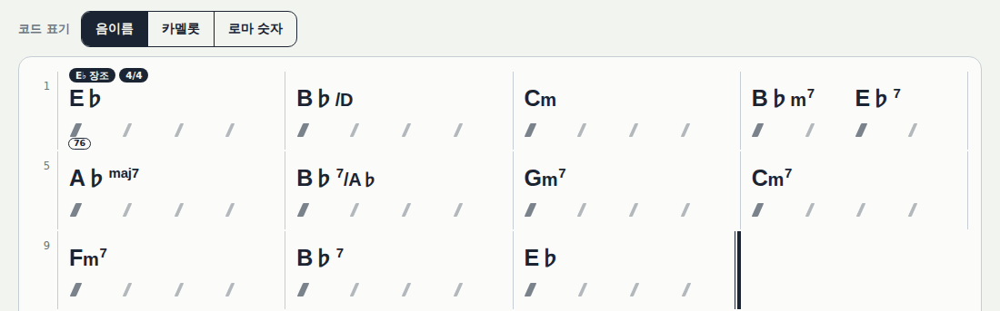
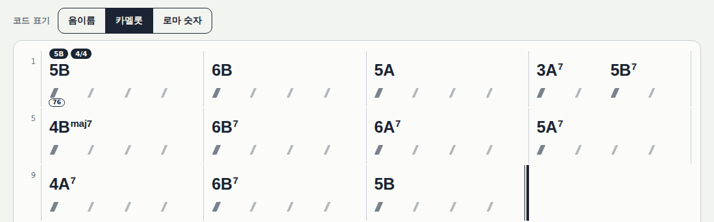
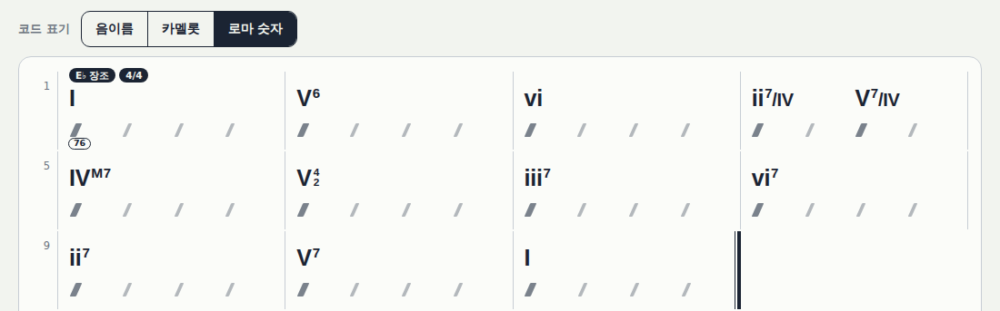
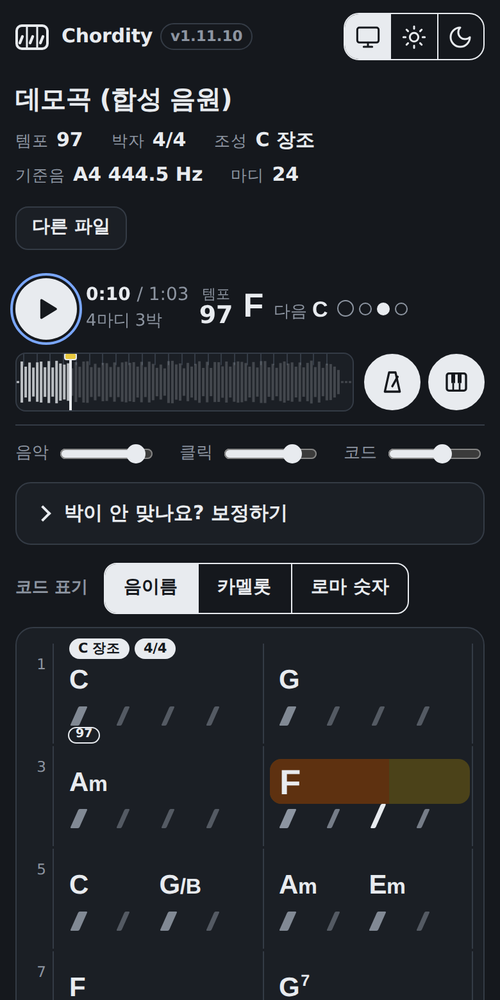
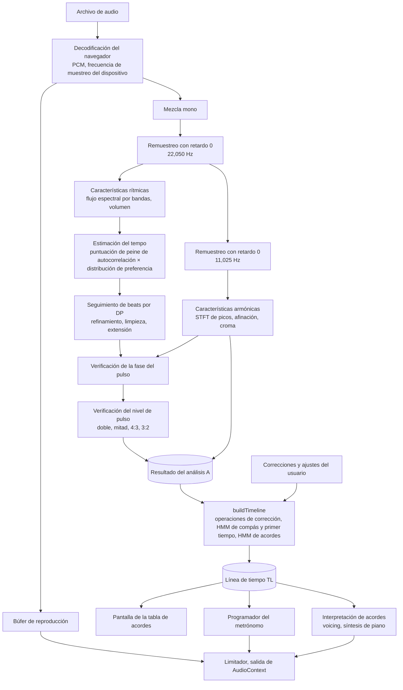
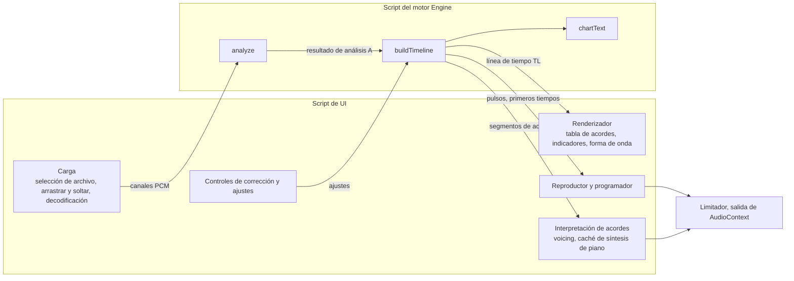
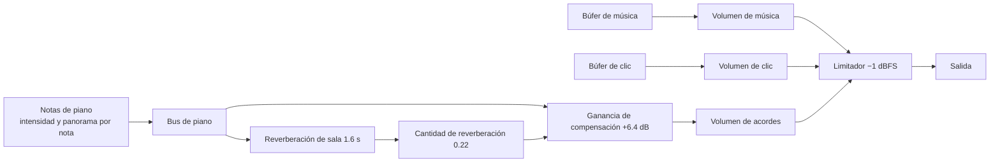

[한국어](README.md) · [English](README.en.md) · [日本語](README.ja.md) · [中文](README.zh.md) · [Français](README.fr.md) · **Español**

> Si usted ha colaborado o contribuido, o desea hacerlo, por favor póngase en contacto conmigo de forma personal. Este proyecto es software de código abierto que cualquiera puede usar de forma gratuita. Para fines personales y no comerciales puede usarlo tal cual sin coste alguno. Sin embargo, los derechos de autor y la propiedad pertenecen al autor original, a los colaboradores y a los contribuidores, por lo que no puede modificarlo ni extraer una parte para incluirla en su propio programa sin permiso del autor original (incluso si es solo para uso propio), ni presentar este programa como suyo, ni distribuirlo o venderlo en otro lugar. Tampoco se permite subir modificaciones a un fork de GitHub. El uso en organizaciones como escuelas, academias, clubes, iglesias, entidades religiosas o empresas no es gratuito sin más, así que póngase en contacto primero. Las condiciones detalladas están en [LICENSE](LICENSE).

# Chordity <sup>v1.11.10</sup>

**Chordity es una página web que, al cargar un archivo de una canción, anota los acordes de cada compás y toca un metrónomo perfectamente ajustado al pulso de la canción.**

En el momento en que cambia el acorde, un piano toca ese acorde, de modo que usted puede comprobarlo de oído mientras toca. No hace falta instalar nada, registrarse ni tener conexión a internet. Los archivos de música nunca salen de su ordenador.

Los resultados pueden ser incorrectos. Los principios del análisis, los fundamentos de sus decisiones y la manera de comprobar y corregir los resultados están recogidos en la [página de ayuda](information.html) (solo en coreano). También se abre pulsando el texto informativo que hay al final de la aplicación.

*Chordity: per-measure chord recognition, a beat-locked metronome and synthesized piano chord playback in a single offline HTML file. No libraries, no uploads.*


## Índice

- **[Parte 1. Introducción sencilla](#parte-1-introducción-sencilla)**
  - [Cuándo resulta útil](#cuándo-resulta-útil)
  - [Cómo se usa](#cómo-se-usa)
  - [Cómo leer la pantalla](#cómo-leer-la-pantalla)
  - [Si el metrónomo suena raro](#si-el-metrónomo-suena-raro)
  - [Ver los nombres de los acordes de otra manera](#ver-los-nombres-de-los-acordes-de-otra-manera)
    - [Nombres de notas](#ver-con-nombres-de-notas), [Camelot](#ver-con-camelot), [Números romanos](#ver-con-números-romanos)
  - [Escuchar los acordes en el piano](#escuchar-los-acordes-en-el-piano)
  - [Atajos de teclado](#atajos-de-teclado)
  - [Canciones que funcionan bien y canciones difíciles](#canciones-que-funcionan-bien-y-canciones-difíciles)
  - [Conviene saber](#conviene-saber)
- **[Parte 2. Principios](#parte-2-principios)**
  - [2-1. Convertir el sonido en una imagen](#2-1-convertir-el-sonido-en-una-imagen)
  - [2-2. Encontrar el pulso: la regularidad de los momentos en que algo empieza a sonar](#2-2-encontrar-el-pulso-la-regularidad-de-los-momentos-en-que-algo-empieza-a-sonar)
  - [2-3. Comprobar si es el pulso real](#2-3-comprobar-si-es-el-pulso-real)
  - [2-4. Dividir en compases](#2-4-dividir-en-compases)
  - [2-5. Averiguar los acordes](#2-5-averiguar-los-acordes)
  - [2-6. Las reglas de la música como probabilidades](#2-6-las-reglas-de-la-música-como-probabilidades)
  - [2-7. Un metrónomo que no se desfasa](#2-7-un-metrónomo-que-no-se-desfasa)
  - [2-8. Hacer sonar los acordes en el piano](#2-8-hacer-sonar-los-acordes-en-el-piano)
  - [2-9. Encontrar dónde cambia la tonalidad](#2-9-encontrar-dónde-cambia-la-tonalidad)
- **[Parte 3. Funcionamiento](#parte-3-funcionamiento)**
  - [3-1. Flujo general](#3-1-flujo-general)
  - [3-2. Carga y preprocesamiento](#3-2-carga-y-preprocesamiento)
  - [3-3. Características rítmicas](#3-3-características-rítmicas)
  - [3-4. Características armónicas](#3-4-características-armónicas)
  - [3-5. Tempo y beats](#3-5-tempo-y-beats)
  - [3-6. Compás (métrica), compases y acordes (etapa ligera)](#3-6-compás-métrica-compases-y-acordes-etapa-ligera)
  - [3-7. Reproducción y metrónomo](#3-7-reproducción-y-metrónomo)
  - [3-8. Qué hacen los botones de corrección](#3-8-qué-hacen-los-botones-de-corrección)
  - [3-9. Interpretación de acordes](#3-9-interpretación-de-acordes)
- **[Parte 4. En profundidad](#parte-4-en-profundidad)**
  - [4-1. Algoritmos y fórmulas](#4-1-algoritmos-y-fórmulas)
    - [(1) Remuestreo con retardo 0](#1-remuestreo-con-retardo-0), [(2) FFT real](#2-fft-real), [(3) Flujo espectral por bandas y envolvente de ataques](#3-flujo-espectral-por-bandas-y-envolvente-de-ataques), [(4) Estimación del tempo](#4-estimación-del-tempo), [(5) Seguimiento de beats por DP (Ellis, 2007)](#5-seguimiento-de-beats-por-dp-ellis-2007), [(6) Refinamiento de beats](#6-refinamiento-de-beats), [(7) Verificación de la fase del pulso](#7-verificación-de-la-fase-del-pulso), [(8) Verificación del nivel de pulso](#8-verificación-del-nivel-de-pulso), [(9) Determinación de la subdivisión del pulso](#9-determinación-de-la-subdivisión-del-pulso), [(10) Picos espectrales, afinación y croma](#10-picos-espectrales-afinación-y-croma), [(11) Agregación sincronizada con el pulso, suelo del bajo y tonalidad](#11-agregación-sincronizada-con-el-pulso-suelo-del-bajo-y-tonalidad), [(12) Plantillas de acordes y puntuación de emisión](#12-plantillas-de-acordes-y-puntuación-de-emisión), [(13) Viterbi de acordes: O(T·K)](#13-viterbi-de-acordes-otk), [(14) Evidencia del primer tiempo y HMM del compás](#14-evidencia-del-primer-tiempo-y-hmm-del-compás), [(15) Programación del metrónomo](#15-programación-del-metrónomo), [(16) Síntesis de piano](#16-síntesis-de-piano), [(17) Voicing y pulsación de teclas](#17-voicing-y-pulsación-de-teclas), [(18) Seguimiento de modulaciones](#18-seguimiento-de-modulaciones), [(19) Notación Camelot](#19-notación-camelot), [(20) Análisis armónico con números romanos](#20-análisis-armónico-con-números-romanos), [(21) Refuerzos por tipo de canción](#21-refuerzos-por-tipo-de-canción), [(22) Ligaduras y posición de los cambios](#22-ligaduras-y-posición-de-los-cambios)
  - [4-2. El mundo físico](#4-2-el-mundo-físico)
    - [Sonido, altura y temperamento igual](#sonido-altura-y-temperamento-igual), [Armónicos](#armónicos), [Bandas de frecuencia por instrumento](#bandas-de-frecuencia-por-instrumento), [El compromiso entre tiempo y frecuencia](#el-compromiso-entre-tiempo-y-frecuencia), [Muestreo y aliasing](#muestreo-y-aliasing), [Volumen, reverberación y logaritmos](#volumen-reverberación-y-logaritmos), [La percepción humana](#la-percepción-humana), [Las cuerdas del piano](#las-cuerdas-del-piano), [Retardo y distancia](#retardo-y-distancia)
  - [4-3. Arquitectura](#4-3-arquitectura)
    - [Composición](#composición), [Estructura del repositorio](#estructura-del-repositorio), [API del motor](#api-del-motor), [Los tres relojes](#los-tres-relojes), [Grafo de audio](#grafo-de-audio), [Guardado de ajustes](#guardado-de-la-configuración)
  - [4-4. Problemas y soluciones](#4-4-problemas-y-soluciones)
  - [4-5. Optimización](#4-5-optimización)
  - [4-6. Verificación](#4-6-verificación)
    - [Pruebas unitarias](#pruebas-unitarias), [Pruebas de regresión con canciones sintéticas](#pruebas-de-regresión-con-canciones-sintéticas), [Pruebas de modulación](#pruebas-de-modulación), [Pruebas de notación Camelot](#pruebas-de-notación-camelot), [Pruebas de números romanos](#pruebas-de-números-romanos), [Pruebas con grabaciones reales](#pruebas-con-grabaciones-reales), [Pruebas de extremo a extremo en un navegador real](#pruebas-de-extremo-a-extremo-en-un-navegador-real), [Pruebas de interpretación de acordes](#pruebas-de-reproducción-de-acordes), [Pruebas de ampliación de tipos de canción (1.5.0)](#pruebas-de-ampliación-de-tipos-de-canción-150), [Pruebas de cambios de compás y de indicación de tempo (1.6.0)](#pruebas-de-cambio-de-compás-y-visualización-del-tempo-160), [Pruebas de ligaduras y posición de los cambios (1.8.4)](#pruebas-de-ligado-y-posición-de-los-cambios-184)
  - [4-7. Puntos fuertes](#4-7-puntos-fuertes)
  - [4-8. Limitaciones y trabajo futuro](#4-8-limitaciones-y-próximos-pasos)
  - [4-9. Referencias](#4-9-referencias)
- **[Historial de cambios](#historial-de-cambios)**
  - [Reglas de versionado](#reglas-de-versión)
  - [Chordity 1.x](#chordity-1x)
    - [1.11.10](#11110-2026-10-21), [1.11.9](#1119-2026-10-18), [1.11.8](#1118-2026-10-18), [1.11.7](#1117-2026-10-15), [1.11.6](#1116-2026-10-14), [1.11.5](#1115-2026-10-14), [1.11.4](#1114-2026-10-14), [1.11.3](#1113-2026-10-14), [1.11.2](#1112-2026-10-13), [1.11.1](#1111-2026-10-13), [1.11.0](#1110-2026-10-13), [1.10.5](#1105-2026-10-11), [1.10.4](#1104-2026-10-11), [1.10.3](#1103-2026-10-11), [1.10.2](#1102-2026-10-11), [1.10.1](#1101-2026-10-11), [1.10.0](#1100-2026-10-11), [1.9.4](#194-2026-10-10), [1.9.3](#193-2026-10-10), [1.9.2](#192-2026-10-10), [1.9.1](#191-2026-09-30), [1.9.0](#190-2026-09-30), [1.8.4](#184-2026-09-30), [1.8.3](#183-2026-09-30), [1.8.2](#182-2026-09-30), [1.8.1](#181-2026-09-30), [1.8.0](#180-2026-09-30), [1.7.0](#170-2026-09-30), [1.6.0](#160-2026-09-30), [1.5.0](#150-2026-09-30), [1.4.2](#142-2026-09-27), [1.4.1](#141-2026-09-27), [1.4.0](#140-2026-09-26), [1.3.1](#131-2026-09-26), [1.3.0](#130-2026-09-26), [1.2.0](#120-2026-09-26), [1.1.1](#111-2026-09-26), [1.1.0](#110-2026-09-26), [1.0.0](#100-2026-09-26)
  - [Versiones de desarrollo 0.x (acordes por compás)](#versiones-de-desarrollo-0x-마디-코드)
    - [0.4.1](#041-2026-09-26), [0.4.0](#040-2026-09-25), [0.3.1](#031-2026-09-25), [0.3.0](#030-2026-09-25), [0.2.1](#021-2026-09-25), [0.2.0](#020-2026-09-25), [0.1.0](#010-2026-09-25)


---

## Parte 1. Introducción sencilla

### Cuándo resulta útil

- Cuando quiere tocar a la guitarra o al piano una canción que le gusta
- Cuando necesita averiguar los acordes de una canción y le cuesta encontrarlos uno a uno de oído
- Cuando quiere practicar el ritmo junto con la grabación original

### Cómo se usa

1. Abra el archivo `chordity.html` con un navegador como Chrome, Edge, Safari o Firefox.
2. Pulse **Abrir archivo** (“파일 열기”) o arrastre un archivo de música sobre la ventana. Tras unos segundos aparecerá la tabla de acordes.
3. Pulse el botón **Reproducir** (“재생”). Junto con la música, el metrónomo suena con un "tac" en cada pulso (en el primer tiempo del compás, un "tic" agudo; y si la unidad de cambio de acorde es de ½ pulso, también un pequeño "tic" entre pulsos), un recuadro de rotulador amarillo rodea el acorde que suena en ese momento y su nombre se agranda. El interior del recuadro se va llenando de naranja como una barra de progreso según avanza la reproducción, y cuando cambia el acorde el recuadro salta como un muelle hacia el siguiente. El piano toca el acorde en cada lugar donde la grabación original toca un acorde (vuelve a tocar cuando cambia el acorde o cuando se toca de nuevo el mismo acorde, y donde el acorde se mantiene sigue sonando).

Sirve cualquier archivo que el navegador pueda reproducir, como MP3, WAV, M4A, FLAC u OGG.

### Cómo leer la pantalla

| Lo que se ve | Significado |
|---|---|
| Recuadro de rotulador amarillo | El acorde que suena ahora. Abarca desde el pulso en que se tocó ese acorde hasta donde aparece el siguiente (si un acorde gris mantenido continúa en el compás siguiente, hasta allí; si cambia la línea, un fragmento por línea). Cuando cambia el acorde, salta como un muelle hacia el siguiente |
| Relleno naranja dentro del recuadro | Cuánto se ha tocado hasta ahora de ese acorde (barra de progreso). El extremo del relleno es la posición de reproducción actual y, al empezar un pulso, alcanza la barra diagonal de ese pulso |
| Nombre de acorde ampliado | El nombre del acorde que suena ahora (un acorde tocado de nuevo). Al entrar se agranda de golpe y, al pasar al siguiente acorde, vuelve despacio a su tamaño. Solo crece hasta donde no toca el nombre siguiente |
| Barra diagonal `/` | Un pulso. La barra que se oscurece es el pulso actual |
| Barra diagonal gruesa | Pulso en el que se toca un acorde nuevo (pulso donde hay un acorde en letra negra). Muestra con qué ritmo se tocan los acordes. En los acordes grises y en los lugares `N.C.` suele haber barras normales |
| `C` `Am` `G7` | Nombres de acordes. Si están justo encima de una barra diagonal, el acorde cambia en ese pulso |
| `G/B` | Acorde de G cuya nota más grave es B |
| Nombres de acordes en letra pequeña, colocados en dos líneas (arriba y abajo) | Si en un compás hay tantos acordes que un nombre toca al siguiente, se reduce la letra; si aun así no caben, los nombres de ese compás se alternan en dos líneas, arriba y abajo (el extremo izquierdo del nombre es el pulso en que se toca ese acorde). En pantallas estrechas, si el nombre largo del último pulso del compás no cabe ni en dos líneas, se quitan primero las partes menos importantes y se añade `…` (`Bm7/F♯` → `Bm7…`). El nombre completo se ve al pasar el ratón por encima o, durante la reproducción, en la casilla del acorde actual en la parte superior |
| Acorde gris | El acorde del compás anterior se mantiene sin volver a tocarlo. Aunque sea el mismo acorde, si se vuelve a tocar en el primer tiempo del compás, aparece en letra negra |
| `N.C.` | Parte sin acorde (cuando solo suena la batería o hay silencio) |
| Compás 0 | Parte en la que la canción empieza a mitad de compás (anacrusa) |
| Indicación como `2박` sobre el compás | Solo ese compás tiene un número de pulsos distinto (`박` = pulso) |
| Etiqueta negra `E 장조로` | La tonalidad cambia a partir de ese pulso (modulación). En la casilla de tonalidad de arriba también aparece como `E♭ 장조 → E 장조` (`장조` = mayor). En el primer compás de la canción se colocan la tonalidad y el compás iniciales sin partícula (`C 장조` `4/4`, como la armadura y el compás de una partitura); la partícula coreana 로/으로 significa “a” (“pasa a…”) |
| Etiqueta negra `3/4으로` | El compás (métrica) cambia a partir de ese compás (cambio de compás). En la casilla de compás de arriba también aparece como `4/4 → 3/4 → 4/4` |
| Píldora blanca `72` `132로` | El tempo desde ese pulso (BPM, redondeado), en la línea bajo las barras diagonales. En el pulso en que empieza la canción se muestra solo el número del tempo inicial; donde el tempo cambia de golpe, se añade `로/으로` (“a”) al nuevo tempo |
| Marco hexagonal blanco `여기까지 63` | Tramo en que el tempo cambia gradualmente (línea bajo las barras diagonales; `여기까지` = “hasta aquí”). La longitud que ocupa el marco es el tramo de cambio y, cuando la posición de reproducción está dentro del marco, se va llenando con el color del rotulador según avanza y muestra el tempo actual como `현재 67` (`현재` = “ahora”). Al llenarse por completo se desvanece a blanco y se enciende un momento la píldora blanca (el tempo de llegada) del pulso siguiente al final del marco |
| Tempo (casilla superior y barra de reproducción) | El tempo en la posición que se reproduce. Si el tempo cambia gradualmente, se mueve como 120, 119, 118 … La barra de reproducción queda fija en la parte superior de la pantalla aunque se desplace, y siempre está visible |
| Nombres como `8B`, `9A` con letras pequeñas | Nombres de acordes cuando se elige la notación Camelot (véase "Ver con Camelot" más abajo) |
| Números romanos como `I`, `vi`, `V7/ii` | Nombres de acordes cuando se elige la notación con números romanos (véase "Ver con números romanos" más abajo) |
| Indicadores circulares | En qué pulso se está ahora. El círculo más grande es el primer tiempo del compás |
| "Siguiente G" (“다음 G”) arriba | El acorde que viene a continuación |
| Botones de metrónomo (“메트로놈”) e interpretación de acordes (“코드 연주”) | Cada pulsación los activa o desactiva |
| Barras de música (“음악”), clic (“클릭”) y acordes (“코드”) | Ajustan por separado el volumen de la grabación original, del metrónomo y de los acordes del piano |

### Si el metrónomo suena raro

La mayoría de las veces se ajusta solo, pero según la canción cada persona puede contar el pulso de forma distinta. Abra **¿El pulso no encaja? Corregir** (“박이 안 맞나요? 보정하기”) y pruebe los botones siguientes. El cambio es inmediato.

| Si suena así | Pulse este botón |
|---|---|
| El clic se oye entre pulso y pulso | Desplazar ½ pulso (“½박 옮기기”) |
| El clic es demasiado denso | A la mitad ÷2 (“절반으로 ÷2”) |
| El clic es demasiado espaciado | El doble de rápido ×2 (“두 배 빠르게 ×2”) |
| La canción tiene sensación de 6/8 pero hay demasiados clics | Agrupar de tres en tres ÷3 (“셋씩 묶기 ÷3”) |
| El inicio del compás está desplazado un pulso | Adelantar un pulso (“한 박 앞당기기”), retrasar un pulso (“한 박 늦추기”) |
| El clic se siente ligeramente adelantado o retrasado | Sincronización del clic (“클릭 타이밍”) |
| Quiere devolver la corrección del pulso al estado inicial | Deshacer la corrección del pulso (“박 보정 되돌리기”) |
| Quiere devolver ajustes como el tipo de acorde al estado inicial | Restablecer ajustes (“설정 기본값으로”) |

Lo que tiene modificado en ese momento aparece en la misma sección, en **Aplicado** (“적용 중”), dividido en "corrección del pulso" (“박 보정”) y "ajustes" (“설정”). Aunque pliegue la sección, junto al título se ve un resumen.

Si quiere ver los acordes de forma más sencilla, elija "Básico" (“기본”) en **Tipo de acorde** (“코드 종류”); si quiere ver también los acordes que cambian dentro de un pulso, elija "Por ½ pulso" (“½박 단위”). En el modo por ½ pulso, el metrónomo también añade un pequeño "tic" agudo entre pulsos (en la posición de las corcheas), y toca así: "tic-tic-tac-tic-tac-tic-tac-tic".

### Ver los nombres de los acordes de otra manera

En la barra **Notación de acordes** (“코드 표기”), justo encima de la tabla, puede ver los mismos acordes de tres maneras. Al pulsar, cambian a la vez la tabla, los acordes actual y siguiente y la tabla de texto, y el modo elegido se conserva la próxima vez que abra la aplicación. Con el teclado, con el foco en la barra, se cambia con ← y →.

| Botón | Ejemplo | Útil cuando |
|---|---|---|
| Nombres de notas (“음이름”) | E♭, B♭/D, Cm7 | Quiere tocar directamente mirando los acordes o intercambiar acordes entre músicos |
| Camelot (“카멜롯”) | 5B, 6B, 3A⁷ | Busca tonalidades y acordes que combinen bien o elige puntos de mezcla como DJ |
| Números romanos (“로마 숫자”) | I, V⁶, ii⁷/IV | Analiza la progresión armónica de una canción o la transporta a otra tonalidad |

Las tres imágenes siguientes muestran los mismos 11 compases en E♭ mayor con cada modo.

#### Ver con nombres de notas



Son los nombres de acordes más habituales. La fundamental se escribe grande, las cualidades como m, sus o dim algo más pequeñas, y las extensiones como 7 o maj7 en superíndice, de modo que incluso los acordes complejos se leen de un vistazo.

- **Acordes con barra**: el `B♭/D` del segundo compás significa que se toca un acorde de B♭ con D como nota más grave. Los acordes con la séptima en el bajo, como el `B♭7/A♭` del sexto compás, también se escriben tal cual.
- **♯/♭ según la tonalidad**: una misma nota se escribe de acuerdo con la tonalidad de ese momento. Esta canción está en E♭ mayor, así que se escribe B♭ en lugar de A♯ y A♭ en lugar de G♯; si la canción modula a E mayor, a partir de ahí se escribe con ♯, como G♯m7.
- Los acordes mantenidos desde el compás anterior sin volver a tocarse se escriben en gris, y donde no hay acorde se escribe `N.C.`. Aunque sea el mismo acorde, si se vuelve a tocar en el primer tiempo del compás, se escribe en letra negra.

#### Ver con Camelot



Se escribe con los números de la rueda Camelot que usan los DJ para enlazar una canción con otra. Las tonalidades se colocan en las posiciones 1 a 12 en el orden del círculo de quintas, y se añade B a las mayores y A a las menores. Las tonalidades y acordes con el mismo número o con una diferencia de uno suenan bien juntos.

- **Cómo leer los acordes**: cada acorde se escribe con el número de la tonalidad que tiene la misma fundamental y el mismo carácter (mayor o menor), y el tipo de acorde se añade en letra pequeña. E♭ es 5B, Cm es 5A y B♭7 es 6B con un pequeño 7.
- **Los acordes ajenos a la tonalidad se ven de un vistazo**: la tonalidad de esta canción es E♭ mayor (5B), por lo que la mayoría de los acordes se concentran entre 4 y 6. Solo el `3A⁷` (B♭m7) del cuarto compás tiene un número alejado, porque es un acorde prestado momentáneamente para ir a A♭maj7 (4B), el IV.
- La tonalidad de la canción también se muestra junto con su número, como `E♭ 장조(5B)` (`장조` = mayor).
- Camelot no tiene forma de indicar la nota del bajo, así que se omite el bajo de los acordes con barra (`B♭/D` → `6B`). La interpretación de acordes sí toca la nota del bajo tal cual.

#### Ver con números romanos



Es el análisis armónico con números romanos que se usa en los libros de armonía. En lugar del nombre de las notas, cada acorde se escribe según **sobre qué grado de la tonalidad se construye**, lo que revela el esqueleto sobre el que se mueve la canción. Como la misma progresión se ve con los mismos números aunque cambie la tonalidad, resulta cómodo para transportar a otra tonalidad o comparar las progresiones de varias canciones.

- **El recorrido de la imagen**: los tres primeros compases, `I – V⁶ – vi`, son una progresión en la que el bajo desciende nota a nota, E♭ → D → C. Los siguientes, `ii⁷/IV – V⁷/IV – IVᴹ⁷`, toman prestado momentáneamente el ii–V de A♭ mayor para ir al IV (A♭maj7), y el final `ii⁷ – V⁷ – I` es la cadencia más básica.
- **Cifras de inversión**: el `V⁶` del segundo compás es un acorde con la tercera (D) en el bajo, y el `V⁴₂` del sexto compás, con la séptima (A♭) en el bajo.

| Notación | Significado |
|---|---|
| I, IV, V (mayúsculas) | Acordes de la familia de la tríada mayor. El número indica sobre qué grado de la tonalidad se construye el acorde |
| i, ii, vi (minúsculas) | Acordes de la familia de la tríada menor |
| °, ø, +, M | Acorde disminuido (°), semidisminuido (ø), aumentado (+), séptima mayor (M7) |
| 7 | Acorde de séptima |
| 6, ⁶₄ | Inversiones de la tríada. 6 si el bajo es la tercera, ⁶₄ si es la quinta |
| ⁶₅, ⁴₃, ⁴₂ | Inversiones del acorde de séptima. Cuando el bajo es la tercera, la quinta o la séptima |
| V/x, vii°/x, ii/x | Acorde usado momentáneamente para ir a x (dominante secundaria y similares). V7/vi es la séptima de dominante que va a vi |
| ♭VI, ♭VII, etc. | Grados fuera de la escala de la tonalidad. Por ejemplo, acordes tomados del modo menor con la misma tónica (acordes prestados) |

- Los números se cuentan respecto a la tonalidad de ese momento. Después de una modulación se vuelve a contar en la nueva tonalidad.
- Si justo antes de una modulación aparece la dominante de la nueva tonalidad, se escribe como V respecto a la nueva tonalidad (por ejemplo, B7 justo antes de pasar a E mayor es V7).
- Si se desactiva la notación de bajo, se escribe en estado fundamental, sin cifras de inversión.

### Escuchar los acordes en el piano

Si deja activada la **interpretación de acordes** (“코드 연주”), el piano toca el acorde en el momento en que cambia. Al escucharlo superpuesto a la grabación original, puede comprobar de oído al instante si el acorde escrito es correcto, y además le sirve de guía cuando toca. El piano se ajusta automáticamente a la afinación de la canción, así que no desentona con la grabación original.

- El volumen de la música, del clic y de los acordes se ajusta por separado con las tres barras de la parte superior.
- En **Corregir** (“보정하기”), dentro de **Interpretación de acordes**, puede elegir cuándo se toca: siguiendo la canción (“곡 따라”; predeterminado, vuelve a tocar solo donde la grabación original toca de nuevo), cuando cambia el acorde (“코드가 바뀔 때”), de nuevo en cada compás (“마디마다 다시”) o en cada pulso (“박마다”).
- Para desactivarla, pulse el botón **Interpretación de acordes** o la tecla P.

### Atajos de teclado

| Tecla | Función |
|---|---|
| Space | Reproducir, pausar |
| M | Activar o desactivar el metrónomo |
| P | Activar o desactivar la interpretación de acordes |
| ← → | Compás anterior, compás siguiente |
| Home | Ir al principio |

Al pulsar un compás se salta a ese compás, y pulsando o arrastrando sobre la forma de onda de arriba también se va al lugar deseado. Los atajos funcionan incluso con el teclado en modo de entrada coreana.

### Canciones que funcionan bien y canciones difíciles

Funcionan bien las canciones con un pulso claro, como pop, rock, baladas, dance, hip hop, K-pop o pop acústico con batería. También reconoce canciones con grandes cambios de tempo a mitad, compases irregulares como 5/4 o 7/4, acordes cuyo bajo es una nota ajena al acorde como F/G, y los power chords del rock (E5). Puede equivocarse en canciones con muchas tensiones y walking bass como el jazz, en canciones que se sienten en unidades de dos pulsos como la bossa nova (los compases se escriben con el doble de longitud), en metal con una distorsión muy fuerte y en canciones en las que el pulso puede contarse de dos maneras, como el reggae. En esos casos, use los botones de corrección de arriba.

### Conviene saber

- Los archivos no se envían por internet. Todo el análisis se hace dentro del navegador.
- Al pulsar el texto informativo de la parte inferior de la pantalla se abre en una pestaña nueva la [ayuda](information.html) (solo en coreano), que recoge los casos en que el resultado puede ser incorrecto, cómo comprobarlo, los principios del análisis y los resultados de verificación.
- Ajustes como el metrónomo, la interpretación de acordes, el volumen, el tipo de acorde y el modo de notación se guardan en el navegador y se mantienen la próxima vez.
- Aunque use auriculares Bluetooth, la música, el clic y el piano llegan con el mismo retraso, así que no se desfasan entre sí.
- Si en el iPhone no sale sonido, compruebe si está activado el modo silencio.

<p align="center"></p>

---

<p align="right"><a href="#목차">↑ Volver al índice</a></p>

## Parte 2. Principios

Este programa no usa modelos de inteligencia artificial preentrenados. Funciona con **procesamiento de señales** y **modelos probabilísticos** que traducen a fórmulas las propiedades físicas del sonido y las reglas de la música. Por eso es posible explicar uno a uno los fundamentos de cada decisión, y puede verlos directamente en **Información del análisis** (“분석 정보”), en la parte inferior de la pantalla.

### 2-1. Convertir el sonido en una imagen

El sonido es una vibración del aire, y un archivo de grabación es una serie de números que miden esa vibración decenas de miles de veces por segundo. Como solo con los números es difícil saber qué notas suenan, el sonido se corta en fragmentos muy cortos y en cada uno se calcula **cuánto hay de cada altura de sonido** (el espectro). Si se colocan en orden temporal, se obtiene una imagen del sonido (espectrograma) con el tiempo en horizontal y la altura en vertical. Todo el análisis posterior consiste en leer esta imagen.

Aquí hay un compromiso inevitable. Si los fragmentos son cortos, se sabe con precisión **cuándo** sonó algo, pero **qué nota** era se vuelve borroso; si son largos, ocurre lo contrario. Por eso se usan fragmentos cortos para encontrar el pulso y fragmentos largos para encontrar los acordes. Las notas más graves del bajo necesitan los fragmentos más largos, porque la diferencia de frecuencia entre semitonos es muy pequeña.

### 2-2. Encontrar el pulso: la regularidad de los momentos en que algo empieza a sonar

Cuando se golpea un tambor o se pulsa una tecla, la energía sonora aumenta de repente en ese instante. Estos momentos se llaman **ataques** (onsets). Si en el espectrograma se suman solo las partes que han crecido respecto al instante anterior, se obtiene una curva que se dispara en cada ataque.

El pulso es el **esqueleto en el que estos ataques se repiten a intervalos regulares**. Primero se desplaza la curva en el tiempo y se superpone consigo misma (autocorrelación) para encontrar el intervalo en el que mejor coincide, es decir, el tempo. Después se busca de una sola vez, a lo largo de toda la canción, la fila de pulsos que "pasa por el mayor número posible de ataques fuertes sin que el intervalo se aleje mucho del tempo" (programación dinámica). Como no se decide cada pulso por separado, sino que se optimiza todo a la vez, la fila no se rompe aunque haya algunos pulsos débiles, y sigue al intérprete aunque el tempo oscile un poco. Aquí el criterio de "intervalo regular" no es el tempo de toda la canción, sino un **tempo local** calculado en ventanas de unos segundos. Así no se deja arrastrar por lugares donde el ritmo se complica un momento, como un fill, y aun así sigue a la canción cuando de verdad se ralentiza o se acelera.

### 2-3. Comprobar si es el pulso real

Encontrar una fila regular no es el final. Hay dos errores frecuentes.

**Tomar el contratiempo como pulso.** Si el hi-hat llena con fuerza el espacio entre pulsos, la fila puede quedar desplazada medio pulso. Pero la música tiene reglas: los momentos en que entran el bombo, la caja y el bajo, y los momentos en que cambia el acorde, se concentran en su mayoría **en el pulso**. Por eso se compara la intensidad de estos sucesos en las posiciones de pulso encontradas y en las desplazadas medio pulso, y si las desplazadas son claramente más fuertes, se desplaza toda la fila medio pulso.

**Tomar el tempo al doble o a la mitad.** En una balada lenta con arpegios densos de corcheas, es fácil confundir cada corchea con un pulso. En ese caso se dividen los pulsos en dos grupos alternos. Si en los pulsos reales caen el bombo y la caja y entre ellos solo hay sonido de teclado, un grupo sale mucho más fuerte que el otro. Entonces se descarta el grupo débil y se corrige el tempo a la mitad. Al revés, si cae una caja con regularidad justo en medio de cada par de pulsos, el tempo se ha tomado demasiado lento y se duplica. Duplicar se hace solo con condiciones mucho más estrictas, porque si es un error aparece enseguida un clic a contratiempo.

En grabaciones reales, el hi-hat y el teclado pueden llenar el contratiempo, de modo que la diferencia de intensidad entre los dos grupos salga pequeña. Por eso se mira también **en qué grupo caen el bombo y la caja**. Con el tempo correcto, el bombo (pulsos 1 y 3) y la caja (pulsos 2 y 4) caen en grupos distintos; si se tomó el doble, ambos caen en el mismo grupo (los pulsos reales). Al corregir el tempo a la mitad, no se descarta un beat de cada dos, sino que se vuelve a rastrear desde el principio con el nuevo tempo. Si el rastreo a nivel de corchea se desliza una sola posición en algún punto de la canción, todos los beats filtrados a partir de ahí quedarían desplazados medio pulso.

**Dos formas de tomar a la mitad una canción rápida.** En canciones rápidas de unos 160–180 BPM es fácil tomar el pulso un nivel más lento, es decir, a la mitad del tempo. La forma cambia según dónde se asiente ese pulso lento. Si se asienta en la caja (pulsos 2 y 4), la caja cae de manera uniforme sobre cada pulso y el bombo cae entre pulsos. En una canción lenta con el tempo correcto, el bombo cae sobre el pulso (1 y 3) y la caja uno sí y otro no, así que esta forma no aparece. Si el pulso lento se asienta en el bombo (sensación de half-time), entre pulsos cae tanta caja como sobre ellos. En ambos casos solo se duplica cuando la estimación de tempo propone el doble del tempo como candidato con casi la misma fuerza. Si se deja el pulso lento asentado en la caja, el primer tiempo del compás también queda desplazado, se mezclan dos acordes en un pulso y aparecen muchos acordes de séptima y acordes con barra.

La reducción a la mitad también se comprueba una vez más. Si se tomaron las corcheas como pulsos, el punto medio entre pulsos es una posición de semicorchea, donde los golpes graves como el bombo o el bajo son raros. Por eso, si entre pulsos también caen graves con frecuencia, se considera que el pulso es el correcto y no se reduce. Cuando se intenta reducir solo por la diferencia de intensidad entre los grupos par e impar, si la caja se concentra en el grupo opuesto al del bombo (backbeat), el pulso también es el correcto y no se reduce.

La manera de reconocer la "caja" es física. Cuando vibra la bordonera bajo la caja, se produce un ruido que crece **a la vez** desde las alturas medias hasta las muy agudas. Las notas de un teclado crecen solo en algunas alturas, y el hi-hat solo en las agudas. Por eso, si se mide "¿han crecido a la vez lo medio y lo agudo?" como el producto de dos valores, se puede aislar solo la caja, porque basta que uno de los dos sea pequeño para que el producto sea pequeño.

### 2-4. Dividir en compases

Para agrupar los pulsos en compases hay que saber dónde está **el primer tiempo del compás**. El primer tiempo deja huellas: cambia el acorde, cambia la nota del bajo, el bombo entra con fuerza y a veces el sonido sube. Se puntúan estas huellas en cada pulso y se busca la agrupación con mayor puntuación respetando la regla de que "los compases suelen repetirse con la misma longitud". Con este mismo método se decide si encajan mejor con las huellas 4 pulsos o 3. Si la sensación de que un pulso se divide en tres es fuerte, se considera un compás compuesto como 6/8 o 12/8.

En canciones en las que la batería toca un backbeat, el patrón par/impar de **bombo en 1 y 3, caja en 2 y 4** también se usa como huella del primer tiempo. En riffs sincopados en los que el acorde cambia una corchea antes del primer tiempo del compás, la huella del cambio de acorde se ve arrastrada un pulso hacia delante, pero como el patrón par/impar de la batería no cambia, el compás no se desplaza un pulso. Además, los compases de 3, 5 y 7 pulsos solo se eligen cuando la huella del primer tiempo se repite realmente con esa longitud. Así se evita que, en canciones cortas, unas pocas huellas grandes y escasas hagan que parezca un compás de 7.

### 2-5. Averiguar los acordes

Las mismas notas en octavas distintas (un do grave y un do agudo) cumplen el mismo papel en un acorde. Por eso, si todas las notas se pliegan en **12 casillas** —do, do♯, re … si—, se obtiene una huella de las notas que suenan en ese momento (croma). En un acorde de C destacan las casillas de do, mi y sol.

Los instrumentos reales no producen una sola nota. Al tocar un do suenan a la vez **armónicos** como el do una octava más arriba, el sol por encima, otra vez do, mi… Por ejemplo, los armónicos del mi de un acorde de C llenan la casilla de si, y una comparación que no tenga en cuenta los armónicos confunde C con Cmaj7. Por eso las huellas de los acordes se preparan incluyendo también los armónicos y se comparan así.

El bajo (la nota más grave) se analiza por separado. Si el acorde es C pero el bajo es mi, se escribe `C/E`.

Cada grabación tiene una nota de referencia ligeramente distinta. Hay muchas canciones en las que el la no está exactamente en 440 Hz. Por eso primero se mide cuánto más altas o bajas están de media las notas de toda la canción, se corrige esa diferencia y después se colocan en las 12 casillas.

### 2-6. Las reglas de la música como probabilidades

Si solo se elige en cada pulso el acorde más parecido, las notas de paso de la melodía hacen que el acorde cambie en cada pulso como si parpadeara. Por eso se introducen como probabilidades dos ideas de sentido común: **los acordes no cambian a menudo** y, **si cambian, lo hacen sobre todo en el primer tiempo del compás y rara vez entre pulsos**. Teniendo en cuenta a la vez estas reglas y el parecido del sonido, se elige de una vez la secuencia de acordes más plausible para toda la canción (modelo oculto de Márkov y algoritmo de Viterbi). También se estima la tonalidad de la canción y se da una pequeña bonificación a los acordes que encajan con ella.

### 2-7. Un metrónomo que no se desfasa

Este metrónomo no toca a intervalos fijos como "97 tictacs por minuto", sino **en el instante de cada pulso encontrado**. Por eso sigue al intérprete aunque acelere o frene un poco.

La sincronización también es precisa. Si se lanza el clic con un temporizador que diga "¡toca ahora!", cuando el ordenador está ocupado se retrasa decenas de ms. Por eso el clic se programa con 0,2 segundos de antelación en el **reloj del dispositivo de audio** que reproduce la música. Como la música y el clic usan el mismo reloj y la misma ruta de salida, encajan al nivel de una sola muestra, e incluso en dispositivos con salida retrasada ambos salen con el mismo retraso y no se desfasan entre sí.

### 2-8. Hacer sonar los acordes en el piano

Incluir sonidos de piano grabados haría el archivo grande y requeriría archivos externos. Por eso el sonido del piano se **genera directamente a partir de las leyes físicas**. Una cuerda de piano no es una cuerda ideal, sino un alambre de acero rígido, así que sus armónicos suenan un poco más altos que los múltiplos enteros exactos (inarmonicidad). El martillo golpea a aproximadamente 1/7 de la longitud de la cuerda, por lo que los armónicos que no se mueven en ese punto suenan débiles. Cada nota la producen dos o tres cuerdas juntas y, como sus afinaciones difieren muy ligeramente, el sonido ondula despacio (batimientos) y aparece un decaimiento en dos fases: primero cae rápido y luego permanece largo tiempo. Cuanto más altos son los armónicos, antes desaparecen, de modo que el sonido se va suavizando. Estas propiedades se acumulan en fórmulas para sintetizar cada nota.

El acorde se toca dividido en una nota de bajo con la mano izquierda y la armonía con la mano derecha. Para la mano derecha se elige la inversión que menos mueve la mano respecto al acorde anterior, de modo que el sonido no da saltos aunque cambie el acorde. El piano se afina según la nota de referencia de la canción encontrada en el análisis y se programa en el mismo reloj de audio que el metrónomo, de modo que suena exactamente en el momento en que cambia el acorde.

### 2-9. Encontrar dónde cambia la tonalidad

La tonalidad de una canción se revela en "qué notas se usan principalmente". Una canción en E♭ mayor usa sobre todo E♭, F, G, A♭, B♭, C y D, y si pasa a E mayor usa E, F♯, G♯, A, B, C♯ y D♯. Por eso, en cada beat se compara la distribución de notas de unos compases antes y después con las distribuciones típicas de las 24 tonalidades y, añadiendo como probabilidad la regla de que **la tonalidad no cambia a menudo**, se busca el recorrido tonal más plausible para toda la canción. Los acordes de otra tonalidad que pasan durante uno o dos compases (por ejemplo, E7 → Am en una canción en C mayor) no se cuentan como modulación. Tampoco se cuentan los movimientos entre las tonalidades relativas mayor y menor que usan las mismas notas (C mayor y A menor), porque la armadura no cambia.

La posición de la modulación se afina al nivel del pulso. Si se pasa a través de la dominante de la nueva tonalidad (por ejemplo, B7 en E mayor), siguiendo la convención de cambiar la armadura en la partitura, se toma como posición de la modulación el lugar donde aparece el nuevo acorde de tónica. La escritura con ♯/♭ de los nombres de acordes también sigue la tonalidad de ese lugar. En el tramo en E mayor se escribe G♯m7, no A♭m7.

---

<p align="right"><a href="#목차">↑ Volver al índice</a></p>

## Parte 3. Funcionamiento

### 3-1. Flujo general



El análisis se divide en una **etapa pesada** y una **etapa ligera**.

- La **etapa pesada** `analyze()` se ejecuta una sola vez al abrir el archivo. Hace todo el procesamiento de señal y el seguimiento automático de beats. Suele tardar unos segundos y cede el control a la pantalla cada 32 ms para que el indicador de progreso no se congele.
- La **etapa ligera** `buildTimeline()` se ejecuta cada vez que se cambia un botón de corrección o un ajuste. Recalcula el compás, los compases y los acordes, y como incluso una canción de 5 minutos tarda unos 40 ms, el cambio se refleja en cuanto se pulsa.

### 3-2. Carga y preprocesamiento

1. El decodificador integrado del navegador descomprime el archivo a PCM. Este único búfer se usa **tanto para la reproducción como para el análisis**. Si se decodificara por separado o se pasara por el remuestreador del navegador, los ejes temporales de ambos resultados podrían desfasarse varios ms.
2. Se promedian los canales para obtener una señal mono y, con un remuestreador implementado a mano, se generan señales a 22,050 Hz (para el ritmo) y 11,025 Hz (para la armonía). Como el núcleo del filtro es simétrico, la señal no se desplaza ni una muestra.
3. Se normaliza la amplitud máxima a 1.

### 3-3. Características rítmicas

| Etapa | Qué hace | Valores principales |
|---|---|---|
| Transformada de Fourier de tiempo corto | Convierte la señal de 22,050 Hz en un espectro por fragmento | Ventana de 1024 puntos (46.4 ms), salto de 256 puntos (11.6 ms, 86.13 fotogramas por segundo) |
| Compresión logarítmica | Hace visibles también los cambios de sonidos suaves | log(1 + 1000·\|X\|) |
| Filtro de máximo | Compara con el espectro de dos fotogramas atrás ensanchado ±1 casilla en frecuencia | No confunde vibratos ni deslizamientos de altura con ataques |
| Flujo por bandas | Promedia por bandas solo el aumento | Graves 21–200 Hz (bombo, bajo), medios 200–2,500 Hz (cuerpo de la caja, teclados), agudos 2.5–10 kHz (hi-hat, bordonera de la caja) |
| Envolvente de ataques | Divide cada banda por su desviación típica y las suma | Los agudos con la mitad de peso (reduce la influencia del hi-hat a contratiempo) |
| Volumen | RMS por fotograma | Se usa para determinar los tramos con sonido y para mostrar la forma de onda |

### 3-4. Características armónicas

| Etapa | Qué hace | Valores principales |
|---|---|---|
| STFT de picos de agudos | Picos espectrales para las notas del acorde | Ventana de 2048 puntos (186 ms), 110–4,200 Hz, máximo 36 por fotograma |
| STFT de picos de bajos | Para la nota del bajo y la afinación | Ventana de 4096 puntos (372 ms), 32–1,400 Hz, máximo 24 por fotograma |
| Condiciones de pico | Solo picos bien definidos | −45 dB o más respecto al máximo del fotograma, al menos el doble de la media de ±6 casillas alrededor |
| Interpolación parabólica logarítmica | Frecuencia y magnitud con más precisión que la separación entre casillas | Usa la magnitud logarítmica del pico y de las casillas vecinas |
| Estimación de la nota de referencia | Promedia sobre un círculo la "parte fraccionaria en semitonos" de todos los picos | Ej.: +18 cent → A4 = 444.6 Hz |
| Croma | Acumula las alturas corregidas en 12 casillas | Mayor peso cuanto más cerca del centro del semitono (cos²). Agudos MIDI 48–96, bajos 28–57 |
| Curva de cambio armónico | Distancia coseno entre los cromas de 4 fotogramas antes y después | Se usa en la verificación de la fase del pulso |

### 3-5. Tempo y beats

1. **Tramos con sonido**: se consideran sonido los tramos a −38 dB o más respecto al volumen alto de la canción (el 5 % superior).
2. **Tempo**: se normaliza la curva de ataques dividiéndola por el volumen medio de ±3 segundos y se calcula la autocorrelación. Se recorre de 40 a 240 BPM en pasos de 0.25 BPM, se multiplica la puntuación de peine, que mira a la vez los intervalos de 1, 2, 3 y 4 veces, por una distribución de preferencia centrada en 110 BPM, y se interpola parabólicamente alrededor del máximo.
3. **Seguimiento de beats por DP**: se usa el método de Ellis (2007) con dos cambios. El intervalo se compara con una curva de tempo local obtenida con ventanas de 8 segundos (mediana de 7 segundos para filtrar los fills), y la intensidad de la penalización se hace proporcional al cuadrado del periodo del pulso, de modo que incluso en canciones lentas la misma oscilación en ms recibe la misma penalización.
4. **Refinamiento**: cada beat se mueve al pico de ataque dentro de ±2 fotogramas (±23 ms) y se interpola parabólicamente. Los beats con ataque débil se completan con una regresión lineal de los beats vecinos. Por último, se compensa un retardo de detección de 6.5 ms.
5. **Limpieza**: se eliminan los beats fuera de los tramos con sonido y se añaden por delante y por detrás beats con el mismo intervalo para cubrir todo el tramo con sonido.
6. **Verificación**: se hacen por orden la verificación de la fase del pulso y la del nivel de pulso (principios de 2-3). Si el nivel de pulso se corrige a la mitad, se repiten los pasos 3 a 5 con el nuevo tempo y se vuelve a verificar la fase. Si el pulso parece dividirse en tres, también se comprueban un tempo 4/3 veces más lento y uno 3/2 veces más rápido (1.11.5 y 1.11.6, (9) de 4-1).

### 3-6. Compás (métrica), compases y acordes (etapa ligera)

1. **Aplicación de las operaciones de corrección**: las operaciones ½ pulso, ×2, ÷2 y ÷3 que haya pulsado el usuario se aplican a la lista de beats en el orden en que se pulsaron. En ÷2 y ÷3, qué pulsos se conservan se decide según el acento del pulso.
2. **Agregación por pulso**: el croma del tramo de cada pulso se promedia dando más peso al centro. Al croma del bajo se le resta la mitad de la mediana de toda la canción, para eliminar componentes siempre presentes como un bombo con altura definida.
3. **Tonalidad y modulación**: en cada beat se compara la distribución de notas de ±6 pulsos alrededor con los perfiles tonales de Krumhansl–Kessler, y se dividen los tramos de tonalidad con un HMM cuyos estados son las 12 armaduras. Los tramos de menos de 24 pulsos se absorben en los vecinos. Si no hay modulación, se usa una única tonalidad elegida con la distribución de toda la canción. Una vez reconocidos los acordes, se vuelve a decidir la tonalidad de cada tramo a partir de los acordes. Junto con la distribución de notas se tienen en cuenta en qué escala tonal encajan los acordes, el tiempo que ocupa el acorde de tónica, las cadencias V → I, el primer y el último acorde, y los acordes del primer tiempo de las frases de 4 compases.
4. **Acordes preliminares**: se resuelve una vez, rápidamente, solo con tríadas mayores y menores, y se usa como evidencia del primer tiempo.
5. **Determinación de la subdivisión**: se compara la intensidad de ataque en el punto 1/2 del pulso y en los puntos 1/3 y 2/3 para ver si el compás es compuesto.
6. **HMM del primer tiempo**: elige automáticamente el compás (4 pulsos frente a 3; si es compuesto, 4 frente a 2) y refleja el desplazamiento del primer tiempo hecho por el usuario.
7. **HMM final de acordes**: se resuelve con Viterbi por unidades de 1 pulso o de ½ pulso, con hasta 289 estados incluidas las inversiones.
8. **Construcción de compases**: se divide en compases en cada primer tiempo y se añaden a la vez la posición y duración de los cambios de acorde dentro del compás, si continúa desde el compás anterior, el nombre de nota adecuado a la tonalidad de ese lugar (♯ o ♭), el código Camelot y el número romano. La pantalla muestra el que se haya elegido en la barra de notación de acordes sobre la tabla, y al cambiar de notación no se vuelve a analizar. Los límites de modulación se afinan al nivel del pulso con una ligera preferencia por el primer tiempo del compás (si pasan por la dominante, en el lugar del acorde de tónica), y se registra en qué compás y en qué pulso caen.

### 3-7. Reproducción y metrónomo

- **Música**: `AudioBufferSourceNode` se inicia 60 ms después del instante de audio actual.
- **Programador**: se despierta cada 25 ms y programa en el reloj de audio los clics de los beats que llegarán en los próximos 0,2 segundos. Si la pestaña está en segundo plano, el navegador ralentiza los temporizadores, así que se programa hasta 1,5 segundos por delante.
- **Sonido del clic**: es un sonido corto preparado de antemano (primer tiempo 1,850 Hz, resto 1,250 Hz, y en el modo por ½ pulso 2,600 Hz entre pulsos). Suena desde la primera muestra, así que no hay retardo de emisión.
- **Resincronización**: al mover la posición o cambiar una corrección o un ajuste, se cancelan todos los clics programados y se vuelven a programar desde el beat siguiente a la posición actual.
- **Pantalla**: en cada fotograma se calcula la posición de reproducción, restando la latencia de salida que informa el navegador para ajustarse al momento en que realmente se oye. La pantalla solo se actualiza cuando cambian el compás, el pulso o el acorde.

### 3-8. Qué hacen los botones de corrección

| Botón | Operación interna | Comportamiento |
|---|---|---|
| Desplazar ½ pulso (“½박 옮기기”) | `half` | Crea una nueva lista de beats con los puntos medios entre beats vecinos y los vuelve a ajustar a los picos de ataque. Descarta los pulsos que quedan antes del inicio de la música |
| El doble de rápido ×2 (“두 배 빠르게 ×2”) | `x2` | Añade un punto medio entre cada par de beats |
| A la mitad ÷2 (“절반으로 ÷2”), agrupar de tres en tres ÷3 (“셋씩 묶기 ÷3”) | `d2`, `d3` | Conserva uno de cada 2 (3). La posición conservada es la que tiene mayor suma de acentos |
| Adelantar un pulso (“한 박 앞당기기”), retrasar (“늦추기”) | `downShift` ∓1 | Rota una posición el número de posición dentro del compás |
| Compás (“박자”) | `meter` | Vuelve a resolver el HMM del primer tiempo con el número de pulsos indicado |

Las correcciones se guardan como un **registro de operaciones** sobre la lista de beats y se vuelven a aplicar en orden desde el principio cada vez. "Deshacer la corrección del pulso" (“박 보정 되돌리기”) vacía este registro. El tipo de acorde, el modo de interpretación de acordes, el acento del primer tiempo, el desplazamiento automático y la sincronización del clic son **ajustes** que se guardan en el navegador, no en la canción, así que se restablecen por separado con "Restablecer ajustes" (“설정 기본값으로”). En "Aplicado" (“적용 중”) solo aparecen, de ambos tipos, los que difieren de los valores predeterminados.

### 3-9. Interpretación de acordes

| Etapa | Qué hace |
|---|---|
| Tramos de acordes | Para cada evento de acorde del compás, el motor entrega las notas que lo forman (0 = C) junto con la nota de bajo que hay que tocar. Si se desactiva la notación con barra, el bajo es la fundamental. |
| Lista de pulsaciones | Se construye según cuándo se toca. "Siguiendo la canción" (“곡 따라”) toca donde cambia el acorde y, aunque sea el mismo acorde, en el primer tiempo de los compases donde la grabación original vuelve a tocarlo (letra negra en la tabla), y donde se mantiene (gris) sigue sonando. "Cuando cambia el acorde" (“코드가 바뀔 때”) toca una sola vez el mismo acorde que continúa a través de compases, "de nuevo en cada compás" (“마디마다 다시”) vuelve a tocar en el primer tiempo del compás y "en cada pulso" (“박마다”) toca en todos los pulsos. En N.C. no se toca y el acorde anterior también se detiene. |
| Voicing | El bajo va de D2 a C♯3; para la mano derecha se colocan todas las notas del acorde en posición cerrada, eligiendo la inversión más cercana al centro de la disposición anterior. |
| Síntesis y caché | Las notas usadas en la canción se sintetizan de antemano una a una en el orden en que aparecen (una vez por nota). Si cambia la nota de referencia de la canción, se vuelven a generar. |
| Programación | El mismo programador que el metrónomo programa en el reloj de audio las pulsaciones de los próximos 0,2 segundos. No se aplica la corrección de sincronización del clic; se toca con el instante exacto de la música. |
| Final del sonido | En el instante en que termina el tramo del acorde (la siguiente pulsación o un N.C.), el sonido se apaga con una constante de tiempo de 70 ms, como si bajara el apagador. |
| Reinicio | Si se reproduce o se salta a mitad de un acorde, el acorde en curso suena inmediatamente una vez. |
| Mezcla | La música, el clic y los acordes tienen volúmenes independientes; al piano se le añade un poco de reverberación de sala de 1,6 segundos y después una ganancia de compensación fija (+6.4 dB). Los tres sonidos pasan justo antes de la salida por un limitador (−1 dBFS) y se mezclan sin saturación. |

El metrónomo y la interpretación de acordes también se resincronizan por separado. Aunque se apague y encienda el metrónomo o se cambie la sincronización del clic, el acorde de piano que está sonando no se corta.

---

<p align="right"><a href="#목차">↑ Volver al índice</a></p>

## Parte 4. En profundidad

### 4-1. Algoritmos y fórmulas

**Símbolos**

| Símbolo | Significado |
|---|---|
| $F = 22050/256 \approx 86.13$ | Tasa de fotogramas rítmicos (fotogramas/segundo) |
| $X(t,k)$ | Valor de la STFT en el fotograma $t$ y la casilla de frecuencia $k$ |
| $\tau$ | Periodo del pulso (en fotogramas) |
| $b_i$ | Instante del $i$-ésimo beat (segundos) |
| $m$ | Número de nota MIDI (real); se distingue del número de pulsos por compás por el contexto |

#### (1) Remuestreo con retardo 0

Si se simplifica la razón entre las frecuencias de muestreo de salida y entrada por su máximo común divisor y se escribe $L/D = f_\text{out}/f_\text{in}$ , la posición de entrada de la $n$-ésima muestra de salida es $nD/L = i_n + \phi_n$ ( $i_n$ parte entera, $\phi_n$ parte fraccionaria).

```math
y[n] = \sum_{j=0}^{2W-1} x[\,i_n - W + 1 + j\,]\; h(\phi_n + W - 1 - j)
```

```math
h(u) = 2f_c\,\mathrm{sinc}(2f_c u)\,w\!\left(\frac{u}{W+1}\right),\qquad
w(r) = 0.42 + 0.5\cos\,\pi r + 0.08\cos\, 2\pi r
```

```math
f_c = 0.46\,\min\!\left(1, \frac{f_\text{out}}{f_\text{in}}\right),\qquad W = \left\lceil \frac{10}{2f_c} \right\rceil
```

Como $h$ es una función par (simétrica), la fase es 0, es decir, el retardo es 0. La fase $\phi_n$ se precalcula en una tabla de hasta 4,096 pasos, y la posición de entrada se actualiza con un acumulador entero ( $D = qL + r$ ), de modo que no se acumulan errores de coma flotante.

#### (2) FFT real

Una señal real de $N$ puntos se calcula con una sola FFT compleja de $N/2$ puntos. Si $z[m] = x[2m] + i\,x[2m+1]$ y $Z = \mathrm{FFT}_{N/2}(z)$ , entonces

```math
X[k] = \underbrace{\tfrac12\left(Z[k] + \overline{Z[N/2-k]}\right)}_{F_e[k]}
     + e^{-2\pi i k/N}\,\underbrace{\tfrac{-i}{2}\left(Z[k] - \overline{Z[N/2-k]}\right)}_{F_o[k]},\qquad 0 \le k \le N/2
```

Los índices de $Z$ se consideran periódicos de periodo $N/2$ ( $Z[N/2] = Z[0]$ ).

#### (3) Flujo espectral por bandas y envolvente de ataques

```math
Y(t,k) = \ln\!\left(1 + \lambda \cdot \tfrac{4}{N}\,|X(t,k)|\right),\qquad \lambda = 1000
```

```math
\Delta(t,k) = \max\!\Big(0,\; Y(t,k) - \max_{|\nu|\le 1} Y(t-2,\,k+\nu)\Big)
```

```math
f_b(t-1) = \frac{1}{|B_b|}\sum_{k \in B_b} \Delta(t,k),\qquad b \in \{\text{low}, \text{mid}, \text{high}\}
```

Se registra en $t-1$ , el punto medio entre los dos fotogramas comparados ( $t$ , $t-2$ ). La envolvente de ataques para el seguimiento de beats es la siguiente.

```math
O(t) = \frac{f_\text{low}(t)}{\sigma_\text{low}} + \frac{f_\text{mid}(t)}{\sigma_\text{mid}} + \frac12\,\frac{f_\text{high}(t)}{\sigma_\text{high}}
```

#### (4) Estimación del tempo

Se normaliza con el volumen de una ventana de ±3 segundos y se resta la media.

```math
E(t) = \frac{O(t)}{\sqrt{\frac{1}{|W_t|}\sum_{s \in W_t} O(s)^2} + \epsilon} - \bar E,\qquad W_t = [\,t - 3F,\ t + 3F\,]
```

La autocorrelación se divide por la longitud de solapamiento, se normaliza por $r(0)$ y se suaviza con $[\tfrac14, \tfrac12, \tfrac14]$ para obtener $\tilde r$ .

```math
r(\ell) = \frac{1}{n-\ell}\sum_{t=0}^{n-\ell-1} E(t)\,E(t+\ell)
```

Para cada candidato de BPM $v$ se miran a la vez los retardos de 1 a 4 veces el periodo del pulso $\tau_v = 60F/v$ .

```math
J(v) = \pi(v)\cdot\max\!\Big(0,\ \sum_{k=1}^{4} c_k \max_{|\delta| \le \delta_k} \tilde r(k\tau_v + \delta)\Big),\qquad c = \left(1, \tfrac12, 0.33, \tfrac14\right)
```

```math
\pi(v) = \exp\!\left(-\frac12 \log_2^2\, \frac{v}{110}\right),\qquad
\delta_1 = 0.5,\quad \delta_{k\ge 2} = 0.5 + 0.004\,k\tau_v
```

Se recorre $v \in [40, 240]$ en pasos de 0.25 y se obtiene un BPM con decimales mediante interpolación parabólica de tres puntos en el máximo.

#### (5) Seguimiento de beats por DP (Ellis, 2007)

La puntuación local, obtenida suavizando los ataques con una gaussiana de ancho $\sigma = \tau/32$ , y la puntuación acumulada son las siguientes.

```math
\ell(t) = \frac{1}{\sigma_O}\sum_{i} O(t+i)\,e^{-\frac12\left(\frac{32 i}{\tau}\right)^2}
```

```math
C(t) = \ell(t) + \max_{\tau(t)/2 \,\le\, d \,\le\, 2\tau(t)}\Big[\,C(t-d) - \alpha \ln^2\,\frac{d}{\tau(t)}\,\Big],\qquad \alpha = \mathrm{clip}\!\left(2000\,T^2,\ 100,\ 1600\right)
```

$T = \tau/F$ es el periodo del pulso (en segundos). Como $\alpha\ln^2(d/\tau) \approx 2000\,(\Delta t)^2$ ( $\Delta t$ son los segundos de desviación del intervalo), la penalización se basa en el **tiempo absoluto**, independientemente del tempo. El valor fijo de 100 del método original se basa en porcentajes, así que en canciones lentas el mismo porcentaje equivalía a muchos más ms y el pulso se dejaba arrastrar por las síncopas.

El periodo local del pulso $\tau(t)$ se obtiene de la autocorrelación $r_w$ en ventanas de 8 segundos (cada 1 segundo); con la mediana de 7 ventanas se filtran oscilaciones momentáneas como los fills y después se interpola linealmente para cada fotograma.

```math
\tau_w = \arg\max_{\ell \in [0.85\tau,\ 1.15\tau]} \Big( r_w(\ell) + \tfrac12\, r_w(2\ell) \Big),\qquad
\tau(t) = \mathrm{clip}\!\Big(\mathrm{interp}_t\big(\mathrm{median}_{7}\,\tau_w\big),\ 0.85\tau,\ 1.15\tau\Big)
```

El punto de partida del retroceso es el último de los máximos locales de $C$ que supera la mitad de su mediana. Al principio y al final del camino se recortan los beats cuya puntuación local suavizada no llega a la mitad del RMS global.

**Retícula de la introducción (1.10.4).** En introducciones con pocos instrumentos, los acentos anticipados al final del compás (bajo y platillo en la corchea posterior al cuarto pulso) son mucho más fuertes que los ataques entre pulsos, y la programación dinámica puede tomarlos como pulsos y derivar hacia un pulso unos pocos % más lento que el del cuerpo de la canción, de modo que las líneas divisorias queden desplazadas aproximadamente medio pulso. Por eso, dentro de los primeros 48 pulsos de la canción, si la retícula que se obtiene prolongando hacia atrás, con periodo constante, los 8 pulsos siguientes a un pulso dado se separa más de un cuarto de pulso de los pulsos actuales, se comparan ambas retículas. El criterio es cuánto encajan los ataques desde el primer sonido hasta ese pulso con las posiciones de corchea (tanto en el pulso como a contratiempo), y solo si la retícula prolongada hacia atrás es mejor por más de 0.15 (media ponderada por ataques, gaussiana de 30 ms de ancho) se sustituyen los pulsos de la introducción por esa retícula. En ese caso, las líneas divisorias también se prolongan hacia atrás con la fase del cuerpo de la canción. Si la introducción tiene de verdad otro tempo o un tempo libre, los pulsos originales encajan mejor con los ataques y se dejan como están. La introducción de 「マリーゴールド」 (desde el primer sonido a 0.55 s hasta la entrada de la banda a 7.34 s) se detectaba con un intervalo de 0.596 s, como una anacrusa de 3 pulsos + líneas divisorias en 2.55 y 4.94 s, y pasó a tres compases completos con intervalo de 0.566 s (0.55, 2.82 y 5.08 s). Estas líneas divisorias coinciden con un margen de 5 ms con los puntos en que se repite el riff de la introducción cada 2.26 s (4 pulsos). De las 1000 canciones de GTZAN, esta regla solo actuó en una canción de reggae, y la puntuación no cambió.

**Desfase local en la introducción (1.11.7).** Incluso en canciones hechas con tempo fijo, si empiezan sin batería, con piano por ejemplo, las notas anticipadas una semicorchea en la introducción pueden ser más fuertes que los ataques entre pulsos, y la programación dinámica puede tomarlas como pulsos. En ese caso el número total de pulsos de la introducción es correcto, así que no se cumple la condición anterior de "separarse más de un cuarto de pulso", pero los pulsos quedan adelantados aproximadamente 1/4 de pulso durante casi toda la introducción, los intervalos son irregulares y los tramos de acordes también se desfasan. Por eso, si a partir de un pulso los 8 pulsos siguientes tienen un tempo uniforme (intervalos dentro de ±3 % del periodo) y, al prolongar esa retícula hacia atrás con periodo constante, alguno de los pulsos actuales se aleja más de 0.15 pulsos, se comparan ambas retículas según cuánto encajan los ataques de la introducción con las posiciones de semicorchea. Solo se sustituyen los pulsos de la introducción por esa retícula cuando la retícula prolongada encaja mejor y hay indicios de que la canción se hizo con tempo fijo (30 o más picos de ataque en la introducción, ajuste a semicorcheas de la retícula prolongada de 0.85 o más).

#### (6) Refinamiento de beats

Se interpola parabólicamente en el máximo de ataque $j$ dentro de $\pm 2$ fotogramas.

```math
\hat t = j + \frac12\cdot\frac{O(j-1) - O(j+1)}{O(j-1) - 2O(j) + O(j+1)},\qquad b = \frac{\hat t}{F} + t_\text{cal},\quad t_\text{cal} = 6.5\ \text{ms}
```

Para los beats cuya intensidad es menor que 0.35 veces la mediana, la posición se fija mediante una regresión lineal de los 4 vecinos a cada lado con pesos $1/(1+|j-i|)$ . Si el tramo con sonido es $[t_s, t_e]$ y el intervalo entre pulsos es $p$ , los beats se recortan a $[\,t_s - p/4,\ t_e + p/4\,]$ y se añaden beats con el mismo intervalo por delante mientras $b_0 - p \ge \max(0, t_s - p/4)$ y por detrás mientras $b_\text{last} + p \le t_e - p/2$ .

#### (7) Verificación de la fase del pulso

La curva de cambio armónico $\nu$ se construye con el croma $\hat c$ comprimido con raíz cuadrada y normalizado en L2.

```math
\nu(t) = \left(1 - \cos\!\Big(\sum_{d=0}^{3}\hat c_{t+d},\ \sum_{d=1}^{4}\hat c_{t-d}\Big)\right)\cdot \min\!\left(1, \sqrt{\frac{\min(e_t, e_{t-1})}{e_{70\%}}}\right)
```

La curva de acento del pulso es la suma ponderada de cuatro curvas normalizadas por su media $\mu$ en los tramos con sonido.

```math
S(t) = 1.0\,\frac{f_\text{low}}{\mu_\text{low}} + 0.7\,\frac{f_\text{mid}}{\mu_\text{mid}} + 0.2\,\frac{f_\text{high}}{\mu_\text{high}} + 0.8\,\frac{\nu}{\mu_\nu}
```

```math
\text{on} = \frac1N\sum_i \max_{|\delta|\le 2} S(b_i + \delta),\qquad
\text{off} = \frac1N\sum_i \max_{|\delta|\le 2} S\!\left(\tfrac{b_i + b_{i+1}}{2} + \delta\right)
```

Si $\text{off} > 1.1\cdot\text{on}$ , todos los beats se desplazan medio pulso (cuando hay 8 beats o más).

#### (8) Verificación del nivel de pulso

Se definen la curva de bombo $K$ y la curva de caja $S_n$ . $S_n$ es la media geométrica de los medios y los agudos, así que solo crece **cuando ambas bandas suben a la vez**.

```math
K(t) = \frac{f_\text{low}(t)}{\sigma_\text{low}},\qquad
S_n(t) = \sqrt{\frac{f_\text{mid}(t)}{\sigma_\text{mid}}\cdot\frac{f_\text{high}(t)}{\sigma_\text{high}}}
```

Para cada beat se calcula $p_i = K + S_n + \tfrac12 S$ (máximo en ±2 fotogramas) y se mira la razón entre las medias de los beats pares e impares.

```math
r_2 = \frac{\max(\bar p_\text{even}, \bar p_\text{odd})}{\min(\bar p_\text{even}, \bar p_\text{odd})}
```

| Corrección | Condición | Acción |
|---|---|---|
| A la mitad | ( $r_2 \ge 2.4$ y $s_{S_n} > -0.1$ , o sesgo del mismo lado) y $\kappa \ge 2$, BPM ≥ 110, BPM/2 ≥ 55 | Se rastrea de nuevo desde el principio con periodo de pulso $2\tau$ |
| Al doble | BPM ≤ 100, 2·BPM ≤ 210, $\sigma \ge 1.3$, $\kappa \ge 2$ | Se añaden puntos medios y se ajustan a los ataques |
| Al doble (tipo contratiempo) | BPM ≤ 100, 2·BPM ≤ 200, $c_2 \ge 0.8$, $\sigma \le 0.8$, $\kappa \le 0.95$, $\lvert d_{S_n}\rvert \le 0.25$ | Igual |
| Al doble (tipo half-time) | BPM ≤ 100, 2·BPM ≤ 210, $c_2 \ge 0.85$, $\sigma \ge 0.9$, $1 \le \kappa \le 10$ | Igual |

```math
\sigma = \frac{\sum S_n(\text{mid})}{\sum S_n(\text{beat})},\qquad
\kappa = \frac{\sum K(\text{beat})}{\sum K(\text{mid})},\qquad
d_{S_n} = \frac{S_{n,\text{even}} - S_{n,\text{odd}}}{S_{n,\text{even}} + S_{n,\text{odd}}}
```

mid es el punto medio entre beats, y $c_2$ es la puntuación del candidato de tempo que es el doble (±8 %) del tempo actual dividida por la puntuación del primero. El tipo contratiempo es el caso en que el pulso lento se asienta en la caja, de modo que sobre el pulso la caja cae uniformemente en cada pulso ( $d_{S_n} \approx 0$ ) y entre pulsos cae el bombo; el tipo half-time es el caso en que sobre el pulso cae el bombo y entre pulsos también cae la caja. El $\kappa \le 10$ del tipo half-time sirve para excluir canciones de piano sin batería, en las que casi no hay golpes graves entre pulsos. En la corrección a la mitad, $\kappa \ge 2$ comprueba si el espacio entre beats es una posición de semicorchea (donde los golpes graves son raros), y $s_{S_n} > -0.1$ comprueba que no se trata de un backbeat (1.10.0).

El **sesgo del mismo lado** es el sesgo medido tomando como + el lado de los beats pares o impares donde el bombo es más fuerte.

```math
s_X = \mathrm{sgn}(K_\text{even} - K_\text{odd})\cdot\frac{X_\text{even} - X_\text{odd}}{X_\text{even} + X_\text{odd}},\qquad
\text{same side} \iff s_K \ge 0.15\ \land\ s_{S_n} \ge 0.15\ \land\ s_\nu > 0\ \land\ r_2 \ge 1.3
```

Con el pulso correcto, el backbeat hace que la caja caiga en el lado opuesto al bombo, así que $s_{S_n} < 0$ (−0.28 a −0.61 en canciones sintéticas); si se tomó el doble, ambos caen en el lado del pulso real, así que $s_{S_n} > 0$ .

La corrección al doble es mucho más estricta porque el riesgo es asimétrico. Reducir a la mitad por error solo hace que los clics sean más espaciados, pero duplicar por error convierte todos los clics añadidos en contratiempos.

#### (9) Determinación de la subdivisión del pulso

Con el perfil $P(\varphi)$ , que promedia el máximo de ataque en cada fase al dividir el tramo del beat en 24 partes iguales,

```math
\text{triple} \iff \min\!\big(P(\tfrac13), P(\tfrac23)\big) > 1.15\,P(\tfrac12)\ \ \land\ \ \tfrac12\big(P(\tfrac13) + P(\tfrac23)\big) > 1.1\,\mathrm{median}(P)
```

**Comprobación del nivel de pulso 4:3 (1.11.5).** En canciones lentas en 4/4 con semicorcheas densas, parece que los ataques se repiten cada tres semicorcheas (corchea con puntillo), y por la distribución de preferencia de tempo (centrada en 110 BPM) puede elegirse 4/3 del tempo real (por ejemplo, 92 BPM para 69 BPM) y escribirse como 12/8 con cada pulso dividido en tres. Si la determinación de la subdivisión da división ternaria, se vuelven a rastrear los beats con el tempo $b'$ que tiene la mayor puntuación de peine $C$ antes de multiplicar por la distribución de preferencia, cerca (±4 %) de 3/4 del tempo $b$ de los beats actuales, y solo se cambia si se cumplen todas las condiciones siguientes.

```math
\frac{C(b')}{C(b)} \ge 0.93,\qquad
\frac{C(b')\,\pi(b')}{C(b)\,\pi(b)} \ge 0.85,\qquad
\frac{P'(\tfrac12)}{\tfrac12\big(P'(\tfrac13) + P'(\tfrac23)\big)} \ge 1.4,\qquad
G = \rho(8) + \rho(16) - \rho(12) - \rho(24) \ge 0,\qquad
\pi(x) = e^{-\frac12\log_2^2(x/110)}
```

La primera condición significa que, sin la distribución de preferencia, el tempo lento explica la periodicidad de los ataques casi igual o mejor que el tempo actual; la segunda, que incluso en la estimación inicial de tempo multiplicada por la distribución de preferencia ambos candidatos casi empatan. $P'$ es el perfil de subdivisión medido con los nuevos beats, y el nuevo pulso debe dividirse claramente en dos corcheas, no en tresillo. $\rho(L)$ es la autocorrelación con retardo $L$ de la serie de cambios armónicos construida con la distancia entre los cromas de agudos y bajos de 4 casillas antes y después, sobre la retícula (semicorcheas) que divide en tres el pulso actual; por tanto $G$ es positivo si la armonía cambia cada 8 o 16 casillas (medio compás o un compás de 4/4) y negativo si cambia cada 6 o 12 casillas (medio compás o un compás de 12/8), porque entonces se repite con retardos 12 y 24. El nuevo tempo debe estar entre 50 y 140 BPM. Si los beats rastreados de nuevo siguen solo al bombo y se pegan al contratiempo (la caja en el punto medio entre pulsos es más fuerte que sobre el pulso y el bombo es más fuerte sobre el pulso: $S_n(\text{beat})/S_n(\text{mid}) < 0.9$ y $K(\text{beat})/K(\text{mid}) > 1$), se desplazan medio pulso. Al principio solo existía la primera condición, pero empeoraron 8 canciones con acompañamiento de guitarra y canciones muy rápidas, así que se fueron añadiendo la tercera y la segunda condición para acotarla; la cuarta es un margen de seguridad que no reduce las canciones que cambian (verificación de 1.11.5 en 4-6).

**Comprobación del nivel de pulso 3:2 (1.11.6).** A la inversa, en canciones con corcheas que fluyen de manera uniforme (acompañamiento de guitarra sola, rock de 8 tiempos, etc.), parece que los acentos se repiten cada tres corcheas (negra con puntillo), y pueden tomarse a 2/3 del tempo real y escribirse como 12/8 o 6/8. En las canciones que no se cambiaron con la comprobación 4:3, se vuelve a rastrear con el tempo $b''$ que tiene la mayor $C$ cerca (±4 %) de 3/2 del tempo actual $b$ , y solo se cambia si se cumplen todas las condiciones siguientes.

```math
\frac{C(b'')}{C(b)} \ge 0.93,\qquad
\frac{P''(\tfrac12)}{\tfrac12\big(P''(\tfrac13) + P''(\tfrac23)\big)} \ge 1.4,\qquad
G \ge 0.05,\qquad
\frac{\bar S(\text{beat})}{\bar S(\text{mid})} \ge 1.05,\qquad
90 \le b'' \le 240
```

$G$ es el mismo indicador que en la comprobación 4:3 (aquí las casillas que dividen en tres el pulso actual son corcheas, así que es positivo si la armonía cambia cada 8 o 16 casillas, es decir, cada uno o dos compases de 4/4). La cuarta condición exige que el acento $S$ en las posiciones de los beats rastreados de nuevo sea más de un 5 % más fuerte que en el punto medio entre beats, lo que filtra los casos en que el tempo es correcto pero los beats se han pegado al contratiempo. La regla de desplazamiento de medio pulso es la misma que en la comprobación 4:3. Los casos en que el nuevo tempo es más lento que 90 BPM (tempo actual menor de 60 BPM) no se consideran, porque en su mayoría son baladas lentas reales en tresillos. Al principio se empezó con la condición de rango y la de $G$, pero había 22 canciones que empeoraban frente a 26 que mejoraban, así que se fueron añadiendo las condiciones de razón de puntuaciones, razón de acentos y división en corcheas hasta que no empeoró ninguna; además, apareció una canción en la que empeoró el mayor/menor en la puntuación de acordes, y el límite inferior de tempo se subió a 90 BPM (verificación de 1.11.6 en 4-6).

#### (10) Picos espectrales, afinación y croma

Con las magnitudes logarítmicas $L_-, L_0, L_+ = \ln|X(k-1)|, \ln|X(k)|, \ln|X(k+1)|$ ,

```math
\delta = \frac12\cdot\frac{L_- - L_+}{L_- - 2L_0 + L_+},\qquad
\hat f = (k + \delta)\frac{f_s}{N},\qquad
\hat A = \frac{4}{N}\exp\!\left(L_0 - \tfrac14(L_- - L_+)\,\delta\right),\qquad
m = 69 + 12\log_2\,\frac{\hat f}{440}
```

La desviación de la nota de referencia (en semitonos) es la media circular de las partes fraccionarias $d_j = m_j - \mathrm{round}(m_j)$ (picos MIDI 40–90 de la STFT de bajos, pesos $\sqrt{A_j}$ ).

```math
\theta = \frac{1}{2\pi}\mathrm{atan2}\!\Big(\sum_j \sqrt{A_j}\sin\, 2\pi d_j,\ \sum_j \sqrt{A_j}\cos\, 2\pi d_j\Big),\qquad
A4 = 440 \cdot 2^{\theta/12}\ \text{Hz}
```

El croma se acumula con la altura corregida $\tilde m = m - \theta$ . $w(\cdot)$ es la ventana de registro de agudos y de bajos, respectivamente.

```math
C(t, q) = \sum_{j:\ \mathrm{round}(\tilde m_j) \bmod 12 = q} A_j\, w(\tilde m_j)\, \cos^2\!\big(\pi(\tilde m_j - \mathrm{round}(\tilde m_j))\big)
```

#### (11) Agregación sincronizada con el pulso, suelo del bajo y tonalidad

Los fotogramas del tramo del pulso $[t_0, t_1)$ se promedian con peso en el centro.

```math
\bar C(q) = \frac{\sum_j \omega_j\,C(j, q)}{\sum_j \omega_j},\qquad \omega_j = 0.1 + \sin(\pi u_j),\quad u_j = \frac{j h - t_0}{t_1 - t_0}
```

La eliminación de los componentes permanentes del croma del bajo y la estimación de la tonalidad son las siguientes. $\vec{K}_\text{mode}$ son los perfiles mayor y menor de Krumhansl–Kessler, y $\mathrm{rot}_t$ es la rotación a la tónica $t$ .

```math
B'_s(q) = \max\!\Big(0,\ B_s(q) - \tfrac12\mathrm{median}_i B_i(q)\Big)
```

```math
(\hat t, \widehat{\text{mode}}) = \arg\max_{t,\ \text{mode}}\ \mathrm{corr}\!\big(\vec{h},\ \mathrm{rot}_t(\vec{K}_\text{mode})\big),\qquad
h_q = \sum_i \sqrt{\frac{T_i(q)}{\sum_{q'} T_i(q')}} + \frac12\sqrt{\frac{B_i(q)}{\sum_{q'} B_i(q')}}
```

#### (12) Plantillas de acordes y puntuación de emisión

Con desplazamientos de armónicos $d = (0, 12, 19, 24, 28, 31)$ semitonos y pesos $0.6^{h-1}$ , se suman las notas del acorde y una fuga del bajo ( $\rho = 0.25$ ).

```math
\tilde T(q) = \sum_{p \in \text{chord}}\ \sum_{h=1}^{6} 0.6^{h-1}\,[\,q \equiv p + d_h\,] \;+\; \rho\sum_{h=1}^{6} 0.6^{h-1}\,[\,q \equiv p_\text{bass} + d_h\,]\pmod{12}
```

```math
T = \frac{(\tilde T/\max\tilde T)^{\gamma}}{\left\|(\tilde T/\max\tilde T)^{\gamma}\right\|_2},\qquad \gamma = 0.45
```

La observación $o_s$ también se construye a partir del croma de agudos de la misma manera (normalización por el máximo, potencia $\gamma$ , normalización L2). La puntuación de emisión del acorde $c$ es la siguiente.

```math
e_s(c) = \beta\,\langle o_s, T_c\rangle + \pi_q + \pi_\text{inv} + \kappa\,[\,c \subset \text{key}\,]
+ \eta\,g_s\Big(\ln\big(0.06 + \hat b_s(p_\text{bass})\big) - \ln\big(0.06 + \tfrac{1}{12}\big)\Big)
```

$\beta = 30$, $\kappa = 0.6$, $\eta = 1.5$ ; $\hat b_s$ es el croma del bajo con suma 1, y $g_s = \min\!\big(1, E^\text{bass}_s / (0.5\,E^\text{bass}_{60\%})\big)$ es un coeficiente que reduce el término del bajo cuando el bajo es débil. La puntuación de ausencia de acorde (N) es mayor cuanto más plano es el croma y cuanto más bajo es el sonido.

```math
e_s(\mathrm{N}) = \beta\left(\frac{1}{\sqrt{12}}\sum_q o_s(q) - 0.12\right) + Q_s,\qquad
Q_s = \begin{cases} 12 & r_s < 0.02 \\ 6\,(0.08 - r_s)/0.06 & r_s < 0.08 \\ 0 & \text{otherwise}\end{cases}
```

$r_s$ es la energía de agudos de la ranura dividida por el percentil 60 global. La puntuación a priori $\pi_q$ y la puntuación a priori de inversión $\pi_\text{inv}$ son las siguientes.

| Cualidad | maj | min | 7 | maj7 | m7 | sus4 | sus2 | dim | aug | m7♭5 | dim7 |
|---|---|---|---|---|---|---|---|---|---|---|---|
| $\pi_q$ | 0 | 0 | −0.4 | −0.6 | −0.4 | −1.2 | −1.4 | −1.3 | −1.8 | −1.2 | −1.6 |

| Bajo | Fundamental | Tercera | Quinta | Séptima |
|---|---|---|---|---|
| $\pi_\text{inv}$ | 0 | −0.7 | −1.0 | −1.0 |

Las inversiones solo se contemplan en maj, min, 7, maj7 y m7. El número de estados por vocabulario es 73 en el básico, 241 en el estándar y 289 en el ampliado (incluido N).

**Atenuar la melodía vocal (1.11.0).** La principal causa de errores en los acordes es que la melodía vocal se mezcla en la banda armónica y se lee como un acorde vecino con muchas notas comunes (C ↔ Am, G7 ↔ Gm7, etc.). En las grabaciones de música popular la voz suele estar en el centro y el acompañamiento repartido a izquierda y derecha, así que en la señal lateral $S = (L - R)/2$ , obtenida restando el canal derecho del izquierdo, la voz casi desaparece y queda el acompañamiento. Por eso se construye un croma de agudos adicional con la señal lateral y se suma al croma de agudos de la decisión final de acordes ($C_\text{treble} = C_M + C_S$). Como el bajo también está en el centro y en la señal lateral faltan los armónicos de la nota del bajo, se recuperan con la mitad de peso los componentes agudos de las notas fuertes del croma del bajo del tramo. Este croma mezclado solo se usa para elegir la fundamental y la rama mayor/menor; si la fundamental y la rama elegidas coinciden con el acorde leído con el croma sin mezclar, para los nombres de séptima e inversión se usa el croma sin mezclar. No se mezcla en la estimación del pulso, el primer tiempo, el compás ni la tonalidad. En archivos mono o con dos canales casi iguales (energía lateral/central por debajo de −30 dB) no se genera la señal lateral, así que el resultado no cambia. En archivos estéreo aumenta el tiempo de análisis.

**Alineación de repeticiones (1.11.0).** En las canciones populares se repite la misma progresión de acordes, como en la primera y segunda estrofa y el estribillo, y en cada repetición solo cambian la melodía y los fills. Para cada pulso se mide la similitud dentro de la canción con los vectores unitarios de croma de agudos y bajos, y cuando la diagonal promediada en ventanas de 8 pulsos (la misma posición a 16 pulsos o más de distancia) supera el 3 % superior de la canción, el lugar que mejor coincide se toma como "pareja de repetición" de ese pulso (solo parejas con la misma posición del pulso dentro del compás, hasta 6 por pulso). En canciones cuyo último estribillo sube un semitono o un tono, también se compara transportando según la diferencia de tonalidad. Antes del Viterbi final de acordes, la puntuación de acordes de cada pulso se promedia ponderadamente con las de sus parejas (el propio 1, cada pareja 0.7 × similitud), pero de las parejas solo se toma prestada la puntuación máxima por fundamental, y la cualidad (mayor, menor, 7, sus…) se decide con el propio sonido de ese pulso. Así, otras repeticiones corrigen los pulsos que se inclinaron hacia un acorde vecino por culpa de una melodía puntual, sin arrastrar la cualidad de acordes que se tocaron de forma diferente. Como la tabla de similitudes tiene un tamaño del cuadrado del número de pulsos, no se usa con entradas muy largas de más de 3,000 ranuras.

**Nombre del semidisminuido (1.11.1).** El vocabulario estándar no incluye m7♭5 (si se incluye, cambian los m7 y dim de otras canciones y el conjunto empeora), así que los acordes semidisminuidos (ii°7 en menor, vii°7 en mayor) se escribían como dim. Una vez decididos los acordes y la tonalidad, en cada tramo escrito como dim, si la séptima menor (fundamental + 10 semitonos) del croma de agudos sin mezclar es al menos 0.5 veces la media de las notas de la tríada, solo se cambia el nombre a m7♭5. La fundamental, la rama mayor/menor, los límites y la tonalidad no cambian. Tomando como referencia los acordes tocados en GuitarSet, las muestras con la cualidad correcta pasaron del 59.37 % al 60.28 % (+97 / −3; en los géneros de música popular, +69 / −0), y la mayoría de las muestras cambiadas eran m7♭5 que el intérprete tocó realmente.

#### (13) Viterbi de acordes: O(T·K)

Como la puntuación de transición es "mantener 0, cambiar $-\lambda_s$ (independiente del acorde de llegada)", basta con el máximo de cada paso para obtener la mejor transición hacia todos los estados de llegada.

```math
V_s(c) = e_s(c) + \max\!\Big(V_{s-1}(c),\ \max_{c'} V_{s-1}(c') - \lambda_s\Big)
```

| Posición de la ranura | Primer tiempo del compás | Pulso central de un compás par | Otros pulsos | Entre pulsos (resolución de ½ pulso) | Acordes preliminares (todos los pulsos) |
|---|---|---|---|---|---|
| $\lambda_s$ | 1.5 | 3.0 | 4.0 | 6.0 | 3.0 |

#### (14) Evidencia del primer tiempo y HMM del compás

Las seis características del pulso $i$ se estandarizan ( $Z$ ) y se suman.

```math
z_i = 1.0\,Z(h)_i + 1.0\,Z(l)_i + 0.5\,Z(g)_i + 0.6\,Z(k)_i + 0.3\,Z(e)_i + 0.4\,Z(o)_i
```

| Símbolo | Característica |
|---|---|
| $h_i$ | Cambio del croma de agudos $1 - \langle \hat t_i, \hat t_{i-1}\rangle$ |
| $l_i$ | Si ha cambiado el acorde preliminar |
| $g_i$ | Cambio del croma del bajo |
| $k_i$ | Intensidad de ataque en graves en la posición del pulso |
| $e_i$ | Aumento de volumen (dB, solo positivo) |
| $o_i$ | Si se ha entrado de nuevo en el acorde de tónica |

Los estados son la posición dentro del compás $p \in \{0, \dots, m-1\}$ . La puntuación de emisión es $1.5\,z_i$ en $p = 0$ , $0.45\,z_i$ en $p = m/2$ para compases pares ( $m \ge 4$ ) y 0 en los demás.

```math
P(p \to p+1) = 1 - 2\varepsilon,\qquad P(k \to 0) = \varepsilon\ \ (1 \le k \le m-2),\qquad P(m-1 \to m-1) = \varepsilon,\qquad \varepsilon = 3\times 10^{-4}
```

Se permiten con pequeña probabilidad acortamientos y alargamientos de compás, para que el camino no se desmorone con cambios de compás o compases truncados. La elección automática del compás se hace con el contraste $\Delta_m$ (media de $z$ de los pulsos elegidos como primer tiempo − media de $z$ de los demás). Los candidatos son 4 y 3 pulsos (4 y 2 si es compuesto), y solo se elige la otra opción cuando su contraste supera al de 4 pulsos en 0.25 o más (0.3 en compases compuestos).

**Prior par/impar de la batería (1.10.0).** Para cada pulso se estandarizan la intensidad del bombo $K$ y la de la caja $S_n$ , y se calcula una coherencia local multiplicando por $(-1)^j$ y sumando dentro de los 8 pulsos anteriores y posteriores, dividida por la suma de valores absolutos (para la caja se invierte el signo).

```math
c^X_i = (-1)^i\,\frac{\sum_{|j-i| \le 8} (-1)^j X_j}{\sum_{|j-i| \le 8} |X_j|} \in [-1, 1],\qquad
z_i \leftarrow z_i + \mathrm{sgn}(c^K_i)\,\min\big(|c^K_i|, |c^{-S_n}_i|\big)\quad \text{if } |c^K_i|, |c^{-S_n}_i| \ge 0.3,\ c^K_i\,c^{-S_n}_i > 0
```

Es un prior según el cual el primer tiempo es un pulso del lado del bombo (pulsos 1 y 3) y no del lado de la caja (pulsos 2 y 4). La distinción entre los pulsos 1 y 3 la sigue decidiendo la evidencia armónica. Como solo se usa cuando el bombo y la caja alternan claramente y en lados opuestos, vale 0 donde solo uno de ellos alterna, como en el rasgueo de una guitarra sola. Si esto se confirma en el 20 % o más de los pulsos de la canción (hay batería), en los lugares donde los graves quedan difusos por el bajo o por acentos sincopados se suma también solo con la coherencia de la caja (0.5 o más). En el pop de GTZAN, la paridad indicada por este prior coincidió en un 99.6 % con la paridad del primer tiempo correcto.

**Refuerzo de la elección de compás (1.10.0).** Los compases de 3, 5 y 7 pulsos, además de la condición de contraste, solo se eligen cuando la autocorrelación de la evidencia del primer tiempo con esa longitud de compás es mayor que con 4 pulsos, y si se confirma un backbeat de batería en el 30 % o más de la canción se eliminan los candidatos de 3, 5 y 7 pulsos (el modelo de cambio de compás a mitad de la canción no cambia). La decisión entre 4 y 2 pulsos (medio compás) se toma con el $z$ anterior a la suma del prior de batería, para que un bombo que refuerza por igual los pulsos 1 y 3 no haga que un 4/4 se lea como 2/4.

```math
\rho_z(m) + \rho_z(2m) > \rho_z(4) + \rho_z(8)
```

**Revisión de compases de longitud distinta (1.11.4).** En canciones que anticipan entre medio y un pulso el acorde del primer tiempo del compás, los cambios armónicos por pulso $h, l, g$ se reparten entre el cuarto pulso y el primero, de modo que la evidencia del primer tiempo señala el tercer pulso como si fuera el primero, las líneas divisorias se desplazan medio compás y es fácil que se cuele un compás de 2 pulsos. Si en la solución con compás fijo hay compases de longitud distinta y no hay cambio de compás a mitad de la canción, se vuelve a resolver con una evidencia en la que el cambio por pulso se sustituye por la distancia entre los cromas de agudos y bajos de ventanas de 2 pulsos antes y 2 pulsos después, $h^{(2)}_i, g^{(2)}_i$ (los cambios anticipados también se concentran en el primer tiempo).

```math
z'_i = z_i - Z(h)_i - Z(l)_i - 0.5\,Z(g)_i + Z(h^{(2)})_i + Z(g^{(2)})_i,\qquad
h^{(2)}_i = 1 - \cos\Big(\textstyle\sum_{j=i-2}^{i-1} \hat T_j,\ \sum_{j=i}^{i+1} \hat T_j\Big)
```

El resultado de la nueva resolución solo se usa cuando se cumplen las tres condiciones (canciones en 4/4 con compás elegido automáticamente y canciones en las que se eligió 4/4 a mano; el desplazamiento del primer tiempo traslada tal cual la retícula corregida). ① No hay ningún compás de longitud distinta (toda la canción tiene una sola fase de compás); ② tanto con la evidencia original $z$ como con la nueva $z'$ , al considerar toda la canción con una sola fase, la puntuación del primer tiempo de esa fase supera a la de las otras fases en más del valor de dos compases de longitud distinta ($2\,|\ln \varepsilon|$); ③ cuando una misma frase se repite 4 u 8 compases después, los casos en que la armonía de los pulsos en la misma posición elegidos por la nueva retícula es más parecida que la de los elegidos por la retícula original son más numerosos según una prueba de signos con $z \ge 3$ (como la misma frase debe tener también la misma fase de compás, esto indica que la inversión de fase de la solución original es falsa). Si se usara sin condiciones, en GTZAN habría canciones en las que el primer tiempo empeora (34), aunque menos que las que mejoran (71), así que las condiciones se acotaron para que no empeorara ninguna canción existente.

**Fase del comienzo de la canción (1.10.3).** Si se ha determinado que la canción empieza con anacrusa, pero en los dos primeros compases hay un compás corto y el número de pulsos desde el comienzo de la canción hasta el final de ese compás corto es múltiplo de la longitud del compás, se trata de un caso en que la fase del primer tiempo se tomó un pulso tarde y luego se ajustó con un compás corto (anacrusa falsa + compás falso de "3 pulsos"). En ese caso se vuelve a contar con compases completos desde el principio de la canción. Los compases irregulares en los 6 géneros populares de GTZAN se redujeron de 711 a 695, y la F del primer tiempo no cambió.

#### (15) Programación del metrónomo

Si en el reloj de audio la música empezó a reproducirse en $t_s$ desde la posición de la canción $o_s$ , el instante programado del $i$-ésimo clic con la corrección del usuario $\delta$ , la posición de reproducción actual y la posición mostrada en pantalla son las siguientes.

```math
t^\text{click}_i = t_s + (b_i + \delta - o_s),\qquad
\text{pos} = o_s + \max(0,\ t_\text{now} - t_s),\qquad
\text{pos}_\text{display} = \text{pos} - L_\text{out}
```

El programador se despierta con un periodo $T_\text{tick} = 25$ ms y programa los clics con $b_i + \delta \le \text{pos} + H$ ( $H = 0.2$ s; 1.5 s en pestañas en segundo plano). Como $H \gg T_\text{tick}$ , mientras el temporizador no se retrase de una vez más de unos 175 ms, el clic ya estará programado. El sonido del clic es un búfer con la siguiente forma de onda precalculada (primer tiempo $f$ = 1,850 Hz·$A$ = 0.9, resto 1,250 Hz·0.6, más un ruido con decaimiento lineal en los primeros 2 ms). Si la unidad de cambio de acorde es ½ pulso, al programar el pulso $b_i$ se programa también un pequeño clic (2,600 Hz, $A$ = 0.3, decaimiento de 8 ms, la mitad de ruido) entre ese pulso y el siguiente, en $(b_i + b_{i+1})/2 + \delta$ . Como es un sonido medio pulso posterior, no llega tarde ni siquiera en canciones lentas, y al mover la posición se vuelve a programar desde el clic posterior del pulso actual (1.10.0).

```math
x(t) = A\Big[\,0.75\,\big(\sin\, 2\pi f t + 0.3\sin\, 2\pi (2.02 f) t\big)\,e^{-t/16\,\text{ms}}\Big]
```

#### (16) Síntesis de piano

La frecuencia fundamental y los armónicos inarmónicos se determinan con la nota MIDI $m$ y la desviación de la nota de referencia de la canción $\theta$ (en semitonos).

```math
f_0 = 440 \cdot 2^{(m - 69 + \theta)/12},\qquad f_k = k f_0\sqrt{1 + B k^2},\qquad B = 3.5\times 10^{-4}\cdot 2^{(m-60)/24}
```

La amplitud de los armónicos se determina con la posición de golpe del martillo $x_h = 1/7.5$ y la atenuación de agudos del fieltro del martillo.

```math
a_k = \frac{|\sin(\pi k x_h)|}{k^{0.8}}\cdot\frac{1}{1 + (f_k/f_b)^2},\qquad f_b = \mathrm{clip}\big(2600 + 40(m-60),\ 1800,\ 5000\big)\ \text{Hz}
```

Cada armónico es la suma de un decaimiento rápido (sonido inmediato) y uno lento (resonancia), y los armónicos bajos suenan a la vez en varias cuerdas $s$ con afinaciones $d_s$ ligeramente distintas.

```math
y(t) = \sum_{k}\ \sum_{s=1}^{S_k} \frac{a_k}{S_k}\left(0.60\,e^{-t/\tau^{F}_k} + 0.40\,e^{-t/\tau^{S}_k}\right)\sin\!\left(2\pi f_k\, 2^{d_s/1200}\, t + \varphi_k\right)
```

```math
\tau^{S}_k = \max\!\left(0.12,\ \tau_1\Big(\frac{f_0}{f_k}\Big)^{0.7}\right),\qquad \tau^{F}_k = 0.15\,\tau^{S}_k,\qquad \tau_1 = \mathrm{clip}\!\left(8.5\cdot 2^{-(m-38)/16},\ 1.0,\ 8.5\right)\ \text{s}
```

El número de cuerdas $S_k$ es, para $k \le 6$ , 1 (m < 35), 2 (m < 47) o 3 (resto), y 1 para $k > 6$ . La diferencia de afinación entre cuerdas es $d = (0, +1.0, -0.8)$ cent. Solo se usan armónicos hasta el 32.º y hasta 8 kHz, y no se calculan una vez que caen por debajo de −100 dB. La fase inicial $\varphi_k$ se fija con un número aleatorio constante por nota y es distinta para cada armónico, pero las varias cuerdas de un mismo armónico arrancan con la misma fase (véanse los batimientos en 4-2). A esto se añaden un ruido de martillo de 30 ms, una rampa de ataque de 2 ms y un fundido final de 60 ms, y se ajusta para que el RMS de los primeros 0,3 segundos sea 0.12. La duración es de $\mathrm{clip}(5.6 - 0.07(m-38),\ 2.6,\ 5.6)$ segundos. Toda la ruta del piano se multiplica por una ganancia de compensación fija de +6.4 dB (×2.09). Los senos se generan con una recurrencia de rotación en lugar de `Math.sin`, y la magnitud se restablece a 1 cada 2,048 muestras.

```math
\begin{pmatrix} c_{i+1} \\ s_{i+1} \end{pmatrix} =
\begin{pmatrix} \cos\,\omega & -\sin\,\omega \\ \sin\,\omega & \cos\,\omega \end{pmatrix}
\begin{pmatrix} c_i \\ s_i \end{pmatrix},\qquad \omega = \frac{2\pi f}{f_s}
```

#### (17) Voicing y pulsación de teclas

Los candidatos de la mano derecha son disposiciones cerradas que, para cada inversión de las notas del acorde, colocan la nota más grave entre F3 y E4 (53–64) y apilan las demás por encima.

```math
n_\text{bass} = 38 + \big((p_\text{bass} - 38) \bmod 12\big),\qquad
\hat V = \arg\min_{V}\ \big|\bar V - \mu\big| + 2\max(0,\ V_\text{top} - 77),\qquad
\mu \leftarrow 0.7\,\bar{\hat V} + 0.3\cdot 62
```

$\bar V$ es la altura media de la disposición, y $\mu$ empieza en D4 (62) y sigue a la disposición anterior, pero se ve atraída poco a poco hacia el centro. La intensidad es 0.62 para el bajo y $0.5\sqrt{3/n}$ para cada nota de la mano derecha ( $n$ es el número de notas de la mano derecha), y la posición estéreo es $\mathrm{clip}((m-60)/36,\ -0.5,\ 0.5)$ . El instante de pulsación $t_j$ se traslada al reloj de audio igual que en (15), pero sin sumar la corrección de clic del usuario $\delta$ , y a partir del instante $t^\text{end}_j$ en que termina el tramo del acorde el volumen se reduce con una constante de tiempo de 70 ms.

```math
t^\text{piano}_j = t_s + (t_j - o_s),\qquad g(t) = g_0\,e^{-(t - t^\text{end}_j)/70\,\text{ms}}\quad (t \ge t^\text{end}_j)
```

#### (18) Seguimiento de modulaciones

Se construyen la distribución de notas $h_i$ del beat $i$ y $H_i$ , que reúne con ponderación triangular los ±6 pulsos anteriores y posteriores.

```math
h_i(q) = \sqrt{\frac{T_i(q)}{\sum_{q'} T_i(q')}} + \frac12\sqrt{\frac{B_i(q)}{\sum_{q'} B_i(q')}},\qquad
H_i = \sum_{|j-i| \le 6}\Big(1 - \frac{|j-i|}{7}\Big)\,h_j
```

La puntuación de la clase de armadura $g$ (tónica mayor $g$ , relativa menor $g+9$) es el mayor de los coeficientes de correlación con los dos perfiles tonales.

```math
c_i(g) = \max\Big(\mathrm{corr}\big(H_i,\ \vec K_\text{major}(g)\big),\ \mathrm{corr}\big(H_i,\ \vec K_\text{minor}(g+9)\big)\Big),\qquad g = 0, \dots, 11
```

Un HMM de 12 estados que solo penaliza con $\Lambda$ cuando cambia la tonalidad se resuelve con el mismo método $O(T \cdot 12)$ que el Viterbi de acordes.

```math
V_i(g) = c_i(g) + \max\Big(V_{i-1}(g),\ \max_{g'} V_{i-1}(g') - \Lambda\Big),\qquad \Lambda = 6
```

Los tramos de menos de 24 pulsos se absorben en el tramo vecino con mayor $\sum c_i$ . En cada tramo se elige, entre la tonalidad mayor y su relativa menor, la que tiene mayor correlación con la distribución de todo el tramo. Los límites se vuelven a buscar dentro de ±8 pulsos con las puntuaciones por beat $u_j$ no agregadas en ventana.

```math
b^\ast = \arg\max_{|b - b_0| \le 8}\ \sum_{j=b-16}^{b-1}\big(u_j(A) - u_j(B)\big) + \sum_{j=b}^{b+15}\big(u_j(B) - u_j(A)\big) + 0.5\,[\,b\ \text{is a downbeat}\,]
```

Si el acorde en $b^\ast$ es V, V7 o Vsus4 de la nueva tonalidad y en los 8 pulsos siguientes aparece el acorde de tónica de la nueva tonalidad (I·Imaj7 en mayor, i·im7 en menor), el límite se traslada al lugar de ese acorde de tónica. La tonalidad de los tramos así divididos se usa para la bonificación de tonalidad de la puntuación de emisión de acordes (12) y para la escritura de los nombres de notas.

Cuando termina el reconocimiento de acordes, se vuelve a decidir la tonalidad de cada tramo a partir de los acordes. Para la secuencia de acordes del tramo (los acordes iguales seguidos se agrupan en uno, con duración $\ell_j$ pulsos) y cada tonalidad candidata $K$ , se elige entre las 24 la tonalidad con mayor puntuación.

```math
J(K) = \frac{\sum_j \ell_j\,[\,c_j \subset K\,]}{\sum_j \ell_j} + 0.5\,\frac{\sum_j \ell_j\,[\,c_j = \mathrm{I}_K\,]}{\sum_j \ell_j} + 0.3\min\!\Big(1, \frac{N_{V \to I}}{3}\Big) + 0.15\,[\,c_1 = \mathrm{I}_K\,] + 0.15\,[\,c_\text{last} = \mathrm{I}_K\,] + 0.4\,\frac{N_\text{phrase}(\mathrm{I}_K)}{N_\text{phrase}} + 1.2\,\mathrm{corr}\Big(\sum_i h_i,\ \vec K\Big)
```

Si la tonalidad así redecidida es la misma en tramos vecinos, se fusionan en un solo tramo (1.10.0). Aunque las clases de armadura que dividieron los tramos sean distintas, la tonalidad redecidida por los acordes puede coincidir, y si se dejara así se escribiría una modulación donde la tonalidad no ha cambiado. Si los tramos vecinos se dividen entre tonalidades relativas mayor y menor (G mayor y E menor), también se fusionan en un solo tramo y se vuelve a decidir la tonalidad con los acordes del tramo fusionado. Esto sigue la convención de no escribir como modulación el paso entre tonalidades relativas, y como las canciones divididas así son canciones en las que la decisión mayor/menor es ambigua, en el tramo fusionado solo se escribe menor cuando la puntuación de la menor supera a la de su relativa mayor en más de 0.2 (en la música popular el modo mayor es habitual, 1.10.0).

**Filtrado de modulaciones casi empatadas (1.11.1).** Al volver a decidir la tonalidad de cada tramo a partir de los acordes, si la tonalidad elegida por un tramo solo supera en $J$ por menos de 0.1 a la tonalidad del tramo vecino (o a la de su relativa que puntúa más alto en este tramo), ese tramo también se considera en la tonalidad del vecino. El objetivo es evitar que una modulación casi sin fundamento bloquee la fusión de relativas y desplace en cadena los nombres de tonalidad de toda la canción. En 1.11.0, la introducción de 「고민중독」 (Gomin jungdok) se dividía entre D mayor con 1.788 y G mayor con 1.781, y toda la canción se escribía como B menor → E menor → F menor; con esta regla vuelve a G mayor → A♭ mayor (la respuesta correcta). En todos los datos probados, solo hubo tres casos dentro de esta diferencia (0.007, 0.02 y 0.036), y las modulaciones reales tenían una ventaja de más de 0.7.

**Nombres de tonalidad en los que se solapan m7 y el acorde de sexta (1.11.4).** En una canción en mayor, el vi7 (D♯m7 en F♯ mayor) tiene las mismas notas que el I6 (F♯6) y los acordes no permiten distinguirlos, pero la puntuación de acorde de tónica solo se suma al lado menor (i7 en D♯ menor), así que las canciones en mayor con muchos vi7 pueden escribirse con el nombre de la relativa menor. Solo cuando la tonalidad elegida por los acordes es menor, la distribución de notas del tramo encaja mejor con la relativa mayor (la primera de las 24 tonalidades), esa diferencia es mayor que 0.15 en $1.2\,\Delta r$ (1.5 veces el margen de casi empate de 0.1) y el m7 sobre la fundamental de esa menor ocupa al menos 1/3 del tiempo de acordes del tramo, ese m7 se cuenta también como acorde de tónica de la relativa mayor y se vuelve a comparar. No se traslada a otras tonalidades mayores. Si se usara sin condiciones, en GTZAN 29 canciones con la tonalidad correcta pasarían a ser incorrectas (y 26 incorrectas pasarían a ser correctas), así que se acotaron las condiciones.

$[\,c \subset K\,]$ indica si todas las notas del acorde están en la escala de la tonalidad (en menor, incluida la sensible), $\mathrm{I}_K$ es el acorde de tónica (I·Imaj7 en mayor, i·im7 en menor), $N_{V \to I}$ es el número de progresiones V·V7 → I, y $N_\text{phrase}$ es el número de primeros tiempos cada 4 compases a partir del primer compás completo del tramo. El peso 1.2 del último término se fijó con 18 canciones de tonalidad clara.

**Pulido de los nombres de modulación (1.10.3).** Si el primer tramo tonal de la canción tiene 8 compases o menos y es la tonalidad de la subdominante o la dominante del tramo siguiente, con la misma rama (mayor/menor), se fusiona con la tonalidad siguiente. Cuando la introducción empieza en iv o en V, el primer acorde de la frase hace que solo la introducción se asigne a otra tonalidad y se escribe una falsa modulación como "B♭ menor → F menor". Además, en las canciones con modulación, los nombres de tonalidad se unifican con la rama del tramo más largo. Las tonalidades relativas mayor y menor tienen las mismas notas, de modo que es solo una elección de nombre; si se eligiera por separado en cada tramo, una modulación un tono hacia arriba se escribiría como "C menor → F mayor" y quedaría oculto qué ha cambiado, así que se escribe "C menor → D menor".

**Pulido de los límites de modulación (1.10.4).** Los límites de modulación se fijan con ventanas de distribución de notas, así que, por culpa de acordes con muchas notas comunes a ambas tonalidades (como el V7 de la tonalidad anterior), tienden a llegar uno o dos compases antes hacia el lado de la nueva tonalidad. Una vez decididos los acordes, para cada primer tiempo de compás dentro de los 2 compases posteriores al límite se suma pulso a pulso "proporción de notas del acorde en la escala de la tonalidad anterior − proporción en la escala de la nueva tonalidad", y el límite se retrasa al primer tiempo de compás que deja más acordes de la tonalidad anterior en ella (solo si mejora en más de 0.5 pulsos). No se adelanta, para no chocar con los lugares en que, pasando por la dominante de la nueva tonalidad, la nueva tonalidad empieza en el acorde de tónica. Además, si el primer tiempo de la nueva tonalidad es N.C., al menos la mitad de ese compás es N.C. (un break) y todavía no ha aparecido el acorde de tónica de la nueva tonalidad, el sonido de ese compás se considera el comienzo en anacrusa de la frase siguiente y la nueva tonalidad se escribe a partir del primer tiempo del compás siguiente (en 1.10.5 se acotó la condición: en un compás con una pausa breve seguida directamente del nuevo acorde de tónica, la nueva tonalidad empieza en ese compás). En 「夜に駆ける」, el B menor pasó del compás 102 (G7 de C menor), a través del compás 103 (un break cuyo primer medio compás es silencio y solo tiene la nota inicial de la voz sin acompañamiento), al compás 104, donde el acompañamiento entra en B menor. La modulación a A♭ mayor de 「고민중독」 se trasladó de 2 compases antes a 1 compás antes (el compás de transición hacia la modulación).

#### (19) Notación Camelot

La rueda Camelot coloca las tonalidades en las posiciones 1 a 12 en el orden del círculo de quintas y añade B a las mayores y A a las menores. El número de la tónica mayor $t$ (C = 0) y el de la menor que comparte número con su relativa mayor (tónica $t+3$) son los siguientes.

```math
n_\text{major}(t) = \big((7t + 7) \bmod 12\big) + 1,\qquad n_\text{minor}(t) = n_\text{major}\big((t + 3) \bmod 12\big)
```

$7t \bmod 12$ indica cuántas quintas se ha subido desde C (como $7 \cdot 7 \equiv 1 \pmod{12}$ , la tonalidad una quinta más arriba tiene un número 1 mayor). Se le suma 7 para que C mayor sea 8B.

| Número | A (menor) | B (mayor) |
|---|---|---|
| 1 | A♭m (G♯m) | B |
| 2 | E♭m (D♯m) | F♯ (G♭) |
| 3 | B♭m | D♭ |
| 4 | Fm | A♭ |
| 5 | Cm | E♭ |
| 6 | Gm | B♭ |
| 7 | Dm | F |
| 8 | Am | C |
| 9 | Em | G |
| 10 | Bm | D |
| 11 | F♯m | A |
| 12 | C♯m (D♭m) | E |

Para los acordes se usa el número de la tonalidad con la misma fundamental y la misma tercera, y el tipo de acorde se conserva como subíndice. Los acordes sus, que no tienen tercera, se colocan en el lado B.

| Tipo de acorde | Código Camelot | Ejemplo |
|---|---|---|
| Tríada mayor, 7, maj7, aug, sus2, sus4 | Número de la tonalidad mayor de la fundamental + B | C → 8B, G7 → 9B7, Fmaj7 → 7Bmaj7, Esus4 → 12Bsus4 |
| Tríada menor, m7, dim, m7♭5, dim7 | Número de la tonalidad menor de la fundamental + A | Am → 8A, Dm7 → 7A7, Bdim → 10Adim, Bm7♭5 → 10A7♭5 |

Los acordes diatónicos de la tonalidad mayor $n$B son: I·IV·V = $n$B·$(n-1)$B·$(n+1)$B, y ii·iii·vi = $(n-1)$A·$(n+1)$A·$n$A, de modo que todos se concentran dentro de $n \pm 1$ (después de 12 viene 1).

#### (20) Análisis armónico con números romanos

Tomando como referencia la tonalidad de ese lugar (tónica $t$ , mayor o menor), el intervalo de la fundamental $r$ , $d = (r - t) \bmod 12$ , se convierte en grado. En menor se toma como base la escala menor natural, y el acorde disminuido sobre la sensible se escribe, según la convención, como vii° sin alteración.

| $d$ | 0 | 1 | 2 | 3 | 4 | 5 | 6 | 7 | 8 | 9 | 10 | 11 |
|---|---|---|---|---|---|---|---|---|---|---|---|---|
| Mayor | I | ♭II | II | ♭III | III | IV | ♯IV | V | ♭VI | VI | ♭VII | VII |
| Menor | I | ♭II | II | III | ♯III | IV | ♯IV | V | VI | ♯VI | VII | ♯VII |

| Regla | Contenido |
|---|---|
| Mayúsculas/minúsculas | Los acordes con tercera menor (m, m7, dim, m7♭5, dim7) van en minúscula |
| Símbolos de cualidad | dim·dim7 → °, m7♭5 → ø, aug → +, maj7 → M |
| Cifras de inversión | Tríadas: estado fundamental (nada), 6, ⁶₄. Acordes de séptima: 7, ⁶₅, ⁴₃, ⁴₂. Si se desactiva la notación de bajo, estado fundamental |
| Dominante secundaria | Si una tríada mayor o un acorde de séptima de dominante ajeno a la tonalidad resuelve una quinta justa descendente en el acorde siguiente, y ese acorde es una tríada x de la tonalidad que no es la tónica, V/x o V7/x. En menor, VII → III también es V/III |
| Acorde de sensible secundaria | Si un acorde disminuido ajeno a la tonalidad va a la tríada x de la tonalidad un semitono más arriba, vii°/x, vii°7/x, viiø7/x |
| ii secundario | Si una tríada menor, m7 o m7♭5 ajenos a la tonalidad continúan en el V/x una quinta justa más abajo, ii/x, ii7/x, iiø7/x |
| Justo antes de una modulación | Si el V·V7 de la tonalidad del tramo siguiente va al acorde de tónica de esa tonalidad, V respecto a la nueva tonalidad |

#### (21) Refuerzos por tipo de canción

**Saltos de tempo.** En cada ventana de 8 segundos (cada 1 segundo) se calcula la puntuación de periodo del pulso $s_w(\ell)$ en el rango de 0.6 a 1.65 veces el periodo global del pulso, y se elige el recorrido con un Viterbi de estados de tempo. La puntuación cerca del tempo original (±4 %) se satura a 1 si supera el 60 % del máximo de la ventana, para que no lo abandone con facilidad, y los demás tempos se comparan con su puntuación real para no irse a periodos falsos como 2/3. El coste de transición entre ventanas es el siguiente.

```math
c(d) = \begin{cases} 0 & d \le 0.005 \\ -6 - 100\,(d - 0.005) & 0.005 < d \le 0.04 \\ -12 - 2d & d > 0.04 \end{cases},\qquad d = \left|\ln\frac{\ell_w}{\ell_{w-1}}\right|
```

Un tempo que cambia gradualmente se sigue sin coste mientras cambie menos del 0.5 % por ventana, y llegar lejos encadenando pasos pequeños sale más caro que un único salto. Si en el recorrido no hay saltos de más del 4 %, se usa tal cual la curva de tempo local de (6); si los hay, se divide en tramos por los puntos de salto y en cada tramo se construye la curva de la misma manera (tempo central del tramo ±15 %, mediana de 7 ventanas).

**Nivel del walking bass.** Si el tempo es de 85 BPM o menos, la razón sobre el pulso/entre pulsos de los ataques graves es 2.5 o menos y no hay backbeat (caja concentrada en el lado opuesto al bombo, $s_{S_n} \le -0.15$), se sube un nivel, y las canciones así subidas se vuelven a comprobar una vez más por debajo de 150 BPM. Los candidatos de tempo van de 40 a 300 BPM.

**Candidatos de compás.** En las canciones de compás simple se comparan 4, 3, 5 y 7 pulsos. Un compás distinto de 4 pulsos solo se elige cuando su contraste de primer tiempo supera al de 4 pulsos en más de 0.25 (3 pulsos) o 0.3 (5 y 7 pulsos), y los compases ajustados alargándolos o acortándolos a la fuerza son el 15 % o menos. Si en el recorrido de 4 pulsos la evidencia de primer tiempo del tercer pulso es al menos el 85 % de la del primero, se considera de 2 pulsos.

**Power chords.** En la puntuación de los estados de power chord se resta en la medida en que la suma del croma a 2, 3, 4 y 5 semitonos por encima de la fundamental supera 0.7 veces la de la fundamental y la quinta.

```math
e_s(c_5) \leftarrow e_s(c_5) - 6\,\max\Big(0,\ \sum_{d \in \{2,3,4,5\}} o_s(r+d) - 0.7\,\big(o_s(r) + o_s(r+7)\big)\Big)
```

Además, solo se escriben power chords cuando en la canción ocupan 16 pulsos o más y el 8 % o más del total; si son menos, se vuelve a decidir sin power chords. Así se evita que algunos sus4 sueltos de una balada se lean como power chords.

**Bajo un tono por encima.** Se incluye un estado de tríada mayor con un bajo un tono por encima de la fundamental (F/G, B♭/C, puntuación a priori −1.6), que solo se acepta cuando esa nota es al menos el 30 % del croma del bajo de la ranura (si no, −3). En números romanos se toma el bajo como fundamental y se escribe V11; en Camelot se añade 11 al número de la tonalidad del bajo.

**Pulido de inversiones.** Si dentro de un mismo acorde el bajo se mueve tres veces o más (walking bass), las inversiones de menos de 2 pulsos se fusionan con las vecinas, y el bajo en la quinta se considera un bajo alterno que va y viene con la fundamental y también se fusiona (si todo el tramo tiene la quinta en el bajo, se conserva). El bajo descendente de un pulso de las baladas (V⁴₂ → iii7) se deja como está.

**Cambios de compás.** Los estados del modelo de primer tiempo se amplían a (compás, posición dentro del compás), y solo al terminar un compás se permite pasar a otro compás (3, 4, 5 o 7 pulsos) con una probabilidad muy pequeña $\mu = 10^{-7}$ (en 1.10.0, $10^{-6}$ → $10^{-7}$ : para no leer como 3/4 los finales de canción en los que los acordes cambian un pulso antes). Solo se considera cambio de compás cuando el nuevo compás dura 4 compases o más (los de uno o dos compases son compases irregulares); si no hay tal cambio, no se usa el resultado de este modelo, de modo que el resultado de las canciones con compás constante no cambia.

**Comprobación de los cambios de compás (1.11.4).** En tramos donde la evidencia del primer tiempo está dispersa (estribillos en los que la voz superior se sostiene y la armonía se mueve en el bajo, etc.), el ruido puede coincidir por casualidad con otra longitud de compás, y el estribillo final de una canción que está en 4/4 hasta el final puede escribirse como 5/4 o 7/4. Por eso, en cada tramo de compás cambiado se mide cuánto se parecen los cromas de agudos y bajos por pulso de pulsos separados por la distancia de frase (4 u 8 compases) para la longitud de compás $m$ , $S(m) = \max_{k \in \{4, 8\}} \overline{\cos}(i,\ i + k m)$ , y si la $S$ del compás principal supera a la del nuevo compás en más de 0.02, se elimina ese cambio de compás y se vuelve a resolver. La música popular se repite en frases de 4 y 8 compases, y las distancias de uno o dos compases no permiten distinguir el compás. Solo se usa cuando el tramo tiene 16 compases o más en el compás principal, para poder ver dos repeticiones de una frase de 8 compases (en fragmentos de 30 segundos, como los tramos son cortos, la media de repeticiones oscilaba y había canciones en las que empeoraba el primer tiempo).

**Indicación de tempo.** Para cada pulso se calcula el tempo con la mediana de los intervalos de los 4 pulsos anteriores y posteriores, y se usa en el BPM de la parte superior de la pantalla durante la reproducción. En el primer pulso de la canción se pone el tempo de los primeros 16 pulsos y, en los demás, se pone una indicación donde el tempo de los 8 pulsos anteriores y posteriores cambia de golpe más de un 12 % y el nuevo tempo (16 pulsos siguientes) difiere en más de un 8 % de la indicación anterior. La indicación se coloca en el pulso en que la diferencia empieza a superar la mitad del máximo y, si hay un primer tiempo de compás a menos de dos pulsos, se ajusta a él.

**Tempo que cambia gradualmente.** Se buscan tramos en los que el tempo suavizado con la mediana de los intervalos de 8 pulsos antes y después sigue cambiando en una misma dirección más de un 1 % respecto a 4 pulsos antes y, en total, cambia más de un 8 % a lo largo de 16 pulsos o más (se excluyen los tramos que contienen un cambio brusco). Como la curva suavizada va con retraso al final, si dentro de los 16 pulsos posteriores al final del tramo el tempo sigue cambiando más de un 1 % por pulso, el final se toma hasta ahí. Como el inicio se extiende 4 pulsos hacia delante y el final hacia atrás, los tramos vecinos pueden solaparse: si se solapan o se tocan en la misma dirección se fusionan en un solo tramo, y si se solapan en direcciones opuestas se dividen en el extremo de tempo dentro de los pulsos solapados y se vuelven a comprobar las condiciones anteriores (16 pulsos, 8 %, sin cambios bruscos) (1.10.0). En la tabla se extiende un marco hexagonal desde el pulso inicial del tramo hasta justo antes del pulso final, y en el pulso final se coloca el tempo de llegada en una píldora blanca. Durante la reproducción, el marco se llena hasta la posición de reproducción y, al alcanzar el pulso de llegada, el relleno se desvanece durante 0,8 segundos según $(1-u)^2$ ($u$ es el tiempo transcurrido desde la llegada ÷ 0,8 segundos). La píldora de llegada se enciende en el pulso de llegada durante el tiempo siguiente y se apaga de golpe ($\Delta b$ es la duración del pulso de llegada).

```math
T_{\mathrm{on}} = 1.1\,\Delta b + 0.06\,\mathrm{s}
```

El factor 1.1 hace que lo que se extiende hacia el pulso siguiente sea proporcional al tempo, y los 0.06 segundos son una cola fija para que el instante en que se apaga no parezca coincidir con el inicio del pulso siguiente. A 100 BPM la cola es de 0.12 segundos; cuanto más lenta la canción, algo más larga, y cuanto más rápida, algo más corta.

```math
r_j = \left|\ln\frac{\mathrm{med}\{\Delta b_{j-8}, \dots, \Delta b_{j-1}\}}{\mathrm{med}\{\Delta b_{j}, \dots, \Delta b_{j+7}\}}\right| \ge 0.12
```

#### (22) Ligaduras y posición de los cambios

**Ligadura (gris).** Cuando el acorde del primer tiempo del compás es el mismo que el de la casilla anterior, se compara la intensidad de sus notas con la media de unos 0,12 segundos justo antes del pulso y el máximo de unos 0,12 segundos justo después (en el croma de agudos, todas las notas del acorde; en el croma del bajo, la nota del bajo). Si en cualquiera de los dos sube más de 1.2 veces, se considera tocado de nuevo y se escribe en letra negra; si no, se considera mantenido y se escribe en gris.

```math
r = \frac{\max_{t \le \tau \le t + 0.12}\ \sum_{k \in \mathcal{C}} c_\tau(k)}{\operatorname{mean}_{t - 0.12 \le \tau < t}\ \sum_{k \in \mathcal{C}} c_\tau(k) + \epsilon} \ge 1.2
```

**Pulido de los cambios en pulsos débiles.** Si se ha determinado que el acorde cambia en un pulso débil (pulsos 2 y 4) de un compás par, pero en el pulso fuerte inmediatamente anterior no se han vuelto a tocar las notas exclusivas del acorde antiguo (razón anterior menor que 1.3) y en ese pulso fuerte la puntuación del nuevo acorde no es 2.5 o más inferior a la del antiguo, el cambio se traslada al pulso fuerte anterior. En acompañamientos de acordes arpegiados, la tercera (G♯) de Esus4 → E solo sonaba en el cuarto pulso y se detectaba un pulso tarde; así se escribe en el tercer pulso, según la convención de las partituras. No se trasladan los límites en el primer tiempo del compás ni los límites en los que el acorde antiguo se volvió a tocar o sigue sonando.

**Acorde de un pulso en el primer tiempo del compás (1.11.8).** El HMM final penaliza los cambios de acorde dentro del compás (4.0 en el segundo pulso), así que un acorde de un pulso que solo suena en el primer tiempo del compás puede fusionarse con el acorde de los pulsos siguientes aunque puntúe más alto en ese pulso. Por eso, cuando desde el primer tiempo del compás se ha escrito un mismo acorde $Y$ (no es un acorde que continúa desde el compás anterior y el segundo pulso tiene el mismo acorde), se busca el acorde $Z$ de otra fundamental que mejor encaja mirando solo el primer tiempo, y si se cumplen todas las condiciones siguientes, el primer tiempo se escribe como $Z$ . $E_b$ es la puntuación de acorde del pulso $b$ , $r$ es la razón de intensidad de la determinación de ligadura anterior (máximo justo después respecto a la media justo antes del pulso), y $\mathcal{C}_Z \setminus \mathcal{C}_Y$ son las notas exclusivas de $Z$ .

```math
E_b(Z) - E_b(Y) \ge 3.5,\qquad
E_{b+1}(Y) > E_{b+1}(Z),\qquad
r_b(\mathcal{C}_Z \setminus \mathcal{C}_Y) \ge 1.2,\qquad
r_{b+1}(\mathcal{C}_Y \setminus \mathcal{C}_Z) \ge 1.2,\qquad
\mathrm{bass}(Z) \ne \mathrm{bass}(Y)
```

Las condiciones primera y segunda indican que en el primer tiempo es mejor $Z$ y en el segundo $Y$ ; la tercera y la cuarta son la evidencia de que los dos acordes se tocaron realmente por separado (en el primer tiempo suenan de nuevo las notas exclusivas de $Z$ y en el segundo se vuelven a tocar las notas exclusivas de $Y$ ). Con solo las condiciones de puntuación, también cambiarían los casos en que la resonancia del acorde del compás anterior se mezcla con el nuevo acorde y en el primer tiempo parece otro acorde, y al comprobarlo con las respuestas correctas de GuitarSet esos casos resultaron ser más frecuentes (verificación de 1.11.8 en 4-6).

**Pulido de los nombres de acordes (1.10.0).** Una vez fijada la tonalidad, se pulen solo los nombres sin tocar los límites. Si un m7 de la tonalidad continúa con la tercera en el bajo (Am7/C, Em7/G, Bm7/D), equivale al acorde de sexta sobre ese bajo formado por las mismas notas (C6, G6, D6), así que, según la convención de las partituras, se escribe como la tríada mayor sobre el bajo (C, G, D). Solo se cambia cuando esa nota es la más fuerte en la suma del tramo en el croma del bajo, y si justo antes o después hay el mismo m7 con otro bajo (Gm7/B♭ → Gm7), solo se ha movido el bajo dentro de un mismo acorde y se deja como está. También se dejan los lugares donde el bajo puede haberse oído mal: no se cambia si esa nota es menos de la mitad del bajo del tramo y las casillas en que es la nota más fuerte en cada pulso no llegan a 3/4 (varias notas mezcladas y difusas), y tampoco un m7 intercalado brevemente entre acordes iguales (Em7 – F♯m7/A – Em7), porque es un acorde de paso. Un sus4 se escribe como la tríada de la misma fundamental si en el croma de agudos del tramo la tercera (la mayor de la mayor y la menor) suena al menos 0.7 veces la cuarta. Así no se lee como sus4 una cuarta mezclada en la melodía o en una batería con altura definida. En los tramos conocidos cuya respuesta correcta es sus4 (canciones sintéticas, respuestas de interpretación de GuitarSet, grabaciones reales), esta razón no superó 0.65.

**Pulido de las anticipaciones al final del compás (1.10.3).** Si un acorde determinado como cambio en el último pulso del compás continúa con la misma fundamental hasta el primer tiempo del compás siguiente, suele tratarse de una anticipación (un rasgueo una corchea antes) o de una nota de aproximación del bajo. Las partituras escriben estos cambios en el primer tiempo siguiente, así que, salvo que en ese pulso la puntuación del nuevo acorde supere a la del antiguo en más de 6.5, el cambio se traslada al primer tiempo siguiente. El umbral se ajustó contrastando 11 candidatos de 4 grabaciones reales con tablas de acordes alineadas (6 de los 7 trasladados coinciden con la tabla, y los 2 que realmente cambian en ese pulso se dejaron como estaban).

### 4-2. El mundo físico

#### Sonido, altura y temperamento igual

El sonido es una vibración de la presión del aire, y la altura es la frecuencia de esa vibración. El temperamento igual de 12 notas divide una octava (el doble de frecuencia) en 12 razones iguales.

```math
f(m) = 440 \cdot 2^{(m - 69)/12}\ \text{Hz},\qquad
m(f) = 69 + 12\log_2\,\frac{f}{440},\qquad
\text{cent}(f_1, f_2) = 1200\log_2\,\frac{f_1}{f_2}
```

El hecho de que una octava sea el doble de frecuencia es el fundamento para plegar las notas en 12 casillas (croma). La nota de referencia de una grabación a menudo se aparta de 440 Hz por la velocidad de la cinta en grabaciones antiguas, la afinación de los instrumentos o una afinación intencionada. Por ejemplo, +18 cent equivale a $440 \cdot 2^{0.18/12} \approx 444.6$ Hz.

#### Armónicos

La vibración de una cuerda o de un tubo produce a la vez componentes (armónicos) en múltiplos enteros $h f_0$ de la frecuencia fundamental $f_0$ . La distancia de un armónico respecto a la fundamental es de $12\log_2\, h$ semitonos.

| Armónico $h$ | Distancia en semitonos | Nota temperada más cercana | Diferencia | Peso en la plantilla |
|---|---|---|---|---|
| 1 | 0 | 0 (la misma nota) | 0 cent | 1 |
| 2 | 12.00 | 12 (octava) | 0 cent | 0.6 |
| 3 | 19.02 | 19 (quinta sobre la octava) | +2.0 cent | 0.36 |
| 4 | 24.00 | 24 (dos octavas) | 0 cent | 0.216 |
| 5 | 27.86 | 28 (tercera mayor sobre dos octavas) | −13.7 cent | 0.13 |
| 6 | 31.02 | 31 (quinta sobre dos octavas) | +2.0 cent | 0.078 |
| 7 | 33.69 | 34 | −31.2 cent | No se usa |

El 7.º armónico se aparta 31 cent del temperamento igual y caería por error en la casilla de otra nota, así que se ha excluido de la plantilla. Incluir los armónicos en el modelo tiene un gran efecto. Aunque solo se toque la tríada de C mayor (C, E, G), el 3.er armónico de E es B y el de G es D, de modo que, si se ignoran los armónicos, parece Cmaj7 o Cadd9. En la tríada menor Cm, el 5.º armónico de C produce un E (tercera mayor), y parece inclinarse hacia el modo mayor. La comparación solo es justa si la plantilla incluye también estos componentes.

#### Bandas de frecuencia por instrumento

| Sonido | Banda principal | Característica física | Uso en el análisis |
|---|---|---|---|
| Bombo | Aprox. 40–100 Hz | Golpe grave corto cuya altura desciende rápido | Flujo de graves → pulso, evidencia del primer tiempo |
| Bajo | Aprox. 41 Hz (E1)–400 Hz | Armónicos enteros, sostenido largo | Croma del bajo → inversiones (acordes con barra) |
| Caja | Cuerpo aprox. 150–250 Hz, ruido de la bordonera aprox. 2–10 kHz | Ruido en una banda ancha | Subida simultánea de medios y agudos → backbeat |
| Hi-hat | Aprox. 5–15 kHz | Ruido metálico | Flujo de agudos (con menos peso en la detección del pulso) |
| Piano, guitarra, voz | Fundamental aprox. 80 Hz–1 kHz, armónicos de varios kHz | Armónicos enteros | Croma de agudos → acordes |

#### El compromiso entre tiempo y frecuencia

La resolución en frecuencia de una ventana de longitud $T$ es aproximadamente $1/T$ , y el límite teórico inferior es $\Delta t\,\Delta f \ge 1/(4\pi)$ (con igualdad para la ventana gaussiana). En cambio, la separación entre semitonos es proporcional a la frecuencia.

```math
\Delta f_\text{semitone}(f) = f\,(2^{1/12} - 1) \approx 0.0595\,f
```

En la nota más grave del bajo, E1 (41.2 Hz), la separación entre semitonos es de solo 2.45 Hz, así que para distinguirlos hace falta $T \gtrsim 1/2.45 \approx 0.41$ segundos. En A2 (110 Hz) es de 6.5 Hz y en A4 (440 Hz) de 26.2 Hz, con mucho más margen. Por eso se usa una ventana distinta para cada uso.

| Uso | Frecuencia de muestreo | Ventana | Longitud de ventana | Salto | Separación entre casillas |
|---|---|---|---|---|---|
| Ritmo (ataques) | 22,050 Hz | 1024 | 46.4 ms | 11.6 ms | 21.5 Hz |
| Agudos (acordes) | 11,025 Hz | 2048 | 185.8 ms | 23.2 ms | 5.38 Hz |
| Bajo, afinación | 11,025 Hz | 4096 | 371.5 ms | 46.4 ms | 2.69 Hz |

La ventana del bajo se queda algo por debajo de 0.41 segundos, pero como normalmente suena una sola nota de bajo a la vez, se compensa estimando la posición del pico con interpolación parabólica logarítmica, con mucha más precisión que la separación entre casillas.

#### Muestreo y aliasing

Con una frecuencia de muestreo $f_s$ no se pueden representar componentes por encima de $f_s/2$ (frecuencia de Nyquist), y si se reduce sin más, los componentes altos se pliegan hacia frecuencias bajas (aliasing). Por eso el remuestreador hace a la vez de filtro paso bajo que corta en el 92 % de la nueva frecuencia de Nyquist. La señal de 22,050 Hz conserva hasta unos 10.1 kHz e incluye la banda del hi-hat (2.5–10 kHz), y la señal de 11,025 Hz conserva hasta unos 5.07 kHz e incluye el rango de picos de agudos (hasta 4.2 kHz). Como la información necesaria está por debajo de esos límites, reducir el número de muestras permite rebajar mucho el cálculo.

#### Volumen, reverberación y logaritmos

- La percepción humana del volumen es aproximadamente logarítmica (ley de Weber–Fechner), así que se trabaja en decibelios, $L = 20\log_{10}(A/A_\text{ref})$ . Los tramos con sonido se definieron como −38 dB o más respecto a las partes fuertes.
- Si el espectro se comprime con $\ln(1 + \lambda|X|)$ , se revela el **cambio relativo** más que la magnitud absoluta, de modo que tanto un rasgueo suave de guitarra como un bombo fuerte se detectan como ataques.
- Incluso después de que una nota se detenga, la reverberación de la sala hace que la energía permanezca decayendo durante cientos de ms. Como el flujo solo suma **los aumentos** (rectificación de media onda), el decaimiento de la reverberación no genera ataques falsos. En la cola de reverberación del final de la canción no se añaden pulsos a la fuerza.

#### La percepción humana

- **Tempo preferido**: se sabe que los tempos en los que las personas cuentan el pulso con comodidad se concentran en torno a 120 BPM (Moelants, 2002). Este programa, teniendo en cuenta las baladas lentas, usa una distribución de preferencia centrada algo más abajo, en 110 BPM, con una anchura de una octava.
- **Ambigüedad del nivel de pulso**: en la música existen físicamente periodos en los niveles de corchea, negra y blanca. Cuál de ellos se percibe como "pulso" es una cuestión de percepción, y puede que no haya una única respuesta correcta. Por eso existen los botones de corrección.
- **Sensibilidad temporal**: se sabe que los intérpretes experimentados perciben desfases de unos pocos ms a varias decenas de ms. El objetivo de error se fijó en ±10 ms, y el error medio medido ronda 1 ms (4-6).

#### Las cuerdas del piano

Son los fenómenos físicos que imita la síntesis de piano de la interpretación de acordes.

| Fenómeno | Física | En la síntesis |
|---|---|---|
| Inarmonicidad | Por la rigidez a flexión de las cuerdas de acero, cuanto más alto es el armónico, más se eleva por encima del múltiplo entero. $B = \pi^3 E d^4 / (64 T L^2)$ ( $E$ módulo de Young, $d$ diámetro, $T$ tensión, $L$ longitud) | $f_k = k f_0\sqrt{1 + Bk^2}$, $B$ aumenta en el registro agudo |
| Posición de golpe | Si el martillo golpea la cuerda a aproximadamente 1/7–1/9 de su longitud, los armónicos que tienen un nodo (punto inmóvil) en ese punto apenas suenan | $\lvert\sin(\pi k x_h)\rvert$ , $x_h = 1/7.5$ |
| Fieltro del martillo | El fieltro blando hace un contacto breve y filtra los componentes muy agudos | $1/(1 + (f_k/f_b)^2)$ |
| Doble decaimiento | Las varias cuerdas de una nota intercambian energía a través del puente: al principio decae rápido y después permanece mucho tiempo | Sonido inmediato 60 %, resonancia 40 % |
| Batimientos | Las cuerdas de una nota están afinadas con diferencias de alrededor de 1 cent, y el sonido ondula despacio | Los armónicos bajos se sintetizan con 2–3 cuerdas, y las cuerdas de un mismo armónico arrancan con la misma fase para que se desfasen poco a poco |
| Decaimiento por armónico | Cuanto más alto es el armónico, antes pierde energía, y el sonido se oscurece con el tiempo | $\tau_k \propto (f_0/f_k)^{0.7}$ |
| Sostenido por registro | Las cuerdas graves son largas y pesadas y suenan más tiempo | Resonancia de la fundamental de 1.0 a 8.5 segundos |

#### Retardo y distancia

- El sonido viaja por el aire a unos 343 m/s, por lo que tarda unos 2.9 ms por metro. Si el altavoz está a 3 m, se oye unos 9 ms tarde, pero como la música y el clic salen del mismo altavoz no hay desfase entre ellos.
- La latencia del dispositivo de salida va de unos pocos ms a varias decenas de ms con cable, y con Bluetooth suele ser de 100–300 ms. Como la música, el clic y la interpretación de acordes pasan por el mismo grafo de Web Audio, se retrasan por igual y mantienen su alineación relativa (el breve retardo de anticipación del limitador también afecta igual a los tres); solo la pantalla se corrige con `outputLatency` .
- La sincronización del clic (±50 ms) es un control para ajustarse al gusto del intérprete (por ejemplo, poner el clic ligeramente por delante), más que para corregir errores de alineación.

### 4-3. Arquitectura

#### Composición



#### Estructura del repositorio

```
.
├── chordity.html             toda la aplicación: script del motor + script de la interfaz + estilos (un solo archivo, unos 230 KB)
├── information.html          página de ayuda (en coreano): fundamentos de las decisiones, principios y fórmulas del análisis, resultados de verificación (un solo archivo)
├── LICENSE                   condiciones de uso
├── README.md
├── README.{en,ja,zh,fr,es}.md  traducciones del README: English, 日本語, 中文, Français, Español
└── docs/
    ├── screenshot-desktop.png
    ├── screenshot-mobile.png
    ├── notation-name.png
    ├── notation-camelot.png
    └── notation-roman.png
```

#### API del motor

El primer `<script>` de `chordity.html` define el objeto global `Engine` (al cargarlo desde Node también se exporta con `module.exports` ). Lo siguiente es una descripción que se usa para desarrollar y verificar este proyecto. Separar el motor y cargarlo en un programa propio constituye una modificación o un uso parcial, y no puede hacerse sin permiso del autor original ([LICENSE](LICENSE), apartado 2-a).

```js
// buf: AudioBuffer (예: AudioContext.decodeAudioData 결과)
const channels = Array.from({ length: buf.numberOfChannels }, (_, c) => buf.getChannelData(c));

// 무거운 단계: 한 번만
const A = await Engine.analyze(
  { channels, sampleRate: buf.sampleRate },
  (progress, stage) => console.log(Math.round(progress * 100) + '%', stage ?? '')
);

// 가벼운 단계: 설정이 바뀔 때마다
const TL = Engine.buildTimeline(A, { vocab: 'extended', res: 2, slash: true });

console.log(Engine.chartText(TL, { title: '내 노래' }));
// # 내 노래  |  BPM 97.1  |  박자 4/4  |  조성 C 장조
//   1 | C . / . / . / . | G . / . / . / . | ...

// 카멜롯 표기로 내보내기: 조성은 C 장조(8B), 코드는 8B, 9A7 처럼
console.log(Engine.chartText(TL, { title: '내 노래', notation: 'camelot' }));

// 로마 숫자로 내보내기: I, V7/vi, ii65 처럼(자리바꿈 숫자는 이어서 적음)
console.log(Engine.chartText(TL, { title: '내 노래', notation: 'roman' }));
```

**Ajustes** (`Engine.defaultSettings()`)

| Clave | Valor | Predeterminado | Significado |
|---|---|---|---|
| `ops` | Array de `'half'`, `'x2'`, `'d2'`, `'d3'` | `[]` | Aplica en orden las operaciones de corrección de beats |
| `meter` | `'auto'` o un entero | `'auto'` | Pulsos por compás |
| `downShift` | Entero | `0` | Desplazamiento del primer tiempo (positivo = retrasar) |
| `vocab` | `'basic'`, `'standard'`, `'extended'` | `'standard'` | Vocabulario de acordes |
| `res` | `1` o `2` | `1` | Unidad de cambio de acorde (1 pulso, ½ pulso) |
| `slash` | Verdadero, falso | `true` | Notación del bajo (inversiones) |

Campos principales del **resultado del análisis `A`**

| Campo | Contenido |
|---|---|
| `duration`, `sampleRate` | Duración original (segundos), frecuencia de muestreo original |
| `fl`, `fm`, `fh`, `rms`, `O` | Flujo de graves, medios y agudos, volumen, envolvente de ataques (por fotograma rítmico) |
| `nov`, `S`, `drum` | Cambio armónico, acento del pulso, curvas de bombo y caja |
| `audible`, `startT`, `endT` | Tramos con sonido |
| `harm` | `tuning` (semitonos), cromas `treble` y `bass` con sus saltos |
| `tempo` | `bpm`, `tau`, candidatos principales `cands` |
| `beats` | Instantes de los beats automáticos (segundos) |
| `phase`, `level` | Valores de decisión y fundamentos de la verificación de fase y de nivel de pulso |
| `level43` | Comprobación del nivel de pulso 4:3 y 3:2: `triple` (si el pulso parecía dividirse en tres), `applied`, si parecía ternario `curBpm` y los valores de decisión por candidato `alts`, y si se cambió `ratio` (4/3 = más lento, 2/3 = más rápido), `toBpm`, `flip` (desplazamiento de medio pulso) |
| `elapsed` | Tiempo de análisis (segundos) |

Campos principales de la **línea de tiempo `TL`**

| Campo | Contenido |
|---|---|
| `empty` | Si no se pudo crear la tabla por falta de beats |
| `beats`, `pos`, `barOfBeat` | Instantes de los beats, posición dentro del compás (0 es el primer tiempo), compás al que pertenece el beat |
| `bars[]` | `num`, `pickup`, `t0`, `t1`, `startBeat`, `nBeats`, `events[]` |
| `events[]` | `off`, `dur` (en pulsos), `tied`, `pcs` (notas del acorde, 0 = C), `bassPc` (bajo que se toca), `label` (`root`, `base`, `ext`, `bass`, `text`, `ascii`, `nc`, `cam`: Camelot `code`·`ext`·`text`·`ascii`, `rn`: números romanos `acc`·`num`·`qual`·`fig`·`sus`·`sec`·`text`·`ascii`) |
| `bpm` | Tempo calculado con la mediana de los intervalos entre beats |
| `meter` | `m`, `triple`, `label` (p. ej., `4/4`, `12/8`), `contrast`, `alt` |
| `key` | Tonalidad inicial: `tonic`, `mode`, `score`, `name` (p. ej., `E♭ 장조`; `장조` = mayor) |
| `keys[]` | Tramos tonales: `name`, `cam` (código Camelot), `tonic`, `mode`, `startBeat`, `barNum` (número de compás), `beat` (en qué pulso), `t0` (segundos) |

#### Los tres relojes

| Reloj | Referencia | Dónde se usa |
|---|---|---|
| Tiempo de muestras | Número de muestra del búfer decodificado ÷ frecuencia de muestreo | Análisis, todos los instantes de beats (segundos) |
| Reloj de audio | `AudioContext.currentTime` | Reproducción de la música y programación de clics |
| Reloj de pantalla | `requestAnimationFrame` | Recuadro del acorde actual y ampliación del nombre, indicadores, posición de reproducción |

Los instantes de los beats se calculan en tiempo de muestras y se trasladan al reloj de audio con la fórmula de (15) en 4-1. Como el búfer de reproducción y la señal de análisis proceden del mismo resultado de decodificación y el retardo del remuestreador es 0, no hay desfase entre ambos ejes temporales.

**Recuadro del acorde actual y ampliación del nombre (1.10.1).** En cada fotograma del reloj de pantalla, se busca el acorde dentro del compás a partir del pulso que contiene la posición de reproducción y de la posición dentro de ese pulso (proporción respecto a la duración del pulso). Durante la reproducción, a la posición se le resta la latencia de salida, pero sin que quede antes del punto donde empezó la reproducción, para que justo después de mover la posición no aparezca brevemente el acorde anterior. La unidad de acorde es un acorde tocado de nuevo (letra negra, `N.C.`) más los acordes grises mantenidos que le siguen, y puede continuar a través de compases. La pantalla solo se actualiza cuando cambia la unidad. El primer nombre se agranda en 0,1 segundos (transición CSS; al salir se reduce a lo largo de 0,7 segundos), y el factor de escala no supera 1.3 (1.15 en compases de dos líneas) y se fija por debajo de espacio restante hasta el siguiente nombre ÷ anchura del nombre, para que el nombre ampliado no toque al vecino. El eje de ampliación es el lado izquierdo del nombre (se mantiene la posición del pulso), y la altura es el 45 % en compases de una línea (entre las píldoras de la línea superior y las barras diagonales que se alargan durante la reproducción) y el borde superior en compases de dos líneas. Hay un recuadro de rotulador por cada línea de la tabla y, en cada línea que abarca la unidad, cubre desde 7px antes del primer nombre (el borde izquierdo de la línea si continúa desde la línea anterior) hasta 2px antes del nombre del acorde siguiente (si es el final del compás, justo antes de la barra de compás; al final de la canción, antes de la doble barra; si continúa en la línea siguiente, el borde derecho de la línea). Cada uno de los dos extremos $x$ del recuadro va hacia su objetivo $x^\ast$ siguiendo un oscilador amortiguado $\ddot x = \omega^2 (x^\ast - x) - 2\zeta\omega\dot x$ . El extremo que avanza, con $\omega = 24\ \mathrm{rad/s},\ \zeta = 0.42$ , sobrepasa el objetivo alrededor de un 23 % y vuelve; el extremo opuesto, con $\omega = 16\ \mathrm{rad/s},\ \zeta = 1$ (amortiguamiento crítico), lo sigue sin sobrepasarlo y se detiene hacia los 0,6 segundos. Como el extremo que sigue no sobrepasa, los dos extremos no se cruzan aunque se pase a un acorde corto. El recuadro de una línea nueva brota desde el inicio del acorde, y el de una línea que la unidad abandona se contrae hacia el lado de avance mientras se desvanece y desaparece cuando se juntan sus extremos. Al pasar el final de la canción se contrae hacia delante. Justo después de redibujar la tabla (cambio de notación o de ancho de pantalla) y con el ajuste de reducción de movimiento, el recuadro y el nombre van directamente a su sitio. Dentro del recuadro, el relleno de progreso (naranja) va desde el extremo izquierdo del fragmento hasta la posición de reproducción. La x de la posición de reproducción es el punto que divide las posiciones de pulso (posiciones de las barras diagonales) de ese compás según la posición dentro del pulso (proporción respecto a la duración del pulso) (1.10.2), y si la unidad viene de la línea anterior, el fragmento de la línea anterior se llena por completo. El relleno se dibuja en coordenadas del recuadro, de modo que su extremo permanece en la posición de reproducción mientras el recuadro se mueve como un muelle. El color del recuadro es `#ffed85` en el tema claro y `#4b4219` en el oscuro, y el relleno es `#ffc061` en el claro y `#5e3110` en el oscuro; incluido el gris de los acordes grises y de `N.C.` (claro `#4e5662`, oscuro `#aab1bb`), todo se lee con un contraste de 4.5:1 o más sobre el relleno, el recuadro o la superficie de la tabla. Por eso no se cambia el color del texto mientras el recuadro se mueve ni en compases de dos líneas donde el nombre es más largo que el recuadro.

#### Grafo de audio



#### Guardado de la configuración

La activación del metrónomo, el acento en el primer tiempo, el modo de mostrar los nombres de acorde (nombres de nota, Camelot, números romanos), la activación de la reproducción de acordes y el momento en que se tocan, los volúmenes de música, clic y acordes, el ajuste de sincronía del clic, el desplazamiento automático, el tema, el vocabulario de acordes, la resolución y la notación con barra se guardan en `chordity-prefs-v1` de `localStorage` (si existen valores guardados con el nombre anterior, se trasladan). En entornos donde no se puede guardar, la aplicación funciona igualmente.

### 4-4. Problemas y soluciones

Problemas encontrados durante el desarrollo y sus soluciones. Las cifras se comprobaron con las pruebas de regresión de canciones sintéticas y con pruebas en un navegador real (4-6).

| Problema | Causa | Solución | Resultado |
|---|---|---|---|
| Las canciones lentas se detectan al doble de tempo y el clic suena en cada corchea | Arpegios densos de corcheas y una distribución a priori que favorece 110 BPM | Corrección a la mitad mediante una prueba de asimetría par/impar en la capa de batería | Balada de 68 BPM: 133 → 67.1 BPM |
| Las canciones rápidas se detectan a la mitad de tempo | Solo el bombo se reconoce como pulso | Corrección al doble mediante una prueba de alternancia: bombo en el pulso, caja entre pulsos | Funk de 176 BPM: 88 → 176 BPM |
| Riesgo de estropear una pieza de piano con el tempo correcto reduciéndola a la mitad | El bajo de la mano izquierda solo está en los tiempos 1 y 3, así que pares e impares son asimétricos | La corrección a la mitad solo se aplica a partir de 110 BPM | Piano de 72 BPM conservado |
| Una balada real se detecta al doble de tempo y los acordes cambian cada medio pulso (「세월이 가면」 (Sewori gamyeon): 135 frente a 68 BPM) | El hi-hat y el teclado llenan los contratiempos, de modo que la razón de intensidad par/impar es 1.59, por debajo del umbral de 2.4 | Se añade una condición que comprueba si bombo y caja se concentran en el mismo lado (con el pulso correcto están en lados opuestos por el backbeat) | Corregido a 68.1 BPM; todas las decisiones en canciones sintéticas sin cambios |
| Compases falsos de 3 o 2 pulsos tras corregir a la mitad | El seguimiento de corcheas se desliza una posición en un relleno y, al descartar pulsos alternos, todo lo que sigue queda afectado | En lugar de descartar, se vuelve a seguir con el nuevo período de pulso | Compases irregulares 5 → 1 |
| En canciones lentas, los pulsos se tambalean arrastrados por síncopas y rellenos | La penalización de intervalo (fija en 100) es relativa en porcentaje, así que en canciones lentas permite barato un vaivén de más de 100 ms | Se compara con la curva de tempo local y la penalización pasa a basarse en tiempo absoluto (α = 2000·T²) | RMS del residuo lineal por tramos 96~222 → 6~23 ms; canción de prueba con ritardando 80/80 |
| Rock rápido detectado a la mitad de tempo, y además con el pulso sobre la caja (tiempos 2 y 4), mezclando acordes cada medio pulso (una canción de 178 BPM a 89 BPM) | Las corcheas del bajo llenan los graves, el bombo se capta débil y la puntuación de tempo es similar en ambos niveles | Duplicación (tipo contratiempo) según el patrón caja en el pulso / bombo entre pulsos y la fuerza del candidato al doble de tempo | 177.9 BPM, F del primer tiempo 0 → 0.95, fundamental de acorde 62% → 86% |
| Canción rápida con sensación half-time detectada a la mitad (una canción de 170 BPM a 85 BPM) | El pulso lento cae sobre el bombo y la caja también aparece entre pulsos | Duplicación tipo half-time. Se excluyen las piezas de piano sin batería, que casi no tienen golpes graves entre pulsos | 170.1 BPM; piezas de piano sintéticas sin cambios |
| Canciones de 110~130 BPM reducidas a la mitad | Solo se miraba la diferencia de intensidad par/impar para concluir que se habían tomado corcheas como pulsos | Se comprueban los graves entre pulsos (deberían estar en posiciones de semicorchea) y el backbeat | 8 canciones pop de GTZAN corregidas; 「세월이 가면」 se mantiene en 68 BPM |
| Canciones en 4/4 anotadas como 7/4, 5/4 o 3/4 | En canciones de unos 30 segundos, se escogían unas pocas huellas grandes y escasas de primer tiempo y el contraste se inflaba | Se verifica la autocorrelación de la evidencia de primer tiempo; si el backbeat de batería es claro, solo compases de número par de pulsos | Canciones de GTZAN anotadas con compás impar 221 → 104 |
| En riffs sincopados el compás se desplaza un pulso y se cuelan compases falsos de 5 o 3 pulsos | La evidencia de primer tiempo sigue a los acordes que cambian una corchea antes | A priori par/impar de la batería (bombo en 1 y 3, caja en 2 y 4) | Compases irregulares 9 → 3 (「고민중독」 (Gomin jungdok)); F del primer tiempo en pop de GTZAN 0.557 → 0.608 |
| El final de la canción se anota como un cambio a 3/4 | Los acordes cambian un pulso antes y parecen tener un intervalo de 3 pulsos | Probabilidad de cambio de compás $10^{-6}$ → $10^{-7}$ | Se mantiene 4/4; las 4 canciones sintéticas con cambio de compás sin cambios |
| Aparecen muchos m7 con la tercera en el bajo, como Am7/C o Em7/G | Los acordes de sexta con las mismas notas (C6, G6) se leen como inversiones de m7 | Si la nota más fuerte del bajo es esa nota, se lee como tríada sobre el bajo | De los 13 puntos cambiados en GuitarSet, 12 coinciden con la respuesta correcta de la interpretación |
| A mitad de una canción en mayor se anota como si modulara a la relativa menor (G mayor → E menor) | Solo el tramo con muchas progresiones que reposan en vi (Em) y B7 → Em se juzgaba aparte como menor | Se fusionan los tramos vecinos divididos entre relativas mayor/menor y se vuelve a decidir; menor solo cuando claramente lleva ventaja | 「고민중독」 G mayor → A♭ mayor (igual que la respuesta correcta); la tonalidad de las demás canciones de prueba sin cambios |
| Se anota sus4 aunque suena la tercera | La cuarta mezclada en la melodía o en una batería con altura (parciales de la caja) | Si la tercera es al menos 0.7 veces la cuarta, tríada | Errores sus en 「고민중독」 10% → 2% |
| En canciones con skank marcado como el reggae, la decisión entre dos niveles se divide | La interpretación al doble de tempo también es musicalmente aceptada | No se fuerza automáticamente; se ofrece ÷2 | No resuelto a propósito |
| Los pulsos se marcan 6~8 ms antes | La ventana de 46 ms incluye el ataque por adelantado y el pico del flujo se adelanta | Constante de corrección de 6.5 ms | Error medio 0 ± 2 ms |
| El 61% de los acordes de séptima se reconoce como tríadas | Penalización a priori excesiva para los acordes de séptima | Reajuste de $\beta$, $\gamma$ y la penalización con búsqueda en rejilla | 0 séptimas omitidas, 0 tríadas confundidas con séptimas |
| Incluso las canciones con modulación muestran una sola tonalidad, y los acordes tras la modulación se escriben con la grafía de la tonalidad anterior (A♭m7 en un tramo en E mayor, etc.) | La tonalidad se estimaba una sola vez para toda la canción | Se dividen tramos con un HMM de tonalidad por armadura y en cada tramo se aplican por separado la grafía ♯/♭ y la bonificación tonal | 「세월이 가면」 en E mayor desde el tiempo 1 del compás 45, escrito después como G♯m7 y C♯7 |
| Una progresión claramente en la menor (Am … E7) se juzga como E menor | La tonalidad se decidía solo por la correlación entre la distribución de notas y el perfil tonal, sin penalizar lo suficiente las notas fuera de la tonalidad (F) | Se vuelve a decidir la tonalidad del tramo con los acordes reconocidos (ajuste a la escala, tiempo en tónica, V → I, primer y último acorde) y se mezcla con la correlación de distribución de notas | Juzgada como A menor, números romanos i v6 VI III6 … |
| Los tramos cortos se inclinan hacia la relativa menor (E mayor → C♯ menor) | Si el tramo termina en vi y contiene V/vi → vi, las pistas de acordes se inclinan hacia menor | Se añade como pista la proporción de tónica en el primer tiempo de las frases de 4 compases y se fija el peso de la distribución de notas con la prueba de 18 canciones | Las 18 canciones con tonalidad clara, todas correctas |
| Si el tempo cambia mucho a mitad de la canción, se pierden los pulsos de la segunda parte y hasta el compás sale mal | El tempo local solo se buscaba dentro de ±15% del tempo global | Se buscan saltos con un Viterbi de estados de tempo; en canciones sin saltos se usa la curva anterior tal cual | Pulsos 64→93/96, contratiempos 16→1 |
| Bebop detectado como un pulso por compás (65 BPM) | La repetición a nivel de compás es fuerte, así que la estimación de tempo elige el nivel lento, y la regla de duplicación solo miraba la caja del backbeat | Candidatos de tempo hasta 300 BPM y subida de un nivel cada vez según los graves entre pulsos (walking bass) | 260 BPM, pulsos 96/96 |
| Con el bajo en C, Cm7 se escribe como E♭ o E♭maj7 | Con las mismas notas (Cm7 = E♭6) la única pista para distinguir la fundamental es el bajo, y su peso es débil | Se probó subir el peso del bajo, pero las notas de paso provocaban errores como C♯maj7/C en otros puntos, así que se revirtió | Sin resolver; registrado en las limitaciones |
| Anacrusa falsa antes de que empiece la música | El camino de la DP se extiende hasta el silencio y el suavizado de vecinos en la limpieza de bordes lo conserva | Se eliminan los pulsos fuera de ±¼ de pulso del tramo con sonido y luego se extrapola | Eliminado |
| El ruido de fondo se considera sonido | El criterio del tramo con sonido era laxo | −40 dB → −38 dB | Eliminado |
| Riesgo de confundir un bombo con altura con una nota de bajo | El retumbo grave del bombo se acumula en el croma del bajo en cada pulso | Se resta la mitad de la mediana de toda la canción | Componente constante eliminado |
| 4 pulsos falsos en un archivo silencioso | Se mantenía el camino original aunque no hubiera tramo con sonido | Sin tramo con sonido, no hay pulsos | Línea de tiempo vacía y mensaje explicativo |
| Clic antes del comienzo de la canción tras desplazar ½ pulso | El cálculo de puntos medios añadía un pulso al principio | Se descartan los pulsos anteriores al tramo con sonido | Eliminado |
| Compás de 1 pulso en la reverberación final | La extrapolación solo comprobaba el borde final | Solo se prolonga si queda sonido al menos medio pulso después del nuevo pulso | Eliminado |
| Riesgo de gran ralentización si se cambia de pestaña durante el análisis | En pestañas en segundo plano, `setTimeout` puede retrasarse hasta en unidades de 1 segundo | Se cede el control con `MessageChannel`, que no está sujeto a la limitación de temporizadores | Sin efecto del retraso de temporizadores |
| Al mantener pulsada la tecla →, no se avanza al compás siguiente | Durante la reserva de reproducción (60 ms) la posición se lee antes del punto de destino | Se fija la posición en el punto de destino antes de la reserva | 5 pulsaciones seguidas → exactamente 5 compases |
| Los iconos de reproducir y pausa no cambian | Los elementos SVG no tienen la propiedad `.hidden` | Se alterna directamente el atributo `hidden` | Correcto |
| El control deslizante de sincronía del clic se aplasta hasta un punto | El CSS para casillas de verificación también se aplicaba a las entradas de rango | Se limitó el selector a las casillas de verificación | Correcto |
| En el móvil, la barra de reproducción fija crece hasta cuatro líneas | El botón del metrónomo y el volumen quedaban fijos con saltos de línea | El metrónomo pasa a ser un botón de icono y el volumen sale de la zona fija | Dos líneas (línea de reproducción y forma de onda), altura 125 px |
| Riesgo de desfase entre el eje temporal del análisis y el de la reproducción | Retraso del remuestreador del navegador y de una decodificación aparte | Se remuestrea directamente el búfer de reproducción, con retraso 0 | Desplazamiento 0 (prueba de impulso 1.00000 s) |
| El piano suena 18 cents más bajo que la grabación | El piano se sintetizaba con A4 = 440 Hz | Se sintetiza con el diapasón estimado en el análisis y la caché se rehace si este cambia | Las 11 notas a +17.7~+18.3 cent (correcto: +18) |
| Riesgo de saturación digital cuando se superponen música, clic y acordes | La suma de los tres sonidos puede superar 0 dBFS | Limitador justo antes de la salida (−1 dBFS, 20:1, ataque 1 ms) | El mismo retraso para los tres mantiene la alineación; los resultados de la prueba del clic no cambian |
| El sonido de la reproducción de acordes es demasiado bajo | El primer instante del golpe de piano es 15~20 dB más fuerte que el cuerpo, así que un volumen ajustado al pico se oye bajo (RMS del primer segundo −28 dBFS con el volumen por defecto) | Ganancia de compensación fija en la vía del piano y fase inicial aleatoria por armónico para reducir el primer pico | Valor final decidido en la fila siguiente |
| Una ganancia de compensación de +11.4 dB es demasiado | El punto adecuado está entre un valor demasiado bajo (−28 dBFS) y uno demasiado alto (−18 dBFS) | Bisección en el punto medio en dB de ambos valores: ganancia de compensación +6.4 dB | Unas 1.8~2.1 veces más que antes (+5.1~+6.5 dB). Incluso al volumen máximo, el pico del piano ronda −3 dBFS, así que el limitador no comprime la música |
| La resonancia de la reproducción de acordes es corta | La proporción de sonido inmediato es alta y decae rápido tras el golpe | Sonido inmediato 72 → 60%, razón de tiempo de decaimiento inmediato 0.12 → 0.15, tiempo de decaimiento residual ×1.13, duración de nota +0.8 s | Cola de 1–2 s +2.7~+3.0 dB; tiempo de decaimiento de 10 dB 1.3~1.8 veces |
| Subir el volumen con un compresor alarga la resonancia unas 3 veces | Un compresor de liberación lenta levanta hasta la cola, y un limitador rápido no capta los picos de los primeros ms | Se quita el compresor y se ajusta con parámetros de síntesis y ganancia fija | Se alarga solo lo previsto (+3 dB) |
| Dar fase aleatoria a cada cuerda alarga en exceso la resonancia | El doble decaimiento se debe a que cuerdas que parten de la misma fase se desfasan poco a poco, y eso se rompía | Fase distinta por armónico, misma fase para las cuerdas del mismo armónico | Cambio de cola solo por el cambio de fase +5.9 → +0.6 dB |

### 4-5. Optimización

| Elemento | Método | Efecto |
|---|---|---|
| Separación de etapas | El procesamiento de señal pesado se hace una vez; la inferencia de compás y acordes, en cada cambio de ajuste | Aplicar una corrección tarda unos 40 ms (canción de 5 minutos) |
| FFT real | Una FFT compleja de $N/2$ puntos + posprocesado, con factores de giro y tabla de inversión de bits precalculados | Aproximadamente la mitad de cálculo de FFT |
| No se guarda el espectrograma | El flujo rítmico se calcula en streaming con un búfer circular de 3 tramas; para la armonía solo se guardan los picos principales por trama | En una canción de 4 minutos, unos 4 MB de picos en lugar de tres espectrogramas completos (ritmo, agudos, bajo, unos 85 MB cada uno, unos 254 MB en total) |
| Remuestreador polifásico | Núcleo precalculado como tabla de fases, acumulador entero, vía rápida sin comprobación de límites | Unas 48 multiplicaciones por muestra de salida (48 kHz → 22.05 kHz) |
| Sumas acumuladas | Las medias por tramo de la normalización de volumen y de la comparación de picos se calculan con sumas acumuladas | Tiempo lineal independiente de la longitud de ventana |
| Viterbi O(T·K) | Se aprovecha la estructura "mantener o cambiar desde el máximo"; la vuelta atrás usa `Int16Array` | Con el vocabulario ampliado (K = 289), 289 veces menos operaciones que O(T·K²) |
| Multitarea cooperativa | Cesión con `MessageChannel` cada 32 ms | Se mantiene un solo archivo sin workers, sin bloqueos de la interfaz |
| Mínimas actualizaciones de pantalla | El DOM solo se modifica cuando cambian el compás, el pulso o el acorde. La forma de onda se dibuja una vez en dos lienzos y el progreso se muestra recortándolos con el ancho CSS | No se redibuja el lienzo en cada fotograma |
| Sonido del clic | Se crea de antemano como búfer y se reutiliza; se cancela todo de una vez con la lista de reservas | No se crea un grafo de osciladores en cada clic |
| Arrays tipados | `Float32Array`, `Float64Array`, `Int16Array`, `Int32Array`, `Uint8Array` | Continuidad de memoria, optimización JIT |
| Síntesis de piano | Seno generado por recurrencia de rotación (sin llamar a `Math.sin`), se omite el cálculo por debajo de −100 dB, cada nota se sintetiza una sola vez y se guarda en caché, y se presintetiza en el orden en que aparece en la canción | 0 tareas del hilo principal de más de 50 ms durante la reproducción |
| Memoria de notas de piano | Solo las notas que usa la canción (15 en la canción de prueba), en mono de 2.6~5.6 s | Unos 13 MB |

También hay una razón para no usar Web Workers. Un worker necesita un archivo de script aparte o una URL `blob:`, lo que impone restricciones a la distribución en un solo archivo y a entornos con una política de seguridad de contenido estricta. Solo con ceder el control cada 32 ms, el indicador de progreso se mantiene fluido incluso durante el análisis de una canción de 5 minutos.

### 4-6. Verificación

#### Pruebas unitarias

| Elemento | Método | Resultado |
|---|---|---|
| FFT real | Señal aleatoria de 256 puntos comparada con una DFT calculada directamente | Error máximo 3.8×10⁻¹³ |
| Precisión del remuestreador | Seno de 1 kHz a 48 kHz → 22,050 Hz, comparado con un seno ideal | Error RMS 7.7×10⁻⁶ |
| Retraso del remuestreador | Se convierte un impulso situado en 1.0 s y se comprueba la posición del pico | 1.00000 s (retraso 0) |
| Frecuencia de muestreo | Entradas de 22.05, 44.1 y 96 kHz | 100% de aciertos de pulso, error medio dentro de 0.3 ms |
| Entradas especiales | Clips silenciosos de 5 s, 1.5 s y 0.2 s | Línea de tiempo vacía sin errores |

#### Pruebas de regresión con canciones sintéticas

Se probó con 18 canciones sintéticas cuya respuesta correcta (pulsos, primer tiempo, acordes) se conoce. Incluyen bombo, caja, hi-hat, bajo y teclado con armónicos, una melodía con un 20% de notas no armónicas y ruido de fondo; algunas tienen el diapasón desviado 18 cents o el tempo oscilando ±2%. Un pulso se considera acertado dentro de 70 ms, y el error es tiempo detectado − tiempo correcto. Un acorde solo cuenta como correcto si fundamental, calidad y bajo coinciden **todos** en el punto medio del pulso.

| Canción | BPM (correcto) | Aciertos de pulso | Contratiempos | Error medio / error absoluto medio | Compás | Primer tiempo | Acordes |
|---|---|---|---|---|---|---|---|
| Pop, hi-hat fuerte a contratiempo, +18 cent | 97.1 (97) | 96/96 | 0 | 0.1 / 1.5 ms | 4/4 | 24/24 | 100% |
| Pop | 128.1 (128) | 96/96 | 0 | 0.5 / 1.7 ms | 4/4 | 24/24 | 100% |
| Vals | 150.2 (150) | 48/48 | 0 | 0.5 / 1.8 ms | 3/4 | 16/16 | 100% |
| Balada en tresillos | 58.0 (58) | 48/48 | 0 | −1.4 / 2.0 ms | 12/8 | 12/12 | 100% |
| Balada con arpegios de corcheas, tempo oscilante | 67.1 (68) | 64/64 | 0 | −1.0 / 1.9 ms | 4/4 | 16/16 | 98.4% |
| Rock con caja débil | 118.0 (118) | 96/96 | 0 | 0.0 / 1.6 ms | 4/4 | 24/24 | 100% |
| Dance (4-on-the-floor, hi-hat abierto a contratiempo) | 123.9 (124) | 96/96 | 0 | −0.4 / 1.5 ms | 4/4 | 24/24 | 100% |
| Hip hop (hi-hat en semicorcheas, bombo sincopado) | 87.9 (88) | 64/64 | 0 | 0.7 / 2.0 ms | 4/4 | 16/16 | 100% |
| Funk | 176.2 (176) | 96/96 | 0 | 0.4 / 1.7 ms | 4/4 | 24/24 | 100% |
| Piano solo | 72.0 (72) | 64/64 | 0 | −3.2 / 3.2 ms | 4/4 | 16/16 | 98.4% |
| Piano solo, compás ternario | 84.0 (84) | 48/48 | 0 | −2.6 / 2.7 ms | 3/4 | 16/16 | 100% |
| Balada, la segunda mitad se ralentiza un 15% (ritardando) | 71.6 (72→63) | 80/80 | 0 | −0.8 / 2.0 ms | 4/4 | 20/20 | 88.8% |
| Modulación C → D (vía A7) | 110.2 (110) | 116/116 | 0 | 0.0 / 1.5 ms | 4/4 | 29/29 | 100% |
| Modulación E♭ → E (vía B7, balada) | 70.0 (70) | 116/116 | 0 | −1.1 / 2.0 ms | 4/4 | 29/29 | 93.1% |
| Modulación G → A♭ (directa) | 100.0 (100) | 112/112 | 0 | 0.0 / 1.4 ms | 4/4 | 28/28 | 100% |
| Estrofa en A menor → estribillo en C mayor (no es modulación) | 96.0 (96) | 64/64 | 0 | −0.2 / 1.5 ms | 4/4 | 16/16 | 100% |
| Introducción solo de batería + anacrusa | 104.0 (104) | 57/57 | 0 | −0.7 / 2.3 ms | 4/4 | 14/14 | 100%, N.C. 9/9 |
| Reggae one drop | 151.7 (76) | 48/48 | 47 | −3.8 / 3.8 ms | 4/4 | Nivel doble | 100% |

El reggae se detecta en el nivel doble, de modo que los pulsos restantes caen todos en posiciones de corchea. Es el caso no resuelto a propósito mencionado antes; una sola pulsación de ÷2 lo deja en 76 BPM. Los errores de acordes son un caso en el que, donde `Esus4 → E` cambia a mitad de compás, la E se detecta un pulso tarde, y dos canciones de arpegios tipo balada (ritardando, E♭ → E) en las que la séptima dentro del arpegio es débil y maj7·m7 se leen como tríadas (el resultado es el mismo activando o desactivando el tempo local o el seguimiento de modulaciones, así que no tiene relación con el seguimiento de pulsos ni de tonalidad).

#### Pruebas de modulación

Las 14 canciones sintéticas sin modulación salieron todas con una sola tonalidad (0 modulaciones falsas). La posición correcta de una modulación es el compás en el que empieza la tónica de la nueva tonalidad.

| Canción | Correcto | Resultado |
|---|---|---|
| C mayor → D mayor, vía A7 | D mayor desde el compás 18 | Compás 18 tiempo 1, error 0 pulsos |
| E♭ mayor → E mayor, vía B7 (balada) | E mayor desde el compás 18 | Compás 18 tiempo 1, error 0 pulsos |
| G mayor → A♭ mayor, directa sin acorde intermedio | A♭ mayor desde el compás 17 | Compás 17 tiempo 1, error 0 pulsos |
| Estrofa en A menor → estribillo en C mayor | Sin modulación (misma armadura) | Sin modulación |
| Canción que empieza con anacrusa | Posición de la tonalidad inicial | Compás 0 tiempo 4 (pulso real dentro de la anacrusa) |

También se comprobó la grafía tras la modulación. El tramo en D mayor se escribe F♯m; el tramo en E mayor, G♯m7·C♯m; el tramo en A♭ mayor, D♭·B♭m7.

#### Pruebas de notación Camelot

| Elemento | Resultado |
|---|---|
| Números de las 24 tonalidades comparados con la tabla estándar de la rueda Camelot | 24/24 coincidencias |
| Conversión por tipo de acorde | C → 8B, Am → 8A, G7 → 9B7, Dm7 → 7A7, Cmaj7 → 8Bmaj7, Esus4 → 12Bsus4, Bdim → 10Adim, Bm7♭5 → 10A7♭5, Bdim7 → 10Adim7, G/B → 9B |
| Cambio de notación en una grabación real (「세월이 가면」 (Sewori gamyeon)) | Tonalidad E♭ mayor (5B) → E mayor (12B), etiqueta de modulación "12B로" (con la partícula coreana 로, "a"). El gráfico, el acorde actual y el siguiente, el gráfico de texto y los nombres para lectores de pantalla pasan todos a Camelot, y vuelven al elegir nombres de nota |
| Resultados del análisis | Cambiar la notación no altera pulsos, primeros tiempos ni acordes (resultados idénticos en las 18 canciones sintéticas) |

#### Pruebas de números romanos

Se analizaron audios sintéticos con acordes claros y se comprobó que los números romanos de los acordes reconocidos coinciden con la notación de los manuales de armonía.

| Tonalidad | Acordes | Resultado |
|---|---|---|
| A menor | Am, Em/G, F, C/E, Dm, G, C, E7 | i, v6, VI, III6, iv, V/III, III, V7 |
| C mayor (dominantes secundarias, acordes prestados) | C, E7, Am, D7, G7, C, A7, Dm, G7, C, Fm, C, B♭, C | I, V7/vi, vi, V7/V, V7, I, V7/ii, ii, V7, I, iv, I, ♭VII, I |
| E♭ mayor (ii secundario, inversiones) | E♭, B♭/D, Cm, B♭m7, E♭7, A♭maj7, B♭7/A♭, Gm7, Cm7, Fm7, B♭7, E♭ | I, V6, vi, ii7/IV, V7/IV, IVM7, V⁴₂, iii7, vi7, ii7, V7, I |

De los 105 acordes de la grabación real (「세월이 가면」), 10 se escribieron como acordes secundarios (ii7/IV, V7/IV, V7/ii, etc.) y 16 como inversiones, y el B7 justo antes de la modulación se escribió como V7 de la nueva tonalidad, E mayor. La decisión de tonalidad en las 18 canciones sintéticas con tonalidad clara acertó en las 18 con el método actual, que mezcla acordes y distribución de notas (el método anterior, que solo usaba la distribución de notas, eligió E menor para una progresión en la menor y acertó 17).

#### Pruebas con grabaciones reales

Se probó con una grabación comercial (기현 (Kihyun), 「세월이 가면」, banda sonora de 응답하라 1988 (Reply 1988), 3 min 50 s). Como no hay marcas de pulso correctas, se aprovechó que es una grabación de estudio con tempo constante y se usó como indicador sustituto del error de seguimiento el residuo de ajustar los pulsos a una recta en cada tramo.

| Elemento | Antes | Ahora |
|---|---|---|
| Nivel de pulso | 135 BPM (corcheas como pulsos) | 68.1 BPM |
| Gráfico del tramo 36~40 s | A♭maj7 / Gm7 B♭/F │ Fsus4 / B♭ / (cambia cada medio pulso) | A♭maj7 / / B♭/F │ Gm7 / E♭ / |
| Compases de distinta longitud | 3 (3 pulsos, 2 pulsos, 3 pulsos) + final | 1 + final |
| RMS del residuo lineal por tramos | 96~222 ms (penalización fija 100, al tempo correcto) | 6~23 ms |
| Intervalo del clic en el tramo 33~48 s (navegador) | 0.80~1.02 s | 0.86~0.90 s |
| Modulación | No se mostraba; después de la modulación también se escribía según E♭ (A♭m7, etc.) | E mayor desde el compás 45 tiempo 1 (2:37) (en el lugar de E en B♭7 → B7 → E); después se escribe G♯m7·C♯7 |

#### Pruebas de extremo a extremo en un navegador real

Se manejó la página de verdad en Chromium sin interfaz (headless). Se interceptó `AudioBufferSourceNode.prototype.start` para **registrar todos los clics programados**, se reconstruyó el tiempo dentro de la canción ( $o_s + t^\text{click} - t_s$ ) a partir de la información del inicio de la música inmediatamente anterior y se comparó con los pulsos correctos. Se ejecutó mezclando reproducción, saltos de compás y parada.

| Archivo | Clics | En el pulso | A contratiempo | Error medio / máximo | Posición del acento del primer tiempo |
|---|---|---|---|---|---|
| Pop 97 BPM | 37 | 37 | 0 | 0.1 / 8.1 ms | 22/22 en el primer tiempo real |
| Anacrusa 104 BPM | 29 | 29 | 0 | 1.9 / 9.7 ms | 16/16 |
| Balada 68 BPM (corrección automática a la mitad) | 22 | 22 | 0 | 1.9 / 8.5 ms | 13/13 |

| Operación de corrección | Resultado |
|---|---|
| Desplazar ½ pulso | Los clics 4/4 pasan al punto medio de los pulsos correctos; al pulsar otra vez, vuelven a 5/5 en el pulso |
| ×2 y luego ÷2 | Intervalo de 310 ms (pulso + punto medio) → vuelve a 622 ms en el pulso |
| Retrasar un pulso | El acento del primer tiempo pasa al segundo pulso |
| Sincronía del clic +30 ms | Los clics se programan 29.2 ms más tarde |
| Fijar el compás en 3 | 3/4, 3 barras inclinadas por compás |
| Desactivar el metrónomo (M) | 0 clics programados |

Además, se comprobaron 0 errores de consola y 0 px de desbordamiento horizontal con anchos de escritorio y de móvil. Una canción de 63 segundos tardó unos 1.6 s desde la selección del archivo hasta mostrar el gráfico (Chromium headless), y el análisis de una canción de 5 minutos unos 2.7 s (Node 22) (medido en un entorno Linux).

#### Pruebas de reproducción de acordes

Las notas de piano programadas se interceptaron del mismo modo. Se estimó la altura de cada búfer de nota (primero de forma aproximada con autocorrelación y luego midiendo con precisión la frecuencia del parcial fundamental con un barrido de Goertzel), se agruparon como un solo golpe las notas que empiezan al mismo tiempo y se compararon con el acorde correcto. No se añadieron marcas de prueba al código de la aplicación.

| Elemento | Resultado |
|---|---|
| Cuando cambia el acorde | Las notas constitutivas coinciden en los 18 golpes; bajo 18/18 |
| Momento del golpe | Error frente al momento real del cambio de acorde: media 1.4 ms, máximo 8.1 ms |
| Inicio de la reproducción a mitad de un acorde | Los 10 golpes de reinicio, todos con el acorde correcto de ese instante |
| Por compás, por pulso | 3/3 y 5/5 correctos; error de tiempo del pulso medio 3.0 ms y 0.6 ms |
| Diapasón del piano | Frente a una afinación de la canción de +18 cent, parciales fundamentales de las 11 notas a +17.7~+18.3 cent |
| Desactivar con la tecla P | Después, 0 notas de piano programadas; el metrónomo sigue |
| Efecto en el metrónomo | Incluso tras añadir el limitador, clics 37/37, 29/29, 22/22 en el pulso, y el acento del primer tiempo, todo correcto |
| Hilo principal | 0 tareas de más de 50 ms durante la reproducción |
| Volumen y resonancia | Se renderizaron la función de síntesis y la vía de sonido de la aplicación real con OfflineAudioContext y se compararon con la versión anterior en los mismos controles deslizantes. RMS del primer segundo +5.1~+6.5 dB (unas 1.8~2.1 veces), cola de 1–2 s +2.7~+3.0 dB, tiempo de decaimiento de 10 dB 1.3~1.8 veces (C, G7, Am). Picos de −7 dBFS con el volumen por defecto y −2.3~−3.0 dBFS con el volumen máximo |

#### Pruebas de ampliación de tipos de canción (1.5.0)

Se añadieron 17 canciones de tipos que no estaban en las 18 de regresión y se compararon con 1.4.2. Son 10 canciones de tipo popular (cambio brusco de tempo, piano rubato, bajo fuera del acorde, variación de altura de cinta, K-pop·EDM, power chords de pop rock, balada R&B con acordes con barra, hip hop con batería fuerte, rock con batería muy fuerte, pop con rasgueo acústico) y 7 de géneros especiales (5/4, 7/4, jazz swing, bebop, bossa nova, metal, ambient).

El criterio de verificación es dar prioridad a la música popular. Una modificación que empeora los resultados de las canciones de música popular (las 18 de regresión, las de tipo popular y la grabación real) no se incorpora aunque mejoren los géneros especiales, y una que mejora la música popular se incorpora aunque los géneros especiales empeoren un poco.

| Grupo | Elemento | 1.4.2 | 1.5.0 |
|---|---|---|---|
| 18 canciones de regresión | Pulsos, primer tiempo, acordes, tonalidad | 100%, 100%, 98.6%, 18 canciones | Igual |
| 10 canciones de tipo popular | Pulsos | 95.7% | 99.6% |
| | Clics a contratiempo | 16 | 1 |
| | Primer tiempo | 95.7% | 99.5% |
| | Acordes (exactos) | 88.1% | 97.0% |
| 7 canciones de géneros especiales | Pulsos | 80.0% | 93.8% |
| | Primer tiempo | 74.4% | 93.2% |
| | Acordes (exactos) | 52.7% | 56.0% |
| Grabación real | Coincidencia con 1.4.2 | | Acordes 100%, primer tiempo 66/66, pulsos 257/257 |

Por canción, los pulsos de la canción con cambio brusco de tempo pasaron de 64→93/96 (contratiempos 16→1); los compases de 5/4 y 7/4 se determinan correctamente (primer tiempo 16/16, 12/12); los pulsos del bebop, de 24→96/96; la canción con bajo fuera del acorde, de 50→100%; la balada R&B con acordes con barra, de 82→91%; y la canción de power chords de pop rock, de 50→88%.

**Métodos comparados pero no incorporados**

| Método | Música popular | Géneros especiales | Decisión |
|---|---|---|---|
| Variantes con extensiones 9·13 de los acordes de séptima | Cambia el 18% de los acordes de la grabación real (A♭→A♭maj7, etc.) | Coincidencia en la familia del jazz swing 28→32% | No incorporado |
| Separación armónica/percusiva (HPSS) | Sin cambios; cambia un 3% de los acordes de la grabación real; el doble de tiempo de análisis | Acordes exactos 56→61% | No incorporado |
| Croma por descomposición de notas NNLS | Acordes de regresión 98.6→97.4%, tipo popular 97.0→95.7% | Acordes exactos 56→63% | No incorporado |
| Modelo bar pointer | Clics a contratiempo en regresión 47→304, primer tiempo 100→56.7% | Primer tiempo 93→44% | No incorporado |

El modelo bar pointer está pensado para usarse con las activaciones de pulso y primer tiempo de una red neuronal entrenada, así que con curvas de ataque y acento hechas a mano no logró distinguir el nivel del pulso ni el compás. Los cuatro métodos siguen en el motor como ajustes desactivados, de modo que se puede repetir la misma comparación.

#### Pruebas de cambio de compás y visualización del tempo (1.6.0)

| Canción | Correcto | Resultado |
|---|---|---|
| Pop, 4/4 → 3/4 → 4/4 (8 compases cada uno) | 3/4 desde el compás 9, 4/4 desde el compás 17 | Igual, primer tiempo 24/24 |
| Estrofa de vals → estribillo en 4/4 | 4/4 desde el compás 9 | Igual, primer tiempo 20/20 |
| Cambio brusco de tempo 96 → 132 | 132 desde el compás 13 tiempo 1 | Igual |
| Balada que se ralentiza un 15% en la segunda mitad | La segunda mitad pasa poco a poco de 72 → 63 | Del compás 11 tiempo 2 al compás 20 tiempo 4, poco a poco 72 → 63 (marco hexagonal); píldora blanca 63 en el compás 20 tiempo 4 |
| 35 canciones con compás constante y la grabación real | Sin cambio de compás | 0 cambios de compás falsos |
| Las 36 canciones restantes y la grabación real | Sin tramos de cambio gradual | 0 marcos hexagonales |

Incluso tras activar el modelo de cambio de compás, los pulsos, primeros tiempos, acordes y tonalidades de las 37 canciones comparadas con 1.5.0 fueron todos iguales, y la grabación real coincidió con 1.4.2 en acordes 100%, primer tiempo 66/66 y pulsos 257/257. En el piano rubato, cuyo tempo oscila aleatoriamente hasta ±12%, apareció una marca en un único lugar donde se acelera de golpe más de un 12%.

#### Banco de pruebas con grabaciones reales (1.10.0)

En 1.10.0, al corregir las reglas del nivel de pulso, el primer tiempo y los nombres de acordes, se comparó con 1.9.4 usando grabaciones reales con respuestas correctas anotadas por personas. GTZAN tiene respuestas de pulso y primer tiempo para 998 extractos de 30 segundos de 10 géneros, y GuitarSet tiene respuestas de acordes, pulsos y primeros tiempos para 180 acompañamientos de guitarra solista. Pulsos y primeros tiempos se midieron con el valor F de emparejamientos uno a uno dentro de ±70 ms, y los acordes contando si la fundamental y la familia mayor/menor (maj·7·maj7 como mayor, m·m7 como menor) coinciden en el punto medio del pulso correcto (en GuitarSet, la respuesta es la del lead sheet). El grupo de música popular comprende blues, country, disco, metal, pop y rock de GTZAN, y rock, cantautor y funk de GuitarSet.

| Datos | Elemento | 1.9.4 | 1.10.0 |
|---|---|---|---|
| 600 canciones de música popular de GTZAN | F de pulso / F de primer tiempo | 0.829 / 0.557 | 0.837 / 0.608 |
| | Canciones con tempo y pulso correctos / canciones a la mitad de tempo | 452 / 54 | 465 / 39 |
| Las 998 canciones de GTZAN | F de pulso / F de primer tiempo | 0.786 / 0.511 | 0.794 / 0.556 |
| | Canciones anotadas con 3, 5 o 7 pulsos | 221 | 104 |
| 108 canciones de música popular de GuitarSet | F de pulso / F de primer tiempo | 0.656 / 0.550 | 0.663 / 0.568 |
| | Fundamental del acorde / mayor·menor | 81.7% / 68.5% | 81.9% / 69.0% |
| Las 180 canciones de GuitarSet | Fundamental del acorde / mayor·menor | 77.0% / 66.8% | 77.8% / 67.9% |

Los valores F del primer tiempo de GTZAN por género subieron todos: blues 0.328 → 0.361, country 0.778 → 0.794, disco 0.676 → 0.708, metal 0.363 → 0.476, pop 0.676 → 0.717, rock 0.519 → 0.593, hip hop 0.482 → 0.541, reggae 0.634 → 0.679, jazz 0.349 → 0.360, clásica 0.293 → 0.315. Por canción, de las 600 de música popular, 61 subieron más de 0.05 en F del primer tiempo y 34 bajaron. De las que bajaron, 22 son casos en que una canción en 4/4 que se anotaba erróneamente como 7/4, 5/4 o 3/4 se corrigió a 4/4 y perdió algunos primeros tiempos que acertaba por casualidad; las canciones cuyo primer tiempo empeoró con el mismo compás son 8. En GuitarSet, dos canciones de funk (114 BPM) se corrigieron de la mitad de tempo al tempo correcto y, al hacerse más densos los pulsos, la fundamental del acorde bajó entre 6 y 9 puntos porcentuales.

También se comprobó con tres grabaciones de canciones populares. 「고민중독」 (Gomin jungdok) se midió con una respuesta correcta obtenida alineando por compases un gráfico de acordes publicado con la batería y el bajo del audio (solo el 62% de tramos en que se puede tener certeza), y en 「크리스마스의 기억」 (Keuriseumaseuui gieok) solo se miraron el tempo conocido (170 BPM) y el compás.

| Canción | Elemento | 1.9.4 | 1.10.0 |
|---|---|---|---|
| QWER 「고민중독」 (correcto: 178 BPM, 4/4, 129 compases) | Tempo | 89.0 (mitad de tempo sobre la caja) | 177.9 |
| | F de pulso / F de primer tiempo / compases irregulares | 0.64 / 0 / 9 | 0.96 / 0.95 / 3 |
| | Fundamental del acorde / mayor·menor (por pulso) | 61.6% / 50.5% | 85.5% / 83.5% |
| | Acordes por compás | 66.7% | 91.3% |
| | Proporción de nombres con añadidos como 7 o sus | 91% | 67% |
| | Tonalidad | E menor → F menor | G mayor → A♭ mayor (desde el compás 104, igual que la respuesta correcta) |
| Warak 「크리스마스의 기억」 (170 BPM) | Tempo / compases irregulares | 85.0 / 3 | 170.1 / 2 (primer y último compás de la canción) |
| 기현 (Kihyun) 「세월이 가면」 (Sewori gamyeon) | Coincidencia con 1.4.2 (acordes, primer tiempo, pulsos) | 97.7%, 66/66, 257/257 | Igual |

Los pulsos, primeros tiempos, acordes y tonalidades de las 37 canciones sintéticas (18 de regresión, 10 de tipo popular, 9 de géneros especiales) y de 37 canciones sintéticas nunca vistas son iguales, canción por canción, a los de 1.9.4.

#### Verificación con 5 grabaciones reales (1.10.3)

Se comprobaron tempo, compás, posición de los compases, tonalidad y acordes con cinco canciones populares de distintos géneros e idiomas. La posición de los compases se comparó con un analizador independiente (madmom: seguimiento entrenado de pulso y primer tiempo y reconocimiento de acordes mayores/menores), y los acordes se midieron cada 0.1 s (fundamental, familia mayor/menor) contra una respuesta correcta obtenida alineando por pulsos gráficos de acordes publicados con el audio y, donde el gráfico y el audio difieren (arreglos de versiones, etc.), midiendo las bandas del bajo y de la armonía. Por derechos de autor, no se distribuyen las respuestas correctas ni los resultados de madmom; solo se indican las puntuaciones. Para 「여래아」 (Yeoraea) no hay gráfico de acordes publicado, así que solo se miraron tempo, compás, compases y tonalidad.

| Canción | Tempo (valor publicado) | Compás | Coincidencia de primer tiempo (madmom) | Tonalidad | Fundamental / mayor·menor 1.10.2 → 1.10.3 | madmom con la misma puntuación |
|---|---|---|---|---|---|---|
| 여자친구 (GFRIEND) 「시간을 달려서」 (Sigan-eul dallyeoseo) | 112.0 (112) | 4/4 | 0.96 → 0.99 | F menor | 89.0% / 86.2% → 89.5% / 86.8% | 83.7% / 84.0% |
| 「もう恋なんてしない」, versión con voz femenina (7 semitonos más alta y un 5% más rápida que la original) | 109.9 | 4/4 | 0.99 | B mayor | 90.1% / 92.9% → 90.4% / 92.9% | 84.1% / 88.1% |
| あいみょん 「マリーゴールド」 | 106.0 (106) | 4/4 | 0.96 | D mayor | 89.4% / 88.9% → 90.4% / 89.9% | 92.9% / 92.9% |
| YOASOBI 「夜に駆ける」 | 130.0 (130) | 4/4 | 1.00 | C menor → B menor → D menor | 88.6% / 80.6% → 88.6% / 80.5% | 83.4% / 82.7% |
| 시드 사운드 (Seed Sound) 「여래아」 | 90.0 | 4/4 | 1.00 | C menor → D menor (1.10.2: C menor → F mayor) | Sin gráfico | - |

En las cinco canciones el nivel de tempo y el compás son correctos, y la posición de los compases coincide con madmom y con los gráficos de acordes. Los dos primeros compases de 「시간을 달려서」 se corrigieron en 1.10.3, y las barras de compás de la introducción de 「マリーゴールド」 en 1.10.4. Como madmom también detecta la introducción de 「マリーゴールド」 de otro modo (1.78·4.78 s), la coincidencia del primer tiempo sigue en 0.96; las barras de compás se comprobaron con el período y el punto de inicio con que se repite el riff de la introducción. Las modulaciones de un semitono abajo y arriba de 「夜に駆ける」 existen de verdad; la tonalidad medio tono más baja se mostraba hasta 1.10.3 dos compases antes (compás 102) y desde 1.10.4 se muestra en el compás 104, donde empieza el estribillo en B menor. La mayoría de los errores de acordes restantes son: la melodía cantada o notas tenidas se mezclan en la banda armónica y se lee un acorde vecino con muchas notas comunes (A → Bm7/A, G7 → Gm7, C → Cm7, etc.); se pierden acordes cortos de medio compás o de un pulso; y una sus4 que resuelve en tríada se funde en un solo acorde. Un método que reducía el peso del registro agudo subió la fundamental entre 0.6 y 1.1 puntos porcentuales en estas cinco canciones, pero empeoró la balada R&B sintética, GuitarSet y 「고민중독」 (Gomin jungdok), así que no se incorporó.

1.10.4 (rejilla de la introducción, ajuste fino de los bordes de modulación) no cambió los acordes, los demás compases ni los demás bordes de tonalidad de las cinco canciones, y las 37 canciones sintéticas, las 18 de regresión, las pruebas de tonalidad y números romanos, GuitarSet, los acordes·primeros tiempos·pulsos de 「고민중독」 y 「세월이 가면」 (Sewori gamyeon), Warak y las puntuaciones de GTZAN siguen todos igual. El borde de tonalidad se movió un compás hacia la respuesta correcta en 「고민중독」, y en 9 puntos de los 1000 extractos de 30 segundos de GTZAN sin respuesta de tonalidad (clásica 3, metal 4, jazz y rock 1 cada uno) y en 1 canción de GuitarSet la marca de modulación se desplazó 1~2 compases hacia atrás (al ser extractos cortos, la mayoría parecen modulaciones que en realidad no existen).

Otros resultados de pruebas de 1.10.3: las 37 canciones sintéticas son iguales canción por canción; 「고민중독」, fundamental 85.5% → 85.9%, mayor·menor 83.5% → 83.8%; música popular de GuitarSet, fundamental igual (81.9%) y F del primer tiempo 0.568 → 0.574; los 6 géneros populares de GTZAN, F de pulso y de primer tiempo iguales con compases irregulares 711 → 695; y 「세월이 가면」 sigue igual que 1.4.2 con 97.7%, 66/66, 257/257.

#### Kit de verificación con 10 grabaciones reales (1.11.0)

A las cinco canciones de 1.10.3 se añadieron cinco de distintos géneros y velocidades (김종국 (Kim Jong-kook) 「이 사람이다」 (I saramida), 015B 「이젠 안녕」 (Ijen annyeong), versión en directo de 박명수 (Park Myung-soo) 「바다의 왕자」 (Badaui wangja), y versiones con voz femenina de 디셈버 (December) 「별이 될게」 (Byeori doelge) y 피노키오 (Pinocchio) 「사랑과 우정 사이」 (Saranggwa ujeong sai)) y 「세월이 가면」 (기현 (Kihyun), banda sonora de 응답하라 1988 (Reply 1988)), para crear un kit de verificación con 10 grabaciones reales con respuestas de acordes. Para cada canción se alinearon al menos dos gráficos de acordes publicados con los pulsos del audio; donde el gráfico y el audio difieren, se decidió midiendo las bandas del bajo y de la armonía; y luego se volvió a comprobar por separado con ojo crítico (se corrigieron entre 1 y 9 puntos por canción), creando las respuestas junto con las de pulso, primer tiempo y tonalidad. Por derechos de autor, las respuestas no se distribuyen. 「여래아」 quedó fuera porque no tiene gráfico publicado, y 「고민중독」 se puntúa por separado.

Las reglas y los valores se eligieron solo con las cuatro primeras canciones, 「고민중독」, GuitarSet y las canciones sintéticas; las cinco nuevas y 「세월이 가면」 no se miraron al elegir los valores y solo se midieron al final.

| Canción | Fundamental / mayor·menor 1.10.5 → 1.11.0 | madmom con la misma puntuación |
|---|---|---|
| 여자친구 「시간을 달려서」 | 89.3% / 86.5% → 91.8% / 90.0% | 83.7% / 84.0% |
| 「もう恋なんてしない」, versión | 90.4% / 92.6% → 92.8% / 94.1% | 84.1% / 88.1% |
| あいみょん 「マリーゴールド」 | 90.4% / 89.8% → 97.0% / 94.9% | 92.9% / 92.9% |
| YOASOBI 「夜に駆ける」 | 88.6% / 80.5% → 90.7% / 85.0% | 83.4% / 82.7% |
| 김종국 「이 사람이다」 | 87.6% / 83.5% → 90.0% / 85.6% | 83.3% / 80.9% |
| 015B 「이젠 안녕」 | 85.8% / 83.2% → 91.0% / 88.8% | 83.2% / 82.7% |
| 박명수 「바다의 왕자」, versión en directo | 94.0% / 93.6% → 99.3% / 99.3% | 90.3% / 90.3% |
| 디셈버 「별이 될게」, versión | 90.4% / 89.8% → 90.9% / 88.5% | 88.6% / 88.5% |
| 피노키오 「사랑과 우정 사이」, versión | 97.7% / 96.2% → 98.0% / 95.8% | 91.1% / 91.9% |
| 기현 「세월이 가면」 | 88.4% / 84.8% → 94.7% / 91.2% | 90.8% / 89.8% |
| Las 4 primeras (canciones usadas para elegir valores) | 89.7% / 87.2% → 93.3% / 91.0% | 86.5% / 87.3% |
| Las 6 siguientes (no vistas al elegir valores) | 90.8% / 88.6% → 94.0% / 91.5% | 88.0% / 87.5% |
| Las 10 canciones | 90.4% / 88.0% → 93.7% / 91.3% | 87.4% / 87.4% |

La puntuación comprueba, en cada muestra de 0.1 s, si la fundamental y la familia mayor/menor del acorde del motor coinciden con alguna de las etiquetas correctas, y los lugares sin acorde (antes del primer tiempo, al final) también cuentan como error. La tabla del apartado de 1.10.3 usa una puntuación antigua que difiere en cómo busca el acorde correspondiente a cada instante y en que excluye esas muestras del denominador mayor/menor, por lo que los valores difieren entre 0.1 y 0.7 puntos porcentuales.

La fundamental subió en las 10 canciones, y las muestras con fundamental errónea bajaron del 9.6% al 6.3% (lecturas como acorde vecino con muchas notas comunes 5.0% → 3.6%). Mayor·menor bajó un poco en 「별이 될게」 y 「사랑과 우정 사이」. La proporción en que coinciden fundamental y calidad (mayor, menor, 7, maj7, m7, sus, etc.) subió del 64.3% al 66.0% (en las cuatro primeras canciones, cuyos gráficos correctos solo anotan tríadas, esta proporción es baja de por sí). Pulsos, primeros tiempos y tonalidades siguen igual en las 10 canciones. 「이젠 안녕」 (correcto: 71 BPM) y 「사랑과 우정 사이」 (64 BPM) se detectan al doble de tempo, contando corcheas como pulsos; si se amplían las condiciones de la verificación del nivel de pulso, más canciones de GTZAN con el tempo correcto bajan a la mitad, así que no se corrigió (4-8).

**Cambio del criterio de prueba de 「세월이 가면」 a una respuesta correcta (1.11.0).** Hasta entonces, la regresión de esta canción se comprobaba por la coincidencia con el resultado de 1.4.2 (coincidencia de acordes 97.7%, primer tiempo 66/66, pulsos 257/257), pero el propio resultado de 1.4.2, comparado con la respuesta correcta, tenía una fundamental de un 88%. Desde 1.11.0 se compara con la respuesta correcta y se considera regresión quedar por debajo de los valores registrados (fundamental 94.7%, mayor·menor 91.2%, calidad 78.1%, F de pulso 0.948, F de primer tiempo 0.937); la coincidencia con 1.4.2 queda solo como referencia (en 1.11.0, acordes 85.9%, primer tiempo y pulsos iguales, 66/66 y 257/257).

Otros resultados de pruebas de 1.11.0: 37 canciones sintéticas, fundamental 96.52% → 96.81%, familia mayor/menor 95.60% → 95.78% (mejoran tres canciones —bebop, jazz swing y balada R&B— y el resto queda igual; pulsos y primeros tiempos iguales); 「고민중독」, fundamental 85.9% → 93.3%, mayor·menor 83.8% → 88.2%; música popular de GuitarSet, fundamental 81.87% → 82.47%, mayor·menor 68.97% → 69.72%; todo GuitarSet, fundamental 77.87% → 78.35%; las 18 de regresión, las pruebas de tonalidad y números romanos y los pulsos·primeros tiempos·compases de GTZAN y Warak quedan igual. En GTZAN cambió la tonalidad de 23 de las 1000 canciones; comparadas con las respuestas de tonalidad publicadas para GTZAN (Lerch), 7 cambiaron a correctas y 5 a incorrectas (el resto no tiene respuesta o ambas son incorrectas), con lo que la precisión de tonalidad de los 6 géneros populares subió del 55.3% al 56.0% (puntuación MIREX, que da crédito parcial a relativas y quintas, 64.4% → 65.0%). Los archivos estéreo tardan en analizarse un 40% más por canción (media de las 10 del kit 2.9 s → 4.0 s, mismo ordenador).

#### Verificación de 1.11.8 (acorde de un pulso en el primer tiempo del compás)

El segundo compás de 「해질녘 예스터데이」 (Haejilnyeok yesuteodei) toca A♯m7 en el primer tiempo y D♯m7 a partir del segundo. Mirando solo el primer tiempo, A♯m7 supera a D♯m7 por 3.79, pero es menos que la penalización por cambiar de acorde en el segundo tiempo (4.0), así que en 1.11.7 todo el compás salía como `D♯m7`.

Al principio solo se puso una condición de puntuación: "si en el primer tiempo otro acorde supera por más de 3.5 y en el segundo tiempo el acorde actual es mejor, el primer tiempo pasa a ese acorde". Con ello cambiaron 102 de las 1,268 canciones de prueba, y las 6 canciones de GuitarSet (que tiene respuestas de acordes) cuya puntuación se movió empeoraron todas. Según las respuestas, en todos esos lugares el nuevo acorde empezaba ya en el primer tiempo, y el otro acorde visto en el primer tiempo era la reverberación del acorde anterior mezclada con el nuevo. La diferencia de puntuación no permitía separar esta canción de aquellas (GuitarSet 00_Jazz3-150-C tenía una diferencia de 3.94, mayor que esta canción). Una condición que dividía el primer tiempo en dos y comprobaba si también ganaba en el medio pulso posterior no se usó, porque precisamente el A♯m7 de esta canción es débil en la parte posterior (0.88).

Si los dos acordes se tocaron realmente por separado se distinguió por el comienzo del sonido (ataque). En esta canción, las notas exclusivas de A♯m7 suenan de nuevo 2.25 veces más fuerte en el primer tiempo, las exclusivas de D♯m7 2.03 veces en el segundo, y los bajos de los dos acordes son distintos. Los 6 puntos erróneos de GuitarSet tenían un ataque débil en el primer tiempo (3 por debajo de 1.2 veces), no se volvía a tocar el acorde original en el segundo tiempo (2), o los dos acordes tenían el mismo bajo (1). Para el umbral de ataque se usó el mismo 1.2 que en la decisión de ligado (gris).

| Condición | Canciones que cambian (de 1,268) | Puntuación de acordes en GuitarSet |
|---|---|---|
| Diferencia de puntuación de 3.5 o más | 102 | Empeoran 6 canciones |
| + condiciones de ataque y bajo, diferencia de 3.0 o más | 51 | Empeoran 2, mejora 1 |
| + condiciones de ataque y bajo, diferencia de 3.25 o más | 34 | Ninguna cambia |
| + condiciones de ataque y bajo, diferencia de 3.5 o más (adoptada) | 23 | Ninguna cambia |

Con 3.25 tampoco empeoró nada en las canciones con respuesta, pero como está cerca de 3.0, donde aparecen canciones que empeoran, se fijó 3.5 para dejar margen. Con la condición final cambian 23 canciones (uno o dos compases cada una). En 「해질녘 예스터데이」 el segundo compás volvió a ser `A♯m7 D♯m7`, y se añadió D♭ en el primer tiempo del compás 93, cerca del final (`A♭sus4 Fm7/C B♭m7` → `D♭ A♭sus4 Fm7/C B♭m7`). En 「고민중독」 del kit de grabaciones reales se añadió B7/F♯ en el primer tiempo de un compás hacia 2:21, pero es una casilla sin acorde anotado en el gráfico correcto, así que la puntuación no cambia (el archivo m4a de la misma canción, igual). Las 20 restantes son canciones de GTZAN sin respuestas de acordes. Las 18 de regresión, las pruebas de tonalidad y números romanos, la puntuación de las 37 canciones sintéticas, la prueba con respuesta correcta de 「세월이 가면」 y la puntuación de acordes y pulsos de las 180 canciones de GuitarSet son iguales que en 1.11.7, y las canciones que cambiaron conservan pulsos, primeros tiempos, compases y tonalidades.

#### Verificación de 1.11.7 (desfase local en la introducción)

En 「해질녘 예스터데이」 (Haejilnyeok yesuteodei), que nos señaló un usuario, la introducción es de piano hasta los 10.88 s, cuando entra la batería, y los pulsos se detectaban de forma irregular con intervalos de 0.40~0.53 s, con lo que los acordes se desajustaban desde el primer compás. Al prolongar hacia atrás el período de pulso de la parte principal (0.455 s, 132 BPM) se llega exactamente al primer sonido (3.14 s), y casi todos los ataques del piano de la introducción caen en posiciones de semicorchea de esa rejilla (51 de 58 picos de ataque dentro de ±25 ms), lo que confirmó que la canción se hizo con un tempo fijo de 132 BPM desde el principio. Hasta entonces, los pulsos seguían las anticipaciones de semicorchea (5.31·9.40 s, etc.) y llegaban hasta 0.12 s antes. En 1.11.7 los pulsos de la introducción se colocan con intervalos de 0.455 s, y el tercer compás pasó de `G♯m G♯m7` a `G♯m7 C♯7` (progresión que desciende por quintas). Sin embargo, el segundo compás pasó de `A♯m7 D♯m7` a `D♯m7`: en la rejilla correcta, A♯m7 solo suena en el primer tiempo (y una semicorchea), así que ese acorde corto de un pulso se fundió con el vecino. Esto se corrigió en 1.11.8 (véase la verificación de 1.11.8 más arriba). El primer compás pasó de `B G♯7/F♯` a `G♯m7/B`, y fuera de la introducción, al reunir las puntuaciones de acordes entre tramos repetidos, los pulsos cambiados de la introducción se usaron como pareja y el cuarto tiempo del compás 44 pasó de `Em7` a `Cmaj7` (por las notas de ese pulso, Em7 es más plausible). El resto de los compases sigue igual.

En las 1,268 canciones de prueba se fueron añadiendo condiciones una a una y se contaron las canciones que cambiaban. Solo con las condiciones de tempo uniforme, desviación local y ajuste a semicorcheas cambiaban 4 canciones (2 de GTZAN con las mismas puntuaciones de pulso y primer tiempo); en GuitarSet 05_Funk2-119-G las puntuaciones de pulso y primer tiempo eran iguales, pero aparecía un compás de distinta longitud y la fundamental bajaba de 0.254 → 0.222 y mayor·menor de 0.316 → 0.263, así que se excluyó añadiendo una condición de evidencia de tempo fijo (al menos 30 picos de ataque, ajuste a semicorcheas de al menos 0.85). Esta canción es una guitarra sola de principio a fin, con solo 19 ataques en la introducción y un ajuste de 0.84. Con la condición final solo cambia 「해질녘 예스터데이」; las otras 1,267 canciones, las 18 de regresión, las pruebas de tonalidad y números romanos, la puntuación de las 37 canciones sintéticas, el kit de grabaciones reales, la prueba con respuesta correcta de 「세월이 가면」 (Sewori gamyeon) y las puntuaciones de GTZAN y GuitarSet son iguales que en 1.11.6. Como entre las canciones de prueba no hay otra con una introducción así (canción a tempo fijo que empieza sin batería, con anticipaciones de semicorchea), todavía no se ha medido cuántas otras canciones corrige esta regla.

#### Verificación de 1.11.6 (comprobación del nivel de pulso 3:2)

Con el mismo método que en 1.11.5, para cada una de las 119 canciones —de las 125 cuyo pulso parece dividirse en tres— que la comprobación 4:3 no cambia, se generaron de antemano los resultados volviendo a detectarlas a un tempo 3/2 veces más rápido, y se fueron añadiendo condiciones una a una.

| Condición | Canciones que cambian | Mejoran | Empeoran (pulso o primer tiempo) |
|---|---|---|---|
| Cambiar todas sin condiciones | 119 | 34 | 84 |
| El nuevo pulso no es de tresillo y está entre 60~240 BPM | 107 | 32 | 75 |
| + agrupación por cambios de armonía $G \ge 0.05$ | 48 | 26 | 22 |
| + razón de puntuaciones sin distribución a priori de al menos 0.93 | 12 | 9 | 3 |
| + razón de acento en las nuevas posiciones de pulso de al menos 1.05 | 9 | 8 | 1 (un acompañamiento de guitarra, primer tiempo) |
| + el nuevo pulso se divide claramente en dos corcheas (1.4 veces) | 8 | 8 | 0 (en pulso y primer tiempo) |
| + nuevo tempo de al menos 90 BPM (adoptada) | 7 | 7 | 0 |

Al ejecutar la puntuación de acordes de GuitarSet en la etapa de 8 canciones, 02_BN2-166-Ab (12/8, 56 BPM → 4/4, 83 BPM, la mitad del correcto 166) mejoró en pulso y primer tiempo, pero la precisión mayor·menor de los acordes bajó de 0.44 a 0.22, así que se excluyó subiendo el límite inferior del nuevo tempo de 60 a 90 BPM. Las canciones que cambiaron son estas 7.

| Canción | Qué cambió | Comparación con la respuesta correcta |
|---|---|---|
| GTZAN metal.00017 | 12/8, 144 BPM → 4/4, 216 BPM (correcto: 217) | F de pulso 0.38 → 0.76, F de primer tiempo 0.04 → 0.70 |
| GTZAN metal.00034, metal.00094 (el mismo audio incluido dos veces) | 12/8, 107 BPM → 4/4, 160 BPM (correcto: 159) | F de pulso 0.38 → 0.88, 0.37 → 1.00 / F de primer tiempo 0.12 → 0.35, 0 → 0 |
| GTZAN rock.00064 | 12/8, 102 BPM → 5/4, 152 BPM (correcto: 152, también con compases de 5 pulsos) | F de pulso 0.39 → 1.00, F de primer tiempo 0.21 → 1.00 |
| GuitarSet 01_Rock1-130-A | 12/8, 87 BPM → 4/4, 130 BPM | F de pulso 0.40 → 0.99, F de primer tiempo 0.29 → 0.96, fundamental 0.83 → 0.96, mayor·menor 0.81 → 0.96 |
| GuitarSet 02_Rock3-148-C | 6/8, 98 BPM → 4/4, 150 BPM | F de pulso 0.40 → 0.60, F de primer tiempo 0.28 → 0.63, fundamental 0.87 → 0.97, mayor·menor 0.76 → 0.87 |
| GTZAN jazz.00086 | 12/8, 137 BPM → 5/4, 206 BPM (el doble del correcto 104) | F de pulso 0.28 → 0.59, F de primer tiempo 0.12 → 0.17 |

Las 6 primeras quedaron en el tempo correcto, y jazz.00086 (que en realidad tenía un error 4:3) quedó al doble del correcto, así que ahora se puede arreglar con el botón ÷2 de la corrección (antes estaba en 12/8 y no se podía arreglar con el botón). Las canciones de prueba con el mismo error (anotadas en 12/8 o 6/8 con un tempo 2/3 del correcto) son 28: 10 de GTZAN y 18 de GuitarSet; de ellas, 6 quedaron en el tempo correcto. Las restantes no superaron una o más condiciones (sobre todo la razón de puntuaciones de 0.93). Si se baja ese umbral, también cambian —y empeoran— acompañamientos de guitarra (00_BN1-129, etc.) en los que el tempo es correcto pero los pulsos se pegan a los contratiempos, así que no se amplió. Al analizar por separado las 1,268 canciones y compararlas con 1.11.5 (límite inferior de 60 BPM), todo fue igual salvo las 7 canciones anteriores y 02_BN2-166, y tras subir el límite inferior a 90 se volvieron a ejecutar las 125 canciones cuyo pulso parece dividirse en tres, confirmando que solo 02_BN2-166 volvió al resultado de 1.11.5. En la puntuación de acordes de las 180 canciones de GuitarSet solo mejoran estas 2 y el resto queda igual; las 18 de regresión, las pruebas de tonalidad y números romanos, la puntuación de las 37 canciones sintéticas, el kit de grabaciones reales, la prueba con respuesta correcta de 「세월이 가면」 y la tonalidad de GTZAN son iguales que en 1.11.5.

#### Verificación de 1.11.5 (comprobación del nivel de pulso 4:3)

En las mismas 1,268 canciones de prueba que en 1.11.4, para cada una de las 125 canciones cuyo pulso parece dividirse en tres (anotadas en 12/8 o 6/8) se generaron de antemano los resultados volviendo a detectarlas a un tempo 4/3 veces más lento, y se fueron añadiendo condiciones una a una contando las canciones que cambiaban. En las canciones con respuesta correcta, se consideró que empeoraban si bajaba cualquiera de los dos, F de pulso o F de primer tiempo.

| Condición | Canciones que cambian | Mejoran | Empeoran (pulso o primer tiempo) |
|---|---|---|---|
| Cambiar todas sin condiciones | 124 | 26 | 96 |
| El nuevo pulso no es de tresillo y está entre 50~140 BPM | 97 | 25 | 70 |
| + razón de puntuaciones sin distribución a priori de al menos 0.93 | 14 | 5 + 1 sin respuesta | 8 (7 acompañamientos de guitarra, 1 canción muy rápida) |
| + el nuevo pulso se divide claramente en dos corcheas (1.4 veces) | 9 | 5 + 1 sin respuesta | 3 (2 acompañamientos de guitarra, 1 canción muy rápida) |
| + casi empate también en la estimación inicial (0.85) | 6 | 5 + 1 sin respuesta | 0 |
| + agrupación por cambios de armonía $G \ge 0$ (adoptada) | 6 | 5 + 1 sin respuesta | 0 |

Las canciones que cambiaron son estas 6.

| Canción | Qué cambió | Comparación con la respuesta correcta |
|---|---|---|
| 「아주 먼 옛날」 (Aju meon yennal) (informada por un usuario) | 12/8, 92 BPM → 4/4, 69 BPM; compases de distinta longitud 4 → 0 (sin contar el último compás) | Sin archivo de respuesta (los acordes caen en el primer y tercer tiempo del compás y avanzan de forma regular como C–Em–Dm7–G7) |
| GTZAN pop.00004 | 6/8, 107 BPM → 4/4, 80 BPM | F de pulso 0.30 → 1.00, F de primer tiempo 0.17 → 1.00 |
| GTZAN pop.00062 | 6/8, 107 BPM → 2/4, 81 BPM | F de pulso 0.30 → 1.00, F de primer tiempo 0.11 → 0.67 |
| GTZAN hiphop.00035 | 12/8, 112 BPM → 4/4, 84 BPM | F de pulso 0.28 → 1.00, F de primer tiempo 0.15 → 1.00 |
| GTZAN rock.00049 | 12/8, 111 BPM → 4/4, 84 BPM | F de pulso 0.27 → 0.98, F de primer tiempo 0 → 0 (igual) |
| GuitarSet 00_Rock2-85-F | 12/8, 113 BPM → 4/4, 85 BPM | F de pulso 0.30 → 0.99, F de primer tiempo 0.21 → 0.97 |

En pop.00004 y pop.00062 los pulsos redetectados seguían al bombo y se pegaban a los contratiempos (F de pulso 0), así que solo mejoraron con la regla de desplazar medio pulso. Las canciones con el mismo error (anotadas en 12/8 o 6/8 con un tempo 4/3 del correcto) son 19: 11 de GTZAN, 7 de GuitarSet y 「아주 먼 옛날」; de ellas se corrigieron 6. Las 13 restantes no superaron una o más de las condiciones anteriores, y si se amplían las condiciones, acompañamientos de guitarra cuyo tempo correcto es 3/2 veces más rápido o canciones de tempo muy rápido pasan a medio tempo o a contratiempo, así que no se ampliaron. Las canciones cuyo pulso no parece dividirse en tres no pasan por esta comprobación, por lo que sus resultados son iguales que en 1.11.4. Al analizar por separado las 1,268 canciones con el motor de 1.11.4 y con este y comparar, todo fue igual salvo las 6 canciones anteriores, y las 18 de regresión, las pruebas de tonalidad y números romanos, la puntuación de las 37 canciones sintéticas, el kit de grabaciones reales y la prueba con respuesta correcta de 「세월이 가면」 son iguales que en 1.11.4.

#### Verificación de 1.11.4 (no empeorar ni una sola canción existente)

Las condiciones de las tres reglas de 1.11.4 (comprobación de cambio de compás, revisión de compases de distinta longitud y nombre de tonalidad cuando m7 y acorde de sexta se solapan) se fijaron para que no empeorara ni una sola de las 1,268 canciones de prueba (37 canciones sintéticas y 37 canciones sintéticas nunca vistas, 15 grabaciones reales (incluidas 11 canciones populares con respuesta correcta), 999 de GTZAN, 180 de GuitarSet). Al resultado de un único análisis por canción se le aplicaron ambos ajustes, con las reglas activadas y desactivadas, y se compararon compases, acordes, tonalidad, compás y tempo. Con las reglas desactivadas todas las canciones son iguales que en 1.11.3, y con ellas activadas solo cambiaron estas 7.

| Canción | Qué cambió | Comparación con la respuesta correcta |
|---|---|---|
| Canción en 4/4 cuyo último estribillo salía en 5/4 y en la que se colaba un compás de 2 pulsos en cada estribillo (informada por un usuario) | Sin cambio de compás; compases de distinta longitud 27 → 0; nombre de tonalidad menor → mayor | Sin archivo de respuesta (4/4 y mayor confirmados por análisis de repeticiones y del bajo) |
| GTZAN hiphop.00067, reggae.00022, reggae.00077 | Menos compases de distinta longitud | F de primer tiempo 0.56·0.89·0.81 → 1.00 |
| GTZAN country.00039, jazz.00074 | Nombre de tonalidad F♯ menor → A mayor, E menor → G mayor | Incorrecto → correcto |
| GTZAN blues.00061 | Nombre de tonalidad F menor → A♭ mayor | Correcto: G menor; incorrecto antes y después (misma puntuación MIREX) |

Ninguna canción empeoró en pulso, primer tiempo, acordes ni tonalidad. En tonalidad también se hizo que ninguna canción redujera su cercanía a la respuesta correcta (puntuación ponderada MIREX) (con el umbral en 0.1 había una canción que pasaba de una tonalidad vecina por quinta de la correcta a otra más lejana, así que se puso en 0.15). Las 18 de regresión, las pruebas de tonalidad y números romanos, la puntuación de las 37 canciones sintéticas, el kit de 11 grabaciones reales, la prueba con respuesta correcta de 「세월이 가면」 y GuitarSet son iguales que en 1.11.3.

**Lo que no se incorporó sin condiciones.** Usadas sin condiciones, las tres reglas cambiaban muchas canciones: la comprobación de cambio de compás, 8 (empeoraba el primer tiempo de 3); la revisión de compases, 159 (mejoraba el primer tiempo de 72 y empeoraba el de 34); el nombre de tonalidad, 118 (26 tonalidades pasaban a correctas y 29 a incorrectas). Para proteger las canciones existentes se aplican solo cuando la evidencia es clara, renunciando también a la mayoría de las canciones que mejoraban. También se probaron, sin incorporarlos, un método que solo cuenta como mayor los m7 cuyo bajo no es la fundamental (76 canciones, 17 tonalidades a correctas y 13 a incorrectas) y una regla de nombres que escribe un m7 de la tonalidad con la séptima en el bajo como tríada mayor/bajo (D♯m7/C♯ → F♯/C♯, fundamental de 「바다의 왕자」 (Badaui wangja) 99.3% → 99.1%).

#### Verificación de 1.11.1 (revisión del momento de los acordes, la calidad y la velocidad)

**Velocidad de análisis.** Sin cambiar ni un solo bit de los resultados del cálculo (las mismas operaciones en el mismo orden), el análisis se hizo unas 1.8 veces más rápido. La conversión de frecuencia de muestreo calcula en paralelo 8 salidas de la misma fase, y la FFT hace dos etapas a la vez y solo obtiene las bandas de frecuencia que se usan. En Chrome, el tiempo total de análisis y creación del gráfico de 5 grabaciones reales bajó de 20.2 s a 11.3 s (se recupera lo que había aumentado en 1.11.0 y es incluso más rápido que 1.10.5), y la memoria máxima durante el análisis es la misma que en 1.11.0. Que el resultado es el mismo se comprobó comparando todos los números que produce el motor con grabaciones reales (incluidas versiones mono, de 3 canales y a 48 kHz), 90 canciones de GuitarSet, 74 canciones sintéticas, entradas con varias frecuencias de muestreo, duraciones y silencio, y combinaciones de interruptores desactivados.

**Corrección de una regresión de tonalidad.** En 1.11.0, la tonalidad de 「고민중독」 (Gomin jungdok) pasó a anotarse erróneamente como B menor → E menor → F menor (1.10.5 daba G mayor → A♭ mayor, igual que la respuesta correcta). Como el kit no tenía archivo de respuesta de tonalidad para esta canción, se pasó por alto en las pruebas de 1.11.0. La causa era que un único nombre de acorde de séptima que dejaba la reducción de la melodía cantada (la C de la introducción como C7) hacía que la tonalidad de la introducción fuera D mayor por una diferencia de puntuación de 0.007; se corrigió con un filtro de modulaciones casi empatadas. Esta regla solo cambió 「고민중독」 y una modulación falsa en una canción de hip hop de las 1000 de GTZAN (esa canción difiere de la respuesta correcta antes y después), y el kit de 10 canciones, las 180 de GuitarSet, las canciones sintéticas y las pruebas de tonalidad y números romanos siguen iguales, tonalidad incluida.

**Nombres de calidad.** Al añadir el nombre del semidisminuido, la calidad respecto a la interpretación de GuitarSet pasó de 59.37% → 60.28%, la calidad en el kit de 10 canciones de 66.0% → 66.2% (los m7♭5 de 「이 사람이다」 (I saramida) y 「もう恋なんてしない」), y el tiempo de análisis por canción, en node en el mismo ordenador, de una media de 4.0 s → 2.1 s. Fundamental, mayor·menor, pulso y tonalidad siguen iguales en todos los grupos de prueba.

**Lo que se investigó pero no se incorporó.**
- Momento del cambio de acorde: al desglosar el 2.1% de errores de "desfase dentro de un pulso" en las grabaciones reales, los verdaderos errores de momento —el mismo cambio de acorde en otro pulso— eran 0.36 puntos porcentuales, y de ellos 0.21 se debían a diferencias en cómo los gráficos correctos anotan las anticipaciones. El resto eran acordes cortos de 1~2 pulsos perdidos o leídos como acordes vecinos, así que las reglas que mueven los bordes (ajuste de la penalización de cambio, refuerzo de la regla de anticipación al final del compás, resolución de ½ pulso) empeoraban todas al menos una canción de música popular y no se incorporaron.
- Tríadas mayores escritas como acordes de séptima: en canciones cuyo gráfico correcto solo anota tríadas, los m7·7·maj7 que añadía el motor eran en su mayoría (77~88%) notas correctas comparados con la interpretación real de GuitarSet. Los casos claramente erróneos son aquellos en que la cuarta (melodía o nota tenida) sobre el acorde V se toma por un armónico de la séptima de la dominante; la regla para evitarlo (admitir en la casilla de la cuarta solo lo que podría generar la séptima) mejoraba las canciones usadas para elegir valores, pero en 「바다의 왕자」 (Badaui wangja), una de las 6 canciones de comprobación final, convertía una verdadera séptima de dominante en tríada y bajaba la calidad 3.07 puntos porcentuales, así que no se incorporó. Cambiar la propia plantilla de los acordes de séptima desplazaba los errores hacia sus4 y bajaba mucho mayor·menor.
- Convertir en tríada una sus4 cuya tercera es clara en el acompañamiento: subía mayor·menor 1.1 puntos porcentuales en las canciones usadas para elegir valores, pero en 「세월이 가면」 (Sewori gamyeon), una de las 6 de comprobación final, se perdía una verdadera sus4, así que no se incorporó.
- Los criterios de adopción de las dos reglas se fijaron antes de ejecutar las canciones de comprobación final, y al no superarlos no se cambiaron valores para volver a medir.

Otros resultados de pruebas de 1.11.1: las 37 canciones sintéticas y las 37 nunca vistas, las 18 de regresión, las pruebas de tonalidad y números romanos, Warak y los pulsos·primeros tiempos·fundamentales·mayor·menor de GTZAN y GuitarSet son iguales que en 1.11.0. La prueba con respuesta correcta de 「세월이 가면」 sigue en fundamental 94.7%, mayor·menor 91.2% y calidad 78.1%.

#### Pruebas de ligado y posición de los cambios (1.8.4)

| Elemento | 1.8.3 | 1.8.4 |
|---|---|---|
| Gris al comienzo de compás en canciones sintéticas (todos son lugares tocados de nuevo) | 49 lugares | 8 lugares, todos la resonancia del último acorde tras el final de la canción |
| Cambios de acorde en el mismo pulso que la respuesta / un pulso antes / un pulso después / cambios que no están en la respuesta | 772 / 50 / 19 / 35 | 776 / 46 / 19 / 35 |
| 18 de regresión: acordes exactos / familia | 98.6% / 99.8% | 98.9% / 100% |
| Canciones de tipo popular: acordes exactos / familia | 97.0% / 99.2% | 97.2% / 99.3% |
| Pulsos, primer tiempo, tonalidad, géneros especiales, pruebas de números romanos | | Igual |
| Grabación real | | Acordes, primer tiempo y pulsos iguales. De los 6 grises, solo el tocado de nuevo (compás 24) pasa a letra negra |
| Canción con pad que mezcla acordes sostenidos (8 lugares donde sigue el mismo acorde) | | 7 lugares correctos |

También se comprobó la posición en que se dibuja en pantalla. Al abrir 6 canciones con anchos de escritorio y de móvil, los 306 nombres de acorde estaban todos a la misma distancia de la barra inclinada de su pulso.

### 4-7. Puntos fuertes

- **Metrónomo pegado a los pulsos reales de la canción.** No toca a un BPM fijo, sino en el momento de cada pulso detectado, así que sigue el tempo aunque oscile.
- **Varias capas de diseño contra los contratiempos.** Se superponen la verificación de fase, la verificación de nivel (más estricta hacia el lado del doble, que es más arriesgado), la corrección del retraso de detección y la programación con el reloj de audio, y se comprobó contrastando todos los clics programados en un navegador real.
- **Gráfico de acordes por compases, fácil de leer.** Admite varios acordes por compás, colocación según la posición de los pulsos, acordes con barra, anacrusas, N.C., indicación de acordes ligados, grafía ♯/♭ según la tonalidad de cada tramo, elección de notación Camelot (8B, 8A) y números romanos (I, V7/vi, ii⁶₅), indicación de la posición de las modulaciones (desde qué compás y pulso, a qué tonalidad) y copia del gráfico como texto.
- **Acordes con menos errores aunque haya voz.** En grabaciones estéreo se atenúa la voz situada en el centro y se reúnen las evidencias de acordes entre estrofas y estribillos que se repiten, reduciendo los errores de acordes vecinos arrastrados por la melodía cantada (fundamental en 10 canciones populares reales: 90.4% → 93.7%).
- **Corrección automática del diapasón.** Incluso en grabaciones con A4 distinto de 440 Hz, se estima la afinación y se corrige antes de buscar los acordes.
- **Comprobar de oído los acordes reconocidos.** Un piano toca los acordes con el diapasón de la grabación original, así que se puede juzgar al instante si los acordes son correctos escuchándolos superpuestos al original. La música, el clic y los acordes se ajustan por separado.
- **Corrección inmediata.** El nivel de pulso y el primer tiempo, que cada persona percibe de forma distinta, se corrigen con un solo botón y se aplican en decenas de ms sin volver a analizar.
- **Totalmente sin conexión y con privacidad.** No hay subida de archivos, y funciona con un único archivo HTML, sin bibliotecas externas, CDN ni fuentes web.
- **Decisiones explicables.** Funciona con procesamiento de señal y modelos probabilísticos, sin modelos de caja negra entrenados, y en pantalla se pueden ver los candidatos de tempo, la evidencia de las verificaciones de fase y nivel, el contraste de compás y la correlación tonal.
- **Diseño de reloj que no pierde la alineación.** Análisis y reproducción usan el mismo búfer, y música, clic y reproducción de acordes pasan por el mismo grafo de audio, así que todo se mueve junto incluso en dispositivos con mucha latencia, como los Bluetooth.
- **Interfaz cómoda.** Admite atajos de teclado (también con la entrada de coreano activa), tema a elegir entre sistema, claro y oscuro (barra arriba a la derecha, aplicado también a la página de ayuda), pantallas de móvil, etiquetas para lectores de pantalla y el ajuste de reducir movimiento, y la configuración se guarda en el navegador.
- **Motor reutilizable.** El motor no depende del DOM, así que funciona tal cual también en Node.

### 4-8. Limitaciones y próximos pasos

**Limitaciones**

- La verificación se centró en **audio sintético** con respuestas conocidas; las grabaciones reales se comprobaron con las 998 canciones de GTZAN con respuestas de pulso y primer tiempo, las 180 de GuitarSet con respuestas de acordes y algunas canciones populares (4-6). En grabaciones reales con voz fuerte y arreglos densos, la precisión es menor que en las canciones sintéticas. El valor F del primer tiempo del compás en los géneros de música popular de GTZAN es de aproximadamente 0.61.
- Las baladas lentas de 60~75 BPM pueden detectarse al doble de tempo, contando corcheas como pulsos (「이젠 안녕」 (Ijen annyeong), 「사랑과 우정 사이」 (Saranggwa ujeong sai)). En ese caso cada compás sale como medio compás real, y se corrige con el botón "mitad" ("절반") de la corrección.
- En canciones lentas divididas en semicorcheas, puede tomarse una corchea con puntillo (3 semicorcheas) como un pulso, con lo que el tempo sale 4/3 veces mayor, se anota en 12/8 o 6/8 y los acordes pueden quedar en posiciones irregulares a mitad de compás. Desde 1.11.5, si la evidencia es clara, se vuelve a detectar a un tempo 4/3 veces más lento, pero de las 19 canciones de prueba con este error solo se corrigen 6, 1 (GTZAN jazz.00086) quedó al doble del tempo correcto con la comprobación 3:2 de 1.11.6 (verificación de 1.11.6 en 4-6), y las 12 restantes siguen igual (ampliarlo más empeora canciones realmente en 12/8 y acompañamientos de guitarra). No se puede corregir con los botones de corrección (×2·÷2·÷3·medio pulso) (a veces el tempo correcto aparece entre los candidatos de tempo de la información del análisis). A la inversa, cuando canciones de corcheas regulares (como acompañamientos de guitarra solista) se detectan en 12/8 o 6/8 a 2/3 del tempo, desde 1.11.6 se vuelven a detectar 3/2 veces más rápido si la evidencia es clara, pero de las 28 canciones de prueba con este error solo 6 quedan en el tempo correcto y el resto sigue igual (ampliarlo más empeora canciones realmente en 12/8 y acompañamientos de guitarra cuyos pulsos se pegan a los contratiempos). Esto tampoco se puede corregir con los botones de corrección.
- El nivel de tempo, doble o mitad, puede variar según la canción. Entre las canciones muy rápidas de más de 160 BPM, las que no se pueden distinguir por el patrón de batería se detectan a la mitad de tempo, y algunas de 75~100 BPM al doble (se corrige con ÷2, ×2).
- El vocabulario de acordes no incluye tensiones 9, 11, 13, acordes de sexta ni add9, así que se simplifican a la tríada o séptima más cercana. En el jazz con muchas tensiones y walking bass se falla a menudo la fundamental (fundamental en jazz swing sintético de un 32%).
- Los power chords (E5) solo se anotan si aparecen con suficiente frecuencia en la canción, y en el metal con distorsión muy fuerte, que llena hasta la banda de la tercera, no se reconocen. En ese caso, la tonalidad también puede inclinarse hacia mayor.
- Las modulaciones solo se muestran si duran aproximadamente 6 compases (24 pulsos) o más. No se muestran las modulaciones cortas de pocos compases ni el paso entre relativas mayor y menor (C mayor ↔ A menor).
- Las modulaciones que pasan por la dominante se marcan, según la convención de las partituras, en el lugar de la tónica, así que pueden diferir en un compás de partituras que consideran la nueva tonalidad desde el compás de la dominante.
- La notación Camelot es un sistema para tonalidades, así que no puede representar el bajo (inversión) y lo omite; los acordes sus sin tercera se colocan, por convención, en B (familia mayor).
- Los números romanos se deciden por reglas. Los acordes secundarios solo se escriben como V/x cuando resuelven en el acorde inmediatamente siguiente; los acordes fuera de la tonalidad que no resuelven se escriben según su grado (p. ej., un I7 que no va a IV). El acorde napolitano se escribe ♭II6 en lugar de N6, y los enarmónicos como ♯IV y ♭V se escriben solo de una de las dos formas de la tabla. La grafía de los nombres de acorde sigue el grado del número romano (♭II en C mayor es D♭, vii°/ii es C♯, y el bajo de una inversión se escribe con la letra de la nota constitutiva, E♭7/D♭). Cuando haría falta un doble accidente o saldría F♭·C♭·E♯·B♯, que no están en la tonalidad, se usa el nombre enarmónico (♭VI en D♭ mayor es A en lugar de B𝄫).
- Los números romanos dependen de la decisión de tonalidad, así que si se elige mal entre relativas mayor y menor, todos los números cambian (p. ej., i … en lugar de vi …).
- Los cambios de compás solo se muestran si el nuevo compás dura 4 compases o más; los cambios de uno o dos compases se dejan como compases irregulares (indicación "3 pulsos" ("3박")). Los candidatos automáticos son 2, 3, 4, 5 y 7 pulsos (4 y 2 en compases compuestos), y no se pueden seguir canciones que alternan entre compás simple y compuesto (6/8, 12/8). Las canciones detectadas un nivel más lento, como la bossa nova que se siente en unidades de dos pulsos, se anotan con compases de doble longitud (se corrige con ×2).
- Los cambios de tempo a mitad de la canción se siguen cuando el nuevo tempo dura más de 10 segundos. Los cambios bruscos de pocos segundos y el rubato intenso pueden hacer perder pulsos, y una introducción que empieza sin pulso se extrapola con el primer tempo. Cuando la introducción tiene el mismo tempo que la parte principal pero los pulsos se desvían por acentos sincopados, se reajustan a la rejilla de la parte principal (1.10.4).
- En canciones cuyos acordes cambian cada dos pulsos, el primer tiempo puede desfasarse un pulso. En canciones con un backbeat de batería claro se refuerza con el patrón par/impar de la batería, pero en riffs donde la batería descansa o en tramos con muchas síncopas todavía pueden quedar compases irregulares.
- Los acordes anticipados una corchea (que entran antes del primer tiempo) se anotan por pulsos, así que en riffs con muchas síncopas el nombre del acorde puede aparecer medio pulso antes o después.
- Si un pad que entra lentamente vuelve a tocar el mismo acorde sin interrupción (superpuesto al sonido anterior, con intensidad plana), puede quedar en gris.
- Si la melodía cantada o notas tenidas se mezclan en la banda armónica, puede leerse un acorde vecino con muchas notas comunes (A → Bm7/A, G7 → Gm7, C → Cm7, etc.). Con la reducción de la melodía cantada y el ajuste de repeticiones de 1.11.0, estos errores bajaron del 5.0% al 3.6% (muestras de 0.1 s) en 10 canciones populares reales, pero la reducción de la melodía cantada solo funciona en grabaciones estéreo con la voz en el centro, y el ajuste de repeticiones no tiene efecto, o puede arrastrar en sentido contrario, en tramos que aparecen una sola vez o donde los acordes cambian en cada repetición.
- En acordes con las mismas notas (Cm7 y E♭6, Cm9 con novena y E♭maj7, etc.) el bajo es la única pista, y por el equilibrio con líneas de bajo con muchas notas de paso a veces se falla la fundamental.
- Como el archivo entero se decodifica en memoria, los archivos muy largos (decenas de minutos) pueden toparse con el límite de memoria del navegador.
- El piano de la reproducción de acordes no son muestras grabadas, sino un sonido sintetizado que imita los fenómenos físicos, así que su timbre difiere de un piano de cola real, y la disposición de voces es de un solo tipo: una nota de bajo y la mano derecha en posición cerrada.

**Lo que valdría la pena probar**

- Añadir vocabulario de sexta, add9 y tensiones de una forma que no desestabilice las grabaciones reales
- Soporte para walking bass y tensiones del jazz
- Combinar activaciones entrenadas de pulso y primer tiempo con el modelo bar pointer
- Ampliar el conjunto de evaluación formado por grabaciones reales con respuestas anotadas por personas (ahora, 11 canciones populares)
- Nivel de pulso en baladas lentas (nuevas evidencias, como el intervalo entre cambios de acorde o la longitud de las frases cantadas)
- Reconocer acordes cortos de 1~2 pulsos (la mayoría de los errores de fundamental restantes) y casos en que el pulso se desliza medio pulso a mitad de la canción
- Reproducción en bucle de un tramo y reproducción lenta manteniendo la altura
- Diseño de impresión del gráfico de acordes, transposición e indicación de cejilla
- Elección del timbre de la reproducción de acordes (piano eléctrico, rasgueo de guitarra) y del estilo de disposición de voces

### 4-9. Referencias

- D. P. W. Ellis, "Beat Tracking by Dynamic Programming," *Journal of New Music Research*, 36(1), 2007.
- S. Böck and G. Widmer, "Maximum Filter Vibrato Suppression for Onset Detection," *Proc. DAFx*, 2013.
- E. D. Scheirer, "Tempo and Beat Analysis of Acoustic Musical Signals," *JASA*, 103(1), 1998.
- D. Moelants, "Preferred Tempo Reconsidered," *Proc. ICMPC*, 2002.
- T. Fujishima, "Realtime Chord Recognition of Musical Sound: A System Using Common Lisp Music," *Proc. ICMC*, 1999.
- M. Mauch and S. Dixon, "Simultaneous Estimation of Chords and Musical Context from Audio," *IEEE Trans. Audio, Speech, and Language Processing*, 18(6), 2010.
- C. L. Krumhansl and E. J. Kessler, "Tracing the Dynamic Changes in Perceived Tonal Organization in a Spatial Representation of Musical Keys," *Psychological Review*, 89(4), 1982.
- C. Harte, M. Sandler, S. Abdallah, and E. Gómez, "Symbolic Representation of Musical Chords: A Proposed Syntax for Text Annotations," *Proc. ISMIR*, 2005.
- B. McFee et al., "librosa: Audio and Music Signal Analysis in Python," *Proc. SciPy*, 2015. (Referencia para la elección del último pulso y la limpieza de bordes en el seguimiento de pulsos)
- J. O. Smith III, "Digital Audio Resampling Home Page," CCRMA, Stanford University.
- C. Wilson, "A Tale of Two Clocks: Scheduling Web Audio with Precision," 2013.
- H. Fletcher, "Normal Vibration Frequencies of a Stiff Piano String," *JASA*, 36(1), 1964.
- G. Weinreich, "Coupled Piano Strings," *JASA*, 62(6), 1977.
- N. Whiteley, A. T. Cemgil, and S. Godsill, "Bayesian Modelling of Temporal Structure in Musical Audio," *Proc. ISMIR*, 2006.
- F. Krebs, S. Böck, and G. Widmer, "An Efficient State-Space Model for Joint Tempo and Meter Tracking," *Proc. ISMIR*, 2015.
- D. FitzGerald, "Harmonic/Percussive Separation using Median Filtering," *Proc. DAFx*, 2010.
- M. Mauch and S. Dixon, "Approximate Note Transcription for the Improved Identification of Difficult Chords," *Proc. ISMIR*, 2010.
- S. Kostka, D. Payne, and B. Almén, *Tonal Harmony*, 8th ed., McGraw-Hill, 2018. (Convenciones de notación de números romanos y cifrado de inversiones)
- W3C, especificación de la *Web Audio API*.

<p align="right"><a href="#목차">↑ Volver al índice</a></p>

## Historial de cambios

### Reglas de versión

La versión se escribe con tres números, `메이저.마이너.빌드` (mayor.menor.compilación). La versión actual se muestra junto al título de la aplicación y de la página de ayuda.

| Posición | Cuándo se sube | Ejemplo |
|---|---|---|
| Mayor | Cuando cambian mucho el nombre de la aplicación o la forma de usarla. 0 es la versión de desarrollo antes de decidir el nombre oficial | 1.0.0 se fija el nombre Chordity |
| Menor | Cuando se añade una función nueva. El número de compilación vuelve a contar desde 0 | 1.3.0 notación con números romanos |
| Compilación | Cuando las funciones no cambian y se corrigen errores, se ajustan sonidos o valores, o cambian textos y documentación | 1.4.1 retoque de los textos explicativos |

### Chordity 1.x

#### 1.11.10 (2026-10-21)
- El README ahora está disponible en seis idiomas (한국어 · English · 日本語 · 中文 · Français · Español). Cambie de idioma con el selector de la parte superior. La interfaz de la aplicación y la página de ayuda siguen en coreano.

#### 1.11.9 (2026-10-18)
- Se corrigió que, al desactivar en la configuración la notación de bajo ("베이스음 표기"), la decisión de 1.11.8 sobre acordes de un pulso en el primer tiempo del compás pudiera cambiar. Al desactivar la notación se omitía el ajuste de inversiones, y el mismo acorde con distinta inversión se trataba como otro acorde. Ahora la decisión es la misma con la notación activada o desactivada, y el resultado con la configuración por defecto (notación activada) no cambia.

#### 1.11.8 (2026-10-18)
- Se corrigieron los casos en que un acorde de un pulso que solo suena en el primer tiempo del compás se fundía con el acorde de los pulsos siguientes y desaparecía (segundo compás de 「해질녘 예스터데이」 (Haejilnyeok yesuteodei), `A♯m7 D♯m7`). El primer tiempo se anota aparte solo cuando en él otro acorde lleva una clara ventaja, las notas de ese acorde se tocan de nuevo en el primer tiempo y el acorde original se vuelve a tocar en el segundo, y los dos acordes tienen distinto bajo. No se cambian los casos en que la reverberación del acorde anterior se mezcla y suena como otro acorde.
- De las 1,268 canciones de prueba cambiaron 23 (uno o dos compases cada una), y no empeoró ningún punto en las canciones con respuestas de acordes.

#### 1.11.7 (2026-10-15)
- Se corrigieron los casos en que, en canciones que empiezan sin batería, con piano u otro instrumento, las semicorcheas anticipadas de la introducción se tomaban como pulsos, de modo que los pulsos salían irregulares y los acordes se desajustaban desde el primer compás (「해질녘 예스터데이」). Solo cuando la parte principal posterior tiene un tempo regular y las notas de la introducción encajan bien en posiciones de semicorchea de ese tempo, los pulsos de la introducción se prolongan hacia atrás con el tempo de la parte principal.
- De las 1,268 canciones de prueba solo cambió esta, y todas las demás siguen igual.

#### 1.11.6 (2026-10-14)
- Se corrigieron los casos en que canciones con corcheas regulares (acompañamientos de guitarra, rock de 8 tiempos, etc.) se anotaban en 12/8 o 6/8 a 2/3 del tempo real. Solo en las canciones cuyo pulso parece dividirse en tres y que la comprobación 4/3 de 1.11.5 no cambió, se prueba a volver a detectarlas a un tempo 3/2 veces más rápido, y solo se cambia cuando la puntuación de tempo, el acento y la división en corcheas del nuevo pulso y el intervalo de cambio de armonía apuntan todos en esa dirección.
- De las 1,268 canciones de prueba cambiaron 7, y en todas el pulso y el primer tiempo mejoraron o quedaron igual (en las 2 con respuestas de acordes, los acordes también mejoraron). 6 quedaron en el tempo correcto y 1 al doble del correcto (algo que se puede arreglar con los botones de corrección).
- La línea "nivel de pulso 4:3" ("4:3 박 단계") de la información del análisis pasa a ser "nivel de pulso 4:3·3:2" ("4:3·3:2 박 단계") y muestra también en qué sentido se volvió a detectar.

#### 1.11.5 (2026-10-14)
- Se corrigieron los casos en que canciones lentas con semicorcheas densas se anotaban en 12/8 a un tempo 4/3 veces más rápido (「아주 먼 옛날」 (Aju meon yennal) 92 BPM 12/8 → 69 BPM 4/4). Solo en las canciones cuyo pulso parece dividirse en tres se prueba a volver a detectarlas a un tempo 4/3 veces más lento, y solo se cambia cuando la puntuación de tempo, la división en corcheas del nuevo pulso y el intervalo de cambio de armonía apuntan todos en esa dirección.
- De las 1,268 canciones de prueba cambiaron 6; en las 5 con respuesta, los pulsos mejoraron y el primer tiempo mejoró o quedó igual. Las otras 13 de las 19 canciones de prueba con el mismo error se dejaron igual para no perjudicar a otras canciones.
- Aparece en la información del análisis la línea "nivel de pulso 4:3" ("4:3 박 단계") (solo en canciones cuyo pulso parece dividirse en tres; desde 1.11.6, "nivel de pulso 4:3·3:2").

#### 1.11.4 (2026-10-14)
- Se corrigieron los casos en que el último estribillo de una canción en 4/4 de principio a fin se anotaba como un cambio a 5/4. Si el tramo considerado como cambio de compás es largo, se comprueba si la armonía se repite a intervalos de 4 u 8 compases y, si se repite mejor con el compás original, no se anota el cambio de compás.
- Se corrigieron los casos en que, en canciones que tocan los acordes un poco antes del primer tiempo del compás, las barras de compás se desplazaban medio compás y se colaban compases cortos de 2 pulsos. Solo en las canciones con compases de distinta longitud se vuelve a buscar el primer tiempo del compás por los cambios de armonía en unidades de 2 pulsos, y ese resultado solo se usa si toda la canción se agrupa de forma regular y además coincide con los tramos que se repiten.
- Se corrigieron los casos en que, si una canción en mayor tenía muchos acordes vi7 (p. ej., D♯m7 en F♯ mayor), el nombre de la tonalidad se anotaba como la relativa menor (D♯ menor). Solo se escribe el nombre mayor cuando la distribución de notas apunta claramente a mayor.
- Estas tres correcciones solo actúan dentro del margen en que ninguna de las 1,268 canciones de prueba empeora. Cambiaron 7 canciones, y las que tienen respuesta correcta mejoraron todas o quedaron igual.

#### 1.11.3 (2026-10-14)
- El logotipo de Chordity de la cabecera de la aplicación aparece como icono (favicon) en las pestañas y los marcadores del navegador (Safari a partir de 26). La aplicación y la página de ayuda usan el mismo icono, y el icono también va dentro de la página, así que no se descarga ningún archivo aparte.
- El color del icono no sigue la elección de tema de la página, sino el modo claro u oscuro del navegador y del sistema operativo: en modo claro se dibuja con trazo oscuro y en modo oscuro con trazo claro. Tras cambiar de modo, puede que haya que recargar la página para que cambie el color del icono. Safari (según 26) lo dibuja con trazo oscuro sea cual sea el modo. Por eso se rodeó el trazo con un borde del color de fondo, para que el icono se vea incluso cuando el color de la pestaña y el del trazo son parecidos.

#### 1.11.2 (2026-10-13)
- En el aviso al pie de la aplicación y de la página de ayuda, "Chordity es una IA" ("Chordity는 AI이며") se corrigió a "Chordity analiza el sonido automáticamente, por lo que puede equivocarse" ("Chordity는 소리를 자동으로 분석하므로 틀릴 수 있습니다"). Chordity no usa modelos de inteligencia artificial entrenados; analiza con procesamiento de señal y modelos probabilísticos.
- Cambiaron las condiciones de uso. El uso personal y no comercial sigue siendo gratuito, pero modificar este software o extraer una parte (como el motor de análisis) para usarla en un programa propio requiere el permiso del autor original, incluso si solo lo usa usted. Los detalles están en [LICENSE](LICENSE).

#### 1.11.1 (2026-10-13)
- El análisis es unas 1.8 veces más rápido. Se aceleró sin cambiar el orden de los cálculos, así que en esta parte los resultados son iguales; se recupera el tiempo que había aumentado en 1.11.0 y es incluso más rápido que 1.10.5.
- Se corrigió que en 1.11.0 la tonalidad de algunas canciones se anotara erróneamente hacia la relativa menor (「고민중독」 (Gomin jungdok): de B menor → E menor → F menor a G mayor → A♭ mayor).
- Los acordes semidisminuidos se escriben m7♭5 (número romano ø) en lugar de dim.
- Se añadieron a la sección de verificación los resultados de la revisión del momento y la calidad de los acordes.

#### 1.11.0 (2026-10-13)
- Se redujeron mucho los casos en que la melodía cantada se mezclaba con la armonía y se leía erróneamente un acorde vecino con muchas notas comunes (C ↔ Am, G7 ↔ Gm7, etc.). En grabaciones estéreo, se atenúa la voz situada en el centro y se decide el acorde escuchando más fuerte el acompañamiento, y se reúnen las evidencias de acordes entre lugares que se repiten, como la 1.ª y 2.ª estrofa o los estribillos, para corregir errores arrastrados por una sola aparición de la melodía. En 10 canciones populares reales, la fundamental del acorde subió del 90.4% al 93.7%, y las 10 mejoraron.
- Pulso, primer tiempo y compás no cambian. La tonalidad no cambia en las 10 grabaciones reales, y al cambiar los acordes cambió la tonalidad de 23 de las 1000 canciones de GTZAN (comparadas con la respuesta correcta, 7 pasaron a correctas y 5 a incorrectas).
- Los archivos estéreo tardan un 40% más en analizarse.
- Se añadieron los resultados de la verificación con 10 grabaciones reales a la página de ayuda y a la sección de verificación de este documento.

#### 1.10.5 (2026-10-11)
- Se corrigió que la regla de ajuste de la posición de las modulaciones anotara un compás tarde incluso los casos en que, en el primer compás de la nueva tonalidad, hay una breve pausa y enseguida se toca la tónica nueva. Solo se anota la nueva tonalidad desde el compás siguiente cuando más de la mitad del compás es silencio y la nueva tónica todavía no ha aparecido.
- Se corrigió que, en canciones cuyos pulsos de introducción se reajustaron a la parte principal, si en la introducción se había detectado también otro compás, la indicación de compás pudiera quedar desalineada con los compases o se anotara un cambio de compás inexistente.
- Al adelantar o retrasar el primer tiempo con la corrección, las barras de compás de la introducción reajustada se desplazan junto con la parte principal.
- Se evitó que, en archivos en los que la canción empieza a sonar de inmediato, al reajustar la introducción pudiera aparecer un pulso antes de 0 segundos.

#### 1.10.4 (2026-10-11)
- Se corrigió que, en introducciones con pocos instrumentos, los pulsos se deslizaran un poco más lentos, arrastrados por acentos anticipados al final del compás, y las barras de compás se desfasaran como medio pulso. Si la introducción continúa con el mismo tempo que la parte principal, esos pulsos y barras de compás se prolongan hacia atrás hasta el final de la introducción (p. ej., la introducción de 「マリーゴールド」 queda en tres compases completos).
- Se pulió que la marca de modulación apareciera uno o dos compases antes de la frase de la nueva tonalidad. Los acordes que pertenecen a la tonalidad anterior, como su dominante (V7), se dejan en la tonalidad anterior, y si el primer compás de la nueva tonalidad empieza con una pausa (break), la nueva tonalidad se anota desde el compás siguiente (p. ej., el B menor de 「夜に駆ける」 desde el compás en que empieza el estribillo).

#### 1.10.3 (2026-10-11)
- Se verificaron tempo, compás, compases, tonalidad y acordes con cinco canciones populares reales de varios géneros ("Verificación con 5 grabaciones reales" en 4-6). En las cinco, tempo y compás son correctos, y en los acordes, comparados con gráficos publicados, la fundamental acierta en torno al 90%.
- Los acordes anticipados en el último pulso del compás (síncopa, nota de aproximación del bajo) se anotan, como en una partitura, como cambio en el primer tiempo del compás siguiente.
- Se corrigió que, al principio de la canción, el primer tiempo se detectara un pulso tarde y aparecieran una anacrusa falsa y compases de "3 pulsos" ("3박").
- Se evitó que solo la introducción se asignara a otra tonalidad y se anotara una falsa modulación al principio de la canción. Además, en canciones con modulación cuyo nombre de tonalidad mezclaba mayor y menor, como "C menor → F mayor", ahora se ajusta al modo principal de la canción y se escribe, por ejemplo, "C menor → D menor".

#### 1.10.2 (2026-10-11)
- El interior del recuadro amarillo que rodea el acorde actual se llena de naranja a medida que avanza la reproducción, como una barra de progreso. El extremo del relleno es la posición actual de reproducción y, al empezar un pulso, llega a la barra inclinada de ese pulso. Si un acorde sostenido continúa en el compás siguiente o en la línea siguiente, ese recuadro también se sigue llenando.
- En el tema claro, los acordes grises y el texto `N.C.` se oscurecieron un poco para que se lean también sobre el relleno naranja.

#### 1.10.1 (2026-10-11)
- Durante la reproducción, el acorde que suena en ese momento se rodea con un recuadro de rotulador amarillo claro. El recuadro abarca desde el pulso en que se tocó ese acorde hasta donde aparece el siguiente, y mientras se sostiene el mismo acorde (acorde gris) se extiende hasta el compás siguiente. Si cambia la línea, se dibuja un trozo por línea. Sustituye al rotulador que coloreaba el compás entero. En el tema oscuro, el recuadro es de un amarillo apagado para que el texto blanco se lea bien. El gris de los acordes grises y de `N.C.` se ajustó un poco para que se lean tanto sobre el recuadro como sobre el fondo.
- Cuando cambia el acorde, el recuadro salta como un muelle hacia el acorde siguiente. El extremo en la dirección del movimiento sale primero, se pasa un poco del objetivo y vuelve, y el extremo opuesto lo sigue.
- El nombre del acorde que suena se agranda de golpe al entrar y, al pasar al acorde siguiente, vuelve despacio a su tamaño. Solo crece lo justo para no tocar el nombre del acorde siguiente ni las indicaciones de encima y debajo del compás.
- Si está activado el ajuste de reducir movimiento del dispositivo, el recuadro y el nombre cambian al instante, sin movimiento.
- Se corrigió que, justo después de pulsar otro compás o moverse con las flechas durante la reproducción, el acorde y el compás inmediatamente anteriores al destino se mostraran un momento como posición actual.

#### 1.10.0 (2026-10-11)
- Las barras inclinadas de los pulsos en que se toca un acorde nuevo se dibujan más gruesas, para que se vea con qué ritmo se tocan los acordes. Se engrosa la barra del pulso (o del medio pulso en el modo "por medio pulso" ("½박 단위")) donde hay un acorde en letra negra, y en los lugares de acordes grises (que sostienen el anterior) y de `N.C.` la barra es normal.
- Se corrigió que, cuando un tramo de cambio gradual de tempo se detectaba dividido en dos o tres, los marcos hexagonales se dibujaran superpuestos y la píldora del tempo de llegada quedara encima de otro marco o se marcara dos veces en el mismo lugar. Los tramos que se superponen o se tocan en la misma dirección se fusionan en uno, y si se superponen cambiando de dirección, como al acelerar y luego frenar, se dividen en el pulso más rápido (o más lento).
- Después de dibujar el gráfico se mide el ancho real de las etiquetas de encima y debajo de los compases según el ancho de la pantalla, y las píldoras blancas, los marcos hexagonales, las píldoras negras (tonalidad y compás) y las indicaciones `N박` (N pulsos) se colocan de modo que no se solapen ni se salgan de la línea. Si las píldoras quedan cerca, la píldora de llegada se aparta un poco; el marco acorta el extremo que toca la píldora; y si el marco es tan corto que no cabe `여기까지 63` ("hasta aquí 63"), solo se escribe el número.
- Se corrigieron la píldora blanca del último pulso del último compás de la canción, que en pantallas estrechas se salía de la doble barra final, y el fondo de la indicación `N박`, que invadía la parte superior de la casilla del nombre del acorde. También se evitaron disposiciones en que la píldora del pulso final de una línea se salía de ella y provocaba desbordamiento horizontal en pantallas estrechas, la píldora de modulación al principio de una línea tocaba la línea bajo las barras inclinadas de la línea superior, o la píldora de modulación se solapaba con la indicación `N박`.
- Se corrigió que los nombres de acorde se solaparan cuando hay muchos acordes en un compás. El tamaño de letra ya no se estima por el número de caracteres, sino que se decide midiendo el ancho real tras dibujar, por lo que, según la canción, el tamaño de los nombres de acorde de algunos compases puede diferir un poco del anterior. En los compases donde no caben ni con la letra más pequeña, los nombres se alternan en dos líneas, arriba y abajo, y en el raro caso de que, en pantallas estrechas, un nombre largo en el último pulso del compás no quepa ni en dos líneas, se quita primero el bajo (`/F♯`) y se añade `…`.
- Se corrigió que, sin cambio de tonalidad, se anotara una modulación a la misma tonalidad, como `C 장조 → C 장조` (C mayor → C mayor). Si tras dividir los tramos de tonalidad y volver a decidir la tonalidad por los acordes dos tramos vecinos quedan en la misma tonalidad, se fusionan en uno.
- Se corrigieron los casos en que canciones rápidas (160~180 BPM) se detectaban a la mitad de tempo. En particular, las canciones en que el pulso lento caía sobre la caja (tiempos 2 y 4), el primer tiempo del compás se desfasaba y dos acordes se mezclaban en un pulso, generando muchos acordes de séptima y con barra (p. ej., un rock de 178 BPM detectado a 89 BPM), ahora se detectan con su tempo y sus compases correctos. Las canciones rápidas con sensación half-time (p. ej., 170 BPM detectadas a 85 BPM) también se corrigen al doble.
- Se hizo más estricta la decisión de reducir el tempo a la mitad, con lo que se redujeron los casos en que canciones de 110~130 BPM se reducían a la mitad por confundirlas con detecciones de corcheas como pulsos.
- En canciones en que la batería toca un backbeat, el patrón par/impar del bombo (tiempos 1 y 3) y la caja (tiempos 2 y 4) se usa también para decidir el primer tiempo del compás. Se redujeron los casos en que, en riffs sincopados donde el acorde cambia antes del primer tiempo, el compás se desplazaba un pulso o se colaban compases falsos de 3 o 5 pulsos, y bajaron mucho los casos en que canciones en 4/4 se anotaban erróneamente como 7/4, 5/4 o 3/4. También se corrigió que, en finales de canción donde los acordes cambian un pulso antes, se anotara un cambio a 3/4.
- Si la unidad de cambio de acorde es ½ pulso, el metrónomo añade entre pulsos un "tic" suave y agudo, sonando como "TOC-tic-tac-tic-tac-tic-tac-tic".
- Se corrigió que, a mitad de una canción en mayor, se anotara como si modulara a la relativa menor (p. ej., G mayor → E menor). Los tramos vecinos divididos entre relativas mayor y menor se fusionan y se vuelven a decidir, y solo se anota menor cuando claramente lleva ventaja.
- Los m7 con la tercera en el bajo, como Am7/C o Em7/G, son acordes de sexta con las mismas notas, así que se escriben C y G. Se conserva el nombre original donde el bajo es difuso y pudo oírse mal, y en los m7 que pasan fugazmente entre dos acordes iguales. También se corrigieron a tríada los casos en que se anotaba sus4 aunque la tercera sonaba claramente.
- Se añadieron a 4-6 los resultados comprobados con grabaciones reales (998 de GTZAN, 180 de GuitarSet y tres canciones populares). En algunas de las canciones que cambiaron, la posición del primer tiempo del compás o los nombres de acordes pueden diferir de antes.

#### 1.9.4 (2026-10-10)
- Se corrigió que, en pantallas muy estrechas (320px o menos), la aplicación se desbordara horizontalmente al abrir una canción. Los tres controles deslizantes de volumen se reparten el ancho y caben en una línea, y las listas desplegables del panel de corrección se ajustan a sus casillas. En pantallas aún más estrechas (menos de unos 310px), la barra de tema baja a la línea siguiente.
- Se corrigió que el cuadro del gráfico de acordes en texto sobrepasara el borde derecho del panel.
- En pantallas estrechas, los títulos de los paneles ya no se parten a mitad de palabra.

#### 1.9.3 (2026-10-10)
- Se corrigieron la cabecera de la página de ayuda, que se desbordaba un poco horizontalmente en pantallas muy estrechas (320px), y la etiqueta "ayuda" ("도움말"), que con anchos de móvil (375~410px) se aplastaba verticalmente y hacía crecer la cabecera a dos o tres líneas. Con anchos de móvil se oculta la etiqueta "ayuda", y en pantallas más estrechas la barra de tema baja a la línea siguiente.

#### 1.9.2 (2026-10-10)
- Se añadió al pie de la aplicación y de la página de ayuda un aviso de derechos de autor y condiciones de uso. Las condiciones detalladas están en el archivo LICENSE del repositorio.
- El texto del aviso del pie se oscureció un poco para superar el criterio de legibilidad (4.5:1) también en el tema claro.

#### 1.9.1 (2026-09-30)
- El botón de tema de arriba a la derecha pasó a ser una barra de tres casillas: sistema, claro y oscuro. La casilla elegida se rellena para mostrar el estado actual, y al elegir sistema se vuelve a seguir el ajuste del dispositivo.
- La aplicación y la página de ayuda comparten el mismo tema. También se puede elegir con las flechas del teclado, y se respeta el ajuste de reducir movimiento.

#### 1.9.0 (2026-09-30)
- Se añadió a la reproducción de acordes el modo "seguir la canción" ("곡 따라") y se hizo el predeterminado. Los lugares que en el original se tocan de nuevo (letra negra en el gráfico) se vuelven a tocar, y los sostenidos (gris) siguen sonando, imitando la textura de ataque del original.
- En la configuración se puede elegir, como antes, "cuando cambia el acorde" ("코드가 바뀔 때"), "de nuevo en cada compás" ("마디마다 다시") y "en cada pulso" ("박마다").

#### 1.8.4 (2026-09-30)
- El gris (ligado) solo se anota cuando el acorde del compás anterior se sostiene sin tocarse de nuevo. Aunque sea el mismo acorde, si se vuelve a tocar en el primer tiempo del compás se escribe en letra negra.
- Cuando se decide que un acorde cambió en un tiempo débil, pero lo correcto es considerar que ya había cambiado en el tiempo fuerte anterior (p. ej., Esus4 → E en un acompañamiento arpegiado), el cambio se traslada al tiempo fuerte anterior.

#### 1.8.3 (2026-09-30)
- La barra de reproducción, que queda fija en la parte superior de la pantalla al desplazarse, muestra el tempo actual. Así se ve cómo cambia el tempo incluso mientras se recorre el gráfico hacia abajo.
- Se ajustaron los espacios para que la barra de reproducción no se haga más gruesa en pantallas estrechas (375px o más).

#### 1.8.2 (2026-09-30)
- La grafía de los nombres de acorde sigue la función armónica (números romanos). El acorde napolitano de C mayor se escribe D♭/F y no C♯/F, y el bajo de las inversiones con la letra de la nota constitutiva (E♭7/D♭, no E♭7/C♯).
- Cuando haría falta un doble accidente o saldría F♭·C♭·E♯·B♯, que no están en la tonalidad, se usa el nombre enarmónico.

#### 1.8.1 (2026-09-30)
- En el primer compás de la canción se muestran la tonalidad y el compás iniciales, como la armadura y la indicación de compás de una partitura (`C 장조` `4/4`, es decir, "C mayor" y 4/4).
- En las etiquetas de los lugares donde algo cambia, se añade al nuevo valor la partícula coreana `로/으로` ("a") según la ortografía (`D 장조로`, `3/4으로`, `132로`, `63으로`). En las etiquetas del comienzo de la canción no se añade partícula.

#### 1.8.0 (2026-09-30)
- La indicación de tempo (píldoras blancas, marcos hexagonales) se trasladó a la línea bajo las barras inclinadas, para que las barras y el pulso actual se vean incluso en los tramos de cambio gradual de tempo.
- Durante la reproducción, el marco hexagonal se llena del color del rotulador a medida que se avanza y, al llenarse por completo, se desvanece a blanco durante 0.8 segundos.
- La píldora de llegada al final del marco se enciende en el pulso de llegada durante un pulso × 1.1 + 0.06 segundos y luego se apaga.

#### 1.7.0 (2026-09-30)
- En los tramos de cambio gradual de tempo se dibuja un marco hexagonal blanco (triángulos en ambos extremos, rectángulo en el centro) que los abarca. La longitud que cubre el marco es el tramo en que cambia el tempo.
- Dentro del marco se escribe normalmente el tempo de llegada, como `여기까지 63` ("hasta aquí 63"), y si la posición de reproducción está dentro del marco se muestra el tempo actual, como `현재 67` ("ahora 67").
- En el pulso donde termina el cambio se escribe el tempo de llegada en una píldora blanca.
- Los tramos de cambio gradual se indican en la información del análisis y en el gráfico de texto.

#### 1.6.0 (2026-09-30)
- Si el compás cambia a mitad de la canción, en la casilla de compás de arriba se muestra algo como `4/4 → 3/4 → 4/4`, y en el compás donde cambia se pone la etiqueta `3/4로` ("a 3/4").
- En el pulso donde empieza la canción y en los lugares donde el tempo cambia de golpe, el tempo se escribe en una píldora blanca (`120`) en el lugar de la barra inclinada.
- Durante la reproducción, la casilla de tempo de arriba sigue el tempo de cada punto. Si el tempo cambia gradualmente, el número también cambia paso a paso.
- Los cambios de compás y de tempo también se anotan en el gráfico de texto y en la información del análisis.

#### 1.5.0 (2026-09-30)
- Se siguen las canciones cuyo tempo cambia mucho a mitad. Los resultados de las canciones con tempo constante son iguales que antes.
- Se reconocen automáticamente los compases de 5/4 y 7/4.
- Se corrigió el problema de que el swing rápido con walking bass se tocara una vez por compás (candidatos de tempo hasta 300 BPM).
- Se reconocen los acordes cuyo bajo es una nota fuera del acorde (un tono por encima), como F/G o B♭/C, y los power chords del rock (E5).
- Se redujeron los casos en que el walking bass o un bajo que alterna fundamental y quinta se anotaban erróneamente como inversiones.
- Se verificó con el criterio de dar prioridad a los resultados de la música popular. Las variantes con extensiones, la separación armónica/percusiva, el croma NNLS y el modelo bar pointer se compararon, pero no se incorporaron porque empeoraban o no mejoraban los resultados de la música popular.

#### 1.4.2 (2026-09-27)
- Se muestra la versión junto al título de la aplicación y de la página de ayuda.
- Se añadieron al README las reglas de versión y el historial de cambios.

#### 1.4.1 (2026-09-27)
- El aviso del pie se retocó a "Chordity es una IA y puede equivocarse. Compruebe de oído las partes importantes." ("Chordity는 AI이며 실수할 수 있습니다. 중요한 부분은 귀로 들어 다시 한번 확인해 주세요.").
- Se puso al principio del README un índice que lleva a todas las secciones.

#### 1.4.0 (2026-09-26)
- Se creó una página de ayuda (`information.html`) que reúne la base de las decisiones. Contiene los casos en que el resultado puede ser erróneo y cómo comprobarlo, cómo leer la información del análisis, los principios, las fórmulas, la física del sonido, la estructura, la verificación, la terminología y las referencias, con índice, búsqueda y temas claro y oscuro.
- Se puso un aviso al pie de la pantalla que abre la página de ayuda al pulsarlo.
- Desde la información del análisis se enlaza a la página de ayuda que explica el significado de cada elemento.

#### 1.3.1 (2026-09-26)
- La elección de notación de acordes (nombres de nota, Camelot, números romanos) se trasladó del panel de configuración a una barra justo encima del gráfico. Con el foco en la barra, también se cambia con ← y →.
- El ajuste de reconocimiento de acordes que quedó en el panel de configuración se renombró como "tipos de acorde" ("코드 종류").
- Se añadieron al README imágenes y explicaciones de cada notación.

#### 1.3.0 (2026-09-26)
- Se añadió la notación de análisis armónico con números romanos. Se anotan el grado y la familia de tríada mayor o menor (mayúsculas y minúsculas), °·ø·+·M, el cifrado de inversiones (6, ⁶₄, ⁶₅, ⁴₃, ⁴₂), los acordes secundarios (V/x, vii°/x, ii/x) y los acordes prestados (♭VI, etc.).
- La tonalidad se comprueba una vez más con los acordes reconocidos. Junto con la distribución de notas se miran la escala en la que encajan los acordes, el tiempo en que aparece la tónica, la cadencia V → I, el primer y el último acorde y el primer acorde de las frases de 4 compases. La tonalidad de las 18 canciones sintéticas con tonalidad clara pasó a ser correcta en todas (antes, 17).

#### 1.2.0 (2026-09-26)
- Los acordes y la tonalidad se pueden ver con los números de la rueda Camelot (8B, 8A). El gráfico de texto también se exporta en Camelot.

#### 1.1.1 (2026-09-26)
- "En uso" ("적용 중") muestra por separado no solo las correcciones de pulso, sino también los ajustes distintos de los predeterminados.
- El deshacer se dividió en dos: "deshacer correcciones de pulso" ("박 보정 되돌리기") y "restablecer la configuración predeterminada" ("설정 기본값으로").

#### 1.1.0 (2026-09-26)
- Si la tonalidad cambia dentro de la canción, se busca desde qué compás y pulso y a qué tonalidad, y se muestra en el gráfico, en la casilla de tonalidad, en el gráfico de texto y en la información del análisis.
- En cada tramo, los acordes se escriben con los ♯/♭ propios de su tonalidad (en un tramo en E mayor, G♯m7 en lugar de A♭m7).
- En las modulaciones que pasan por la dominante de la nueva tonalidad, siguiendo la convención de las partituras, se toma como posición de la modulación el lugar donde aparece la nueva tónica.

#### 1.0.0 (2026-09-26)
- Se fijó el nombre Chordity. El logotipo, el título y los documentos pasaron al nuevo nombre, y la configuración guardada se sigue usando tal cual.

### Versiones de desarrollo 0.x (마디 코드)

Antes de decidir el nombre oficial, se desarrolló con el nombre "마디 코드" ("acordes por compás").

#### 0.4.1 (2026-09-26)
- Se corrigieron las fórmulas del README para que se vean bien en GitHub.
- Se ordenó la estructura del repositorio (carpeta `docs`) para que las capturas de pantalla se vean en el README.

#### 0.4.0 (2026-09-25)
- Con un seguimiento de pulsos que sigue el tempo local en unidades de pocos segundos, los pulsos no se desplazan ni siquiera en tramos de ritmo complejo como los rellenos.
- Si el bombo y la caja se concentran en pulsos del mismo lado, se considera que se han tomado corcheas como pulsos y se vuelve a seguir con el nuevo tempo. Se corrigió el problema de que las baladas lentas se detectaran al doble de tempo.

#### 0.3.1 (2026-09-25)
- Se subió el volumen de la reproducción de acordes y se alargó la resonancia.
- El piano se afina según el diapasón de la canción.

#### 0.3.0 (2026-09-25)
- En el momento en que cambia el acorde, se toca el acorde con un piano (al cambiar, en cada compás, en cada pulso).
- Los volúmenes de música, clic y acordes se ajustan por separado, y se añadió un limitador para que el sonido no se rompa aunque se superpongan los tres.
- Las notas de piano se sintetizan directamente imitando la física de las cuerdas.

#### 0.2.1 (2026-09-25)
- Se escribió el README. Contiene una explicación sencilla, los principios, el funcionamiento, los algoritmos y las fórmulas.

#### 0.2.0 (2026-09-25)
- Se creó la interfaz. Incluye abrir archivos y arrastrar y soltar, gráfico de acordes por compás con rotulador, metrónomo ajustado a la música, corrección de pulsos, copia del gráfico de texto, información del análisis, temas claro y oscuro y atajos de teclado.

#### 0.1.0 (2026-09-25)
- Se creó el motor de análisis. Incluye remuestreo sin retraso, FFT real, ataques por banda, estimación de tempo, seguimiento de pulsos por programación dinámica, verificación de fase y de nivel de pulso, diapasón y croma, inferencia del primer tiempo del compás, inferencia de acordes con inversiones y pruebas de regresión con audio sintético.

<p align="right"><a href="#목차">↑ Volver al índice</a></p>
