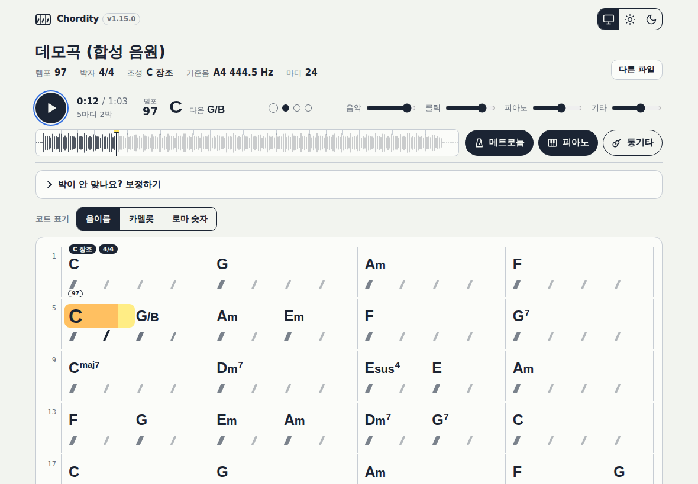
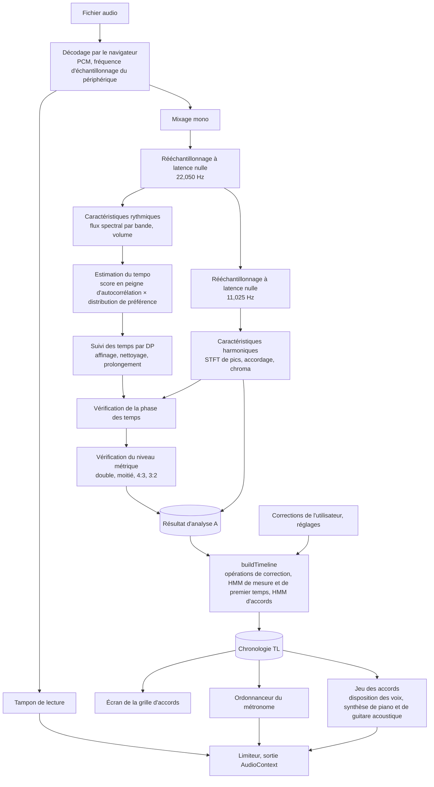
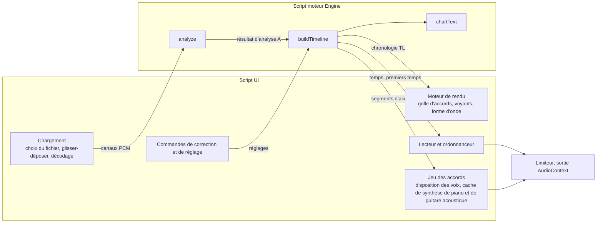
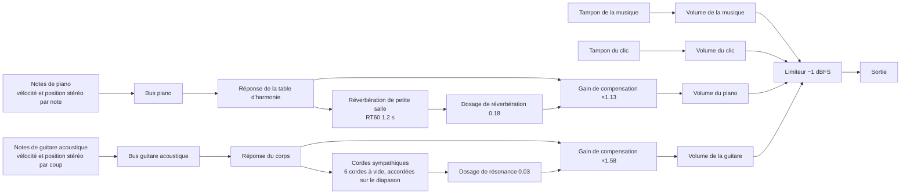

[한국어](README.md) · [English](README.en.md) · [日本語](README.ja.md) · [中文](README.zh.md) · **Français** · [Español](README.es.md)

Version 1.11.11 :

Contributeurs -

* 고쿠라주민 (118.220) : idée de ne pas déplacer le focus quand les accords avancent tant que le panneau de correction des temps ou un panneau du bas est ouvert.

> Si vous avez collaboré ou contribué à ce projet, ou si vous souhaitez le faire, merci de me contacter personnellement. Ce projet est un logiciel dont le code source est ouvert afin que chacun puisse l'utiliser gratuitement. Pour un usage personnel et non commercial, vous pouvez l'utiliser tel quel sans frais. Toutefois, les droits d'auteur et la propriété appartiennent à l'auteur original, aux collaborateurs et aux contributeurs : sans l'autorisation de l'auteur original, vous ne pouvez ni le modifier, ni en extraire une partie pour l'intégrer à votre propre programme (y compris pour votre seul usage personnel), ni revendiquer ce programme comme le vôtre, ni le distribuer ou le vendre ailleurs. Il n'est pas non plus permis de publier des modifications sur un fork GitHub. L'utilisation par des organisations telles qu'écoles, instituts privés, clubs, églises, organisations religieuses ou entreprises n'est pas automatiquement gratuite ; merci de me contacter au préalable. Les conditions détaillées figurent dans le fichier [LICENSE](LICENSE).

# Chordity <sup>v1.18.0</sup>

**Chordity est une page web qui, à partir d'un fichier de chanson, écrit les accords de chaque mesure et fait battre un métronome exactement sur les temps du morceau.**

Au moment où l'accord change, un piano, une guitare acoustique ou les deux ensemble jouent cet accord, ce qui vous permet de vérifier à l'oreille tout en jouant. Aucune installation, aucune inscription ni aucune connexion Internet n'est nécessaire. Vos fichiers audio ne quittent jamais votre ordinateur.

Les résultats peuvent être erronés. Les principes d'analyse, les raisons des décisions prises et la manière de vérifier et de corriger les résultats sont expliqués dans la [page d'aide](information.html). Vous pouvez aussi l'ouvrir en cliquant sur le texte d'information tout en bas de l'application.

*Chordity: per-measure chord recognition, a beat-locked metronome and synthesized piano chord playback in a single offline HTML file. No libraries, no uploads.*



## Sommaire

- **[Partie 1. Découverte facile](#partie-1-découverte-facile)**
  - [Quand l'utiliser](#quand-lutiliser)
  - [Mode d'emploi](#mode-demploi)
  - [Lire l'écran](#lire-lécran)
  - [Si le métronome sonne bizarrement](#si-le-métronome-sonne-bizarrement)
  - [Afficher les noms d'accords autrement](#afficher-les-noms-daccords-autrement)
    - [Noms de notes](#afficher-en-noms-de-notes), [Camelot](#afficher-en-camelot), [Chiffres romains](#afficher-en-chiffres-romains)
  - [Écouter les accords au piano ou à la guitare acoustique](#écouter-les-accords-au-piano-ou-à-la-guitare-acoustique)
  - [Raccourcis clavier](#raccourcis-clavier)
  - [Chansons faciles, chansons difficiles](#chansons-faciles-chansons-difficiles)
  - [Bon à savoir](#bon-à-savoir)
- **[Partie 2. Principes](#partie-2-principes)**
  - [2-1. Transformer le son en image](#2-1-transformer-le-son-en-image)
  - [2-2. Trouver les temps : la régularité des instants où un son commence](#2-2-trouver-les-temps--la-régularité-des-instants-où-un-son-commence)
  - [2-3. Vérifier qu'il s'agit de vrais temps](#2-3-vérifier-quil-sagit-de-vrais-temps)
  - [2-4. Découper en mesures](#2-4-découper-en-mesures)
  - [2-5. Identifier les accords](#2-5-identifier-les-accords)
  - [2-6. Les règles de la musique en probabilités](#2-6-les-règles-de-la-musique-en-probabilités)
  - [2-7. Un métronome qui ne se décale pas](#2-7-un-métronome-qui-ne-se-décale-pas)
  - [2-8. Faire entendre les accords au piano ou à la guitare acoustique](#2-8-faire-entendre-les-accords-au-piano-ou-à-la-guitare-acoustique)
  - [2-9. Trouver les changements de tonalité](#2-9-trouver-les-changements-de-tonalité)
- **[Partie 3. Fonctionnement](#partie-3-fonctionnement)**
  - [3-1. Vue d'ensemble](#3-1-vue-densemble)
  - [3-2. Chargement et prétraitement](#3-2-chargement-et-prétraitement)
  - [3-3. Caractéristiques rythmiques](#3-3-caractéristiques-rythmiques)
  - [3-4. Caractéristiques harmoniques](#3-4-caractéristiques-harmoniques)
  - [3-5. Tempo et temps](#3-5-tempo-et-temps)
  - [3-6. Mesure, mesures et accords (étape légère)](#3-6-mesure-mesures-et-accords-étape-légère)
  - [3-7. Lecture et métronome](#3-7-lecture-et-métronome)
  - [3-8. Ce que font les boutons de correction](#3-8-ce-que-font-les-boutons-de-correction)
  - [3-9. Jeu des accords](#3-9-jeu-des-accords)
- **[Partie 4. Pour aller plus loin](#partie-4-pour-aller-plus-loin)**
  - [4-1. Algorithmes et formules](#4-1-algorithmes-et-formules)
    - [(1) Rééchantillonnage à latence nulle](#1-rééchantillonnage-à-latence-nulle), [(2) FFT réelle](#2-fft-réelle), [(3) Flux spectral par bande et enveloppe d'attaques](#3-flux-spectral-par-bande-et-enveloppe-dattaques), [(4) Estimation du tempo](#4-estimation-du-tempo), [(5) Suivi des temps par DP (Ellis, 2007)](#5-suivi-des-temps-par-dp-ellis-2007), [(6) Affinage des temps](#6-affinage-des-temps), [(7) Vérification de la phase des temps](#7-vérification-de-la-phase-des-temps), [(8) Vérification du niveau métrique](#8-vérification-du-niveau-métrique), [(9) Détermination de la subdivision du temps](#9-détermination-de-la-subdivision-du-temps), [(10) Pics spectraux, accordage, chroma](#10-pics-spectraux-accordage-chroma), [(11) Agrégation synchronisée sur les temps, plancher de basse, tonalité](#11-agrégation-synchronisée-sur-les-temps-plancher-de-basse-tonalité), [(12) Gabarits d'accords et score d'émission](#12-gabarits-daccords-et-score-démission), [(13) Viterbi des accords : O(T·K)](#13-viterbi-des-accords--otk), [(14) Indices de premier temps et HMM de mesure](#14-indices-de-premier-temps-et-hmm-de-mesure), [(15) Ordonnancement du métronome](#15-ordonnancement-du-métronome), [(16) Synthèse de piano](#16-synthèse-de-piano), [(17) Disposition des voix et frappe](#17-disposition-des-voix-et-frappe), [(18) Suivi des modulations](#18-suivi-des-modulations), [(19) Notation Camelot](#19-notation-camelot), [(20) Analyse harmonique en chiffres romains](#20-analyse-harmonique-en-chiffres-romains), [(21) Renforts par type de morceau](#21-renforts-par-type-de-morceau), [(22) Tenues et positions de changement](#22-tenues-et-positions-de-changement), [(23) Synthèse de guitare acoustique](#23-synthèse-de-guitare-acoustique), [(24) Suivi du grattage](#24-suivi-du-grattage)
  - [4-2. Le monde physique](#4-2-le-monde-physique)
    - [Son, hauteur, tempérament égal](#son-hauteur-tempérament-égal), [Harmoniques](#harmoniques), [Bandes de fréquences par instrument](#bandes-de-fréquences-par-instrument), [Le compromis temps-fréquence](#le-compromis-temps-fréquence), [Échantillonnage et repliement](#échantillonnage-et-repliement), [Volume, réverbération, logarithme](#volume-réverbération-logarithme), [La perception humaine](#la-perception-humaine), [Les cordes du piano](#les-cordes-du-piano), [Les cordes de la guitare acoustique](#les-cordes-de-la-guitare-acoustique), [Latence et distance](#latence-et-distance)
  - [4-3. Architecture](#4-3-architecture)
    - [Composition](#composition), [Organisation du dépôt](#organisation-du-dépôt), [API du moteur](#api-du-moteur), [Trois horloges](#trois-horloges), [Graphe audio](#graphe-audio), [Enregistrement des réglages](#enregistrement-des-réglages)
  - [4-4. Problèmes et solutions](#4-4-problèmes-et-solutions)
  - [4-5. Optimisation](#4-5-optimisation)
  - [4-6. Validation](#4-6-vérification)
    - [Tests unitaires](#tests-unitaires), [Tests de non-régression sur morceaux synthétiques](#tests-de-non-régression-sur-morceaux-synthétiques), [Tests de modulation](#tests-de-modulation), [Tests de notation Camelot](#tests-de-la-notation-camelot), [Tests de chiffres romains](#tests-des-chiffres-romains), [Tests sur enregistrements réels](#tests-sur-un-vrai-enregistrement), [Tests de bout en bout dans un vrai navigateur](#tests-de-bout-en-bout-dans-un-vrai-navigateur), [Tests de jeu des accords](#tests-du-jeu-des-accords), [Tests de la guitare acoustique et du nouveau piano (1.12.0)](#tests-de-la-guitare-acoustique-et-du-nouveau-piano-1120), [Tests du début de morceau sans accompagnement (1.12.2)](#tests-du-début-de-morceau-sans-accompagnement-1122), [Tests du son de piano et des nuances de la guitare acoustique (1.13.0)](#tests-du-son-de-piano-et-des-nuances-de-la-guitare-acoustique-1130), [Tests des signes de coups de la guitare acoustique (1.14.0)](#tests-des-signes-de-coups-de-la-guitare-acoustique-1140), [Tests des coups montants et du grattage lent de la guitare acoustique (1.15.0)](#tests-des-coups-montants-et-du-grattage-lent-de-la-guitare-acoustique-1150), [Tests d'extension des types de morceaux (1.5.0)](#tests-dextension-des-genres-de-morceaux-150), [Tests de changement de mesure et d'affichage du tempo (1.6.0)](#tests-de-changement-de-mesure-et-daffichage-du-tempo-160), [Tests de tenues et de positions de changement (1.8.4)](#tests-des-accords-tenus-et-des-positions-de-changement-184)
  - [4-7. Points forts](#4-7-points-forts)
  - [4-8. Limites et perspectives](#4-8-limites-et-perspectives)
  - [4-9. Références](#4-9-références)
- **[Journal des modifications](#journal-des-modifications)**
  - [Règles de version](#règles-de-version)
  - [Chordity 1.x](#chordity-1x)
    - [1.18.0](#1180-2026-10-31), [1.17.0](#1170-2026-10-30), [1.16.1](#1161-2026-10-30), [1.16.0](#1160-2026-10-30), [1.15.1](#1151-2026-10-29), [1.15.0](#1150-2026-10-29), [1.14.0](#1140-2026-10-29), [1.13.0](#1130-2026-10-26), [1.12.2](#1122-2026-10-26), [1.12.1](#1121-2026-10-26), [1.12.0](#1120-2026-10-25), [1.11.11](#11111-2026-10-25), [1.11.10](#11110-2026-10-21), [1.11.9](#1119-2026-10-18), [1.11.8](#1118-2026-10-18), [1.11.7](#1117-2026-10-15), [1.11.6](#1116-2026-10-14), [1.11.5](#1115-2026-10-14), [1.11.4](#1114-2026-10-14), [1.11.3](#1113-2026-10-14), [1.11.2](#1112-2026-10-13), [1.11.1](#1111-2026-10-13), [1.11.0](#1110-2026-10-13), [1.10.5](#1105-2026-10-11), [1.10.4](#1104-2026-10-11), [1.10.3](#1103-2026-10-11), [1.10.2](#1102-2026-10-11), [1.10.1](#1101-2026-10-11), [1.10.0](#1100-2026-10-11), [1.9.4](#194-2026-10-10), [1.9.3](#193-2026-10-10), [1.9.2](#192-2026-10-10), [1.9.1](#191-2026-09-30), [1.9.0](#190-2026-09-30), [1.8.4](#184-2026-09-30), [1.8.3](#183-2026-09-30), [1.8.2](#182-2026-09-30), [1.8.1](#181-2026-09-30), [1.8.0](#180-2026-09-30), [1.7.0](#170-2026-09-30), [1.6.0](#160-2026-09-30), [1.5.0](#150-2026-09-30), [1.4.2](#142-2026-09-27), [1.4.1](#141-2026-09-27), [1.4.0](#140-2026-09-26), [1.3.1](#131-2026-09-26), [1.3.0](#130-2026-09-26), [1.2.0](#120-2026-09-26), [1.1.1](#111-2026-09-26), [1.1.0](#110-2026-09-26), [1.0.0](#100-2026-09-26)
  - [Versions de développement 0.x (accords par mesure)](#versions-de-développement-0x-마디-코드)
    - [0.4.1](#041-2026-09-26), [0.4.0](#040-2026-09-25), [0.3.1](#031-2026-09-25), [0.3.0](#030-2026-09-25), [0.2.1](#021-2026-09-25), [0.2.0](#020-2026-09-25), [0.1.0](#010-2026-09-25)


---

## Partie 1. Découverte facile

### Quand l'utiliser

- Quand vous voulez jouer une chanson que vous aimez à la guitare ou au piano
- Quand vous devez trouver les accords d'une chanson mais que les chercher un à un à l'oreille est difficile
- Quand vous voulez travailler votre sens du rythme en suivant l'enregistrement original

### Mode d'emploi

1. Ouvrez le fichier `chordity.html` dans un navigateur comme Chrome, Edge, Safari ou Firefox.
2. Cliquez sur **Ouvrir un fichier** (« 파일 열기 ») ou faites glisser un fichier audio sur la fenêtre. Après quelques secondes, la grille d'accords apparaît.
3. Appuyez sur le bouton **Lecture** (« 재생 »). Avec la musique, le métronome fait « tac » à chaque temps (un « tic » aigu sur le premier temps de la mesure et, si l'unité de changement d'accord est le ½ temps, un petit « tic » entre les temps, ou deux « tic » si c'est le ⅓ temps d'un morceau ternaire). Un cadre surligné en jaune entoure l'accord qui sonne et le nom de cet accord s'agrandit. L'intérieur du cadre se remplit d'orange au fil de la lecture, comme une barre de progression, et quand l'accord change, le cadre rebondit comme un ressort vers l'accord suivant. Le piano joue l'accord à chaque endroit où l'enregistrement original frappe un accord (il rejoue lorsque l'accord change ou que le même accord est frappé de nouveau, et laisse résonner là où l'accord est tenu).

Tout fichier que le navigateur sait lire convient : MP3, WAV, M4A, FLAC, OGG, etc.

### Lire l'écran

| Ce que vous voyez | Signification |
|---|---|
| Cadre surligné en jaune | L'accord qui sonne en ce moment. Il s'étend du temps où cet accord est frappé jusqu'à l'endroit où apparaît l'accord suivant (si un accord gris tenu se prolonge sur la mesure suivante, jusque-là ; en cas de retour à la ligne, un morceau par ligne). Quand l'accord change, il rebondit comme un ressort vers l'accord suivant |
| Remplissage orange dans le cadre | La part de cet accord déjà jouée (barre de progression). Le bord du remplissage correspond à la position de lecture actuelle et atteint la barre oblique d'un temps au moment où ce temps commence |
| Nom d'accord agrandi | Le nom de l'accord qui sonne (accord nouvellement frappé). Il grossit d'un coup à son arrivée, puis reprend lentement sa taille normale quand on passe à l'accord suivant. Il ne grossit que jusqu'à ne pas toucher le nom suivant |
| Barre oblique `/` | Un temps. La barre oblique qui devient plus foncée est le temps en cours |
| Barre oblique épaisse | Un temps où l'accord est frappé de nouveau (temps portant un accord en noir). On voit ainsi sur quel rythme les accords sont joués. Aux emplacements des accords gris et de `N.C.`, la barre oblique est normale |
| `⊓` `V` au-dessus des barres obliques (guitare acoustique activée) | Les coups que joue la guitare acoustique. `⊓` est un coup descendant (de haut en bas) et `V` un coup montant (de bas en haut), placés sur le temps ou entre les temps où tombe le coup. Ils changent avec le mode de jeu de la guitare acoustique. Un `⊓` précédé d'une ligne ondulée verticale est un grattage lent des six cordes (1.15.0). Pendant la lecture, chaque signe rebondit au moment où son coup est joué (1.15.0) |
| Crochet ┌─┐ marqué `M` | Passage où la guitare acoustique gratte avec les cordes étouffées par la main gauche (étouffé, palm mute). Les deux extrémités du crochet sont le premier et le dernier coup de ce passage |
| `C` `Am` `G7` | Noms d'accords. Placé juste au-dessus d'une barre oblique, l'accord change sur ce temps |
| `G/B` | Accord de G dont la note la plus grave est B |
| Petits caractères, noms d'accords sur deux lignes (haut/bas) | Quand une mesure contient beaucoup d'accords et qu'un nom touche l'accord suivant, la taille du texte est réduite ; si cela ne suffit toujours pas, les noms de cette mesure sont placés en alternance sur deux lignes, en haut et en bas (le bord gauche du nom correspond au temps où l'accord est frappé). Sur un écran étroit, si le nom long du dernier temps d'une mesure ne tient même pas sur deux lignes, les parties les moins importantes sont retirées et `…` est ajouté (`Bm7/F♯` → `Bm7…`). Le nom complet s'affiche au survol de la souris ou, pendant la lecture, dans la case de l'accord actuel en haut |
| Accord gris | L'accord de la mesure précédente est tenu sans être frappé de nouveau. Même pour un accord identique, s'il est frappé de nouveau sur le premier temps de la mesure, il est écrit en noir |
| `N.C.` | Passage sans accord (quand on n'entend que la batterie, quand c'est silencieux, ou quand le morceau commence par du chant seul, sans accompagnement) |
| Mesure 0 | Le passage où la chanson commence au milieu d'une mesure (anacrouse) |
| Indication comme `2박` au-dessus d'une mesure | Seule cette mesure a un nombre de temps différent (ici « 2 temps ») |
| Étiquette noire `E 장조로` | La tonalité change à partir de ce temps (modulation). La case de tonalité en haut l'indique aussi, par exemple `E♭ 장조 → E 장조`. Sur la première mesure du morceau, la tonalité et la mesure de départ sont affichées sans particule (`C 장조` `4/4`, comme l'armure et la signature rythmique d'une partition). Le coréen ajoute après une valeur nouvelle la particule 로/으로 (« vers ») ; `장조` signifie « majeur » |
| Étiquette noire `3/4으로` | La mesure (signature rythmique) change à partir de cette mesure (changement de mesure). La case de mesure en haut l'indique aussi, par exemple `4/4 → 3/4 → 4/4` |
| Pastille blanche `72` `132로` | Le tempo à partir de ce temps (BPM, arrondi), sur la ligne sous les barres obliques. Sur le temps où commence le morceau, le tempo de départ est affiché en chiffres seuls ; là où le tempo change brusquement, la particule coréenne `로/으로` (« vers ») est ajoutée au nouveau tempo |
| Cadre hexagonal blanc `여기까지 63` | Passage où le tempo change progressivement (ligne sous les barres obliques ; `여기까지` signifie « jusqu'ici »). La longueur couverte par le cadre est le passage du changement ; lorsque la position de lecture se trouve dans le cadre, il se remplit de la couleur du surligneur à mesure de l'avancée et affiche le tempo actuel, comme `현재 67` (« actuel 67 »). Une fois rempli jusqu'au bout, il pâlit en blanc et la pastille blanche du temps suivant la fin du cadre (le tempo d'arrivée) s'allume brièvement |
| Tempo (case du haut et barre de lecture) | Le tempo à la position de lecture. Si le tempo change progressivement, il suit le mouvement : 120, 119, 118… La barre de lecture reste fixée en haut de l'écran même en faisant défiler, et est donc toujours visible |
| Noms du type `8B`, `9A` avec de petits caractères | Noms d'accords lorsque la notation Camelot est choisie (voir « Afficher en Camelot » ci-dessous) |
| Chiffres romains comme `I`, `vi`, `V7/ii` | Noms d'accords lorsque la notation en chiffres romains est choisie (voir « Afficher en chiffres romains » ci-dessous) |
| Voyants ronds | Indiquent le numéro du temps en cours. Le plus grand rond est le premier temps de la mesure |
| « Suivant G » (« 다음 G ») en haut | L'accord qui va arriver |
| Boutons métronome, piano et guitare acoustique | Chaque appui active ou désactive la fonction. Le piano et la guitare acoustique s'activent et se désactivent séparément ; s'ils sont tous deux activés, ils jouent ensemble |
| Curseurs musique, clic, accords | Règlent séparément le volume de l'enregistrement original, du métronome et du jeu des accords (piano ou guitare acoustique) |

### Si le métronome sonne bizarrement

Dans la plupart des cas, tout se cale automatiquement, mais selon les chansons, chacun peut compter les temps différemment. Ouvrez **Les temps ne tombent pas juste ? Corriger** (« 박이 안 맞나요? 보정하기 ») et essayez les boutons ci-dessous. Le changement est immédiat.

| Si vous entendez ceci | Utilisez ce bouton |
|---|---|
| Le clic tombe entre les temps | Décaler d'½ temps (« ½박 옮기기 ») |
| Les clics sont trop serrés | Moitié ÷2 (« 절반으로 ÷2 ») |
| Les clics sont trop espacés | Deux fois plus vite ×2 (« 두 배 빠르게 ×2 ») |
| Le morceau a un feeling en 6/8 mais il y a trop de clics | Grouper par trois ÷3 (« 셋씩 묶기 ÷3 ») |
| Le début des mesures est décalé d'un temps | Avancer d'un temps, retarder d'un temps (« 한 박 앞당기기 », « 한 박 늦추기 ») |
| Le clic semble très légèrement en avance ou en retard | Synchronisation du clic (« 클릭 타이밍 ») |
| Vous voulez remettre la correction des temps à l'état initial | Annuler la correction des temps (« 박 보정 되돌리기 ») |
| Vous voulez remettre les réglages comme le type d'accords à l'état initial | Réglages par défaut (« 설정 기본값으로 ») |

Ce que vous avez modifié s'affiche dans la même case, sous **En vigueur** (« 적용 중 »), réparti entre « Correction des temps » (« 박 보정 ») et « Réglages » (« 설정 »). Même lorsque la case est repliée, un résumé reste visible à côté du titre.

Pour afficher des accords plus simples, choisissez « Basique » (« 기본 ») dans **Type d'accords** (« 코드 종류 ») ; pour voir aussi les accords qui changent à l'intérieur d'un temps, choisissez « Par ½ temps » (« ½박 단위 »). En mode ½ temps, le métronome ajoute aussi un petit « tic » aigu entre les temps (à la place des croches) et joue « tic-tic-tac-tic-tac-tic-tac-tic » (« 띡-틱-딱-틱-딱-틱-딱-틱 »). Dans les morceaux ternaires où le temps se divise en trois (12/8, 6/8, etc.), cette option devient « Par ⅓ temps » (« ⅓박 단위 ») et divise chaque temps en trois (trois croches) ; le métronome ajoute lui aussi deux « tic » entre les temps et joue « tic-tic-tic-tac-tic-tic » (« 띡-틱-틱-딱-틱-틱 »).

### Afficher les noms d'accords autrement

La barre **Notation des accords** (« 코드 표기 ») juste au-dessus de la grille permet de voir un même accord de trois façons. Le changement est immédiat et s'applique à la fois à la grille, aux accords actuel et suivant et à la grille en texte ; la façon choisie est conservée à la prochaine ouverture. Au clavier, placez le focus sur la barre et changez avec ← et →.

| Bouton | Exemple | Utile quand |
|---|---|---|
| Noms de notes (« 음이름 ») | E♭, B♭/D, Cm7 | Vous voulez jouer directement en lisant les accords, ou échanger des accords entre musiciens |
| Camelot (« 카멜롯 ») | 5B, 6B, 3A⁷ | Vous cherchez des tonalités et des accords qui s'accordent bien, ou choisissez un point de mixage DJ |
| Chiffres romains (« 로마 숫자 ») | I, V⁶, ii⁷/IV | Vous analysez la progression harmonique d'un morceau, ou le transposez dans une autre tonalité |

Les trois images ci-dessous montrent les mêmes 11 mesures en E♭ majeur dans chacune des notations.

#### Afficher en noms de notes


C'est la notation d'accords la plus familière. La fondamentale est écrite en grand, les qualités comme m, sus ou dim un peu plus petit, et les extensions comme 7 ou maj7 en exposant, si bien que même les accords complexes se lisent d'un coup d'œil.

- **Accords barrés** : le `B♭/D` de la deuxième mesure signifie qu'il faut jouer un accord de B♭ avec D comme note la plus grave. Les accords dont la basse est la septième, comme le `B♭7/A♭` de la sixième mesure, sont aussi écrits tels quels.
- **♯/♭ adaptés à la tonalité** : une même note s'écrit selon la tonalité en vigueur à cet endroit. Ce morceau étant en E♭ majeur, on écrit B♭ au lieu de A♯ et A♭ au lieu de G♯ ; si le morceau module en E majeur, on écrit ensuite avec des ♯, comme G♯m7.
- Les accords tenus depuis la mesure précédente sans être frappés de nouveau sont en gris, et les passages sans accord sont notés `N.C.`. Même pour un accord identique, s'il est frappé de nouveau sur le premier temps de la mesure, il est écrit en noir.

#### Afficher en Camelot


Les accords sont écrits avec les numéros de la roue Camelot qu'utilisent les DJ pour enchaîner les morceaux. Les tonalités sont placées sur les positions 1 à 12 dans l'ordre du cycle des quintes, avec B pour la famille majeure et A pour la famille mineure. Les tonalités et accords dont les numéros sont identiques ou ne diffèrent que d'un sonnent bien ensemble.

- **Lire un accord** : il est écrit avec le numéro de la tonalité qui a la même fondamentale et le même caractère (majeur ou mineur), et le type d'accord est ajouté en petits caractères. E♭ devient 5B, Cm devient 5A, et B♭7 devient 6B avec un petit 7.
- **Les accords hors tonalité sautent aux yeux** : ce morceau étant en E♭ majeur (5B), la plupart des accords se regroupent entre 4 et 6. Seul le `3A⁷` (B♭m7) de la quatrième mesure est éloigné, car c'est un accord emprunté brièvement pour aller vers le IV, A♭maj7 (4B).
- La tonalité du morceau est aussi affichée avec son numéro, comme `E♭ 장조(5B)` (E♭ majeur).
- Camelot n'ayant aucun moyen d'indiquer la note de basse, la basse des accords barrés est omise (`B♭/D` → `6B`). Le jeu des accords, lui, joue bien la note de basse.

#### Afficher en chiffres romains


Il s'agit de l'analyse harmonique en chiffres romains utilisée dans les traités d'harmonie. Au lieu des noms de notes, chaque accord est écrit selon **le degré de la tonalité sur lequel il est bâti**, ce qui révèle la charpente sur laquelle se déplace le morceau. Une même progression apparaît avec les mêmes chiffres quelle que soit la tonalité, ce qui facilite la transposition ou la comparaison des progressions de plusieurs morceaux.

- **Déroulement de l'image** : les trois premières mesures `I – V⁶ – vi` forment une progression où la basse descend note par note, E♭ → D → C. Le `ii⁷/IV – V⁷/IV – IVᴹ⁷` qui suit emprunte brièvement le ii–V de A♭ majeur pour aller vers le IV (A♭maj7), et le `ii⁷ – V⁷ – I` final est la cadence la plus élémentaire.
- **Chiffres de renversement** : le `V⁶` de la deuxième mesure a la tierce (D) à la basse, et le `V⁴₂` de la sixième mesure a la septième (A♭) à la basse.

| Notation | Signification |
|---|---|
| I, IV, V (majuscules) | Accords de la famille de l'accord parfait majeur. Le chiffre indique le degré de la tonalité sur lequel l'accord est bâti |
| i, ii, vi (minuscules) | Accords de la famille de l'accord parfait mineur |
| °, ø, +, M | Accord diminué (°), septième demi-diminuée (ø), accord augmenté (+), septième majeure (M7) |
| 7 | Accord de septième |
| 6, ⁶₄ | Renversements de l'accord de trois sons. 6 si la basse est la tierce, ⁶₄ si c'est la quinte |
| ⁶₅, ⁴₃, ⁴₂ | Renversements de l'accord de septième, quand la basse est la tierce, la quinte ou la septième |
| V/x, vii°/x, ii/x | Accord utilisé brièvement pour aller vers x (accord secondaire). V7/vi est la septième de dominante qui mène à vi |
| ♭VI, ♭VII, etc. | Degrés hors de la gamme de la tonalité, par exemple des accords empruntés au mode mineur de même tonique (accords d'emprunt) |

- Les chiffres se comptent par rapport à la tonalité en vigueur à cet endroit. Après une modulation, on recompte dans la nouvelle tonalité.
- Si l'accord de dominante de la nouvelle tonalité apparaît juste avant une modulation, il est écrit V par rapport à la nouvelle tonalité (par exemple, le B7 juste avant le passage en E majeur est noté V7).
- Si la notation de basse est désactivée, les accords sont écrits à l'état fondamental, sans chiffres de renversement.

### Écouter les accords au piano ou à la guitare acoustique

Activez le jeu des accords avec les boutons **Piano** (« 피아노 ») et **Guitare acoustique** (« 통기타 ») en haut : les accords reconnus sont alors joués. Les deux boutons s'activent et se désactivent séparément ; s'ils sont tous deux activés, le piano et la guitare acoustique jouent ensemble (au départ, seul le piano est activé). En l'écoutant superposé à l'enregistrement original, vous pouvez vérifier immédiatement à l'oreille si l'accord écrit est juste, et cela sert aussi de guide quand vous jouez. Le son s'accorde automatiquement sur la hauteur du morceau, si bien qu'il ne sonne pas faux par rapport à l'original.

- Les volumes de la musique, du clic et des accords se règlent séparément avec les trois curseurs du haut (le curseur des accords vaut à la fois pour le piano et la guitare acoustique).
- Le moment où joue le piano se choisit dans **Jeu du piano** (« 피아노 연주 ») sous **Corriger** (« 보정하기 ») : en suivant le morceau (« 곡 따라 » ; par défaut, ne rejoue qu'aux endroits où l'original frappe de nouveau), à chaque changement d'accord, à chaque mesure, ou à chaque temps.
- La manière dont joue la guitare acoustique se choisit dans **Jeu de la guitare acoustique** (« 통기타 연주 ») sous **Corriger**. Le mode par défaut, **auteur-compositeur** (« 싱어송라이터 », 1.16.0), joue comme le ferait un accompagnateur à la guitare acoustique après avoir écouté le morceau. Il choisit un mouvement de main en croches, en doubles croches ou en triolets d'après le tempo et le caractère, prend un motif de grattage qui convient à l'original (le plus souvent ↓ ↓↑ ↑↓↑, un motif en doubles croches pour les morceaux lents), le joue plus aéré dans les passages calmes (↓↓↓↓, etc.) et plus plein dans les passages forts, et joue les passages répétés avec le même motif. Juste avant un passage qui devient beaucoup plus fort, il remplit le dernier temps, anticipe les accords qui changent entre les temps et accentue les temps 2 et 4. Même dans un passage calme, il continue le motif principal joué doucement quand l'original garde un backbeat ou un contretemps marqué, et quand l'original est clairsemé il joue tout le passage avec une seule densité (noires, blanches ou un accord laissé sonner). La fin d'une phrase de 8 mesures n'est allégée que si l'original est faible sur ce temps, un break où les accords s'arrêtent est frappé une fois puis laissé, et le dernier accord du morceau est gratté lentement une fois et laissé sonner. Depuis 1.17.0, il ne répète plus un seul motif : à chaque niveau, il choisit mesure par mesure, parmi plusieurs formes de grattage qu'utilisent les vrais accompagnateurs, celle qui colle le mieux au rythme de l'original, ajoute des coups sur les cases vides que l'original frappe fort, laisse libres les cases presque silencieuses et change de forme en fin de phrase quand la même dure plus de 4 mesures (les passages répétés restent joués de la même façon). Le mode **en suivant le grattage** (« 스트로크 따라 ») repère, temps par temps et sur une grille de doubles croches, le rythme joué dans l'original par la guitare, le piano, la batterie, etc., et gratte à ces endroits en coups descendants et montants. Dans les mesures où aucun coup n'a été trouvé, elle gratte une fois sur le premier temps, et comme le rythme de l'original est déduit du son, il peut différer du jeu réel (4-8). Le **grattage 4 beat, 8 beat et 16 beat** (« 4비트·8비트·16비트 스트럼 ») choisit, mesure par mesure, parmi les variations de grattage enseignées dans les méthodes de guitare (en 8 beat, par exemple ↓↑↓↑↓↑↓↑, ↓ ↓ ↓↑↓↑, ↓ ↓↑ ↑↓↑), celle qui correspond le mieux au rythme de l'original, et la joue en mesure sur les temps du morceau. Selon la technique de base qui consiste à toujours balancer la main de haut en bas, les coups placés du côté des temps sont descendants et ceux qui tombent entre eux montants ; les motifs choisis apparaissent à la ligne « grattage de la guitare acoustique » (« 통기타 스트럼 ») des **Informations d'analyse** (« 분석 정보 »). Le **grattage swing** (« 스윙 스트럼 ») joue à chaque temps les deux croches, longue puis brève (↓·↑ ↓·↑), sur la première et la troisième position du triolet. Si l'original est swing, il mesure dans l'original la position où tombe le contretemps (le rapport de swing) et s'y aligne ; dans les morceaux binaires ou ceux où cette mesure est impossible, il gratte à la position du triolet (⅔ du temps). Le swing ne joue que ce rythme, sans variations, et le rapport utilisé apparaît à la ligne « grattage de la guitare acoustique » des informations d'analyse. Quel que soit le mode, la guitare joue toujours là où l'accord change (si le changement tombe entre deux cases jouées, sur la première case qui suit : le temps suivant en 4 beat, le contretemps de ce temps en swing) ; même là où il n'y a pas d'accord (N.C.), si l'original a un rythme (batterie, etc.), elle joue des **étouffés** (« tchic »), en grattant les cordes bloquées, ou, si la note de basse est nette, des **palm mutes** sur cette note (rien n'est joué dans les passages calmes) ; et les accords sont pris avec de vrais doigtés de guitare (C en x32010, G en 320003, etc.). Quel que soit le mode, la guitare gratte doucement là où l'original est calme et fort là où il est puissant, et, au sein même d'une mesure, elle gratte fort aux endroits où l'original a frappé fort (1.13.0). Depuis la 1.15.1, elle gratte un peu plus fort à mesure que l'original devient fort et un peu plus doucement à mesure qu'il devient calme, et plus elle gratte fort, plus elle balaie vite les cordes (jusqu'à 1.25 fois la vitesse d'un vrai grattage de guitare acoustique), plus elle gratte doucement, plus elle les balaie lentement (jusqu'à 0.8 fois). Dans la partie finale du morceau, le dernier accord, le premier temps de la mesure qui mène à l'outro et les accords tenus plus d'une mesure ne sont pas frappés d'un coup mais grattés lentement depuis les cordes graves, comme un accord arpégé, et plus le morceau est lent, plus le grattage est lent (un demi-temps, 0.12~0.5 s). Au début et au milieu du morceau, il n'y a pas de grattage lent (1.15.1). Le suivi du grattage trouve aussi les coups montants faibles couverts par la batterie dans les morceaux grattés serré en doubles croches. Il place en outre des coups montants en rythme, en suivant une main qui monte et descend sans arrêt : les morceaux rapides (116 BPM ou plus) reçoivent des ↓↑ en croches et les plus lents un ↓↑ en doubles croches juste avant le temps suivant, et si le coup descendant qui mène à un coup montant ajouté manque, il est ajouté aussi. Ils ne sont ajoutés que là où cet endroit de l'original est plutôt fort parmi les mêmes endroits du morceau, pour suivre le rythme du morceau (1.15.0).
- Lorsque la guitare acoustique est activée, les coups qu'elle joue apparaissent sous forme de signes entre les noms d'accords et les barres obliques de la grille. Les coups descendants sont marqués `⊓` et les coups montants `V` là où ils sont joués, et les passages étouffés ou en palm mute, où les cordes sont étouffées, reçoivent un `M` au-dessus d'un crochet reliant leur premier et leur dernier coup. Si vous changez le mode de jeu de la guitare acoustique, les signes suivent, et si vous désactivez la guitare acoustique, les signes disparaissent et la grille reprend sa hauteur normale (1.14.0). Un grattage lent reçoit une ligne ondulée verticale à gauche de son `⊓`. Pendant la lecture, 0.1 s avant chaque coup, son signe gonfle et fait un petit bond, s'écrase comme un ressort en retombant, puis se redresse et reprend sa taille normale en 0.33 s (il reste immobile si l'appareil est réglé pour réduire les animations, 1.15.0).
- Le piano s'active et se désactive aussi avec la touche P, et la guitare acoustique avec la touche G.

### Raccourcis clavier

| Touche | Action |
|---|---|
| Space | Lecture, pause |
| M | Activer, désactiver le métronome |
| P | Activer, désactiver le jeu des accords au piano |
| G | Activer, désactiver le jeu des accords à la guitare acoustique |
| ← → | Mesure précédente, mesure suivante |
| Home | Retour au début |

Cliquer sur une mesure vous y amène ; cliquer sur la forme d'onde en haut ou la faire glisser vous amène aussi à l'endroit voulu. Les raccourcis fonctionnent même lorsque le clavier est en mode de saisie coréenne.

### Chansons faciles, chansons difficiles

Les chansons aux temps bien marqués, comme la pop, le rock, les ballades, la dance, le hip-hop, la K-pop ou la pop acoustique avec batterie, fonctionnent bien. Les chansons dont le tempo change fortement en cours de route, les mesures irrégulières comme 5/4 ou 7/4, les accords dont la basse est hors de l'accord comme F/G, et les power chords du rock (E5) sont aussi reconnus. Les morceaux riches en tensions et en walking bass comme le jazz, ceux que l'on ressent par unités de deux temps comme la bossa-nova (les mesures sont écrites avec une longueur double), le metal à distorsion très forte, et les morceaux dont les temps peuvent se compter de deux façons comme le reggae peuvent donner des erreurs. Dans ce cas, utilisez les boutons de correction ci-dessus.

### Bon à savoir

- Vos fichiers ne sont pas envoyés sur Internet. Toute l'analyse se fait dans le navigateur.
- En cliquant sur le texte d'information tout en bas de l'écran, l'[aide](information.html) s'ouvre dans un nouvel onglet ; elle récapitule les cas où les résultats peuvent être erronés, comment les vérifier, les principes d'analyse et les résultats de validation.
- Les réglages comme le métronome, le jeu des accords, le volume, le type d'accords et la notation des accords sont enregistrés dans le navigateur et conservés pour la fois suivante.
- Même avec des écouteurs Bluetooth, la musique, le clic et le jeu des accords arrivent en retard tous ensemble, donc ils ne se décalent pas entre eux.
- Si vous n'entendez aucun son sur iPhone, vérifiez que le mode silencieux n'est pas activé.
- Pendant la lecture, la page défile pour suivre la mesure en cours. Tant que le panneau de correction et de réglages en haut, ou le panneau de grille d’accords en texte ou d’informations d’analyse en bas, est ouvert, elle ne défile pas : vous pouvez lire le panneau tranquillement. Refermez les panneaux et elle suit de nouveau.

<p align="center"></p>

---

<p align="right"><a href="#목차">↑ Retour au sommaire</a></p>

## Partie 2. Principes

Ce programme n'utilise aucun modèle d'intelligence artificielle préentraîné. Il fonctionne grâce au **traitement du signal** et à des **modèles probabilistes** qui traduisent en formules les propriétés physiques du son et les règles de la musique. On peut donc expliquer chaque décision une par une, et vous pouvez en consulter directement les justifications dans **Informations d'analyse** (« 분석 정보 ») en bas de l'écran.

### 2-1. Transformer le son en image

Le son est une vibration de l'air, et un fichier audio est une suite de nombres mesurant cette vibration des dizaines de milliers de fois par seconde. Comme il est difficile de savoir quelles notes sonnent en regardant seulement ces nombres, on découpe le son en tranches très courtes et l'on calcule pour chacune **quelles hauteurs y sont mélangées et dans quelle proportion** (le spectre). En alignant ces tranches dans l'ordre du temps, on obtient une image du son (le spectrogramme) dont l'axe horizontal est le temps et l'axe vertical la hauteur. Toute l'analyse qui suit consiste à lire cette image.

Il y a là un compromis inévitable. Des tranches courtes indiquent précisément **quand** un son s'est produit mais rendent flou **quelle note** c'est ; des tranches longues font l'inverse. On utilise donc des tranches courtes pour trouver les temps et des tranches longues pour trouver les accords. Pour les notes de basse les plus graves, l'écart de fréquence entre deux demi-tons est très petit, si bien qu'il faut les tranches les plus longues.

### 2-2. Trouver les temps : la régularité des instants où un son commence

Quand on frappe une batterie ou qu'on enfonce une touche, l'énergie sonore augmente brusquement à cet instant. On appelle cet instant une **attaque** (onset). Si l'on additionne uniquement les parties du spectrogramme qui ont augmenté par rapport à l'instant précédent, on obtient une courbe qui présente un pic à chaque attaque.

Les temps sont **la charpente de ces attaques qui se répètent à intervalles réguliers**. On fait d'abord glisser la courbe dans le temps pour la superposer à elle-même (autocorrélation) et l'on cherche l'intervalle qui se superpose le mieux, c'est-à-dire le tempo. Ensuite, on cherche en une seule fois, sur tout le morceau, la suite de temps qui « passe par le plus grand nombre possible d'attaques fortes sans que l'intervalle s'écarte beaucoup du tempo » (programmation dynamique). Comme on optimise l'ensemble d'un coup au lieu de fixer chaque temps séparément, la suite ne se rompt pas même si quelques temps faibles s'y mêlent, et elle suit le tempo même s'il fluctue légèrement au fil du jeu. Ici, la référence de « l'intervalle régulier » n'est pas le tempo de tout le morceau, mais un **tempo local** calculé sur quelques secondes. Ainsi, on ne se laisse pas entraîner là où le rythme se complique brièvement, comme dans un fill, tout en suivant le morceau lorsqu'il ralentit ou accélère réellement.

### 2-3. Vérifier qu'il s'agit de vrais temps

Trouver une suite régulière ne suffit pas. Il existe deux erreurs courantes.

**Prendre le contretemps pour le temps.** Si la charleston remplit fortement l'espace entre les temps, la suite peut être décalée d'un demi-temps. Or la musique a des règles : les entrées de grosse caisse, de caisse claire et de basse, ainsi que les changements d'accord, se concentrent pour la plupart **sur les temps**. On compare donc la force de ces événements à la position des temps trouvés et à la position décalée d'un demi-temps ; si la position décalée est nettement plus forte, on décale toute la suite d'un demi-temps.

**Prendre un tempo double ou moitié.** Dans une ballade lente avec des arpèges serrés en croches, il est facile de prendre chaque croche pour un temps. On sépare alors les temps en deux groupes, un sur deux. Si les vrais temps portent la grosse caisse et la caisse claire et qu'entre eux il n'y a que le clavier, un groupe ressort bien plus fort que l'autre. On écarte alors le groupe faible et l'on divise le tempo par deux. À l'inverse, si une caisse claire tombe régulièrement au milieu de chaque intervalle entre les temps, le tempo a été pris trop lent et on le double. Le doublement, qui produit immédiatement un clic à contretemps en cas d'erreur, n'est appliqué que sous des conditions beaucoup plus strictes.

Dans les enregistrements réels, la charleston et le clavier remplissent les contretemps, et l'écart de force entre les deux groupes peut être faible. On regarde donc aussi **dans quel groupe tombent la grosse caisse et la caisse claire**. Au bon tempo, la grosse caisse (temps 1 et 3) et la caisse claire (temps 2 et 4) tombent dans des groupes différents ; si le tempo a été doublé, elles tombent toutes deux dans le même groupe (les vrais temps). Pour diviser le tempo par deux, on ne retire pas un temps sur deux, mais on refait le suivi depuis le début avec le nouveau tempo. En effet, si le suivi au niveau des croches glisse d'une seule case quelque part au milieu du morceau, tous les temps filtrés après cet endroit se retrouvent décalés d'un demi-temps.

**Deux formes de tempo moitié pour les morceaux rapides.** Les morceaux rapides autour de 160 à 180 BPM sont facilement saisis un niveau plus lent, c'est-à-dire à la moitié du tempo. La forme diffère alors selon l'endroit où se posent les temps lents. Si les temps lents se posent sur la caisse claire (temps 2 et 4), une caisse claire tombe régulièrement sur chaque temps et la grosse caisse entre les temps. C'est une forme impossible pour un morceau lent au bon tempo, où la grosse caisse tombe sur les temps (1 et 3) et la caisse claire un temps sur deux. Si les temps lents se posent sur la grosse caisse (sensation half-time), la caisse claire tombe aussi souvent entre les temps que sur les temps. Dans les deux cas, on ne double que si l'estimation du tempo propose le tempo double comme candidat de force presque égale. Si l'on laisse les temps lents posés sur la caisse claire, le premier temps de la mesure est aussi décalé, et deux accords se mélangent dans un même temps, ce qui fait apparaître beaucoup d'accords de septième et d'accords barrés.

La division par deux est elle aussi vérifiée une fois de plus. Si l'on a pris les croches pour des temps, le milieu de chaque intervalle est une position de double croche, où les frappes graves comme la grosse caisse ou la basse sont rares. Si des sons graves tombent souvent entre les temps, on considère donc que les temps sont les bons et l'on ne divise pas. Lorsqu'on veut diviser sur la seule base de l'écart de force entre groupes pairs et impairs, si la caisse claire se concentre dans le groupe opposé à la grosse caisse (backbeat), les temps sont également les bons et l'on ne divise pas.

La façon de reconnaître la « caisse claire » est physique. Quand le timbre sous la caisse claire vibre, il produit un bruit qui augmente **simultanément** des fréquences moyennes jusqu'aux très aiguës. Les notes d'un clavier n'augmentent que sur quelques hauteurs, et la charleston uniquement dans les aigus. En mesurant « les fréquences moyennes et aiguës ont-elles augmenté en même temps » par le produit de ces deux valeurs, on peut isoler la caisse claire, car il suffit que l'une des deux soit faible pour que le produit soit faible.

### 2-4. Découper en mesures

Pour grouper les temps en mesures, il faut savoir où se trouve **le premier temps de la mesure**. Le premier temps laisse des traces : l'accord change, la note de basse change, la grosse caisse frappe fort, le volume augmente parfois. On attribue à chaque temps un score selon ces traces et l'on cherche le groupement au score le plus élevé tout en respectant la règle « les mesures se répètent généralement avec la même longueur ». C'est aussi de cette façon qu'on détermine si une mesure à 4 temps ou à 3 temps correspond le mieux aux traces. Si la sensation d'un temps divisé en trois est forte, on considère une mesure composée comme 6/8 ou 12/8.

Dans les morceaux où la batterie joue un backbeat, la forme paire/impaire **grosse caisse sur les temps 1 et 3, caisse claire sur les temps 2 et 4** sert aussi de trace du premier temps. Dans un riff syncopé où l'accord change une croche avant le premier temps de la mesure, la trace du changement d'accord est tirée un temps en avant, mais la forme paire/impaire de la batterie reste la même, de sorte que la mesure n'est pas décalée d'un temps. Par ailleurs, les mesures à 3, 5 et 7 temps ne sont choisies que si les traces du premier temps se répètent réellement à cette longueur. Il s'agit d'éviter que, dans un morceau court, quelques rares grandes traces ne fassent croire à une mesure à 7 temps.

### 2-5. Identifier les accords

Une même note à des octaves différentes (un do grave et un do aigu) joue le même rôle dans un accord. Si l'on replie donc toutes les notes dans **12 cases** — do, do♯, ré … si —, on obtient l'empreinte des notes qui sonnent à cet instant (le chroma). Pour un accord de C, les cases do, mi et sol ressortent.

Les vrais instruments ne produisent jamais une seule note. Quand on joue un do, des **harmoniques** sonnent avec lui : le do une octave au-dessus, le sol au-dessus, encore un do, un mi… Par exemple, l'harmonique issue du mi d'un accord de C remplit la case si, si bien qu'une comparaison qui ignore les harmoniques prend un C pour un Cmaj7. On construit donc les empreintes des accords en y incluant les harmoniques avant de comparer.

La basse (la note la plus grave) est examinée séparément. Si l'accord est C mais que la basse est mi, on écrit `C/E`.

La note de référence varie légèrement d'un enregistrement à l'autre. Pour bien des morceaux, le la n'est pas exactement à 440 Hz. On mesure donc d'abord de combien les notes de tout le morceau sont en moyenne trop hautes ou trop basses, on corrige d'autant, puis on les place dans les 12 cases.

### 2-6. Les règles de la musique en probabilités

Si l'on se contente de choisir pour chaque temps l'accord le plus ressemblant, les notes de passage de la mélodie font clignoter les accords à chaque temps. On introduit donc deux principes de bon sens sous forme de probabilités : **les accords ne changent pas souvent**, et **s'ils changent, c'est le plus souvent sur le premier temps de la mesure et rarement entre les temps**. En pesant ensemble ces règles et la ressemblance du son, on choisit en une fois la suite d'accords la plus plausible pour tout le morceau (modèle de Markov caché et algorithme de Viterbi). On estime aussi la tonalité du morceau et l'on donne un léger bonus aux accords qui lui conviennent.

### 2-7. Un métronome qui ne se décale pas

Ce métronome ne bat pas à intervalle fixe comme « 97 tic-tac par minute », mais **à l'instant de chacun des temps trouvés**. Il suit donc le jeu même si celui-ci accélère ou ralentit légèrement.

La synchronisation est aussi précise. Si l'on déclenche le clic par un minuteur qui dit « joue maintenant ! », il arrive avec des dizaines de ms de retard quand l'ordinateur est occupé. On programme donc le clic 0.2 seconde à l'avance sur **l'horloge du périphérique audio** qui lit la musique. Comme la musique et le clic utilisent la même horloge et le même chemin de sortie, ils s'emboîtent à l'échantillon près ; même sur un périphérique dont la sortie a du retard, les deux arrivent en retard ensemble et ne se décalent pas l'un par rapport à l'autre.

### 2-8. Faire entendre les accords au piano ou à la guitare acoustique

Intégrer des sons de piano enregistrés alourdirait le fichier et exigerait des fichiers externes. Le son de piano est donc **fabriqué directement à partir des lois physiques**. Une corde de piano n'est pas une corde idéale mais un fil d'acier rigide, si bien que ses harmoniques sonnent légèrement plus haut que des multiples entiers exacts (inharmonicité). Le marteau frappe la corde à environ 1/7 de sa longueur, de sorte que les harmoniques qui ne bougent pas à cet endroit sonnent faiblement. Une note est produite par deux ou trois cordes à la fois ; comme leurs hauteurs diffèrent très légèrement, le son ondule lentement (battements) et décroît en deux étapes : rapidement au début, puis il persiste longtemps. Plus une harmonique est aiguë, plus elle disparaît vite, si bien que le son s'adoucit progressivement. En empilant ces propriétés sous forme de formules, on synthétise chaque note.

Depuis 1.12.0, le piano intègre davantage de propriétés que l'on mesure sur de vrais pianos : un timbre qui garde d'autant plus d'harmoniques aiguës que le marteau frappe fort, les battements entre cordes qui naissent sur toutes les harmoniques, et le « toc » sourd et grave du marteau qui, en frappant la corde, heurte la table d'harmonie ; le son sort ensuite à travers une réponse qui imite la résonance boisée de la table d'harmonie du piano. Au relâchement des touches, les étouffoirs retombent différemment selon le registre, et le registre le plus aigu (cordes sans étouffoir) résonne longtemps.

En 1.13.0, le son a de nouveau été retouché pour correspondre aux valeurs mesurées sur de vrais enregistrements de piano. Le son de l'instant où le marteau frappe la corde a été ajouté sous deux formes : un bruit bref et aigu, produit quand le feutre touche la corde, et le « toc » boisé produit quand cette force heurte la table d'harmonie. Le son décroît désormais rapidement pendant la première seconde, comme sur un vrai piano, ce qui corrige sa résonance uniforme jusqu'à l'accord suivant, comme si la pédale restait enfoncée. Le son résiduel qui persiste longtemps à bas niveau est conservé, et le son s'arrête naturellement là où il est devenu assez faible. La réverbération a été remplacée par les premières réflexions renvoyées par les murs d'une petite pièce (temps de réverbération de 1.2 seconde), suivies de la résonance qui se diffuse ensuite.

La guitare acoustique est produite par la méthode de Karplus-Strong, qui imite une corde pincée. Si l'on place dans une ligne à retard un bruit long d'une période de la corde et qu'on le réinjecte sans cesse en l'assombrissant peu à peu, on obtient un son qui, comme une vraie corde pincée, perd d'abord ses composantes aiguës. On y ajoute la position et la force du médiator sur la corde ainsi que les résonances de l'air et de la table du corps de la guitare, et les accords sont joués avec les doigtés que l'on prend à la main sur six cordes en accordage standard. Un coup descendant attaque toutes les cordes à partir de la plus grave, un coup montant les 3 ou 4 cordes aiguës à partir de la plus aiguë, à quelques ms d'intervalle. Depuis la 1.15.1, l'écart entre cordes part de la médiane d'enregistrements réels de guitare acoustique (GuitarSet : 6.2 ms en descendant, 7.0 ms en montant) et devient jusqu'à 1.25 fois plus rapide quand le coup est fort et jusqu'à 0.8 fois plus lent quand il est doux (jusqu'à la 1.15.0, il était d'environ 11 ms en descendant et balayait les cordes lentement). Les instants de jeu sont déterminés en cherchant, dans chaque case obtenue en divisant le temps en quatre (en trois en mesure composée), les instants où le son des médiums (200~2,500 Hz) de l'original augmente de nouveau. Un grattage lent joue toutes les cordes depuis la plus grave à intervalles égaux répartis sur un demi-temps (0.12~0.5 s). Depuis la 1.15.0, seules comptent les augmentations aux pics du spectre (partiels ayant une hauteur). Depuis la 1.15.0, chaque corde a son propre timbre : les cordes filées (E, A, D, G) sont plus sombres et les cordes lisses (B, E) plus brillantes, à mi-chemin entre la brillance par corde mesurée dans de vrais enregistrements de guitare acoustique (GuitarSet) et le timbre précédent, si bien que les cordes fines ne sont plus criardes tandis que le grattage garde son attaque. La résonance vient de la guitare elle-même au lieu d'une réverbération de pièce : en plus de la résonance du corps, les six cordes à vide résonnent par sympathie avec les harmoniques des notes jouées (accordées sur le diapason du morceau).

Depuis 1.13.0, la guitare acoustique module la force de son jeu. Elle gratte doucement là où l'original est calme (couplets, interludes calmes) et fort là où il monte en puissance (refrains), et, au sein même d'une mesure, elle gratte fort aux endroits où l'original a frappé fort, et doucement sur les contretemps joués légèrement. Le volume du morceau est jugé d'après le volume global, ainsi que d'après le volume de l'accompagnement étalé à gauche et à droite (la différence entre les canaux gauche et droit de la stéréo). En effet, dans la musique populaire masterisée, même lorsque le volume global du couplet et celui du refrain sont presque identiques, l'accompagnement s'étale largement à gauche et à droite dans le refrain. Les mesures jouées doucement le sont avec un timbre doux, mais le timbre est fixé à un seul par mesure, pour qu'il ne vacille pas d'un coup à l'autre.

Un accord est joué en deux parties : une note de basse à la main gauche et l'harmonie à la main droite. Pour la main droite, on choisit le renversement qui demande le moins de déplacement depuis l'accord précédent, afin que le son ne saute pas d'un accord à l'autre. Le piano est accordé sur la note de référence du morceau trouvée par l'analyse, et il est programmé sur la même horloge audio que le métronome pour sonner exactement au moment où l'accord change. Depuis 1.16.1, le piano sonne plus brillant et plus net, comme si les marteaux frappaient les cordes plus fermement, avec des harmoniques aiguës (2~8 kHz) plus claires et le même volume global. Depuis 1.18.0, il se rapproche d'un grand piano Steinway : la frappe des marteaux sur les cordes est plus nette (attaque des 10 premières ms +2~4.5 dB) et la résonance un peu plus longue.

### 2-9. Trouver les changements de tonalité

La tonalité d'un morceau se révèle par « les notes principalement utilisées ». Un morceau en E♭ majeur utilise surtout E♭, F, G, A♭, B♭, C, D ; s'il passe en E majeur, il utilise E, F♯, G♯, A, B, C♯, D♯. On compare donc, à chaque temps, la distribution des notes des quelques mesures avant et après avec la distribution typique des 24 tonalités, et l'on introduit la règle **la tonalité ne change pas souvent** sous forme de probabilité pour trouver le parcours tonal le plus plausible de tout le morceau. Les accords d'une autre tonalité qui ne font que passer une ou deux mesures (par exemple E7 → Am dans un morceau en C majeur) ne sont pas comptés comme modulations. Le passage entre tonalités relatives majeure et mineure qui utilisent les mêmes notes (C majeur et A mineur) n'est pas non plus compté comme modulation, puisque l'armure ne change pas.

La position de la modulation est affinée au temps près. Si l'on passe par l'accord de dominante de la nouvelle tonalité (par exemple le B7 de E majeur), on considère, selon l'usage qui consiste à changer l'armure sur la partition, que la modulation se situe à l'endroit où apparaît le nouvel accord de tonique. L'écriture ♯/♭ des noms d'accords suit également la tonalité en vigueur à cet endroit. Dans une section en E majeur, on écrit G♯m7 et non A♭m7.

---

<p align="right"><a href="#목차">↑ Retour au sommaire</a></p>

## Partie 3. Fonctionnement

### 3-1. Vue d'ensemble



L'analyse se divise en une **étape lourde** et une **étape légère**.

- **L'étape lourde** `analyze()` n'est exécutée qu'une seule fois, à l'ouverture du fichier. Elle comprend tout le traitement du signal et le suivi automatique des temps. Elle prend généralement quelques secondes, et rend la main à l'affichage toutes les 32 ms pour que l'indicateur de progression ne se fige pas.
- **L'étape légère** `buildTimeline()` est exécutée chaque fois qu'on modifie un bouton de correction ou un réglage. Elle recalcule la mesure, les mesures et les accords ; même pour un morceau de 5 minutes, cela prend environ 40 ms, si bien que le changement s'applique dès l'appui.

### 3-2. Chargement et prétraitement

1. Le décodeur intégré du navigateur décode le fichier en PCM. Ce tampon unique sert **à la fois à la lecture et à l'analyse**. En effet, avec un décodage séparé ou en passant par le rééchantillonneur du navigateur, les axes temporels des deux résultats pourraient se décaler de quelques ms.
2. On fait la moyenne des canaux pour obtenir un signal mono, puis un rééchantillonneur implémenté sur mesure produit des signaux à 22,050 Hz (pour le rythme) et à 11,025 Hz (pour l'harmonie). Le noyau du filtre étant symétrique, le signal n'est décalé d'aucun échantillon.
3. L'amplitude maximale est ramenée à 1.

### 3-3. Caractéristiques rythmiques

| Étape | Rôle | Valeurs principales |
|---|---|---|
| Transformée de Fourier à court terme | Transformer le signal à 22,050 Hz en spectre tranche par tranche | Fenêtre de 1024 points (46.4 ms), pas de 256 points (11.6 ms, 86.13 trames par seconde) |
| Compression logarithmique | Rendre visibles même les variations des sons faibles | log(1 + 1000·\|X\|) |
| Filtre maximum | Comparer au spectre d'il y a deux trames élargi de ±1 case en fréquence | Évite de prendre un vibrato ou un glissement de hauteur pour une attaque |
| Flux par bande | Moyenne, par bande, des seules augmentations | Graves 21–200 Hz (grosse caisse, basse), médiums 200–2,500 Hz (fût de caisse claire, clavier), aigus 2.5–10 kHz (charleston, timbre de caisse claire) |
| Enveloppe d'attaques | Division par l'écart type de chaque bande, puis somme | Les aigus ont un poids de moitié (réduit l'influence de la charleston à contretemps) |
| Volume | RMS par trame | Sert à déterminer les passages sonores et à afficher la forme d'onde |

### 3-4. Caractéristiques harmoniques

| Étape | Rôle | Valeurs principales |
|---|---|---|
| STFT de pics pour les aigus | Pics spectraux pour les notes de l'accord | Fenêtre de 2048 points (186 ms), 110–4,200 Hz, au plus 36 par trame |
| STFT de pics pour la basse | Pour la note de basse et l'accordage | Fenêtre de 4096 points (372 ms), 32–1,400 Hz, au plus 24 par trame |
| Conditions de pic | Seulement les sommets nets | Au moins −45 dB par rapport au maximum de la trame, au moins 2 fois la moyenne des ±6 cases voisines |
| Interpolation parabolique logarithmique | Fréquence et amplitude plus précises que l'espacement des cases | Utilise l'amplitude logarithmique du pic et des cases voisines |
| Estimation de la note de référence | Moyenne sur le cercle de la « partie fractionnaire en demi-tons » de tous les pics | Ex. : +18 cent → A4 = 444.6 Hz |
| Chroma | Accumulation des hauteurs corrigées dans les 12 cases | Poids d'autant plus grand que la hauteur est proche du centre du demi-ton (cos²). MIDI 48–96 pour les aigus, 28–57 pour la basse |
| Courbe de changement harmonique | Distance cosinus entre les chromas des 4 trames avant et après | Sert à la vérification de la phase des temps |

### 3-5. Tempo et temps

1. **Passages sonores** : on considère comme sonore tout passage à au moins −38 dB du volume fort du morceau (5 % supérieurs).
2. **Tempo** : on normalise la courbe d'attaques en la divisant par le volume moyen sur ±3 secondes, puis on calcule l'autocorrélation. On balaie 40–240 BPM par pas de 0.25 BPM, on multiplie un score en peigne qui considère ensemble les intervalles ×1, ×2, ×3 et ×4 par une distribution de préférence centrée sur 110 BPM, et on applique une interpolation parabolique autour du maximum.
3. **Suivi des temps par DP** : on utilise la méthode d'Ellis (2007) avec deux modifications. L'intervalle est comparé à une courbe de tempo local calculée sur des fenêtres de 8 secondes (médiane sur 7 secondes pour filtrer les fills), et l'intensité de la pénalité est proportionnelle au carré de la période du temps, afin qu'une même fluctuation en ms reçoive la même pénalité même dans un morceau lent.
4. **Affinage** : chaque temps est déplacé vers le pic d'attaque situé à ±2 trames (±23 ms) et interpolé paraboliquement. Les temps dont l'attaque est faible sont complétés par une régression linéaire sur les temps voisins. Enfin, on corrige la latence de détection de 6.5 ms.
5. **Nettoyage** : on supprime les temps hors des passages sonores, puis on prolonge avec le même intervalle avant et après pour couvrir tout le passage sonore.
6. **Vérification** : on effectue successivement la vérification de la phase des temps et la vérification du niveau métrique (principe décrit en 2-3). Si le niveau métrique est divisé par deux, on refait les étapes 3 à 5 avec le nouveau tempo et l'on vérifie de nouveau la phase. Si les temps semblent divisés en trois, on vérifie aussi un tempo 4/3 fois plus lent et un tempo 3/2 fois plus rapide (1.11.5·1.11.6, (9) de 4-1).

### 3-6. Mesure, mesures et accords (étape légère)

1. **Application des opérations de correction** : les opérations ½ temps, ×2, ÷2 et ÷3 choisies par l'utilisateur sont appliquées à la liste des temps dans l'ordre où elles ont été faites. Pour ÷2 et ÷3, l'accentuation des temps détermine quels temps conserver.
2. **Agrégation par temps** : on fait la moyenne des chromas de l'intervalle du temps en pondérant le centre. Du chroma de basse, on soustrait la moitié de la médiane de tout le morceau pour éliminer les composantes toujours présentes, comme une grosse caisse à hauteur définie.
3. **Tonalité et modulation** : à chaque temps, on compare la distribution des notes sur ±6 temps avec les profils tonaux de Krumhansl–Kessler, et l'on découpe les sections tonales avec un HMM dont les états sont les 12 armures. Les sections de moins de 24 temps sont absorbées par les sections voisines. S'il n'y a pas de modulation, on utilise une seule tonalité choisie d'après la distribution de tout le morceau. Une fois les accords reconnus, la tonalité de chaque section est redéterminée à partir des accords : on considère, avec la distribution des notes, la gamme dans laquelle s'inscrivent les accords, le temps occupé par l'accord de tonique, les cadences V → I, le premier et le dernier accord, et les accords sur le premier temps des phrases de 4 mesures.
4. **Accords provisoires** : on fait une résolution rapide avec seulement les accords parfaits majeurs et mineurs, qui sert d'indice pour le premier temps.
5. **Détermination de la subdivision** : on compare la force des attaques au point 1/2 et aux points 1/3 et 2/3 de chaque temps pour voir s'il s'agit d'une mesure composée.
6. **HMM du premier temps** : choisit automatiquement la mesure (4 temps contre 3 temps, ou 4 contre 2 en mesure composée) et applique le déplacement du premier temps fait par l'utilisateur.
7. **HMM final des accords** : résolution par Viterbi, par temps, par ½ temps ou par ⅓ temps (morceaux ternaires), sur au plus 289 états, renversements compris.
8. **Construction des mesures** : on découpe une mesure à chaque premier temps et l'on y attache la position et la durée des changements d'accord dans la mesure, le fait que l'accord se prolonge ou non depuis la mesure précédente, le nom de note (♯ ou ♭) adapté à la tonalité à cet endroit, le code Camelot et le chiffre romain. L'écran affiche celui qui est choisi dans la barre de notation des accords au-dessus de la grille, sans nouvelle analyse lors du changement de notation. Les frontières de modulation sont affinées au temps près en favorisant légèrement le premier temps de la mesure (à la place de l'accord de tonique si l'on passe par la dominante), et l'on enregistre à quelle mesure et à quel temps elles se trouvent.

### 3-7. Lecture et métronome

- **Musique** : un `AudioBufferSourceNode` est démarré 60 ms après l'heure audio actuelle.
- **Ordonnanceur** : il se réveille toutes les 25 ms et programme sur l'horloge audio les clics des temps des 0.2 secondes à venir. Quand l'onglet est en arrière-plan, le navigateur ralentit les minuteurs, donc on programme jusqu'à 1.5 seconde à l'avance.
- **Son du clic** : un son court préparé à l'avance (1,850 Hz pour le premier temps, 1,250 Hz pour les autres, 2,600 Hz entre les temps en mode fraction de temps (½ ou ⅓ temps)). Il sonne dès le premier échantillon, sans latence d'émission.
- **Resynchronisation** : lorsqu'on change de position, de correction ou de réglage, tous les clics programmés sont annulés et la programmation reprend à partir du temps qui suit la position actuelle.
- **Affichage** : la position de lecture est calculée à chaque image, en soustrayant la latence de sortie signalée par le navigateur pour se caler sur l'instant réellement entendu. L'écran n'est mis à jour que lorsque la mesure, le temps ou l'accord change.
- **Défilement automatique** : au changement de mesure, si la mesure en cours est hors de la zone visible sous la barre de lecture fixe, la page défile en douceur. Si un panneau repliable (`details.panel`) est ouvert, elle ne défile pas (1.11.11).

### 3-8. Ce que font les boutons de correction

| Bouton | Opération interne | Effet |
|---|---|---|
| Décaler d'½ temps (« ½박 옮기기 ») | `half` | Crée une nouvelle liste de temps aux points milieu des temps voisins, puis la recale sur les pics d'attaque. Les temps qui débordent avant le début de la musique sont écartés |
| Deux fois plus vite ×2 (« 두 배 빠르게 ×2 ») | `x2` | Ajoute un point milieu entre chaque paire de temps |
| Moitié ÷2 (« 절반으로 ÷2 »), grouper par trois ÷3 (« 셋씩 묶기 ÷3 ») | `d2`, `d3` | Conserve un temps sur 2 (sur 3). La position conservée est celle dont la somme des accentuations est la plus grande |
| Avancer, retarder d'un temps (« 한 박 앞당기기 », « 늦추기 ») | `downShift` ∓1 | Fait tourner d'un cran le numéro de position dans la mesure |
| Mesure (« 박자 ») | `meter` | Résout de nouveau le HMM du premier temps avec le nombre de temps indiqué |

Les corrections sont enregistrées comme un **historique d'opérations** sur la liste des temps et sont réappliquées à chaque fois depuis le début, dans l'ordre. « Annuler la correction des temps » (« 박 보정 되돌리기 ») vide cet historique. Le type d'accords (« 코드 종류 »), le mode de jeu des accords (« 코드 연주 »), l'accentuation du premier temps (« 첫 박 강조 »), le défilement automatique (« 자동 스크롤 ») et la synchronisation du clic (« 클릭 타이밍 ») sont des **réglages** enregistrés dans le navigateur et non dans le morceau ; on les réinitialise séparément avec « Réglages par défaut » (« 설정 기본값으로 »). « En vigueur » (« 적용 중 ») n'affiche, pour les deux, que ce qui diffère des valeurs par défaut.

### 3-9. Jeu des accords

| Étape | Rôle |
|---|---|
| Intervalles d'accords | Pour chaque événement d'accord d'une mesure, le moteur transmet les notes constitutives (0 = C) et la note de basse à jouer. Si la notation de basse est désactivée, la basse est la fondamentale. |
| Liste des frappes | Pour le piano, elle est établie selon le moment de jeu choisi. « En suivant le morceau » (« 곡 따라 ») joue là où l'accord change et, même pour un accord identique, sur le premier temps d'une mesure où l'original le frappe de nouveau (lettres noires dans la grille), et laisse résonner là où l'accord est tenu (gris). « À chaque changement d'accord » (« 코드가 바뀔 때 ») ne joue qu'une fois un même accord prolongé sur plusieurs mesures, « Rejouer à chaque mesure » (« 마디마다 다시 ») rejoue sur le premier temps de chaque mesure, et « À chaque temps » (« 박마다 ») joue sur tous les temps. Sur N.C., rien n'est joué et l'accord précédent s'arrête aussi. |
| Liste des coups (guitare acoustique) | La fonction du moteur `strokes(A, TL)` mesure l'intensité du flux des médiums dans chaque case obtenue en divisant le temps en quatre (en trois en mesure composée), et gratte sur les cases dont l'intensité normalisée dans le morceau vaut au moins 0.5 (à l'instant du pic dans la case) ainsi que sur les cases où l'accord vient de changer. Les contretemps de doubles croches (cases impaires) sont des coups montants, les autres des coups descendants, et la force du coup varie selon l'intensité. Une mesure sans coup trouvé reçoit un seul coup descendant sur le premier temps. Si un coup déplacé sur le pic de sa case tombe moins de 60 ms avant une limite d'accord (coup anticipé), il est gratté avec le nouvel accord. Chaque corde résonne jusqu'à ce que la même corde soit de nouveau attaquée, que l'accord change ou qu'arrive un N.C. (les cordes graves ne sont pas coupées par les coups montants). Si l'on choisit le grattage 4, 8 ou 16 beat, la fonction du moteur `strumGrid(A, TL, mode)` choisit un motif de méthode par mesure et gratte sur ses cases (voir (24)). Pour le grattage swing, la même fonction gratte ↓·↑ à chaque temps, sur le temps et à la position du contretemps (rapport mesuré dans l'original ; ⅔ du temps s'il n'a pas pu être mesuré, pour les morceaux binaires et en mesure composée). Dans les passages N.C. où l'original a un rythme, les deux fonctions ajoutent des coups étouffés (`mute` : `dead` pour l'étouffé, `palm` pour le palm mute, avec la note `pc` pour le palm mute ; voir (24)). Lorsque la guitare acoustique est activée, les signes sont dessinés d'après cette liste (les coups réellement joués) dans une bande entre les noms d'accords et les barres obliques de la grille (1.14.0). En suivant le grattage, l'instant déplacé vers le pic est ramené à la plus proche des 4 cases du temps (3 en mesure composée) ; les autres modes placent le signe à l'instant joué, dans ce temps. Les coups descendants sont `⊓`, les montants `V`, et les coups étouffés consécutifs (sans coup ordinaire entre eux et sans trou de plus de 2 temps) sont reliés du premier au dernier par un crochet surmonté d'un `M`. Quand un crochet franchit une mesure ou une ligne, il est dessiné par morceaux, seuls les morceaux d'extrémité sont coudés, et il n'y a qu'un `M`, sur le morceau qui couvre le plus de temps. Depuis la 1.15.0, l'intensité de la case ne compte que les augmentations aux pics du spectre, et dans les morceaux aux contretemps de doubles croches actifs (part a des cases à contretemps qui sonnent fort) une case de contretemps de double croche est aussi jouée si elle atteint max(0.8, 2.4 − 3.5a). Le dernier accord du morceau, le premier temps de la mesure avant l'outro (une fin de morceau de plus de 2 mesures, dans le dernier quart du morceau, dont les mesures sont plus de 6 dB sous la médiane du morceau) et les accords tenus plus d'une mesure dans la partie finale (depuis la mesure avant l'outro, ou les deux dernières mesures s'il n'y a pas d'outro) reçoivent un temps de grattage `rake` (secondes) et sont joués en descendant, et la grille dessine une ligne ondulée à gauche de leur `⊓`. Les positions de la 1.15.0, la mesure avant un moment fort (où les 4 mesures suivantes sont plus de 2.5 dB plus fortes que les 4 précédentes) et les accords tenus au milieu du morceau, restent sous forme d'interrupteurs éteints (`RAKE_MID_RISE`, `RAKE_MID_HOLD`) (1.15.1). Le remplissage selon le mouvement de la main (`ST_FILL`) traite les morceaux plus lents que 116 BPM ou aux contretemps de doubles croches actifs (a ≥ 0.33) comme une main en doubles croches et les autres comme une main en croches (même dans ceux-ci, un temps comportant un coup à contretemps de double croche utilise la main en doubles croches) ; là où ce temps et le suivant sont joués et où la case de coup montant juste avant le temps suivant (case 3 pour la main en doubles croches, case 2 pour la main en croches) atteint au moins le 65e centile des mêmes cases du morceau, il ajoute le coup montant et le coup descendant qui le précède (case 2 pour la main en doubles croches, le temps pour la main en croches). Les temps joués avec la main en croches jouent aussi leurs coups de la case 2 en montant. Pendant la lecture, l'écran fait rebondir chaque signe pendant 0.33 s à partir de 0.1 s avant son coup (autour de son centre bas : 1.45 fois plus grand et 5px plus haut à 0.125 s, écrasé à 1.6 fois la largeur et 0.7 fois la hauteur à 0.21 s, normal à 0.33 s). Auteur-compositeur (1.16.0, `strumGrid(A, TL, 'ssw')` → `sswStrum`) découpe chaque temps en cases de mouvement de main (2 pour la main en croches, 4 pour celle en doubles croches, 3 pour celle en triolets) et choisit par mesure un motif de niveau 0~4 (un ↓, blanches, noires, folk ↓ ↓↑ ↑↓↑ ou doubles croches ↓ ↓·↓↑, croches ↓↑↓↑ ou doubles croches ↓·↓↑ ·↑↓↑) par Viterbi (coût = (niveau − souhaité)² − 4 × ajustement, souhaité = niveau de base du morceau − 1.5·max(0, 1 − 2r), r = 0.6 × volume + 0.4 × activité rythmique mélangé entre mesures partenaires de répétition, pénalité de changement 2.5 et 0.6 aux limites de phrase de 4 mesures). L'alignement des répétitions (`ST_REP`) mélange l'intensité de chaque case avec la même case des temps partenaires et l'utilise pour les seuils du mode en suivant le grattage et les scores de motifs 4, 8 et 16 temps. Règles de finition : r n'est mélangé entre mesures partenaires de répétition que si leurs gains de mesure diffèrent d'au plus 3 dB (`SSW_REPG`). Volume absolu (`SSW_ABSG`) : g ≤ −12 dB limite la cible à 0.5, ≤ −7 dB à 2, et ≥ −3 dB garde au moins le niveau de base du morceau. Un passage calme de mesures avec accord consécutives à g ≤ −7 dB (`SSW_QGROOVE`) garde le motif de base (au plus 3) joué doucement si, sur la grille en doubles croches de l'original, il compte au moins 1.2 cases fortes (u ≥ 0.83) pour 4 temps hors du temps des temps 1 et 3 (2 pour la main en doubles croches, `SSW_QG16`) sur au moins 3 mesures ; sinon tout le passage prend la médiane de sa cible, et si celle-ci vaut 1.5 ou moins alors que les temps 2 et 4 de l'original sont au moins 0.5 plus forts que le temps 3, il joue des noires (`SSW_QB24`). Les morceaux dont les temps 1 et 3 sont au moins 0.5 plus forts que les temps 2 et 4 jouent le niveau 3 en demi-tempo (`SSW_HALF`). La variation de fin de phrase de 8 mesures (`SSW_PHRASE`) n'enlève le coup descendant en main en croches que si ce temps de l'original est sous 0.5 à la fois dans la mesure même et mélangé avec ses partenaires de répétition (`SSW_PHRASE_U`), et n'est pas utilisée juste avant une mesure de break. Une mesure qui finit en N.C. n'est frappée qu'à l'endroit où l'accord commence (`SSW_BREAK`), et rien n'est joué après le dernier accord (`SSW_END`). Coups étouffés (`SSW_CHUCK`, désactivé) : dans les morceaux en main en croches dont les mesures fortes (g ≥ −3 dB, niveau 3 ou plus) ont dans l'original les temps 2 et 4 en moyenne au moins 0.2 plus forts que les temps 1 et 3, les coups descendants des temps 2 et 4 dans les suites d'au moins 4 telles mesures sont joués étouffés (les temps où l'accord change sont joués en accords). 1.17.0, moins de répétition : le niveau reste celui choisi par le Viterbi ci-dessus, et un second Viterbi choisit à chaque mesure, parmi les formes variantes de ce niveau (`SSW_VARS` ; pour la main en croches au niveau 3, ↓ ↓↑ ↓ ↓↑, ↓ ↓ ↓↑↓↑, ↓ ↓↑↓↑↓↑, etc. ; `SSW_VARS_HALF` pour les morceaux en demi-tempo), celle qui a le meilleur score d'ajustement, sans pénalité pour changer de forme dans un niveau (`SSW_VCHG` 0) et, dans les mesures calmes, une variante seulement si elle ajuste mieux de plus de 0.05 (`SSW_VAR`). Sur la forme choisie, les cases vides dont la force mélangée avec les partenaires de répétition vaut uS ≥ 1.0 reçoivent un coup dans le sens du mouvement de la main (pas dans les mesures calmes), et les cases à uS ≤ −0.6 sont retirées (jamais le temps du temps 1 ni une case de changement d'accord ; `SSW_EDIT`). Quand le même niveau et la même forme durent plus de 4 mesures, la mesure qui termine une phrase de 4 mesures prend la deuxième meilleure forme (ajustement à 0.05 près) ou un remplissage sur son dernier temps (`SSW_RUNBREAK`). 1.18.0 : en suivant le grattage ne déplace plus les coups vers le pic mais les joue sur les positions de la grille (le temps divisé en 4 ou 3 cases), décalés tous ensemble d'un seul ressenti du temps par morceau (médiane pic moins temps de case sur les cases fortes sur le temps, ±15 ms), avec les croches à contretemps à la position de swing φ dans les morceaux swing (`ST_BEAT` ; sur un morceau synthétique, l'écart type passe de 8.7 à 0.5 ms). L'égrènement de l'accord final dure 0.6~0.9 s quel que soit le tempo (`RAKE_END_MIN`, `RAKE_END_MAX`) ; les cordes qui sonnent encore sont étouffées en 40 ms au début de l'égrènement, les cordes égrenées sont à +3 dB, et les coups montants qui ne suivent pas directement un coup descendant sont à +3 dB (dans la page : `GUITAR.rakeDamp`, `rakeGain`, `upAlone`). |
| Disposition des voix | Piano : la basse se situe entre D2 et C♯3 ; la main droite place toutes les notes constitutives en position serrée, en choisissant le renversement le plus proche du centre de la disposition précédente. Guitare acoustique : on cherche les doigtés dans une fenêtre de 4 frettes (cordes à vide comprises) sur six cordes en accordage standard, où la corde jouée la plus grave donne la note de basse et où toutes les cordes au-dessus sont jouées ; parmi les formes qui contiennent toutes les notes constitutives (la quinte peut être omise à partir de 4 notes), on choisit d'après le nombre de doigts, la position et les cordes à vide (une fois par accord). |
| Synthèse et cache | Les notes utilisées dans le morceau sont synthétisées à l'avance, une par une, dans leur ordre d'apparition (une fois par note pour le piano ; pour la guitare acoustique, dont la synthèse ne prend qu'environ 2 ms par note, seul le niveau de force avec lequel chaque coup sera joué est préparé à l'avance (depuis 1.13.0, le niveau fixé par les nuances ; auparavant, le niveau de force normal) et les autres niveaux au moment de jouer, avec 2 bruits d'excitation et au plus les 48 tampons utilisés le plus récemment). Pour le piano, la synthèse suit l'ordre d'apparition à partir de la position de lecture actuelle, découpée harmonique par harmonique et seulement environ 10 ms à la fois, pour ne pas figer l'écran. Un accord pas encore entièrement prêt est attendu côté lecture et joué dès qu'il est prêt, ou sauté s'il a plus de 0.3 seconde de retard. Elles sont recréées si la note de référence du morceau change. |
| Programmation | Le même ordonnanceur que le métronome programme les frappes 0.2 seconde à l'avance sur l'horloge audio. La correction de synchronisation du clic ne s'applique pas ; on joue à l'heure de la musique telle quelle. La liste des frappes du piano et celle des coups de la guitare acoustique tiennent chacune leur propre compte, et seuls les instruments activés sont programmés : s'ils sont tous deux activés, ils jouent ensemble. Un instrument désactivé avance quand même dans sa liste, si bien qu'une fois activé il reprend à la position actuelle. |
| Fin du son | Pour le piano, à l'instant où l'intervalle de l'accord se termine (frappe suivante ou N.C.), le son décroît avec une constante de temps propre au registre (70~160 ms, 0.6 seconde pour le registre le plus aigu), comme lorsque l'étouffoir retombe. Pour la guitare acoustique, si l'on gratte de nouveau la même corde, le son précédent s'arrête en 8 ms (le médiator bloque la corde), et les cordes absentes d'un coup descendant sont étouffées à la main en 30 ms. |
| Redémarrage | Si l'on lance la lecture ou se déplace au milieu d'un accord, l'accord en cours est joué immédiatement une fois (en coup descendant pour la guitare acoustique). Si l'on active un instrument pendant la lecture, seul cet instrument joue l'accord en cours ; si on le désactive, seul le son de cet instrument s'arrête. |
| Mixage | La musique, le clic, le piano et la guitare ont chacun leur propre volume (piano et guitare séparés depuis la 1.15.0) ; le piano passe par la réponse de la table d'harmonie, puis on y mêle un peu de réverbération de petite pièce (RT60 1.2 seconde, 6 premières réflexions) ; la guitare acoustique passe par la réponse du corps, puis on y mêle, au lieu d'une réverbération de pièce, une réponse de cordes sympathiques où les six cordes à vide résonnent avec elle (1.15.0, accordée sur le diapason du morceau) ; et l'on applique un gain de correction fixe (calé par rendu pour que les deux instruments et le piano de 1.11 aient le même volume, puis, depuis la 1.15.1, +3 dB pour le piano et +6 dB pour la guitare acoustique). Tous les sons passent par un limiteur (−1 dBFS) juste avant la sortie et sont mélangés sans écrêtage. |

Le métronome et le jeu des accords se resynchronisent aussi séparément. Activer ou désactiver le métronome ou modifier la synchronisation du clic n'interrompt pas l'accord de piano en train de sonner. Le piano et la guitare acoustique sont eux aussi indépendants l'un de l'autre : activer ou désactiver l'un n'interrompt pas le son de l'autre.

---

<p align="right"><a href="#목차">↑ Retour au sommaire</a></p>

## Partie 4. Pour aller plus loin

### 4-1. Algorithmes et formules

**Notations**

| Symbole | Signification |
|---|---|
| $F = 22050/256 \approx 86.13$ | Fréquence des trames rythmiques (trames/seconde) |
| $X(t,k)$ | Valeur de la STFT pour la trame $t$ et la case de fréquence $k$ |
| $\tau$ | Période du temps (en trames) |
| $b_i$ | Instant du $i$-ième temps (secondes) |
| $m$ | Numéro de note MIDI (réel) ; se distingue du nombre de temps par mesure selon le contexte |

#### (1) Rééchantillonnage à latence nulle

Si l'on réduit par le PGCD le rapport des fréquences d'échantillonnage de sortie et d'entrée pour écrire $L/D = f_\text{out}/f_\text{in}$, la position d'entrée du $n$-ième échantillon de sortie est $nD/L = i_n + \phi_n$ ( $i_n$ partie entière, $\phi_n$ partie fractionnaire).

```math
y[n] = \sum_{j=0}^{2W-1} x[\,i_n - W + 1 + j\,]\; h(\phi_n + W - 1 - j)
```

```math
h(u) = 2f_c\,\mathrm{sinc}(2f_c u)\,w\!\left(\frac{u}{W+1}\right),\qquad
w(r) = 0.42 + 0.5\cos\,\pi r + 0.08\cos\, 2\pi r
```

```math
f_c = 0.46\,\min\!\left(1, \frac{f_\text{out}}{f_\text{in}}\right),\qquad W = \left\lceil \frac{10}{2f_c} \right\rceil
```

Comme $h$ est une fonction paire (symétrique), sa phase est nulle, c'est-à-dire que sa latence est nulle. La phase $\phi_n$ est précalculée dans une table d'au plus 4,096 niveaux, et la position d'entrée est mise à jour par un accumulateur entier ( $D = qL + r$ ), si bien que les erreurs de virgule flottante ne s'accumulent pas.

#### (2) FFT réelle

Un signal réel de $N$ points est calculé avec une seule FFT complexe de $N/2$ points. En posant $z[m] = x[2m] + i\,x[2m+1]$ et $Z = \mathrm{FFT}_{N/2}(z)$ :

```math
X[k] = \underbrace{\tfrac12\left(Z[k] + \overline{Z[N/2-k]}\right)}_{F_e[k]}
     + e^{-2\pi i k/N}\,\underbrace{\tfrac{-i}{2}\left(Z[k] - \overline{Z[N/2-k]}\right)}_{F_o[k]},\qquad 0 \le k \le N/2
```

Les indices de $Z$ sont considérés de période $N/2$ ( $Z[N/2] = Z[0]$ ).

#### (3) Flux spectral par bande et enveloppe d'attaques

```math
Y(t,k) = \ln\!\left(1 + \lambda \cdot \tfrac{4}{N}\,|X(t,k)|\right),\qquad \lambda = 1000
```

```math
\Delta(t,k) = \max\!\Big(0,\; Y(t,k) - \max_{|\nu|\le 1} Y(t-2,\,k+\nu)\Big)
```

```math
f_b(t-1) = \frac{1}{|B_b|}\sum_{k \in B_b} \Delta(t,k),\qquad b \in \{\text{low}, \text{mid}, \text{high}\}
```

La valeur est enregistrée en $t-1$, au milieu des deux trames comparées ( $t$, $t-2$ ). L'enveloppe d'attaques utilisée pour le suivi des temps est la suivante.

```math
O(t) = \frac{f_\text{low}(t)}{\sigma_\text{low}} + \frac{f_\text{mid}(t)}{\sigma_\text{mid}} + \frac12\,\frac{f_\text{high}(t)}{\sigma_\text{high}}
```

#### (4) Estimation du tempo

On normalise par le volume sur une fenêtre de ±3 secondes, puis on soustrait la moyenne.

```math
E(t) = \frac{O(t)}{\sqrt{\frac{1}{|W_t|}\sum_{s \in W_t} O(s)^2} + \epsilon} - \bar E,\qquad W_t = [\,t - 3F,\ t + 3F\,]
```

L'autocorrélation est divisée par la longueur de recouvrement, normalisée par $r(0)$ puis lissée par $[\tfrac14, \tfrac12, \tfrac14]$ ; on la note $\tilde r$.

```math
r(\ell) = \frac{1}{n-\ell}\sum_{t=0}^{n-\ell-1} E(t)\,E(t+\ell)
```

Pour chaque BPM candidat $v$, on considère ensemble les retards de 1 à 4 fois la période du temps $\tau_v = 60F/v$.

```math
J(v) = \pi(v)\cdot\max\!\Big(0,\ \sum_{k=1}^{4} c_k \max_{|\delta| \le \delta_k} \tilde r(k\tau_v + \delta)\Big),\qquad c = \left(1, \tfrac12, 0.33, \tfrac14\right)
```

```math
\pi(v) = \exp\!\left(-\frac12 \log_2^2\, \frac{v}{110}\right),\qquad
\delta_1 = 0.5,\quad \delta_{k\ge 2} = 0.5 + 0.004\,k\tau_v
```

On balaie $v \in [40, 240]$ par pas de 0.25 et l'on obtient un BPM décimal par interpolation parabolique sur trois points autour du maximum.

#### (5) Suivi des temps par DP (Ellis, 2007)

Le score local, obtenu en lissant les attaques par une gaussienne de largeur $\sigma = \tau/32$, et le score cumulé sont les suivants.

```math
\ell(t) = \frac{1}{\sigma_O}\sum_{i} O(t+i)\,e^{-\frac12\left(\frac{32 i}{\tau}\right)^2}
```

```math
C(t) = \ell(t) + \max_{\tau(t)/2 \,\le\, d \,\le\, 2\tau(t)}\Big[\,C(t-d) - \alpha \ln^2\,\frac{d}{\tau(t)}\,\Big],\qquad \alpha = \mathrm{clip}\!\left(2000\,T^2,\ 100,\ 1600\right)
```

$T = \tau/F$ est la période du temps (en secondes). Comme $\alpha\ln^2(d/\tau) \approx 2000\,(\Delta t)^2$ ( $\Delta t$ étant l'écart d'intervalle en secondes), la pénalité est fondée sur le **temps absolu**, indépendamment du tempo. La valeur fixe 100 de la méthode originale est fondée sur un pourcentage ; dans un morceau lent, un même pourcentage représente beaucoup plus de ms, et les temps se laissaient entraîner par les syncopes.

La période locale du temps $\tau(t)$ est obtenue par l'autocorrélation $r_w$ sur des fenêtres de 8 secondes (pas de 1 seconde) ; on filtre les fluctuations momentanées comme les fills par la médiane de 7 fenêtres, puis on interpole linéairement à chaque trame.

```math
\tau_w = \arg\max_{\ell \in [0.85\tau,\ 1.15\tau]} \Big( r_w(\ell) + \tfrac12\, r_w(2\ell) \Big),\qquad
\tau(t) = \mathrm{clip}\!\Big(\mathrm{interp}_t\big(\mathrm{median}_{7}\,\tau_w\big),\ 0.85\tau,\ 1.15\tau\Big)
```

Le point de départ du retour arrière est le dernier maximum local de $C$ qui dépasse la moitié de la médiane de ces maxima. Au début et à la fin du chemin, les temps dont le score local lissé n'atteint pas la moitié du RMS global sont supprimés.

**Grille de l'introduction (1.10.4).** Dans une introduction peu instrumentée, l'accent anticipé en fin de mesure (basse ou cymbale sur la croche après le quatrième temps) est bien plus fort que les attaques entre les temps ; la programmation dynamique peut alors prendre cet accent pour un temps et dériver vers des temps plus lents de quelques % que le corps du morceau, si bien que les barres de mesure se décalent d'environ un demi-temps. Dans les 48 premiers temps du morceau, si la grille prolongée à rebours de façon régulière à partir d'un temps, avec la période des 8 temps qui le suivent, s'écarte de plus d'un quart de temps des temps actuels, on compare donc les deux grilles. Le critère est la mesure dans laquelle les attaques, depuis le premier son jusqu'à ce temps, tombent sur des positions de croche (temps et contretemps) ; on ne remplace les temps de l'introduction par la grille prolongée à rebours que si celle-ci est meilleure de plus de 0.15 (moyenne pondérée par les attaques, gaussienne de 30 ms de largeur). Les barres de mesure sont alors aussi prolongées à rebours avec la phase du corps du morceau. Si l'introduction est réellement à un autre tempo ou en tempo libre, les temps d'origine correspondent mieux aux attaques et restent inchangés. L'introduction de 「マリーゴールド」 (du premier son à 0.55 s jusqu'à l'entrée du groupe à 7.34 s) était saisie avec un intervalle de 0.596 s, en anacrouse de 3 temps + barres de mesure à 2.55 et 4.94 s ; elle est devenue trois mesures complètes avec un intervalle de 0.566 s (0.55, 2.82 et 5.08 s). Ces barres de mesure coïncident à 5 ms près avec les débuts de répétition du riff d'introduction, toutes les 2.26 s (4 temps). Sur les 1000 morceaux de GTZAN, cette règle ne s'est déclenchée que pour un seul morceau de reggae, et le score est inchangé.

**Décalage local de l'introduction (1.11.7).** Même pour un morceau produit à tempo fixe, s'il commence sans batterie, au piano par exemple, une note anticipée d'une double croche dans l'introduction peut être plus forte que les attaques entre les temps, et la programmation dynamique peut la prendre pour un temps. Dans ce cas, le nombre total de temps de l'introduction est juste, si bien que la condition « écart de plus d'un quart de temps » ci-dessus ne se déclenche pas ; mais les temps sont avancés d'environ 1/4 de temps pendant presque toute l'introduction, les intervalles sont irréguliers et les intervalles d'accords sont aussi décalés. Ainsi, si à partir d'un certain temps les 8 temps suivants ont un tempo régulier (intervalles à ±3 % de la période) et que, en prolongeant cette grille à rebours de façon régulière, certains temps actuels s'en écartent de plus de 0.15 temps, on compare les deux grilles selon la mesure dans laquelle les attaques de l'introduction tombent sur des positions de double croche. On ne remplace les temps de l'introduction par cette grille que si la grille prolongée à rebours correspond mieux et qu'il existe des indices d'un morceau produit à tempo fixe (au moins 30 pics d'attaque dans l'introduction, correspondance à la double croche de la grille prolongée d'au moins 0.85).

#### (6) Affinage des temps

On interpole paraboliquement autour du maximum d'attaque $j$ situé à $\pm 2$ trames.

```math
\hat t = j + \frac12\cdot\frac{O(j-1) - O(j+1)}{O(j-1) - 2O(j) + O(j+1)},\qquad b = \frac{\hat t}{F} + t_\text{cal},\quad t_\text{cal} = 6.5\ \text{ms}
```

Pour les temps dont la force est inférieure à 0.35 fois la médiane, la position est déterminée par une régression linéaire sur les 4 voisins de chaque côté, avec le poids $1/(1+|j-i|)$. Pour un passage sonore $[t_s, t_e]$ et un intervalle entre temps $p$, les temps sont tronqués à $[\,t_s - p/4,\ t_e + p/4\,]$, puis prolongés avec le même intervalle vers l'avant tant que $b_0 - p \ge \max(0, t_s - p/4)$ et vers l'arrière tant que $b_\text{last} + p \le t_e - p/2$.

#### (7) Vérification de la phase des temps

La courbe de changement harmonique $\nu$ est construite à partir du chroma $\hat c$ compressé par racine carrée puis normalisé en L2.

```math
\nu(t) = \left(1 - \cos\!\Big(\sum_{d=0}^{3}\hat c_{t+d},\ \sum_{d=1}^{4}\hat c_{t-d}\Big)\right)\cdot \min\!\left(1, \sqrt{\frac{\min(e_t, e_{t-1})}{e_{70\%}}}\right)
```

La courbe d'accentuation des temps est la somme pondérée de quatre courbes normalisées par leur moyenne $\mu$ sur les passages sonores.

```math
S(t) = 1.0\,\frac{f_\text{low}}{\mu_\text{low}} + 0.7\,\frac{f_\text{mid}}{\mu_\text{mid}} + 0.2\,\frac{f_\text{high}}{\mu_\text{high}} + 0.8\,\frac{\nu}{\mu_\nu}
```

```math
\text{on} = \frac1N\sum_i \max_{|\delta|\le 2} S(b_i + \delta),\qquad
\text{off} = \frac1N\sum_i \max_{|\delta|\le 2} S\!\left(\tfrac{b_i + b_{i+1}}{2} + \delta\right)
```

Si $\text{off} > 1.1\cdot\text{on}$ , tous les temps sont décalés d'un demi-temps (lorsqu'il y a au moins 8 temps).

#### (8) Vérification du niveau métrique

On définit la courbe de grosse caisse $K$ et la courbe de caisse claire $S_n$ . $S_n$ étant la moyenne géométrique des médiums et des aigus, elle n'augmente **que lorsque les deux bandes montent simultanément**.

```math
K(t) = \frac{f_\text{low}(t)}{\sigma_\text{low}},\qquad
S_n(t) = \sqrt{\frac{f_\text{mid}(t)}{\sigma_\text{mid}}\cdot\frac{f_\text{high}(t)}{\sigma_\text{high}}}
```

Pour chaque temps, on calcule $p_i = K + S_n + \tfrac12 S$ (maximum sur ±2 trames) et l'on examine le rapport des moyennes des temps pairs et impairs.

```math
r_2 = \frac{\max(\bar p_\text{even}, \bar p_\text{odd})}{\min(\bar p_\text{even}, \bar p_\text{odd})}
```

| Correction | Condition | Action |
|---|---|---|
| Moitié | ( $r_2 \ge 2.4$ et $s_{S_n} > -0.1$ , ou biais du même côté) et $\kappa \ge 2$, BPM ≥ 110, BPM/2 ≥ 55 | Refaire le suivi depuis le début avec la période $2\tau$ |
| Double | BPM ≤ 100, 2·BPM ≤ 210, $\sigma \ge 1.3$, $\kappa \ge 2$ | Ajouter les points milieu et les caler sur les attaques |
| Double (type backbeat) | BPM ≤ 100, 2·BPM ≤ 200, $c_2 \ge 0.8$, $\sigma \le 0.8$, $\kappa \le 0.95$, $\lvert d_{S_n}\rvert \le 0.25$ | Idem |
| Double (type half-time) | BPM ≤ 100, 2·BPM ≤ 210, $c_2 \ge 0.85$, $\sigma \ge 0.9$, $1 \le \kappa \le 10$ | Idem |

```math
\sigma = \frac{\sum S_n(\text{mid})}{\sum S_n(\text{beat})},\qquad
\kappa = \frac{\sum K(\text{beat})}{\sum K(\text{mid})},\qquad
d_{S_n} = \frac{S_{n,\text{even}} - S_{n,\text{odd}}}{S_{n,\text{even}} + S_{n,\text{odd}}}
```

mid désigne le point milieu entre deux temps, et $c_2$ le score du candidat de tempo égal au double du tempo actuel (±8 %) divisé par le score du premier candidat. Le type backbeat correspond au cas où les temps lents se posent sur la caisse claire : une caisse claire régulière sur chaque temps ( $d_{S_n} \approx 0$ ) et la grosse caisse entre les temps ; le type half-time correspond à la grosse caisse sur les temps et à une caisse claire également entre les temps. Le $\kappa \le 10$ du type half-time sert à exclure les morceaux de piano sans batterie, où il n'y a presque aucune frappe grave entre les temps. Pour la correction de moitié, $\kappa \ge 2$ vérifie que l'intervalle entre les temps est une position de double croche (où les frappes graves sont rares), et $s_{S_n} > -0.1$ vérifie qu'il ne s'agit pas d'un backbeat (1.10.0).

Le **biais du même côté** est un biais mesuré entre temps pairs et impairs en prenant comme + le côté où la grosse caisse est la plus forte.

```math
s_X = \mathrm{sgn}(K_\text{even} - K_\text{odd})\cdot\frac{X_\text{even} - X_\text{odd}}{X_\text{even} + X_\text{odd}},\qquad
\text{same side} \iff s_K \ge 0.15\ \land\ s_{S_n} \ge 0.15\ \land\ s_\nu > 0\ \land\ r_2 \ge 1.3
```

Aux bons temps, la caisse claire tombe du côté opposé à la grosse caisse à cause du backbeat, donc $s_{S_n} < 0$ (de −0.28 à −0.61 sur les morceaux synthétiques) ; si le tempo a été doublé, les deux tombent du côté des vrais temps, donc $s_{S_n} > 0$ .

La correction de doublement est beaucoup plus stricte parce que le risque est asymétrique. Diviser à tort par deux ne fait que raréfier les clics, alors que doubler à tort place à contretemps tous les clics ajoutés.

#### (9) Détermination de la subdivision du temps

À partir du profil $P(\varphi)$ , moyenne des maxima d'attaque pour chaque phase de l'intervalle de temps divisé en 24 parts :

```math
\text{triple} \iff \min\!\big(P(\tfrac13), P(\tfrac23)\big) > 1.15\,P(\tfrac12)\ \ \land\ \ \tfrac12\big(P(\tfrac13) + P(\tfrac23)\big) > 1.1\,\mathrm{median}(P)
```

**Vérification du niveau métrique 4:3 (1.11.5).** Un morceau lent en 4/4 aux doubles croches serrées peut sembler avoir des attaques qui se répètent toutes les trois doubles croches (croche pointée) ; à cause de la distribution de préférence de tempo (centrée sur 110 BPM), c'est alors 4/3 du tempo réel (par exemple 92 BPM au lieu de 69 BPM) qui est choisi, et le morceau peut être écrit en 12/8 avec un temps divisé en trois. Si la détermination de la subdivision donne une division ternaire, on refait le suivi des temps avec le tempo $b'$ qui maximise le score en peigne $C$ avant multiplication par la distribution de préférence, au voisinage (±4 %) des 3/4 du tempo actuel $b$ , et l'on ne change que si toutes les conditions suivantes sont remplies.

```math
\frac{C(b')}{C(b)} \ge 0.93,\qquad
\frac{C(b')\,\pi(b')}{C(b)\,\pi(b)} \ge 0.85,\qquad
\frac{P'(\tfrac12)}{\tfrac12\big(P'(\tfrac13) + P'(\tfrac23)\big)} \ge 1.4,\qquad
G = \rho(8) + \rho(16) - \rho(12) - \rho(24) \ge 0,\qquad
\pi(x) = e^{-\frac12\log_2^2(x/110)}
```

La première condition signifie que, sans la distribution de préférence, le tempo lent explique la périodicité des attaques presque aussi bien ou mieux que le tempo actuel ; la deuxième, que les deux candidats étaient presque à égalité même dans l'estimation initiale du tempo, distribution de préférence comprise. $P'$ est le profil de subdivision mesuré avec les nouveaux temps : les nouveaux temps doivent se diviser nettement en deux croches et non en triolet. $\rho(L)$ est l'autocorrélation au retard $L$ de la suite des changements harmoniques, construite à partir de la distance entre chromas aigus et graves des 4 cases avant et après, sur la grille qui divise le temps actuel en trois (doubles croches) ; $G$ est donc positif si l'harmonie change toutes les 8 ou 16 cases (demi-mesure ou mesure en 4/4), et négatif si elle change toutes les 6 ou 12 cases (demi-mesure ou mesure en 12/8), car elle se répète alors aux retards 12 et 24. Le nouveau tempo doit être compris entre 50 et 140 BPM. Si les temps ressaisis ne suivent que la grosse caisse et se collent au contretemps (la caisse claire au milieu entre les temps est plus forte que sur les temps et la grosse caisse plus forte sur les temps : $S_n(\text{beat})/S_n(\text{mid}) < 0.9$ et $K(\text{beat})/K(\text{mid}) > 1$), on les décale d'un demi-temps. Au départ, seule la première condition existait, mais 8 morceaux d'accompagnement de guitare et morceaux très rapides se sont dégradés ; on a donc resserré en ajoutant successivement la troisième puis la deuxième condition, et la quatrième est une marge de sécurité qui ne réduit pas le nombre de morceaux modifiés (validation 1.11.5 en 4-6).

**Vérification du niveau métrique 3:2 (1.11.6).** À l'inverse, un morceau aux croches régulières (accompagnement de guitare seule, rock en croches, etc.) peut sembler avoir des accents qui se répètent toutes les trois croches (noire pointée) ; il est alors saisi aux 2/3 du tempo réel et peut être écrit en 12/8 ou 6/8. Pour les morceaux non modifiés par la vérification 4:3, on refait le suivi avec le tempo $b''$ qui maximise $C$ au voisinage (±4 %) des 3/2 du tempo actuel $b$ , et l'on ne change que si toutes les conditions suivantes sont remplies.

```math
\frac{C(b'')}{C(b)} \ge 0.93,\qquad
\frac{P''(\tfrac12)}{\tfrac12\big(P''(\tfrac13) + P''(\tfrac23)\big)} \ge 1.4,\qquad
G \ge 0.05,\qquad
\frac{\bar S(\text{beat})}{\bar S(\text{mid})} \ge 1.05,\qquad
90 \le b'' \le 240
```

$G$ est le même indicateur que pour la vérification 4:3 (ici, les cases qui divisent le temps actuel en trois sont des croches, donc il est positif si l'harmonie change toutes les 8 ou 16 cases, soit une ou deux mesures en 4/4). La quatrième condition exige que l'accentuation $S$ à la position des temps ressaisis soit plus forte de plus de 5 % qu'au milieu entre les temps ; elle écarte les cas où le tempo est juste mais où les temps se sont collés au contretemps. La règle de décalage d'un demi-temps est la même que pour la vérification 4:3. Les cas où le nouveau tempo est inférieur à 90 BPM (tempo actuel inférieur à 60 BPM) ne sont pas examinés, car il s'agit le plus souvent de vraies ballades lentes en triolets. Au départ, on n'avait que la plage et la condition sur $G$ , mais il y avait 22 morceaux dégradés pour 26 améliorés ; on a donc resserré en ajoutant successivement les conditions de rapport de scores, de rapport d'accentuation et de division en croches jusqu'à ce qu'aucun morceau ne se dégrade, puis, un morceau ayant vu son caractère majeur/mineur se dégrader dans la notation des accords, on a relevé la borne inférieure du tempo à 90 BPM (validation 1.11.6 en 4-6).

#### (10) Pics spectraux, accordage, chroma

Avec les amplitudes logarithmiques $L_-, L_0, L_+ = \ln|X(k-1)|, \ln|X(k)|, \ln|X(k+1)|$ :

```math
\delta = \frac12\cdot\frac{L_- - L_+}{L_- - 2L_0 + L_+},\qquad
\hat f = (k + \delta)\frac{f_s}{N},\qquad
\hat A = \frac{4}{N}\exp\!\left(L_0 - \tfrac14(L_- - L_+)\,\delta\right),\qquad
m = 69 + 12\log_2\,\frac{\hat f}{440}
```

L'écart de la note de référence (en demi-tons) est la moyenne circulaire des parties fractionnaires $d_j = m_j - \mathrm{round}(m_j)$ (pics MIDI 40–90 de la STFT de basse, poids $\sqrt{A_j}$ ).

```math
\theta = \frac{1}{2\pi}\mathrm{atan2}\!\Big(\sum_j \sqrt{A_j}\sin\, 2\pi d_j,\ \sum_j \sqrt{A_j}\cos\, 2\pi d_j\Big),\qquad
A4 = 440 \cdot 2^{\theta/12}\ \text{Hz}
```

Le chroma est accumulé avec la hauteur corrigée $\tilde m = m - \theta$ . $w(\cdot)$ est la fenêtre de registre propre aux aigus et à la basse.

```math
C(t, q) = \sum_{j:\ \mathrm{round}(\tilde m_j) \bmod 12 = q} A_j\, w(\tilde m_j)\, \cos^2\!\big(\pi(\tilde m_j - \mathrm{round}(\tilde m_j))\big)
```

#### (11) Agrégation synchronisée sur les temps, plancher de basse, tonalité

Les trames de l'intervalle de temps $[t_0, t_1)$ sont moyennées avec une pondération centrale.

```math
\bar C(q) = \frac{\sum_j \omega_j\,C(j, q)}{\sum_j \omega_j},\qquad \omega_j = 0.1 + \sin(\pi u_j),\quad u_j = \frac{j h - t_0}{t_1 - t_0}
```

La suppression des composantes permanentes du chroma de basse et l'estimation de la tonalité sont les suivantes. $\vec{K}_\text{mode}$ désigne les profils majeur et mineur de Krumhansl–Kessler, et $\mathrm{rot}_t$ la rotation vers la tonique $t$ .

```math
B'_s(q) = \max\!\Big(0,\ B_s(q) - \tfrac12\mathrm{median}_i B_i(q)\Big)
```

```math
(\hat t, \widehat{\text{mode}}) = \arg\max_{t,\ \text{mode}}\ \mathrm{corr}\!\big(\vec{h},\ \mathrm{rot}_t(\vec{K}_\text{mode})\big),\qquad
h_q = \sum_i \sqrt{\frac{T_i(q)}{\sum_{q'} T_i(q')}} + \frac12\sqrt{\frac{B_i(q)}{\sum_{q'} B_i(q')}}
```

#### (12) Gabarits d'accords et score d'émission

Avec les décalages d'harmoniques $d = (0, 12, 19, 24, 28, 31)$ demi-tons et les poids $0.6^{h-1}$ , on additionne les notes constitutives et une fuite de basse ( $\rho = 0.25$ ).

```math
\tilde T(q) = \sum_{p \in \text{chord}}\ \sum_{h=1}^{6} 0.6^{h-1}\,[\,q \equiv p + d_h\,] \;+\; \rho\sum_{h=1}^{6} 0.6^{h-1}\,[\,q \equiv p_\text{bass} + d_h\,]\pmod{12}
```

```math
T = \frac{(\tilde T/\max\tilde T)^{\gamma}}{\left\|(\tilde T/\max\tilde T)^{\gamma}\right\|_2},\qquad \gamma = 0.45
```

L'observation $o_s$ est construite de la même façon à partir du chroma des aigus (normalisation par le maximum, puissance $\gamma$ , normalisation L2). Le score d'émission de l'accord $c$ est le suivant.

```math
e_s(c) = \beta\,\langle o_s, T_c\rangle + \pi_q + \pi_\text{inv} + \kappa\,[\,c \subset \text{key}\,]
+ \eta\,g_s\Big(\ln\big(0.06 + \hat b_s(p_\text{bass})\big) - \ln\big(0.06 + \tfrac{1}{12}\big)\Big)
```

$\beta = 30$, $\kappa = 0.6$, $\eta = 1.5$ ; $\hat b_s$ est le chroma de basse de somme 1, et $g_s = \min\!\big(1, E^\text{bass}_s / (0.5\,E^\text{bass}_{60\%})\big)$ un coefficient qui réduit le terme de basse quand la basse est faible. Le score de l'absence d'accord (N) augmente d'autant plus que le chroma est plat et que le son est faible.

```math
e_s(\mathrm{N}) = \beta\left(\frac{1}{\sqrt{12}}\sum_q o_s(q) - 0.12\right) + Q_s,\qquad
Q_s = \begin{cases} 12 & r_s < 0.02 \\ 6\,(0.08 - r_s)/0.06 & r_s < 0.08 \\ 0 & \text{otherwise}\end{cases}
```

$r_s$ est l'énergie des aigus du créneau divisée par le 60e centile global. Les scores a priori $\pi_q$ et les scores a priori de renversement $\pi_\text{inv}$ sont donnés ci-dessous.

| Qualité | maj | min | 7 | maj7 | m7 | sus4 | sus2 | dim | aug | m7♭5 | dim7 |
|---|---|---|---|---|---|---|---|---|---|---|---|
| $\pi_q$ | 0 | 0 | −0.4 | −0.6 | −0.4 | −1.2 | −1.4 | −1.3 | −1.8 | −1.2 | −1.6 |

| Basse | Fondamentale | Tierce | Quinte | Septième |
|---|---|---|---|---|
| $\pi_\text{inv}$ | 0 | −0.7 | −1.0 | −1.0 |

Les renversements ne sont prévus que pour maj, min, 7, maj7 et m7. Le nombre d'états par vocabulaire est de 73 en basique, 241 en standard et 289 en étendu (N compris).

**Atténuer la mélodie chantée (1.11.0).** La première cause d'erreur sur les accords est la mélodie chantée qui se mêle à la bande harmonique et fait lire un accord voisin partageant beaucoup de notes communes (C ↔ Am, G7 ↔ Gm7, etc.). Les enregistrements de musique populaire placent généralement la voix au centre et l'accompagnement écarté à gauche et à droite ; dans le signal latéral $S = (L - R)/2$ , obtenu en soustrayant la droite de la gauche, la voix est presque effacée et l'accompagnement subsiste. On construit donc un second chroma des aigus à partir du signal latéral et on l'ajoute au chroma des aigus utilisé pour la décision finale des accords ($C_\text{treble} = C_M + C_S$). La basse étant aussi au centre, les harmoniques de la note de basse disparaissent du signal latéral ; on restaure donc à demi-poids la composante aiguë des notes fortes du chroma de basse de l'intervalle. Ce chroma mélangé ne sert qu'à choisir la fondamentale et la branche majeure/mineure ; si la fondamentale et la branche choisies sont les mêmes que celles de l'accord lu sur le chroma non mélangé, les noms de septième et de renversement sont pris du côté non mélangé. Il n'est pas utilisé pour les temps, le premier temps, la mesure ni l'estimation de la tonalité. Pour les fichiers mono ou dont les deux canaux sont presque identiques (énergie latérale/centrale inférieure à −30 dB), aucun signal latéral n'est construit et le résultat est inchangé. Pour les fichiers stéréo, le temps d'analyse augmente.

**Aligner les répétitions (1.11.0).** Dans les chansons populaires, la même progression d'accords se répète, comme dans les couplets 1 et 2 et le refrain, et seules la mélodie et les fills changent à chaque fois. On mesure la similarité interne au morceau, temps par temps, avec les vecteurs unitaires des chromas aigus et graves ; lorsque la diagonale moyennée sur une fenêtre de 8 temps (même position à au moins 16 temps d'écart) dépasse les 3 % supérieurs du morceau, l'endroit qui correspond le mieux à cette position devient le « partenaire de répétition » de ce temps (seulement les partenaires ayant la même position dans la mesure, jusqu'à 6 par temps). Pour les morceaux dont le dernier refrain monte d'un demi-ton ou d'un ton, on compare aussi après transposition de l'écart de tonalité. Avant le Viterbi final des accords, on fait pour chaque temps une moyenne pondérée de ses scores d'accords et de ceux de ses partenaires (1 pour lui-même, 0.7 × similarité par partenaire) ; on n'emprunte aux partenaires que le meilleur score par fondamentale, et les qualités comme majeur, mineur, 7 ou sus sont déterminées par le son du temps lui-même. Un temps qui a penché vers un accord voisin à cause d'une mélodie ponctuelle est ainsi corrigé par les autres répétitions, sans importer la qualité d'un accord joué différemment. La table de similarité ayant une taille égale au carré du nombre de temps, la méthode n'est pas utilisée pour les entrées très longues de plus de 3,000 créneaux.

**Nom de la septième demi-diminuée (1.11.1).** Le vocabulaire standard ne contient pas m7♭5 (l'ajouter modifierait les m7 et dim d'autres morceaux et dégraderait l'ensemble), si bien que les accords de septième demi-diminuée (ii°7 en mineur, vii°7 en majeur) étaient écrits dim. Une fois les accords et la tonalité déterminés, pour chaque intervalle écrit dim, si la septième mineure (fondamentale + 10 demi-tons) dans le chroma des aigus non mélangé vaut au moins 0.5 fois la moyenne des notes de l'accord de trois sons, seul le nom est changé en m7♭5. La fondamentale, le caractère majeur/mineur, les frontières et la tonalité restent inchangés. Sur GuitarSet, par rapport aux accords joués, la proportion d'échantillons à la qualité correcte est passée de 59.37 % à 60.28 % (+97 / −3, et +69 / −0 pour les genres de musique populaire), et la plupart des échantillons modifiés étaient des m7♭5 réellement joués par le musicien.

#### (13) Viterbi des accords : O(T·K)

Comme le score de transition vaut « 0 pour rester, $-\lambda_s$ pour changer (indépendamment de l'accord d'arrivée) », le seul maximum de chaque étape suffit à obtenir la meilleure transition vers tous les états d'arrivée.

```math
V_s(c) = e_s(c) + \max\!\Big(V_{s-1}(c),\ \max_{c'} V_{s-1}(c') - \lambda_s\Big)
```

| Position du créneau | Premier temps de la mesure | Temps central des mesures paires | Autres temps | Entre les temps (résolution en fraction de temps) | Accords provisoires (tous les temps) |
|---|---|---|---|---|---|
| $\lambda_s$ | 1.5 | 3.0 | 4.0 | 6.0 | 3.0 |

**Résolution ⅓ temps (1.12.0).** Dans les morceaux ternaires où le temps se divise en trois (morceaux écrits en 12/8 ou 6/8 parce que le profil de subdivision du temps est ternaire), si l'on choisit « Par ½ temps » (« ½박 단위 »), option qui devient « Par ⅓ temps » (« ⅓박 단위 ») dans ces morceaux, chaque temps est résolu en trois créneaux de ⅓ temps au lieu de ½ temps. En effet, couper en deux le temps à la noire pointée d'une mesure composée ne tombe pas sur les limites des croches. Le score d'émission est calculé sur un chroma normalisé quelle que soit la longueur du créneau, si bien qu'avec davantage de créneaux, les changements deviennent relativement moins coûteux par temps. Pour le ⅓ temps, on multiplie donc par 1.75 les quatre $\lambda_s$ des créneaux d'accords finaux du tableau ci-dessus (premier temps de la mesure 2.625, temps central 5.25, autres temps 7.0, entre les temps 10.5 ; le 3.0 des accords provisoires reste inchangé). La comparaison de 1.5, 1.75, 2.0 et 2.5 figure en 4-6. Le vote entre sections répétées n'est effectué que jusqu'à 3,000 créneaux ; en ⅓ temps, il est donc sauté pour les morceaux de plus d'environ 1,000 temps (1,500 temps en ½ temps).

**Début de morceau sans accompagnement (1.12.2).** Quand un morceau commence par du chant (une seule ligne mélodique) et des effets sonores, sans accompagnement, les notes chantées et leurs harmoniques sont lues comme des accords, et des accords sans rapport apparaissent. On examine donc le passage qui part du début du morceau (dans les 2 premiers temps) et où se suivent des temps presque sans basse (somme du chroma de basse après retrait du plancher inférieure à 0.2 fois la médiane du morceau ; un seul temps qui dépasse n'interrompt pas le passage) ; si ce passage compte au moins 8 temps non silencieux (temps dont le niveau n'est pas inférieur de plus de 15 dB à la médiane du morceau) et que les médianes de ces temps remplissent toutes les conditions suivantes, il est noté N.C.

- Degré de monodie d'au moins 0.6 : dans chaque trame de la STFT de pics pour les aigus, on prend comme fréquence fondamentale le pic fort le plus grave (au moins 0.2 fois le maximum de la trame), on calcule la part de l'amplitude des pics qui tombent sur ses harmoniques (1~10 fois, à ±0.35 demi-ton près), puis on en fait la moyenne sur le temps, pondérée par l'amplitude. Cette valeur est proche de 1 pour une seule ligne chantée et baisse quand des accords s'y mêlent.
- Part des trois notes les plus fortes dans le chroma des aigus d'au moins 0.7 : il s'agit d'exclure les introductions de batterie seule (peu de pics, donc un degré de monodie élevé, mais un chroma réparti uniformément).
- Force de grosse caisse inférieure à 0.4 : maximum de la courbe de grosse caisse à l'emplacement du temps, divisé par la valeur à 99 % de cette courbe sur le morceau. Il s'agit d'exclure les riffs et le rap accompagnés de batterie.
- Rapport entre le chroma des aigus du signal latéral (L−R) et celui du signal central inférieur à 0.3 : examiné seulement en stéréo, pour exclure les accompagnements largement étalés à gauche et à droite.

Dans les créneaux sans accompagnement, les états d'accord sont bloqués dans les scores d'émission finaux des accords, si bien qu'il ne reste que N. Ce blocage intervenant après le vote entre sections répétées, une autre répétition ne peut pas y ramener un accord, et les affinages qui suivent ne changent pas N en accord. Les temps, les premiers temps, la mesure et la tonalité restent inchangés, et la guitare acoustique ne joue pas non plus de coups étouffés dans ce passage (pour ne pas prendre des effets sonores comme des gouttes d'eau pour le rythme d'un accompagnement). Les passages situés au milieu d'un morceau ne sont pas examinés : dans le kit d'enregistrements réels, les 8 passages presque sans basse situés au milieu des morceaux comportaient tous des accords dans la vérité (4-6).

#### (14) Indices de premier temps et HMM de mesure

On standardise ( $Z$ ) chacune des six caractéristiques du temps $i$ et on les additionne.

```math
z_i = 1.0\,Z(h)_i + 1.0\,Z(l)_i + 0.5\,Z(g)_i + 0.6\,Z(k)_i + 0.3\,Z(e)_i + 0.4\,Z(o)_i
```

| Symbole | Caractéristique |
|---|---|
| $h_i$ | Changement du chroma des aigus $1 - \langle \hat t_i, \hat t_{i-1}\rangle$ |
| $l_i$ | L'accord provisoire a-t-il changé |
| $g_i$ | Changement du chroma de basse |
| $k_i$ | Force des attaques graves à la position du temps |
| $e_i$ | Augmentation du volume (dB, positive uniquement) |
| $o_i$ | Entrée nouvelle sur l'accord de tonique |

Les états sont les positions dans la mesure $p \in \{0, \dots, m-1\}$ . Le score d'émission vaut $1.5\,z_i$ en $p = 0$ , $0.45\,z_i$ en $p = m/2$ pour les mesures paires ( $m \ge 4$ ), et 0 ailleurs.

```math
P(p \to p+1) = 1 - 2\varepsilon,\qquad P(k \to 0) = \varepsilon\ \ (1 \le k \le m-2),\qquad P(m-1 \to m-1) = \varepsilon,\qquad \varepsilon = 3\times 10^{-4}
```

En autorisant avec une faible probabilité le raccourcissement et l'allongement des mesures, le chemin ne s'effondre pas en cas de mesure irrégulière ou de mesure tronquée. Le choix automatique de la mesure se fait par le contraste $\Delta_m$ (moyenne des $z$ des temps choisis comme premiers temps − moyenne des $z$ des autres temps). Les candidats sont 4 et 3 temps (4 et 2 en mesure composée), et l'on ne choisit l'autre que si son contraste dépasse celui de 4 temps d'au moins 0.25 (0.3 en mesure composée).

**A priori pair/impair de la batterie (1.10.0).** Pour chaque temps, on standardise la force de grosse caisse $K$ et la force de caisse claire $S_n$ , puis on calcule une cohérence locale : la somme, sur les 8 temps avant et après, des valeurs multipliées par $(-1)^j$ , divisée par la somme des valeurs absolues (avec le signe inversé pour la caisse claire).

```math
c^X_i = (-1)^i\,\frac{\sum_{|j-i| \le 8} (-1)^j X_j}{\sum_{|j-i| \le 8} |X_j|} \in [-1, 1],\qquad
z_i \leftarrow z_i + \mathrm{sgn}(c^K_i)\,\min\big(|c^K_i|, |c^{-S_n}_i|\big)\quad \text{if } |c^K_i|, |c^{-S_n}_i| \ge 0.3,\ c^K_i\,c^{-S_n}_i > 0
```

C'est l'a priori selon lequel le premier temps est un temps de grosse caisse (temps 1 et 3) et non de caisse claire (temps 2 et 4). La distinction entre le temps 1 et le temps 3 reste déterminée par les indices harmoniques. Comme il n'est utilisé que lorsque la grosse caisse et la caisse claire alternent toutes deux nettement et en opposition, il vaut 0 là où une seule alterne, comme dans le grattage d'une guitare seule. Si cela est confirmé sur au moins 20 % des temps du morceau (présence d'une batterie), on l'ajoute aussi sur la seule base de la cohérence de la caisse claire (au moins 0.5) là où les graves sont brouillés par la basse ou des accents syncopés. Sur la pop de GTZAN, la parité indiquée par cet a priori correspondait à 99.6 % à la parité du premier temps de référence.

**Renforcement du choix de la mesure (1.10.0).** Les mesures à 3, 5 et 7 temps ne sont choisies que si, en plus de la condition de contraste, l'autocorrélation des indices de premier temps à cette longueur de mesure est supérieure à celle de 4 temps ; et si un backbeat de batterie est confirmé sur au moins 30 % du morceau, les candidats à 3, 5 et 7 temps sont retirés (le modèle de changement de mesure en cours de morceau reste inchangé). La décision 4 temps contre 2 temps (demi-mesure) se fait avec le $z$ d'avant l'ajout de l'a priori de batterie, afin que la grosse caisse, qui renforce également les temps 1 et 3, ne fasse pas lire une mesure en 4/4 comme du 2/4.

```math
\rho_z(m) + \rho_z(2m) > \rho_z(4) + \rho_z(8)
```

**Réexamen des mesures de longueur différente (1.11.4).** Dans les morceaux où l'accord du premier temps de la mesure est anticipé d'un demi-temps à un temps, les changements harmoniques par temps $h, l, g$ se répartissent entre le quatrième temps et le premier, si bien que les indices de premier temps désignent facilement le troisième temps comme premier temps, que les barres de mesure se décalent d'une demi-mesure et qu'une mesure de 2 temps s'intercale. Si la résolution à mesure fixe contient des mesures de longueur différente et qu'il n'y a pas de changement de mesure en cours de morceau, on résout de nouveau avec des indices où les changements par temps sont remplacés par les distances $h^{(2)}_i, g^{(2)}_i$ entre les chromas aigus et graves des fenêtres des 2 temps précédents et des 2 temps suivants (les changements anticipés se regroupent aussi sur le premier temps).

```math
z'_i = z_i - Z(h)_i - Z(l)_i - 0.5\,Z(g)_i + Z(h^{(2)})_i + Z(g^{(2)})_i,\qquad
h^{(2)}_i = 1 - \cos\Big(\textstyle\sum_{j=i-2}^{i-1} \hat T_j,\ \sum_{j=i}^{i+1} \hat T_j\Big)
```

Le résultat de la nouvelle résolution n'est utilisé que si les trois conditions suivantes sont toutes remplies (morceaux en 4/4 dont la mesure a été choisie automatiquement et morceaux où le 4/4 a été choisi manuellement ; un déplacement du premier temps décale tel quel la grille corrigée). ① Aucune mesure de longueur différente (tout le morceau a une seule phase de mesure). ② Avec les indices d'origine $z$ comme avec les nouveaux indices $z'$ , si l'on considère tout le morceau avec une seule phase, le score de premier temps de cette phase dépasse celui des autres phases de plus de la valeur de deux mesures de longueur différente ($2\,|\ln \varepsilon|$). ③ Lorsque la même phrase se répète 4 ou 8 mesures plus loin, les cas où l'harmonie des temps à la même position choisis par la nouvelle grille est plus semblable que celle des temps choisis par la grille d'origine sont plus nombreux selon un test des signes $z \ge 3$ (une même phrase devant aussi avoir la même phase de mesure, c'est la preuve que l'inversion de phase de la résolution d'origine était fausse). Utilisée sans condition, la méthode dégradait sur GTZAN des morceaux (34), moins nombreux que ceux dont le premier temps s'améliorait (71) ; les conditions ont donc été resserrées pour qu'aucun morceau existant ne se dégrade.

**Phase du début du morceau (1.10.3).** Si le morceau est jugé commencer par une anacrouse mais qu'une mesure courte s'intercale dans les deux premières mesures, et que le nombre de temps depuis le début du morceau jusqu'à la fin de cette mesure courte est un multiple de la longueur de mesure, il s'agit d'un cas où la phase du premier temps a été prise un temps trop tard puis rattrapée par une mesure courte (fausse anacrouse + fausse mesure « à 3 temps »). Dans ce cas, on recompte en mesures complètes depuis le début du morceau. Sur les 6 genres populaires de GTZAN, le nombre de mesures irrégulières passe de 711 à 695, et le F du premier temps est inchangé.

#### (15) Ordonnancement du métronome

Si, sur l'horloge audio, la lecture de la musique a commencé à l'instant $t_s$ à partir de la position $o_s$ du morceau, l'heure programmée du $i$-ième clic, correction utilisateur $\delta$ comprise, la position de lecture actuelle et la position affichée à l'écran sont les suivantes.

```math
t^\text{click}_i = t_s + (b_i + \delta - o_s),\qquad
\text{pos} = o_s + \max(0,\ t_\text{now} - t_s),\qquad
\text{pos}_\text{display} = \text{pos} - L_\text{out}
```

L'ordonnanceur se réveille avec une période $T_\text{tick} = 25$ ms et programme les clics tels que $b_i + \delta \le \text{pos} + H$ ( $H = 0.2$ s, 1.5 s pour un onglet en arrière-plan). Comme $H \gg T_\text{tick}$ , le clic est déjà programmé tant que le minuteur ne prend pas plus d'environ 175 ms de retard d'un coup. Le son du clic est un tampon précalculé de la forme d'onde suivante (premier temps $f$ = 1,850 Hz·$A$ = 0.9, autres temps 1,250 Hz·0.6, avec un bruit à décroissance linéaire ajouté sur les 2 premières ms). Si l'unité de changement d'accord est le ½ temps, lors de la programmation du temps $b_i$ , un petit clic (2,600 Hz, $A$ = 0.3, décroissance 8 ms, moitié de bruit) est programmé en même temps entre ce temps et le suivant, en $(b_i + b_{i+1})/2 + \delta$ . Ce son étant un demi-temps plus tard, il n'est pas en retard même dans un morceau lent, et en cas de changement de position, la programmation reprend à partir du clic qui suit le temps actuel (1.10.0).

```math
x(t) = A\Big[\,0.75\,\big(\sin\, 2\pi f t + 0.3\sin\, 2\pi (2.02 f) t\big)\,e^{-t/16\,\text{ms}}\Big]
```

#### (16) Synthèse de piano

Voici le piano de 1.12.0 (v2). La fréquence fondamentale et les harmoniques inharmoniques sont déterminées à partir de la note MIDI $m$ et de l'écart de note de référence du morceau $\theta$ (en demi-tons). Comme sur un vrai piano, l'inharmonicité $B$ est faible dans le grave et grande dans l'aigu (Fletcher).

```math
f_0 = 440 \cdot 2^{(m - 69 + \theta)/12},\qquad f_k = k f_0\sqrt{1 + B k^2},\qquad B = \mathrm{clip}\big(2.5\times 10^{-4}\cdot 2^{(m-48)/16},\ 10^{-4},\ 4\times 10^{-3}\big)
```

L'amplitude des harmoniques est déterminée par le peigne de la position de frappe du marteau $x_h = 0.122$ et par un passe-bas du feutre dont la fréquence de coupure varie avec la force du marteau $v$ (0.55 par défaut). Plus la frappe est forte, plus le contact du feutre est bref, et plus il reste d'harmoniques aiguës.

```math
a_k = \frac{0.08 + |\sin(\pi k x_h)|}{k^{0.55}\,\big(1 + (f_k/f_c)^{2.6}\big)},\qquad f_c = \mathrm{clip}\big((900 + 9 f_0)(0.55 + 1.1\,v),\ 700,\ 9000\big)\ \text{Hz}
```

Chaque harmonique est la somme d'une décroissance rapide (son immédiat, proportion $p$ ) et d'une décroissance lente (son résiduel) ; jusqu'à la 24e harmonique, les $S$ cordes qui forment une note (1 : m < 32, 2 : m < 44, 3 : sinon) sonnent ensemble, accordées de façon légèrement différente (±1.6 cent) par un nombre aléatoire fixé pour chaque note. La décroissance diffère aussi légèrement d'une corde à l'autre ( $\tau^S/(1 + 0.12 q)$ ), si bien que battements et double décroissance apparaissent sur toutes les harmoniques graves.

```math
y(t) = \sum_{k}\ \sum_{q=0}^{S_k-1} \frac{a_k}{S_k}\left(p\,e^{-t/\tau^{F}_k} + (1-p)\,e^{-(1 + 0.12q)\,t/\tau^{S}_k}\right)\sin\!\left(2\pi f_k\, 2^{d_q/1200}\, t + \varphi_k\right)
```

```math
\tau^{S}_k = \max\!\left(0.1,\ \tau_1\Big(\frac{f_0}{f_k}\Big)^{0.75}\right),\quad \tau^{F}_k = \max(0.04,\ 0.12\,\tau^{S}_k),\quad \tau_1 = \mathrm{clip}\!\left(11\cdot 2^{-(m-36)/15},\ 1.2,\ 11\right)\ \text{s},\quad p = \mathrm{clip}\big(0.5 + 0.006(m-60),\ 0.35,\ 0.7\big)
```

On utilise les harmoniques jusqu'à la 64e et jusqu'à 12 kHz, et l'on cesse de calculer une fois descendu sous −100 dB. Dans le grave (m < 40), la fondamentale est réduite à 0.55 fois pour imiter les vraies cordes graves, riches en harmoniques. Au moment de la frappe, on ajoute un coup sourd et grave sur la table d'harmonie ( $f = \mathrm{clip}(f_0/2, 60, 140)$ Hz, décroissance de 12 ms) et un bruit de feutre (4 ms). Les sinus sont produits par une récurrence de rotation.

```math
\begin{pmatrix} c_{i+1} \\ s_{i+1} \end{pmatrix} =
\begin{pmatrix} \cos\,\omega & -\sin\,\omega \\ \sin\,\omega & \cos\,\omega \end{pmatrix}
\begin{pmatrix} c_i \\ s_i \end{pmatrix},\qquad \omega = \frac{2\pi f}{f_s}
```

Au relâchement d'une note (frappe suivante, N.C.), la décroissance due à l'étouffoir dépend du registre. La table d'harmonie du piano est imitée par une réponse $h$ de 0.35 seconde, somme du son direct et de 160 modes amortis espacés logarithmiquement entre 70 et 4,500 Hz ; l'énergie de la partie modale vaut 1.2 fois celle du son direct, et l'énergie totale est ramenée à 1.

```math
\tau_\text{rel}(m) = \begin{cases} 0.6\ \text{s} & m \ge 89\ (\text{댐퍼 없음}) \\ \mathrm{clip}\big(0.16 - 0.0015(m-40),\ 0.07,\ 0.16\big)\ \text{s} & \text{그 밖} \end{cases},\qquad
h(t) = \delta(t) + \sum_{j=1}^{160} A_j\,e^{-t/\tau_j}\sin(2\pi f_j t + \phi_j),\quad \tau_j = 0.09\Big(\frac{70}{f_j}\Big)^{0.5}\cdot U(0.6, 1.4)\ \text{s}
```

Pour chaque note, le RMS des 0.3 premières secondes est ramené à 0.12, et comme la réponse de la table d'harmonie renforce le registre du piano (d'environ +12 dB), le gain fixe du chemin a été abaissé d'autant (×0.52) pour obtenir le même volume que le piano de 1.11. Le piano utilisé jusqu'à 1.11 (v1 : 32 harmoniques et 8 kHz, battements jusqu'à la 6e harmonique, sans table d'harmonie) est conservé sous forme de commutateur pour comparaison.

**Piano de 1.13.0 (v3).** Sur la base de v2, la décroissance, le bruit de frappe du marteau, la fin du son, la table d'harmonie et la réverbération de pièce ont été calés sur des valeurs mesurées sur de vrais enregistrements (avec tous les commutateurs de synthèse désactivés, le résultat est identique à 1.12 à l'échantillon près). Pour la décroissance, on raccourcit le temps de son résiduel de la fondamentale, on adoucit la pente propre à chaque harmonique, et la proportion de son immédiat $p_k$ est fixée non plus d'après le numéro de note mais d'après la fréquence du partiel (de façon logarithmique, de 0.75 sous 250 Hz à 0.2 au-dessus de 1,500 Hz).

```math
\tau_1 = \mathrm{clip}\big(5.5\cdot 2^{-(m-36)/22},\ 1.2,\ 5.5\big)\ \text{s},\quad
\tau^{S}_k = \max\!\Big(0.1,\ \tau_1\Big(\frac{f_0}{f_k}\Big)^{0.6}\Big),\quad
\tau^{F}_k = \mathrm{clip}\big(0.12\,\tau^{S}_k,\ 0.2,\ 0.4\big)\ \text{s},\quad
p_k = 0.75 - 0.55\,\mathrm{clip}\Big(\frac{\ln(f_k/250)}{\ln 6},\ 0,\ 1\Big)
```

Le bruit de frappe du marteau est ajouté après que la note a été ramenée à 0.12, si bien que le volume de la note ne change pas. ① Le bruit de contact est un bruit blanc que l'on fait passer par un passe-haut à 1,500 Hz et un passe-bas à $\min(7000,\ 1.6 f_c)$ Hz (à un pôle chacun), que l'on multiplie ensuite par l'enveloppe $n(t)$ , et dont le RMS des 5 premières ms est réglé 1 dB au-dessus du volume de la note (proportionnellement à la force du marteau $v$ ). ② L'impulsion de force $\pi(t)$ est une impulsion sans composante continue, formée d'une période de sinus de largeur $W$ multipliée par une fenêtre de Hann ; sur le chemin de lecture, elle est convoluée avec la réponse de la table d'harmonie et devient le « toc » boisé (commuted synthesis). Plus la note est grave, plus le marteau est gros, et plus l'impulsion est longue.

```math
n(t) \propto \big(1 - e^{-t/1.5\,\text{ms}}\big)\,e^{-t/15\,\text{ms}},\qquad
\pi(t) = \sqrt2\cdot 0.12\,\frac{v}{0.55}\,10^{-12/20}\,\sin\frac{2\pi t}{W}\cdot\frac{1 - \cos(2\pi t/W)}{2},\quad
W = \mathrm{clip}\big(2.5\cdot 2^{-(m-60)/36},\ 1,\ 4\big)\ \text{ms}
```

Au lieu d'une longueur fixée à l'avance (2.8~6.5 secondes, le son étant encore à −12~−34 dB du volume de la note au moment de s'arrêter), le son s'arrête au dernier endroit où le RMS par blocs de 20 ms est descendu 45 dB sous le volume de la note, avec une atténuation en cosinus surélevé de 0.15 seconde (8 secondes au plus). Pour la réponse de la table d'harmonie, on a corrigé le défaut de 1.12 où le premier échantillon des modes s'ajoutait au son direct, ce qui rendait le son direct plus faible de 6.5 dB ; on a raccourci la décroissance des modes à $\tau_j = 0.05\,(70/f_j)^{0.75}\cdot U(0.6, 1.4)$ seconde, et multiplié l'amplitude des modes par $(f_j/70)^{0.225}$ pour renforcer légèrement l'aigu. La réverbération de pièce est une réponse longue de 1.3 seconde. Le son diffus $\ell(t)$ est un bruit dont le coefficient de passe-bas décroît selon $0.25 + 0.6\,e^{-t/0.72\,\text{s}}$ (il s'assombrit avec le temps) ; il entre à partir de 20 ms, en 4 ms, et il est précédé de 6 premières réflexions ( $t_r$ = 7, 11, 15, 19, 24, 31 ms, $g_r$ = 0.5, 0.42, 0.36, 0.3, 0.25, 0.2 ; canal droit à 1.07 fois + 0.3 ms). L'énergie de la réponse est ramenée à 1, et avec un gain de réverbération de 0.18 (réverbération/son sec environ −13.5 dB) et un gain de correction du chemin de 0.80, on obtient le même volume qu'en 1.12.

```math
h_\text{room}(t) = \ell(t)\,e^{-6.91\,t/1.2\,\text{s}}\,[t \ge 20\,\text{ms}] + \sum_{r=1}^{6} (-1)^{r-1}\, g_r\,\delta(t - t_r)
```

Les accords tenus (gris) restent enfoncés jusqu'à la frappe suivante, comme en 1.12. En effet, dans les enregistrements réels, 79% des endroits où les mains se levaient correspondaient à la frappe suivante ; l'impression de résonance uniforme a été corrigée par la décroissance ci-dessus.

#### (17) Disposition des voix et frappe

Les candidats pour la main droite sont, pour chaque renversement des notes constitutives, des dispositions serrées construites vers le haut avec la note la plus grave placée entre F3 et E4 (53 à 64).

```math
n_\text{bass} = 38 + \big((p_\text{bass} - 38) \bmod 12\big),\qquad
\hat V = \arg\min_{V}\ \big|\bar V - \mu\big| + 2\max(0,\ V_\text{top} - 77),\qquad
\mu \leftarrow 0.7\,\bar{\hat V} + 0.3\cdot 62
```

$\bar V$ est la hauteur moyenne de la disposition, et $\mu$ part de D4 (62) et suit la disposition précédente tout en étant légèrement ramené vers le centre. L'intensité est de 0.62 pour la basse et de $0.5\sqrt{3/n}$ pour chaque note de la main droite ( $n$ étant le nombre de notes de la main droite), et la position stéréo vaut $\mathrm{clip}((m-60)/36,\ -0.5,\ 0.5)$ . L'instant de frappe $t_j$ est transposé sur l'horloge audio de la même manière qu'en (15), mais sans ajouter la correction de clic $\delta$ de l'utilisateur ; à partir de l'instant $t^\text{end}_j$ où l'intervalle de l'accord se termine, le volume décroît avec une constante de temps de 70 ms.

```math
t^\text{piano}_j = t_s + (t_j - o_s),\qquad g(t) = g_0\,e^{-(t - t^\text{end}_j)/70\,\text{ms}}\quad (t \ge t^\text{end}_j)
```

#### (18) Suivi des modulations

On construit la distribution des notes $h_i$ du temps $i$ et $H_i$ , qui regroupe les ±6 temps avant et après avec une pondération triangulaire.

```math
h_i(q) = \sqrt{\frac{T_i(q)}{\sum_{q'} T_i(q')}} + \frac12\sqrt{\frac{B_i(q)}{\sum_{q'} B_i(q')}},\qquad
H_i = \sum_{|j-i| \le 6}\Big(1 - \frac{|j-i|}{7}\Big)\,h_j
```

Le score de la classe d'armure $g$ (tonique majeure $g$ , mineur relatif $g+9$ ) est le plus grand des deux coefficients de corrélation avec les profils tonaux.

```math
c_i(g) = \max\Big(\mathrm{corr}\big(H_i,\ \vec K_\text{major}(g)\big),\ \mathrm{corr}\big(H_i,\ \vec K_\text{minor}(g+9)\big)\Big),\qquad g = 0, \dots, 11
```

Un HMM à 12 états qui n'applique la pénalité $\Lambda$ qu'en cas de changement de tonalité est résolu en $O(T \cdot 12)$ , de la même manière que le Viterbi des accords.

```math
V_i(g) = c_i(g) + \max\Big(V_{i-1}(g),\ \max_{g'} V_{i-1}(g') - \Lambda\Big),\qquad \Lambda = 6
```

Les sections de moins de 24 temps sont absorbées par la section voisine dont la somme $\sum c_i$ est la plus grande. Pour chaque section, on choisit entre le majeur et le mineur relatif celui dont la corrélation avec la distribution de toute la section est la plus grande. Les frontières sont recherchées de nouveau à ±8 temps avec les scores par temps $u_j$ , non regroupés par fenêtre.

```math
b^\ast = \arg\max_{|b - b_0| \le 8}\ \sum_{j=b-16}^{b-1}\big(u_j(A) - u_j(B)\big) + \sum_{j=b}^{b+15}\big(u_j(B) - u_j(A)\big) + 0.5\,[\,b\ \text{is a downbeat}\,]
```

Si l'accord en $b^\ast$ est V, V7 ou Vsus4 de la nouvelle tonalité et que l'accord de tonique de la nouvelle tonalité (I·Imaj7 en majeur, i·im7 en mineur) suit dans les 8 temps, la frontière est déplacée à l'emplacement de cet accord de tonique. La tonalité des sections ainsi découpées sert au bonus de tonalité du score d'émission des accords (12) et à l'écriture des noms de notes.

Une fois la reconnaissance des accords terminée, la tonalité de chaque section est redéterminée à partir des accords. Pour la suite d'accords de la section (accords identiques regroupés en un seul, de durée $\ell_j$ temps) et une tonalité candidate $K$ , on choisit parmi les 24 la tonalité qui maximise le score suivant.

```math
J(K) = \frac{\sum_j \ell_j\,[\,c_j \subset K\,]}{\sum_j \ell_j} + 0.5\,\frac{\sum_j \ell_j\,[\,c_j = \mathrm{I}_K\,]}{\sum_j \ell_j} + 0.3\min\!\Big(1, \frac{N_{V \to I}}{3}\Big) + 0.15\,[\,c_1 = \mathrm{I}_K\,] + 0.15\,[\,c_\text{last} = \mathrm{I}_K\,] + 0.4\,\frac{N_\text{phrase}(\mathrm{I}_K)}{N_\text{phrase}} + 1.2\,\mathrm{corr}\Big(\sum_i h_i,\ \vec K\Big)
```

Si les tonalités ainsi redéterminées sont identiques pour deux sections voisines, celles-ci sont fusionnées en une seule (1.10.0). En effet, même si les classes d'armure qui ont servi au découpage diffèrent, la tonalité redéterminée par les accords peut être la même, et sans fusion une modulation serait écrite alors que la tonalité n'a pas changé. Même si deux sections voisines se répartissent entre tonalités relatives majeure et mineure (G majeur et E mineur), elles sont fusionnées et la tonalité est redéterminée avec les accords de la section fusionnée. Cela suit l'usage qui consiste à ne pas écrire de modulation pour un passage entre tonalités relatives ; un morceau ainsi partagé est un morceau où le choix entre majeur et mineur est ambigu, si bien que dans la section fusionnée, on n'écrit le mineur que si son score dépasse de plus de 0.2 celui du majeur relatif (le majeur est fréquent en musique populaire, 1.10.0).

**Filtrer les modulations quasi ex æquo (1.11.1).** Lors de la redétermination de la tonalité de chaque section par les accords, si la tonalité choisie pour une section ne devance que de moins de 0.1 en $J$ la tonalité de la section voisine (ou celle de ses tonalités relatives qui obtient le meilleur score dans cette section), cette section est aussi considérée comme étant dans la tonalité voisine. Il s'agit d'éviter qu'une modulation presque sans fondement empêche la fusion des tonalités relatives et décale en chaîne les noms de tonalité de tout le morceau. En 1.11.0, l'introduction de 「고민중독」 (Gomin jungdok) se partageait entre D majeur 1.788 et G majeur 1.781, et tout le morceau était écrit B mineur → E mineur → F mineur ; avec cette règle, on revient à G majeur → A♭ majeur (la bonne réponse). Dans toutes les données testées, cet écart n'a été atteint que trois fois (0.007, 0.02, 0.036), alors que les vraies modulations devançaient de plus de 0.7.

**Noms de tonalité quand m7 et accord de sixte se recouvrent (1.11.4).** Dans un morceau en majeur, le vi7 (D♯m7 en F♯ majeur) a les mêmes notes que le I6 (F♯6) et ne peut donc pas être distingué par les accords ; or le score d'accord de tonique ne va qu'au mineur (i7 en D♯ mineur), si bien qu'un morceau en majeur riche en vi7 peut recevoir le nom du mineur relatif. On ne compte aussi ce m7 comme accord de tonique du majeur relatif, et l'on ne refait la comparaison, que si la tonalité choisie par les accords est mineure, que la distribution des notes de la section correspond le mieux au majeur relatif (1er sur 24 tonalités), que cet écart, $1.2\,\Delta r$ , dépasse 0.15 (1.5 fois la marge de quasi-égalité 0.1), et que le m7 sur la fondamentale de ce mineur occupe au moins 1/3 de la durée des accords de la section. On ne déplace vers aucun autre majeur. Utilisée sans condition, la règle faisait passer à faux 29 tonalités justes de GTZAN (pour 26 fausses devenues justes), d'où les conditions resserrées.

$[\,c \subset K\,]$ indique si toutes les notes de l'accord appartiennent à la gamme de la tonalité (sensible comprise pour le mineur), $\mathrm{I}_K$ est l'accord de tonique (I·Imaj7 en majeur, i·im7 en mineur), $N_{V \to I}$ le nombre de progressions V·V7 → I, et $N_\text{phrase}$ le nombre de premiers temps toutes les 4 mesures à partir de la première mesure complète de la section. Le poids 1.2 du dernier terme a été fixé à partir de 18 morceaux à la tonalité claire.

**Affiner les noms de modulation (1.10.3).** Si la première section tonale du morceau fait 8 mesures ou moins et qu'elle est dans la tonalité de sous-dominante ou de dominante de la section suivante, de même branche (majeur ou mineur), elle est fusionnée avec la tonalité suivante. En effet, si l'introduction commence sur iv ou V, le premier accord de la phrase fait attribuer une autre tonalité à la seule introduction, et une fausse modulation comme « B♭ mineur → F mineur » est écrite. Par ailleurs, dans un morceau avec modulation, les noms de tonalité sont uniformisés sur la branche de la section la plus longue. Les tonalités relatives majeure et mineure ayant les mêmes notes, ce n'est qu'un choix de nom ; mais en choisissant section par section, une modulation d'un ton vers le haut serait écrite « C mineur → F majeur », masquant ce qui a changé ; on écrit donc « C mineur → D mineur ».

**Affiner les frontières de modulation (1.10.4).** Les frontières de modulation étant déterminées par des fenêtres de distribution des notes, elles tendent à arriver une ou deux mesures trop tôt du côté de la nouvelle tonalité, à cause d'accords dont beaucoup de notes appartiennent aux deux tonalités (V7 de l'ancienne tonalité, etc.). Une fois tous les accords déterminés, pour chaque premier temps de mesure dans les 2 mesures qui suivent la frontière, on additionne temps par temps « la proportion de notes de l'accord appartenant à la gamme de l'ancienne tonalité − la proportion appartenant à la gamme de la nouvelle tonalité », et l'on repousse la frontière au premier temps de mesure qui laisse le plus d'accords de l'ancienne tonalité dans l'ancienne tonalité (seulement si le gain dépasse 0.5 temps). On ne la déplace jamais vers l'avant, afin de ne pas entrer en conflit avec la règle qui fait commencer la nouvelle tonalité à l'accord de tonique après passage par la dominante de la nouvelle tonalité. Par ailleurs, si le premier temps de la nouvelle tonalité est N.C., que la moitié ou plus de cette mesure est N.C. (un break) et que l'accord de tonique de la nouvelle tonalité n'est pas encore apparu, le son de cette mesure est considéré comme l'anacrouse de la phrase suivante et la nouvelle tonalité est écrite à partir du premier temps de la mesure suivante (conditions resserrées en 1.10.5 : une mesure qui marque une courte pause puis frappe tout de suite le nouvel accord de tonique passe dans la nouvelle tonalité dès cette mesure). Dans 「夜に駆ける」, le B mineur a été déplacé de la mesure 102 (G7 de C mineur), en passant par la mesure 103 (un break dont la première demi-mesure est silencieuse et ne contient que la note d'attaque du chant sans accompagnement), à la mesure 104, où l'accompagnement entre en B mineur. Dans 「고민중독」, la modulation vers A♭ majeur, placée 2 mesures trop tôt, a été déplacée à 1 mesure trop tôt (la mesure de transition vers la modulation).

#### (19) Notation Camelot

La roue Camelot place les tonalités sur les numéros 1 à 12 dans l'ordre du cycle des quintes, avec B pour le majeur et A pour le mineur. Le numéro d'une tonalité majeure de tonique $t$ (C = 0), et celui de la tonalité mineure qui partage le numéro de son majeur relatif (tonique $t+3$), sont les suivants.

```math
n_\text{major}(t) = \big((7t + 7) \bmod 12\big) + 1,\qquad n_\text{minor}(t) = n_\text{major}\big((t + 3) \bmod 12\big)
```

$7t \bmod 12$ indique de combien de quintes on est monté depuis C (comme $7 \cdot 7 \equiv 1 \pmod{12}$ , la tonalité située une quinte plus haut a un numéro supérieur de 1). On y ajoute 7 pour que C majeur soit 8B.

| Numéro | A (mineur) | B (majeur) |
|---|---|---|
| 1 | A♭m (G♯m) | B |
| 2 | E♭m (D♯m) | F♯ (G♭) |
| 3 | B♭m | D♭ |
| 4 | Fm | A♭ |
| 5 | Cm | E♭ |
| 6 | Gm | B♭ |
| 7 | Dm | F |
| 8 | Am | C |
| 9 | Em | G |
| 10 | Bm | D |
| 11 | F♯m | A |
| 12 | C♯m (D♭m) | E |

Un accord prend le numéro de la tonalité qui a la même fondamentale et la même tierce, et le type d'accord est conservé en indice. Les accords sus, sans tierce, sont placés du côté B.

| Type d'accord | Code Camelot | Exemple |
|---|---|---|
| Accord parfait majeur, 7, maj7, aug, sus2, sus4 | Numéro du majeur sur la fondamentale + B | C → 8B, G7 → 9B7, Fmaj7 → 7Bmaj7, Esus4 → 12Bsus4 |
| Accord parfait mineur, m7, dim, m7♭5, dim7 | Numéro du mineur sur la fondamentale + A | Am → 8A, Dm7 → 7A7, Bdim → 10Adim, Bm7♭5 → 10A7♭5 |

Les accords diatoniques du majeur $n$B se regroupent tous dans $n \pm 1$ : I·IV·V sont $n$B·$(n-1)$B·$(n+1)$B, et ii·iii·vi sont $(n-1)$A·$(n+1)$A·$n$A (après 12 vient 1).

#### (20) Analyse harmonique en chiffres romains

Par rapport à la tonalité en vigueur à cet endroit (tonique $t$ , majeur ou mineur), l'intervalle de la fondamentale $r$ , $d = (r - t) \bmod 12$ , est converti en degré. Le mineur se réfère à la gamme mineure naturelle, et l'accord diminué sur la sensible est écrit vii° sans altération, selon l'usage.

| $d$ | 0 | 1 | 2 | 3 | 4 | 5 | 6 | 7 | 8 | 9 | 10 | 11 |
|---|---|---|---|---|---|---|---|---|---|---|---|---|
| Majeur | I | ♭II | II | ♭III | III | IV | ♯IV | V | ♭VI | VI | ♭VII | VII |
| Mineur | I | ♭II | II | III | ♯III | IV | ♯IV | V | VI | ♯VI | VII | ♯VII |

| Règle | Contenu |
|---|---|
| Majuscules et minuscules | Les accords dont la tierce est mineure (m, m7, dim, m7♭5, dim7) sont en minuscules |
| Symboles de qualité | dim·dim7 → °, m7♭5 → ø, aug → +, maj7 → M |
| Chiffres de renversement | Accords de trois sons : état fondamental (rien), 6, ⁶₄. Accords de septième : 7, ⁶₅, ⁴₃, ⁴₂. Si la notation de basse est désactivée, état fondamental |
| Dominante secondaire | Un accord parfait majeur ou de septième de dominante hors tonalité qui se résout en descendant d'une quinte juste sur l'accord immédiatement suivant, si cet accord est un accord de trois sons x de la tonalité autre que la tonique : V/x, V7/x. En mineur, VII → III est aussi V/III |
| Accord de sensible secondaire | Un accord diminué hors tonalité qui va vers un accord de trois sons x de la tonalité situé un demi-ton plus haut : vii°/x, vii°7/x, viiø7/x |
| ii secondaire | Un accord parfait mineur, m7 ou m7♭5 hors tonalité qui enchaîne sur le V/x situé une quinte juste plus bas : ii/x, ii7/x, iiø7/x |
| Juste avant une modulation | Si le V ou V7 de la tonalité de la section suivante va vers l'accord de tonique de cette tonalité, il est noté V par rapport à la nouvelle tonalité |

#### (21) Renforts par type de morceau

**Sauts de tempo.** Pour chaque fenêtre de 8 secondes (pas de 1 seconde), on calcule le score de période $s_w(\ell)$ dans la plage de 0.6 à 1.65 fois la période globale du temps, et l'on choisit le parcours avec un Viterbi sur les états de tempo. Le score au voisinage du tempo d'origine (±4 %) est saturé à 1 s'il atteint au moins 60 % du maximum de la fenêtre, pour qu'on ne le quitte pas facilement ; les autres tempos sont comparés avec leur score réel, pour ne pas partir vers une fausse période comme ×2/3. Le coût de déplacement entre fenêtres est le suivant.

```math
c(d) = \begin{cases} 0 & d \le 0.005 \\ -6 - 100\,(d - 0.005) & 0.005 < d \le 0.04 \\ -12 - 2d & d > 0.04 \end{cases},\qquad d = \left|\ln\frac{\ell_w}{\ell_{w-1}}\right|
```

Un tempo qui change progressivement est suivi sans coût à moins de 0.5 % par fenêtre, et un chemin qui va loin à petits pas devient plus cher qu'un saut unique. S'il n'y a aucun saut de plus de 4 % dans le chemin, on utilise tel quel la courbe de tempo local de (6) ; s'il y en a, on découpe en sections aux points de saut et l'on construit une courbe par section de la même manière (tempo central de la section ±15 %, médiane sur 7 fenêtres).

**Niveau de la walking bass.** Si le tempo est de 85 BPM ou moins, que le rapport sur le temps/entre les temps des attaques graves est de 2.5 ou moins et qu'il n'y a pas de backbeat (caisse claire concentrée du côté opposé à la grosse caisse, $s_{S_n} \le -0.15$), on monte d'un niveau ; les morceaux ainsi montés sont vérifiés une fois de plus à 150 BPM ou moins. Les candidats de tempo vont de 40 à 300 BPM.

**Candidats de mesure.** Pour les morceaux en mesure simple, on compare 4, 3, 5 et 7 temps. Une mesure autre que 4 temps n'est choisie que si son contraste de premier temps dépasse celui de 4 temps de plus de 0.25 (3 temps) ou 0.3 (5 et 7 temps), et si les mesures ajustées en les allongeant ou raccourcissant de force représentent 15 % ou moins. Sur le chemin à 4 temps, si l'indice de premier temps du troisième temps atteint au moins 85 % de celui du premier temps, on considère une mesure à 2 temps.

**Power chords.** Dans le score des états de power chord, on retranche une pénalité correspondant à l'excès de la somme des chromas situés 2, 3, 4 et 5 demi-tons au-dessus de la fondamentale sur 0.7 fois la fondamentale et la quinte.

```math
e_s(c_5) \leftarrow e_s(c_5) - 6\,\max\Big(0,\ \sum_{d \in \{2,3,4,5\}} o_s(r+d) - 0.7\,\big(o_s(r) + o_s(r+7)\big)\Big)
```

De plus, les power chords ne sont écrits que s'ils occupent au moins 16 temps et au moins 8 % du morceau ; sinon, on les retire et l'on refait la décision. Il s'agit d'éviter que des sus4 de ballade ne soient lus çà et là comme des power chords.

**Basse un ton au-dessus.** On prévoit des états d'accord parfait majeur avec une basse située un ton au-dessus de la fondamentale (F/G, B♭/C, score a priori −1.6), qui ne sont acceptés que si cette note représente au moins 30 % du chroma de basse du créneau (sinon −3). En chiffres romains, la basse est considérée comme la fondamentale, ce qui donne V11 ; en Camelot, on ajoute 11 au numéro de la tonalité de la basse.

**Affinage des renversements.** Si la basse bouge trois fois ou plus au sein d'un même accord (walking bass), les renversements de moins de 2 temps sont fusionnés avec ce qui précède ou suit, et une basse sur la quinte est considérée comme une basse alternée avec la fondamentale et fusionnée (elle est conservée si toute la section a la quinte à la basse). La basse descendante d'un temps des ballades (V⁴₂ → iii7) est laissée telle quelle.

**Changements de mesure.** Les états du modèle de premier temps sont étendus à (mesure, position dans la mesure), et le passage à une autre mesure (3, 4, 5 ou 7 temps) n'est permis qu'en fin de mesure, avec une très faible probabilité $\mu = 10^{-7}$ (passée de $10^{-6}$ à $10^{-7}$ en 1.10.0 : pour ne pas lire en 3/4 les fins de morceau où les accords changent un temps en avance). On ne considère qu'il y a changement de mesure que si la nouvelle mesure dure au moins 4 mesures (une ou deux mesures ne sont que des mesures irrégulières) ; sans un tel changement, le résultat de ce modèle n'est pas utilisé, si bien que les résultats des morceaux à mesure constante ne changent pas.

**Vérification des changements de mesure (1.11.4).** Dans les passages où les indices de premier temps sont brouillés (refrain où la voix supérieure tient longuement et où l'harmonie bouge par la basse, etc.), le bruit peut correspondre par hasard à une autre longueur de mesure, et le dernier refrain d'un morceau en 4/4 du début à la fin peut être écrit en 5/4 ou 7/4. Pour chaque section de mesure modifiée, on mesure donc $S(m) = \max_{k \in \{4, 8\}} \overline{\cos}(i,\ i + k m)$ , la ressemblance des chromas aigus et graves par temps entre temps séparés d'un intervalle de phrase (4 ou 8 mesures) de longueur de mesure $m$ ; si le $S$ de la mesure principale dépasse celui de la nouvelle mesure de plus de 0.02, ce changement de mesure est écarté et l'on résout de nouveau. En effet, la musique populaire se répète par phrases de 4 ou 8 mesures, et un écart d'une ou deux mesures ne permet pas de distinguer les mesures. La vérification n'est utilisée que si la section fait au moins 16 mesures dans la mesure principale, afin de pouvoir observer deux répétitions d'une phrase de 8 mesures (sur des extraits de 30 secondes, les sections étant courtes, la moyenne des répétitions fluctuait et le premier temps se dégradait pour certains morceaux).

**Affichage du tempo.** Pour chaque temps, on calcule le tempo à partir de la médiane des intervalles des 4 temps avant et après, et on l'affiche dans le BPM en haut de l'écran pendant la lecture. Une indication est placée sur le premier temps du morceau avec le tempo des 16 premiers temps et, ailleurs, là où le tempo des 8 temps avant et après change brusquement de plus de 12 % et où le nouveau tempo (16 temps suivants) diffère de plus de 8 % de l'indication précédente. L'indication est placée au temps où l'écart commence à dépasser la moitié du maximum ; s'il y a un premier temps de mesure à moins de deux temps, elle y est alignée.

**Tempo qui change progressivement.** On cherche les passages où le tempo lissé par la médiane des intervalles des 8 temps avant et après continue de changer dans une même direction de plus de 1 % par rapport à 4 temps plus tôt, et où il a changé en tout de plus de 8 % sur au moins 16 temps (en excluant les passages qui contiennent un changement brusque). La courbe lissée réagissant en retard à la fin du passage, si dans les 16 temps suivant la fin du passage le tempo continue de changer de plus de 1 % à chaque temps, on prend la fin jusque-là. Comme le début est avancé de 4 temps et la fin repoussée, des passages voisins peuvent se chevaucher ; s'ils se chevauchent ou se touchent dans la même direction, ils sont fusionnés, et s'ils se chevauchent en directions opposées, ils sont coupés à l'extremum de tempo situé dans les temps communs, puis les conditions ci-dessus (16 temps, 8 %, aucun changement brusque) sont vérifiées de nouveau (1.10.0). Sur la grille, un cadre hexagonal s'étend du temps de début du passage jusqu'au temps qui précède immédiatement le temps de fin, et le tempo d'arrivée est placé dans une pastille blanche sur le temps de fin. Pendant la lecture, le cadre se remplit jusqu'à la position de lecture et, lorsqu'il atteint le temps d'arrivée, le remplissage pâlit pendant 0.8 seconde selon $(1-u)^2$ ($u$ étant le temps écoulé depuis l'arrivée ÷ 0.8 seconde). La pastille d'arrivée s'allume au temps d'arrivée pendant la durée suivante, puis s'éteint immédiatement ($\Delta b$ étant la durée du temps d'arrivée).

```math
T_{\mathrm{on}} = 1.1\,\Delta b + 0.06\,\mathrm{s}
```

Le facteur 1.1 rend proportionnel au tempo le débordement sur le temps suivant, et les 0.06 seconde sont une rémanence fixe pour que l'instant de l'extinction ne paraisse pas coïncider avec le début du temps suivant. À 100 BPM, la rémanence est de 0.12 seconde ; elle est un peu plus longue pour les morceaux lents et un peu plus courte pour les rapides.

```math
r_j = \left|\ln\frac{\mathrm{med}\{\Delta b_{j-8}, \dots, \Delta b_{j-1}\}}{\mathrm{med}\{\Delta b_{j}, \dots, \Delta b_{j+7}\}}\right| \ge 0.12
```

#### (22) Tenues et positions de changement

**Tenue (gris).** Lorsque l'accord du premier temps d'une mesure est identique à celui de la case précédente, on compare la force des notes de cet accord entre la moyenne sur environ 0.12 seconde juste avant le temps et le maximum sur environ 0.12 seconde juste après (toutes les notes de l'accord pour le chroma des aigus, la note de basse pour le chroma de basse). Si l'un ou l'autre fait un bond de plus de 1.2 fois, on considère l'accord comme frappé de nouveau et on l'écrit en noir ; sinon, on le considère comme tenu et on l'écrit en gris.

```math
r = \frac{\max_{t \le \tau \le t + 0.12}\ \sum_{k \in \mathcal{C}} c_\tau(k)}{\operatorname{mean}_{t - 0.12 \le \tau < t}\ \sum_{k \in \mathcal{C}} c_\tau(k) + \epsilon} \ge 1.2
```

**Affinage des changements sur temps faible.** Si un changement d'accord a été détecté sur un temps faible (temps 2 ou 4) d'une mesure paire, mais que, sur le temps fort qui précède immédiatement, les notes propres à l'ancien accord n'ont pas été frappées de nouveau (rapport ci-dessus inférieur à 1.3) et que le score du nouvel accord sur ce temps fort n'est pas inférieur de 2.5 ou plus à celui de l'ancien, le changement est déplacé sur le temps fort précédent. Dans un accompagnement en accords brisés, la tierce (G♯) de Esus4 → E ne sonnait qu'au temps 4 et le changement était détecté un temps trop tard ; on l'écrit ainsi au temps 3, selon l'usage de la partition. Les frontières sur le premier temps de la mesure et celles où l'ancien accord est frappé de nouveau ou continue de sonner ne sont pas déplacées.

**Accord d'un temps sur le premier temps de la mesure (1.11.8).** Le HMM final pénalise les changements d'accord à l'intérieur d'une mesure (4.0 pour le deuxième temps), si bien qu'un accord d'un seul temps qui ne sonne que sur le premier temps peut être fusionné avec l'accord des temps suivants, même s'il l'emporte en score sur ce temps. Ainsi, lorsque le même accord $Y$ est écrit à partir du premier temps de la mesure (et qu'il ne s'agit pas d'un accord prolongé depuis la mesure précédente, le deuxième temps portant aussi le même accord), on cherche l'accord $Z$ d'une autre fondamentale qui correspond le mieux au seul premier temps, et l'on écrit $Z$ sur le premier temps si toutes les conditions suivantes sont remplies. $E_b$ est le score d'accord du temps $b$ , $r$ le rapport de force du jugement de tenue ci-dessus (maximum juste après par rapport à la moyenne juste avant le temps), et $\mathcal{C}_Z \setminus \mathcal{C}_Y$ les notes propres à $Z$ .

```math
E_b(Z) - E_b(Y) \ge 3.5,\qquad
E_{b+1}(Y) > E_{b+1}(Z),\qquad
r_b(\mathcal{C}_Z \setminus \mathcal{C}_Y) \ge 1.2,\qquad
r_{b+1}(\mathcal{C}_Y \setminus \mathcal{C}_Z) \ge 1.2,\qquad
\mathrm{bass}(Z) \ne \mathrm{bass}(Y)
```

Les première et deuxième conditions signifient que $Z$ est meilleur au premier temps et $Y$ au deuxième ; les troisième et quatrième sont la preuve que les deux accords ont réellement été frappés séparément (les notes propres à $Z$ sonnent nouvellement au premier temps, et les notes propres à $Y$ sont frappées de nouveau au deuxième). Avec les seules conditions de score, on modifiait aussi les cas où la résonance de l'accord de la mesure précédente se mêle au nouvel accord et fait passer le premier temps pour un autre accord ; or, vérification faite avec les accords de référence de GuitarSet, ces cas étaient plus fréquents (validation 1.11.8 en 4-6).

**Affinage des noms d'accords (1.10.0).** Une fois la tonalité fixée, on affine uniquement les noms, sans toucher aux frontières. Si un m7 de la tonalité se prolonge avec sa tierce à la basse (Am7/C, Em7/G, Bm7/D), il s'agit, avec les mêmes notes, d'un accord de sixte sur la basse (C6, G6, D6) ; selon l'usage de la partition, on l'écrit comme l'accord parfait majeur sur la basse (C, G, D). On ne change que si cette note est la plus forte du chroma de basse en somme sur l'intervalle ; si le même m7 est accolé juste avant ou après avec une autre basse (Gm7/B♭ → Gm7), seule la basse a bougé au sein d'un même accord, et on le laisse tel quel. On laisse aussi tels quels les endroits où la basse a pu être mal entendue : si cette note fait moins de la moitié de la basse de l'intervalle et que les cases où elle est la plus forte à chaque temps représentent moins des 3/4 (plusieurs notes mêlées, flou), on ne change pas ; un m7 brièvement intercalé entre deux accords identiques (Em7 – F♯m7/A – Em7) est un accord de passage et n'est pas changé non plus. Un sus4 est écrit comme l'accord parfait de même fondamentale si, dans le chroma des aigus de l'intervalle, la tierce (la plus grande de la majeure et de la mineure) sonne au moins 0.7 fois autant que la quarte. Il s'agit de ne pas lire comme sus4 une quarte mêlée à la mélodie ou à une batterie à hauteur définie. Dans les intervalles connus dont la bonne réponse est sus4 (morceaux synthétiques, références jouées de GuitarSet, enregistrements réels), ce rapport n'a jamais dépassé 0.65.

**Affinage des syncopes en fin de mesure (1.10.3).** Si un accord détecté comme changeant sur le dernier temps d'une mesure se prolonge avec la même fondamentale jusqu'au premier temps de la mesure suivante, il s'agit souvent d'une syncope anticipée (un coup de grattage une croche en avance) ou d'une note d'approche de la basse. La partition écrivant ce type de changement sur le premier temps suivant, on déplace le changement sur ce premier temps, à moins que sur ce temps le score du nouvel accord ne devance celui de l'ancien de plus de 6.5. Ce seuil a été ajusté en confrontant 11 candidats de 4 enregistrements réels avec des grilles d'accords alignées (6 des 7 déplacements correspondent à la grille, et les 2 qui changeaient réellement sur ce temps ont été laissés tels quels).

#### (23) Synthèse de guitare acoustique

Il s'agit du Karplus-Strong étendu (Jaffe & Smith, 1983). La longueur d'une période $P = f_s/f_0$ est répartie entre une ligne à retard de $N$ échantillons, un passe-bas de boucle $H(z) = (1-s) + s z^{-1}$ (retard de phase de $s$ échantillons) et un passe-tout de Thiran du premier ordre (retard fractionnaire $d$ ), ce qui supprime l'erreur d'accordage.

```math
N = \lfloor P - s - 0.1 \rfloor,\quad d = P - s - N,\quad A(z) = \frac{a + z^{-1}}{1 + a z^{-1}},\ a = \frac{1-d}{1+d},\qquad s = \mathrm{clip}\big(0.5 - 0.004(m-40),\ 0.3,\ 0.5\big)
```

Le gain de boucle $g$ est fixé de sorte que la fondamentale ait le temps de décroissance $T_{60}$ (7 secondes dans le grave → 1.6 seconde dans l'aigu), en corrigeant l'amplitude du passe-bas à la fondamentale $|H(f_0)|$ .

```math
g = \frac{10^{-3/(T_{60} f_0)}}{|H(e^{i 2\pi f_0/f_s})|},\qquad T_{60} = 7\cdot\Big(\frac{1.6}{7}\Big)^{\mathrm{clip}((m-40)/36,\,0,\,1)}\ \text{s}
```

L'excitation est un bruit long d'une période, filtré par un passe-bas dont la fréquence de coupure $\mathrm{clip}(1500 + 6000v,\ 1200,\ 9000)$ Hz dépend de la force du médiator $v$ , auquel on applique le peigne de position du médiator $x[n] - x[n - \beta N]$ ( $\beta = 0.14$ , attaque côté chevalet), puis dont on retire la composante continue. On utilise 3 niveaux de force (0.45, 0.7, 0.95) et, pour chaque note, 2 bruits utilisés à tour de rôle, afin que des coups identiques ne sonnent pas mécaniquement pareil. Le corps est une réponse de 0.25 seconde composée du son direct et de 90 modes entre 80 et 3,500 Hz, où sont renforcés la résonance de l'air (environ 102 Hz), la table (environ 205 Hz) et environ 420 Hz (énergie des modes = 1.5 fois celle du son direct).

Un coup attaque successivement les cordes du doigté. Le coup descendant joue toutes les cordes à partir de la plus grave ; le coup montant joue au plus les 4 cordes aiguës à partir de la plus aiguë. Depuis 1.13.0, la force de la corde $s$ (0 correspond à la 6e corde) reprend directement comme amplitude la force du coup $d$ fixée par le moteur (en dB, les nuances de (24)), rapportée au nombre $n$ de cordes réellement jouées dans ce coup, si bien que les coups montants sont joués sur la même base de volume que les coups descendants. Le niveau de force (0.45, 0.7, 0.95) et l'intervalle entre cordes sont fixés par la valeur de timbre $c$ , unique pour chaque mesure (niveau doux si $c < 0.55$ , niveau fort à partir de 0.82).

```math
a_s = 10^{d/20}\Big(0.62 + 0.08\,\frac{5 - s}{5}\Big)\sqrt{\frac{4}{n}},\qquad
\Delta_\text{down} = 12\ \text{ms}\cdot(1.25 - 0.5c),\qquad \Delta_\text{up} = 8\ \text{ms}\cdot(1.25 - 0.5c)
```

Si les nuances sont désactivées, comme en 1.12, la force $v$ est écrêtée par le bas à 0.3, les coups montants reçoivent 0.72 fois la force, $n$ est le nombre de cordes de l'accord, et le niveau et l'intervalle sont fixés par $v$ .

Si la même corde est grattée de nouveau, le son précédent est arrêté avec une constante de temps de 8 ms (en réalité, le médiator bloque la corde), et les cordes absentes d'un coup descendant sont étouffées en 30 ms.

#### (24) Suivi du grattage

Les instants où un instrument harmonique est joué dans l'original apparaissent comme des pics du flux spectral des médiums (200~2,500 Hz) $e_t$ (bande des médiums de (3)). Après normalisation par la médiane et la valeur à 90 % des valeurs positives du morceau, on divise chaque temps $b_i$ en $D$ cases (4, ou 3 en mesure composée), on prend comme intensité de chaque case le maximum à proximité, puis on normalise de nouveau les intensités des cases dans le morceau.

```math
\hat e_t = \frac{e_t - \mathrm{med}^{+}(e)}{q_{0.9}^{+}(e) - \mathrm{med}^{+}(e)},\qquad
v_{ij} = \max_{|t - \tau_{ij}| \le w} \hat e_t,\quad \tau_{ij} = b_i + \frac{j}{D}(b_{i+1} - b_i),\quad w = \min\Big(45\ \text{ms},\ \frac{b_{i+1} - b_i}{2D}\Big),\qquad
u_{ij} = \frac{v_{ij} - \mathrm{med}(v)}{q_{0.9}(v) - \mathrm{med}(v)}
```

On gratte sur les cases sur le temps ( $j = 0$ ) où $u_{ij} \ge 0.4$ et sur les cases entre les temps où $u_{ij} \ge 0.3$ (à l'instant du pic dans la case) et sur les cases où l'accord vient de changer (début d'un accord en lettres noires dans la grille), mais pas sur les cases N.C. La direction est montante sur les contretemps de doubles croches ( $j$ impair) et descendante ailleurs, et la force vaut $\mathrm{clip}(0.6 + 0.12u,\ 0.45,\ 1)$ . Une mesure sans case jouée reçoit un seul coup descendant sur le premier temps, et deux coups qui se chevauchent à moins de 30 ms sont fusionnés en un seul. Les seuils et la règle de direction ont été fixés à partir des notes de référence par corde des 180 morceaux de GuitarSet et de versions « groupe » de ces morceaux où l'on a mêlé une batterie (4-6). En 1.12.0, toutes les cases avaient le seuil 0.5 : dans les morceaux de groupe, où les coups à contretemps sont noyés sous la batterie et la voix, la guitare manquait souvent les contretemps et ne jouait que des coups descendants sur les temps.

**Variations de grattage 4, 8 et 16 beat (1.12.0).** La taille de case est le temps en 4 beat, la croche en 8 beat (3 cases par temps en mesure composée) et la double croche en 16 beat (6 cases par temps en mesure composée). La table des motifs reprend ceux qu'on apprend couramment dans les méthodes de guitare. En 4/4, le 8 beat en compte dix : ↓↑↓↑↓↑↓↑ (de base), ↓·↓↑↓↑↓↑, ↓·↓·↓↑↓↑, ↓·↓↑·↑↓↑ (go-go, calypso), ↓·↓↑↓·↓↑, ↓·↓·↓·↓↑, ↓·↓↑·↑↓·, ↓↑↓↑↓·↓↑, ↓···↓·↓↑ et ↓·↓↑↓··· ; le 16 beat en compte dix aussi (toutes les doubles croches, ↓·↓↑ sur chaque temps, go-go lent, syncope 3-3-2, etc.) et le 4 beat six (↓↓↓↓ et des motifs mêlés de silences) ; il existe aussi des tables à part pour 3/4 et 2/4 et pour 6/8 et 12/8 (trois croches en ↓↓↑, etc.). En mesure simple, la direction suit la règle du pendule, selon laquelle la main se balance toujours de haut en bas (descendant sur les temps et les demi-temps, montant entre eux) : les motifs ne diffèrent donc que par les cases jouées. Pour que le beat choisi s'entende, tous les motifs 8 beat jouent au moins un coup montant en croche, et tous les motifs 16 beat au moins un contretemps de double croche.

Pour chaque mesure (par groupes de 4, 3 ou 2 temps pour les mesures de 5 temps ou plus), les intensités de case de l'original $u_k$ mesurées à la même taille de case (le même flux des médiums que pour le suivi du grattage, normalisé entre cases dans le morceau) servent à noter le motif $p$, puis, avec un bonus ajouté quand on garde le même motif que dans le groupe précédent, Viterbi choisit la suite de motifs au score le plus élevé sur tout le morceau.

```math
s_n(p) = \sum_{k \in p} \big(u_k - \theta\big) + \beta\,[p = p_0],\qquad
\max_{p_1, \dots, p_N}\ \sum_n s_n(p_n) + \sigma \sum_{n} |p_n|\,[p_n = p_{n-1}]
```

$k \in p$ désigne les cases que joue le motif, $p_0$ le motif de base et $|p|$ le nombre de cases. Le seuil $\theta$ vaut −0.3 en 4 beat, 0.1 en 8 beat et 0.2 en 16 beat (plus haut quand les cases sont petites, car les cases faibles y sont plus nombreuses), et $\beta = 0.1$, $\sigma = 0.1$ . Si l'accord change sur une case que le motif ne joue pas, on ajoute un coup descendant sur cette case (si le changement tombe entre deux cases, sur la première case qui suit : le 4 beat ne jouant que sur les temps, un accord qui change entre les temps en mode ½ temps ou ⅓ temps est gratté avec le nouvel accord sur le temps suivant), et les cases N.C. ne sont pas jouées. La force vaut 0.84 sur le premier temps de la mesure, 0.74 sur les autres temps, 0.68 pour les coups descendants entre les temps et 0.66 pour les coups montants, plus $0.06\,\mathrm{clip}(u_k, -1, 2)$ (puis ×0.88 en 16 beat, pour que ses nombreux coups ne sonnent pas plus fort) ; et pour qu'un coup ne déborde pas sur la case suivante, même en doubles croches rapides, l'intervalle entre cordes est ramené à moins de 45 % de la longueur de case.

**Grattage swing (1.12.0).** Il joue tel quel le rythme ternaire -.--.--.--.- (sur la première et la troisième position du triolet de chaque temps ; `-` joué, `.` silence). En mesure simple, chaque temps a deux cases : coup descendant sur le temps $b_i$ , coup montant sur le contretemps $b_i + \varphi\,(b_{i+1} - b_i)$ , et les cases durent $\varphi$ temps et $1 - \varphi$ temps (long:bref = $\varphi : (1 - \varphi)$, soit 2:1 en triolet). En mesure composée (6/8, 12/8), le temps étant déjà ternaire, il joue la première et la troisième des trois cases de croche ($\varphi = \tfrac23$). Le rapport de swing $\varphi$ est mesuré dans l'original. Dans le profil de phase synchronisé sur les temps $S(\theta)$ (32 cases par temps, $\theta \in [-0.25, 1)$), obtenu en superposant et en moyennant temps par temps le flux des médiums selon la position dans le temps $\theta = (t - b_i)/(b_{i+1} - b_i)$ , on cherche le pic sur le temps $\theta_\text{on}$ ( $|\theta| \le 0.12$ ) et le maximum local intérieur $\theta_\text{off}$ entre $\theta_\text{on} + 0.42$ et $\theta_\text{on} + 0.76$ ( $\mathrm{med}\,S$ est la médiane sur $\theta \in [0, 1)$).

```math
\hat\varphi = \theta_\text{off} - \theta_\text{on},\qquad
\mathrm{sal} = \frac{S(\theta_\text{off}) - \mathrm{med}\,S}{S(\theta_\text{on}) - \mathrm{med}\,S}
```

Si la position du contretemps $\hat\varphi$ dépasse 0.70 alors que la position miroir $\theta_\text{on} + 1 - \hat\varphi$ et la position ½ (maximum dans ±0.04 pour chacune) sont elles aussi remplies (hauteur au-dessus de la médiane supérieure à 0.3 fois celle du pic de contretemps), on considère le morceau comme en doubles croches binaires et l'on cherche de nouveau entre $\theta_\text{on} + 0.42$ et $\theta_\text{on} + 0.70$ . Si $\mathrm{sal} \ge 0.2$, si les temps dont l'intensité normalisée à la position du contretemps vaut au moins 0.5 représentent au moins 20 % et si $\hat\varphi \ge 0.56$ , on considère que l'original est swing et l'on utilise $\hat\varphi$ ramené à [0.56, 0.75]. Sinon (morceau binaire, swing plus léger que 0.56 ou contretemps peu net), on gratte à la position du triolet $\varphi = \tfrac23$ . Ainsi, les morceaux au swing léger, vers 0.55, sont eux aussi joués en 2:1. Contrairement au 4, 8 et 16 beat, il ne choisit pas de variation à chaque mesure et gratte toujours ↓·↑ à chaque temps (la raison de l'absence de variations est donnée en 4-6). En mode ½ temps, si l'accord change entre les temps, le nouvel accord est gratté à la position du contretemps $\varphi$ de ce temps, et l'accord précédent continue de résonner jusque-là. Les informations d'analyse indiquent la position du contretemps (rapportée à la durée du temps, par exemple 0.63 temps), le rapport long:bref et si cette valeur a été mesurée dans l'original (mesurée dans l'original, ou bien la raison de l'emploi du triolet par défaut : original binaire, mesure impossible dans l'original) ; pour les morceaux en 12/8 ou 6/8, seul « swing (triolet de mesure composée ↓·↑) » (« 스윙(겹박자 셋잇단 ↓·↑) ») est affiché.

**Étouffés et palm mutes dans les passages N.C. (1.12.0).** Même là où il n'y a pas d'accord (N.C.), si l'original a un rythme, la guitare acoustique gratte en bloquant les cordes. Les événements N.C. consécutifs sont regroupés en un passage, et l'on vérifie, avec la même intensité de case $u$ (formule ci-dessus) que pour le suivi du grattage, si l'original contient des sons joués. On ne gratte que sur les temps qui remplissent ces conditions : parmi les cases du passage, la proportion de cases où $u \ge 0.5$ vaut au moins 0.15 ; le fragment obtenu en coupant le passage aux barres de mesure contient au moins une telle case ; et le niveau du temps (dB du rms² du temps − médiane des niveaux de temps du morceau) vaut au moins −18 dB. Le suivi du grattage gratte sur les cases où $u \ge 0.5$ , et les modes 4, 8 et 16 beat et swing sur les cases que joue le motif choisi (le choix du motif reste inchangé). Ainsi, rien n'est joué dans les débuts, fins et arrêts calmes. La manière de jouer est fixée pour chaque passage. Si la majorité des temps du passage ont une basse à hauteur définie (dans le chroma de basse du temps, après retrait du plancher du morceau, la note la plus forte représente au moins 50 % de la somme, et cette somme vaut au moins 0.3 fois la médiane du morceau), que ces temps sont au moins 3, et que la note de basse la plus fréquente occupe au moins 60 % de ces temps et appartient à la gamme de la tonalité en vigueur à cet endroit, on joue un **palm mute** sur le power chord de cette note (fondamentale, quinte, octave, sur les trois cordes graves). Sinon, on joue un **étouffé** (le « tchic » obtenu en grattant les six cordes bloquées par la main gauche). Le son reprend tel quel le modèle de corde de (23), mais pour le palm mute, on ajoute dans la boucle de la corde un passe-bas du premier ordre qui atténue vite les harmoniques aiguës, et l'on fixe le T60 de la fondamentale à 0.15~0.29 seconde (d'autant plus long que la note est grave) ; pour l'étouffé, le T60 est d'environ 30 ms, et l'on ajoute un bruit de médiator et de corde. Un coup étouffé arrête toutes les cordes qui résonnaient (la main étant posée sur les cordes), et le volume a été réglé un peu en dessous de celui d'un coup ordinaire (étouffé ×1.5, palm mute ×0.8 → RMS sur les 0.1 premières secondes inférieure d'environ 7 dB pour l'étouffé et d'environ 6 dB pour le palm mute).

**Nuances (1.13.0).** La force $d$ de chaque coup (en dB, 0 étant le plus fort : un coup descendant de force 1.0 en 1.12) est fixée par le gain de mesure $g_b$ et l'accent $\mu$ . Le volume de la mesure est jugé en mêlant le niveau $R_b$ du rms de l'original (dB de la moyenne des rms² dans la mesure) et le niveau $S_b$ du signal latéral stéréo $(L - R)/2$ . En effet, dans la musique populaire masterisée, le rms du couplet et celui du refrain sont presque identiques (「結露」 : couplet 1 − refrain 0.0 dB), mais dans le refrain l'accompagnement s'étale largement à gauche et à droite, et une différence apparaît dans le signal latéral (signal latéral dans les médiums : −8.7 dB). La référence est la valeur à 75% $q_{0.75}$ des mesures d'accords (les mesures autres que celles qui ne contiennent que des N.C. ou qui sont sans accompagnement).

```math
L_b = (1-w)\big(R_b - q_{0.75}(R)\big) + w\,\max\!\big(S_b - q_{0.75}(S),\ -20\big),\qquad
g_b = \mathrm{clip}\Big(\max\!\big(1.5\,(L_b - q_{0.75}(L)),\ 1.5\min(0,\ R_b - q_{0.75}(R)) - 3\big),\ -15,\ 3\Big)\ \text{dB}
```

$w = 0.5$ , et pour le mono ou le quasi-mono (énergie latérale/centrale inférieure à −30 dB), qui n'a pas de signal latéral, $w = 0$ . Le signal latéral ne fait jamais baisser le volume de plus de 3 dB au-delà de ce que donnerait le seul suivi du volume de la musique, si bien que la guitare s'entend au-dessus de l'original même dans les passages calmes. Depuis la 1.15.1, l'écart à la référence est élargi 1.5 fois (le 1.5 de la formule ci-dessus) : les mesures fortes sont grattées plus fort, au-delà de 0 dB jusqu'à +3 dB, et les mesures calmes plus doucement, jusqu'à −15 dB (jusqu'à la 1.15.0, le facteur était 1 et la plage de −12 à 0 dB, si bien que toutes les mesures plus fortes que la référence étaient au même 0 dB). La valeur de timbre devient aussi plus claire d'autant quand $g_b > 0$. Le gain n'est pas lissé et change directement à la barre de mesure (sur 12 enregistrements réels, parmi 42 changements de volume de section de plus de 4 dB, 93% ont effectué plus de 70% de leur changement en 2 temps). L'accent est l'intensité de case $u$ (formule de (24)) centrée sur $\tilde u_b$ , la médiane des $u$ des coups situés dans les 2 mesures avant et après (s'il y a moins de 4 coups dans cet intervalle, les 4 mesures avant et après, et s'il en manque encore, tout le morceau). Si l'on centrait sur la médiane de tout le morceau, l'intensité des cases de l'original deviendrait relativement grande dans les passages calmes, et la guitare y gratterait au contraire plus fort.

```math
\mu = k\,\big(\mathrm{clip}(u,\ u_\text{lo},\ 2) - \tilde u_b\big) + \delta_\text{up},\qquad
d = \mathrm{clip}\big(Y_0 + \mu + g_b,\ -30,\ 3\big),\qquad
c_b = 0.7\cdot 10^{(\min(0,\ g_b + 2) + \max(0,\ g_b))/40}
```

Pour le suivi du grattage, $k = 4$ et $u_\text{lo} = -1.25$ ; pour le 4, 8 et 16 beat et le swing, $k = 3$ et $u_\text{lo} = -1$ ; les coups montants reçoivent $\delta_\text{up} = -2$ dB, le coup descendant sur le premier temps d'une mesure sans case jouée $\mu = -2$ dB, et les étouffés sur N.C. suivent la même formule. $Y_0$ vaut −3.3 pour le suivi du grattage, −2.2 en 4 beat, −2.15 en 8 beat, −3.9 en 16 beat et −3.0 dB en swing, de sorte que la médiane de la force des coups descendants dans les mesures fortes (mesures d'accords avec $g_b \ge -1$ dB) des 12 enregistrements réels soit la même qu'en 1.12. La valeur de timbre $c_b$ étant la même dans toute la mesure, le vacillement du timbre de 1.12, où 51% des coups descendants voisins en 8 beat changeaient de niveau de force, disparaît (en contrepartie, le niveau fort (0.95) n'est plus utilisé dans les mesures fortes). Si les nuances sont désactivées (`DYN`), on reprend telles quelles les forces de 1.12 (suivi du grattage : $\mathrm{clip}(0.6 + 0.12u,\ 0.45,\ 1)$ ; 4, 8 et 16 beat et swing : 0.84 sur le premier temps de la mesure, 0.74 sur les autres temps, 0.68 pour les coups descendants entre les temps et 0.66 pour les coups montants, plus $0.06\,\mathrm{clip}(u, -1, 2)$ ). Une table par position de temps (premier temps −1.5, troisième temps −1, contretemps de croche −1.5, contretemps de double croche −2.5 dB), l'ajout du flux des aigus et le passage des accents forts au niveau supérieur ont seulement été comparés et restent désactivés (4-6).

### 4-2. Le monde physique

#### Son, hauteur, tempérament égal

Le son est une vibration de la pression de l'air, et la hauteur est la fréquence de cette vibration. Le tempérament égal à 12 demi-tons divise une octave (fréquence ×2) en 12 rapports égaux.

```math
f(m) = 440 \cdot 2^{(m - 69)/12}\ \text{Hz},\qquad
m(f) = 69 + 12\log_2\,\frac{f}{440},\qquad
\text{cent}(f_1, f_2) = 1200\log_2\,\frac{f_1}{f_2}
```

Le fait que l'octave corresponde à une fréquence doublée justifie de replier les notes en 12 cases (chroma). La note de référence d'un enregistrement s'écarte souvent de 440 Hz, à cause de la vitesse de bande des enregistrements anciens, de l'accordage des instruments ou d'un accordage volontaire. Par exemple, +18 cent donne $440 \cdot 2^{0.18/12} \approx 444.6$ Hz.

#### Harmoniques

La vibration d'une corde ou d'un tuyau produit aussi des composantes (harmoniques) aux multiples entiers $h f_0$ de la fréquence fondamentale $f_0$ . La distance d'une harmonique au son fondamental est de $12\log_2\, h$ demi-tons.

| Harmonique $h$ | Distance en demi-tons | Note tempérée la plus proche | Écart | Poids dans le gabarit |
|---|---|---|---|---|
| 1 | 0 | 0 (même note) | 0 cent | 1 |
| 2 | 12.00 | 12 (octave) | 0 cent | 0.6 |
| 3 | 19.02 | 19 (quinte au-dessus de l'octave) | +2.0 cent | 0.36 |
| 4 | 24.00 | 24 (deux octaves) | 0 cent | 0.216 |
| 5 | 27.86 | 28 (tierce majeure au-dessus de deux octaves) | −13.7 cent | 0.13 |
| 6 | 31.02 | 31 (quinte au-dessus de deux octaves) | +2.0 cent | 0.078 |
| 7 | 33.69 | 34 | −31.2 cent | Non utilisée |

La 7e harmonique s'écarte de 31 cents du tempérament égal et tomberait à tort dans une autre case ; elle a donc été retirée des gabarits. L'effet d'intégrer les harmoniques au modèle est important. Même en ne jouant que l'accord parfait de C majeur (C, E, G), la 3e harmonique de E donne B et celle de G donne D, si bien qu'en ignorant les harmoniques, on croirait voir Cmaj7 ou Cadd9. Dans l'accord parfait mineur Cm, la 5e harmonique de C produit E (tierce majeure), ce qui fait pencher l'accord vers le majeur. Les gabarits doivent contenir ces composantes pour que la comparaison soit équitable.

#### Bandes de fréquences par instrument

| Son | Bande principale | Caractéristique physique | Usage dans l'analyse |
|---|---|---|---|
| Grosse caisse | environ 40–100 Hz | Bref grondement grave dont la hauteur descend rapidement | Flux grave → temps, indices de premier temps |
| Basse | environ 41 Hz (E1)–400 Hz | Harmoniques entières, longue tenue | Chroma de basse → renversements (accords barrés) |
| Caisse claire | fût environ 150–250 Hz, bruit du timbre environ 2–10 kHz | Bruit sur une large bande | Montée simultanée des médiums et des aigus → backbeat |
| Charleston | environ 5–15 kHz | Bruit métallique | Flux aigu (poids réduit pour la détection des temps) |
| Piano, guitare, voix | fondamentale environ 80 Hz–1 kHz, harmoniques jusqu'à plusieurs kHz | Harmoniques entières | Chroma des aigus → accords |

#### Le compromis temps-fréquence

La résolution fréquentielle d'une fenêtre de longueur $T$ est d'environ $1/T$ , et la borne inférieure théorique est $\Delta t\,\Delta f \ge 1/(4\pi)$ (égalité pour une fenêtre gaussienne). En revanche, l'écart d'un demi-ton est proportionnel à la fréquence.

```math
\Delta f_\text{semitone}(f) = f\,(2^{1/12} - 1) \approx 0.0595\,f
```

Pour la note de basse la plus grave, E1 (41.2 Hz), l'écart d'un demi-ton n'est que de 2.45 Hz, si bien que pour les distinguer il faut $T \gtrsim 1/2.45 \approx 0.41$ seconde. À A2 (110 Hz), il est de 6.5 Hz, et à A4 (440 Hz) de 26.2 Hz, ce qui laisse de la marge. On utilise donc une fenêtre distincte pour chaque usage.

| Usage | Fréquence d'échantillonnage | Fenêtre | Longueur de fenêtre | Pas | Espacement des cases |
|---|---|---|---|---|---|
| Rythme (attaques) | 22,050 Hz | 1024 | 46.4 ms | 11.6 ms | 21.5 Hz |
| Aigus (accords) | 11,025 Hz | 2048 | 185.8 ms | 23.2 ms | 5.38 Hz |
| Basse, accordage | 11,025 Hz | 4096 | 371.5 ms | 46.4 ms | 2.69 Hz |

La fenêtre de basse est un peu en deçà de 0.41 seconde, mais comme il n'y a généralement qu'une seule note de basse à la fois, on compense en estimant la position du pic par interpolation parabolique logarithmique, avec une précision bien supérieure à l'espacement des cases.

#### Échantillonnage et repliement

Avec une fréquence d'échantillonnage $f_s$ , on ne peut pas représenter les composantes au-dessus de $f_s/2$ (fréquence de Nyquist) ; si l'on réduit l'échantillonnage tel quel, les composantes aiguës se replient vers les basses fréquences (repliement, ou aliasing). Le rééchantillonneur fait donc aussi office de filtre passe-bas coupant à 92 % de la nouvelle fréquence de Nyquist. Le signal à 22,050 Hz conserve jusqu'à environ 10.1 kHz et contient la bande de la charleston (2.5–10 kHz) ; le signal à 11,025 Hz conserve jusqu'à environ 5.07 kHz et contient la plage des pics aigus (jusqu'à 4.2 kHz). Les informations nécessaires se trouvant en dessous, on peut réduire le nombre d'échantillons et abaisser fortement la charge de calcul.

#### Volume, réverbération, logarithme

- La perception humaine du volume étant à peu près logarithmique (loi de Weber–Fechner), on travaille en décibels $L = 20\log_{10}(A/A_\text{ref})$ . Les passages sonores ont été définis comme ceux à au moins −38 dB des parties fortes.
- En compressant le spectre par $\ln(1 + \lambda|X|)$ , ce sont les **variations relatives** plutôt que l'amplitude absolue qui ressortent, si bien qu'un grattage de guitare discret comme une grosse caisse forte sont tous deux détectés comme attaques.
- Même après l'arrêt d'une note, l'énergie subsiste en décroissant pendant plusieurs centaines de ms à cause de la réverbération de la pièce. Le flux n'additionnant **que les augmentations** (redressement demi-onde), la décroissance de la réverbération ne crée pas de fausses attaques. On ne prolonge pas de force les temps dans la queue de réverbération de fin de morceau.

#### La perception humaine

- **Tempo préféré** : on sait que les tempos auxquels les gens comptent les temps confortablement se concentrent autour de 120 BPM environ (Moelants, 2002). Pour tenir compte des ballades lentes, ce programme utilise une distribution de préférence d'une octave de largeur, centrée un peu plus bas, sur 110 BPM.
- **Ambiguïté du niveau métrique** : la musique contient physiquement des périodicités à tous les niveaux, croche, noire et blanche. Le niveau ressenti comme « le temps » est une question de perception, si bien qu'il peut ne pas y avoir une seule bonne réponse. C'est la raison d'être des boutons de correction.
- **Sensibilité au timing** : on sait que les musiciens expérimentés perçoivent des décalages de quelques ms à quelques dizaines de ms. L'erreur visée a été fixée à ±10 ms, et l'erreur moyenne mesurée est d'environ 1 ms (4-6).

#### Les cordes du piano

Voici les phénomènes physiques qu'imite la synthèse de piano du jeu des accords (v2 de 1.12.0).

| Phénomène | Physique | Dans la synthèse |
|---|---|---|
| Inharmonicité | À cause de la rigidité en flexion de la corde d'acier, plus une harmonique est aiguë, plus elle est au-dessus du multiple entier. $B = \pi^3 E d^4 / (64 T L^2)$ ( $E$ module d'Young, $d$ diamètre, $T$ tension, $L$ longueur) | $f_k = k f_0\sqrt{1 + Bk^2}$, $B$ augmente dans l'aigu |
| Point de frappe | Quand le marteau frappe la corde à environ 1/7 à 1/9 de sa longueur, les harmoniques dont ce point est un nœud (point immobile) ne sonnent presque pas | $\lvert\sin(\pi k x_h)\rvert$ , $x_h = 0.122$ |
| Feutre du marteau | Le feutre souple, en contact bref, filtre les composantes très aiguës | $1/(1 + (f_k/f_c)^{2.6})$ |
| Double décroissance | Les cordes d'une même note échangent de l'énergie par le chevalet : le son décroît vite au début puis persiste longtemps | Son immédiat 60 %, son résiduel 40 % |
| Battements | Les cordes d'une même note sont accordées avec de légères différences, autour de 1 cent, et le son ondule lentement | Jusqu'à la 24e harmonique, synthèse avec 2 ou 3 cordes (±1.6 cent, par un nombre aléatoire fixé pour chaque note), et les cordes d'une même harmonique partent avec la même phase pour se décaler progressivement |
| Décroissance par harmonique | Plus une harmonique est aiguë, plus elle perd vite son énergie, et le son s'assombrit avec le temps | $\tau_k \propto (f_0/f_k)^{0.75}$ |
| Tenue selon le registre | Les cordes graves, longues et lourdes, résonnent longtemps | Son résiduel de la fondamentale de 1.2 à 11 secondes |
| Force du marteau | Plus la frappe est forte, plus le contact du feutre est bref, et plus il reste d'harmoniques aiguës (le son s'éclaircit) | Fréquence de coupure du passe-bas du feutre $f_c \propto 0.55 + 1.1v$ |
| Table d'harmonie | La vibration des cordes passe par le chevalet, puis la table d'harmonie en bois la transmet à l'air. Les innombrables résonances de la table ajoutent au timbre une résonance boisée | Passage par la réponse de 160 modes amortis entre 70 et 4,500 Hz |
| Étouffoirs | Quand on relâche la touche, un étouffoir en feutre presse la corde et le son décroît vite. Le registre le plus aigu n'a pas d'étouffoirs | 70~160 ms selon le registre, 0.6 seconde pour le plus aigu |

#### Les cordes de la guitare acoustique

Voici les phénomènes physiques qu'imite la synthèse de guitare acoustique (cordes en acier).

| Phénomène | Physique | Dans la synthèse |
|---|---|---|
| Décroissance de la corde pincée | En vibrant, la corde perd de l'énergie par le chevalet et dans l'air, d'autant plus vite que la composante est aiguë | Passe-bas dans la boucle de la ligne à retard (Karplus-Strong) |
| Accordage | Si la longueur d'une période n'est pas un nombre entier d'échantillons, la note est fausse | Retard fractionnaire par un passe-tout du premier ordre (erreur inférieure à 0.21 cent) |
| Position du médiator | Si l'on attaque près du chevalet, les harmoniques dont ce point est un nœud s'affaiblissent | Peigne $x[n] - x[n - 0.14N]$ |
| Force du médiator | Plus l'attaque est forte, plus le son est brillant et fort | Passe-bas d'excitation de 1.2~9 kHz, 3 niveaux de force |
| Résonance du corps | L'air de la caisse (environ 100 Hz) et la table (environ 200 Hz) renforcent les graves | Réponse de 90 modes, accentuation à 102, 205 et 420 Hz |
| Coup de grattage | Le coup descendant touche les cordes à partir de la plus grave, le coup montant à partir de la plus aiguë, à quelques ms d'écart. En grattant de nouveau, le médiator bloque brièvement la corde | environ 5~9 ms entre cordes (1.15.1, selon la force), arrêt du son précédent sur la même corde |

#### Latence et distance

- Le son se propage dans l'air à environ 343 m/s, soit environ 2.9 ms par mètre. Si l'enceinte est à 3 m, le son arrive environ 9 ms plus tard, mais comme la musique et le clic sortent de la même enceinte, il n'y a aucun décalage entre eux.
- La latence des périphériques de sortie va de quelques ms à quelques dizaines de ms en filaire, et souvent de 100 à 300 ms en Bluetooth. La musique, le clic et le jeu des accords passant par le même graphe Web Audio, ils sont retardés de la même façon et leur alignement relatif est conservé (la courte latence d'anticipation du limiteur s'applique aussi également aux trois) ; seul l'affichage est corrigé par `outputLatency` .
- La synchronisation du clic (« 클릭 타이밍 », ±50 ms) est une molette destinée moins à corriger des erreurs d'alignement qu'à s'adapter aux goûts du musicien (placer le clic légèrement en avance, par exemple).

### 4-3. Architecture

#### Composition



#### Organisation du dépôt

```
.
├── chordity.html             toute l’application : script du moteur + script de l’interface + styles (fichier unique, environ 230 Ko)
├── information.html          page d’aide (en coréen) : justification des décisions, principes et formules d’analyse, résultats de vérification (fichier unique)
├── LICENSE                   conditions d’utilisation
├── README.md
├── README.{en,ja,zh,fr,es}.md  traductions du README : English, 日本語, 中文, Français, Español
└── docs/
    ├── screenshot-desktop.png
    ├── screenshot-mobile.png
    ├── notation-name.png
    ├── notation-camelot.png
    └── notation-roman.png
```

#### API du moteur

Le premier `<script>` de `chordity.html` définit la variable globale `Engine` (également exportée via `module.exports` pour un usage sous Node). Ce qui suit est une description destinée au développement et à la validation de ce projet. Extraire le moteur pour l'appeler depuis votre propre programme relève de la modification et de l'utilisation partielle, ce qui n'est pas possible sans l'autorisation de l'auteur original ([LICENSE](LICENSE), article 2, point a).

```js
// buf: AudioBuffer (예: AudioContext.decodeAudioData 결과)
const channels = Array.from({ length: buf.numberOfChannels }, (_, c) => buf.getChannelData(c));

// 무거운 단계: 한 번만
const A = await Engine.analyze(
  { channels, sampleRate: buf.sampleRate },
  (progress, stage) => console.log(Math.round(progress * 100) + '%', stage ?? '')
);

// 가벼운 단계: 설정이 바뀔 때마다
const TL = Engine.buildTimeline(A, { vocab: 'extended', res: 2, slash: true });

console.log(Engine.chartText(TL, { title: '내 노래' }));
// # 내 노래  |  BPM 97.1  |  박자 4/4  |  조성 C 장조
//   1 | C . / . / . / . | G . / . / . / . | ...

// 카멜롯 표기로 내보내기: 조성은 C 장조(8B), 코드는 8B, 9A7 처럼
console.log(Engine.chartText(TL, { title: '내 노래', notation: 'camelot' }));

// 로마 숫자로 내보내기: I, V7/vi, ii65 처럼(자리바꿈 숫자는 이어서 적음)
console.log(Engine.chartText(TL, { title: '내 노래', notation: 'roman' }));
```

**Réglages** (`Engine.defaultSettings()`)

| Clé | Valeur | Défaut | Signification |
|---|---|---|---|
| `ops` | Tableau de `'half'`, `'x2'`, `'d2'`, `'d3'` | `[]` | Opérations de correction des temps appliquées dans l'ordre |
| `meter` | `'auto'` ou un entier | `'auto'` | Nombre de temps par mesure |
| `downShift` | Entier | `0` | Déplacement du premier temps (positif pour retarder) |
| `vocab` | `'basic'`, `'standard'`, `'extended'` | `'standard'` | Vocabulaire d'accords |
| `res` | `1` ou `2` | `1` | Unité de changement d'accord (1 temps, fraction de temps : ½ temps, ou ⅓ temps pour les morceaux ternaires) |
| `slash` | Vrai, faux | `true` | Notation de la basse (renversements) |

Principaux champs du **résultat d'analyse `A`**

| Champ | Contenu |
|---|---|
| `duration`, `sampleRate` | Durée de l'original (secondes), fréquence d'échantillonnage de l'original |
| `fl`, `fm`, `fh`, `rms`, `O` | Flux graves, médiums et aigus, volume, enveloppe d'attaques (en trames rythmiques) |
| `nov`, `S`, `drum` | Changement harmonique, accentuation des temps, courbes de grosse caisse et de caisse claire |
| `audible`, `startT`, `endT` | Passages sonores |
| `harm` | `tuning` (demi-tons), chromas `treble` et `bass` avec leurs pas respectifs |
| `tempo` | `bpm`, `tau`, candidats principaux `cands` |
| `beats` | Instants des temps automatiques (secondes) |
| `phase`, `level` | Valeurs de décision et justifications de la vérification de phase et de la vérification du niveau métrique |
| `level43` | Vérification du niveau métrique 4:3·3:2 : `triple` (le temps semblait-il divisé en trois), `applied`, si divisé en trois `curBpm` et les valeurs de décision par candidat `alts`, si changé `ratio` (4/3 = plus lent, 2/3 = plus rapide), `toBpm`, `flip` (décalage d'un demi-temps) |
| `elapsed` | Durée de l'analyse (secondes) |

Principaux champs de la **chronologie `TL`**

| Champ | Contenu |
|---|---|
| `empty` | La grille n'a-t-elle pas pu être construite faute de temps suffisants |
| `beats`, `pos`, `barOfBeat` | Instants des temps, position dans la mesure (0 = premier temps), mesure à laquelle appartient le temps |
| `bars[]` | `num`, `pickup`, `t0`, `t1`, `startBeat`, `nBeats`, `events[]` |
| `events[]` | `off`, `dur` (en temps), `tied`, `pcs` (notes constitutives, 0 = C), `bassPc` (basse à jouer), `label` (`root`, `base`, `ext`, `bass`, `text`, `ascii`, `nc`, `cam` : Camelot `code`·`ext`·`text`·`ascii`, `rn` : chiffres romains `acc`·`num`·`qual`·`fig`·`sus`·`sec`·`text`·`ascii`) |
| `res`, `subRes` | Résolution réelle des créneaux d'accords (1, 2, 3 : 3 si `settings.res` vaut 2 et que le morceau est ternaire), résolution lorsque la fraction de temps est choisie (2 ou 3) |
| `bpm` | Tempo calculé à partir de la médiane des intervalles entre temps |
| `meter` | `m`, `triple`, `label` (ex. : `4/4`, `12/8`), `contrast`, `alt` |
| `key` | Première tonalité : `tonic`, `mode`, `score`, `name` (ex. : `E♭ 장조`) |
| `keys[]` | Sections tonales : `name`, `cam` (code Camelot), `tonic`, `mode`, `startBeat`, `barNum` (numéro de mesure), `beat` (numéro du temps), `t0` (secondes) |

#### Trois horloges

| Horloge | Référence | Usage |
|---|---|---|
| Temps échantillon | Numéro d'échantillon du tampon décodé ÷ fréquence d'échantillonnage | Analyse, tous les instants de temps (secondes) |
| Horloge audio | `AudioContext.currentTime` | Lecture de la musique et programmation des clics |
| Horloge d'affichage | `requestAnimationFrame` | Cadre de l'accord actuel et agrandissement du nom, voyants, affichage de la position de lecture |

Les instants des temps sont calculés en temps échantillon, puis transposés sur l'horloge audio par la formule (15) de 4-1. Comme le tampon de lecture et le signal d'analyse proviennent du même résultat de décodage et que la latence du rééchantillonneur est nulle, il n'y a aucun décalage entre les deux axes temporels.

**Cadre de l'accord actuel et agrandissement du nom (1.10.1).** À chaque image de l'horloge d'affichage, on retrouve l'accord dans la mesure à partir du temps contenant la position de lecture et de la position dans ce temps (rapport à la durée du temps). Pendant la lecture, on soustrait la latence de sortie à la position, sans aller en deçà de l'endroit où la lecture a commencé, afin que l'accord précédent n'apparaisse pas brièvement juste après un déplacement. L'unité d'accord est un accord nouvellement frappé (en noir, ou `N.C.`) suivi des accords gris tenus après lui, et elle peut se prolonger au-delà de la mesure. L'écran n'est mis à jour que lorsque l'unité change. Le premier nom grossit en 0.1 seconde (transition CSS ; au départ, il rétrécit en 0.7 seconde), avec un facteur qui ne dépasse pas 1.3 (1.15 pour les mesures sur deux lignes) et qui reste inférieur à l'espace disponible jusqu'au nom suivant ÷ largeur du nom, si bien que le nom agrandi ne touche pas ses voisins. L'axe d'agrandissement est le côté gauche du nom (la position du temps reste inchangée), à 45 % de la hauteur pour une mesure sur une ligne (entre la pastille de la ligne supérieure et la barre oblique qui s'allonge pendant la lecture), et au bord supérieur pour une mesure sur deux lignes. Il y a un cadre surligné par ligne de la grille : sur chaque ligne couverte par l'unité, il s'étend de 7px avant le premier nom (ou du bord gauche de la ligne si l'unité se poursuit depuis la ligne précédente) jusqu'à 2px avant le nom de l'accord suivant (juste avant la barre de mesure en fin de mesure, avant la double barre en fin de morceau, et jusqu'au bord droit de la ligne si l'unité se poursuit sur la ligne suivante). Les deux extrémités $x$ du cadre rejoignent chacune leur cible $x^\ast$ selon un oscillateur amorti $\ddot x = \omega^2 (x^\ast - x) - 2\zeta\omega\dot x$ . L'extrémité qui avance, avec $\omega = 24\ \mathrm{rad/s},\ \zeta = 0.42$ , dépasse la cible d'environ 23 % avant de revenir ; l'extrémité opposée, avec $\omega = 16\ \mathrm{rad/s},\ \zeta = 1$ (amortissement critique), suit sans dépasser et s'arrête au bout d'environ 0.6 seconde. Comme l'extrémité qui suit ne dépasse pas, les deux extrémités ne se croisent pas même lors d'un passage à un accord court. Sur une nouvelle ligne, le cadre jaillit au début de l'accord ; sur la ligne que l'unité quitte, le cadre se rétracte dans le sens de l'avancée en pâlissant, puis disparaît quand ses deux extrémités se rejoignent. Après la fin du morceau, il se rétracte vers l'avant. Juste après un nouveau tracé de la grille (changement de notation ou de largeur d'écran) et avec le réglage de réduction des animations, le cadre et le nom se placent immédiatement. À l'intérieur du cadre, le remplissage de progression (orange) va du bord gauche du morceau de cadre jusqu'à la position de lecture. La coordonnée x de la position de lecture est obtenue en interpolant les positions des temps de la mesure (positions des barres obliques) selon la position dans le temps (rapport à la durée du temps) (1.10.2) ; si l'unité se poursuit depuis la ligne précédente, le morceau de la ligne précédente est rempli jusqu'au bout. Le remplissage est dessiné dans les coordonnées du cadre, de sorte que son bord reste sur la position de lecture même pendant le mouvement à ressort du cadre. La couleur du cadre est `#ffed85` en thème clair et `#4b4219` en thème sombre, celle du remplissage `#ffc061` en thème clair et `#5e3110` en thème sombre ; le gris des accords gris et de `N.C.` (`#4e5662` en clair, `#aab1bb` en sombre) reste lisible avec un contraste d'au moins 4.5:1 partout, sur le remplissage, sur le cadre comme sur le fond de la grille. Ainsi, la couleur du texte ne change pas pendant le mouvement du cadre ni dans les mesures sur deux lignes où le nom est plus long que le cadre.

#### Graphe audio



#### Enregistrement des réglages

L'activation du métronome, l'accentuation du premier temps, le mode d'affichage des noms d'accords (noms de notes, Camelot, chiffres romains), l'activation du jeu des accords au piano et à la guitare acoustique (la guitare acoustique depuis 1.12.0) et le moment où joue le piano, la manière dont joue la guitare acoustique (1.12.0), les volumes de la musique, du clic, du piano et de la guitare (piano et guitare séparés depuis la 1.15.0 ; un volume des accords enregistré auparavant est repris pour les deux), le calage du clic, le défilement automatique, le thème, le vocabulaire d'accords, la résolution et la notation de basse sont enregistrés dans `chordity-prefs-v1` de `localStorage` (les valeurs enregistrées sous un ancien nom sont reprises). Dans un environnement où l'enregistrement est impossible, l'application fonctionne normalement.

### 4-4. Problèmes et solutions

Voici les problèmes rencontrés pendant le développement et leurs solutions. Les chiffres ont été vérifiés par les tests de non-régression sur les morceaux synthétiques et par les tests dans un vrai navigateur (4-6).

| Problème | Cause | Solution | Résultat |
|---|---|---|---|
| Un morceau lent est détecté au double du tempo, avec un clic à chaque croche | Arpèges serrés en croches et distribution a priori favorisant 110 BPM | Correction de moitié par un test d'asymétrie pair/impair de la couche batterie | Ballade à 68 BPM : 133 → 67.1 BPM |
| Un morceau rapide est détecté à la moitié du tempo | Seule la grosse caisse est reconnue comme temps | Correction au double par un test d'alternance grosse caisse sur le temps / caisse claire entre les temps | Funk à 176 BPM : 88 → 176 BPM |
| Risque de casser un morceau de piano au bon tempo en le divisant par deux | La basse de la main gauche n'étant qu'aux temps 1 et 3, le pair/impair est asymétrique | Correction de moitié seulement à partir de 110 BPM | Piano à 72 BPM conservé |
| Une vraie ballade est détectée au double du tempo et les accords changent tous les demi-temps (「세월이 가면」 (Sewori gamyeon) : 135 contre 68 BPM) | Le charleston et le clavier remplissent les contretemps, le rapport d'intensité pair/impair (1.59) n'atteint pas le seuil de 2.4 | Ajout d'une condition vérifiant si grosse caisse et caisse claire se concentrent du même côté (au bon tempo, elles sont de côtés opposés à cause du backbeat) | Corrigé à 68.1 BPM, jugements sur les morceaux synthétiques tous inchangés |
| Fausses mesures à 3 ou 2 temps après la correction de moitié | Le suivi en croches avait glissé d'une case lors d'un fill, et en ne gardant qu'un beat sur deux, toute la suite était affectée | Au lieu de filtrer, nouveau suivi avec la nouvelle période de temps | Mesures irrégulières 5 → 1 |
| Dans les morceaux lents, les temps vacillent, attirés par les syncopes et les fills | La pénalité d'intervalle (fixe, 100) étant relative (en pourcentage), des écarts de plus de 100 ms restaient bon marché dans les morceaux lents | Comparaison avec la courbe de tempo locale et pénalité en temps absolu (α = 2000·T²) | RMS du résidu linéaire par section 96~222 → 6~23 ms, morceau de test en ritardando 80/80 |
| Un rock rapide est détecté à la moitié du tempo, et en plus avec les temps posés sur la caisse claire (temps 2 et 4), si bien que les accords se mélangent par demi-temps (un morceau à 178 BPM donné à 89 BPM) | Les croches de la basse remplissent les graves et la grosse caisse ressort faiblement ; le score de tempo est proche pour les deux niveaux | Doublement (type contretemps) d'après la forme caisse claire sur le temps / grosse caisse entre les temps et la force du candidat au double tempo | 177.9 BPM, F du premier temps 0 → 0.95, fondamentale des accords 62 % → 86 % |
| Un morceau rapide au feeling half-time est détecté à la moitié du tempo (un morceau à 170 BPM donné à 85 BPM) | Le temps lent tombe sur la grosse caisse et la caisse claire arrive aussi entre les temps | Doublement de type half-time. Exclusion des morceaux de piano sans batterie, qui n'ont presque pas de frappes graves entre les temps | 170.1 BPM, morceau de piano synthétique inchangé |
| Les morceaux à 110~130 BPM sont divisés par deux | Jugement que les croches ont été prises pour des temps sur la seule base de la différence d'intensité pair/impair | Vérification des graves entre les temps (qui doivent être en position de double croche) et du backbeat | 8 morceaux pop GTZAN corrigés, 「세월이 가면」 toujours à 68 BPM |
| Des morceaux en 4/4 sont notés en 7/4, 5/4 ou 3/4 | Dans des morceaux d'une trentaine de secondes, seules quelques rares traces fortes de premier temps sont retenues, ce qui gonfle le contraste | Vérification de l'autocorrélation de l'indice de premier temps ; si le backbeat de batterie est net, seulement des mesures paires | Morceaux notés en mesure impaire sur GTZAN 221 → 104 |
| Sur un riff syncopé, la mesure est décalée d'un temps et de fausses mesures à 5 ou 3 temps s'intercalent | L'indice de premier temps suit les accords qui changent une croche en avance | A priori pair/impair de la batterie (grosse caisse aux temps 1 et 3, caisse claire aux temps 2 et 4) | Mesures irrégulières 9 → 3 (「고민중독」), F du premier temps sur la pop GTZAN 0.557 → 0.608 |
| La conclusion d'un morceau est notée comme passant en 3/4 | Les accords changent un temps en avance et ressemblent à un intervalle de 3 temps | Probabilité de changement de mesure $10^{-6}$ → $10^{-7}$ | 4/4 conservé, les 4 morceaux synthétiques à changement de mesure inchangés |
| Beaucoup de m7 avec la tierce à la basse, comme Am7/C ou Em7/G | Les accords de sixte composés des mêmes notes (C6, G6) sont lus comme des renversements de m7 | Si la basse est la note la plus forte, accord de trois sons au-dessus de la basse | Sur GuitarSet, 12 des 13 changements correspondent à la vérité de jeu |
| Une modulation vers le mineur relatif apparaît au milieu d'un morceau majeur (G majeur → E mineur) | Seule la section riche en cadences sur vi (Em) et en progressions B7 → Em est jugée séparément comme mineure | Fusion des sections voisines partagées entre majeur et mineur relatifs et nouveau jugement ; mineur seulement s'il domine nettement | 「고민중독」 G majeur → A♭ majeur (comme la vérité), tonalités de tous les autres morceaux de test inchangées |
| Noté sus4 alors que la tierce sonne | Quarte mêlée venant de la mélodie ou d'une batterie à hauteur (partiels de la caisse claire) | Accord de trois sons si la tierce vaut au moins 0.7 fois la quarte | 「고민중독」 erreurs sus 10 % → 2 % |
| Le jugement entre deux niveaux est partagé sur les morceaux au skank marqué comme le reggae | L'interprétation au double tempo est aussi d'usage musicalement | Pas de forçage automatique, ÷2 est proposé | Non-résolution volontaire |
| Les beats sont marqués 6~8 ms trop tôt | La fenêtre de 46 ms englobe l'attaque à l'avance et le pic de flux arrive plus tôt | Constante de correction de 6.5 ms | Erreur moyenne 0 ± 2 ms |
| 61 % des accords de septième reconnus comme accords de trois sons | Pénalité a priori des accords de septième excessive | Réajustement de $\beta$, $\gamma$ et de la pénalité par recherche sur grille | Septièmes manquées 0, accords de trois sons pris pour des septièmes 0 |
| Même un morceau qui module n'affiche qu'une seule tonalité, et les accords après la modulation sont écrits dans la notation de l'ancienne tonalité (A♭m7 dans une section en E majeur, etc.) | Tonalité estimée une seule fois pour tout le morceau | Découpage en sections par un HMM de tonalité au niveau de l'armure, avec notation ♯/♭ et bonus de tonalité appliqués séparément par section | 「세월이 가면」 en E majeur à partir du temps 1 de la mesure 45, notation G♯m7 et C♯7 ensuite |
| Une progression nettement en la mineur (Am … E7) est jugée en E mineur | La tonalité n'était fixée que par la corrélation entre distribution des notes et profils de tonalité, sans pénaliser assez les notes hors tonalité (F) | Nouvelle détermination de la tonalité de section à partir des accords reconnus (adéquation à la gamme, durée de l'accord de tonique, V → I, premier et dernier accords), mélangée à la corrélation de distribution des notes | Jugé en A mineur, chiffres romains i v6 VI III6 … |
| Une courte section penche vers le mineur relatif (E majeur → C♯ mineur) | Si la section finit sur vi et contient V/vi → vi, les indices d'accords penchent vers le mineur | Ajout comme indice de la proportion d'accords de tonique au premier temps des phrases de 4 mesures, poids de la distribution des notes fixé par un test sur 18 morceaux | Les 18 morceaux à tonalité claire sont tous justes |
| Quand le tempo change fortement au milieu d'un morceau, les temps de la seconde partie sont perdus et même la mesure est fausse | Le tempo local n'était cherché qu'à ±15 % du tempo global | Recherche des sauts par un Viterbi sur les états de tempo ; sans saut, la courbe précédente est utilisée telle quelle | Beats 64→93/96, contretemps 16→1 |
| Le bebop est pris à une fois par mesure (65 BPM) | La forte répétition à l'échelle de la mesure fait choisir le niveau lent, et la règle de doublement ne regarde que la caisse claire en backbeat | Candidats de tempo jusqu'à 300 BPM, montée d'un niveau à la fois d'après les graves entre les temps (walking bass) | 260 BPM, beats 96/96 |
| Avec C à la basse, Cm7 est écrit E♭ ou E♭maj7 | Pour un même contenu de notes (Cm7 = E♭6), seule la basse permet de distinguer la fondamentale, et son poids est faible | Essai d'augmentation du poids de la basse, annulé car les notes de passage créaient ailleurs des erreurs comme C♯maj7/C | Non résolu, consigné dans les limites |
| Fausse anacrouse avant le début de la musique | Le chemin DP se prolonge dans le silence et le lissage par voisins du nettoyage des bords le conserve | Suppression des beats hors de la zone sonore ±¼ de temps, puis extrapolation | Supprimée |
| Le plancher de bruit est jugé comme du son | Critère de zone sonore trop lâche | −40 dB → −38 dB | Supprimé |
| Risque qu'une grosse caisse à hauteur soit prise pour une note de basse | Le boom grave de la grosse caisse s'accumule à chaque temps dans le chroma de basse | Soustraction de la moitié de la médiane du morceau entier | Composante permanente supprimée |
| 4 faux beats sur un fichier silencieux | Le chemin d'origine était conservé même sans zone sonore | Pas de beats sans zone sonore | Ligne de temps vide et message d'information |
| Clic avant le début du morceau après un décalage d'½ temps | Le calcul des points milieux ajoutait un temps au tout début | Les temps avant la zone sonore sont supprimés | Supprimé |
| Mesure d'un seul temps dans la réverbération de fin | L'extrapolation ne vérifiait que la borne de fin | Prolongation seulement s'il reste au moins un demi-temps de son après le nouveau temps | Supprimée |
| Risque de fort ralentissement si l'on change d'onglet pendant l'analyse | Dans un onglet en arrière-plan, `setTimeout` peut être retardé jusqu'à la seconde | Cession du contrôle via `MessageChannel`, non soumis à la limitation des minuteurs | Aucun effet des retards de minuteur |
| En maintenant la touche →, on ne passe pas à la mesure suivante | Pendant la programmation de la lecture (60 ms), la position est lue avant le point de saut | Position fixée au point de saut avant la programmation | 5 appuis consécutifs → exactement 5 mesures |
| Les icônes lecture et pause ne changent pas | Les éléments SVG n'ont pas de propriété `.hidden` | Bascule directe de l'attribut `hidden` | Normal |
| Le curseur de calage du clic est écrasé en un point | Le CSS des cases à cocher s'appliquait aussi aux entrées de plage | Sélecteur limité aux cases à cocher | Normal |
| Sur téléphone, la barre de lecture fixe grandit à quatre lignes | Le bouton du métronome et les volumes étaient tous fixés, avec retours à la ligne | Métronome en bouton icône, volumes hors de la zone fixe | Deux lignes (ligne de lecture et forme d'onde), hauteur 125 px |
| Risque de décalage entre les axes temporels de l'analyse et de la lecture | Latence du rééchantillonneur du navigateur et d'un décodage séparé | Rééchantillonnage direct du tampon de lecture, avec latence nulle | Décalage 0 (test d'impulsion 1.00000 s) |
| Le piano sonne 18 cents plus bas que l'enregistrement | Piano synthétisé avec A4 = 440 Hz | Synthèse au diapason estimé par l'analyse, cache reconstruit si le diapason change | Les 11 notes à +17.7~+18.3 cents (valeur juste +18) |
| Risque d'écrêtage numérique quand musique, clic et accords se superposent | La somme des trois sons peut dépasser 0 dBFS | Limiteur juste avant la sortie (−1 dBFS, 20:1, attaque 1 ms) | Même latence pour les trois, l'alignement est conservé, résultats des tests du clic inchangés |
| Le son du jeu des accords est trop faible | L'attaque du piano est 15~20 dB plus forte que le corps du son, si bien qu'un volume calé sur le pic paraît faible à l'oreille (RMS de la première seconde −28 dBFS au volume par défaut) | Gain de compensation fixe sur la voie piano, et phases initiales aléatoires par harmonique pour réduire le premier pic | Valeur finale fixée à la ligne suivante |
| Un gain de compensation de +11.4 dB est trop fort | Le point optimal se trouve entre une valeur trop faible (−28 dBFS) et une valeur trop forte (−18 dBFS) | Dichotomie au milieu en dB des deux valeurs : gain de compensation +6.4 dB | Environ 1.8~2.1 fois plus qu'avant (+5.1~+6.5 dB). Même au volume maximal, le pic du piano est autour de −3 dBFS, donc le limiteur n'écrase pas la musique |
| La résonance du jeu des accords est courte | Forte proportion de son immédiat, qui décroît vite juste après la frappe | Son immédiat 72 → 60 %, rapport de temps de décroissance du son immédiat 0.12 → 0.15, temps de décroissance du son résiduel ×1.13, durée des notes +0.8 s | Queue à 1–2 s +2.7~+3.0 dB, temps de décroissance de 10 dB ×1.3~1.8 |
| Monter le volume par un compresseur allonge la résonance d'environ 3 fois | Un compresseur à relâchement lent remonte aussi la queue, et un limiteur rapide ne saisit pas les pics des premières ms | Compresseur retiré, réglage par les paramètres de synthèse et un gain fixe | Allongement seulement de la valeur visée (+3 dB) |
| Des phases aléatoires par corde allongent exagérément la résonance | La double décroissance vient de cordes parties en phase qui se désaccordent peu à peu, et cela la brisait | Phase différente par harmonique, même phase pour les cordes d'un même harmonique | Variation de queue due au seul changement de phase +5.9 → +0.6 dB |

### 4-5. Optimisation

| Élément | Méthode | Effet |
|---|---|---|
| Séparation des étapes | Traitement du signal lourd une seule fois, inférence de la mesure et des accords à chaque réglage | Prise en compte d'une correction en environ 40 ms (morceau de 5 minutes) |
| FFT réelle | Une FFT complexe sur $N/2$ points + post-traitement, facteurs de rotation et table d'inversion de bits précalculés | Calcul de FFT réduit d'environ moitié |
| Pas de stockage du spectrogramme | Flux rythmique calculé au fil de l'eau dans un tampon circulaire de 3 trames, pour l'harmonie seuls les pics principaux de chaque trame sont gardés | Pour un morceau de 4 minutes, environ 4 MB de pics au lieu de trois spectrogrammes complets (rythme, aigus, basse, environ 85 MB chacun, soit environ 254 MB au total) |
| Rééchantillonneur polyphase | Noyau précalculé en table de phases, accumulateur entier, chemin rapide sans test de bornes | Environ 48 multiplications par échantillon de sortie (48 kHz → 22.05 kHz) |
| Sommes cumulées | Moyennes par intervalle de la normalisation du volume et du test de contraste des pics calculées par sommes cumulées | Temps linéaire indépendant de la longueur de fenêtre |
| Viterbi en O(T·K) | Exploitation de la structure « rester, ou passer depuis le maximum », retour arrière en `Int16Array` | Avec le vocabulaire étendu (K = 289), 289 fois moins d'opérations qu'en O(T·K²) |
| Multitâche coopératif | Cession via `MessageChannel` toutes les 32 ms | Fichier unique conservé sans worker, pas de gel de l'interface |
| Mises à jour d'écran minimales | DOM modifié seulement quand la mesure, le temps ou l'accord change. La forme d'onde est dessinée une fois sur deux canevas, rognés par largeur CSS pour afficher la progression | Pas de redessin du canevas à chaque image |
| Son du clic | Créé d'avance en tampon et réutilisé, annulation groupée via la liste des programmations | Pas de graphe d'oscillateur créé à chaque clic |
| Tableaux typés | `Float32Array`, `Float64Array`, `Int16Array`, `Int32Array`, `Uint8Array` | Contiguïté mémoire, optimisation JIT |
| Synthèse du piano et de la guitare acoustique | Sinus générés par récurrence de rotation (sans appel à `Math.sin`), calcul ignoré sous −100 dB, chaque note synthétisée une seule fois puis mise en cache, synthèse anticipée dans l'ordre d'apparition dans le morceau. La guitare acoustique n'utilisant qu'une ligne à retard, il faut environ 2 ms par note (piano v2 environ 60 ms, v1 environ 30 ms, 48 kHz, node) | 0 tâche de plus de 50 ms sur le fil principal pendant la lecture |
| Mémoire des notes du jeu des accords | Piano : seules les notes utilisées par le morceau (15 dans le morceau de test), en mono de 2.8~6.5 s ; guitare acoustique : notes mono de 3 s, au plus les 48 utilisées le plus récemment | Piano environ 14 MB, guitare au plus environ 28 MB |

Il y a aussi une raison de ne pas utiliser de Web Worker. Un worker exige un fichier de script séparé ou une URL `blob:`, ce qui pose des contraintes pour la distribution en fichier unique et dans les environnements à politique de sécurité du contenu stricte. La seule cession par tranches de 32 ms suffit à garder l'indicateur de progression fluide même pendant l'analyse d'un morceau de 5 minutes.

### 4-6. Vérification

#### Tests unitaires

| Élément | Méthode | Résultat |
|---|---|---|
| FFT réelle | Comparaison avec une DFT calculée directement sur un signal aléatoire de 256 points | Erreur maximale 3.8×10⁻¹³ |
| Précision du rééchantillonneur | Sinus de 1 kHz à 48 kHz → 22,050 Hz, comparé à un sinus idéal | Erreur RMS 7.7×10⁻⁶ |
| Latence du rééchantillonneur | Conversion d'une impulsion placée à 1.0 s, puis vérification de la position du pic | 1.00000 s (latence 0) |
| Fréquence d'échantillonnage | Entrées à 22.05, 44.1 et 96 kHz | Beats justes à 100 %, erreur moyenne inférieure à 0.3 ms |
| Entrées particulières | Clips silencieux de 5 s, 1.5 s et 0.2 s | Ligne de temps vide, sans erreur |

#### Tests de non-régression sur morceaux synthétiques

Les tests portent sur 18 morceaux synthétiques dont on connaît la vérité (beats, premiers temps, accords). Ils contiennent grosse caisse, caisse claire, charleston, une basse et un clavier avec harmoniques, une mélodie comportant 20 % de notes étrangères, et un plancher de bruit ; certains ont un diapason décalé de 18 cents ou un tempo qui varie de ±2 %. Un beat est juste s'il tombe à moins de 70 ms, et l'erreur vaut instant détecté − instant vrai. Un accord n'est compté juste que si la fondamentale, la qualité et la basse sont **toutes** correctes au milieu du temps.

| Morceau | BPM (vérité) | Beats justes | Contretemps | Erreur moyenne / erreur absolue moyenne | Mesure | Premier temps | Accords |
|---|---|---|---|---|---|---|---|
| Pop, charleston fort sur les contretemps, +18 cents | 97.1 (97) | 96/96 | 0 | 0.1 / 1.5 ms | 4/4 | 24/24 | 100% |
| Pop | 128.1 (128) | 96/96 | 0 | 0.5 / 1.7 ms | 4/4 | 24/24 | 100% |
| Valse | 150.2 (150) | 48/48 | 0 | 0.5 / 1.8 ms | 3/4 | 16/16 | 100% |
| Ballade en triolets | 58.0 (58) | 48/48 | 0 | −1.4 / 2.0 ms | 12/8 | 12/12 | 100% |
| Ballade en arpèges de croches, tempo fluctuant | 67.1 (68) | 64/64 | 0 | −1.0 / 1.9 ms | 4/4 | 16/16 | 98.4% |
| Rock à caisse claire faible | 118.0 (118) | 96/96 | 0 | 0.0 / 1.6 ms | 4/4 | 24/24 | 100% |
| Dance (4-on-the-floor, charleston ouvert sur les contretemps) | 123.9 (124) | 96/96 | 0 | −0.4 / 1.5 ms | 4/4 | 24/24 | 100% |
| Hip-hop (charleston en doubles croches, grosse caisse syncopée) | 87.9 (88) | 64/64 | 0 | 0.7 / 2.0 ms | 4/4 | 16/16 | 100% |
| Funk | 176.2 (176) | 96/96 | 0 | 0.4 / 1.7 ms | 4/4 | 24/24 | 100% |
| Piano solo | 72.0 (72) | 64/64 | 0 | −3.2 / 3.2 ms | 4/4 | 16/16 | 98.4% |
| Piano solo, mesure à 3 temps | 84.0 (84) | 48/48 | 0 | −2.6 / 2.7 ms | 3/4 | 16/16 | 100% |
| Ballade, ralentissement de 15 % en seconde partie (ritardando) | 71.6 (72→63) | 80/80 | 0 | −0.8 / 2.0 ms | 4/4 | 20/20 | 88.8% |
| Modulation C → D (via A7) | 110.2 (110) | 116/116 | 0 | 0.0 / 1.5 ms | 4/4 | 29/29 | 100% |
| Modulation E♭ → E (via B7, ballade) | 70.0 (70) | 116/116 | 0 | −1.1 / 2.0 ms | 4/4 | 29/29 | 93.1% |
| Modulation G → A♭ (directe) | 100.0 (100) | 112/112 | 0 | 0.0 / 1.4 ms | 4/4 | 28/28 | 100% |
| Couplet en A mineur → refrain en C majeur (pas une modulation) | 96.0 (96) | 64/64 | 0 | −0.2 / 1.5 ms | 4/4 | 16/16 | 100% |
| Intro batterie seule + anacrouse | 104.0 (104) | 57/57 | 0 | −0.7 / 2.3 ms | 4/4 | 14/14 | 100%, N.C. 9/9 |
| Reggae one drop | 151.7 (76) | 48/48 | 47 | −3.8 / 3.8 ms | 4/4 | niveau double | 100% |

Le reggae est détecté au niveau double, si bien que les autres beats tombent tous sur des positions de croche. C'est la non-résolution volontaire mentionnée plus haut, et un seul ÷2 donne 76 BPM. Les erreurs d'accords sont, d'une part, un endroit où `Esus4 → E` change au milieu de la mesure et où E est détecté un temps trop tard, et d'autre part deux morceaux en arpèges de type ballade (ritardando, E♭ → E) où la septième, faible dans l'arpège, a fait lire maj7 et m7 comme des accords de trois sons (le résultat est le même que l'on active ou non le tempo local ou le suivi des modulations, donc cela n'a rien à voir avec le suivi des temps ni de la tonalité).

#### Tests de modulation

Les 14 morceaux synthétiques sans modulation sont tous sortis avec une seule tonalité (0 fausse modulation). La position vraie d'une modulation est la mesure où commence l'accord de tonique de la nouvelle tonalité.

| Morceau | Vérité | Résultat |
|---|---|---|
| C majeur → D majeur, via A7 | D majeur à partir de la mesure 18 | Mesure 18, temps 1, erreur 0 temps |
| E♭ majeur → E majeur, via B7 (ballade) | E majeur à partir de la mesure 18 | Mesure 18, temps 1, erreur 0 temps |
| G majeur → A♭ majeur, directement sans transition | A♭ majeur à partir de la mesure 17 | Mesure 17, temps 1, erreur 0 temps |
| Couplet en A mineur → refrain en C majeur | Pas de modulation (même armure) | Pas de modulation |
| Morceau commençant par une anacrouse | Position de la tonalité de départ | Mesure 0, temps 4 (le temps réel dans l'anacrouse) |

La notation après la modulation a aussi été vérifiée : la section en D majeur est écrite F♯m, la section en E majeur G♯m7 et C♯m, la section en A♭ majeur D♭ et B♭m7.

#### Tests de la notation Camelot

| Élément | Résultat |
|---|---|
| Numéros des 24 tonalités comparés à la table de la roue Camelot standard | 24/24 concordants |
| Conversion par type d'accord | C → 8B, Am → 8A, G7 → 9B7, Dm7 → 7A7, Cmaj7 → 8Bmaj7, Esus4 → 12Bsus4, Bdim → 10Adim, Bm7♭5 → 10A7♭5, Bdim7 → 10Adim7, G/B → 9B |
| Changement de notation sur un vrai enregistrement (「세월이 가면」 (Sewori gamyeon)) | Tonalité E♭ majeur (5B) → E majeur (12B), étiquette de modulation « 12B로 » (avec la particule coréenne 로, « vers »). La grille, l'accord actuel et suivant, la grille texte et les noms pour lecteur d'écran passent tous en Camelot, et reviennent si l'on choisit les noms de notes |
| Résultats d'analyse | Changer de notation laisse inchangés temps, premiers temps et jugements d'accords (résultats identiques sur les 18 morceaux synthétiques) |

#### Tests des chiffres romains

Des sources synthétiques aux accords nets ont été analysées pour vérifier que les chiffres romains des accords reconnus correspondent à la notation des manuels d'harmonie.

| Tonalité | Accords | Résultat |
|---|---|---|
| A mineur | Am, Em/G, F, C/E, Dm, G, C, E7 | i, v6, VI, III6, iv, V/III, III, V7 |
| C majeur (dominantes secondaires, accords d'emprunt) | C, E7, Am, D7, G7, C, A7, Dm, G7, C, Fm, C, B♭, C | I, V7/vi, vi, V7/V, V7, I, V7/ii, ii, V7, I, iv, I, ♭VII, I |
| E♭ majeur (ii secondaire, renversements) | E♭, B♭/D, Cm, B♭m7, E♭7, A♭maj7, B♭7/A♭, Gm7, Cm7, Fm7, B♭7, E♭ | I, V6, vi, ii7/IV, V7/IV, IVM7, V⁴₂, iii7, vi7, ii7, V7, I |

Sur les 105 accords du vrai enregistrement (「세월이 가면」), 10 ont été écrits comme accords secondaires (ii7/IV, V7/IV, V7/ii, etc.) et 16 comme renversements, et le B7 juste avant la modulation a été écrit V7 de la nouvelle tonalité, E majeur. Pour les 18 morceaux synthétiques à tonalité claire, la méthode actuelle, qui mélange accords et distribution des notes, a trouvé la bonne tonalité pour les 18 (l'ancienne méthode, fondée sur la seule distribution des notes, choisissait E mineur pour la progression en la mineur et n'en trouvait que 17).

#### Tests sur un vrai enregistrement

Le test a porté sur un enregistrement commercial (기현 (Gihyeon), 「세월이 가면」, bande originale de Reply 1988, 3 min 50 s). Faute de marques de temps de référence, et comme il s'agit d'un enregistrement de studio à tempo constant, le résidu de l'ajustement linéaire des beats par section a servi d'indicateur indirect de l'erreur de suivi.

| Élément | Avant | Maintenant |
|---|---|---|
| Niveau du temps | 135 BPM (croches prises pour des temps) | 68.1 BPM |
| Grille de la section 36~40 s | A♭maj7 / Gm7 B♭/F │ Fsus4 / B♭ / (change tous les demi-temps) | A♭maj7 / / B♭/F │ Gm7 / E♭ / |
| Mesures de longueur différente | 3 (3 temps, 2 temps, 3 temps) + fin | 1 + fin |
| RMS du résidu linéaire par section | 96~222 ms (pénalité fixe 100, au bon tempo) | 6~23 ms |
| Intervalles du clic dans la section 33~48 s (navigateur) | 0.80~1.02 s | 0.86~0.90 s |
| Modulation | Non affichée, notation en E♭ même après la modulation (A♭m7, etc.) | E majeur à partir du temps 1 de la mesure 45 (2:37) (position du E dans B♭7 → B7 → E), puis notation G♯m7 et C♯7 |

#### Tests de bout en bout dans un vrai navigateur

La page a été réellement manipulée dans Chromium sans interface. En interceptant `AudioBufferSourceNode.prototype.start`, **tous les clics programmés ont été enregistrés**, puis, à partir des informations du dernier démarrage de la musique, leur instant dans le morceau ( $o_s + t^\text{click} - t_s$ ) a été reconstitué et comparé aux beats de référence. L'exécution mélangeait lecture, sauts de mesure et arrêts.

| Fichier | Clics | Sur le temps | Contretemps | Erreur moyenne / maximale | Position de l'accent du premier temps |
|---|---|---|---|---|---|
| Pop 97 BPM | 37 | 37 | 0 | 0.1 / 8.1 ms | 22/22 vrais premiers temps |
| Anacrouse 104 BPM | 29 | 29 | 0 | 1.9 / 9.7 ms | 16/16 |
| Ballade 68 BPM (correction de moitié automatique) | 22 | 22 | 0 | 1.9 / 8.5 ms | 13/13 |

| Correction effectuée | Résultat |
|---|---|
| Décaler d'½ temps (« ½박 옮기기 ») | Les clics 4/4 passent au point milieu des temps de référence ; un appui de plus les ramène sur le temps 5/5 |
| ×2, puis ÷2 | Intervalle 310 ms (temps + points milieux) → retour sur le temps à 622 ms |
| Retarder d'un temps (« 한 박 늦추기 ») | L'accent du premier temps passe au 2ᵉ temps |
| Calage du clic (« 클릭 타이밍 ») +30 ms | Clics programmés 29.2 ms plus tard |
| Mesure fixée à 3 (« 박자 3으로 지정 ») | 3/4, 3 barres obliques par mesure |
| Désactivation du métronome (M) | 0 clic programmé |

Par ailleurs, 0 erreur de console et 0 px de débordement horizontal ont été constatés aux largeurs bureau et téléphone. Pour un morceau de 63 s, il faut environ 1.6 s du choix du fichier à l'affichage de la grille (Chromium sans interface), et l'analyse d'un morceau de 5 minutes prend environ 2.7 s (Node 22) (mesures sous Linux).

#### Tests du jeu des accords

Les notes de piano programmées ont été interceptées de la même manière. La hauteur de chaque tampon de note a été estimée (recherche approximative par autocorrélation, puis mesure précise de la fréquence du partiel fondamental par balayage de Goertzel), les notes commençant au même instant ont été regroupées en une seule frappe et comparées à l'accord de référence. Aucun marqueur de test n'a été ajouté au code de l'application.

| Élément | Résultat |
|---|---|
| Aux changements d'accord | Les 18 frappes ont toutes les bonnes notes constitutives, basse juste 18/18 |
| Instant des frappes | Écart avec l'instant réel du changement d'accord : 1.4 ms en moyenne, 8.1 ms au maximum |
| Démarrage de la lecture au milieu d'un accord | Les 10 frappes de reprise donnent toutes l'accord juste à cet instant |
| À chaque mesure, à chaque temps | 3/3 et 5/5 justes, écart d'instant des temps 3.0 ms et 0.6 ms en moyenne |
| Diapason du piano | Pour un accordage du morceau à +18 cents, partiels fondamentaux des 11 notes à +17.7~+18.3 cents |
| Désactivation par la touche P | Plus aucune note de piano programmée ensuite, le métronome continue |
| Effet sur le métronome | Même après l'ajout du limiteur, clics sur le temps 37/37, 29/29, 22/22, accents de premier temps tous exacts |
| Fil principal | 0 tâche de plus de 50 ms pendant la lecture |
| Volume et résonance | Rendu, via OfflineAudioContext, de la fonction de synthèse et de la chaîne audio de la vraie application, comparé à la version précédente avec les mêmes curseurs. RMS de la première seconde +5.1~+6.5 dB (environ 1.8~2.1 fois), queue à 1–2 s +2.7~+3.0 dB, temps de décroissance de 10 dB ×1.3~1.8 (C, G7, Am). Pic à −7 dBFS au volume par défaut, −2.3~−3.0 dBFS au volume maximal |

#### Tests de la guitare acoustique et du nouveau piano (1.12.0)

**Évaluation du suivi du grattage.** À partir des notes de référence par corde des 180 morceaux de GuitarSet, les groupes où au moins 3 cordes sonnent en moins de 60 ms ont été considérés comme de vrais coups de grattage (8,551 coups) : descendants si la corde grave sonnait en premier, montants si c'était la corde aiguë. Un coup choisi par le moteur était compté comme juste si son instant tombait à ±50 ms.

| Méthode | Précision | Rappel | F |
|---|---|---|---|
| Hausse du chroma des aigus, seuil 0.5 | 0.48 | 0.61 | 0.54 |
| Enveloppe d'attaques (toutes bandes), seuil 0.5 | 0.53 | 0.64 | 0.58 |
| Flux des médiums, seuil 0.3 | 0.50 | 0.73 | 0.59 |
| Flux des médiums, seuil 0.5 (retenu) | 0.54 | 0.64 | 0.59 |
| Flux des médiums, seuil 0.7 | 0.55 | 0.55 | 0.55 |
| Flux des médiums, moyenne des mêmes positions sur les 2 mesures avant et après | 0.54 | 0.61 | 0.57 |

Par genre, la F vaut 0.60 en rock, 0.62 en funk, 0.64 en bossa nova, 0.65 en jazz et 0.43 en singer-songwriter (beaucoup d'accompagnements joués aux doigts). Le seuil 0.3 donne la même F mais une précision plus faible (il gratte souvent là où l'original ne joue pas), d'où le choix de 0.5 ; le motif répété obtenu en moyennant les mesures entre elles n'apportait rien et n'a pas été retenu. Pour la direction, « tout en coups descendants » (70.4 %) et « montant seulement sur les contretemps de doubles croches » (70.3 %) sont presque à égalité, tandis que « montant sur les contretemps de croches » tombe à 66.8 % ; on a donc choisi la règle des doubles croches, qui mêle des coups montants.

**Seuils séparés sur le temps et entre les temps (1.12.1).** Dans les vrais morceaux, la guitare sonne avec la batterie, la basse et la voix ; on a donc aussi fabriqué des versions « groupe » en mêlant à chaque enregistrement d'accompagnement de GuitarSet une batterie synthétique calée sur les temps de référence (grosse caisse sur les temps impairs, caisse claire sur les temps pairs, charleston en croches ou en doubles croches, batterie aussi forte que la guitare), notées avec les mêmes références (le suivi du grattage du moteur tel quel). La guitare seule suit la même méthode que le tableau ci-dessus (180 morceaux) ; la version groupe ne compte que les coups de référence situés dans la plage de temps analysée, sur les morceaux que le moteur a analysés en mesure simple.

| | 1.12.0 (0.5 sur toutes les cases) | 1.12.1 (0.4 sur le temps, 0.3 entre les temps) |
|---|---|---|
| Guitare seule, F (précision / rappel) | 0.587 (0.54 / 0.64) | 0.598 (0.51 / 0.72) |
| Guitare seule, F rock / funk / singer-songwriter | 0.601 / 0.616 / 0.429 | 0.633 / 0.634 / 0.425 |
| Guitare seule, direction / part de coups montants (références : 36 % montants) | 70.4 % / 12 % | 69.2 % / 16 % |
| Version groupe, F (charleston en croches / doubles croches) | 0.583 / 0.582 | 0.596 / 0.595 |
| 11 enregistrements réels, coups par temps / part de coups montants | 1.04 / 10 % | 1.28 / 15 % |

Sur le temps, les seuils 0.5, 0.4 et 0.3 donnent presque la même F (version groupe 0.595, 0.596, 0.594) ; le rock préfère un seuil bas et le singer-songwriter un seuil haut, d'où la valeur médiane 0.4. Entre les temps, descendre à 0.2 ne change rien pour la version groupe mais fait baisser la guitare seule (morceaux en mesure simple) de 0.622 à 0.615, d'où 0.3. S'il reste moins de coups montants que dans les références, c'est à cause de la direction des contretemps de croches. Dans les références, ces contretemps sont joués en montant 12 % du temps en rock et 5 % en funk, mais 55 % en singer-songwriter et 70 % en bossa nova et en jazz, et on n'a pas pu distinguer ces deux cas à partir du son de l'original (force, rapport aigus/médiums, tempo, force des cases de doubles croches, etc.). Jouer les contretemps de croches en montant quand un morceau a peu de cases de doubles croches porte la part de coups montants à 40 %, proche des références, mais la direction tombe de 84 à 68 % en rock et de 88 à 79 % en funk ; cette règle n'a donc pas été retenue.

**Évaluation des variations de grattage 4, 8 et 16 beat.** Avec les mêmes références, on a comparé, pour chaque taille de case, le jeu du seul motif de base et le choix d'une variation à chaque mesure (« changements » : proportion de groupes où le motif a changé).

| Taille de case | F, motif de base seul | F, variations choisies | Direction (base → variations) | Changements |
|---|---|---|---|---|
| 4 beat | 0.462 | 0.471 | 75.8 % → 75.6 % | 0.31 |
| 8 beat | 0.462 | 0.501 | 63.4 % → 67.6 % | 0.24 |
| 16 beat | 0.314 | 0.415 | 70.0 % → 69.8 % | 0.18 |

Pour chaque genre (rock, funk, bossa nova, jazz, singer-songwriter), le résultat était égal ou supérieur à celui du seul motif de base. Avec un bonus de continuité $\sigma$ égal à 0, la F est supérieure d'un peu plus de 0.01, mais le motif change presque à chaque mesure (de 0.5 à 0.7 fois par groupe) ; on l'a donc fixé à 0.1. Ajouter aux tables 8 et 16 beat des motifs ne jouant que des noires ou des croches donne une F plus élevée (0.509 et 0.485), mais même en 16 beat, les mesures ne jouant que des noires deviennent alors les plus nombreuses, d'où leur exclusion ; l'ajout du flux des aigus (F ±0.003) et la modulation de la densité par les nuances de la mesure (F −0.007~−0.011) ont seulement été comparés. Sur cinq enregistrements réels de musique populaire, le 8 beat passait d'un motif à l'autre selon les sections, avec de 6 à 13 motifs par morceau (introduction ↓···↓·↓↑, couplet ↓·↓↑·↑↓·, etc.), tandis que le 16 beat restait longtemps sur un seul motif du type ↓·↓·↓·↓↑ (croches descendantes et une seule double croche montante) dans les morceaux à rythme de batterie régulier (4-8).

**Son.** La fondamentale de la guitare acoustique est juste à 0.21 cent près sur toutes les notes de E2 à E5 (MIDI 40~76), et elle suit aussi l'écart de note de référence du morceau (−30, +25 cents). Le volume (RMS), comparé à volume égal en rendant la chaîne audio de l'application avec OfflineAudioContext, vaut sur 12 secondes d'accompagnement rock de GuitarSet −24.6 dBFS pour le piano de 1.11, −24.6 pour le nouveau piano et −25.4 pour la guitare acoustique, et sur un morceau de nappes synthétique −27.1, −26.8 et −26.4 dBFS. Avec le nouveau piano et la guitare acoustique activés ensemble, on obtient −22.1 et −24.0 dBFS, avec des crêtes d'au plus −5.5 et −5.3 dBFS, sous le limiteur. Les doigtés sortent sous des formes que l'on prend à la main, comme C x32010, G 320003, Am x02210, D xx0232, E 022100, Bm7 x20202, C/E 032010.

**Fil principal.** Juste après l'ouverture d'un morceau, on s'est déplacé vers une mesure plus loin, pas encore synthétisée à l'avance, et on a compté les tâches de plus de 50 ms (longtask) pendant 6 secondes de lecture. La première implémentation, qui synthétisait le nouveau piano d'un seul coup, en produisait 5 (51~93 ms) ; avec le seul découpage de la synthèse, il en restait 1 (195~267 ms), car le premier accord était achevé sur-le-champ ; depuis que les accords non prêts sont attendus, on en compte 0, pour le piano comme pour la guitare acoustique (0 également pour 1.11.11). En contrepartie, le premier accord, juste après l'ouverture d'un morceau ou juste après un déplacement vers un endroit pas encore visité, peut arriver un peu en retard (une fois environ 70 ms dans le test « En suivant le morceau » (« 곡 따라 »)).

**Tests dans le navigateur (`e2e-guitar.js`).** Au départ, seul le bouton du piano est activé ; une fois le bouton de la guitare acoustique activé, il le reste à la réouverture. Avec les deux activés, en lisant 7 secondes du morceau de nappes, le piano joue les notes de l'accord au même instant (3 fois) et la guitare acoustique gratte 17 coups, de 4 à 6 cordes chacun, attaquées successivement à 7.7~11.0 ms d'intervalle : les deux sonnent ensemble. Si l'on désactive le piano avec la touche P, seule la guitare acoustique joue ; si l'on désactive la guitare acoustique avec la touche G et active le piano, seul le piano joue ; et si l'on désactive la guitare acoustique pendant la lecture, il n'y a plus de notes de guitare ensuite, tandis que le piano continue de jouer. Chaque limite d'accord a reçu un coup gratté avec le nouvel accord (8/8, 15/15 et 9/9 sur deux morceaux de GuitarSet et le morceau de nappes). En 4, 8 et 16 beat, sur 9 secondes d'un morceau pop synthétique avec batterie, tous les coups tombaient sur les cases de temps, de croches ou de doubles croches mesurées à partir des clics du métronome (à moins de 2 % de l'intervalle entre clics), et la direction déterminée d'après la hauteur de la première et de la dernière corde correspondait toujours à la règle du pendule (en 4 beat, les 14 coups tous descendants ; 17 coups en 8 beat, 35 en 16 beat). Les résultats des 18 morceaux de non-régression, de la tonalité, des chiffres romains, des 37 morceaux synthétiques et des tests sur enregistrements réels sont identiques à ceux de 1.11.11 (l'analyse n'a pas changé).

**Évaluation du grattage swing.** Avec les mêmes références GuitarSet, on a mesuré pour chaque morceau le rapport de swing réel (position du contretemps des coups de référence, rapportée aux temps de référence), puis réparti les 97 morceaux en mesure simple dont le moteur a saisi les temps au même tempo que la référence en 22 morceaux swing (15 jazz, 4 singer-songwriter, 2 bossa nova, 1 rock) et 75 morceaux binaires. L'erreur de contretemps est la médiane des écarts d'instant entre les coups de contretemps appariés et la référence.

| Mode de jeu | F des morceaux swing (±30 / ±50 ms) | F des morceaux binaires | Erreur de contretemps des morceaux swing |
|---|---|---|---|
| Motif de base 8 beat (contretemps à la position ½) | 0.344 / 0.399 | 0.491 / 0.513 | 30.5 ms |
| Variations 8 beat (valeur par défaut de l'application) | 0.408 / 0.461 | 0.519 / 0.538 | 34.0 ms |
| Swing, toujours à la position ⅔ du triolet | 0.385 / 0.432 | 0.310 / 0.335 | 22.1 ms |
| Swing, rapport mesuré dans l'original (retenu) | 0.422 / 0.454 | 0.310 / 0.336 | 14.8 ms |

Sur les morceaux swing, le rapport mesuré dans l'original s'écartait du rapport réel de 0.012 temps en médiane, mais seuls 15 des 22 morceaux swing ont franchi les conditions de confiance et ont été joués avec ce rapport (pour les 7 autres, le contretemps était peu net, d'où ⅔), et 74 des 75 morceaux binaires ont été jugés binaires (le seul morceau pris à tort pour du swing est un morceau de bossa nova). Sur le kit de 11 enregistrements réels de musique populaire et sur les 17 fichiers WAV de test autres que le shuffle, aucun morceau n'a non plus été mesuré à tort comme swing, et tous ont été joués à la position du triolet (la ballade en 12/8, en mesure composée, à ⅔ par définition). Si le swing est inférieur au 8 beat sur les morceaux binaires, et même un peu inférieur aux variations 8 beat à ±50 ms sur les morceaux swing, c'est qu'il gratte à chaque temps : sur les morceaux binaires, à une position absente de l'original (⅔), et sur les morceaux swing, même sur les contretemps où l'original se tait. Le swing est un mode qui convertit le jeu en rythme ternaire plutôt que de suivre l'original ; on le laisse donc tel quel. Le morceau synthétique shuffle (`shuffle.wav`, 96 BPM, rapport de swing 0.62, ↓·↑ à chaque temps) a été joué en 4/4, avec un rapport de 0.626 et 0.95 coup montant par temps, et le jazz swing synthétique à 140 BPM et le bebop à 260 BPM (contretemps de ride à ⅔) ont été mesurés à 0.673 et 0.661.

Faire choisir une variation à chaque mesure (motifs mêlés de silences comme en 8 beat, ↓··↓··↓·↑↓·↑, etc.) augmentait la F des morceaux swing de GuitarSet (dont 15 de jazz sur 22) de +0.030 / +0.029 et celle des morceaux en mesure composée de +0.026 / +0.022, mais sur le morceau synthétique shuffle, ce mode choisissait à toutes les mesures ↓··↓··↓·↑↓·↑, sans les coups montants des deux premiers temps, si bien que les coups montants par temps tombaient de 0.95 → 0.48 et la F (±30 ms) de 0.972 → 0.829 ; quant à la ballade synthétique en 12/8, toutes ses mesures devenaient D--D-UD--D-U, avec moitié moins de coups montants, au lieu de quatre ↓·↑ (D-UD-UD-UD-U). En effet, lorsque les coups montants sont plus faibles que les coups descendants, l'intensité des cases de contretemps se concentre sous la médiane du morceau. Même en normalisant autrement l'intensité des cases (plancher entre les cases, rapport aux temps voisins, normalisation séparée sur les temps et sur les contretemps), la capacité à distinguer les cases de contretemps jouées de celles qui ne le sont pas (exactitude équilibrée) restait la même (0.69~0.70) sur les morceaux binaires de type populaire de GuitarSet ; le swing gratte donc seulement ↓·↑ à chaque temps, sans variations. La règle qui considère comme doubles croches binaires un contretemps au-delà de 0.70 même lorsque seule la position ½ est remplie évite les faux shuffles (0.75) de type tresillo (3-3-2) et dembow construits à la main, mais elle jugeait binaire un morceau de rock swing de GuitarSet et faisait baisser la F des morceaux swing de 0.422 → 0.411 ; elle n'a donc pas été retenue.

Dans les tests du navigateur, le morceau synthétique shuffle a reçu, dans chacun des 14 intervalles entre clics de temps, un coup descendant sur le temps et un coup montant à la position 0.63 ; le morceau pop binaire a été joué à la position ⅔ (14/14), et la ballade en 12/8 aux positions 0 et ⅔ du temps à la noire pointée. En mode ½ temps, pour les accords qui changent entre les temps (G → G7, Esus4 → E), les notes du nouvel accord (F, G♯) se trouvaient dans le coup montant à la position ⅔ de ce temps et non dans son coup descendant, et aucun coup distinct n'a été gratté à la position du demi-temps. Les coups des modes 4, 8 et 16 beat et du suivi du grattage sont strictement identiques à ceux d'avant l'ajout du swing sur les 180 morceaux de GuitarSet, les 18 fichiers WAV de test et les 11 morceaux du kit (plus de 220,000 coups).

**Évaluation de l'unité ⅓ temps.** Parmi les morceaux de test, ceux qui ont été analysés comme ternaires sont 38 morceaux de GuitarSet (tous en 4/4 selon la vérité : morceaux au feeling swing ou shuffle ou, pour 16 d'entre eux, morceaux où la noire pointée a été prise pour le temps), 72 de GTZAN et 1 des 37 morceaux synthétiques (la ballade en 12/8) ; il n'y en a aucun dans le kit de 11 enregistrements réels. Pour les morceaux non ternaires (142 de GuitarSet, 927 de GTZAN, les 11 du kit), les résultats en ½ temps sont eux aussi identiques à ceux de 1.11.11, et en unité d'un temps (valeur par défaut), tous les morceaux sont identiques. Parmi les 450 changements de référence des 38 morceaux ternaires de GuitarSet, aucun ne tombe entre les temps, si bien qu'on ne peut pas vérifier la justesse des changements en position ⅓ ; on a donc créé à part, pour la comparaison, 8 morceaux synthétiques en 12/8 dont les accords changent sur les positions de croche ⅓ et ⅔ (64 changements entre les temps, 128 sur les temps).

| Unité de changement d'accord | Changements entre les temps bien placés, morceaux synthétiques (±¼ de croche) | 29 morceaux ternaires de type populaire de GuitarSet : fondamentale / majeur-mineur / F des frontières de changement | Changements entre les temps, 72 morceaux ternaires de GTZAN (par mesure) |
|---|---|---|---|
| ½ temps | 0 / 64 | 77.3% / 68.1% / 0.418 | 0.385 |
| ⅓ temps, pénalité ×1.5 | 56 / 64 | 76.7% / 67.9% / 0.446 | 0.516 |
| ⅓ temps, pénalité ×1.75 (retenu) | 56 / 64 | 77.2% / 68.5% / 0.466 | 0.375 |
| ⅓ temps, pénalité ×2.0 | 52 / 64 | 77.3% / 68.6% / 0.468 | 0.288 |
| ⅓ temps, pénalité ×2.5 | 40 / 64 | 78.0% / 69.7% / 0.490 | 0.159 |

Les 128 changements sur les temps étaient bien placés avec tous les réglages. ×1.5 donne le même coût de changement par temps que le ½ temps, mais augmente de 34 % les changements entre les temps sur GTZAN et abaisse la fondamentale de GuitarSet d'environ 0.7 point ; on a donc choisi ×1.75, qui saisit autant de changements en position ⅓ que ×1.5 tout en gardant un nombre de changements entre les temps proche de celui du ½ temps. À partir de ×2.0, les scores de GuitarSet sont plus élevés (la vérité ne contenant aucun changement entre les temps, moins il y a de changements, plus le score est élevé), mais les changements en position ⅓ des morceaux synthétiques sont manqués. La méthode qui multiplie séparément les cases sur les temps par ×1.5 et seulement les cases entre les temps par ×2.0 n'a pas été retenue, car sur 2 des morceaux synthétiques ci-dessus (66 et 76 BPM, 16 changements entre les temps), elle n'en plaçait correctement que 10 (14 avec ×1.75). Dans les tests du navigateur (`e2e-subtick.js`), la ballade en 12/8 en mode ⅓ temps fait sonner deux « tic » entre chaque paire de temps voisins, aux positions ⅓ et ⅔ (à 5 ms près), les petites barres obliques de la grille sont elles aussi au nombre de deux par temps, la liste déroulante et le résumé « En vigueur » (« 적용 중 ») affichent « Par ⅓ temps » (« ⅓박 단위 »), et l'unité de changement d'accord des informations d'analyse affiche « ⅓ temps » (« ⅓박 »).

**Évaluation des coups étouffés sur N.C.** On a d'abord mesuré ce que sont les N.C. dans de vrais morceaux. Sur 11 enregistrements réels de chansons populaires, les N.C. représentent 26 temps sur 5,149 (0.5 %), presque tous dans des débuts et des fins calmes ; sur 600 morceaux de type populaire de GTZAN, ils représentent 426 temps sur 34,391 (1.2 %, 73 morceaux), avec beaucoup de breaks de batterie seule et de passages hip-hop ne comportant que basse et batterie. Dans 22 morceaux synthétiques dont on connaît la vérité (66~150 BPM ; pop, acoustique, EDM, hip-hop, rock, valse, 12/8), on a placé des introductions de batterie, des breaks de batterie, des arrêts complets, un dernier accord qui résonne jusqu'à la fin, des fondus de sortie doux, du bruit montant, des passages de basse+808 et de rap, etc., puis on a noté la vérité à chaque temps (accord, étouffé ou palm mute avec sa note, silence) pour comparer.

| Mode de jeu | Nombre de coups étouffés | Précision par temps | Rappel par temps | Faux coups étouffés dans les silences | Note du palm mute juste |
|---|---|---|---|---|---|
| En suivant le grattage | 324 | 1.000 | 0.573 | 0 | 100 % |
| 4 beat | 181 | 1.000 | 0.564 | 0 | 100 % |
| 8 beat | 273 | 1.000 | 0.579 | 0 | 100 % |
| 16 beat | 456 | 1.000 | 0.601 | 0 | 100 % |
| Swing | 386 | 1.000 | 0.601 | 0 | 100 % |

Le type (étouffé ou palm mute) était juste à 78~80 %, et toutes les erreurs sont des walking bass (la note change à chaque temps) jouées en étouffés (jugeant qu'un « tchic » vaut mieux qu'une fausse note, on ne joue un palm mute que lorsqu'une même note se maintient sur plus de 60 %). Les 9 passages synthétiques ne comportant que basse et grosse caisse sont lus par le moteur comme des accords (A, D, etc.) : ce ne sont pas des N.C., et ce sont donc ces accords qui sont joués. Sur les 11 enregistrements réels, on compte 0 coup étouffé quel que soit le mode, et parmi les fichiers WAV de test, seuls deux morceaux à introduction de batterie seule et le morceau de test du palm mute en reçoivent. Dans les enregistrements réels, les endroits qui ont un rythme mais où il ne faut pas jouer étaient la fin de 「시간을 달려서」 (50 % de cases fortes, −23 dB : bloquée par le seuil de niveau) et le début de 「고민중독」 (2/16 cases fortes, bloqué par la condition sur le passage) ; en comparant les seuils, une proportion de cases fortes de 0.10 dans le passage faisait apparaître des coups étouffés dans des enregistrements réels (고민중독 et 이젠 안녕), 0.20 faisait passer le rappel par temps de 0.58 → 0.50, et un seuil de niveau de −24 dB faisait jouer des coups étouffés à la fin de 「시간을 달려서」 ; on a donc retenu 0.15 et −18 dB. Sans la condition sur les fragments de mesure, lorsqu'une mesure calme se trouvait réunie dans un même passage avec le break suivant, les modes 4, 8 et 16 beat et swing plaçaient 13 coups étouffés sur des temps sans son. Si la note du palm mute suit la basse temps par temps, sur GTZAN, 20 notes sur 225 heurtent à un demi-ton la fondamentale d'un accord voisin ; on la ramène donc à une seule note, jouée seulement si elle appartient à la gamme de la tonalité (0 sur 162). En dehors des N.C., aucun coup n'a changé sur les 180 morceaux de GuitarSet, les 999 morceaux de GTZAN, les fichiers WAV de test et les enregistrements réels. Dans les tests du navigateur, sur l'introduction de batterie, les 9 coups étouffés du suivi du grattage et les 12 du 8 beat tombaient tous sur les cases du métronome, selon la règle du pendule, et les coups ordinaires reprenaient dès le premier accord ; sur l'introduction rap basse+808 (`ncpalm.wav`), seuls des palm mutes en A5 (note la plus grave 110.3 Hz) ont été joués.

#### Tests du début de morceau sans accompagnement (1.12.2)

Sur un morceau réel dont les quelque 28 premières secondes ne contiennent que du chant sans accompagnement et des bruits de gouttes d'eau, le moteur écrivait des accords comme G, D7, C♯m7, C♯dim ou Gm. Sur ce passage, les médianes sont les suivantes : basse à 0.04 fois la médiane du morceau, degré de monodie 0.62, rapport du signal latéral 0.00, force de grosse caisse 0.24. On a vérifié comme suit que ce jugement ne touche pas les autres morceaux.

| Groupe | Nombre de morceaux | Morceaux où un passage sans accompagnement est apparu |
|---|---|---|
| Kit d'enregistrements réels (chansons populaires) | 11 | 0 (scores des accords et des temps identiques à 1.12.1) |
| Fichiers WAV de test | 19 | 0 |
| GuitarSet | 180 | 0 |
| GTZAN | 999 | 0 |
| Notation des morceaux synthétiques (`npm run eval`) | 37 | 0 (aucune différence morceau par morceau) |

Que ce morceau soit mixé en mono, converti à 48 kHz ou amputé de ses 2 premières secondes, le même passage (0.95~28.8 s, mesures 0~8) devient N.C., et à partir de 28.8 s, où entre la guitare, les accords sont identiques à ceux de 1.12.1, en unité d'un temps comme en ½ temps. Dans le passage sans accompagnement, la guitare acoustique ne joue ni coups grattés ni coups étouffés (dans 1.12.1, le suivi du grattage y jouait 39 coups et le 8 beat 45).

Les passages semblables au milieu d'un morceau ne sont pas examinés. Dans le kit, noter N.C. les 8 passages presque sans basse situés au milieu des morceaux faisait baisser à chaque fois la précision de la fondamentale du morceau de 1.6~2.9 points (la vérité y comporte des accords) ; parmi eux, 「恋」 à 197~206 s (une note tenue douce sous le chant) avait un degré de monodie de 0.72 et un rapport du signal latéral de 0.05, et l'on ne pouvait pas le distinguer, par le son, d'un début sans accompagnement. Sans la condition sur la grosse caisse, le début de GTZAN blues.00010 (une seule ligne de riff et la batterie) est pris pour un passage sans accompagnement, et sans le départ admis dans les 2 premiers temps ni la tolérance d'un temps isolé qui dépasse, on manque l'enregistrement amputé de ses 2 premières secondes. Dans le test synthétique `tests/acaptest.js` (8 mesures de chant construit avec harmoniques, formants et vibrato, suivies d'un groupe), le début chanté a été noté N.C. (38/38 temps), le groupe en accords (47/47 temps), avec 0 coup étouffé de la guitare acoustique ; les débuts où le chant s'accompagne de batterie (grosse caisse à chaque temps) ou d'une basse et d'accords, ainsi que les morceaux qui commencent par le groupe, n'ont pas été considérés comme sans accompagnement.

#### Tests du son de piano et des nuances de la guitare acoustique (1.13.0)

**Piano.** Dans de vrais enregistrements de piano, on a choisi des frappes isolées, sans autre frappe forte avant ni après (9 extraits de piano seul : passages où l'on n'entend que le piano dans 5 morceaux classiques de GTZAN et 3 chansons populaires du kit d'enregistrements réels ; 81 frappes, et pour la décroissance, les 11 qui ont résonné seules plus de 0.8 seconde), et l'on en a mesuré l'attaque et la décroissance ; puis on a joué, à 2.6 secondes d'intervalle, 6 accords (C, Am, F, G7, C et F à la main droite) et 5 notes isolées (C3, C4, C5, E4, A3) produits par la même synthèse et le même chemin sonore que l'application (réponse de la table d'harmonie, réverbération de pièce, gain de correction), et on les a mesurés de la même manière.

| | 1.12 | 1.13 | Enregistrements réels |
|---|---|---|---|
| Temps de montée 2~5 kHz (10 → 90%) | 12.7 ms | 3.6 ms | 5.3 ms |
| Coup sourd 80~300 Hz des notes aiguës (excès des 30 premières ms sur le prolongement vers l'arrière de la décroissance qui suit) | 2.2 dB | 11.4 dB | 5.3 dB |
| Décroissance toutes bandes à 0.25 / 0.5 / 1 s (par rapport à la crête) | −2.1 / −4.4 / −7.3 dB | −3.4 / −8.3 / −15.1 dB | −5.6 / −10.4 / −17.1 dB |
| Accord de C tenu, après 1 / 2 s | −5.8 / −9.8 dB | −12.3 / −18.6 dB | |
| RT60 de la réverbération de pièce | 2.38 s | 1.10 s | |

En 1.12, la décroissance n'atteignait qu'environ la moitié de celle des enregistrements réels, si bien qu'un accord tenu résonnait presque uniformément jusqu'à la frappe suivante. 1.13 s'est rapproché des enregistrements réels, mais la décroissance à 1 seconde est encore 2 dB moins rapide. Le volume d'un rendu de 30 secondes avec le piano et la guitare acoustique activés ensemble est le même qu'en 1.12 : pop synthétique −21.81 → −21.76, ballade en triolets −24.32 → −24.19, morceau de nappes −23.53 → −23.75 dBFS ; les crêtes sont environ 3 dB plus hautes à cause du bruit du marteau. Si l'on joue en même temps l'original au volume par défaut de l'application (0.9), la part des tranches de 10 ms où le limiteur de sortie (−1 dBFS) réduit le niveau de plus de 1 dB passe, dans 「結露」, de 1.4 → 3.2% avec le piano seul activé, et de 5.1 → 5.4% avec le piano et la guitare acoustique activés ensemble. Avec tous les commutateurs de 1.13 désactivés, les notes de piano et la réponse de la table d'harmonie sont identiques à 1.12 à l'échantillon près (`npm run test:piano`).

**Nuances de la guitare acoustique : GuitarSet.** Pour chaque coup de référence (au moins 3 cordes, 8,551 coups) des 180 morceaux de GuitarSet, on a mesuré la force réelle dans l'enregistrement (du RMS de −5~+60 ms dans la bande 200~2,500 Hz, on retranche la moitié de la puissance de −30~−5 ms avant, pour atténuer la résonance du coup précédent ; sans rien retrancher, la résonance s'y mêle, et en retranchant tout, on en retire trop). La mesure est la corrélation (r après retrait de la moyenne de chaque morceau) entre cette force réelle et la force avec laquelle les coups du moteur (appariés aux références à ±50 ms) s'entendent dans l'application. Pour l'écart d'audibilité entre coups montants et descendants, on a utilisé des valeurs mesurées de la même manière sur des rendus passant par le chemin sonore de l'application (1.12 : −2.1 dB ; 1.13 sans correction des coups montants : +2.1 dB), et l'on a examiné à la fois la guitare seule et une version groupe où une batterie synthétique (charleston en croches ou en doubles croches) est mêlée sur les temps de référence de GuitarSet.

| | En suivant le grattage | 8 beat | 16 beat |
|---|---|---|---|
| Guitare seule | 0.34 → 0.55 | 0.24 → 0.58 | 0.28 → 0.59 |
| Charleston en croches | 0.29 → 0.49 | 0.12 → 0.55 | 0.19 → 0.57 |
| Charleston en doubles croches | 0.29 → 0.49 | 0.12 → 0.55 | 0.20 → 0.57 |

La correction des coups montants $\delta_\text{up}$ a été fixée à −2 dB, car pour 0 / −1 / −2 / −3 / −4 dB, la moyenne des 9 cellules vaut 0.517 / 0.542 / 0.549 / 0.537 / 0.511 (8 cellules sur 9 sont au plus haut, ou à égalité, à −2). Dans le jeu réel, les coups montants sont 1.4 dB plus faibles que les coups descendants, mais l'intensité de case $u$ du moteur rend déjà compte de la douceur des coups montants, et la direction du moteur ne concorde avec les références qu'à environ 70% ; il vaut donc mieux les atténuer moins que cela. Se contenter, comme en 1.12, d'élargir les intensités de case sur tout le morceau fait gratter plus fort les passages calmes (sur 12 enregistrements réels, le quart de mesures le plus calme est à +0.88 dB par rapport au quart le plus fort), alors que centrer sur les 2 mesures avant et après donne +0.20 dB. La table par position de temps, utilisée seule, fait mieux que la table de forces fixes de 1.12, mais ajoutée après l'élargissement de $u$ , elle fait baisser le r du 8 beat de 0.563 → 0.500 (dans le jeu réel, le premier temps de la mesure est 1.9 dB plus faible que les temps 2 et 4) ; quant au flux des aigus, il passe de 0.476 → 0.561 sur la guitare seule, mais suit le charleston dès qu'on mêle la batterie, 0.413 → 0.328 : aucun des deux n'a donc été retenu. Un morceau de GuitarSet dure environ 30 secondes et son volume est régulier ; le gain de mesure (nuances par passage) a donc été examiné sur les enregistrements réels ci-dessous.

**Nuances de la guitare acoustique : 12 enregistrements réels.** Pour 「結露」 et les 11 morceaux du kit d'enregistrements réels, on a rendu, dans chaque mode, la guitare acoustique seule du début à la fin, et l'on a comparé avec 1.12. Les mesures fortes sont les mesures d'accords dont le gain de mesure vaut au moins −1 dB ; le suivi du volume est la corrélation de rang entre l'énergie de la guitare acoustique dans la mesure et le volume de mesure de l'original $L_b$ ; l'écart « calme − fort » est la différence d'énergie entre le quart de mesures le plus calme et le quart le plus fort, répartis selon $L_b$ (toutes les valeurs sont des médianes des valeurs par morceau).

| Mode | Suivi du volume 1.12 → 1.13 (morceau le plus bas) | Calme − fort 1.12 → 1.13 | Écart de force des coups descendants, mesures fortes | Écart d'énergie, mesures fortes | Coups atteignant 0 dB (morceau qui en a le plus) |
|---|---|---|---|---|---|
| En suivant le grattage | −0.13 → +0.60 (+0.19) | +0.41 → −3.88 dB | −0.01 dB | +0.27 dB | 3.2% (5.7%) |
| 4 beat | +0.08 → +0.74 (+0.19) | −0.33 → −4.51 dB | −0.12 dB | +0.21 dB | 3.3% (9.7%) |
| 8 beat | −0.07 → +0.69 (+0.18) | +0.02 → −4.02 dB | −0.10 dB | +0.48 dB | 5.0% (9.2%) |
| 16 beat | −0.01 → +0.77 (+0.13) | +0.10 → −4.37 dB | +0.05 dB | +0.34 dB | 1.2% (2.7%) |
| Swing | +0.05 → +0.72 (+0.14) | −0.03 → −3.61 dB | −0.30 dB | +0.47 dB | 3.0% (6.4%) |

En 1.12, le suivi du grattage jouait au contraire plus fort les endroits calmes dans 8 des 12 morceaux (dans les endroits calmes, le rythme de l'original est net, d'où des coups plus nombreux et plus forts) ; en 1.13, les endroits calmes sont plus faibles dans tous les morceaux et dans tous les modes. Le morceau au suivi du volume le plus bas est fort d'un bout à l'autre (étendue du volume des mesures d'accords : 1.9 dB ; 84% des mesures sont des mesures fortes) : il n'y a presque aucun changement à suivre. La force des coups descendants dans les mesures fortes (attaque −5~+60 ms) a été alignée sur 1.12, et l'énergie des mesures fortes a un peu augmenté, dans la mesure où les coups montants sont devenus plus forts de 1.4~2.3 dB (−0.3~+0.8 dB selon les morceaux). Les −0.30 dB du swing viennent de ce que les coups montants, plus forts, entrent dans la puissance retranchée de l'intervalle précédent ; sur toute la bande, l'écart est de +0.08 dB. En 4, 8 et 16 beat et en swing, l'accent de la table de forces fixes de 1.12, qui jouait le premier temps de la mesure 0.9~1.8 dB plus fort, a disparu (dans le jeu réel, le premier temps de la mesure est au contraire plus faible). Les coups qui atteignent 0 dB (force 1.0 de 1.12) représentent en 4 et 8 beat environ 10% selon les morceaux, et la crête de la guitare acoustique seule est montée, dans le morceau le plus fort, de −3.6 → −3.0 dBFS (16 beat −5.1 → −3.3). En effet, à force égale, le niveau normal a des crêtes plus hautes que le niveau fort (1.12).

**「結露」 par section.** On a examiné le volume des coups (médiane du volume en pondération K sur les 100 ms qui suivent l'attaque) par rapport au refrain 1.

| Section | En suivant le grattage 1.12 → 1.13 | 8 beat 1.12 → 1.13 |
|---|---|---|
| Couplet 1 | +0.4 → −2.0 dB | −0.2 → −2.3 dB |
| Pré-refrain | +0.6 → −2.0 dB | +0.3 → −2.0 dB |
| Interlude | +0.4 → +0.2 dB | +0.1 → +0.6 dB |
| Couplet 2 | −0.6 → −0.3 dB | 0.0 → +0.5 dB |
| Passage calme | +0.9 → −7.4 dB | −0.5 → −6.0 dB |
| Break | 0.0 → −12.1 dB | −1.1 → −11.4 dB |
| Dernier refrain | −0.4 → −0.3 dB | +0.2 → +0.2 dB |

On a aussi vérifié si les coups s'entendent au-dessus de l'original lorsqu'il est joué en même temps au volume par défaut de l'application (0.9) (dans les 100 premières ms, sur au moins 3 des 20 bandes de 1/3 d'octave de 100 Hz~8 kHz, la guitare acoustique n'est pas plus de 6 dB sous l'original). Dans toutes les sections d'au moins 8 coups, la médiane du volume de la guitare acoustique par rapport à l'original vaut au moins −15 dB (le plus bas étant le pré-refrain, à −13.8 dB) : les passages calmes s'entendent donc eux aussi. Avec une limite du gain de mesure (ne pas baisser de plus de 3 dB au-delà du seul suivi du volume de la musique) fixée à 4 dB, le pré-refrain tombait à −15.3 dB, au-delà de ce critère ; on l'a donc fixée à 3 dB. Dans les sections fortes (refrains, interlude, couplet 2), les coups audibles sont au total les mêmes, 87.7 → 88.1% ; pour le suivi du grattage, les coups descendants sont passés de 96.4 → 91.7% à mesure que les accents se sont élargis, et les coups montants de 63.8 → 78.3%. En 8 beat, les coups descendants sont inchangés et les coups montants ont augmenté. Le niveau de force étant fixé à un seul par mesure, les changements de niveau entre coups descendants voisins sont tombés de 16.1 → 1.0% pour le suivi du grattage et de 51.4 → 1.0% en 8 beat ; en contrepartie, en 8 beat, les premiers temps de mesure que 1.12 jouait au niveau fort (27% des coups descendants des sections fortes) sont devenus 0.19 octave plus sombres sur leurs 50 premières ms.

Avec les nuances désactivées, les listes de coups sont identiques à 1.12 au JSON près (37 morceaux synthétiques, 12 enregistrements réels, 180 morceaux de GuitarSet, 19 fichiers WAV de test et 14 autres morceaux × 5 modes), et l'écart de rendu est d'au plus 1.5×10⁻⁷. Activées, elles laissent inchangés les instants de jeu, les directions, les changements d'accord et les étouffés, et les résultats d'analyse (temps, accords, tonalité, grille) sont identiques sur les 262 morceaux. La mesure supplémentaire du niveau du signal latéral prend environ 5 ms pour un morceau de 5 minutes. `npm run test:dyn` vérifie, sur des morceaux synthétiques, que les coups d'un passage calme (−12 dB) deviennent plus faibles de plus de 6 dB dans les 5 modes, et que, dans un morceau stéréo de volume constant, un passage à l'image stéréo étroite est atténué dans la limite (3 dB).

#### Tests des signes de coups de la guitare acoustique (1.14.0)

`tests/e2e-gm.js` (dans `npm run test:ui`) le vérifie dans un vrai navigateur. Guitare acoustique désactivée, il n'y a aucun signe et les mesures font 86px de haut ; activée, elles font 106px (101px en largeur de téléphone). Sur un morceau pop de synthèse avec une introduction de batterie (N.C.), le 8 temps a dessiné 67 signes pour les 67 coups joués (13 montants, 12 étouffés) et le mode en suivant le grattage 89 pour 89, et le centre des signes sur les temps et les sous-temps était à 0.25px au plus du centre des barres obliques. Les signes, crochets et `M` ne chevauchent ni les barres obliques, ni la bande des noms d'accords, ni le cadre de l'accord en cours, et chaque crochet d'étouffé n'a de coude gauche que sur son premier morceau, de coude droit que sur son dernier morceau, et un seul `M` (le morceau en palm mute compte 40 coups étouffés en 2 passages). Le contraste des signes est de 4.59:1 en clair et 5.47:1 en sombre (4.23:1 et 4.83:1 sur une mesure survolée), celui de la lettre `M` de 15.14:1 et 13.83:1, et il n'y a aucun débordement horizontal à 360, 375 et 390px.

#### Tests des coups montants et du grattage lent de la guitare acoustique (1.15.0)

Mesurer l'intensité des cases avec le flux des pics du spectre (`tests/strum/mixscore.js`, vérité GuitarSet dans les temps analysés) fait passer la F guitare seule en mesure simple de 0.622 à 0.628, en mesure composée de 0.617 à 0.623, et dans les mélanges de type groupe avec batterie synthétique (charleston en croches et en doubles croches) de 0.596 à 0.612 et de 0.595 à 0.612, les cinq types de morceaux étant égaux ou meilleurs. La F des grattages 4, 8, 16 temps et swing reste presque la même : 0.471 → 0.472, 0.501 → 0.503, 0.415 → 0.414, 0.381 → 0.381. Ajuster à chaque morceau le seuil des contretemps de doubles croches laisse la F en mesure simple presque inchangée, 0.628 → 0.626 (type groupe 0.613, 0.614) ; le rock passe de 0.656 à 0.685 et l'auteur-compositeur-interprète de 0.455 à 0.441, si bien que la musique populaire dans son ensemble passe de 0.583 à 0.594. Les coups montants sont passés de 14 à 20 % (vérité 36 %). Dans les enregistrements réels, les morceaux grattés serré en doubles croches sont passés de 26~31 % à 47~54 % de coups montants, et les autres sont restés identiques. Remplir les coups montants en suivant la main (seulement là où la case atteint le 65e centile des mêmes cases du morceau) fait passer les coups montants de 20 à 35 % (vérité 36 %) et la direction de 71.4 à 72.0 %, plus près de la vérité ; mais comme GuitarSet compte beaucoup d'interprétations clairsemées (0.84 coup par temps dans la vérité), la F baisse de 0.626 à 0.602 (type groupe 0.595, 0.592) et la direction en rock de 84.5 à 76.4 % (F 0.584 avec la médiane, 0.524 avec un seuil fixe de −0.35). Dans 14 enregistrements réels, les coups montants sont passés de 1~31 % à 19~54 %.
Méthodes non retenues : soustraire le flux des aigus (charleston) (F guitare seule 0.622 → 0.611), mêler le signal latéral écarté à gauche et à droite (les pulsations de croches sont devenues encore plus serrées), jouer en montant les contretemps de croches quand une mesure n'a pas de contretemps de doubles croches (direction rock 85.1 → 72.7 %), et supprimer les coups montants qui ne se répètent pas dans les mesures voisines (montants 15 → 5 %, F 0.622 → 0.616) ou les ajouter (F 0.610). Dans la vérité GuitarSet, les contretemps de croches sont joués en montant à 15 % en rock, 3 % en funk et 65~87 % en bossa-nova et jazz, et même parmi les morceaux avec peu de contretemps de doubles croches cela va de 0 à 100 % selon le morceau ; on ne peut donc pas non plus trancher par morceau.
En suivant le grattage, les grattages lents tombaient en 1.15.0 à 1 à 11 endroits par morceau dans 8 enregistrements réels (dernier accord, avant un moment fort, accords tenus plus d'une mesure, y compris au début et au milieu des morceaux), et en 1.15.1 ils tombent à 1 à 3 endroits par morceau dans les 14 enregistrements réels, tous dans les dernières mesures (dernier accord, mesure avant l'outro, accords tenus dans la partie finale), et un grattage dure environ 0.21 s à 135 BPM et environ 0.44 s à 68 BPM. `tests/e2e-gm.js` vérifie que le nombre de lignes ondulées est égal au nombre de grattages lents, que chacune se trouve à côté d'un signe descendant à la même position (8 temps 2 = 2, en suivant le grattage 2 = 2) sans chevaucher les barres obliques ni la bande des noms d'accords, et à la lecture dans le navigateur un grattage de 5 cordes a eu 72 ms entre cordes (0.288 s ÷ 4). Pendant la lecture, un signe commence à rebondir de 0.087 à 0.098 s avant son coup (0.1 s à l'avance, à une image d'écran près) ; le rebond dure 0.33 s, est le plus grand (1.45 fois) et 5px plus haut à 0.125 s, écrasé à 0.7 fois sa hauteur à 0.21 s, puis revient à la normale, et il n'y a pas de rebond quand les animations sont réduites. Les résultats d'analyse (temps, accords, tonalités, grille) sont inchangés pour les 37 morceaux synthétiques.

Le timbre de la guitare acoustique a été ajusté corde par corde à partir de 4,008 notes isolées des 180 enregistrements solo de GuitarSet : pour chaque corde, on a mesuré la part de 2~6 kHz, celle de 6~12 kHz, celle de 3~8 kHz dans les 30 premières ms (le côté criard de l'attaque) et le centroïde spectral, puis ajusté les notes synthétisées (réponse du corps comprise) sur les mêmes grandeurs. Les caler exactement sur les vrais enregistrements (erreur par corde 537 → 16) assombrissait aussi l'attaque du grattage jusqu'au niveau des vrais enregistrements (part de 3~8 kHz dans les 30 premières ms de 1,834 coups descendants des enregistrements d'accompagnement de GuitarSet : −20.1 dB) ; la 1.15.0 se place donc à mi-chemin (−13.4 dB) entre cela et le timbre précédent (−6.1 dB). Les centroïdes de la 6e à la 1re corde sont passés de 889~1,200 Hz (toutes les cordes à peu près aussi brillantes) à 380, 535, 776, 926, 1,121 et 1,221 Hz, et la hauteur reste à moins de 0.1 cent avec des diapasons de 444.6 Hz et 432.4 Hz. Dans les rendus de guitare seule, les cordes sympathiques ajoutent 19~31 % de l'énergie du son après la réponse du corps (l'ancienne réverbération de pièce en ajoutait environ 2 %), et le gain de correction garde le volume global à ±0.3 dB du précédent. `tests/e2e-vol.js` (dans `npm run test:ui`) vérifie qu'en réduisant de moitié le curseur de la guitare seule la guitare acoustique change, de −6.02 dB, et qu'en réduisant au quart celui du piano seul le piano change, de −12.04 dB (l'autre instrument 0.00 dB), qu'un volume des accords enregistré auparavant est repris pour les deux, que les valeurs restent après réouverture et qu'à 360, 375 et 390px les curseurs sont sur deux lignes de deux (sans chevauchement ni débordement, curseurs de 114px au moins). Le rendu d'un même passage donne toujours le même son (l'ordre des variantes des notes de guitare repart du début à chaque rendu). 1.15.1 : `tests/raketest.js` (`npm run test:rake`) vérifie dans les 5 modes que, sur un morceau synthétique de 32 mesures avec des passages calmes au début, au milieu et à la fin, les grattages lents ne tombent qu'à partir de la mesure avant l'outro (mesure 27), qu'un morceau qui finit sans outro ne gratte lentement que son dernier accord, et que rallumer les interrupteurs des positions de la 1.15.0 fait revenir les grattages des mesures 3 et 15. `tests/dyntest.js` vérifie, sur un morceau avec des passages normal, fort et calme, que le gain de mesure du passage fort est de +3.0 dB (0 dB en 1.15.0) et celui du passage calme de −9.1 dB (−6.1 dB), si bien que l'écart entre eux passe de 6.1 à 12.1 dB. L'écart de référence entre cordes a été mesuré sur les débuts de note par corde des coups de plus de cinq cordes dans les enregistrements d'accompagnement de GuitarSet (768 descendants, 403 montants) ; dans 5 enregistrements réels, la vitesse par morceau a un 10e centile de 0.80~0.93 fois et un 90e centile de 1.11~1.13 fois, et la médiane d'un coup descendant sur six cordes est de 29~30 ms (54 ms en 1.15.0). En rendant 40 secondes de 3 enregistrements réels aux volumes par défaut, guitare seule et piano seul, le volume pondéré K par rapport à la musique est passé de −9.0~−13.6 LU et −8.8~−13.3 LU en 1.15.0 à −3.0~−7.4 LU et −5.8~−10.3 LU en 1.15.1 (dynamique élargie comprise). Moment des coups (1.15.1) : le moment du pic dans chaque case en suivant le grattage est maintenant mesuré par interpolation parabolique entre trames (`ST_TPCAL` ; jusqu'à la 1.15.0, il était arrondi à des trames espacées de 11.6 ms : sur 4 morceaux synthétiques, le 10e–90e centile de l'écart avec le vrai début du son est passé de ±5~7 ms à ±3 ms). Jouer au moment de la case tel quel (`ST_GRID`) fait baisser la F de GuitarSet de 0.580 à 0.554 ; il reste donc éteint. L'application attaque aussi la première corde plus tôt de (écart entre cordes × −0.34 en descendant, 1.0 en montant), pour que l'instant où le coup sonne le plus fort (le pic d'attaque dans la bande médiane, à 1 ms près) tombe sur le moment du coup. En rendant la guitare seule sur 5 enregistrements réels et en comparant chaque coup à l'original, certains morceaux avaient des coups montants en retard de +8.4 ms avant cela, et maintenant la médiane par morceau est de −5.8~−0.4 ms en descendant (médiane des 5 morceaux −0.6 ms) et −7.2~+3.8 ms en montant (`tests/timingdiag.js` diagnostique les moments des temps et des coups sur des morceaux synthétiques). 1.16.0 : `tests/sswtest.js` (`npm run test:ssw`) vérifie sur des morceaux synthétiques le mouvement de main (croches à 128 BPM, doubles croches à 80 BPM, triolets en 12/8), que le passage fort répété utilise les mêmes motifs (7 mesures sur 8), que les passages calmes sont plus aérés, coups descendants sur le temps et montants à contretemps, que tous les temps où l'accord change sont joués, que deux appels donnent le même résultat et qu'éteint il donne le 8 temps. Sur 14 enregistrements réels (accord des états des cases et des temps entiers entre temps partenaires de répétition), auteur-compositeur atteint 0.84~0.99 par case et 0.63~0.97 par temps (0.94 et 0.85 en moyenne), et en suivant le grattage passe de 0.747 à 0.921 par case et de 0.354 à 0.763 par temps avec l'alignement des répétitions (`ST_REP`). Sur les 180 accompagnements réels de GuitarSet, auteur-compositeur obtient F 0.439 et une direction de 69 % (rock 0.507 et 74 %, auteur-compositeur 0.333 et 65 %), soit une F un peu plus basse mais une direction plus juste que le 8 temps (0.487 et 68 %), et en suivant le grattage passe de F 0.581 à 0.579. Évaluation de 1.16.0 : six juges IA, adoptant le point de vue d'un guitariste acoustique de studio, d'un auteur-compositeur, d'un arrangeur, d'un professeur de guitare, d'un accompagnateur sur scène et d'un ingénieur du son, n'ont vu que la force rythmique de l'original et la notation de grattage des deux versions (sans savoir laquelle était laquelle), puis ont choisi. Auteur-compositeur a battu en suivant le grattage de 1.15.1 par 39 à 9 (8 morceaux), la version avec les règles de volume absolu, de demi-tempo, de fin de morceau et de fin de phrase a battu celle sans ces règles par 27 à 15 (8 morceaux, 6 égalités), et la version aux règles de fin de phrase, de passages calmes et de break corrigées a battu la précédente par 52 à 20 (12 morceaux). Les deux endroits perdus lors de cette dernière comparaison (une intro de ballade en main en doubles croches jouée avec le motif doux, et une intro au temps 3 vide jouée en blanches) reçoivent désormais le traitement choisi par les juges grâce à `SSW_QG16` et `SSW_QB24`. `npm run test:ssw` vérifie aussi que, interrupteur de coups étouffés activé, les étouffés ne tombent que sur le temps des temps 2 et 4 des mesures fortes et que les temps où l'accord change sont toujours joués en accords. 1.17.0 : sur les 14 enregistrements réels, la part de mesures jouées exactement comme la précédente passe de 0.64 à 0.34, celle de la forme la plus utilisée de 0.61 à 0.41, la plus longue suite d'une même forme (par morceau, en moyenne) de 12.6 à 5.4 mesures, la part de cases jouées où la force de l'original vaut au moins 0.3 de 0.59 à 0.64, la part des cases fortes de l'original (1 ou plus) qui sont jouées de 0.82 à 0.88, les coups par temps de 1.49 à 1.46, et l'accord entre temps partenaires de répétition de 0.944 à 0.938 par case et de 0.846 à 0.822 par temps. Sur les 180 morceaux de GuitarSet, F passe de 0.439 à 0.473 et la direction de 69 % à 70 %, et la part de mesures jouées comme la précédente baisse de 0.62 à 0.25 (morceaux d'auteur-compositeur : de 0.70 à 0.33), près du 0.12 (0.28) des vrais musiciens. `npm run test:ssw` vérifie aussi que, sur un morceau synthétique à 100 BPM avec du rythme, la plus longue suite d'une même forme baisse de 7 à 3 mesures et que toutes les mesures avec accord frappent le temps 1. 1.18.0 : `npm run test:piano` vérifie que le son Steinway renforce l'attaque des marteaux (2~5 kHz sur les 10 premières ms) de plus de 1.5 dB à C3 et C4 (3.1 et 2.2 dB) avec un volume à ±1 dB, et que le désactiver redonne le son de 1.17.0.

#### Tests d'extension des genres de morceaux (1.5.0)

17 morceaux de genres absents des 18 morceaux de non-régression ont été ajoutés et comparés à la version 1.4.2 : 10 morceaux de type musique populaire (changement brusque de tempo, piano rubato, basse hors accord, variation de hauteur de bande, K-pop/EDM, power chords pop-rock, ballade R&B à accords barrés, hip-hop à batterie forte, rock à batterie très forte, pop en grattage acoustique) et 7 morceaux de genres particuliers (5/4, 7/4, jazz swing, bebop, bossa nova, metal, ambient).

Le critère de vérification donne la priorité à la musique populaire. Une modification qui dégrade les résultats des morceaux populaires (les 18 de non-régression, les morceaux de type populaire, l'enregistrement réel) n'est pas intégrée même si elle améliore les genres particuliers, et une modification qui améliore les morceaux populaires est intégrée même si elle dégrade un peu les genres particuliers.

| Groupe | Élément | 1.4.2 | 1.5.0 |
|---|---|---|---|
| 18 morceaux de non-régression | Beats, premiers temps, accords, tonalité | 100%, 100%, 98.6%, 18 morceaux | Identique |
| 10 morceaux de type populaire | Beats | 95.7% | 99.6% |
| | Clics à contretemps | 16 | 1 |
| | Premiers temps | 95.7% | 99.5% |
| | Accords (exacts) | 88.1% | 97.0% |
| 7 morceaux de genres particuliers | Beats | 80.0% | 93.8% |
| | Premiers temps | 74.4% | 93.2% |
| | Accords (exacts) | 52.7% | 56.0% |
| Enregistrement réel | Concordance avec 1.4.2 | | Accords 100%, premiers temps 66/66, beats 257/257 |

Morceau par morceau : les beats du morceau à changement brusque de tempo passent de 64→93/96 (contretemps 16→1), les mesures 5/4 et 7/4 sont jugées exactement (premiers temps 16/16, 12/12), les beats du bebop passent de 24→96/96, le morceau à basse hors accord de 50→100 %, la ballade R&B à accords barrés de 82→91 %, et le morceau pop-rock en power chords de 50→88 %.

**Méthodes comparées mais non intégrées**

| Méthode | Musique populaire | Genres particuliers | Décision |
|---|---|---|---|
| Variantes des accords de septième avec extensions 9 et 13 | 18 % des accords de l'enregistrement réel changent (A♭→A♭maj7, etc.) | Concordance de la famille jazz swing 28→32 % | Non intégrée |
| Séparation harmonique/percussive (HPSS) | Aucun changement, 3 % des accords de l'enregistrement réel changent, temps d'analyse doublé | Accords exacts 56→61 % | Non intégrée |
| Chroma par décomposition en notes NNLS | Accords de non-régression 98.6→97.4 %, type populaire 97.0→95.7 % | Accords exacts 56→63 % | Non intégrée |
| Modèle bar pointer | Clics à contretemps en non-régression 47→304, premiers temps 100→56.7 % | Premiers temps 93→44 % | Non intégrée |

Le modèle bar pointer s'utilise normalement avec des activations de temps et de premier temps produites par un réseau de neurones entraîné ; avec des courbes d'attaque et d'accentuation construites à la main, il n'a pas su distinguer le niveau des temps ni la mesure. Les quatre méthodes restent dans le moteur sous forme de réglages désactivés, pour qu'on puisse refaire la même comparaison.

#### Tests de changement de mesure et d'affichage du tempo (1.6.0)

| Morceau | Vérité | Résultat |
|---|---|---|
| Pop, 4/4 → 3/4 → 4/4 (8 mesures chacun) | 3/4 à partir de la mesure 9, 4/4 à partir de la mesure 17 | Identique, premiers temps 24/24 |
| Couplet en valse → refrain en 4/4 | 4/4 à partir de la mesure 9 | Identique, premiers temps 20/20 |
| Changement brusque de tempo 96 → 132 | 132 à partir du temps 1 de la mesure 13 | Identique |
| Ballade ralentissant de 15 % en seconde partie | Seconde partie progressivement 72 → 63 | Progressivement 72 → 63 du temps 2 de la mesure 11 au temps 4 de la mesure 20 (cadre hexagonal), pastille blanche 63 au temps 4 de la mesure 20 |
| 35 morceaux à mesure constante et l'enregistrement réel | Pas de changement de mesure | 0 faux changement de mesure |
| Les 36 autres morceaux et l'enregistrement réel | Pas de section à changement progressif | 0 cadre hexagonal |

Même après l'activation du modèle de changement de mesure, les beats, premiers temps, accords et tonalités des 37 morceaux comparés à 1.5.0 sont tous identiques, et l'enregistrement réel concorde avec 1.4.2 : accords 100 %, premiers temps 66/66, beats 257/257. Sur le piano rubato, dont le tempo fluctue aléatoirement jusqu'à ±12 %, une seule marque est apparue, à un endroit où le tempo accélère brusquement de plus de 12 %.

#### Banc d'essai sur enregistrements réels (1.10.0)

En corrigeant dans 1.10.0 les règles de niveau du temps, de premier temps et de noms d'accords, la comparaison avec 1.9.4 a été faite sur des enregistrements réels annotés à la main. GTZAN comprend 998 extraits de 30 s répartis en 10 genres avec annotations de temps et de premiers temps ; GuitarSet comprend 180 accompagnements de guitare solo annotés en accords, temps et premiers temps. Pour les beats et premiers temps, la mesure F repose sur des appariements un à un à ±70 ms ; pour les accords, on compte si la fondamentale et la famille majeur/mineur (maj, 7, maj7 pour majeur ; m, m7 pour mineur) sont justes au milieu du temps de référence (pour GuitarSet, la vérité est la grille d'accords). Le groupe musique populaire comprend blues, country, disco, metal, pop et rock de GTZAN, et rock, auteur-compositeur-interprète et funk de GuitarSet.

| Données | Élément | 1.9.4 | 1.10.0 |
|---|---|---|---|
| GTZAN, 600 morceaux populaires | F des beats / F des premiers temps | 0.829 / 0.557 | 0.837 / 0.608 |
| | Morceaux pris au bon tempo et sur le temps / morceaux pris à la moitié du tempo | 452 / 54 | 465 / 39 |
| GTZAN, les 998 morceaux | F des beats / F des premiers temps | 0.786 / 0.511 | 0.794 / 0.556 |
| | Morceaux notés à 3, 5 ou 7 temps | 221 | 104 |
| GuitarSet, 108 morceaux populaires | F des beats / F des premiers temps | 0.656 / 0.550 | 0.663 / 0.568 |
| | Fondamentale des accords / majeur-mineur | 81.7% / 68.5% | 81.9% / 69.0% |
| GuitarSet, les 180 morceaux | Fondamentale des accords / majeur-mineur | 77.0% / 66.8% | 77.8% / 67.9% |

Par genre GTZAN, la F du premier temps a augmenté partout : blues 0.328 → 0.361, country 0.778 → 0.794, disco 0.676 → 0.708, metal 0.363 → 0.476, pop 0.676 → 0.717, rock 0.519 → 0.593, hip-hop 0.482 → 0.541, reggae 0.634 → 0.679, jazz 0.349 → 0.360, classique 0.293 → 0.315. Morceau par morceau, sur les 600 morceaux populaires, la F du premier temps a augmenté de plus de 0.05 pour 61 morceaux et baissé pour 34. Parmi ces derniers, 22 sont des morceaux en 4/4 jusque-là notés à tort en 7/4, 5/4 ou 3/4 qui, corrigés en 4/4, ont perdu quelques premiers temps justes par hasard ; seuls 8 morceaux ont vu la position du premier temps se dégrader à mesure égale. Sur GuitarSet, deux morceaux funk (114 BPM), corrigés de la moitié du tempo vers le bon tempo, ont des temps plus serrés et la fondamentale des accords a baissé de 6~9 points.

La vérification a aussi porté sur trois enregistrements de chanson populaire coréenne. 「고민중독」 (Gominjungdok, « Accro aux soucis ») a été mesuré contre une vérité obtenue en alignant mesure par mesure une grille d'accords publiée sur la batterie et la basse de l'enregistrement (seulement les 62 % de sections sûres) ; pour 「크리스마스의 기억」 (Keuriseumaseuui gieok, « Souvenir de Noël »), seuls le tempo connu (170 BPM) et la mesure ont été examinés.

| Morceau | Élément | 1.9.4 | 1.10.0 |
|---|---|---|---|
| QWER 「고민중독」 (vérité 178 BPM, 4/4, 129 mesures) | Tempo | 89.0 (moitié du tempo, sur la caisse claire) | 177.9 |
| | F des beats / F des premiers temps / mesures irrégulières | 0.64 / 0 / 9 | 0.96 / 0.95 / 3 |
| | Fondamentale des accords / majeur-mineur (par temps) | 61.6% / 50.5% | 85.5% / 83.5% |
| | Accords par mesure | 66.7% | 91.3% |
| | Proportion de noms ornés (7, sus, etc.) | 91% | 67% |
| | Tonalité | E mineur → F mineur | G majeur → A♭ majeur (à partir de la mesure 104, comme la vérité) |
| Warak 「크리스마스의 기억」 (170 BPM) | Tempo / mesures irrégulières | 85.0 / 3 | 170.1 / 2 (première et dernière mesures du morceau) |
| 기현 (Gihyeon) 「세월이 가면」 (Sewori gamyeon) | Concordance avec 1.4.2 (accords, premiers temps, beats) | 97.7%, 66/66, 257/257 | Identique |

Les beats, premiers temps, accords et tonalités des 37 morceaux synthétiques (18 de non-régression, 10 de type populaire, 9 de genres particuliers) et de 37 morceaux synthétiques inédits sont identiques à 1.9.4, morceau par morceau.

#### Vérification sur 5 enregistrements réels (1.10.3)

Cinq chansons populaires de genres et de langues différents ont servi à vérifier le tempo, la mesure, la position des mesures, la tonalité et les accords. La position des mesures a été comparée à un analyseur indépendant (madmom : suivi appris des temps et des premiers temps, et reconnaissance d'accords majeurs/mineurs) ; les accords ont été mesurés toutes les 0.1 s (fondamentale, famille majeur/mineur) contre une vérité obtenue en alignant au temps près des grilles d'accords publiées sur l'enregistrement, les endroits où la grille et l'enregistrement diffèrent (arrangements de reprises, etc.) étant tranchés en mesurant la basse et la bande harmonique. Pour des raisons de droits d'auteur, la vérité et les résultats de madmom ne sont pas distribués ; seuls les scores sont donnés. Pour 「여래아」 (Yeoraea), faute de grille d'accords publiée, seuls le tempo, la mesure, les mesures et la tonalité ont été examinés.

| Morceau | Tempo (valeur publiée) | Mesure | Concordance des premiers temps (madmom) | Tonalité | Fondamentale / majeur-mineur des accords 1.10.2 → 1.10.3 | madmom avec la même notation |
|---|---|---|---|---|---|---|
| 여자친구 (GFRIEND) 「시간을 달려서」 (Siganeul dallyeoseo) | 112.0 (112) | 4/4 | 0.96 → 0.99 | F mineur | 89.0% / 86.2% → 89.5% / 86.8% | 83.7% / 84.0% |
| 「もう恋なんてしない」, reprise par une voix féminine (7 demi-tons plus haut que l'original et environ 5 % plus rapide) | 109.9 | 4/4 | 0.99 | B majeur | 90.1% / 92.9% → 90.4% / 92.9% | 84.1% / 88.1% |
| あいみょん 「マリーゴールド」 | 106.0 (106) | 4/4 | 0.96 | D majeur | 89.4% / 88.9% → 90.4% / 89.9% | 92.9% / 92.9% |
| YOASOBI 「夜に駆ける」 | 130.0 (130) | 4/4 | 1.00 | C mineur → B mineur → D mineur | 88.6% / 80.6% → 88.6% / 80.5% | 83.4% / 82.7% |
| 시드 사운드 (Seed Sound) 「여래아」 | 90.0 | 4/4 | 1.00 | C mineur → D mineur (1.10.2 : C mineur → F majeur) | Pas de grille | - |

Pour les cinq morceaux, le niveau de tempo et la mesure sont justes, et la position des mesures concorde avec madmom et les grilles d'accords. Les deux premières mesures de 「시간을 달려서」 ont été corrigées dans 1.10.3, et les barres de mesure de l'introduction de 「マリーゴールド」 dans 1.10.4. Pour l'introduction de 「マリーゴールド」, madmom place lui aussi les choses autrement (1.78 et 4.78 s), si bien que la concordance des premiers temps reste à 0.96 ; les barres de mesure ont été vérifiées d'après la période de répétition et le point de départ du riff d'introduction. Les modulations d'un demi-ton vers le bas puis vers le haut de 「夜に駆ける」 existent réellement ; la tonalité descendue d'un demi-ton était affichée deux mesures trop tôt (mesure 102) jusqu'à 1.10.3, et à partir de 1.10.4 elle l'est à la mesure 104, où commence le refrain en B mineur. La plupart des erreurs d'accords restantes viennent de la mélodie chantée ou de notes tenues qui se mêlent à la bande harmonique et font lire un accord voisin riche en notes communes (A → Bm7/A, G7 → Gm7, C → Cm7, etc.), d'accords courts d'une demi-mesure ou d'un temps manqués, et de la fusion en un seul accord d'un sus4 qui se résout sur l'accord de trois sons. Une méthode réduisant le poids du registre aigu augmentait la fondamentale de 0.6~1.1 point sur ces cinq morceaux, mais dégradait la ballade R&B synthétique, GuitarSet et 「고민중독」 (Gominjungdok) ; elle n'a donc pas été intégrée.

1.10.4 (grille de l'introduction, affinement des bornes de modulation) n'a modifié ni les accords, ni les autres mesures, ni les autres bornes de tonalité des cinq morceaux, et les scores des 37 morceaux synthétiques, des 18 morceaux de non-régression, des tests de tonalité et de chiffres romains, de GuitarSet, des accords, premiers temps et beats de 「고민중독」 et de 「세월이 가면」 (Sewori gamyeon), de Warak et de GTZAN sont tous inchangés. Sur 「고민중독」, la borne de tonalité s'est déplacée d'une mesure vers la vérité ; sur les 1000 extraits GTZAN de 30 s sans vérité de tonalité, 9 endroits (3 en classique, 4 en metal, 1 en jazz et 1 en rock) et 1 morceau de GuitarSet ont vu le marquage de modulation reculer de 1~2 mesures (s'agissant de courts extraits, ce sont pour la plupart des modulations qui n'existent pas).

Autres résultats de test de 1.10.3 : les 37 morceaux synthétiques sont identiques morceau par morceau ; 「고민중독」 passe de 85.5 % → 85.9 % pour la fondamentale et de 83.5 % → 83.8 % pour majeur/mineur ; sur la musique populaire de GuitarSet, la fondamentale est inchangée (81.9 %) et la F des premiers temps passe de 0.568 → 0.574 ; sur les 6 genres populaires de GTZAN, F des beats et des premiers temps inchangées, mesures irrégulières 711 → 695 ; 「세월이 가면」 reste à 97.7 %, 66/66, 257/257 par rapport à 1.4.2.

#### Kit de vérification de 10 enregistrements réels (1.11.0)

Aux cinq morceaux de 1.10.3 ont été ajoutés cinq morceaux de genres et de tempos différents (김종국 (Kim Jong-kook) 「이 사람이다」 (I saramida), 015B 「이젠 안녕」 (Ijen annyeong), reprise en concert de 박명수 (Park Myung-soo) 「바다의 왕자」 (Badaui wangja), et reprises par une voix féminine de 디셈버 (December) 「별이 될게」 (Byeori doelge) et de 피노키오 (Pinocchio) 「사랑과 우정 사이」 (Saranggwa ujeong sai)) ainsi que 「세월이 가면」 (기현 (Gihyeon), bande originale de Reply 1988), pour constituer un kit de vérification de 10 enregistrements réels avec vérité d'accords. Pour chaque morceau, au moins deux grilles d'accords publiées ont été alignées sur les temps de l'enregistrement, les endroits où grille et enregistrement diffèrent ont été tranchés en mesurant la basse et la bande harmonique, puis le tout a été revérifié séparément avec un œil critique (1~9 corrections par morceau), et la vérité a été établie avec celle des temps, des premiers temps et de la tonalité. Pour des raisons de droits d'auteur, la vérité n'est pas distribuée. 「여래아」 a été écarté faute de grille publiée, et 「고민중독」 est noté séparément.

Les règles et les valeurs ont été choisies uniquement à partir des quatre premiers morceaux, de 「고민중독」, de GuitarSet et des morceaux synthétiques ; les cinq nouveaux morceaux et 「세월이 가면」 n'ont pas été regardés lors du choix des valeurs et n'ont été mesurés qu'à la fin.

| Morceau | Fondamentale / majeur-mineur des accords 1.10.5 → 1.11.0 | madmom avec la même notation |
|---|---|---|
| 여자친구 「시간을 달려서」 | 89.3% / 86.5% → 91.8% / 90.0% | 83.7% / 84.0% |
| Reprise de 「もう恋なんてしない」 | 90.4% / 92.6% → 92.8% / 94.1% | 84.1% / 88.1% |
| あいみょん 「マリーゴールド」 | 90.4% / 89.8% → 97.0% / 94.9% | 92.9% / 92.9% |
| YOASOBI 「夜に駆ける」 | 88.6% / 80.5% → 90.7% / 85.0% | 83.4% / 82.7% |
| 김종국 「이 사람이다」 | 87.6% / 83.5% → 90.0% / 85.6% | 83.3% / 80.9% |
| 015B 「이젠 안녕」 | 85.8% / 83.2% → 91.0% / 88.8% | 83.2% / 82.7% |
| 박명수 「바다의 왕자」, reprise en concert | 94.0% / 93.6% → 99.3% / 99.3% | 90.3% / 90.3% |
| 디셈버 「별이 될게」, reprise | 90.4% / 89.8% → 90.9% / 88.5% | 88.6% / 88.5% |
| 피노키오 「사랑과 우정 사이」, reprise | 97.7% / 96.2% → 98.0% / 95.8% | 91.1% / 91.9% |
| 기현 「세월이 가면」 | 88.4% / 84.8% → 94.7% / 91.2% | 90.8% / 89.8% |
| Les 4 premiers morceaux (ayant servi à choisir les valeurs) | 89.7% / 87.2% → 93.3% / 91.0% | 86.5% / 87.3% |
| Les 6 derniers morceaux (non regardés lors du choix des valeurs) | 90.8% / 88.6% → 94.0% / 91.5% | 88.0% / 87.5% |
| Les 10 morceaux | 90.4% / 88.0% → 93.7% / 91.3% | 87.4% / 87.4% |

La notation vérifie, pour chaque échantillon de 0.1 s, si la fondamentale et la famille majeur/mineur de l'accord du moteur correspondent à l'une des étiquettes de vérité ; les endroits sans accord (avant le premier temps, à la fin) sont aussi comptés faux. Le tableau de la section 1.10.3 utilisait une ancienne notation, qui cherchait l'accord correspondant à l'instant et retirait ces échantillons du dénominateur majeur/mineur ; ses valeurs diffèrent donc de 0.1~0.7 point.

La fondamentale a progressé pour les 10 morceaux, et la part d'échantillons à fondamentale fausse est passée de 9.6 % à 6.3 % (lectures comme accord voisin riche en notes communes : 5.0 % → 3.6 %). Majeur/mineur a un peu baissé pour 「별이 될게」 et 「사랑과 우정 사이」. La proportion où la fondamentale et la qualité (majeur, mineur, 7, maj7, m7, sus, etc.) sont toutes deux justes est passée de 64.3 % à 66.0 % (pour les 4 premiers morceaux, dont les grilles de vérité n'indiquent que des accords de trois sons, cette proportion est basse dès le départ). Les temps, premiers temps et tonalités sont inchangés pour les 10 morceaux. 「이젠 안녕」 (vérité 71 BPM) et 「사랑과 우정 사이」 (64 BPM) sont pris au double tempo, en comptant les croches comme temps ; élargir les conditions de la vérification du niveau du temps faisait descendre à la moitié davantage de morceaux GTZAN au bon tempo, on ne l'a donc pas corrigé (4-8).

**Le critère de test de 「세월이 가면」 devient la vérité (1.11.0).** Jusqu'ici, les régressions sur ce morceau étaient vérifiées par la concordance avec les résultats de 1.4.2 (accords 97.7 %, premiers temps 66/66, beats 257/257), mais les résultats de 1.4.2 eux-mêmes n'avaient qu'environ 88 % de fondamentales justes par rapport à la vérité. À partir de 1.11.0, la comparaison se fait avec la vérité, et toute baisse sous les valeurs consignées (fondamentale 94.7 %, majeur/mineur 91.2 %, qualité 78.1 %, F des beats 0.948, F des premiers temps 0.937) est considérée comme une régression ; la concordance avec 1.4.2 n'est gardée qu'à titre indicatif (dans 1.11.0, accords 85.9 %, premiers temps et beats inchangés à 66/66 et 257/257).

Autres résultats de test de 1.11.0 : pour les 37 morceaux synthétiques, fondamentale 96.52 % → 96.81 % et famille majeur/mineur 95.60 % → 95.78 % (trois morceaux, bebop, jazz swing et ballade R&B, s'améliorent, les autres sont identiques ; temps et premiers temps inchangés) ; 「고민중독」 fondamentale 85.9 % → 93.3 %, majeur/mineur 83.8 % → 88.2 % ; musique populaire de GuitarSet fondamentale 81.87 % → 82.47 %, majeur/mineur 68.97 % → 69.72 % ; GuitarSet complet fondamentale 77.87 % → 78.35 % ; les 18 morceaux de non-régression, les tests de tonalité et de chiffres romains, ainsi que temps, premiers temps et mesures de GTZAN et Warak sont inchangés. Sur GTZAN, la tonalité de 23 des 1000 morceaux a changé ; comparé à la vérité de tonalité GTZAN publiée (Lerch), 7 morceaux ont changé à juste titre et 5 à tort (pour les autres, pas de vérité ou faux dans les deux cas), et la précision de tonalité sur les 6 genres populaires est passée de 55.3 % à 56.0 % (score MIREX, qui accorde un crédit partiel aux tonalités relatives et à la quinte, 64.4 % → 65.0 %). Pour les fichiers stéréo, le temps d'analyse augmente d'environ 40 % par morceau (moyenne des 10 morceaux du kit 2.9 s → 4.0 s, même ordinateur).

#### Vérification de 1.11.8 (accord d'un seul temps au premier temps de la mesure)

Dans la deuxième mesure de 「해질녘 예스터데이」 (Haejilnyeok yeseuteodei, « Yesterday au crépuscule »), A♯m7 est joué au premier temps et D♯m7 à partir du deuxième. Au seul premier temps, A♯m7 devance D♯m7 de 3.79, mais c'est moins que la pénalité de changement d'accord au deuxième temps (4.0), si bien que dans 1.11.7 la mesure entière sortait en `D♯m7`.

Au départ, on n'avait posé qu'une condition de score : « si au premier temps un autre accord devance de plus de 3.5 et qu'au deuxième temps l'accord actuel est meilleur, le premier temps prend cet accord ». Résultat : 102 des 1,268 morceaux de test changeaient, et sur GuitarSet, qui a une vérité d'accords, les 6 morceaux dont le score bougeait se dégradaient tous. D'après la vérité, tous ces endroits étaient des cas où le nouvel accord commence dès le premier temps, et l'autre accord vu au premier temps était la réverbération de l'accord précédent mêlée au nouvel accord. La différence de score ne permettait pas de distinguer ce morceau-ci de ceux-là (GuitarSet 00_Jazz3-150-C avait un écart de 3.94, plus grand que ce morceau). Une condition qui coupe le premier temps en deux et vérifie si l'accord devance aussi dans le demi-temps arrière n'a pas été retenue, car l'A♯m7 de ce morceau y est au contraire faible (0.88).

Ce qui a permis de savoir si les deux accords étaient vraiment joués séparément, c'est le début du son (l'attaque). Dans ce morceau, les notes propres à A♯m7 sonnent à nouveau au premier temps avec un rapport de 2.25, celles propres à D♯m7 au deuxième temps avec un rapport de 2.03, et les basses des deux accords diffèrent. Les 6 endroits fautifs de GuitarSet avaient une attaque faible au premier temps (moins de 1.2 fois, 3 endroits), ou l'accord d'origine n'était pas rejoué au deuxième temps (2 endroits), ou les deux accords avaient la même basse (1 endroit). Le seuil d'attaque reprend tel quel le rapport de 1.2 utilisé pour juger le gris (tenu).

| Condition | Morceaux modifiés (sur 1,268) | Notation des accords GuitarSet |
|---|---|---|
| Écart de score 3.5 ou plus | 102 | 6 morceaux dégradés |
| + conditions d'attaque et de basse, écart de score 3.0 ou plus | 51 | 2 morceaux dégradés, 1 amélioré |
| + conditions d'attaque et de basse, écart de score 3.25 ou plus | 34 | Aucun morceau modifié |
| + conditions d'attaque et de basse, écart de score 3.5 ou plus (retenu) | 23 | Aucun morceau modifié |

Même à 3.25, aucun morceau avec vérité ne se dégradait, mais comme c'est proche de 3.0, où des dégradations apparaissent, on a fixé 3.5 pour garder une marge. Avec la condition finale, 23 morceaux changent (une ou deux mesures par morceau). Pour 「해질녘 예스터데이」, la deuxième mesure est redevenue `A♯m7 D♯m7`, et un D♭ s'est ajouté au premier temps de la mesure 93, vers la fin (`A♭sus4 Fm7/C B♭m7` → `D♭ A♭sus4 Fm7/C B♭m7`). Pour 「고민중독」 du kit d'enregistrements réels, un B7/F♯ s'est ajouté au premier temps d'une mesure vers 2 min 21 s, mais c'est une case sans accord dans la grille de vérité, donc le score est inchangé (de même pour le fichier m4a du même morceau). Les 20 autres morceaux sont des morceaux GTZAN sans vérité d'accords. Les 18 morceaux de non-régression, les tests de tonalité et de chiffres romains, la notation des 37 morceaux synthétiques, le test de vérité de 「세월이 가면」 et la notation des accords et des temps des 180 morceaux de GuitarSet sont identiques à 1.11.7, et même les morceaux modifiés gardent leurs temps, premiers temps, mesure et tonalité.

#### Vérification de 1.11.7 (décalage local dans l'introduction)

「해질녘 예스터데이」 (Haejilnyeok yeseuteodei), signalé par un utilisateur, a une introduction au piano jusqu'à l'entrée de la batterie à 10.88 s ; les temps y étaient détectés de manière irrégulière, à des intervalles de 0.40~0.53 s, et les accords étaient décalés dès la première mesure. En prolongeant vers l'arrière la période des temps du corps du morceau (0.455 s, 132 BPM), on tombe exactement sur le premier son (3.14 s), et presque toutes les attaques du piano de l'introduction se placent sur des positions de double croche de cette grille (51 des 58 pics d'attaque à ±25 ms près) : le morceau a donc été produit à tempo fixe de 132 BPM dès le début. Jusqu'ici, les anticipations d'une double croche (5.31 s, 9.40 s, etc.) étaient suivies comme des temps, et les temps arrivaient jusqu'à 0.12 s trop tôt. Dans 1.11.7, les temps de l'introduction sont placés à 0.455 s d'intervalle, et la troisième mesure passe de `G♯m G♯m7` à `G♯m7 C♯7` (progression descendant par quintes). En revanche, la deuxième mesure passe de `A♯m7 D♯m7` à `D♯m7` : sur la bonne grille, A♯m7 ne sonne qu'au premier temps (plus une double croche), et cet accord court d'un temps a été fusionné avec l'accord voisin. Cela a été corrigé dans 1.11.8 (voir la vérification de 1.11.8 ci-dessus). La première mesure passe de `B G♯7/F♯` à `G♯m7/B` ; hors de l'introduction, lors du regroupement des scores d'accords entre sections répétées, les temps modifiés de l'introduction ont servi de paires, et un seul temps, le quatrième de la mesure 44, est passé de `Em7` à `Cmaj7` (d'après les notes de ce temps, Em7 est plus plausible). Les autres mesures sont inchangées.

Sur les 1,268 morceaux de test, on a compté les morceaux modifiés en ajoutant les conditions une à une. Avec les seules conditions de tempo régulier, d'écart local et d'alignement en doubles croches, 4 morceaux changeaient (pour 2 morceaux GTZAN, scores de temps et de premiers temps inchangés) ; GuitarSet 05_Funk2-119-G gardait les mêmes scores de temps et de premiers temps, mais une mesure de longueur différente apparaissait et la fondamentale des accords baissait de 0.254 → 0.222, majeur/mineur de 0.316 → 0.263 ; on l'a exclu en ajoutant une condition de preuve de tempo fixe (au moins 30 pics d'attaque, alignement en doubles croches d'au moins 0.85). Ce morceau est joué du début à la fin par une guitare seule, avec seulement 19 attaques dans l'introduction et un alignement de 0.84. Avec la condition finale, seul 「해질녘 예스터데이」 change ; les 1,267 autres morceaux ainsi que les 18 morceaux de non-régression, les tests de tonalité et de chiffres romains, la notation des 37 morceaux synthétiques, le kit d'enregistrements réels, le test de vérité de 「세월이 가면」 (Sewori gamyeon) et les notations GTZAN et GuitarSet sont identiques à 1.11.6. Aucun autre morceau de test n'ayant une introduction de même forme (anticipations d'une double croche dans un morceau à tempo fixe commençant sans batterie), on n'a pas encore pu mesurer dans quelle mesure cette règle corrige d'autres morceaux.

#### Vérification de 1.11.6 (contrôle du niveau du temps 3:2)

Avec la même méthode que pour 1.11.5, pour chacun des 119 morceaux, parmi les 125 dont les temps semblent divisés en trois, que le contrôle 4:3 ne modifie pas, on a préparé le résultat redétecté à un tempo 3/2 fois plus rapide, puis on a ajouté les conditions une à une.

| Condition | Morceaux modifiés | Améliorés | Dégradés (temps ou premier temps) |
|---|---|---|---|
| Tout changer sans condition | 119 | 34 | 84 |
| Nouveau temps non ternaire, entre 60 et 240 BPM | 107 | 32 | 75 |
| + groupement des changements d'harmonie $G \ge 0.05$ | 48 | 26 | 22 |
| + rapport de score sans distribution a priori d'au moins 0.93 | 12 | 9 | 3 |
| + rapport d'accentuation aux nouvelles positions de beat d'au moins 1.05 | 9 | 8 | 1 (un accompagnement de guitare, premier temps) |
| + nouveau temps nettement divisé en deux croches (1.4 fois) | 8 | 8 | 0 (sur les temps et premiers temps) |
| + nouveau tempo d'au moins 90 BPM (retenu) | 7 | 7 | 0 |

À l'étape des 8 morceaux, la notation des accords GuitarSet a montré que 02_BN2-166-Ab (12/8, 56 BPM → 4/4, 83 BPM, la moitié de la vérité, 166) améliorait temps et premiers temps, mais que sa précision majeur/mineur des accords tombait de 0.44 à 0.22 ; on l'a exclu en relevant le plancher du nouveau tempo de 60 à 90 BPM. Les 7 morceaux modifiés sont les suivants.

| Morceau | Changement | Comparaison avec la vérité |
|---|---|---|
| GTZAN metal.00017 | 12/8, 144 BPM → 4/4, 216 BPM (vérité 217) | F des temps 0.38 → 0.76, F des premiers temps 0.04 → 0.70 |
| GTZAN metal.00034, metal.00094 (même enregistrement présent deux fois) | 12/8, 107 BPM → 4/4, 160 BPM (vérité 159) | F des temps 0.38 → 0.88, 0.37 → 1.00 / F des premiers temps 0.12 → 0.35, 0 → 0 |
| GTZAN rock.00064 | 12/8, 102 BPM → 5/4, 152 BPM (vérité 152, mesures à 5 temps aussi dans la vérité) | F des temps 0.39 → 1.00, F des premiers temps 0.21 → 1.00 |
| GuitarSet 01_Rock1-130-A | 12/8, 87 BPM → 4/4, 130 BPM | F des temps 0.40 → 0.99, F des premiers temps 0.29 → 0.96, fondamentale des accords 0.83 → 0.96, majeur/mineur 0.81 → 0.96 |
| GuitarSet 02_Rock3-148-C | 6/8, 98 BPM → 4/4, 150 BPM | F des temps 0.40 → 0.60, F des premiers temps 0.28 → 0.63, fondamentale des accords 0.87 → 0.97, majeur/mineur 0.76 → 0.87 |
| GTZAN jazz.00086 | 12/8, 137 BPM → 5/4, 206 BPM (le double de la vérité, 104) | F des temps 0.28 → 0.59, F des premiers temps 0.12 → 0.17 |

Les 6 premiers morceaux sont au tempo juste, et jazz.00086 (qui avait en réalité une erreur 4:3) est au double de la vérité, ce qui le rend corrigeable avec le bouton ÷2 des corrections (« 보정 ») (auparavant, en 12/8, le bouton ne pouvait pas le corriger). Les morceaux de test présentant la même erreur (notés en 12/8 ou 6/8, avec un tempo valant 2/3 de la vérité) sont au nombre de 28 : 10 dans GTZAN et 18 dans GuitarSet ; 6 d'entre eux sont passés au tempo juste. Les autres n'ont pas franchi au moins une des conditions (surtout le rapport de score de 0.93). Abaisser ce seuil faisait aussi changer, en les dégradant, des accompagnements de guitare (00_BN1-129, etc.) dont le tempo devient juste mais dont les beats se collent aux contretemps ; on ne l'a donc pas élargi. En analysant séparément l'ensemble des 1,268 morceaux et en les comparant à 1.11.5 (plancher 60 BPM), tout était identique sauf les 7 morceaux ci-dessus et 02_BN2-166 ; après avoir relevé le plancher à 90, on a relancé les 125 morceaux dont les temps semblent divisés en trois et vérifié que seul 02_BN2-166 revenait à 1.11.5. La notation des accords des 180 morceaux GuitarSet n'améliore que ces 2 morceaux, le reste étant identique, et les 18 morceaux de non-régression, les tests de tonalité et de chiffres romains, la notation des 37 morceaux synthétiques, le kit d'enregistrements réels, le test de vérité de 「세월이 가면」 et les tonalités GTZAN sont identiques à 1.11.5.

#### Vérification de 1.11.5 (contrôle du niveau du temps 4:3)

Sur les mêmes 1,268 morceaux de test que pour 1.11.4, pour chacun des 125 morceaux dont les temps semblent divisés en trois (notés en 12/8 ou 6/8), on a préparé le résultat redétecté à un tempo 4/3 fois plus lent, puis compté les morceaux modifiés en ajoutant les conditions une à une. Pour les morceaux avec vérité, une baisse de la F des temps ou de la F des premiers temps comptait comme une dégradation.

| Condition | Morceaux modifiés | Améliorés | Dégradés (temps ou premier temps) |
|---|---|---|---|
| Tout changer sans condition | 124 | 26 | 96 |
| Nouveau temps non ternaire, entre 50 et 140 BPM | 97 | 25 | 70 |
| + rapport de score sans distribution a priori d'au moins 0.93 | 14 | 5 + 1 morceau sans vérité | 8 (7 accompagnements de guitare, 1 morceau très rapide) |
| + nouveau temps nettement divisé en deux croches (1.4 fois) | 9 | 5 + 1 morceau sans vérité | 3 (2 accompagnements de guitare, 1 morceau très rapide) |
| + quasi-égalité dès l'estimation initiale (0.85) | 6 | 5 + 1 morceau sans vérité | 0 |
| + groupement des changements d'harmonie $G \ge 0$ (retenu) | 6 | 5 + 1 morceau sans vérité | 0 |

Les 6 morceaux modifiés sont les suivants.

| Morceau | Changement | Comparaison avec la vérité |
|---|---|---|
| 「아주 먼 옛날」 (Aju meon yennal, « Il y a très longtemps ») (signalé par un utilisateur) | 12/8, 92 BPM → 4/4, 69 BPM, mesures de longueur différente 4 → 0 (hors dernière mesure) | Pas de fichier de vérité (les accords tombent aux temps 1 et 3 de la mesure et progressent régulièrement, comme C–Em–Dm7–G7) |
| GTZAN pop.00004 | 6/8, 107 BPM → 4/4, 80 BPM | F des temps 0.30 → 1.00, F des premiers temps 0.17 → 1.00 |
| GTZAN pop.00062 | 6/8, 107 BPM → 2/4, 81 BPM | F des temps 0.30 → 1.00, F des premiers temps 0.11 → 0.67 |
| GTZAN hiphop.00035 | 12/8, 112 BPM → 4/4, 84 BPM | F des temps 0.28 → 1.00, F des premiers temps 0.15 → 1.00 |
| GTZAN rock.00049 | 12/8, 111 BPM → 4/4, 84 BPM | F des temps 0.27 → 0.98, F des premiers temps 0 → 0 (identique) |
| GuitarSet 00_Rock2-85-F | 12/8, 113 BPM → 4/4, 85 BPM | F des temps 0.30 → 0.99, F des premiers temps 0.21 → 0.97 |

Pour pop.00004 et pop.00062, les beats redétectés suivaient la grosse caisse et se collaient aux contretemps (F des temps 0), et il a fallu la règle de décalage d'un demi-temps pour qu'ils s'améliorent. Les morceaux présentant la même erreur (notés en 12/8 ou 6/8, avec un tempo valant 4/3 de la vérité) sont au nombre de 19 : 11 dans GTZAN, 7 dans GuitarSet et 「아주 먼 옛날」 ; 6 d'entre eux ont été corrigés. Les 13 autres n'ont pas franchi au moins une des conditions ci-dessus ; élargir les conditions faisait passer à la moitié du tempo ou en contretemps des accompagnements de guitare dont le tempo juste est 3/2 fois plus rapide, ou des morceaux très rapides, on ne les a donc pas élargies. Les morceaux dont les temps ne semblent pas divisés en trois ne subissent pas ce contrôle, leurs résultats sont donc identiques à 1.11.4. En analysant séparément l'ensemble des 1,268 morceaux avec le moteur 1.11.4 et avec ce moteur, tout est identique sauf les 6 morceaux ci-dessus, et les 18 morceaux de non-régression, les tests de tonalité et de chiffres romains, la notation des 37 morceaux synthétiques, le kit d'enregistrements réels et le test de vérité de 「세월이 가면」 sont identiques à 1.11.4.

#### Vérification de 1.11.4 (ne dégrader aucun morceau existant)

Les conditions des trois règles de 1.11.4 (contrôle du changement de mesure, réexamen des mesures de longueur différente, nom de tonalité quand m7 et accord de sixte se recouvrent) ont été fixées pour qu'aucun des 1,268 morceaux de test (37 morceaux synthétiques et 37 morceaux synthétiques inédits, 15 enregistrements réels (dont 11 chansons populaires avec vérité), 999 morceaux GTZAN, 180 morceaux GuitarSet) ne se dégrade. Pour chaque morceau, on a appliqué au résultat d'une seule analyse les deux réglages, règles activées et désactivées, et comparé mesures, accords, tonalités, mesures (signatures) et tempos. Règles désactivées, tous les morceaux sont identiques à 1.11.3 ; activées, seuls les 7 morceaux suivants changent.

| Morceau | Changement | Comparaison avec la vérité |
|---|---|---|
| Morceau en 4/4 dont le dernier refrain passait en 5/4 et où une mesure à 2 temps s'intercalait à chaque refrain (signalé par un utilisateur) | Pas de changement de mesure, mesures de longueur différente 27 → 0, nom de tonalité mineur → majeur | Pas de fichier de vérité (4/4 et majeur confirmés par l'analyse des répétitions et de la basse) |
| GTZAN hiphop.00067, reggae.00022, reggae.00077 | Moins de mesures de longueur différente | F des premiers temps 0.56, 0.89, 0.81 → 1.00 |
| GTZAN country.00039, jazz.00074 | Nom de tonalité F♯ mineur → A majeur, E mineur → G majeur | Faux → juste |
| GTZAN blues.00061 | Nom de tonalité F mineur → A♭ majeur | Vérité G mineur, faux avant comme après (score MIREX identique) |

Aucun morceau ne se dégrade en temps, premiers temps, accords ou tonalité. Pour la tonalité, on a aussi fait en sorte qu'aucun morceau ne voie baisser sa proximité à la vérité (score pondéré MIREX) (avec un seuil de 0.1, un morceau passait d'une tonalité voisine à la quinte de la vérité à une tonalité éloignée, d'où 0.15). Les 18 morceaux de non-régression, les tests de tonalité et de chiffres romains, la notation des 37 morceaux synthétiques, le kit de 11 enregistrements réels, le test de vérité de 「세월이 가면」 et GuitarSet sont identiques à 1.11.3.

**Ce qui n'a pas été intégré sans conditions.** Utilisées sans conditions, les trois règles modifiaient beaucoup de morceaux : contrôle du changement de mesure 8 morceaux (premiers temps dégradés pour 3), réexamen des mesures 159 morceaux (premiers temps améliorés pour 72, dégradés pour 34), nom de tonalité 118 morceaux (tonalité devenue juste pour 26, fausse pour 29). En ne les appliquant que lorsque les indices sont nets, afin de protéger les morceaux existants, on a aussi renoncé à la plupart des améliorations. On a également testé, sans les intégrer, une méthode qui ne compte comme majeur que les m7 dont la basse n'est pas la fondamentale (76 morceaux, tonalité juste pour 17, fausse pour 13) et une règle de nommage qui écrit un m7 de la tonalité avec la septième à la basse comme accord parfait majeur/basse (D♯m7/C♯ → F♯/C♯, fondamentale de 「바다의 왕자」 (Badaui wangja) 99.3 % → 99.1 %).

#### Vérification de 1.11.1 (examen de l'instant, de la qualité des accords et de la vitesse)

**Vitesse d'analyse.** Sans changer un seul bit des résultats de calcul (mêmes opérations dans le même ordre), l'analyse a été accélérée d'environ 1.8 fois. La conversion de fréquence d'échantillonnage calcule côte à côte 8 sorties de même phase, et la FFT parcourt deux étapes à la fois et ne calcule que les cases de fréquence utilisées. Dans Chrome, le temps total d'analyse et de construction de la grille pour 5 enregistrements réels est passé de 20.2 s à 11.3 s (ce qui annule le surcoût de 1.11.0 et dépasse même 1.10.5), et la mémoire maximale pendant l'analyse est la même qu'en 1.11.0. L'identité des résultats a été vérifiée en comparant tous les nombres produits par le moteur sur des enregistrements réels (y compris en versions mono, 3 canaux et 48 kHz), 90 morceaux GuitarSet, 74 morceaux synthétiques, diverses fréquences d'échantillonnage, durées et entrées silencieuses, et sur des combinaisons de commutateurs désactivés.

**Correction d'une régression de tonalité.** Dans 1.11.0, la tonalité de 「고민중독」 (Gominjungdok) était notée à tort B mineur → E mineur → F mineur (1.10.5 donnait G majeur → A♭ majeur, comme la vérité). Le kit ne contenait pas de fichier de vérité de tonalité pour ce morceau, et le test de 1.11.0 l'a manqué. La cause était un seul nom d'accord de septième laissé par la réduction de la mélodie chantée (le C de l'introduction devenu C7), qui faisait passer la tonalité de l'introduction en D majeur pour un écart de score de 0.007 ; on l'a corrigé par un filtrage des modulations quasi à égalité. Cette règle n'a modifié que 「고민중독」 et une fausse modulation d'un morceau hip-hop parmi les 1000 de GTZAN (ce morceau diffère de la vérité avant comme après) ; les 10 morceaux du kit, les 180 de GuitarSet, les morceaux synthétiques et les tests de tonalité et de chiffres romains sont inchangés, tonalité comprise.

**Noms de qualité.** L'ajout du nom d'accord semi-diminué fait passer la qualité, mesurée par rapport au jeu réel de GuitarSet, de 59.37 % → 60.28 % ; la qualité sur les 10 morceaux du kit passe de 66.0 % → 66.2 % (m7♭5 dans 「이 사람이다」 (I saramida) et 「もう恋なんてしない」), et le temps d'analyse par morceau, sous node sur le même ordinateur, passe en moyenne de 4.0 s → 2.1 s. Fondamentale, majeur/mineur, temps et tonalité sont inchangés dans tous les groupes de test.

**Ce qui a été étudié mais non intégré.**
- Instant des changements d'accord : en décomposant les erreurs de « décalage à l'intérieur d'un temps » (2.1 %) de l'enregistrement réel, les vraies erreurs d'instant, où le même changement d'accord tombe sur un autre temps, ne représentaient que 0.36 point, dont 0.21 point dû à la façon dont la grille de vérité note les anticipations. Le reste correspondait à des accords courts d'un ou deux temps manqués ou lus comme accords voisins ; les règles de déplacement des bornes (réglage de la pénalité de changement, renforcement de la règle d'anticipation en fin de mesure, résolution à ½ temps) dégradaient toutes au moins un morceau populaire et n'ont pas été intégrées.
- Accords parfaits majeurs notés comme septièmes : sur les morceaux dont la grille de vérité n'indique que des accords de trois sons, les m7, 7 et maj7 ajoutés par le moteur étaient pour la plupart (77~88 %) des notes justes par rapport au jeu réel de GuitarSet. Les erreurs nettes sont les cas où la quarte au-dessus de l'accord V (mélodie, note tenue) est prise à tort pour l'harmonique de la septième d'une septième de dominante ; la règle qui l'empêchait (n'accepter la case de la quarte que jusqu'à la part que la septième peut produire) améliorait les morceaux ayant servi à choisir les valeurs, mais parmi les 6 morceaux de contrôle final, elle transformait de vraies septièmes de dominante de 「바다의 왕자」 (Badaui wangja) en accords de trois sons et faisait baisser la qualité de 3.07 points ; elle n'a pas été intégrée. Modifier le gabarit même des accords de septième déplaçait les erreurs vers sus4 et faisait chuter fortement majeur/mineur.
- sus4 avec une tierce nette dans l'accompagnement transformé en accord de trois sons : majeur/mineur gagnait 1.1 point sur les morceaux ayant servi à choisir les valeurs, mais parmi les 6 morceaux de contrôle final, de vrais sus4 de 「세월이 가면」 (Sewori gamyeon) étaient perdus ; non intégré.
- Les critères d'adoption de ces deux règles avaient été fixés avant de lancer les morceaux de contrôle final, et après leur échec on n'a pas modifié les valeurs pour remesurer.

Autres résultats de test de 1.11.1 : les 37 morceaux synthétiques et les 37 inédits, les 18 morceaux de non-régression, les tests de tonalité et de chiffres romains, Warak, ainsi que temps, premiers temps, fondamentales et majeur/mineur de GTZAN et GuitarSet sont identiques à 1.11.0. Le test de vérité de 「세월이 가면」 reste à fondamentale 94.7 %, majeur/mineur 91.2 %, qualité 78.1 %.

#### Tests des accords tenus et des positions de changement (1.8.4)

| Élément | 1.8.3 | 1.8.4 |
|---|---|---|
| Gris en début de mesure dans les morceaux synthétiques (tous rejoués) | 49 endroits | 8 endroits, tous la résonance du dernier accord après la fin du morceau |
| Changements d'accord au même temps que la vérité / un temps trop tôt / un temps trop tard / changements absents de la vérité | 772 / 50 / 19 / 35 | 776 / 46 / 19 / 35 |
| Accords exacts / famille, 18 morceaux de non-régression | 98.6% / 99.8% | 98.9% / 100% |
| Accords exacts / famille, morceaux de type populaire | 97.0% / 99.2% | 97.2% / 99.3% |
| Beats, premiers temps, tonalité, genres particuliers, test des chiffres romains | | Identique |
| Enregistrement réel | | Accords, premiers temps et beats identiques. Sur 6 endroits en gris, seul celui qui est rejoué (mesure 24) passe en noir |
| Morceau de nappes avec accords tenus (8 endroits où le même accord se prolonge) | | 7 endroits justes |

La position d'affichage à l'écran a aussi été vérifiée. En ouvrant 6 morceaux aux largeurs bureau et mobile, les 306 noms d'accords étaient tous à la même distance de la barre oblique de leur temps.

### 4-7. Points forts

- **Un métronome calé sur les vrais temps du morceau.** Il ne bat pas à un BPM fixe mais à l'instant de chaque temps détecté, et suit donc les fluctuations de tempo.
- **Une conception à plusieurs couches contre les contretemps.** Vérification de phase, vérification de niveau (plus stricte du côté risqué du doublement), correction de la latence de détection et programmation sur l'horloge audio se superposent, et le tout a été vérifié en comparant exhaustivement les clics programmés dans un vrai navigateur.
- **Une grille d'accords lisible, mesure par mesure.** Plusieurs accords par mesure, placement selon la position du temps, accords barrés (« / »), anacrouse, N.C., marquage des accords tenus, notation ♯/♭ adaptée à la tonalité de chaque section, choix entre notation Camelot (8B, 8A) et chiffres romains (I, V7/vi, ii⁶₅), affichage de la position des modulations (à partir de quelle mesure et de quel temps, vers quelle tonalité) et copie de la grille en texte.
- **Des accords moins faux même avec du chant.** Dans les enregistrements stéréo, la voix placée au centre est atténuée, et les indices d'accords sont mis en commun entre couplets et refrains répétés, ce qui réduit les erreurs d'accords voisins attirés par la mélodie chantée (fondamentale sur 10 vraies chansons populaires 90.4 % → 93.7 %).
- **Correction automatique du diapason.** Même pour un enregistrement dont le A4 n'est pas à 440 Hz, l'accordage est estimé et corrigé avant la recherche des accords.
- **Vérification à l'oreille des accords reconnus.** Le piano ou la guitare acoustique (les deux ensemble s'ils sont tous deux activés) joue les accords au diapason du morceau original : en l'écoutant superposé à l'original, on juge aussitôt si les accords sont justes. La guitare acoustique repère le rythme joué dans l'original et gratte selon ce rythme, ou choisit à chaque mesure, parmi les variations de grattage 4, 8 et 16 beat des méthodes de guitare, celle qui convient à l'original. La musique, le clic et le son des accords se règlent séparément.
- **Corrections immédiates.** Le niveau des temps et le premier temps, que chacun ressent différemment, se corrigent d'un seul bouton et sont pris en compte en quelques dizaines de ms, sans nouvelle analyse.
- **Hors ligne complet et respect de la vie privée.** Aucun envoi de fichier ; l'outil fonctionne avec un seul fichier HTML, sans bibliothèque externe, CDN ni police web.
- **Des décisions explicables.** Il fonctionne par traitement du signal et modèles probabilistes, sans modèle boîte noire entraîné, et l'on peut voir à l'écran les candidats de tempo, les justifications des vérifications de phase et de niveau, le contraste des mesures et les corrélations de tonalité.
- **Une conception d'horloge qui ne perd pas l'alignement.** L'analyse et la lecture utilisent le même tampon, et la musique, le clic et le jeu des accords passent par le même graphe audio : tout bouge ensemble, même sur des appareils à forte latence comme le Bluetooth.
- **Un écran pratique.** Raccourcis clavier (y compris en mode de saisie coréen), choix du thème entre système, clair et sombre (« 시스템 », « 밝게 », « 어둡게 » ; barre en haut à droite, appliqué aussi à la page d'aide), écran de téléphone, étiquettes pour lecteurs d'écran et réglage de réduction des animations ; les réglages sont enregistrés dans le navigateur.
- **Un moteur réutilisable.** Le moteur ne dépend pas du DOM et tourne tel quel sous Node.

### 4-8. Limites et perspectives

**Limites**

- La vérification porte surtout sur des **sources synthétiques** dont la vérité est connue ; pour les enregistrements réels, elle a été faite sur les 998 morceaux GTZAN avec vérité des temps et des premiers temps, les 180 morceaux GuitarSet avec vérité des accords et quelques chansons populaires (4-6). Sur des enregistrements réels à voix forte et arrangement dense, la précision est inférieure à celle des morceaux synthétiques. La F des premiers temps de mesure pour les genres populaires de GTZAN est d'environ 0.61.
- Les ballades lentes de 60~75 BPM peuvent être prises au double du tempo en comptant les croches comme temps (「이젠 안녕」 (Ijen annyeong), 「사랑과 우정 사이」 (Saranggwa ujeong sai)). Les mesures sortent alors comme des demi-mesures réelles ; on corrige avec le bouton « moitié » (« 절반 ») des corrections (« 보정 »).
- Dans les morceaux lents subdivisés en doubles croches, une croche pointée (3 doubles croches) peut être prise pour un temps : le tempo sort alors à 4/3, la mesure est notée 12/8 ou 6/8, et les accords peuvent tomber à des positions irrégulières au milieu des mesures. Depuis 1.11.5, si les indices sont nets, le tempo est redétecté 4/3 fois plus lent, mais parmi les 19 morceaux de test présentant cette erreur, seuls 6 sont corrigés ; 1 morceau (GTZAN jazz.00086) passe au double du tempo juste par le contrôle 3:2 de 1.11.6 (vérification de 1.11.6 en 4-6), et les 12 autres restent tels quels (élargir davantage dégraderait de vrais morceaux en 12/8 et des accompagnements de guitare). Les boutons de correction (×2, ÷2, ÷3, demi-temps (« 반 박 »)) ne permettent pas de le corriger (le tempo juste apparaît parfois parmi les candidats de tempo des informations d'analyse). À l'inverse, les morceaux à croches régulières (accompagnements de guitare solo, etc.) pris en 12/8 ou 6/8 à 2/3 du tempo sont, depuis 1.11.6, redétectés 3/2 fois plus vite si les indices sont nets, mais parmi les 28 morceaux de test présentant cette erreur, seuls 6 passent au tempo juste et les autres restent tels quels (élargir davantage dégraderait de vrais morceaux en 12/8 et des accompagnements de guitare dont les beats se collent aux contretemps). Cela non plus ne se corrige pas avec les boutons de correction.
- Le choix entre le niveau double et le niveau moitié du tempo peut être discutable selon les morceaux. Parmi les morceaux très rapides de plus de 160 BPM, ceux que la forme de la batterie ne permet pas de trancher sont pris à la moitié du tempo, et certains morceaux de 75~100 BPM au double (correction par ÷2, ×2).
- Le vocabulaire d'accords ne comporte pas de tensions 9, 11, 13, d'accords de sixte ni d'add9 ; ils sont simplifiés en l'accord de trois sons ou de septième le plus proche. Le jazz, riche en tensions et en walking bass, fait souvent des erreurs de fondamentale (fondamentale d'environ 32 % sur le jazz swing synthétique).
- Les power chords (E5) ne sont notés que s'ils apparaissent assez souvent dans le morceau ; dans le metal à distorsion très forte, la bande de la tierce est aussi remplie et ils ne sont pas reconnus. La tonalité peut alors aussi pencher vers le majeur.
- Une modulation n'est affichée que si elle dure environ 6 mesures (24 temps) ou plus. Les modulations courtes de quelques mesures et les passages entre majeur et mineur relatifs (C majeur ↔ A mineur) ne sont pas affichés.
- Une modulation passant par l'accord de dominante est affichée, selon l'usage des partitions, à la place de l'accord de tonique ; elle peut donc différer d'une mesure environ d'une partition qui considère la nouvelle tonalité dès la mesure de la dominante.
- La notation Camelot, conçue pour les tonalités, ne peut pas représenter la note de basse (renversement), qui est donc omise ; les accords sus, sans tierce, sont placés par convention en B (famille majeure).
- Les chiffres romains sont déterminés par des règles. Les accords secondaires ne sont écrits V/x que s'ils se résolvent sur l'accord qui suit immédiatement ; les accords hors tonalité non résolus sont écrits selon leur degré (p. ex. un I7 qui ne va pas vers IV). L'accord napolitain est écrit ♭II6 au lieu de N6, et les enharmoniques comme ♯IV et ♭V sont écrits d'un seul côté du tableau. L'orthographe des noms d'accords suit le degré du chiffre romain (♭II de C majeur = D♭, vii°/ii = C♯, basse des renversements selon la lettre de la note constitutive : E♭7/D♭). Quand il faudrait un double accident ou F♭, C♭, E♯, B♯, absents de la tonalité, le nom enharmonique est utilisé (♭VI de D♭ majeur = A au lieu de B𝄫).
- Les chiffres romains dépendent du jugement de tonalité : si le mauvais des deux tons relatifs est choisi, tous les chiffres changent (p. ex. i … au lieu de vi …).
- Un changement de mesure n'est affiché que si la nouvelle mesure dure au moins 4 mesures ; les changements d'une ou deux mesures restent des mesures irrégulières (marquées « 3박 », « 3 temps »). Les candidats automatiques sont 2, 3, 4, 5 et 7 temps (4 et 2 en mesure composée), et les morceaux qui alternent mesure simple et composée (6/8, 12/8) ne sont pas suivis. Les morceaux pris un niveau trop lent, comme la bossa nova ressentie par unités de deux temps, sont notés avec des mesures deux fois plus longues (correction par ×2).
- Les changements de tempo au milieu d'un morceau sont suivis si le nouveau tempo dure plus de 10 s. Les changements brusques de quelques secondes et un rubato marqué peuvent faire perdre des temps, et une introduction commençant sans pulsation est extrapolée au premier tempo. Quand l'introduction a le même tempo que le corps du morceau mais que les temps ont dérivé à cause d'accents syncopés, ils sont recalés sur la grille du corps du morceau (1.10.4).
- Dans les morceaux où les accords changent tous les deux temps, le premier temps peut être décalé d'un temps. Pour les morceaux à backbeat de batterie net, la forme pair/impair de la batterie sert de renfort, mais des mesures irrégulières peuvent encore subsister dans les riffs où la batterie se tait ou dans les passages très syncopés.
- Les accords anticipés d'une croche (qui arrivent avant le premier temps) sont notés à l'unité du temps ; dans les riffs très syncopés, le nom d'accord peut donc paraître un demi-temps trop tôt ou trop tard.
- Si une nappe à montée lente rejoue le même accord sans coupure (intensité plate, superposée au son précédent), il peut rester en gris.
- Si la mélodie chantée ou une note tenue se mêle à la bande harmonique, l'accord peut être lu comme un accord voisin riche en notes communes (A → Bm7/A, G7 → Gm7, C → Cm7, etc.). Avec la réduction de la mélodie chantée et l'alignement des répétitions de 1.11.0, ces erreurs sont passées de 5.0 % à 3.6 % (échantillons de 0.1 s) sur 10 vraies chansons populaires, mais la réduction de la mélodie ne fonctionne que sur les enregistrements stéréo où la voix est au centre, et l'alignement des répétitions est sans effet, voire tire dans le mauvais sens, sur les sections qui n'apparaissent qu'une fois ou là où les accords changent à chaque répétition.
- Le jugement « sans accompagnement » ne porte que sur le début du morceau. Aux endroits, au milieu d'un morceau, où l'on n'entend que du chant sans accompagnement, les accords sont écrits comme avant d'après les notes chantées. Même au début, si seule une note tenue très douce, sans basse (nappe ou main droite du piano), s'étend sous le chant, le passage peut être considéré comme sans accompagnement et noté N.C. (placé tout au début du morceau, le passage de ce type de 「恋」 est noté N.C.). Un chant solo masculin, dont la fréquence fondamentale tombe dans la bande de la basse, et un chant solo stéréo à la réverbération largement étalée, arrêté par la condition sur le signal latéral, peuvent ne pas être reconnus comme sans accompagnement (test synthétique).
- Pour les accords de même composition (Cm7 et E♭6, Cm9 mêlé d'une neuvième et E♭maj7, etc.), la basse est le seul indice, et l'équilibre avec des lignes de basse riches en notes de passage fait parfois manquer la fondamentale.
- Le fichier entier étant décodé en mémoire, un fichier très long (plusieurs dizaines de minutes) peut atteindre la limite de mémoire du navigateur.
- Le piano et la guitare acoustique du jeu des accords ne sont pas des échantillons enregistrés mais des sons de synthèse imitant les phénomènes physiques ; leur timbre diffère de celui des vrais instruments. Le voicing du piano suit une seule manière, une note de basse et une position serrée à la main droite, et celui de la guitare acoustique un seul type de doigté : accordage standard, sans capodastre, dans une fenêtre de 4 frettes.
- Le nouveau piano demande plusieurs dizaines de ms de synthèse par note ; les notes utilisées dans le morceau sont donc préparées à l'avance. Juste après l'ouverture d'un morceau ou juste après un déplacement vers un endroit pas encore visité, le premier accord peut arriver un peu en retard, ou être sauté s'il a plus de 0.3 seconde de retard.
- Les nuances de la guitare acoustique suivent le volume de l'ensemble de l'original et celui de l'accompagnement étalé à gauche et à droite ; elles peuvent donc différer de la force avec laquelle la guitare de l'original a réellement été jouée. Une source mono n'étant jugée que sur son volume global, l'écart entre couplet et refrain ressort faible dans les morceaux fortement masterisés, et même les endroits calmes ne sont pas atténués de plus de 12 dB par rapport aux plus forts.
- Le suivi du grattage (« 스트로크 따라 ») de la guitare acoustique repère les instants où le son de l'original augmente de nouveau : dans les morceaux à batterie forte, il suit donc le rythme de la batterie, et il joue aussi en grattage les accompagnements joués aux doigts (arpèges). Sur les 180 morceaux de GuitarSet, la concordance avec les vrais coups de grattage (au moins 3 cordes jouées en moins de 60 ms) atteint une F de 0.60, la direction (descendant ou montant) est juste à 69 %, et les coups montants sont ajoutés en suivant le mouvement de la main, si bien qu'ils sont à peu près aussi fréquents (35 %) qu'en réalité (36 %) ; mais comme cela ajoute aussi des coups montants absents de l'original, la concordance avec les vrais coups baisse un peu (F dans les temps analysés 0.63 → 0.60). Comme le son ne permet pas de savoir si un contretemps de croche est joué en montant ou en descendant, c'est le tempo qui décide : à 116 BPM ou plus, la main va en croches et ils sont joués en montant ; en dessous, elle va en doubles croches et ils sont joués en descendant. Dans le rock rapide qui joue les contretemps de croches en descendant, la direction est donc moins souvent juste (rock 85 → 76 %). Le grattage 4, 8 et 16 beat se joue sur les temps analysés : si les temps ou les premiers temps sont décalés, il l'est aussi, et dans les morceaux à rythme de batterie régulier, le 16 beat peut rester longtemps sur un même motif. Les coups étouffés (brushing) mêlés entre les accords, en dehors des N.C., ne sont pas encore disponibles. Les palm mutes sur N.C. ne sont joués que là où le moteur a lu un N.C. : si un riff de basse seule est lu comme un accord (par exemple A), c'est cet accord qui est joué, et une basse dont la note change à chaque temps est jouée en étouffés au lieu de palm mutes. Rien n'est joué avant le premier temps ni après le dernier, et le volume des palm mutes varie un peu selon la fondamentale (E♭5, sur la 5e corde à la 6e frette, est environ 2~4 dB plus faible que les autres notes). Les variations 8 et 16 beat peuvent choisir, dans les morceaux où les coups montants sont bien plus faibles que les coups descendants, des motifs clairsemés qui omettent des coups montants (sur un morceau pop synthétique gratté ↓↑ à chaque temps, le 8 beat donne un motif du type ↓·↓·↓·↓↑). Le grattage swing ne varie pas d'une mesure à l'autre, même si l'original est swing, et ne joue que ↓·↑ à chaque temps ; dans les morceaux au contretemps peu net ou au swing plus léger que 0.56 (y compris ceux au swing léger, vers 0.55), il gratte à la position du triolet (2:1) au lieu du rapport de swing de l'original. Une syncope en doubles croches binaires accentuée vers 0.75 (tresillo, dembow, etc.) peut être mesurée comme un shuffle pointé (3:1), et un shuffle à 120 BPM ou moins peut être saisi en 12/8 et joué en triolets de mesure composée (⅔ fixe) (18 shuffles synthétiques sur 24 à 80 BPM, 8 sur 24 à 120 BPM, aucun à 160 BPM). Le ⅓ temps n'étant utilisé que pour les morceaux en mesure composée dont le temps se divise en trois, les morceaux joués en swing mais saisis en 4/4 sont divisés en ½ temps. Enfin, en ⅓ temps, le vote entre sections répétées est sauté pour les morceaux de plus d'environ 1,000 temps. Dans les morceaux à la batterie forte et aux coups montants de doubles croches très faibles, il peut ne trouver presque aucun coup montant et jouer surtout en descendant (le grattage 16 temps joue alors les coups montants de son motif). Le moment fort avant lequel il gratte lentement n'est trouvé que là où l'original devient plus fort ; dans les morceaux d'un volume égal du début à la fin, seuls le dernier accord et les accords longuement tenus sont grattés lentement.

**Pistes pour la suite**

- Ajout d'accords de sixte, d'add9 et de tensions au vocabulaire sans perturber les enregistrements réels
- Prise en charge de la walking bass et des tensions du jazz
- Combinaison d'activations apprises de temps et de premiers temps avec le modèle bar pointer
- Élargissement du jeu d'évaluation composé d'enregistrements réels annotés à la main (actuellement 11 chansons populaires)
- Niveau des temps des ballades lentes (nouveaux indices comme l'intervalle des changements d'accord ou la longueur des phrases chantées)
- Reconnaissance des accords courts d'un ou deux temps (l'essentiel des erreurs de fondamentale restantes), cas où les temps glissent d'un demi-temps au milieu d'un morceau
- Lecture en boucle d'une section, lecture ralentie à hauteur constante
- Mise en page d'impression de la grille, transposition et notation du capodastre
- Ajout de timbres pour le jeu des accords (piano électrique, etc.), suivi de la guitare jouée aux doigts (arpèges), choix du style de voicing

### 4-9. Références

- D. P. W. Ellis, "Beat Tracking by Dynamic Programming," *Journal of New Music Research*, 36(1), 2007.
- S. Böck and G. Widmer, "Maximum Filter Vibrato Suppression for Onset Detection," *Proc. DAFx*, 2013.
- E. D. Scheirer, "Tempo and Beat Analysis of Acoustic Musical Signals," *JASA*, 103(1), 1998.
- D. Moelants, "Preferred Tempo Reconsidered," *Proc. ICMPC*, 2002.
- T. Fujishima, "Realtime Chord Recognition of Musical Sound: A System Using Common Lisp Music," *Proc. ICMC*, 1999.
- M. Mauch and S. Dixon, "Simultaneous Estimation of Chords and Musical Context from Audio," *IEEE Trans. Audio, Speech, and Language Processing*, 18(6), 2010.
- C. L. Krumhansl and E. J. Kessler, "Tracing the Dynamic Changes in Perceived Tonal Organization in a Spatial Representation of Musical Keys," *Psychological Review*, 89(4), 1982.
- C. Harte, M. Sandler, S. Abdallah, and E. Gómez, "Symbolic Representation of Musical Chords: A Proposed Syntax for Text Annotations," *Proc. ISMIR*, 2005.
- B. McFee et al., "librosa: Audio and Music Signal Analysis in Python," *Proc. SciPy*, 2015. (référence pour le choix du dernier temps du suivi des beats et pour le nettoyage des bords)
- J. O. Smith III, "Digital Audio Resampling Home Page," CCRMA, Stanford University.
- C. Wilson, "A Tale of Two Clocks: Scheduling Web Audio with Precision," 2013.
- H. Fletcher, "Normal Vibration Frequencies of a Stiff Piano String," *JASA*, 36(1), 1964.
- G. Weinreich, "Coupled Piano Strings," *JASA*, 62(6), 1977.
- N. Whiteley, A. T. Cemgil, and S. Godsill, "Bayesian Modelling of Temporal Structure in Musical Audio," *Proc. ISMIR*, 2006.
- F. Krebs, S. Böck, and G. Widmer, "An Efficient State-Space Model for Joint Tempo and Meter Tracking," *Proc. ISMIR*, 2015.
- D. FitzGerald, "Harmonic/Percussive Separation using Median Filtering," *Proc. DAFx*, 2010.
- M. Mauch and S. Dixon, "Approximate Note Transcription for the Improved Identification of Difficult Chords," *Proc. ISMIR*, 2010.
- S. Kostka, D. Payne, and B. Almén, *Tonal Harmony*, 8th ed., McGraw-Hill, 2018. (conventions de notation des chiffres romains et des chiffrages de renversement)
- W3C, spécification *Web Audio API*.

<p align="right"><a href="#목차">↑ Retour au sommaire</a></p>

## Journal des modifications

### Règles de version

La version s'écrit avec trois nombres, `majeure.mineure.build`. La version actuelle est affichée à côté du titre de l'application et de la page d'aide.

| Position | Quand l'incrémenter | Exemple |
|---|---|---|
| Majeure | Quand le nom de l'application ou sa façon de s'utiliser change fortement. 0 désigne les versions de développement antérieures au nom définitif | 1.0.0 nom fixé à Chordity |
| Mineure | Quand une nouvelle fonction est ajoutée. Le numéro de build repart de 0 | 1.3.0 notation en chiffres romains |
| Build | Quand les fonctions restent les mêmes et que changent des corrections de bugs, des réglages de son ou de valeurs, des textes ou la documentation | 1.4.1 retouche des textes d'information |

### Chordity 1.x

#### 1.18.0 (2026-10-31)
- Le piano se rapproche désormais d'un grand Steinway, avec une frappe des marteaux sur les cordes plus nette.
- La guitare en suivant le grattage tombe maintenant pile sur le temps. Le « di-ri-ring » de l'accord final s'entend corde après corde, et les coups montants isolés, qui ne suivent pas directement un coup descendant, sont un peu plus forts.

#### 1.17.0 (2026-10-30)
- La guitare auteur-compositeur ne répète plus trop longtemps un même motif. Chaque mesure choisit, parmi plusieurs formes de grattage, celle qui colle au rythme de l'original, ajoute des coups là où l'original frappe fort et laisse des vides là où il est vide. Les mesures jouées exactement comme la précédente passent de 64 % à 34 % (accompagnateurs réels : 28 %), et l'accord avec de vrais accompagnements de guitare (F de GuitarSet) monte de 0.439 à 0.473.

#### 1.16.1 (2026-10-30)
- Le piano sonne plus brillant et plus net. Les harmoniques aiguës (2~8 kHz) sont plus claires de 6~10 dB, et le volume ne change pas.

#### 1.16.0 (2026-10-30)
- L'accompagnement à la guitare acoustique passe par défaut en **auteur-compositeur**. Au lieu de suivre chaque son de l'original, il choisit, comme un accompagnateur à la guitare acoustique, un motif de grattage adapté au tempo et au caractère du morceau, joue plus aéré dans les passages calmes et plus plein dans les passages forts, et joue de la même manière les passages répétés. Il remplit avant un passage qui devient beaucoup plus fort et anticipe les accords qui changent entre les temps. Les passages calmes suivent le rythme de l'original : ils gardent le motif joué doucement ou s'allègent avec une seule densité ; aux breaks où les accords s'arrêtent, il s'arrête après un coup, et le dernier accord est joué une fois et laissé sonner. Les modes précédents (en suivant le grattage, 4, 8 et 16 temps, swing) restent disponibles dans Corriger.
- Le mode en suivant le grattage joue lui aussi les passages répétés (couplets, refrains) avec le même rythme (la part des temps répétés joués à l’identique passe de 35 % à 76 %).

#### 1.15.1 (2026-10-29)
- La guitare acoustique ne balaie plus les cordes si lentement que chaque grattage traînait. Elle gratte maintenant à la vitesse d'une vraie guitare acoustique, jusqu'à 1.25 fois plus vite quand elle gratte fort et jusqu'à 0.8 fois plus lentement quand elle gratte doucement.
- Le grattage lent arpégé n'a plus lieu que dans la partie finale du morceau (dernier accord, mesure qui mène à l'outro, accords tenus à la fin). Les grattages lents au début et au milieu du morceau ont disparu.
- La guitare acoustique gratte un peu plus fort à mesure que l'original devient fort et un peu plus doucement à mesure qu'il devient calme. Avant, toutes les parties fortes étaient grattées avec la même force.
- La guitare acoustique ne gratte plus légèrement à côté de l'original. Elle mesure le moment où l'original gratte entre les trames d'analyse (au lieu de l'arrondir à des trames espacées de 11.6 ms) et avance un peu les coups montants, qui commencent par les cordes fines et sonnaient donc en retard, pour que chaque coup tombe pile avec l'original.
- La guitare acoustique est plus forte (+6 dB) et le piano un peu plus fort (+3 dB).

#### 1.15.0 (2026-10-29)
- La guitare acoustique gratte désormais lentement depuis les cordes graves, comme un accord arpégé au lieu d'un coup sec, sur le dernier accord du morceau, sur le premier temps de la mesure juste avant une partie qui devient beaucoup plus forte (un moment fort) et sur les accords tenus plus d'une mesure. Plus le morceau est lent, plus le grattage est lent, et la grille le signale par une ligne ondulée verticale à gauche du `⊓`.
- La guitare acoustique place désormais les coups montants avec entrain et en rythme, en suivant une main qui monte et descend sans arrêt. Les morceaux rapides reçoivent des ↓↑ en croches et les plus lents un ↓↑ en doubles croches avant le temps suivant, et si le coup descendant qui mène à un coup montant ajouté manque, il est ajouté aussi. Dans les morceaux grattés serré en doubles croches, elle trouve aussi les coups montants faibles couverts par la batterie. Dans 14 enregistrements réels, les coups montants sont passés de 1~31 % à 19~54 %.
- Pendant la lecture, les signes de coups de la guitare acoustique gonflent et font un petit bond 0.1 s avant chaque coup, s'écrasent comme un ressort en retombant, puis se redressent et reprennent leur taille normale en 0.33 s.
- La guitare acoustique a désormais un timbre différent sur chaque corde. Les cordes filées (E, A, D, G) sonnent plus sombres et plus pleines et les cordes lisses (B, E) plus brillantes, ce qui corrige les cordes fines criardes et les cordes graves trop faibles tout en gardant l'attaque du grattage.
- La résonance de la guitare acoustique vient désormais de la guitare elle-même au lieu d'une réverbération de pièce. En plus de la résonance du corps, les cordes à vide non jouées résonnent avec elle, accordées sur le diapason du morceau.
- Les curseurs de volume règlent désormais le piano et la guitare séparément. Un volume des accords enregistré auparavant est repris par les deux curseurs.

#### 1.14.0 (2026-10-29)
- Lorsque la guitare acoustique est activée, la grille affiche les coups qu'elle joue sous forme de signes entre les noms d'accords et les barres obliques. Les coups descendants sont marqués `⊓` et les coups montants `V` là où ils sont joués, et les passages étouffés ou en palm mute reçoivent un `M` au-dessus d'un crochet reliant leur premier et leur dernier coup. Si vous changez le mode de jeu de la guitare acoustique (en suivant le grattage, 4, 8 ou 16 temps, swing), les signes changent avec lui.

#### 1.13.0 (2026-10-26)
- La guitare acoustique module désormais la force de son jeu. Elle gratte doucement là où l'original est calme (couplets, interludes calmes) et fort là où il monte en puissance (refrains), et, au sein même d'une mesure, elle gratte fort aux endroits où l'original a frappé fort, et doucement sur les contretemps joués légèrement. Jusqu'à 1.12, elle jouait souvent au contraire plus fort dans les endroits calmes. Les coups montants, bien trop faibles par rapport aux coups descendants, ont aussi été corrigés, et le timbre qui dépend de la force est fixé à un seul par mesure, pour qu'il ne vacille pas d'un coup à l'autre.
- Le son du piano du jeu des accords a de nouveau été retouché pour correspondre à de vrais enregistrements de piano. On entend le marteau frapper la corde, et le son décroît rapidement au début, puis s'éteint naturellement dans la réverbération d'une petite pièce. Cela corrige sa résonance uniforme jusqu'à l'accord suivant, comme si la pédale était enfoncée. Le volume est le même qu'en 1.12.
- Correction : des caractères `\n` n'apparaissent plus près des formules de la page d'aide.

#### 1.12.2 (2026-10-26)
- Quand un morceau commence par du chant seul, sans accompagnement (des effets sonores peuvent s'y ajouter), ce passage ne reçoit plus d'accords et est noté N.C. Cela corrige les cas où les notes chantées étaient lues comme des accords et où des accords sans rapport s'affichaient ; le piano et la guitare acoustique ne jouent pas non plus dans ce passage. Une ligne « 무반주 » (« sans accompagnement ») apparaît dans les informations d'analyse.

#### 1.12.1 (2026-10-26)
- Le suivi du grattage de la guitare acoustique joue aussi les coups à contretemps joués doucement dans l'original. Dans les morceaux de groupe, il joue moins souvent de simples coups descendants clairsemés sur les temps : sur 11 enregistrements réels, les coups passent de 1.04 à 1.28 par temps et les coups montants sont environ 1.7 fois plus nombreux.

#### 1.12.0 (2026-10-25)
- La guitare acoustique s’ajoute au jeu des accords. Les boutons piano et guitare acoustique en haut s’activent et se désactivent séparément (touche P pour le piano, touche G pour la guitare acoustique), et s’ils sont tous deux activés, les deux jouent ensemble. La guitare acoustique repère le rythme joué dans l’original et gratte selon ce rythme en coups descendants et montants (en suivant le grattage), avec de vrais doigtés de guitare.
- La guitare acoustique peut aussi jouer en grattage 4 beat, 8 beat et 16 beat. Parmi les nombreuses variations de grattage enseignées dans les méthodes de guitare, elle choisit à chaque mesure celle qui correspond le mieux au rythme de l'original et la joue en coups descendants et montants sur les temps du morceau ; les motifs choisis apparaissent dans les informations d'analyse.
- Même là où il n'y a pas d'accord (N.C.), si l'original a un rythme (batterie, etc.), la guitare acoustique joue des étouffés (« tchic »), en grattant les cordes bloquées, ou, si la note de basse est nette, des palm mutes sur cette note. Rien n'est joué dans les débuts, fins et arrêts calmes.
- Le grattage swing s'ajoute à la guitare acoustique. Il joue à chaque temps les deux croches, longue puis brève (↓·↑), sur la première et la troisième position du triolet, et si l'original est swing, il s'aligne sur le rapport mesuré dans l'original.
- Dans les morceaux analysés comme ternaires (12/8, 6/8, etc.), l'option « Par ½ temps » (« ½박 단위 ») de l'unité de changement d'accord devient « Par ⅓ temps » (« ⅓박 단위 ») et découpe chaque temps en tranches de ⅓. Les accords qui changent sur une position de croche sont écrits à cette position, et le métronome ajoute lui aussi deux « tic » entre les temps.
- Le son du piano du jeu des accords a été refait : timbre qui varie avec la force du marteau, battements sur toutes les harmoniques, bruit du marteau qui frappe la table d’harmonie, résonance boisée de la table d’harmonie et étouffoirs différents selon le registre.
- Le piano et la guitare acoustique sont réglés pour sonner au même volume avec le même curseur « Accords » (« 코드 »).

#### 1.11.11 (2026-10-25)
- Correction : pendant la lecture, la page ne s’éloigne plus d’un panneau ouvert. Tant que le panneau de correction et de réglages en haut, ou le panneau de grille d’accords en texte ou d’informations d’analyse en bas, est ouvert, le défilement automatique est suspendu ; il reprend quand les panneaux sont refermés.

#### 1.11.10 (2026-10-21)
- Le README est désormais disponible en six langues (한국어 · English · 日本語 · 中文 · Français · Español). Changez de langue avec le sélecteur tout en haut. L’interface de l’application et la page d’aide restent en coréen.

#### 1.11.9 (2026-10-18)
- Correction d'un problème où la désactivation de la notation de basse (« 베이스음 표기 ») dans les réglages pouvait modifier le jugement de 1.11.8 sur l'accord d'un seul temps au premier temps de la mesure. Avec la notation désactivée, l'affinement des renversements était ignoré, et deux accords identiques ne différant que par le renversement étaient considérés comme différents. Le jugement est désormais le même que la notation soit activée ou non, et les résultats avec le réglage par défaut (notation activée) sont inchangés.

#### 1.11.8 (2026-10-18)
- Correction des cas où un accord d'un seul temps, joué seulement au premier temps de la mesure, était fusionné avec l'accord du temps suivant et disparaissait (deuxième mesure de 「해질녘 예스터데이」 (Haejilnyeok yeseuteodei) : `A♯m7 D♯m7`). Le premier temps n'est noté séparément que si un autre accord y domine nettement, que les notes de cet accord sont nouvellement frappées au premier temps et que l'accord d'origine est rejoué au deuxième temps, et que les deux accords ont des basses différentes. Les cas où la réverbération de l'accord précédent se mêle et fait entendre un autre accord ne sont pas modifiés.
- Sur les 1,268 morceaux de test, 23 ont changé (une ou deux mesures par morceau), et aucun endroit ne s'est dégradé dans les morceaux avec vérité d'accords.

#### 1.11.7 (2026-10-15)
- Correction des cas où, dans un morceau commençant sans batterie (au piano, etc.), les doubles croches anticipées de l'introduction étaient prises pour des temps, rendant les temps irréguliers et décalant les accords dès la première mesure (「해질녘 예스터데이」). Ce n'est que si le corps du morceau qui suit est à tempo régulier et que les notes de l'introduction tombent bien sur les positions de double croche de ce tempo que les temps de l'introduction sont prolongés vers l'arrière au tempo du corps du morceau.
- Sur les 1,268 morceaux de test, seul celui-ci a changé ; tous les autres sont inchangés.

#### 1.11.6 (2026-10-14)
- Correction des cas où un morceau en croches régulières (accompagnement de guitare, rock en croches, etc.) était noté en 12/8 ou 6/8 à 2/3 du tempo réel. Seuls les morceaux dont le temps semble divisé en trois et que le contrôle 4/3 de 1.11.5 n'a pas modifiés sont redétectés à un tempo 3/2 fois plus rapide, et le changement n'est fait que si le score de tempo, l'accentuation et la division en croches du nouveau temps, et l'intervalle des changements d'harmonie vont tous dans ce sens.
- Sur les 1,268 morceaux de test, 7 ont changé, et tous ont des temps et premiers temps améliorés ou identiques (pour les 2 morceaux avec vérité d'accords, les accords s'améliorent aussi). 6 morceaux sont passés au tempo juste et 1 au double du tempo juste (corrigeable par les boutons de correction).
- La ligne « 4:3 박 단계 » (« niveau du temps 4:3 ») des informations d'analyse devient « 4:3·3:2 박 단계 » et indique aussi dans quel sens la redétection a été faite.

#### 1.11.5 (2026-10-14)
- Correction des cas où un morceau lent riche en doubles croches était noté en 12/8 à un tempo 4/3 fois trop rapide (「아주 먼 옛날」 (Aju meon yennal) 92 BPM 12/8 → 69 BPM 4/4). Seuls les morceaux dont le temps semble divisé en trois sont redétectés à un tempo 4/3 fois plus lent, et le changement n'est fait que si le score de tempo, la division en croches du nouveau temps et l'intervalle des changements d'harmonie vont tous dans ce sens.
- Sur les 1,268 morceaux de test, 6 ont changé ; pour les 5 avec vérité, les temps se sont améliorés et les premiers temps se sont améliorés ou sont restés identiques. Parmi les 19 morceaux de test présentant la même erreur, les 13 restants ont été laissés tels quels pour ne pas nuire aux autres morceaux.
- Une ligne « 4:3 박 단계 » apparaît dans les informations d'analyse (seulement pour les morceaux dont le temps semble divisé en trois ; « 4:3·3:2 박 단계 » à partir de 1.11.6).

#### 1.11.4 (2026-10-14)
- Correction des cas où le dernier refrain d'un morceau en 4/4 du début à la fin était noté comme passant en 5/4. Si la section jugée en changement de mesure est longue, on vérifie si l'harmonie se répète tous les 4 ou 8 mesures, et si elle se répète mieux dans la mesure d'origine, le changement de mesure n'est pas noté.
- Correction des cas où, dans un morceau dont les accords sont joués un peu avant le premier temps, les barres de mesure étaient décalées d'une demi-mesure et des mesures courtes de 2 temps s'intercalaient. Seuls les morceaux comportant des mesures de longueur différente voient leur premier temps recherché à nouveau d'après les changements d'harmonie par unités de 2 temps, et ce résultat n'est utilisé que si tout le morceau se regroupe régulièrement et concorde avec les sections répétées.
- Correction des cas où, dans un morceau majeur riche en accords vi7 (p. ex. D♯m7 en F♯ majeur), le nom de tonalité était noté au mineur relatif (D♯ mineur). Le nom majeur n'est utilisé que si la distribution des notes désigne nettement le majeur.
- Ces trois corrections n'agissent que dans la limite où aucun des 1,268 morceaux de test ne se dégrade. 7 morceaux ont changé, et tous ceux avec vérité se sont améliorés ou sont restés identiques.

#### 1.11.3 (2026-10-14)
- Le logo Chordity de l'en-tête de l'application apparaît comme icône (favicon) dans les onglets et les favoris du navigateur (Safari à partir de 26). L'application et la page d'aide utilisent la même icône, et l'icône est incluse dans la page : aucun fichier n'est téléchargé à part.
- La couleur de l'icône suit le mode clair ou sombre du navigateur et du système d'exploitation, et non le choix de thème de la page : traits foncés en mode clair, traits clairs en mode sombre. Après un changement de mode, il peut falloir recharger la page pour que la couleur de l'icône change. Safari (version 26) dessine des traits foncés quel que soit le mode. C'est pourquoi un liseré de la couleur du fond entoure les traits, afin que l'icône reste visible même quand la couleur de l'onglet et celle des traits sont proches.

#### 1.11.2 (2026-10-13)
- Dans la mention en bas de l'application et de la page d'aide, « Chordity는 AI이며 » (« Chordity est une IA ») a été corrigé en « Chordity는 소리를 자동으로 분석하므로 틀릴 수 있습니다 » (« Chordity analyse le son automatiquement et peut donc se tromper »). Chordity n'utilise pas de modèle d'intelligence artificielle entraîné ; il analyse par traitement du signal et modèles probabilistes.
- Les conditions d'utilisation ont changé. L'usage personnel et non commercial reste gratuit, mais modifier ce logiciel ou en extraire une partie (le moteur d'analyse, etc.) pour l'intégrer à son propre programme nécessite l'autorisation de l'auteur, y compris pour un usage strictement personnel. Les détails figurent dans [LICENSE](LICENSE).

#### 1.11.1 (2026-10-13)
- L'analyse est environ 1.8 fois plus rapide. L'accélération ne change pas l'ordre des calculs, les résultats de cette partie sont donc identiques ; elle annule le temps supplémentaire de 1.11.0 et dépasse même 1.10.5.
- Correction des cas où, dans 1.11.0, la tonalité de certains morceaux était notée à tort du côté du mineur relatif (「고민중독」 (Gominjungdok) : B mineur → E mineur → F mineur devient G majeur → A♭ majeur).
- Les accords semi-diminués sont écrits m7♭5 (chiffre romain ø) au lieu de dim.
- Les résultats de l'examen de l'instant et de la qualité des accords ont été ajoutés à la section de vérification.

#### 1.11.0 (2026-10-13)
- Forte réduction des erreurs où la mélodie chantée, mêlée à l'harmonie, faisait lire un accord voisin riche en notes communes (C ↔ Am, G7 ↔ Gm7, etc.). Dans les enregistrements stéréo, la voix placée au centre est atténuée et l'accompagnement est écouté plus fort pour fixer les accords ; les indices d'accords sont mis en commun entre les passages répétés, comme les couplets 1 et 2 ou les refrains, ce qui corrige les erreurs dues à un passage mélodique isolé. Sur 10 vraies chansons populaires, la fondamentale des accords est passée de 90.4 % à 93.7 %, et les 10 morceaux se sont tous améliorés.
- Temps, premiers temps et mesures sont inchangés. La tonalité est inchangée sur les 10 enregistrements réels ; du fait des changements d'accords, la tonalité de 23 des 1000 morceaux GTZAN a changé (par rapport à la vérité, 7 à juste titre, 5 à tort).
- L'analyse des fichiers stéréo prend environ 40 % de temps en plus.
- Les résultats de la vérification sur 10 enregistrements réels ont été ajoutés à la page d'aide et à la section de vérification de ce document.

#### 1.10.5 (2026-10-11)
- Correction de la règle d'affinement de la position des modulations, qui notait aussi une mesure trop tard les cas où la première mesure de la nouvelle tonalité commence par un court silence suivi immédiatement de l'accord de tonique de la nouvelle tonalité. La nouvelle tonalité n'est notée à partir de la mesure suivante que si plus de la moitié de la mesure est un silence et que la nouvelle tonique n'est pas encore apparue.
- Correction d'un problème où, dans les morceaux dont les temps de l'introduction ont été recalés sur le corps du morceau, une autre mesure détectée en même temps dans l'introduction pouvait décaler l'affichage de la mesure par rapport aux mesures ou faire noter un changement de mesure inexistant.
- Même quand on avance ou recule le premier temps dans les corrections (« 보정 »), les barres de mesure de l'introduction recalée se déplacent avec celles du corps du morceau.
- Pour les fichiers où le son commence immédiatement, le recalage de l'introduction ne peut plus créer de temps avant 0 s.

#### 1.10.4 (2026-10-11)
- Correction des cas où, dans une introduction peu instrumentée, les accents anticipés en fin de mesure entraînaient des temps légèrement ralentis et des barres de mesure décalées d'environ un demi-temps. Si l'introduction se poursuit au même tempo que le corps du morceau, ces temps et barres de mesure sont prolongés vers l'arrière jusqu'à la fin de l'introduction (p. ex. l'introduction de 「マリーゴールド」 en trois mesures entières).
- Affinement des cas où le marquage de modulation apparaissait une ou deux mesures avant la phrase de la nouvelle tonalité. Les accords appartenant à l'ancienne tonalité, comme sa dominante (V7), restent dans l'ancienne tonalité, et si la première mesure de la nouvelle tonalité commence par un silence (break), la nouvelle tonalité est notée à partir de la mesure suivante (p. ex. le B mineur de 「夜に駆ける」 à partir de la mesure où commence le refrain).

#### 1.10.3 (2026-10-11)
- Le tempo, la mesure, les mesures, la tonalité et les accords ont été vérifiés sur cinq vraies chansons populaires de genres variés (« Vérification sur 5 enregistrements réels » en 4-6). Pour les cinq morceaux, tempo et mesure sont justes, et les accords, comparés aux grilles publiées, ont environ 90 % de fondamentales justes.
- Les accords anticipés au dernier temps de la mesure (syncope, note d'approche à la basse) sont notés, comme sur une partition, comme changeant au premier temps de la mesure suivante.
- Correction des cas où, au début d'un morceau, le premier temps était pris un temps trop tard, créant une fausse anacrouse et une mesure « 3박 » (« 3 temps »).
- Les fausses modulations notées au début d'un morceau parce que seule l'introduction était jugée dans une autre tonalité ont été empêchées. Par ailleurs, dans les morceaux avec modulation, les noms de tonalité qui mélangeaient majeur et mineur, comme « C mineur → F majeur », sont alignés sur le mode principal du morceau et notés comme « C mineur → D mineur ».

#### 1.10.2 (2026-10-11)
- L'intérieur du cadre jaune entourant l'accord actuel se remplit d'orange au fil de la lecture, comme une barre de progression. Le bord du remplissage est la position de lecture actuelle et atteint, au début de chaque temps, la position de la barre oblique de ce temps. Si un accord tenu se prolonge sur la mesure ou la ligne suivante, ce cadre continue aussi de se remplir.
- Les accords gris et le texte `N.C.` du thème clair ont été un peu foncés pour rester lisibles sur le remplissage orange.

#### 1.10.1 (2026-10-11)
- Pendant la lecture, l'accord qui sonne est entouré d'un cadre surligné jaune clair. Le cadre s'étend du temps où l'accord a été frappé jusqu'à l'endroit où vient l'accord suivant, et se prolonge sur la mesure suivante tant que le même accord est tenu (accord gris). Si la ligne change, il est dessiné en un morceau par ligne. Il remplace le surlignage qui couvrait toute la mesure. Dans le thème sombre, c'est un cadre jaune sobre, pour que le texte blanc reste bien lisible. Le gris des accords gris et de `N.C.` a été un peu ajusté pour rester lisible aussi bien sur le cadre que sur le fond.
- Quand l'accord change, le cadre rebondit comme un ressort vers l'accord suivant : le bord du côté où il va part en premier, dépasse un peu la cible puis revient, et le bord opposé suit.
- Le nom de l'accord qui sonne grossit nettement à son arrivée, puis reprend lentement sa taille quand on passe à l'accord suivant. Il ne grossit que dans la limite où il ne touche ni le nom de l'accord suivant ni les marques au-dessus et au-dessous de la mesure.
- Si le réglage de réduction des animations de l'appareil est activé, le cadre et le nom changent immédiatement, sans animation.
- Correction d'un problème où, juste après avoir cliqué sur une autre mesure ou s'être déplacé avec les touches fléchées pendant la lecture, l'accord et la mesure juste avant la destination étaient brièvement affichés comme position actuelle.

#### 1.10.0 (2026-10-11)
- Les barres obliques des temps où un accord est nouvellement frappé sont dessinées en gras, pour montrer sur quel rythme les accords sont joués. La barre oblique des temps portant un accord en noir (le demi-temps avec l'unité ½ temps (« ½박 단위 »)) devient épaisse, tandis que les positions des accords gris (accord précédent tenu) et de `N.C.` gardent une barre normale.
- Correction des cas où une section de tempo à changement progressif était détectée en deux ou trois morceaux, si bien que les cadres hexagonaux se superposaient et que la pastille du tempo d'arrivée se plaçait sur un autre cadre ou était marquée deux fois au même endroit. Les sections qui se chevauchent ou se touchent dans le même sens sont fusionnées en une seule ; si elles se chevauchent en changeant de sens, par exemple en accélérant puis en ralentissant, elles sont séparées au temps le plus rapide (ou le plus lent).
- Après le dessin de la grille, la largeur réelle des étiquettes au-dessus et au-dessous des mesures est mesurée selon la largeur de l'écran, et les pastilles blanches, cadres hexagonaux, pastilles noires (tonalité, mesure) et marques `N박` (« N temps ») sont placés sans se chevaucher ni sortir de la ligne. Si des pastilles sont proches, la pastille d'arrivée se décale un peu, le cadre raccourcit son bord du côté de la pastille, et si le cadre est trop court pour contenir `여기까지 63` (« jusqu'ici 63 »), seul le nombre est écrit.
- Correction des cas où la pastille blanche posée sur le dernier temps de la dernière mesure du morceau sortait de la double barre finale sur les écrans étroits, et où le fond de la marque `N박` débordait sur le haut de la case du nom d'accord. On a aussi empêché les dispositions où la pastille du temps de fin de ligne sortait de la ligne et provoquait un débordement horizontal sur écran étroit, où la pastille de modulation en début de ligne touchait la ligne sous les barres obliques de la ligne précédente, ou où la pastille de modulation pouvait chevaucher la marque `N박`.
- Correction du chevauchement des noms d'accords quand une mesure contient beaucoup d'accords. La taille du texte n'est plus estimée d'après le nombre de caractères, mais fixée en mesurant la largeur réelle après le dessin ; selon les morceaux, la taille des noms d'accords de quelques mesures peut donc différer légèrement d'avant. Pour les mesures où même la plus petite taille ne suffit pas, les noms sont alternés sur deux lignes, en haut et en bas, et dans les rares cas où, sur écran étroit, un nom long au dernier temps de la mesure ne tient même pas sur deux lignes, la note de basse (`/F♯`) est retirée en premier et `…` est ajouté.
- Correction des cas où, sans changement de tonalité, une modulation vers la même tonalité était notée, comme `C 장조 → C 장조` (« C majeur → C majeur »). Si, après le découpage en sections de tonalité et la nouvelle détermination de la tonalité par les accords, deux sections voisines ont la même tonalité, elles sont fusionnées en une seule.
- Correction des cas où des morceaux rapides (160~180 BPM) étaient pris à la moitié du tempo. En particulier, les morceaux où le temps lent tombait sur la caisse claire (temps 2 et 4), décalant le premier temps de la mesure et mêlant deux accords dans un même temps, ce qui produisait beaucoup d'accords de septième et d'accords barrés (p. ex. un rock à 178 BPM pris à 89 BPM), sont pris à leur tempo et avec leurs mesures. Les morceaux rapides au feeling half-time (p. ex. 170 BPM pris à 85 BPM) sont aussi corrigés au double.
- Le jugement de réduction du tempo de moitié a été rendu plus strict, réduisant les cas où des morceaux à 110~130 BPM étaient pris à tort comme ayant des croches comptées comme temps et étaient divisés par deux.
- Dans les morceaux où la batterie joue un backbeat, la forme pair/impair de la grosse caisse (temps 1 et 3) et de la caisse claire (temps 2 et 4) sert aussi à déterminer le premier temps de la mesure. Les cas où, sur des riffs syncopés dont les accords changent avant le premier temps, la mesure était décalée d'un temps ou de fausses mesures à 3 ou 5 temps s'intercalaient ont diminué, et les morceaux en 4/4 notés à tort en 7/4, 5/4 ou 3/4 sont beaucoup moins nombreux. Les fins de morceau où les accords changent un temps en avance ne sont plus notées en 3/4.
- Si l'unité de changement d'accord est réglée sur ½ temps, le métronome ajoute aussi un petit « tic » aigu entre les temps et bat comme « ding-tic-dac-tic-dac-tic-dac-tic ».
- Correction des cas où une modulation vers le mineur relatif était notée au milieu d'un morceau majeur (p. ex. G majeur → E mineur). Les sections voisines partagées entre majeur et mineur relatifs sont fusionnées en une seule et jugées à nouveau, et le mineur n'est noté que s'il domine nettement.
- Les m7 avec la tierce à la basse, comme Am7/C ou Em7/G, sont des accords de sixte composés des mêmes notes et sont donc notés C, G. Là où la basse est floue et a pu être mal entendue, ainsi que pour les m7 de passage brièvement intercalés entre deux mêmes accords, le nom d'origine est conservé. Les accords notés sus4 alors que la tierce sonne nettement sont aussi corrigés en accords de trois sons.
- Les résultats vérifiés sur des enregistrements réels (998 morceaux GTZAN, 180 morceaux GuitarSet, trois chansons populaires) ont été ajoutés en 4-6. Pour certains morceaux modifiés, la position du premier temps de mesure ou les noms d'accords peuvent différer d'avant.

#### 1.9.4 (2026-10-10)
- Correction du débordement horizontal de l'application à l'ouverture d'un morceau sur les écrans très étroits (320px ou moins). Les trois curseurs de volume se partagent la largeur sur une seule ligne, et les listes déroulantes du panneau des corrections (« 보정 ») tiennent dans leur case. Sur les écrans encore plus étroits (moins d'environ 310px), la barre de thème passe à la ligne suivante.
- Correction de la zone de grille d'accords en texte qui dépassait la bordure droite du panneau.
- Les titres des panneaux ne sont plus coupés au milieu d'un mot sur les écrans étroits.

#### 1.9.3 (2026-10-10)
- Correction de l'en-tête de la page d'aide, qui débordait légèrement en largeur sur les écrans très étroits (320px), et de l'étiquette « 도움말 » (« Aide ») qui, à la largeur d'un téléphone (375~410px), était écrasée verticalement et faisait grandir l'en-tête sur deux ou trois lignes. À la largeur d'un téléphone, l'étiquette « 도움말 » est masquée, et sur les écrans plus étroits la barre de thème passe à la ligne suivante.

#### 1.9.2 (2026-10-10)
- Une mention de droits d'auteur et de conditions d'utilisation a été ajoutée en bas de l'application et de la page d'aide. Les conditions détaillées figurent dans le fichier LICENSE du dépôt.
- Le texte de la mention en bas a été un peu foncé pour dépasser le seuil de lisibilité (4.5:1) même avec le thème clair.

#### 1.9.1 (2026-09-30)
- Le bouton de thème en haut à droite devient une barre à trois cases : système, clair, sombre (« 시스템 », « 밝게 », « 어둡게 »). La case choisie est remplie pour montrer l'état actuel, et choisir système revient au réglage de l'appareil.
- L'application et la page d'aide partagent le même thème. On peut aussi choisir avec les touches fléchées du clavier, et le réglage de réduction des animations est respecté.

#### 1.9.0 (2026-09-30)
- Ajout au jeu des accords d'un mode « suivre le morceau » (« 곡 따라 »), devenu le mode par défaut. Les endroits nouvellement frappés dans l'original (texte noir dans la grille) sont rejoués, et les endroits tenus (gris) continuent de sonner, en suivant la texture de jeu de l'original.
- Dans les réglages, on peut toujours choisir comme avant « aux changements d'accord » (« 코드가 바뀔 때 »), « à chaque mesure » (« 마디마다 다시 ») ou « à chaque temps » (« 박마다 »).

#### 1.8.4 (2026-09-30)
- Le gris (tenu) n'est utilisé que lorsque l'accord de la mesure précédente est tenu sans être rejoué. Même pour un accord identique, s'il est rejoué au premier temps de la mesure, il est écrit en noir.
- Quand un changement d'accord est jugé sur un temps faible mais qu'il est plus juste de le considérer comme déjà fait au temps fort précédent (p. ex. Esus4 → E dans un accompagnement en accords arpégés), le changement est déplacé au temps fort précédent.

#### 1.8.3 (2026-09-30)
- Le tempo actuel est affiché dans la barre de lecture, qui reste fixée en haut de l'écran pendant le défilement. On voit ainsi le tempo changer même en faisant défiler la grille.
- Les espacements ont été ajustés pour que la barre de lecture ne s'épaississe pas non plus sur les écrans étroits (375px ou plus).

#### 1.8.2 (2026-09-30)
- L'orthographe des noms d'accords suit la fonction de l'accord (chiffre romain). L'accord napolitain de C majeur s'écrit D♭/F et non C♯/F, et la basse des renversements selon la lettre de la note constitutive (E♭7/D♭ et non E♭7/C♯).
- Quand il faudrait un double accident ou F♭, C♭, E♯, B♯, absents de la tonalité, le nom enharmonique est utilisé.

#### 1.8.1 (2026-09-30)
- La première mesure du morceau affiche la tonalité et la mesure de départ, comme l'armure et l'indication de mesure d'une partition (`C 장조` `4/4`, c'est-à-dire « C majeur », « 4/4 »).
- Aux endroits de changement, l'étiquette ajoute à la nouvelle valeur la particule coréenne `로/으로` (« vers »), choisie selon les règles d'orthographe (`D 장조로`, `3/4으로`, `132로`, `63으로`). L'étiquette du début du morceau ne prend pas de particule.

#### 1.8.0 (2026-09-30)
- L'affichage du tempo (pastilles blanches, cadres hexagonaux) passe sur la ligne sous les barres obliques, si bien que les barres obliques et le temps actuel restent visibles même dans les sections où le tempo change progressivement.
- Pendant la lecture, le cadre hexagonal se remplit couleur surligneur à mesure qu'il est parcouru, et une fois plein, il s'estompe vers le blanc pendant 0.8 s.
- La pastille d'arrivée au bout du cadre s'allume au temps d'arrivée pendant un temps × 1.1 + 0.06 s, puis s'éteint.

#### 1.7.0 (2026-09-30)
- Un cadre hexagonal blanc (triangles aux deux bouts, rectangle au milieu) est dessiné sur les sections où le tempo change progressivement. La longueur couverte par le cadre est la section où le tempo change.
- Dans le cadre, le tempo d'arrivée est normalement écrit, comme `여기까지 63` (« jusqu'ici 63 »), et si la position de lecture est dans le cadre, le tempo actuel est affiché, comme `현재 67` (« actuel 67 »).
- Au temps où le changement est achevé, le tempo atteint est écrit dans une pastille blanche.
- Les sections à changement progressif sont indiquées dans les informations d'analyse et dans la grille texte.

#### 1.6.0 (2026-09-30)
- Si la mesure change au milieu d'un morceau, la case de mesure en haut affiche par exemple `4/4 → 3/4 → 4/4`, et une étiquette `3/4로` (« vers 3/4 ») est placée sur la mesure du changement.
- Au temps où commence le morceau et aux endroits où le tempo change brusquement, le tempo est écrit dans une pastille blanche (`120`) à la place de la barre oblique.
- Pendant la lecture, la case de tempo en haut suit le tempo de la position courante. Si le tempo change progressivement, le nombre change aussi pas à pas.
- Les changements de mesure et de tempo sont aussi indiqués dans la grille texte et les informations d'analyse.

#### 1.5.0 (2026-09-30)
- Suivi des morceaux dont le tempo change fortement en cours de route. Les résultats des morceaux à tempo constant sont les mêmes qu'avant.
- Reconnaissance automatique des mesures 5/4 et 7/4.
- Correction du problème où un swing rapide avec walking bass était battu une fois par mesure (candidats de tempo jusqu'à 300 BPM).
- Reconnaissance des accords dont la basse est une note hors accord (un ton au-dessus), comme F/G ou B♭/C, et des power chords du rock (E5).
- Réduction des cas où une walking bass ou une basse alternant fondamentale et quinte était notée à tort comme renversement.
- Vérification selon un critère donnant la priorité aux résultats sur la musique populaire. Variantes à extensions, séparation harmonique/percussive, chroma NNLS et modèle bar pointer ont été comparés mais non intégrés, car ils dégradaient ou n'amélioraient pas les résultats sur la musique populaire.

#### 1.4.2 (2026-09-27)
- La version est affichée à côté du titre de l'application et de la page d'aide.
- Les règles de version et le journal des modifications ont été ajoutés au README.

#### 1.4.1 (2026-09-27)
- La mention en bas a été retouchée en « Chordity는 AI이며 실수할 수 있습니다. 중요한 부분은 귀로 들어 다시 한번 확인해 주세요. » (« Chordity est une IA et peut se tromper. Vérifiez à l'oreille les passages importants. »).
- Une table des matières menant à toutes les rubriques a été placée en tête du README.

#### 1.4.0 (2026-09-26)
- Création d'une page d'aide (`information.html`) qui rassemble les fondements des décisions. Elle couvre les cas où les résultats peuvent être faux et comment les vérifier, la lecture des informations d'analyse, les principes, les formules, la physique du son, l'architecture, la vérification, le vocabulaire et les références, avec table des matières, recherche et thèmes clair et sombre.
- Une mention a été placée tout en bas de l'écran ; un clic dessus ouvre la page d'aide.
- Les informations d'analyse renvoient vers la page d'aide qui explique le sens de chaque élément.

#### 1.3.1 (2026-09-26)
- Le choix de notation des accords (noms de notes, Camelot, chiffres romains) a été déplacé du panneau des réglages vers une barre juste au-dessus de la grille. On peut aussi changer avec ← et → quand la barre a le focus.
- Le réglage de reconnaissance des accords restant dans le panneau des réglages a été renommé « types d'accords » (« 코드 종류 »).
- Des illustrations et explications par notation ont été ajoutées au README.

#### 1.3.0 (2026-09-26)
- Ajout de la notation d'analyse harmonique en chiffres romains. Elle indique le degré et la famille d'accord parfait majeur/mineur (majuscules/minuscules), °, ø, +, M, les chiffrages de renversement (6, ⁶₄, ⁶₅, ⁴₃, ⁴₂), les accords secondaires (V/x, vii°/x, ii/x) et les accords d'emprunt (♭VI, etc.).
- La tonalité est vérifiée une fois de plus à l'aide des accords reconnus. On examine, avec la distribution des notes, la gamme à laquelle les accords s'adaptent, la durée d'apparition de l'accord de tonique, les cadences V → I, les premiers et derniers accords et le premier accord des phrases de 4 mesures. La tonalité est désormais juste pour les 18 morceaux synthétiques à tonalité claire (17 auparavant).

#### 1.2.0 (2026-09-26)
- Les accords et la tonalité peuvent être affichés avec les numéros de la roue Camelot (8B, 8A). La grille texte s'exporte aussi en Camelot.

#### 1.1.1 (2026-09-26)
- « En cours d'application » (« 적용 중 ») montre séparément non seulement les corrections de temps, mais aussi les réglages différents des valeurs par défaut.
- L'annulation a été scindée en deux : « annuler les corrections de temps » (« 박 보정 되돌리기 ») et « réglages par défaut » (« 설정 기본값으로 »).

#### 1.1.0 (2026-09-26)
- Si la tonalité change dans un morceau, l'outil trouve à partir de quelle mesure et de quel temps et vers quelle tonalité, et l'affiche dans la grille, la case de tonalité, la grille texte et les informations d'analyse.
- Dans chaque section, les accords sont écrits avec les ♯/♭ adaptés à sa tonalité (G♯m7 au lieu de A♭m7 dans une section en E majeur).
- Pour une modulation passant par la dominante de la nouvelle tonalité, la position de la modulation est, selon l'usage des partitions, l'endroit où apparaît la nouvelle tonique.

#### 1.0.0 (2026-09-26)
- Le nom a été fixé à Chordity. Le logo, le titre et les documents ont pris le nouveau nom, et les réglages enregistrés continuent d'être utilisés.

### Versions de développement 0.x (마디 코드)

Avant que le nom définitif soit fixé, l'outil s'appelait « 마디 코드 » (« Accords par mesure »).

#### 0.4.1 (2026-09-26)
- Correction des formules du README pour qu'elles s'affichent correctement sur GitHub.
- Réorganisation du dépôt (dossier `docs`) pour que les captures d'écran s'affichent dans le README.

#### 0.4.0 (2026-09-25)
- Grâce à un suivi des beats qui suit le tempo local à l'échelle de quelques secondes, les temps ne dérivent plus même dans les passages rythmiquement complexes comme les fills.
- Si la grosse caisse et la caisse claire se concentrent sur les temps du même côté, on considère que les croches ont été prises pour des temps et le suivi est relancé avec le nouveau tempo. Le problème des ballades lentes prises au double du tempo a été corrigé.

#### 0.3.1 (2026-09-25)
- Le volume du jeu des accords a été augmenté et la résonance allongée.
- Le piano est accordé sur le diapason du morceau.

#### 0.3.0 (2026-09-25)
- Le piano joue l'accord au moment où il change (aux changements, à chaque mesure, à chaque temps).
- Les volumes de la musique, du clic et des accords se règlent séparément, et un limiteur empêche la saturation quand les trois se superposent.
- Les notes de piano sont synthétisées directement en imitant la physique des cordes.

#### 0.2.1 (2026-09-25)
- Rédaction du README : explication simple, principes, fonctionnement, algorithmes et formules.

#### 0.2.0 (2026-09-25)
- Création de l'interface : ouverture de fichier et glisser-déposer, grille d'accords par mesure avec surlignage, métronome calé sur la musique, corrections des temps, copie de la grille texte, informations d'analyse, thèmes clair et sombre, raccourcis clavier.

#### 0.1.0 (2026-09-25)
- Création du moteur d'analyse : rééchantillonnage sans latence, FFT réelle, attaques par bande, estimation du tempo, suivi des beats par programmation dynamique, vérification de la phase et du niveau du temps, diapason et chroma, inférence du premier temps de mesure, inférence des accords y compris les renversements, tests de non-régression sur sources synthétiques.

<p align="right"><a href="#목차">↑ Retour au sommaire</a></p>
