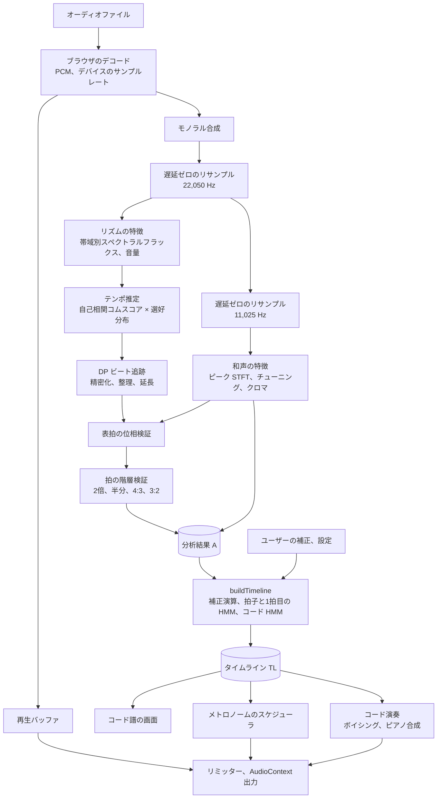
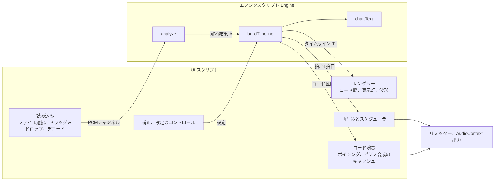
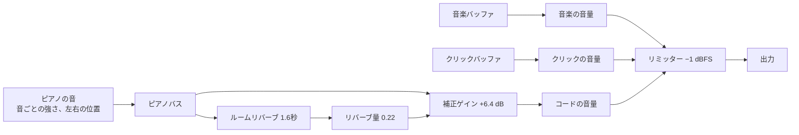

[한국어](README.md) · [English](README.en.md) · **日本語** · [中文](README.zh.md) · [Français](README.fr.md) · [Español](README.es.md)

> 共同作業や貢献をしてくださった方、またはこれからしてくださる方は、個別にご連絡ください。このプロジェクトは、誰でも無料で使えるようにソースを公開しているソフトウェアです。個人的・非営利の目的であれば、費用なしでそのままお使いいただけます。ただし著作権と所有権は原作者・共同作業者・貢献者にあり、原作者の許可なく改変したり、その一部を切り出して自分のプログラムに組み込んで使ったりすること（本人だけが使う場合も含む）、このプログラムを自分のものだと主張すること、他の場所で配布・販売することはできません。GitHub のフォークに改変した内容を載せることも許可していません。学校、塾、サークル、教会、宗教団体、会社などの団体での利用は無条件に無料というわけではないため、事前にご連絡ください。詳しい条件は [LICENSE](LICENSE) にあります。

# Chordity <sup>v1.11.10</sup>

**Chordity は、曲のファイルを入れると小節ごとにコードを書き出し、曲の拍にぴったり合わせてメトロノームを鳴らしてくれるウェブページです。**

コードが変わる瞬間にはピアノがそのコードを弾いてくれるので、耳で確かめながら一緒に弾けます。インストールも会員登録もインターネット接続も不要です。音楽ファイルがあなたのコンピューターの外に出ることはありません。

結果が間違っていることもあります。分析の原理と判断の根拠、結果を確かめて直す方法は[ヘルプページ](information.html)にまとめてあります。アプリのいちばん下にある案内文をクリックしても開きます。

*Chordity: per-measure chord recognition, a beat-locked metronome and synthesized piano chord playback in a single offline HTML file. No libraries, no uploads.*


## 目次

- **[第1部　やさしく知る](#第1部やさしく知る)**
  - [こんなときに便利です](#こんなときに便利です)
  - [使い方](#使い方)
  - [画面の読み方](#画面の読み方)
  - [メトロノームがおかしく聞こえたら](#メトロノームがおかしく聞こえたら)
  - [コード名を別の形で見る](#コード名を別の形で見る)
    - [音名](#音名で見る)、[キャメロット](#キャメロットで見る)、[ローマ数字](#ローマ数字で見る)
  - [ピアノでコードを聴く](#ピアノでコードを聴く)
  - [ショートカットキー](#ショートカットキー)
  - [うまくいく曲、難しい曲](#うまくいく曲難しい曲)
  - [知っておくとよいこと](#知っておくとよいこと)
- **[第2部　原理](#第2部原理)**
  - [2-1. 音を絵に変える](#2-1-音を絵に変える)
  - [2-2. 拍を見つける：新しく鳴る瞬間の規則](#2-2-拍を見つける新しく鳴る瞬間の規則)
  - [2-3. 本当の拍か確かめる](#2-3-本当の拍か確かめる)
  - [2-4. 小節に分ける](#2-4-小節に分ける)
  - [2-5. コードを突き止める](#2-5-コードを突き止める)
  - [2-6. 音楽の規則を確率で](#2-6-音楽の規則を確率で)
  - [2-7. ずれないメトロノーム](#2-7-ずれないメトロノーム)
  - [2-8. コードをピアノで聴かせる](#2-8-コードをピアノで聴かせる)
  - [2-9. 調が変わる場所を見つける](#2-9-調が変わる場所を見つける)
- **[第3部　動作の仕組み](#第3部動作の仕組み)**
  - [3-1. 全体の流れ](#3-1-全体の流れ)
  - [3-2. 読み込みと前処理](#3-2-読み込みと前処理)
  - [3-3. リズムの特徴](#3-3-リズムの特徴)
  - [3-4. 和声の特徴](#3-4-和声の特徴)
  - [3-5. テンポとビート](#3-5-テンポとビート)
  - [3-6. 拍子、小節、コード（軽い段階）](#3-6-拍子小節コード軽い段階)
  - [3-7. 再生とメトロノーム](#3-7-再生とメトロノーム)
  - [3-8. 補正ボタンの役割](#3-8-補正ボタンの役割)
  - [3-9. コード演奏](#3-9-コード演奏)
- **[第4部　深く掘り下げる](#第4部深く掘り下げる)**
  - [4-1. アルゴリズムと数式](#4-1-アルゴリズムと数式)
    - [(1) 遅延ゼロのリサンプリング](#1-遅延ゼロのリサンプリング)、[(2) 実数 FFT](#2-実数-fft)、[(3) 帯域別スペクトラルフラックスとオンセット包絡](#3-帯域別スペクトラルフラックスとオンセット包絡)、[(4) テンポ推定](#4-テンポ推定)、[(5) DP ビート追跡 (Ellis, 2007)](#5-dp-ビート追跡-ellis-2007)、[(6) ビートの精密化](#6-ビートの精密化)、[(7) 表拍の位相検証](#7-表拍の位相検証)、[(8) 拍の階層検証](#8-拍の階層検証)、[(9) 拍の細分判定](#9-拍の細分判定)、[(10) スペクトルピーク、チューニング、クロマ](#10-スペクトルピークチューニングクロマ)、[(11) 拍同期集計、ベースの床、調](#11-拍同期集計ベースの床調)、[(12) コードテンプレートと出力スコア](#12-コードテンプレートと出力スコア)、[(13) コードのビタビ：O(T·K)](#13-コードのビタビotk)、[(14) 1拍目の証拠と拍子 HMM](#14-1拍目の証拠と拍子-hmm)、[(15) メトロノームのスケジューリング](#15-メトロノームのスケジューリング)、[(16) ピアノ合成](#16-ピアノ合成)、[(17) ボイシングと打鍵](#17-ボイシングと打鍵)、[(18) 転調の追跡](#18-転調の追跡)、[(19) キャメロット表記](#19-キャメロット表記)、[(20) ローマ数字による和声分析](#20-ローマ数字による和声分析)、[(21) 曲の種類別の補強](#21-曲の種類別の補強)、[(22) 持続と変化の位置](#22-持続と変化の位置)
  - [4-2. 物理の世界](#4-2-物理の世界)
    - [音、音高、平均律](#音音高平均律)、[倍音](#倍音)、[楽器ごとの周波数帯域](#楽器ごとの周波数帯域)、[時間と周波数のトレードオフ](#時間と周波数のトレードオフ)、[サンプリングとエイリアシング](#サンプリングとエイリアシング)、[音量、残響、対数](#音量残響対数)、[人間の知覚](#人間の知覚)、[ピアノの弦](#ピアノの弦)、[遅延と距離](#遅延と距離)
  - [4-3. 体系](#4-3-体系)
    - [構成](#構成)、[リポジトリ構成](#リポジトリ構成)、[エンジン API](#エンジン-api)、[三つの時計](#三つの時計)、[オーディオグラフ](#オーディオグラフ)、[設定の保存](#設定の保存)
  - [4-4. 課題と解決](#4-4-課題と解決)
  - [4-5. 最適化](#4-5-最適化)
  - [4-6. 検証](#4-6-検証)
    - [単体テスト](#単体テスト)、[合成曲の回帰テスト](#合成曲の回帰テスト)、[転調テスト](#転調テスト)、[キャメロット表記テスト](#キャメロット表記テスト)、[ローマ数字テスト](#ローマ数字テスト)、[実録音テスト](#実際の録音のテスト)、[実ブラウザでのエンドツーエンドテスト](#実際のブラウザでのエンドツーエンドテスト)、[コード演奏テスト](#コード演奏テスト)、[曲の種類の拡張テスト(1.5.0)](#曲の種類の拡張テスト150)、[拍子の変化とテンポ表示のテスト(1.6.0)](#拍子の変化とテンポ表示のテスト160)、[持続と変化の位置のテスト(1.8.4)](#持続と変わり目の位置のテスト184)
  - [4-7. 特長](#4-7-特長)
  - [4-8. 限界と今後](#4-8-限界と今後)
  - [4-9. 参考文献](#4-9-参考文献)
- **[更新履歴](#更新履歴)**
  - [バージョンの規則](#バージョンの規則)
  - [Chordity 1.x](#chordity-1x)
    - [1.11.10](#11110-2026-10-21)、[1.11.9](#1119-2026-10-18)、[1.11.8](#1118-2026-10-18)、[1.11.7](#1117-2026-10-15)、[1.11.6](#1116-2026-10-14)、[1.11.5](#1115-2026-10-14)、[1.11.4](#1114-2026-10-14)、[1.11.3](#1113-2026-10-14)、[1.11.2](#1112-2026-10-13)、[1.11.1](#1111-2026-10-13)、[1.11.0](#1110-2026-10-13)、[1.10.5](#1105-2026-10-11)、[1.10.4](#1104-2026-10-11)、[1.10.3](#1103-2026-10-11)、[1.10.2](#1102-2026-10-11)、[1.10.1](#1101-2026-10-11)、[1.10.0](#1100-2026-10-11)、[1.9.4](#194-2026-10-10)、[1.9.3](#193-2026-10-10)、[1.9.2](#192-2026-10-10)、[1.9.1](#191-2026-09-30)、[1.9.0](#190-2026-09-30)、[1.8.4](#184-2026-09-30)、[1.8.3](#183-2026-09-30)、[1.8.2](#182-2026-09-30)、[1.8.1](#181-2026-09-30)、[1.8.0](#180-2026-09-30)、[1.7.0](#170-2026-09-30)、[1.6.0](#160-2026-09-30)、[1.5.0](#150-2026-09-30)、[1.4.2](#142-2026-09-27)、[1.4.1](#141-2026-09-27)、[1.4.0](#140-2026-09-26)、[1.3.1](#131-2026-09-26)、[1.3.0](#130-2026-09-26)、[1.2.0](#120-2026-09-26)、[1.1.1](#111-2026-09-26)、[1.1.0](#110-2026-09-26)、[1.0.0](#100-2026-09-26)
  - [開発版 0.x（小節コード）](#開発版-0x마디-코드)
    - [0.4.1](#041-2026-09-26)、[0.4.0](#040-2026-09-25)、[0.3.1](#031-2026-09-25)、[0.3.0](#030-2026-09-25)、[0.2.1](#021-2026-09-25)、[0.2.0](#020-2026-09-25)、[0.1.0](#010-2026-09-25)


---

## 第1部　やさしく知る

### こんなときに便利です

- 好きな曲をギターやピアノで一緒に弾いてみたいとき
- 曲のコードを知りたいのに、耳で一つずつ探すのが難しいとき
- 原曲に合わせてリズム練習をしたいとき

### 使い方

1. `chordity.html` ファイルを Chrome、Edge、Safari、Firefox などのブラウザで開きます。
2. **ファイルを開く**（「파일 열기」）を押すか、音楽ファイルをウィンドウの上にドラッグ＆ドロップします。数秒待つとコード譜が表示されます。
3. **再生**（「재생」）ボタンを押します。音楽と一緒にメトロノームが拍ごとに「カッ」と鳴り（小節の1拍目は高い「ピッ」、コード変化の単位が½拍なら拍の間に小さな「チッ」も）、いま鳴っているコードを黄色い蛍光ペンの枠が囲み、そのコード名が大きくなります。枠の中は進行バーのように再生した分だけオレンジ色で満たされ、コードが変わると枠がばねのように弾んで次のコードへ移ります。ピアノは原曲がコードを弾く場所ごとにそのコードを弾いてくれます（コードが変わるときや同じコードを弾き直すときに打ち直し、伸ばしている所ではそのまま鳴らし続けます）。

MP3、WAV、M4A、FLAC、OGG など、ブラウザが再生できるファイルであれば大丈夫です。

### 画面の読み方

| 見えるもの | 意味 |
|---|---|
| 黄色い蛍光ペンの枠 | いま鳴っているコード。そのコードを弾いた拍から次のコードが出てくる所までを囲む（伸ばしている灰色のコードが次の小節へ続くならそこまで、行が変わると行ごとに一片ずつ）。コードが変わるとばねのように弾んで次のコードへ移る |
| 枠の中のオレンジ色の塗り | そのコードでここまで演奏された分（進行バー）。塗りの端が現在の再生位置で、拍が始まるときにその拍の斜線の位置に届く |
| 大きくなったコード名 | いま鳴っているコードの名前（新しく弾いたコード）。入ってきたときにぱっと大きくなり、次のコードに移るとゆっくり元の大きさに縮む。次の名前に触れない程度にだけ大きくなる |
| 斜線 `/` | 1拍。濃く変わる斜線が現在の拍 |
| 太い斜線 | コードを新しく弾く拍（黒い文字のコードが置かれた拍）。どんなリズムでコードを弾いているかがわかる。灰色のコードと `N.C.` の位置は通常の斜線 |
| `C` `Am` `G7` | コード名。斜線のすぐ上にあれば、その拍でコードが変わる |
| `G/B` | G コードだが、いちばん低い音が B |
| 小さな文字、上下2段に置かれたコード名 | 1小節にコードが多く、名前が次のコードに触れると文字を小さくし、それでも収まらなければその小節の名前を上下2段に交互に置く（名前の左端がそのコードを弾く拍）。狭い画面で小節の最後の拍の長い名前が2段でも収まらないときは、重要度の低い部分から省いて `…` を付ける（`Bm7/F♯` → `Bm7…`）。完全な名前はマウスを重ねるか、再生中に上の「現在のコード」欄で見られる |
| 灰色のコード | 前の小節のコードを新しく弾かず、そのまま伸ばしている。同じコードでも小節の1拍目で弾き直せば黒い文字 |
| `N.C.` | コードがない部分（ドラムだけのときや静かなとき） |
| 0番小節 | 曲が小節の途中から始まる部分（弱起・アウフタクト） |
| 小節の上の `2박` のような表示 | その小節だけ拍数が違う（「박」は「拍」） |
| 黒い名札 `E 장조로` | その拍から調が変わる（転調）。上の調欄にも `E♭ 장조 → E 장조` のように表示される。曲の最初の小節には開始時の調と拍子が助詞なしで付く（`C 장조` `4/4`。楽譜の調号・拍子記号と同じ） |
| 黒い名札 `3/4으로` | その小節から拍子が変わる（拍子の変化）。上の拍子欄にも `4/4 → 3/4 → 4/4` のように表示される |
| 白い錠剤形の名札 `72` `132로` | その拍からのテンポ（BPM、四捨五入）。スラッシュの下の行。曲が始まる拍には開始テンポを数字だけで、テンポが急に変わった所には新しいテンポに韓国語の助詞 `로/으로`（「〜へ」）を付ける |
| 白い六角形の枠 `여기까지 63` | テンポが徐々に変わる区間（スラッシュの下の行）。「여기까지」は「ここまで」の意味。枠がかかっている長さが変化する区間で、再生位置が枠の中にあると、通過した分だけ蛍光ペンの色で満たされながら `현재 67`（「現在 67」）のように現在のテンポを表示する。最後まで満ちると白く薄れ、枠の終わりの次の拍の白い錠剤（到着したテンポ）が一瞬点灯する |
| テンポ（上の欄と再生バー） | 再生している位置のテンポ。テンポが徐々に変わると 120、119、118 … のように追従する。再生バーはスクロールしても画面のいちばん上に固定され、常に見える |
| `8B`、`9A` に小さな文字が付いた名前 | キャメロット表記を選んだときのコード名（下の「キャメロットで見る」を参照） |
| `I`、`vi`、`V7/ii` のようなローマ数字 | ローマ数字表記を選んだときのコード名（下の「ローマ数字で見る」を参照） |
| 丸い表示灯 | いま何拍目か。いちばん大きい丸が小節の1拍目 |
| 上の「次 G」（「다음 G」） | もうすぐ出てくるコード |
| メトロノーム、コード演奏ボタン | 押すたびにオン・オフ |
| 音楽、クリック、コードのスライダー | 原曲、メトロノーム、ピアノのコード音の音量を個別に調整 |

### メトロノームがおかしく聞こえたら

たいていは自動で合いますが、曲によっては人によって拍の数え方が違うこともあります。**拍が合いませんか？ 補正する**（「박이 안 맞나요? 보정하기」）を開いて、下のボタンを押してみてください。押すとすぐに変わります。

| こう聞こえたら | このボタンを |
|---|---|
| クリックが拍と拍の間で聞こえる | ½拍ずらす（「½박 옮기기」） |
| クリックが細かすぎる | 半分に ÷2（「절반으로 ÷2」） |
| クリックがまばらすぎる | 2倍速く ×2（「두 배 빠르게 ×2」） |
| 6/8 の感じの曲なのにクリックが多すぎる | 3つずつまとめる ÷3（「셋씩 묶기 ÷3」） |
| 小節の始まりが1拍ずれている | 1拍早める、1拍遅らせる（「한 박 앞당기기」「한 박 늦추기」） |
| クリックがほんの少し早い、または遅く感じる | クリックのタイミング（「클릭 타이밍」） |
| 拍の補正を最初の状態に戻したい | 拍の補正を元に戻す（「박 보정 되돌리기」） |
| コードの種類などの設定を最初の状態に戻したい | 設定を既定値に（「설정 기본값으로」） |

いま何を変更しているかは、同じ欄の **適用中**（「적용 중」）に「拍の補正」（「박 보정」）と「設定」（「설정」）に分けて表示されます。欄を折りたたんでも、見出しの横に要約が見えます。

コードをもっとシンプルに見たいときは **コードの種類**（「코드 종류」）で「基本」（「기본」）を、1拍の中で変わるコードまで見たいときは「½拍単位」（「½박 단위」）を選んでください。½拍単位では、メトロノームも拍の間（8分音符の位置）に小さく高い「チッ」を入れ、「ピッ・チッ・カッ・チッ・カッ・チッ・カッ・チッ」のように鳴ります。

### コード名を別の形で見る

コード譜のすぐ上にある **コード表記**（「코드 표기」）バーで、同じコードを3通りの方式で見ることができます。押すとすぐにコード譜、現在・次のコード、テキストのコード譜が一緒に変わり、選んだ方式は次に開いたときもそのままです。キーボードでは、バーにフォーカスを置いたまま ←、→ で切り替えます。

| ボタン | 例 | こんなときに便利 |
|---|---|---|
| 音名（「음이름」） | E♭, B♭/D, Cm7 | コードを見ながらすぐに一緒に弾くとき、演奏者同士でコードをやり取りするとき |
| キャメロット（「카멜롯」） | 5B, 6B, 3A⁷ | よく合う調やコードを探すとき、DJ ミックスのポイントを選ぶとき |
| ローマ数字（「로마 숫자」） | I, V⁶, ii⁷/IV | 曲の和声進行を分析するとき、別の調に移して弾くとき |

下の3つの図は、E♭ 長調の同じ11小節をそれぞれの方式で見たものです。

#### 音名で見る


いちばんなじみのあるコード名です。ルートは大きく、m・sus・dim などの性質は少し小さく、7・maj7 などの拡張音は上付き文字で書くので、複雑なコードもひと目で読めます。

- **スラッシュコード**：2小節目の `B♭/D` は、B♭ コードを弾きつつ、いちばん低い音を D にするという意味です。6小節目の `B♭7/A♭` のように7度の音をベースに置いたコードもそのまま書きます。
- **調に合った ♯/♭**：同じ音でも、その位置の調に合わせて書きます。この曲は E♭ 長調なので A♯ ではなく B♭、G♯ ではなく A♭ と書き、曲が E 長調に転調すると、それ以降は G♯m7 のように ♯ で書きます。
- 前の小節から新しく弾かずに伸ばしているコードは灰色で、コードがない所は `N.C.` と書きます。同じコードでも小節の1拍目で弾き直せば黒い文字で書きます。

#### キャメロットで見る


DJ が曲と曲をつなぐときに使うキャメロット・ホイールの番号で書きます。調を5度圏の順に1〜12番の位置に置き、長調系には B、短調系には A を付けます。番号が同じか1つ違いの調やコード同士は、よく調和して響きます。

- **コードの読み方**：ルートと性格（長・短）が同じ調の番号で書き、コードの種類は小さな文字で付けます。E♭ は 5B、Cm は 5A、B♭7 は 6B に小さな 7 が付きます。
- **調の外の和音がひと目でわかります**：この曲の調は E♭ 長調（5B）なので、コードはほとんど4〜6番に集まっています。4小節目の `3A⁷`（B♭m7）だけ番号が遠く離れていますが、これは IV である A♭maj7（4B）へ向かうために一時的に借りてきた和音だからです。
- 曲の調も `E♭ 장조(5B)` のように番号と一緒に表示します（「장조」は「長調」）。
- キャメロットにはベース音を書く方法がないため、スラッシュコードのベース音は省略します（`B♭/D` → `6B`）。コード演奏ではベース音までそのまま弾きます。

#### ローマ数字で見る


和声学の本で使われるローマ数字による和声分析です。コードを音名の代わりに **調の中の何番目の音の上に立つ和音か** で書くので、曲がどんな骨組みで動いているかが見えてきます。調が違っても同じ進行は同じ数字で表されるので、別の調に移して弾いたり、複数の曲の進行を比べたりするのに便利です。

- **図の流れ**：最初の3小節 `I – V⁶ – vi` は、ベースが E♭ → D → C と1音ずつ下がっていく進行です。続く `ii⁷/IV – V⁷/IV – IVᴹ⁷` は IV（A♭maj7）へ向かうために A♭ 長調の ii–V を一時的に借りてくる進行で、最後の `ii⁷ – V⁷ – I` は最も基本的な終止（カデンツ）です。
- **転回形の数字**：2小節目の `V⁶` は第3音（D）を、6小節目の `V⁴₂` は第7音（A♭）をベースに置いた和音です。

| 表記 | 意味 |
|---|---|
| I, IV, V（大文字） | 長三和音系のコード。数字は調の何番目の音の上の和音か |
| i, ii, vi（小文字） | 短三和音系のコード |
| °, ø, +, M | 減三和音（°）、半減七の和音（ø）、増三和音（+）、長七の和音（M7） |
| 7 | 七の和音 |
| 6, ⁶₄ | 三和音の転回形。ベースが第3音なら 6、第5音なら ⁶₄ |
| ⁶₅, ⁴₃, ⁴₂ | 七の和音の転回形。ベースが第3音、第5音、第7音のとき |
| V/x, vii°/x, ii/x | x へ向かうために一時的に使う和音（副次和音）。V7/vi は vi へ向かう属七の和音 |
| ♭VI, ♭VII など | 調の音階の外の度数。同主短調から借りてきた和音（借用和音）など |

- 数字はその位置の調を基準に数えます。転調した後は新しい調で数え直します。
- 転調の直前に新しい調の属和音が出てきたら、新しい調を基準に V と書きます（例：E 長調へ移る直前の B7 は V7）。
- ベース音表記（分数コード）をオフにすると、転回形の数字なしで基本形で書きます。

### ピアノでコードを聴く

**コード演奏**（「코드 연주」）をオンにしておくと、コードが変わる瞬間にピアノがそのコードを弾いてくれます。原曲と重ねて聴けば、書かれたコードが合っているかを耳ですぐに確かめられ、一緒に弾くときの道しるべにもなります。ピアノは曲の音高に自動で合わせられるので、原曲と音がずれることはありません。

- 音楽、クリック、コードの音量は、上の3本のスライダーで個別に調整します。
- **補正する**（「보정하기」）の **コード演奏** で、弾くタイミングを選べます：曲に合わせる（「곡 따라」、既定。原曲で新しく弾いた所だけ打ち直す）、コードが変わるとき（「코드가 바뀔 때」）、小節ごとに打ち直す（「마디마다 다시」）、拍ごと（「박마다」）。
- オフにするには **コード演奏** ボタンか P キーを押してください。

### ショートカットキー

| キー | 機能 |
|---|---|
| Space | 再生、一時停止 |
| M | メトロノームのオン・オフ |
| P | コード演奏のオン・オフ |
| ← → | 前の小節、次の小節 |
| Home | 先頭へ |

小節をクリックするとその小節へ移動し、上の波形をクリックまたはドラッグしても好きな位置へ移動できます。ハングル入力の状態でもショートカットキーは動作します。

### うまくいく曲、難しい曲

ドラムのあるポップ、ロック、バラード、ダンス、ヒップホップ、K-POP、アコースティック・ポップのように拍がはっきりした曲はうまくいきます。曲の途中でテンポが大きく変わる曲、5/4・7/4 のような変拍子、F/G のようにベースがコードの外の音であるコード、ロックのパワーコード（E5）も認識します。ジャズのようにテンションやウォーキングベースが多い曲、ボサノヴァのように2拍単位で感じる曲（小節が2倍の長さで書かれる）、ディストーションが非常に強いメタル、レゲエのように拍を2通りに数えられる曲は間違えることがあります。そんなときは上の補正ボタンを使ってください。

### 知っておくとよいこと

- ファイルがインターネットに送られることはありません。すべての分析はブラウザの中で行います。
- 画面のいちばん下の案内文を押すと、結果が間違いうるケースとその確かめ方、分析の原理と検証結果をまとめた[ヘルプ](information.html)が新しいタブで開きます。
- メトロノーム、コード演奏、音量、コードの種類やコード表記の方式などの設定はブラウザに保存され、次回もそのままです。
- Bluetooth イヤホンを使っても、音楽、クリック、ピアノが一緒に遅れて出るので、互いにずれることはありません。
- iPhone で音が出ないときは、消音モードがオンになっていないか確認してください。

<p align="center"></p>

---

<p align="right"><a href="#목차">↑ 目次へ</a></p>

## 第2部　原理

このプログラムは、事前に学習した人工知能モデルを使いません。音の物理的な性質と音楽の規則を数式に置き換えた **信号処理** と **確率モデル** で動作します。そのため判断の根拠を一つひとつ説明でき、画面下の **分析情報**（「분석 정보」）でその根拠を直接見ることができます。

### 2-1. 音を絵に変える

音は空気の振動で、録音ファイルはその振動を1秒間に何万回も測った数値の並びです。数値を見ただけではどんな音が鳴っているのかわかりにくいため、音をごく短い断片に切り分け、断片ごとに **どの高さの音がどれだけ混ざっているか**（スペクトル）を計算します。これを時間順に並べると、横軸が時間、縦軸が音高の、音の絵（スペクトログラム）になります。以降の分析はすべて、この絵を読む作業です。

ここには避けられないトレードオフがあります。断片を短く切ると **いつ** 音が鳴ったかは正確ですが **どの音** かはぼやけ、長く切るとその逆になります。そこで、拍を探すときは短い断片を、コードを探すときは長い断片を別々に使います。最も低いベースの音は半音間の周波数の差がとても小さいため、最も長い断片が必要です。

### 2-2. 拍を見つける：新しく鳴る瞬間の規則

ドラムを叩いたり鍵盤を押したりすると、その瞬間に音のエネルギーが急に増えます。このような瞬間を **オンセット** といいます。スペクトログラムで直前より大きくなった部分だけを足し合わせると、オンセットごとに鋭く立ち上がる曲線ができます。

拍とは、これらのオンセットが **一定の間隔で繰り返される骨組み** です。まず曲線を時間方向にずらしながら自分自身と重ね合わせ（自己相関）、最もよく重なる間隔、すなわちテンポを見つけます。次に「強いオンセットをできるだけ多く通りつつ、間隔はテンポから大きく外れない」拍の列を、曲全体にわたって一度に探します（動的計画法）。拍を一つずつ別々に決めるのではなく全体をまとめて最適化するので、弱い拍がいくつか混ざっていても列が途切れず、演奏のテンポが少しずつ揺れても追従します。このときの「一定の間隔」の基準は曲全体のテンポではなく、数秒単位で求めた **局所テンポ** です。そのため、フィルインのように一時的にリズムが複雑になる所には引きずられず、曲が実際に遅くなったり速くなったりすればそれに追従します。

### 2-3. 本当の拍か確かめる

規則的な列が見つかっても、それで終わりではありません。よくある間違いが2つあります。

**裏拍を拍として捉える場合。** ハイハットが拍の間を強く埋めると、列が半拍ずれて捉えられることがあります。しかし音楽には規則があります。キック、スネア、ベースが入る瞬間やコードが変わる瞬間は、たいてい **表拍** に集まります。そこで、見つけた拍の位置と半拍ずらした位置でこれらのイベントの強さを比べ、半拍ずらした方がはっきり強ければ列全体を半拍ずらします。

**テンポを2倍や半分で捉える場合。** ゆっくりしたバラードで8分音符のアルペジオが細かく続くと、8分音符一つひとつを拍と勘違いしやすくなります。このときは拍を一つおきに2つのグループに分けてみます。本当の拍にキックとスネアが来て、その間には鍵盤の音しかなければ、一方のグループがもう一方よりずっと強く出ます。そうなれば弱いグループを捨て、テンポを半分に直します。逆に、拍と拍のちょうど真ん中ごとにスネアが規則的に来るなら、テンポを遅く捉えすぎているので2倍に直します。2倍にする方は、間違えるとすぐに裏拍でクリックが鳴ってしまうので、ずっと厳しい条件のときだけ行います。

実際の録音ではハイハットや鍵盤が裏拍を埋めるため、2つのグループの強さの差が小さく出ることがあります。そこで **キックとスネアがどちらのグループに来るか** も見ます。正しいテンポならキック（1・3拍目）とスネア（2・4拍目）は互いに別のグループに来ますが、2倍で捉えていれば両方とも同じグループ（本当の拍）に来ます。テンポを半分に直すときは、ビートを一つおきに間引くのではなく、新しいテンポで最初から追跡し直します。8分音符の階層での追跡が曲の途中のどこかで1マスでも滑ると、間引いたビートはそれ以降すべて半拍ずつずれてしまうからです。

**速い曲を半分で捉える2つの形。** 160〜180 BPM ほどの速い曲は、拍を1階層遅く、つまり半分のテンポで捉えやすくなります。このとき、遅い拍がどこに乗ったかによって形が異なります。遅い拍がスネア（2・4拍目）に乗ると、拍の上ごとにスネアが均等に来て、キックは拍の間に来ます。正しいテンポのゆっくりした曲なら、キックは拍の上（1・3拍目）に来てスネアは1拍おきに来るので、現れない形です。遅い拍がキックに乗ると（ハーフタイムの感じ）、拍の間にも拍の上と同じくらいスネアが来ます。どちらの場合も、テンポ推定が2倍のテンポをほぼ同じ強さの候補として出したときだけ2倍に直します。遅い拍がスネアに乗ったままにしておくと、小節の1拍目もずれて1拍の中に2つのコードが混ざり、七の和音やスラッシュコードがたくさん出てしまいます。

半分にする方も、もう一度確かめます。8分音符を拍として捉えていたなら、拍と拍の真ん中は16分音符の位置なので、キックやベースのような低音の打撃はまれです。そこで、拍の間にも低音が頻繁に来るなら拍は正しいと見なし、半分にはしません。偶数・奇数グループの強さの差だけで半分にしようとするとき、スネアがキックと反対側のグループに集まっていれば（バックビート）、やはり正しい拍なので半分にはしません。

「スネア」を見分ける方法は物理的です。スネアの裏面の響き線が振動すると、中くらいの高さからとても高い音まで **一斉に** 大きくなる雑音が出ます。鍵盤の音はいくつかの高さでしか大きくならず、ハイハットは高い側でしか大きくなりません。そこで「中くらいの高さと高い側が同時に大きくなったか」を2つの値の積で測ると、スネアだけを選び出せます。どちらか一方でも小さければ、積が小さくなるからです。

### 2-4. 小節に分ける

拍をいくつかずつまとめて小節を作るには、**小節の1拍目** がどこかを知る必要があります。1拍目には痕跡が残ります。コードが変わり、ベースの音が変わり、キックが強く入り、音が大きくなることもあります。拍ごとにこうした痕跡に点数を付け、「小節はふつう同じ長さで繰り返される」という規則を守りながら、点数が最も高いまとまり方を探します。4拍と3拍のどちらが痕跡によく合うかも、この方法で決めます。1拍の中が3つに分かれる感じが強ければ、6/8、12/8 のような複合拍子と見なします。

ドラムがバックビートを叩く曲では、**キックは1・3拍目、スネアは2・4拍目** という偶数・奇数の形も1拍目の痕跡として使います。コードが小節の1拍目より8分音符分早く変わるシンコペーションのリフでは、コード変化の痕跡が1拍前へ引っ張られますが、ドラムの偶数・奇数の形はそのままなので、小節が1拍ずれることはありません。また3・5・7拍子は、1拍目の痕跡が実際にその長さごとに繰り返されるときだけ選びます。短い曲で、まれな大きな痕跡をいくつか拾っただけで7拍子のように見えてしまうのを防ぐためです。

### 2-5. コードを突き止める

オクターブが異なる同じ音（低いドと高いド）は、和音の中で同じ役割を果たします。そこで、すべての音をド、ド♯、レ … シの **12マス** に折りたたんで入れると、その瞬間に鳴っている音の指紋ができます（クロマ）。C コードなら、ド、ミ、ソのマスが目立ちます。

実際の楽器は1つの音だけを出すわけではありません。ドを弾くと、1オクターブ上のド、その上のソ、さらにド、ミ … といった **倍音** が一緒に鳴ります。たとえば C コードのミから出た倍音はシのマスを埋めるので、倍音を考慮しない比較では C を Cmaj7 と取り違えてしまいます。そこで、コードの指紋も倍音まで含めて作っておき、それと比較します。

ベース（いちばん低い音）は別に見ます。コードは C なのにベースがミなら `C/E` と書きます。

録音ごとに基準音は少しずつ異なります。A の音がちょうど 440 Hz ではない曲もたくさんあります。そこで、まず曲全体の音が平均してどれだけ高いか低いかを測り、その分を補正してから12マスに入れます。

### 2-6. 音楽の規則を確率で

拍ごとに最も似ているコードを選ぶだけだと、メロディーの経過音のせいでコードが拍ごとに点滅するように変わってしまいます。そこで2つの常識を確率として組み込みます。**コードはそう頻繁には変わらない**、そして **変わるなら小節の1拍目で最も変わりやすく、拍の間ではあまり変わらない**。この規則と音の似かたを合わせて考え、曲全体で最ももっともらしいコードの並びを一度に選びます（隠れマルコフモデルとビタビアルゴリズム）。曲の調も推定し、調に合うコードに少し加点します。

### 2-7. ずれないメトロノーム

このメトロノームは「1分間に97回カチカチ」のように一定の間隔で鳴らすのではなく、**見つけた拍一つひとつの時刻** に鳴らします。そのため演奏が少し速くなったり遅くなったりしても追従します。

タイミングも精密です。タイマーで「今鳴らせ！」とクリックを出すと、コンピューターが忙しいときに数十 ms ずつ遅れます。そこで、音楽を再生している **オーディオデバイスの時計** に、クリックを0.2秒前もって予約しておきます。音楽とクリックが同じ時計と同じ出力経路を使うのでサンプル単位でかみ合い、出力が遅れるデバイスでも両者が一緒に遅れて出るので、互いにはずれません。

### 2-8. コードをピアノで聴かせる

録音されたピアノの音を入れるとファイルが大きくなり、外部ファイルも必要になります。そこでピアノの音を **物理法則から直接作って** 使います。ピアノの弦は理想的な弦ではなく硬い鋼線なので、倍音が正確な整数倍より少しずつ高く鳴ります（非調和性）。ハンマーは弦の長さの1/7ほどの位置を叩くので、その点で動かない倍音は弱く鳴ります。1つの音を2〜3本の弦が一緒に出しますが、弦同士の音がごくわずかに違うため音がゆっくり揺らぎ（うなり）、最初は速く減衰し、後には長く残る2段階の減衰が生じます。高い倍音ほど早く消えるので、音はだんだん柔らかくなります。これらの性質を数式で積み重ね、1音ずつ合成します。

コードは左手のベース1音と右手の和音に分けて弾きます。右手は前のコードから手の動きが最も少ない転回形を選ぶので、コードが変わっても音がばらつきません。ピアノは分析で見つけた曲の基準音に合わせて調律され、メトロノームと同じオーディオの時計に予約されて、コードが変わる瞬間に正確に鳴ります。

### 2-9. 調が変わる場所を見つける

曲の調は「主にどの音が使われているか」で表れます。E♭ 長調の曲は主に E♭、F、G、A♭、B♭、C、D を使い、E 長調に移ると E、F♯、G♯、A、B、C♯、D♯ を使います。そこでビートごとに前後数小節の音の分布を24の調の典型的な分布と比べ、**調はそう頻繁には変わらない** という規則を確率として組み込んで、曲全体で最ももっともらしい調の流れを探します。1〜2小節かすめるだけの他の調の和音（例：C 長調の曲の E7 → Am）は転調とは見なしません。同じ音を使う平行調（C 長調と A 短調）の間の移動も、調号が変わらないので転調とは見なしません。

転調の位置は拍単位で細かく整えます。新しい調の属和音（例：E 長調の B7）を経て移る場合は、楽譜で調号を書き換える慣例に従い、新しい主和音が出てくる位置を転調の位置と見なします。コード名の ♯/♭ 表記もその位置の調に従います。E 長調の区間では A♭m7 ではなく G♯m7 と書きます。

---

<p align="right"><a href="#목차">↑ 目次へ</a></p>

## 第3部　動作の仕組み

### 3-1. 全体の流れ



分析は **重い段階** と **軽い段階** に分かれます。

- **重い段階** `analyze()` は、ファイルを開いたときに一度だけ実行されます。信号処理のすべてと自動ビート追跡までを行います。通常は数秒かかり、32 ms ごとに画面に制御を返すので、進行状況の表示が止まりません。
- **軽い段階** `buildTimeline()` は、補正ボタンや設定を変えるたびに実行されます。拍子、小節、コードを再計算しますが、5分の曲でも約 40 ms なので、押すとすぐに反映されます。

### 3-2. 読み込みと前処理

1. ブラウザ内蔵のデコーダーがファイルを PCM に展開します。このバッファ1つを **再生と分析の両方に** 使います。別々にデコードしたり、ブラウザのリサンプラーを通したりすると、2つの結果の時間軸が数 ms ずつずれることがあるからです。
2. チャンネルを平均してモノラルにし、独自に実装したリサンプラーで 22,050 Hz（リズム用）と 11,025 Hz（和声用）の信号を作ります。フィルターカーネルが左右対称なので、信号は1サンプルもずれません。
3. 最大振幅を1にそろえます。

### 3-3. リズムの特徴

| 段階 | 処理内容 | 主な値 |
|---|---|---|
| 短時間フーリエ変換 | 22,050 Hz の信号を断片ごとにスペクトルへ | 窓 1024点（46.4 ms）、ホップ 256点（11.6 ms、毎秒 86.13 フレーム） |
| 対数圧縮 | 静かな音の変化も見えるように | log(1 + 1000·\|X\|) |
| 最大値フィルター | 2フレーム前のスペクトルを周波数方向に ±1マス広げて比較 | ビブラートや音程の滑りをオンセットと取り違えない |
| 帯域別フラックス | 増えた量だけを帯域ごとに平均 | 低域 21–200 Hz（キック、ベース）、中域 200–2,500 Hz（スネアの胴、鍵盤）、高域 2.5–10 kHz（ハイハット、スネアの響き線） |
| オンセット包絡 | 帯域ごとに標準偏差で割って合算 | 高域は半分の重み（裏拍のハイハットの影響を縮小） |
| 音量 | フレームごとの RMS | 有音区間の判定と波形表示に使用 |

### 3-4. 和声の特徴

| 段階 | 処理内容 | 主な値 |
|---|---|---|
| トレブルのピーク STFT | コード構成音用のスペクトルピーク | 窓 2048点（186 ms）、110–4,200 Hz、フレームあたり最大36個 |
| ベースのピーク STFT | ベース音とチューニング用 | 窓 4096点（372 ms）、32–1,400 Hz、フレームあたり最大24個 |
| ピークの条件 | はっきりした山だけ | フレーム最大値比 −45 dB 以上、周囲 ±6マスの平均の2倍以上 |
| 対数放物線補間 | 周波数と大きさをマスの間隔より精密に | ピークとその両隣のマスの対数の大きさを使用 |
| 基準音の推定 | すべてのピークの「半音の小数部」を円周上で平均 | 例：+18 cent → A4 = 444.6 Hz |
| クロマ | 補正した音高を12マスに累積 | 半音の中心に近いほど大きな重み（cos²）。トレブルは MIDI 48–96、ベースは 28–57 |
| 和声変化曲線 | 前後4フレームのクロマのコサイン距離 | 表拍の位相検証に使用 |

### 3-5. テンポとビート

1. **有音区間**：曲の大きな音量（上位 5%）に対して −38 dB 以上の区間を有音と見なします。
2. **テンポ**：オンセット曲線を ±3秒の平均音量で割って平準化し、自己相関を求めます。40–240 BPM を 0.25 BPM 刻みで走査し、1・2・3・4倍の間隔を合わせて見るコムスコアに 110 BPM を中心とする選好分布を掛け、最大値の周辺を放物線補間します。
3. **DP ビート追跡**：Ellis（2007）の方法を2点変えて使います。間隔は 8秒窓で求めた局所テンポ曲線（フィルインを除くよう7秒の中央値）と比べ、ペナルティの強さは拍の周期の2乗に比例させて、ゆっくりした曲でも同じ ms の揺れには同じペナルティを与えます。
4. **精密化**：各ビートを ±2フレーム（±23 ms）以内のオンセットの頂点へ移し、放物線補間します。オンセットが弱いビートは、隣接するビートの直線回帰で埋めます。最後に検出遅延 6.5 ms を補正します。
5. **整理**：有音区間の外のビートを消し、前後に同じ間隔をつなげて有音区間全体を覆います。
6. **検証**：表拍の位相検証と拍の階層検証を順に行います（2-3の原理）。拍の階層を半分に直したときは、新しいテンポで3〜5をやり直し、位相も再検証します。拍が3つに分かれて見える場合は、4/3倍遅いテンポと 3/2倍速いテンポも確認します（1.11.5・1.11.6、4-1の (9)）。

### 3-6. 拍子、小節、コード（軽い段階）

1. **補正演算の適用**：ユーザーが押した ½拍、×2、÷2、÷3 を、押した順にビートの一覧へ適用します。÷2 と ÷3 では、どの拍を残すかを拍の強勢で決めます。
2. **拍単位の集計**：拍区間のクロマを、中央に重みを置いて平均します。ベースのクロマからは曲全体の中央値の半分を引き、音程のあるキックドラムのように常に鳴っている成分を取り除きます。
3. **調と転調**：ビートごとに前後 ±6拍の音の分布を Krumhansl–Kessler の調プロファイルと比べ、12種類の調号を状態とする HMM で調の区間を分けます。24拍より短い区間は隣の区間に吸収します。転調がなければ、曲全体の分布で選んだ調を1つ使います。コードを認識した後は、区間ごとにコードから調を決め直します。コードがどの調の音階に当てはまるか、主和音が占める時間、V → I の終止、最初と最後のコード、4小節フレーズの1拍目のコードを、音の分布と合わせて見ます。
4. **予備のコード**：長三和音と短三和音だけで素早く一度解き、1拍目の証拠として使います。
5. **細分の判定**：拍の中の 1/2 の位置と 1/3、2/3 の位置のオンセットの強さを比べ、複合拍子かどうかを見ます。
6. **1拍目の HMM**：拍子を自動で選び（4拍 対 3拍、複合拍子なら 4 対 2）、ユーザーによる1拍目の移動を反映します。
7. **最終のコード HMM**：1拍または½拍単位で、転回形を含む最大289個の状態の中からビタビで解きます。
8. **小節の構成**：1拍目ごとに小節を区切り、小節内のコード変化の位置と長さ、前の小節から続いているかどうか、その位置の調に合った音名（♯ または ♭）、キャメロット記号、ローマ数字を一緒に付けます。画面はコード譜の上のコード表記バーで選んだ1つを表示し、表記を切り替えても再分析はしません。転調の境界は小節の1拍目を少し好むように拍単位で整え（属和音を経由する場合は主和音の位置へ）、何小節目の何拍目かを記録します。

### 3-7. 再生とメトロノーム

- **音楽**：`AudioBufferSourceNode` を現在のオーディオ時刻より 60 ms 後に開始します。
- **スケジューラ**：25 ms ごとに起きて、これから 0.2秒以内に来るビートのクリックをオーディオの時計に予約します。タブがバックグラウンドにあるとブラウザがタイマーを遅らせるので、1.5秒先まで予約します。
- **クリック音**：あらかじめ作っておいた短い音です（1拍目 1,850 Hz、その他 1,250 Hz、½拍単位のときの拍の間 2,600 Hz）。最初のサンプルから音が出るので、発音の遅れがありません。
- **再同期**：位置を移動したり、補正や設定を変えたりすると、予約したクリックをすべて取り消し、現在位置の次のビートから予約し直します。
- **画面**：毎フレーム再生位置を計算しますが、ブラウザが知らせる出力遅延の分を差し引いて、実際に聞こえるタイミングに合わせます。小節、拍、コードが変わったときだけ画面を更新します。

### 3-8. 補正ボタンの役割

| ボタン | 内部演算 | 動作 |
|---|---|---|
| ½拍ずらす（「½박 옮기기」） | `half` | 隣り合うビートの中間点で新しいビート一覧を作り、オンセットの頂点に合わせ直す。音楽の開始前にはみ出した拍は捨てる |
| 2倍速く ×2（「두 배 빠르게 ×2」） | `x2` | ビートの間ごとに中間点を追加 |
| 半分に ÷2、3つずつまとめる ÷3（「절반으로 ÷2」「셋씩 묶기 ÷3」） | `d2`, `d3` | 2個（3個）ごとに1つを残す。残す位置は拍の強勢の合計が大きい方 |
| 1拍早める、遅らせる（「한 박 앞당기기」「늦추기」） | `downShift` ∓1 | 小節内の位置番号を1つずつ回転 |
| 拍子（「박자」） | `meter` | 1拍目の HMM を指定した拍数で解き直す |

補正はビート一覧に対する **演算の記録** として保存され、毎回最初から順に適用し直されます。「拍の補正を元に戻す」（「박 보정 되돌리기」）は、この記録を空にすることです。コードの種類、コード演奏の方式、1拍目の強調、自動スクロール、クリックのタイミングは、曲ではなくブラウザに保存される **設定** なので、「設定を既定値に」（「설정 기본값으로」）で別に戻します。「適用中」（「적용 중」）には、どちらについても既定値と異なるものだけが表示されます。

### 3-9. コード演奏

| 段階 | 処理内容 |
|---|---|
| コード区間 | エンジンが小節のコードイベントごとに、構成音（0 = C）と演奏するベース音を一緒に渡します。スラッシュ表記をオフにすると、ベースはルートになります。 |
| 打鍵の一覧 | 弾くタイミングに応じて作ります。「曲に合わせる」（「곡 따라」）は、コードが変わる所と、同じコードでも原曲で新しく弾いた小節の1拍目（コード譜の黒い文字）で弾き、伸ばしている所（灰色）ではそのまま鳴らし続けます。「コードが変わるとき」（「코드가 바뀔 때」）は小節をまたいで続く同じコードを1回だけ、「小節ごとに打ち直す」（「마디마다 다시」）は小節の1拍目で打ち直し、「拍ごと」（「박마다」）はすべての拍で弾きます。N.C. では弾かず、前のコードも止めます。 |
| ボイシング | ベースは D2〜C♯3、右手は構成音すべてを密集配置に置きつつ、前の配置の中心に最も近い転回形を選びます。 |
| 合成とキャッシュ | 曲で使われる音を、最初に出てくる順に1音ずつ前もって合成しておきます（音ごとに1回）。曲の基準音が変わると作り直します。 |
| 予約 | メトロノームと同じスケジューラが、0.2秒先の打鍵をオーディオの時計に予約します。クリックのタイミング補正は適用せず、音楽の時刻のまま弾きます。 |
| 音の終わり | コード区間が終わる時刻（次の打鍵または N.C.）に、ダンパーが降りるように 70 ms の時定数で減衰します。 |
| 再開 | コードの途中から再生したり移動したりすると、進行中のコードをすぐに1回鳴らします。 |
| ミキシング | 音楽、クリック、コードの音量はそれぞれ別にあり、ピアノには 1.6秒の部屋の残響を少し混ぜた後、固定の補正ゲイン（+6.4 dB）をかけます。3つの音は出力直前のリミッター（−1 dBFS）を通って、クリッピングなしで合わさります。 |

メトロノームとコード演奏は、再同期も別々に行います。メトロノームをオン・オフしたり、クリックのタイミングを変えたりしても、鳴っているピアノのコードは途切れません。

---

<p align="right"><a href="#목차">↑ 目次へ</a></p>

## 第4部　深く掘り下げる

### 4-1. アルゴリズムと数式

**記号**

| 記号 | 意味 |
|---|---|
| $F = 22050/256 \approx 86.13$ | リズムのフレームレート（フレーム/秒） |
| $X(t,k)$ | フレーム $t$、周波数ビン $k$ の STFT 値 |
| $\tau$ | 拍の周期（フレーム単位） |
| $b_i$ | $i$ 番目のビートの時刻（秒） |
| $m$ | MIDI ノート番号（実数）、小節あたりの拍数とは文脈で区別 |

#### (1) 遅延ゼロのリサンプリング

出力/入力のサンプルレート比を最大公約数で約分して $L/D = f_\text{out}/f_\text{in}$ とすると、$n$ 番目の出力サンプルの入力位置は $nD/L = i_n + \phi_n$ です（$i_n$ は整数部、$\phi_n$ は小数部）。

```math
y[n] = \sum_{j=0}^{2W-1} x[\,i_n - W + 1 + j\,]\; h(\phi_n + W - 1 - j)
```

```math
h(u) = 2f_c\,\mathrm{sinc}(2f_c u)\,w\!\left(\frac{u}{W+1}\right),\qquad
w(r) = 0.42 + 0.5\cos\,\pi r + 0.08\cos\, 2\pi r
```

```math
f_c = 0.46\,\min\!\left(1, \frac{f_\text{out}}{f_\text{in}}\right),\qquad W = \left\lceil \frac{10}{2f_c} \right\rceil
```

$h$ が偶関数（左右対称）なので位相は0、つまり遅延が0です。位相 $\phi_n$ は最大 4,096段階のテーブルで事前に計算し、入力位置は整数のアキュムレータ（$D = qL + r$）で更新するので、浮動小数点の誤差が蓄積しません。

#### (2) 実数 FFT

$N$ 点の実数信号を、$N/2$ 点の複素 FFT 1回で計算します。$z[m] = x[2m] + i\,x[2m+1]$、$Z = \mathrm{FFT}_{N/2}(z)$ とすると

```math
X[k] = \underbrace{\tfrac12\left(Z[k] + \overline{Z[N/2-k]}\right)}_{F_e[k]}
     + e^{-2\pi i k/N}\,\underbrace{\tfrac{-i}{2}\left(Z[k] - \overline{Z[N/2-k]}\right)}_{F_o[k]},\qquad 0 \le k \le N/2
```

$Z$ のインデックスは $N/2$ 周期で扱います（$Z[N/2] = Z[0]$）。

#### (3) 帯域別スペクトラルフラックスとオンセット包絡

```math
Y(t,k) = \ln\!\left(1 + \lambda \cdot \tfrac{4}{N}\,|X(t,k)|\right),\qquad \lambda = 1000
```

```math
\Delta(t,k) = \max\!\Big(0,\; Y(t,k) - \max_{|\nu|\le 1} Y(t-2,\,k+\nu)\Big)
```

```math
f_b(t-1) = \frac{1}{|B_b|}\sum_{k \in B_b} \Delta(t,k),\qquad b \in \{\text{low}, \text{mid}, \text{high}\}
```

比較する2つのフレーム（$t$、$t-2$）の中間である $t-1$ に記録します。ビート追跡用のオンセット包絡は次のとおりです。

```math
O(t) = \frac{f_\text{low}(t)}{\sigma_\text{low}} + \frac{f_\text{mid}(t)}{\sigma_\text{mid}} + \frac12\,\frac{f_\text{high}(t)}{\sigma_\text{high}}
```

#### (4) テンポ推定

±3秒の窓の音量で平準化し、平均を引きます。

```math
E(t) = \frac{O(t)}{\sqrt{\frac{1}{|W_t|}\sum_{s \in W_t} O(s)^2} + \epsilon} - \bar E,\qquad W_t = [\,t - 3F,\ t + 3F\,]
```

自己相関は重なる長さで割り、$r(0)$ で正規化した後 $[\tfrac14, \tfrac12, \tfrac14]$ で平滑化して $\tilde r$ とします。

```math
r(\ell) = \frac{1}{n-\ell}\sum_{t=0}^{n-\ell-1} E(t)\,E(t+\ell)
```

BPM の候補 $v$ ごとに、拍の周期 $\tau_v = 60F/v$ の1〜4倍の遅れを合わせて見ます。

```math
J(v) = \pi(v)\cdot\max\!\Big(0,\ \sum_{k=1}^{4} c_k \max_{|\delta| \le \delta_k} \tilde r(k\tau_v + \delta)\Big),\qquad c = \left(1, \tfrac12, 0.33, \tfrac14\right)
```

```math
\pi(v) = \exp\!\left(-\frac12 \log_2^2\, \frac{v}{110}\right),\qquad
\delta_1 = 0.5,\quad \delta_{k\ge 2} = 0.5 + 0.004\,k\tau_v
```

$v \in [40, 240]$ を 0.25 刻みで走査し、最大値で3点の放物線補間を行って小数点以下までの BPM を得ます。

#### (5) DP ビート追跡 (Ellis, 2007)

オンセットを幅 $\sigma = \tau/32$ のガウス関数で平滑化した局所スコアと累積スコアは次のとおりです。

```math
\ell(t) = \frac{1}{\sigma_O}\sum_{i} O(t+i)\,e^{-\frac12\left(\frac{32 i}{\tau}\right)^2}
```

```math
C(t) = \ell(t) + \max_{\tau(t)/2 \,\le\, d \,\le\, 2\tau(t)}\Big[\,C(t-d) - \alpha \ln^2\,\frac{d}{\tau(t)}\,\Big],\qquad \alpha = \mathrm{clip}\!\left(2000\,T^2,\ 100,\ 1600\right)
```

$T = \tau/F$ は拍の周期（秒）です。$\alpha\ln^2(d/\tau) \approx 2000\,(\Delta t)^2$（$\Delta t$ は間隔のずれの秒数）なので、ペナルティはテンポに関係なく **絶対時間** が基準になります。元の方法の固定値 100 はパーセント基準なので、ゆっくりした曲では同じパーセントがずっと長い ms になり、拍がシンコペーションに引きずられていました。

局所的な拍の周期 $\tau(t)$ は 8秒窓（1秒間隔）の自己相関 $r_w$ から求め、7つの窓の中央値でフィルインのような一時的な揺れを除いた後、フレームごとに線形補間します。

```math
\tau_w = \arg\max_{\ell \in [0.85\tau,\ 1.15\tau]} \Big( r_w(\ell) + \tfrac12\, r_w(2\ell) \Big),\qquad
\tau(t) = \mathrm{clip}\!\Big(\mathrm{interp}_t\big(\mathrm{median}_{7}\,\tau_w\big),\ 0.85\tau,\ 1.15\tau\Big)
```

バックトラックの開始点は、$C$ の局所最大値のうち、その中央値の半分を超える最後の地点です。経路の前後で、平滑化した局所スコアが全体の RMS の半分に満たないビートは切り捨てます。

**イントロの格子（1.10.4）。** 楽器の少ないイントロでは、小節の終わりに食って入るアクセント（4拍目裏の8分音符のベース・シンバル）が拍の間のオンセットよりずっと強いため、動的計画法がそのアクセントを拍とみなし、本編より数 % 遅い拍へ流れて、小節線が半拍ほどずれることがあります。そこで曲の最初の48拍の中で、ある拍からその後8拍の周期で一定に逆向きにつないだ格子が、現在の拍と4分の1拍を超えて離れる場合に、2つの格子を比べます。基準は、最初の音からその拍までのオンセットが8分音符の位置（表拍と裏拍の両方）にどれだけ合うかで、逆向きにつないだ格子が 0.15 を超えて（オンセットの重み平均、幅 30 ms のガウス関数）良い場合にだけ、イントロの拍をその格子に置き換えます。このとき小節線も、本編の位相を逆向きにつないで使います。イントロが本当に別のテンポや自由なテンポであれば、元の拍の方がオンセットによく合うので、そのままにします。「マリーゴールド」のイントロ（最初の音 0.55秒からバンドが入る 7.34秒まで）は 0.596秒間隔で捉えられ、3拍の弱起 + 2.55・4.94秒の小節線になっていましたが、0.566秒間隔の完全小節3つ（0.55・2.82・5.08秒）に変わりました。この小節線は、イントロのリフが 2.26秒（4拍）ごとに繰り返される開始点と 5 ms 以内で一致します。GTZAN 1000曲のうちこの規則が働いたのはレゲエ1曲だけで、スコアは変わりません。

**イントロの局所的なずれ（1.11.7）。** 固定テンポで作った曲でも、ドラムなしでピアノなどから始まると、イントロで16分音符分食って弾いた音が拍の間のオンセットより強く、動的計画法がその音を拍とみなすことがあります。この場合、イントロ全体の拍数は合っているので上の「4分の1拍を超えて離れる」条件には引っかかりませんが、拍がイントロのほぼ全体にわたって1/4拍ほど前にずれ、間隔がばらつき、コード区間もずれます。そこで、ある拍からその後8拍が均一なテンポ（間隔が周期の ±3% 以内）で、その格子を一定に逆向きにつないだときに現在の拍のうち 0.15拍を超えて外れる拍があれば、イントロのオンセットが16分音符の位置にどれだけ合うかで2つの格子を比べます。逆向きにつないだ格子の方がよく合い、かつ固定テンポで作った曲だという根拠（イントロのオンセットのピーク30個以上、逆向きにつないだ格子の16分音符への一致 0.85 以上）があるときだけ、イントロの拍をその格子に置き換えます。

#### (6) ビートの精密化

$\pm 2$ フレーム以内のオンセット最大値 $j$ で放物線補間します。

```math
\hat t = j + \frac12\cdot\frac{O(j-1) - O(j+1)}{O(j-1) - 2O(j) + O(j+1)},\qquad b = \frac{\hat t}{F} + t_\text{cal},\quad t_\text{cal} = 6.5\ \text{ms}
```

強さが中央値の 0.35倍未満のビートは、左右4つの隣を重み $1/(1+|j-i|)$ で線形回帰して位置を決めます。有音区間が $[t_s, t_e]$、拍の間隔が $p$ のとき、ビートは $[\,t_s - p/4,\ t_e + p/4\,]$ の中に切り詰め、前方は $b_0 - p \ge \max(0, t_s - p/4)$ である間、後方は $b_\text{last} + p \le t_e - p/2$ である間、同じ間隔でつなげます。

#### (7) 表拍の位相検証

和声変化曲線 $\nu$ は、平方根で圧縮した後 L2 正規化したクロマ $\hat c$ から作ります。

```math
\nu(t) = \left(1 - \cos\!\Big(\sum_{d=0}^{3}\hat c_{t+d},\ \sum_{d=1}^{4}\hat c_{t-d}\Big)\right)\cdot \min\!\left(1, \sqrt{\frac{\min(e_t, e_{t-1})}{e_{70\%}}}\right)
```

拍の強勢曲線は、有音区間の平均 $\mu$ で正規化した4つの曲線の重み付き和です。

```math
S(t) = 1.0\,\frac{f_\text{low}}{\mu_\text{low}} + 0.7\,\frac{f_\text{mid}}{\mu_\text{mid}} + 0.2\,\frac{f_\text{high}}{\mu_\text{high}} + 0.8\,\frac{\nu}{\mu_\nu}
```

```math
\text{on} = \frac1N\sum_i \max_{|\delta|\le 2} S(b_i + \delta),\qquad
\text{off} = \frac1N\sum_i \max_{|\delta|\le 2} S\!\left(\tfrac{b_i + b_{i+1}}{2} + \delta\right)
```

$\text{off} > 1.1\cdot\text{on}$ ならビート全体を半拍ずらします（ビートが8個以上のとき）。

#### (8) 拍の階層検証

キック曲線 $K$ とスネア曲線 $S_n$ を定義します。$S_n$ は中域と高域の幾何平均なので、**2つの帯域が同時に上がるときだけ** 大きくなります。

```math
K(t) = \frac{f_\text{low}(t)}{\sigma_\text{low}},\qquad
S_n(t) = \sqrt{\frac{f_\text{mid}(t)}{\sigma_\text{mid}}\cdot\frac{f_\text{high}(t)}{\sigma_\text{high}}}
```

ビートごとに $p_i = K + S_n + \tfrac12 S$（±2フレームの最大値）を求め、偶数番目と奇数番目の平均の比を見ます。

```math
r_2 = \frac{\max(\bar p_\text{even}, \bar p_\text{odd})}{\min(\bar p_\text{even}, \bar p_\text{odd})}
```

| 補正 | 条件 | 動作 |
|---|---|---|
| 半分に | （$r_2 \ge 2.4$ かつ $s_{S_n} > -0.1$、または同じ側への偏り）かつ $\kappa \ge 2$、BPM ≥ 110、BPM/2 ≥ 55 | 拍の周期 $2\tau$ で最初から追跡し直す |
| 2倍に | BPM ≤ 100、2·BPM ≤ 210、$\sigma \ge 1.3$、$\kappa \ge 2$ | 中間点を追加してオンセットに合わせる |
| 2倍に（裏拍型） | BPM ≤ 100、2·BPM ≤ 200、$c_2 \ge 0.8$、$\sigma \le 0.8$、$\kappa \le 0.95$、$\lvert d_{S_n}\rvert \le 0.25$ | 同上 |
| 2倍に（ハーフタイム型） | BPM ≤ 100、2·BPM ≤ 210、$c_2 \ge 0.85$、$\sigma \ge 0.9$、$1 \le \kappa \le 10$ | 同上 |

```math
\sigma = \frac{\sum S_n(\text{mid})}{\sum S_n(\text{beat})},\qquad
\kappa = \frac{\sum K(\text{beat})}{\sum K(\text{mid})},\qquad
d_{S_n} = \frac{S_{n,\text{even}} - S_{n,\text{odd}}}{S_{n,\text{even}} + S_{n,\text{odd}}}
```

mid はビート間の中間点、$c_2$ はテンポ候補のうち現在のテンポの2倍（±8%）である候補のスコアを1位のスコアで割った値です。裏拍型は、遅い拍がスネアに乗って拍の上には拍ごとに均等にスネアが（$d_{S_n} \approx 0$）、拍の間にはキックが来る場合で、ハーフタイム型は、拍の上にキック、拍の間にもスネアが来る場合です。ハーフタイム型の $\kappa \le 10$ は、拍の間に低音の打撃がほとんどない、ドラムなしのピアノ曲を除外するためのものです。半分への補正の $\kappa \ge 2$ はビートの間が16分音符の位置（低音の打撃がまれ）であるかを、$s_{S_n} > -0.1$ はバックビートでないかを確かめる条件です（1.10.0）。

**同じ側への偏り** は、偶数・奇数のビートのうちキックが強い方を + として測った偏りです。

```math
s_X = \mathrm{sgn}(K_\text{even} - K_\text{odd})\cdot\frac{X_\text{even} - X_\text{odd}}{X_\text{even} + X_\text{odd}},\qquad
\text{same side} \iff s_K \ge 0.15\ \land\ s_{S_n} \ge 0.15\ \land\ s_\nu > 0\ \land\ r_2 \ge 1.3
```

正しい拍ではバックビートのためにスネアがキックの反対側に来るので $s_{S_n} < 0$（合成曲で −0.28 〜 −0.61）となり、2倍で捉えた場合は両方とも本当の拍の側に来るので $s_{S_n} > 0$ になります。

2倍への補正がずっと厳しいのは、リスクが非対称だからです。誤って半分にしてもクリックがまばらになるだけですが、誤って2倍にすると、追加されたクリックがすべて裏拍になってしまいます。

#### (9) 拍の細分判定

ビート区間を24等分した位相ごとにオンセットの最大値を平均したプロファイル $P(\varphi)$ において

```math
\text{triple} \iff \min\!\big(P(\tfrac13), P(\tfrac23)\big) > 1.15\,P(\tfrac12)\ \ \land\ \ \tfrac12\big(P(\tfrac13) + P(\tfrac23)\big) > 1.1\,\mathrm{median}(P)
```

**4:3 の拍階層の確認（1.11.5）。** 16分音符が細かく続くゆっくりした 4/4 の曲は、16分音符3つ（付点8分音符）ごとにオンセットが繰り返されているように見え、テンポの選好分布（110 BPM 中心）のせいで実際のテンポ（例：69 BPM）の 4/3倍（92 BPM）が選ばれ、1拍が3つに分かれた 12/8 として書かれることがあります。拍の細分判定が3分割の場合、現在のビートのテンポ $b$ の 3/4 付近（±4%）で、選好分布を掛ける前のコムスコア $C$ が最も大きいテンポ $b'$ でビートを追跡し直してみて、次をすべて満たすときだけ置き換えます。

```math
\frac{C(b')}{C(b)} \ge 0.93,\qquad
\frac{C(b')\,\pi(b')}{C(b)\,\pi(b)} \ge 0.85,\qquad
\frac{P'(\tfrac12)}{\tfrac12\big(P'(\tfrac13) + P'(\tfrac23)\big)} \ge 1.4,\qquad
G = \rho(8) + \rho(16) - \rho(12) - \rho(24) \ge 0,\qquad
\pi(x) = e^{-\frac12\log_2^2(x/110)}
```

1つ目の条件は、選好分布を除けば遅いテンポの方がオンセットの周期を現在のテンポとほぼ同じか、それ以上にうまく説明するという意味で、2つ目は、選好分布を掛けた最初のテンポ推定でも2つの候補がほぼ互角だったという意味です。$P'$ は新しいビートで測った拍の細分プロファイルで、新しい拍は三連符ではなく、8分音符2つにはっきり分かれなければなりません。$\rho(L)$ は、現在の拍を3つに分けた格子（16分音符）上で、前後4マスのトレブル・ベースのクロマ距離から作った和音変化の列の、遅れ $L$ の自己相関です。そのため $G$ は、和音が8・16マス（4/4 の半小節・1小節）ごとに変われば正、6・12マス（12/8 の半小節・1小節）ごとに変われば遅れ12・24で繰り返されるので負になります。新しいテンポは 50〜140 BPM でなければなりません。追跡し直したビートがキックだけを追って裏拍に付いた場合（拍の間の中央のスネアが拍の上より強く、キックは拍の上が強い：$S_n(\text{beat})/S_n(\text{mid}) < 0.9$ かつ $K(\text{beat})/K(\text{mid}) > 1$）は、半拍ずらします。最初は1つ目の条件だけでしたが、ギター伴奏の曲と非常に速い曲の8曲が悪くなったため、3つ目・2つ目の条件を順に加えて絞り込みました。4つ目の条件は、変化する曲を減らさない安全余裕です（4-6の 1.11.5 の検証）。

**3:2 の拍階層の確認（1.11.6）。** 逆に、8分音符が均等に続く曲（ソロギターの伴奏、8ビートのロックなど）は、8分音符3つ（付点4分音符）ごとにアクセントが繰り返されているように見え、実際のテンポの 2/3倍で捉えられて 12/8・6/8 と書かれることがあります。4:3 の確認で置き換えなかった曲は、現在のテンポ $b$ の 3/2 付近（±4%）で $C$ が最も大きいテンポ $b''$ で追跡し直してみて、次をすべて満たすときだけ置き換えます。

```math
\frac{C(b'')}{C(b)} \ge 0.93,\qquad
\frac{P''(\tfrac12)}{\tfrac12\big(P''(\tfrac13) + P''(\tfrac23)\big)} \ge 1.4,\qquad
G \ge 0.05,\qquad
\frac{\bar S(\text{beat})}{\bar S(\text{mid})} \ge 1.05,\qquad
90 \le b'' \le 240
```

$G$ は 4:3 の確認と同じ指標です（ここでは現在の拍を3つに分けたマスが8分音符なので、和音が 4/4 の1小節・2小節である8・16マスごとに変われば正）。4つ目の条件は、追跡し直したビート位置の強勢 $S$ がビート間の中央より 5% を超えて強くなければならないというもので、テンポは合っているがビートが裏拍に付いた場合を除外します。半拍ずらす規則は 4:3 の確認と同じです。新しいテンポが 90 BPM より遅い場合（現在のテンポが 60 BPM 未満）は、実際にゆっくりした三連のバラードがほとんどなので対象にしません。最初は範囲と $G$ の条件から始めましたが、良くなる曲26曲に対して悪くなる曲が22曲あったため、スコア比・強勢比・8分音符への分かれ方の条件を順に加えて、悪くなる曲がなくなるまで絞り込みました。さらにコードの採点で長・短が悪くなった曲が1曲出たため、テンポの下限を 90 BPM に引き上げました（4-6の 1.11.6 の検証）。

#### (10) スペクトルピーク、チューニング、クロマ

対数の大きさ $L_-, L_0, L_+ = \ln|X(k-1)|, \ln|X(k)|, \ln|X(k+1)|$ を用いて

```math
\delta = \frac12\cdot\frac{L_- - L_+}{L_- - 2L_0 + L_+},\qquad
\hat f = (k + \delta)\frac{f_s}{N},\qquad
\hat A = \frac{4}{N}\exp\!\left(L_0 - \tfrac14(L_- - L_+)\,\delta\right),\qquad
m = 69 + 12\log_2\,\frac{\hat f}{440}
```

基準音の偏差（半音単位）は、小数部 $d_j = m_j - \mathrm{round}(m_j)$ の円周平均です（ベース STFT の MIDI 40–90 のピーク、重み $\sqrt{A_j}$）。

```math
\theta = \frac{1}{2\pi}\mathrm{atan2}\!\Big(\sum_j \sqrt{A_j}\sin\, 2\pi d_j,\ \sum_j \sqrt{A_j}\cos\, 2\pi d_j\Big),\qquad
A4 = 440 \cdot 2^{\theta/12}\ \text{Hz}
```

補正した音高 $\tilde m = m - \theta$ でクロマを積み上げます。$w(\cdot)$ はトレブルとベースそれぞれの音域の窓です。

```math
C(t, q) = \sum_{j:\ \mathrm{round}(\tilde m_j) \bmod 12 = q} A_j\, w(\tilde m_j)\, \cos^2\!\big(\pi(\tilde m_j - \mathrm{round}(\tilde m_j))\big)
```

#### (11) 拍同期集計、ベースの床、調

拍区間 $[t_0, t_1)$ のフレームを、中央に重みを置いて平均します。

```math
\bar C(q) = \frac{\sum_j \omega_j\,C(j, q)}{\sum_j \omega_j},\qquad \omega_j = 0.1 + \sin(\pi u_j),\quad u_j = \frac{j h - t_0}{t_1 - t_0}
```

ベースのクロマの常在成分の除去と調の推定は次のとおりです。$\vec{K}_\text{mode}$ は Krumhansl–Kessler の長調・短調プロファイルで、$\mathrm{rot}_t$ は主音 $t$ への回転です。

```math
B'_s(q) = \max\!\Big(0,\ B_s(q) - \tfrac12\mathrm{median}_i B_i(q)\Big)
```

```math
(\hat t, \widehat{\text{mode}}) = \arg\max_{t,\ \text{mode}}\ \mathrm{corr}\!\big(\vec{h},\ \mathrm{rot}_t(\vec{K}_\text{mode})\big),\qquad
h_q = \sum_i \sqrt{\frac{T_i(q)}{\sum_{q'} T_i(q')}} + \frac12\sqrt{\frac{B_i(q)}{\sum_{q'} B_i(q')}}
```

#### (12) コードテンプレートと出力スコア

倍音のオフセット $d = (0, 12, 19, 24, 28, 31)$ 半音、重み $0.6^{h-1}$ で、構成音とベースの漏れ（$\rho = 0.25$）を足し合わせます。

```math
\tilde T(q) = \sum_{p \in \text{chord}}\ \sum_{h=1}^{6} 0.6^{h-1}\,[\,q \equiv p + d_h\,] \;+\; \rho\sum_{h=1}^{6} 0.6^{h-1}\,[\,q \equiv p_\text{bass} + d_h\,]\pmod{12}
```

```math
T = \frac{(\tilde T/\max\tilde T)^{\gamma}}{\left\|(\tilde T/\max\tilde T)^{\gamma}\right\|_2},\qquad \gamma = 0.45
```

観測 $o_s$ も、トレブルのクロマを同じ方法（最大値正規化、$\gamma$ 乗、L2 正規化）で作ります。コード $c$ の出力スコアは次のとおりです。

```math
e_s(c) = \beta\,\langle o_s, T_c\rangle + \pi_q + \pi_\text{inv} + \kappa\,[\,c \subset \text{key}\,]
+ \eta\,g_s\Big(\ln\big(0.06 + \hat b_s(p_\text{bass})\big) - \ln\big(0.06 + \tfrac{1}{12}\big)\Big)
```

$\beta = 30$、$\kappa = 0.6$、$\eta = 1.5$ で、$\hat b_s$ は合計が1のベースのクロマ、$g_s = \min\!\big(1, E^\text{bass}_s / (0.5\,E^\text{bass}_{60\%})\big)$ はベースが弱いときにベースの項を小さくする係数です。コードなし（N）のスコアは、クロマが平坦なほど、音が小さいほど大きくなります。

```math
e_s(\mathrm{N}) = \beta\left(\frac{1}{\sqrt{12}}\sum_q o_s(q) - 0.12\right) + Q_s,\qquad
Q_s = \begin{cases} 12 & r_s < 0.02 \\ 6\,(0.08 - r_s)/0.06 & r_s < 0.08 \\ 0 & \text{otherwise}\end{cases}
```

$r_s$ はスロットのトレブルのエネルギーを全体の60パーセンタイルで割った値です。事前スコア $\pi_q$ と転回形の事前スコア $\pi_\text{inv}$ は以下のとおりです。

| 性質 | maj | min | 7 | maj7 | m7 | sus4 | sus2 | dim | aug | m7♭5 | dim7 |
|---|---|---|---|---|---|---|---|---|---|---|---|
| $\pi_q$ | 0 | 0 | −0.4 | −0.6 | −0.4 | −1.2 | −1.4 | −1.3 | −1.8 | −1.2 | −1.6 |

| ベース | ルート | 第3音 | 第5音 | 第7音 |
|---|---|---|---|---|
| $\pi_\text{inv}$ | 0 | −0.7 | −1.0 | −1.0 |

転回形は maj、min、7、maj7、m7 にだけ設けます。語彙ごとの状態数は、基本73個、標準241個、拡張289個（N を含む）です。

**歌のメロディーを減らす（1.11.0）。** コードを間違える最大の原因は、歌のメロディーが和音の帯域に混ざり、共通音の多い隣のコード（C ↔ Am、G7 ↔ Gm7 など）として読まれてしまうことです。ポピュラー音楽の録音では、ふつう歌を中央に、伴奏を左右に広げて置くので、左から右を引いたサイド信号 $S = (L - R)/2$ では歌がほとんど消え、伴奏が残ります。そこでサイド信号からトレブルのクロマをもう1つ作り、最終的なコード判定のトレブルのクロマに足します（$C_\text{treble} = C_M + C_S$）。ベースも中央にあるため、サイド信号ではベース音の倍音が抜けてしまうので、区間のベースのクロマで強い音のトレブル成分を半分の比重で復元します。こうして混ぜたクロマはルートと長・短の系統を選ぶときだけ使い、選んだルート・系統が混ぜる前のクロマで読んだコードと同じであれば、七の和音・転回形の名前は混ぜる前の方を使います。拍・1拍目・拍子・調の推定には混ぜません。モノラルのファイルや、2つのチャンネルがほぼ同じファイル（サイド/ミッドのエネルギー −30 dB 未満）ではサイド信号を作らないので、結果は変わりません。ステレオのファイルでは分析時間が長くなります。

**繰り返しを揃える（1.11.0）。** ポピュラー歌謡は1番・2番やサビのように同じコード進行が繰り返され、そのたびにメロディーとフィルインだけが変わります。拍ごとにトレブル・ベースのクロマの単位ベクトルで曲内の類似度を測り、8拍の窓で平均した対角線（16拍以上離れた同じ位置）が曲内の上位 3% を超え、かつその位置で最もよく合う所を、その拍の「繰り返しの相手」とします（小節内の拍の位置が同じ相手のみ、拍ごとに6個まで）。最後のサビが半音・全音上がる曲では、調の差の分だけ移調しても比較します。最終のコードのビタビの前に、拍ごとのコードのスコアを相手のスコアと加重平均しますが（自分は1、相手1つあたり 0.7 × 類似度）、相手からはルートごとの最高スコアだけを借り、長・短・7・sus のような性質はその拍自身の音で決めます。一度のメロディーのせいで隣のコードに傾いた拍を別の繰り返しが正し、違う形に弾き変えたコードの性質までは引き寄せません。類似度の表は拍数の2乗の大きさになるので、3,000スロットを超える非常に長い入力には使いません。

**半減七の名前（1.11.1）。** 標準の語彙には m7♭5 がないため（入れると他の曲の m7・dim が変わって全体が悪くなる）、半減七の和音（短調の ii°7、長調の vii°7）が dim と書かれていました。コードと調をすべて決めた後、dim と書かれた区間ごとに、混ぜる前のトレブルのクロマの短7度の音（ルート + 10半音）が三和音の構成音の平均の 0.5倍以上であれば、名前だけを m7♭5 に変えます。ルート・長短・境界・調はそのままです。GuitarSet で演奏されたコードを基準に、性質が合うサンプルが 59.37% から 60.28% に増え（+97 / −3、ポピュラー音楽のジャンルでは +69 / −0）、変わったサンプルのほとんどが、演奏者が実際に弾いた m7♭5 でした。

#### (13) コードのビタビ：O(T·K)

遷移スコアが「維持は0、変えると $-\lambda_s$（行き先のコードによらない）」なので、各段階の最大値1つだけで、すべての行き先の状態に対する最善の遷移を求めることができます。

```math
V_s(c) = e_s(c) + \max\!\Big(V_{s-1}(c),\ \max_{c'} V_{s-1}(c') - \lambda_s\Big)
```

| スロットの位置 | 小節の1拍目 | 偶数拍子の中央の拍 | その他の拍 | 拍の間（½拍解像度） | 予備のコード（すべての拍） |
|---|---|---|---|---|---|
| $\lambda_s$ | 1.5 | 3.0 | 4.0 | 6.0 | 3.0 |

#### (14) 1拍目の証拠と拍子 HMM

拍 $i$ の6つの特徴をそれぞれ標準化（$Z$）して足し合わせます。

```math
z_i = 1.0\,Z(h)_i + 1.0\,Z(l)_i + 0.5\,Z(g)_i + 0.6\,Z(k)_i + 0.3\,Z(e)_i + 0.4\,Z(o)_i
```

| 記号 | 特徴 |
|---|---|
| $h_i$ | トレブルのクロマの変化 $1 - \langle \hat t_i, \hat t_{i-1}\rangle$ |
| $l_i$ | 予備のコードが変わったか |
| $g_i$ | ベースのクロマの変化 |
| $k_i$ | 拍位置の低域オンセットの強さ |
| $e_i$ | 音量の増加量（dB、正の値のみ） |
| $o_i$ | 主和音に新たに入ったか |

状態は小節内の位置 $p \in \{0, \dots, m-1\}$ です。出力スコアは $p = 0$ で $1.5\,z_i$、偶数拍子（$m \ge 4$）の $p = m/2$ で $0.45\,z_i$、それ以外は0です。

```math
P(p \to p+1) = 1 - 2\varepsilon,\qquad P(k \to 0) = \varepsilon\ \ (1 \le k \le m-2),\qquad P(m-1 \to m-1) = \varepsilon,\qquad \varepsilon = 3\times 10^{-4}
```

小さな確率で小節の短縮と延長を許すことで、変拍子や切れた小節があっても経路が崩れません。拍子の自動選択は、対比度 $\Delta_m$（1拍目として選んだ拍の $z$ の平均 − 残りの拍の $z$ の平均）で行います。候補は4拍と3拍（複合拍子なら4と2）で、4拍より対比度が 0.25（複合拍子では 0.3）以上高いときだけ、もう一方を選びます。

**ドラムの偶数・奇数の事前分布（1.10.0）。** 拍ごとにキックの強さ $K$ とスネアの強さ $S_n$ を標準化し、前後8拍以内で $(-1)^j$ を掛けて足した値を絶対値の和で割った局所一貫度を求めます（スネアは符号を反転）。

```math
c^X_i = (-1)^i\,\frac{\sum_{|j-i| \le 8} (-1)^j X_j}{\sum_{|j-i| \le 8} |X_j|} \in [-1, 1],\qquad
z_i \leftarrow z_i + \mathrm{sgn}(c^K_i)\,\min\big(|c^K_i|, |c^{-S_n}_i|\big)\quad \text{if } |c^K_i|, |c^{-S_n}_i| \ge 0.3,\ c^K_i\,c^{-S_n}_i > 0
```

1拍目はキック側の拍（1・3拍目）であって、スネア側（2・4拍目）ではないという事前分布です。1拍目と3拍目の区別は、引き続き和声の証拠が決めます。キックとスネアが両方ともはっきり交互に現れ、かつ互いに反対側にあるときだけ使うので、ソロギターのストロークのように片方だけが交互に現れる所では0です。曲の 20% 以上の拍でこのように確認されれば（ドラムセットがある）、低域がベースやシンコペーションのアクセントで不明瞭な所では、スネアの一貫度（0.5 以上）だけでも加算します。GTZAN のポップでは、この事前分布が示した偶数・奇数は、正解の1拍目の偶数・奇数と 99.6% 一致しました。

**拍子選択の補強（1.10.0）。** 3・5・7拍子は、対比度の条件に加えて、1拍目の証拠の自己相関がその小節の長さで4拍より大きいときだけ選び、ドラムのバックビートが曲の 30% 以上で確認されれば、3・5・7拍子の候補を外します（曲の途中の拍子変化のモデルはそのまま）。4拍 対 2拍（半小節）の判定は、ドラムの事前分布を足す前の $z$ で行います。キックが1・3拍目を同じように持ち上げて、4/4 が 2/4 と読まれないようにするためです。

```math
\rho_z(m) + \rho_z(2m) > \rho_z(4) + \rho_z(8)
```

**長さの異なる小節の見直し（1.11.4）。** 小節の1拍目のコードを半拍〜1拍食って弾く曲では、拍単位の和声変化 $h, l, g$ が4拍目と1拍目に分かれ、1拍目の証拠が3拍目を1拍目のように指し、小節線が半小節ずれて2拍の小節が挟まりやすくなります。固定拍子の解に長さの異なる小節があり、曲の途中の拍子変化がない場合は、拍単位の変化の代わりに、前2拍と後2拍の窓のトレブル・ベースのクロマ距離 $h^{(2)}_i, g^{(2)}_i$（食って入った変化も1拍目に集まる）に置き換えた証拠で解き直します。

```math
z'_i = z_i - Z(h)_i - Z(l)_i - 0.5\,Z(g)_i + Z(h^{(2)})_i + Z(g^{(2)})_i,\qquad
h^{(2)}_i = 1 - \cos\Big(\textstyle\sum_{j=i-2}^{i-1} \hat T_j,\ \sum_{j=i}^{i+1} \hat T_j\Big)
```

解き直した結果は、次の3つがすべて当てはまるときだけ使います（拍子を自動で選んだ 4/4 の曲と、4/4 を直接選んだ曲。1拍目の移動は直した格子をそのまま移す）。① 長さの異なる小節が1つもない（曲全体が1つの小節位相）、② 元の証拠 $z$ と新しい証拠 $z'$ の両方で、曲全体を1つの位相と見たとき、その位相の1拍目のスコアが他の位相より長さの異なる小節2つ分の値（$2\,|\ln \varepsilon|$）を超えて高い、③ 同じフレーズが4・8小節後に繰り返されるとき、新しい格子が選んだ同じ位置の拍の和声の方が、元の格子が選んだ拍より似ているケースが、符号検定で $z \ge 3$ と言えるほど多い（同じフレーズは小節の位相も同じはずなので、元の解の位相の反転が偽物だという根拠）。条件なしで使うと、GTZAN で1拍目が良くなった曲（71）より少ないものの悪くなった曲（34）があったため、既存の曲が1曲も悪くならないよう条件を絞りました。

**曲の冒頭の位相（1.10.3）。** 曲が弱起で始まると判定されたのに、最初の2小節の中に短い小節が挟まっていて、曲の最初からその短い小節の終わりまでの拍数が小節の長さの倍数であれば、1拍目の位相を1拍遅く捉えてから短い小節で帳尻を合わせたケースです（偽の弱起 + 偽の「3拍」小節）。この場合は、曲の最初から完全小節として数え直します。GTZAN のポピュラー6ジャンルの不規則な小節が 711個から 695個に減り、1拍目の F 値は変わりません。

#### (15) メトロノームのスケジューリング

オーディオの時計で、音楽を $t_s$ に曲の位置 $o_s$ から再生し始めたとすると、ユーザー補正 $\delta$ を加えた $i$ 番目のクリックの予約時刻と、現在の再生位置、画面の表示位置は次のとおりです。

```math
t^\text{click}_i = t_s + (b_i + \delta - o_s),\qquad
\text{pos} = o_s + \max(0,\ t_\text{now} - t_s),\qquad
\text{pos}_\text{display} = \text{pos} - L_\text{out}
```

スケジューラは周期 $T_\text{tick} = 25$ ms で起きて、$b_i + \delta \le \text{pos} + H$ となるクリックを予約します（$H = 0.2$ s、バックグラウンドのタブでは 1.5 s）。$H \gg T_\text{tick}$ なので、タイマーが一度に約 175 ms 以上遅れない限り、クリックはすでに予約されています。クリック音は、次の波形を事前に計算しておいたバッファです（1拍目 $f$ = 1,850 Hz・$A$ = 0.9、その他 1,250 Hz・0.6、最初の 2 ms に線形に減衰するノイズを加える）。コード変化の単位が½拍なら、拍 $b_i$ を予約するときに、その後の拍の間 $(b_i + b_{i+1})/2 + \delta$ に小さなクリック（2,600 Hz、$A$ = 0.3、減衰 8 ms、ノイズ半分）を一緒に予約します。半拍後の音なので、ゆっくりした曲でも遅れず、位置を移動すると現在の拍の後ろ側のクリックから予約し直します（1.10.0）。

```math
x(t) = A\Big[\,0.75\,\big(\sin\, 2\pi f t + 0.3\sin\, 2\pi (2.02 f) t\big)\,e^{-t/16\,\text{ms}}\Big]
```

#### (16) ピアノ合成

MIDI ノート $m$ と曲の基準音の偏差 $\theta$（半音）から、基本周波数と非調和な倍音を決めます。

```math
f_0 = 440 \cdot 2^{(m - 69 + \theta)/12},\qquad f_k = k f_0\sqrt{1 + B k^2},\qquad B = 3.5\times 10^{-4}\cdot 2^{(m-60)/24}
```

ハンマーの打弦位置 $x_h = 1/7.5$ と、ハンマーフェルトによる高域の減衰で、倍音の大きさを決めます。

```math
a_k = \frac{|\sin(\pi k x_h)|}{k^{0.8}}\cdot\frac{1}{1 + (f_k/f_b)^2},\qquad f_b = \mathrm{clip}\big(2600 + 40(m-60),\ 1800,\ 5000\big)\ \text{Hz}
```

各倍音は速い減衰（即時音）と遅い減衰（余韻）の和で、低い倍音は複数の弦 $s$ が少しずつ異なる音程 $d_s$ で一緒に鳴ります。

```math
y(t) = \sum_{k}\ \sum_{s=1}^{S_k} \frac{a_k}{S_k}\left(0.60\,e^{-t/\tau^{F}_k} + 0.40\,e^{-t/\tau^{S}_k}\right)\sin\!\left(2\pi f_k\, 2^{d_s/1200}\, t + \varphi_k\right)
```

```math
\tau^{S}_k = \max\!\left(0.12,\ \tau_1\Big(\frac{f_0}{f_k}\Big)^{0.7}\right),\qquad \tau^{F}_k = 0.15\,\tau^{S}_k,\qquad \tau_1 = \mathrm{clip}\!\left(8.5\cdot 2^{-(m-38)/16},\ 1.0,\ 8.5\right)\ \text{s}
```

弦の数 $S_k$ は、$k \le 6$ で 1（m < 35）、2（m < 47）、3（それ以外）で、$k > 6$ は1です。弦ごとの調律の差は $d = (0, +1.0, -0.8)$ cent です。倍音は32番目、8 kHz までだけ使い、−100 dB を下回った後は計算しません。開始位相 $\varphi_k$ は音ごとに固定した乱数で倍音ごとに変えますが、同じ倍音の複数の弦は同じ位相から始めます（4-2のうなりを参照）。ここに 30 ms のハンマーノイズ、2 ms のアタックのランプ、最後の 60 ms のフェードを加え、最初の 0.3秒の RMS が 0.12 になるようにそろえます。長さは $\mathrm{clip}(5.6 - 0.07(m-38),\ 2.6,\ 5.6)$ 秒です。ピアノの経路全体には、固定の補正ゲイン +6.4 dB（×2.09）を掛けます。サインは `Math.sin` の代わりに回転の漸化式で作り、2,048 サンプルごとに大きさを1に戻します。

```math
\begin{pmatrix} c_{i+1} \\ s_{i+1} \end{pmatrix} =
\begin{pmatrix} \cos\,\omega & -\sin\,\omega \\ \sin\,\omega & \cos\,\omega \end{pmatrix}
\begin{pmatrix} c_i \\ s_i \end{pmatrix},\qquad \omega = \frac{2\pi f}{f_s}
```

#### (17) ボイシングと打鍵

右手の候補は、構成音の転回形ごとにいちばん下の音を F3〜E4（53〜64）に置いて上に積み上げた密集配置です。

```math
n_\text{bass} = 38 + \big((p_\text{bass} - 38) \bmod 12\big),\qquad
\hat V = \arg\min_{V}\ \big|\bar V - \mu\big| + 2\max(0,\ V_\text{top} - 77),\qquad
\mu \leftarrow 0.7\,\bar{\hat V} + 0.3\cdot 62
```

$\bar V$ は配置の平均音高で、$\mu$ は D4（62）から始まって直前の配置を追いつつ、少しずつ中央へ引き寄せられます。強さはベース 0.62、右手は音ごとに $0.5\sqrt{3/n}$（$n$ は右手の音数）、左右の位置は $\mathrm{clip}((m-60)/36,\ -0.5,\ 0.5)$ です。打鍵の時刻 $t_j$ は (15) と同じ方法でオーディオの時計に移しますが、ユーザーのクリック補正 $\delta$ は加えず、コード区間が終わる時刻 $t^\text{end}_j$ から音量を時定数 70 ms で減らします。

```math
t^\text{piano}_j = t_s + (t_j - o_s),\qquad g(t) = g_0\,e^{-(t - t^\text{end}_j)/70\,\text{ms}}\quad (t \ge t^\text{end}_j)
```

#### (18) 転調の追跡

ビート $i$ の音の分布 $h_i$ と、前後 ±6拍を三角形の重みで集めた $H_i$ を作ります。

```math
h_i(q) = \sqrt{\frac{T_i(q)}{\sum_{q'} T_i(q')}} + \frac12\sqrt{\frac{B_i(q)}{\sum_{q'} B_i(q')}},\qquad
H_i = \sum_{|j-i| \le 6}\Big(1 - \frac{|j-i|}{7}\Big)\,h_j
```

調号の類 $g$（長調の主音 $g$、平行短調 $g+9$）のスコアは、2つの調プロファイルとの相関のうち大きい方です。

```math
c_i(g) = \max\Big(\mathrm{corr}\big(H_i,\ \vec K_\text{major}(g)\big),\ \mathrm{corr}\big(H_i,\ \vec K_\text{minor}(g+9)\big)\Big),\qquad g = 0, \dots, 11
```

調が変わるときだけペナルティ $\Lambda$ を与える12状態の HMM を、コードのビタビと同じ $O(T \cdot 12)$ の方法で解きます。

```math
V_i(g) = c_i(g) + \max\Big(V_{i-1}(g),\ \max_{g'} V_{i-1}(g') - \Lambda\Big),\qquad \Lambda = 6
```

24拍より短い区間は、$\sum c_i$ がより大きい隣の区間に吸収します。区間ごとに、長調と平行短調のうち区間全体の分布との相関が大きい方を選びます。境界は、窓で集めていないビートごとのスコア $u_j$ を使って ±8拍以内で探し直します。

```math
b^\ast = \arg\max_{|b - b_0| \le 8}\ \sum_{j=b-16}^{b-1}\big(u_j(A) - u_j(B)\big) + \sum_{j=b}^{b+15}\big(u_j(B) - u_j(A)\big) + 0.5\,[\,b\ \text{is a downbeat}\,]
```

$b^\ast$ のコードが新しい調の V、V7、Vsus4 で、8拍以内に新しい調の主和音（長調 I・Imaj7、短調 i・im7）が続けば、境界をその主和音の位置へ移します。こうして分けた区間の調が、コードの出力スコア (12) の調の加点と音名表記に使われます。

コード認識が終わると、区間ごとにコードから調を決め直します。区間のコード列（同じコードは1つにまとめ、長さ $\ell_j$ 拍）と候補の調 $K$ について、次のスコアが最も大きい調を24個の中から選びます。

```math
J(K) = \frac{\sum_j \ell_j\,[\,c_j \subset K\,]}{\sum_j \ell_j} + 0.5\,\frac{\sum_j \ell_j\,[\,c_j = \mathrm{I}_K\,]}{\sum_j \ell_j} + 0.3\min\!\Big(1, \frac{N_{V \to I}}{3}\Big) + 0.15\,[\,c_1 = \mathrm{I}_K\,] + 0.15\,[\,c_\text{last} = \mathrm{I}_K\,] + 0.4\,\frac{N_\text{phrase}(\mathrm{I}_K)}{N_\text{phrase}} + 1.2\,\mathrm{corr}\Big(\sum_i h_i,\ \vec K\Big)
```

こうして決め直した調が隣り合う区間同士で同じなら、1つの区間にまとめます（1.10.0）。区間を分けた調号の類は違っても、コードから決め直した調が同じになることがあり、そのままにすると調が変わっていないのに転調と書かれてしまうからです。隣り合う区間が平行調（G 長調と E 短調）に分かれても1つの区間にまとめ、まとめた区間のコードから調を決め直します。平行調の間の移動は転調と書かないという慣例に従ったもので、このように分かれた曲は長調・短調の判断が曖昧な曲なので、まとめた区間では短調のスコアが平行長調より 0.2 を超えて高いときだけ短調と書きます（ポピュラー音楽では長調が多い、1.10.0）。

**ほぼ同点の転調を除く（1.11.1）。** 区間ごとにコードから調を決め直すとき、ある区間が選んだ調が、隣の区間の調（またはその平行調のうちこの区間でスコアの高い方）より $J$ で 0.1 未満しか上回っていなければ、その区間も隣の調と見なします。根拠のほとんどない転調が平行調の統合を妨げ、曲全体の調の名前が連鎖的にずれるのを防ぐためです。1.11.0 では「고민중독」（Gomin jungdok）のイントロが D 長調 1.788 対 G 長調 1.781 に分かれ、曲全体が B 短調 → E 短調 → F 短調と書かれていましたが、この規則によって G 長調 → A♭ 長調（正解）に戻ります。テストしたすべての資料で、この差の中に入るケースは3回（0.007、0.02、0.036）だけで、本当の転調は 0.7 を超えて上回っていました。

**m7 と6の和音が重なる調の名前（1.11.4）。** 長調の曲の vi7（F♯ 長調の D♯m7）は I6（F♯6）と構成音が同じでコードからは区別できませんが、主和音のスコアは短調側（D♯ 短調の i7）にしか入らないため、vi7 の多い長調の曲が平行短調の名前で書かれることがあります。コードから選んだ調が短調で、区間の音の分布が平行長調と最もよく合い（24の調のうち1位）、その差が $1.2\,\Delta r$ で 0.15（ほぼ同点の幅 0.1 の1.5倍）を超えて大きく、その短調のルート上の m7 が区間のコードの時間の1/3以上を占めるときだけ、その m7 を平行長調の主和音としても数えて比較し直します。他の長調へは移しません。条件なしで使うと、GTZAN で合っていた調の29曲が間違いに変わった（間違っていた26曲は正しく変わった）ため、条件を絞りました。

$[\,c \subset K\,]$ はコードの構成音がすべて調の音階（短調は導音を含む）に入るか、$\mathrm{I}_K$ は主和音（長調 I・Imaj7、短調 i・im7）、$N_{V \to I}$ は V・V7 → I の進行の数、$N_\text{phrase}$ は区間の最初の完全小節から4小節ごとの1拍目の数です。最後の項の比重 1.2 は、調のはっきりした18曲で決めました。

**転調の名前の整え（1.10.3）。** 曲の最初の調の区間が8小節以下で、次の区間と同じ系統（長・短）の下属調・属調であれば、次の調にまとめます。イントロが iv や V から始まると、フレーズの最初のコードのせいでイントロだけが別の調に決まり、「B♭ 短調 → F 短調」のような偽の転調が書かれてしまうからです。また、転調のある曲では、調の名前を最も長い区間の系統に統一します。平行調は構成音が同じなので名前だけの選択ですが、区間ごとに別々に選ぶと、全音上への転調が「C 短調 → F 長調」のように書かれて何が変わったのかがわかりにくくなるので、「C 短調 → D 短調」と書きます。

**転調の境界の整え（1.10.4）。** 転調の境界は音の分布の窓で決めるので、2つの調にまたがる音の多いコード（前の調の V7 など）のせいで、新しい調の側へ1〜2小節早く来やすくなります。コードをすべて決めた後、境界の後2小節以内の小節の1拍目ごとに「コードの構成音が前の調の音階に入る割合 − 新しい調の音階に入る割合」を拍ごとに足し、前の調のコードを最も多く前の調に残す小節の1拍目まで境界を遅らせます（0.5拍を超えて良い場合のみ）。前へは移しません。新しい調の属和音を経て、主和音から新しい調とした位置とぶつからないようにするためです。また、新しい調の1拍目が N.C. で、その小節の半分以上が N.C.（ブレイク）であり、新しい調の主和音がまだ出ていなければ、その小節の音は次のフレーズの弱起の始まりと見なし、次の小節の1拍目から新しい調と書きます（1.10.5 で条件を絞った：短く休んですぐに新しい主和音を弾く小節は、その小節から新しい調）。「夜に駆ける」の B 短調は、102小節（C 短調の G7）から103小節（最初の半小節が無音で、伴奏のない歌の出だしの音だけがあるブレイク）を経て、伴奏が B 短調で入ってくる104小節へ移されました。「고민중독」の A♭ 長調への転調は、2小節早い位置から1小節早い位置（転調へ移る経過の小節）へ移されました。

#### (19) キャメロット表記

キャメロット・ホイールは、調を5度圏の順に1〜12番に置き、長調に B、短調に A を付けます。長調の主音 $t$（C = 0）の番号と、平行長調（主音 $t+3$）と番号を共有する短調の番号は次のとおりです。

```math
n_\text{major}(t) = \big((7t + 7) \bmod 12\big) + 1,\qquad n_\text{minor}(t) = n_\text{major}\big((t + 3) \bmod 12\big)
```

$7t \bmod 12$ は、C から5度を何回上がった位置かを表します（$7 \cdot 7 \equiv 1 \pmod{12}$ なので、5度上の調は番号が1大きくなる）。これに7を足して、C 長調が 8B になるようにします。

| 番号 | A（短調） | B（長調） |
|---|---|---|
| 1 | A♭m (G♯m) | B |
| 2 | E♭m (D♯m) | F♯ (G♭) |
| 3 | B♭m | D♭ |
| 4 | Fm | A♭ |
| 5 | Cm | E♭ |
| 6 | Gm | B♭ |
| 7 | Dm | F |
| 8 | Am | C |
| 9 | Em | G |
| 10 | Bm | D |
| 11 | F♯m | A |
| 12 | C♯m (D♭m) | E |

コードは、ルートが同じで第3音も同じ調の番号を使い、コードの種類は添え字として残します。第3音のない sus コードは B 側に置きます。

| コードの種類 | キャメロット記号 | 例 |
|---|---|---|
| 長三和音、7、maj7、aug、sus2、sus4 | ルートの長調の番号 + B | C → 8B, G7 → 9B7, Fmaj7 → 7Bmaj7, Esus4 → 12Bsus4 |
| 短三和音、m7、dim、m7♭5、dim7 | ルートの短調の番号 + A | Am → 8A, Dm7 → 7A7, Bdim → 10Adim, Bm7♭5 → 10A7♭5 |

長調 $n$B のダイアトニックコードは、I・IV・V が $n$B・$(n-1)$B・$(n+1)$B、ii・iii・vi が $(n-1)$A・$(n+1)$A・$n$A で、すべて $n \pm 1$ の範囲に集まります（12 の次は 1）。

#### (20) ローマ数字による和声分析

その位置の調（主音 $t$、長調・短調）を基準に、ルート $r$ の音程 $d = (r - t) \bmod 12$ を度数に変換します。短調は自然短音階を基準とし、導音上の減三和音は慣例どおり臨時記号なしで vii° と書きます。

| $d$ | 0 | 1 | 2 | 3 | 4 | 5 | 6 | 7 | 8 | 9 | 10 | 11 |
|---|---|---|---|---|---|---|---|---|---|---|---|---|
| 長調 | I | ♭II | II | ♭III | III | IV | ♯IV | V | ♭VI | VI | ♭VII | VII |
| 短調 | I | ♭II | II | III | ♯III | IV | ♯IV | V | VI | ♯VI | VII | ♯VII |

| 規則 | 内容 |
|---|---|
| 大文字・小文字 | 第3音が短3度のコード（m、m7、dim、m7♭5、dim7）は小文字 |
| 性質の記号 | dim・dim7 → °、m7♭5 → ø、aug → +、maj7 → M |
| 転回形の数字 | 三和音は基本形（なし）、6、⁶₄。七の和音は 7、⁶₅、⁴₃、⁴₂。ベース音表記をオフにすると基本形 |
| 副属和音 | 調の外の長三和音・属七の和音が、すぐ次のコードへ完全5度下がって解決し、そのコードが主和音ではない調内の三和音 x なら V/x、V7/x。短調の VII → III も V/III |
| 副導和音 | 調の外の減和音が半音上の調内の三和音 x へ進めば vii°/x、vii°7/x、viiø7/x |
| 副 ii | 調の外の短三和音・m7・m7♭5 が完全5度下の V/x へつながれば ii/x、ii7/x、iiø7/x |
| 転調の直前 | 次の区間の調の V・V7 がその調の主和音へ進めば、新しい調を基準に V |

#### (21) 曲の種類別の補強

**テンポの跳躍。** 8秒窓（1秒間隔）ごとに、全体の拍の周期の 0.6〜1.65倍の範囲で拍周期のスコア $s_w(\ell)$ を求め、テンポ状態のビタビで流れを選びます。元のテンポ付近（±4%）のスコアは、窓の最大値の 60% 以上なら1に飽和させて簡単には離れないようにし、他のテンポは実際のスコアで比べて、2/3倍のような偽の周期へ行かないようにします。窓の間の移動コストは次のとおりです。

```math
c(d) = \begin{cases} 0 & d \le 0.005 \\ -6 - 100\,(d - 0.005) & 0.005 < d \le 0.04 \\ -12 - 2d & d > 0.04 \end{cases},\qquad d = \left|\ln\frac{\ell_w}{\ell_{w-1}}\right|
```

徐々に変わるテンポは、窓ごとに 0.5% 以内ならコストなしで追従し、小さな歩みを重ねて遠くへ行く道は、1回の跳躍よりも高くつきます。経路に 4% を超える跳躍がなければ (6) の局所テンポ曲線をそのまま使い、あれば跳躍地点で区間を分け、区間ごとに同じ方法（区間の中心テンポ ±15%、7窓の中央値）で曲線を作ります。

**ウォーキングベースの階層。** テンポが 85 BPM 以下なのに、低域オンセットの拍の上/拍の間の比が 2.5 以下で、バックビート（キックの反対側に集まったスネア、$s_{S_n} \le -0.15$）がなければ1階層上げ、こうして上げた曲は 150 BPM 以下でもう一度確認します。テンポの候補は 40〜300 BPM です。

**拍子の候補。** 単純拍子の曲は、4・3・5・7拍子を比べます。4拍子以外の拍子は、1拍目の対比度が4拍子より（3拍子は 0.25、5・7拍子は 0.3）を超えて高く、長さを無理に伸ばしたり縮めたりして合わせた小節が 15% 以下のときだけ選びます。4拍子の経路で、3拍目の1拍目の証拠が1拍目の 85% 以上であれば2拍子と見なします。

**パワーコード。** パワーコードの状態のスコアから、ルートの上 2・3・4・5半音のクロマの合計が、ルートと第5音の 0.7倍を超える分だけ減点します。

```math
e_s(c_5) \leftarrow e_s(c_5) - 6\,\max\Big(0,\ \sum_{d \in \{2,3,4,5\}} o_s(r+d) - 0.7\,\big(o_s(r) + o_s(r+7)\big)\Big)
```

また、曲の中でパワーコードが16拍以上、全体の 8% 以上あるときだけ書き、それより少なければパワーコードを除いて判定し直します。バラードの sus4 がときどきパワーコードとして読まれるのを防ぐためです。

**全音上のベース。** 長三和音の上に、ルートより全音高いベースを置いた状態（F/G、B♭/C、事前スコア −1.6）を設け、スロットのベースのクロマの 30% 以上がその音であるときだけ認めます（そうでなければ −3）。ローマ数字ではベースをルートと見なして V11、キャメロットではベースの調の番号に 11 を付けます。

**転回形の整え。** 同じコードの中でベースが3回以上動くと（ウォーキングベース）、2拍より短い転回形を前後にまとめ、第5音のベースはルートと行き来する交互ベースと見なしてまとめます（区間全体が第5音のベースなら残す）。バラードの1拍ずつの下行ベース（V⁴₂ → iii7）はそのままにします。

**拍子の変化。** 1拍目モデルの状態を（拍子、小節内の位置）に広げ、小節が終わるときだけ非常に小さな確率 $\mu = 10^{-7}$ で他の拍子（3・4・5・7拍子）へ移れるようにします（1.10.0 で $10^{-6}$ → $10^{-7}$：曲の締めくくりでコードが1拍ずつ先に変わる所を 3/4 と読まないように）。新しい拍子が4小節以上続くときだけ拍子の変化と見なし（1〜2小節のものは不規則な小節）、そのような変化がなければこのモデルの結果は使わないので、拍子が一定の曲の結果は変わりません。

**拍子の変化の確認（1.11.4）。** 1拍目の証拠が乱れた区間（上声が長く続き、和音はベースで動くサビなど）では、ノイズが偶然別の小節の長さに合ってしまい、最後まで 4/4 の曲の最後のサビが 5/4・7/4 と書かれることがあります。そこで、変わった拍子の区間ごとに、拍ごとのトレブル・ベースのクロマが小節の長さ $m$ のフレーズ間隔（4小節・8小節）だけ離れた拍同士でどれだけ似ているか $S(m) = \max_{k \in \{4, 8\}} \overline{\cos}(i,\ i + k m)$ を測り、主な拍子の $S$ が新しい拍子の $S$ より 0.02 を超えて高ければ、その拍子の変化を除いて解き直します。ポピュラー音楽は4・8小節のフレーズで繰り返されるので、1〜2小節の間隔では拍子を見分けられないからです。8小節のフレーズの繰り返しを2回見られるよう、区間が主な拍子で16小節以上あるときだけ使います（30秒の断片では区間が短く、繰り返しの平均が揺らいで1拍目が悪くなる曲がありました）。

**テンポの表示。** 拍ごとに前後4拍の間隔の中央値でテンポを求め、再生中の画面上の BPM に使います。曲の1拍目には最初の16拍のテンポを、それ以外では、前後8拍のテンポが 12% を超えて急に変わり、かつ新しいテンポ（後ろ16拍）が直前の表示より 8% を超えて異なる所に表示を付けます。表示位置は、差が最大値の半分を超え始めた拍で、2拍以内に小節の1拍目があればそこに合わせます。

**徐々に変わるテンポ。** 前後8拍の間隔の中央値で整えたテンポが、4拍前より 1% を超えて一方向に変わり続け、合計で 8% を超えて16拍以上にわたって変わった区間を探します（急に変わった所を含む区間は除外）。整えた曲線は曲の終わりで遅れて追従するので、区間の終わりの後16拍以内で拍ごとにテンポが 1% を超えてさらに変わるなら、そこまでを終わりと見なします。始まりを4拍前へ、終わりを後ろへ広げて取るので隣の区間と重なることがありますが、同じ方向で重なるか接していれば1つの区間にまとめ、反対方向で重なれば、重なった拍の中のテンポの極値で分けた後、上の条件（16拍、8%、急な変化なし）を確認し直します（1.10.0）。コード譜には、区間の開始拍から終わりの拍の直前まで六角形の枠をかけ、終わりの拍には到着したテンポを白い錠剤として置きます。再生中は枠が再生位置まで満たされ、到着の拍に達すると、塗りが 0.8秒間 $(1-u)^2$ で薄れていきます（$u$ は到着後の経過時間 ÷ 0.8秒）。到着の錠剤は、到着の拍で次の時間だけ点灯し、その後すぐに消えます（$\Delta b$ は到着の拍の長さ）。

```math
T_{\mathrm{on}} = 1.1\,\Delta b + 0.06\,\mathrm{s}
```

1.1倍は次の拍へにじむ度合いをテンポに比例させるためのもの、0.06秒は消える瞬間が次の拍の始まりと重なって見えないようにするための固定の余韻です。100 BPM で余韻は 0.12秒で、ゆっくりした曲ほど少し長く、速い曲ほど少し短くなります。

```math
r_j = \left|\ln\frac{\mathrm{med}\{\Delta b_{j-8}, \dots, \Delta b_{j-1}\}}{\mathrm{med}\{\Delta b_{j}, \dots, \Delta b_{j+7}\}}\right| \ge 0.12
```

#### (22) 持続と変化の位置

**持続（灰色）。** 小節の1拍目のコードが前のマスと同じとき、そのコードの構成音の強さを、拍の直前約 0.12秒の平均と直後約 0.12秒の最大で比べます（トレブルのクロマは構成音全体、ベースのクロマはベース音）。どちらかが 1.2倍を超えて跳ね上がれば新しく弾いたものと見なして黒い文字で、そうでなければ伸ばしているものと見なして灰色で書きます。

```math
r = \frac{\max_{t \le \tau \le t + 0.12}\ \sum_{k \in \mathcal{C}} c_\tau(k)}{\operatorname{mean}_{t - 0.12 \le \tau < t}\ \sum_{k \in \mathcal{C}} c_\tau(k) + \epsilon} \ge 1.2
```

**弱拍での変化の整え。** 偶数拍子の弱拍（2・4拍目）でコードが変わったと判定されたのに、直前の強拍で古いコードにしかない音が新しく弾かれておらず（上の比が 1.3 未満）、かつその強拍で新しいコードのスコアが古いコードより 2.5 以上低くなければ、変化を前の強拍へ移します。分散和音の伴奏で Esus4 → E の第3音（G♯）が4拍目になってようやく鳴り、1拍遅れて判定されていたものを、楽譜の慣例どおり3拍目に書くためです。小節の1拍目の境界と、古いコードが弾き直されたか鳴り続けている境界は移しません。

**小節の1拍目だけの1拍のコード（1.11.8）。** 最終の HMM は小節の中でコードを変えることにペナルティ（2拍目 4.0）を課すので、小節の1拍目だけで鳴る1拍のコードは、その拍でスコアが上回っていても後ろの拍のコードにまとめられてしまうことがあります。そこで、小節の1拍目から同じコード $Y$ が書かれたとき（前の小節から続いてきたコードではなく、2拍目も同じコード）、1拍目だけを見たときに最もよく合う別のルートのコード $Z$ を探し、次をすべて満たせば1拍目を $Z$ と書きます。$E_b$ は拍 $b$ のコードのスコア、$r$ は上の持続判定の強さの比（拍の直前の平均に対する直後の最大）で、$\mathcal{C}_Z \setminus \mathcal{C}_Y$ は $Z$ にしかない音です。

```math
E_b(Z) - E_b(Y) \ge 3.5,\qquad
E_{b+1}(Y) > E_{b+1}(Z),\qquad
r_b(\mathcal{C}_Z \setminus \mathcal{C}_Y) \ge 1.2,\qquad
r_{b+1}(\mathcal{C}_Y \setminus \mathcal{C}_Z) \ge 1.2,\qquad
\mathrm{bass}(Z) \ne \mathrm{bass}(Y)
```

1つ目・2つ目の条件は、1拍目では $Z$、2拍目では $Y$ の方が良いということで、3つ目・4つ目の条件は、2つのコードを本当に別々に弾いたという根拠（1拍目に $Z$ にしかない音が新しく鳴り、2拍目に $Y$ にしかない音を弾き直す）です。スコアの条件だけにすると、前の小節のコードの残響が新しいコードと混ざって1拍目で別のコードのように見えるケースまで変わってしまい、GuitarSet の正解で確かめたところ、そのようなケースの方が多くありました（4-6の 1.11.8 の検証）。

**コード名の整え（1.10.0）。** 調を確定した後、境界はそのままに名前だけを整えます。調の中の m7 が第3音をベースに置いたまま続く場合（Am7/C、Em7/G、Bm7/D）は、同じ音からなるベースの上の6の和音（C6、G6、D6）なので、楽譜の慣例どおりベースの上の長三和音（C、G、D）と書きます。ベースのクロマでその音が区間の合計で最も強いときだけ変え、すぐ前後に同じ m7 が別のベースで付いている場合（Gm7/B♭ → Gm7）は、1つのコードの中でベースだけが動いたものなのでそのままにします。ベースを聞き違えた可能性がある所もそのままにします。その音が区間のベースの半分未満で、かつ拍ごとに最も強い音であるマスが 3/4 に満たない場合（複数の音が混ざって不明瞭）は変えず、同じコードの間に一瞬挟まった m7（Em7 – F♯m7/A – Em7）も経過的な和音なので変えません。sus4 は、区間のトレブルのクロマで第3音（長・短のうち大きい方）が第4音の 0.7倍以上鳴っていれば、同じルートの三和音と書きます。メロディーや音程のあるドラムに混ざった第4音を sus4 と読まないためです。正解が sus4 であることがわかっている区間（合成曲、GuitarSet の演奏の正解、実録音）では、この比は 0.65 を超えませんでした。

**小節末のシンコペーションの整え（1.10.3）。** 小節の最後の拍で変わったと判定されたコードが、次の小節の1拍目まで同じルートで続く場合は、食って弾いたシンコペーション（8分音符前で弾くストローク）やベースのアプローチ音であることが多くなります。楽譜ではこのような変化を次の1拍目に書くので、その拍で新しいコードのスコアが古いコードより 6.5 を超えて上回っていなければ、変化を次の1拍目へ移します。しきい値は、実録音4曲の候補11か所を、位置合わせしたコード譜と照らし合わせて決めた値です（移した7か所のうち6か所がコード譜と一致し、本当にその拍で変わっていた2か所はそのまま）。

### 4-2. 物理の世界

#### 音、音高、平均律

音は空気の圧力の振動で、音高は振動の周波数です。12平均律は、1オクターブ（周波数2倍）を12個の等しい比に分けます。

```math
f(m) = 440 \cdot 2^{(m - 69)/12}\ \text{Hz},\qquad
m(f) = 69 + 12\log_2\,\frac{f}{440},\qquad
\text{cent}(f_1, f_2) = 1200\log_2\,\frac{f_1}{f_2}
```

オクターブが周波数2倍であるという事実が、音を12マス（クロマ）に折りたたむ根拠です。録音の基準音は、古い録音のテープ速度、楽器の調律、意図的なチューニングのために 440 Hz からずれることがよくあります。たとえば +18 cent なら $440 \cdot 2^{0.18/12} \approx 444.6$ Hz です。

#### 倍音

弦や管の振動は、基本周波数 $f_0$ の整数倍 $h f_0$ の成分（倍音）を一緒に出します。倍音が基音から離れている距離は $12\log_2\, h$ 半音です。

| 倍音 $h$ | 半音の距離 | 最も近い平均律 | 差 | テンプレートの重み |
|---|---|---|---|---|
| 1 | 0 | 0（同じ音） | 0 cent | 1 |
| 2 | 12.00 | 12（オクターブ） | 0 cent | 0.6 |
| 3 | 19.02 | 19（オクターブ上の5度） | +2.0 cent | 0.36 |
| 4 | 24.00 | 24（2オクターブ） | 0 cent | 0.216 |
| 5 | 27.86 | 28（2オクターブ上の長3度） | −13.7 cent | 0.13 |
| 6 | 31.02 | 31（2オクターブ上の5度） | +2.0 cent | 0.078 |
| 7 | 33.69 | 34 | −31.2 cent | 使わない |

第7倍音は平均律から 31 cent もずれ、別の音のマスに誤って入るので、テンプレートから外しました。倍音をモデルに入れる効果は大きなものです。C の長三和音（C、E、G）だけを弾いても、E の第3倍音は B、G の第3倍音は D になるので、倍音を無視すると Cmaj7 や Cadd9 のように見えます。短三和音 Cm では、C の第5倍音が E（長3度）を作るので、長調の側に傾いて見えます。テンプレートがこの成分まで含んでいてこそ、比較が公正になります。

#### 楽器ごとの周波数帯域

| 音 | 主な帯域 | 物理的な特徴 | 分析での用途 |
|---|---|---|---|
| キックドラム | 約 40–100 Hz | 短い低音のブーン、音高が急速に下がる | 低域フラックス → 拍、1拍目の証拠 |
| ベース | 約 41 Hz（E1）–400 Hz | 整数倍の倍音、長い持続 | ベースのクロマ → 転回形（スラッシュコード） |
| スネア | 胴 約 150–250 Hz、響き線のノイズ 約 2–10 kHz | 広い帯域にわたるノイズ | 中域と高域の同時上昇 → バックビート |
| ハイハット | 約 5–15 kHz | 金属的なノイズ | 高域フラックス（拍の判定では重みを下げる） |
| ピアノ、ギター、ボーカル | 基音 約 80 Hz–1 kHz、倍音は数 kHz | 整数倍の倍音 | トレブルのクロマ → コード |

#### 時間と周波数のトレードオフ

窓の長さ $T$ の周波数分解能はおよそ $1/T$ で、理論的な下限は $\Delta t\,\Delta f \ge 1/(4\pi)$ です（ガウス窓で等号）。一方、半音の間隔は周波数に比例します。

```math
\Delta f_\text{semitone}(f) = f\,(2^{1/12} - 1) \approx 0.0595\,f
```

ベースの最低音 E1（41.2 Hz）では半音の間隔がわずか 2.45 Hz なので、区別するには $T \gtrsim 1/2.45 \approx 0.41$ 秒が必要です。A2（110 Hz）では 6.5 Hz、A4（440 Hz）では 26.2 Hz と余裕が出てきます。そこで用途ごとに窓を使い分けます。

| 用途 | サンプルレート | 窓 | 窓の長さ | ホップ | ビン間隔 |
|---|---|---|---|---|---|
| リズム（オンセット） | 22,050 Hz | 1024 | 46.4 ms | 11.6 ms | 21.5 Hz |
| トレブル（コード） | 11,025 Hz | 2048 | 185.8 ms | 23.2 ms | 5.38 Hz |
| ベース、チューニング | 11,025 Hz | 4096 | 371.5 ms | 46.4 ms | 2.69 Hz |

ベースの窓は 0.41秒に少し足りませんが、一度に鳴るベースの音はふつう1つなので、ピークの位置を対数放物線補間でビン間隔よりはるかに精密に推定して補います。

#### サンプリングとエイリアシング

サンプルレート $f_s$ では $f_s/2$（ナイキスト周波数）より高い成分を表せず、そのまま間引くと高い成分が低い周波数に折り返して入ってきます（エイリアシング）。そこでリサンプラーは、新しいナイキストの 92% で遮断するローパスフィルターを兼ねます。22,050 Hz の信号は約 10.1 kHz まで残ってハイハットの帯域（2.5–10 kHz）を含み、11,025 Hz の信号は約 5.07 kHz まで残ってトレブルのピークの範囲（4.2 kHz まで）を含みます。必要な情報はこれより下にあるので、サンプル数を減らして計算量を大きく下げることができます。

#### 音量、残響、対数

- 人間の音量の感覚はおおよそ対数的なので（ウェーバー–フェヒナーの法則）、デシベル $L = 20\log_{10}(A/A_\text{ref})$ で扱います。有音区間は、大きな部分に対して −38 dB 以上と決めました。
- スペクトルを $\ln(1 + \lambda|X|)$ で圧縮すると、絶対的な大きさよりも **相対的な変化** が見えるようになり、静かなギターのストロークも大きなキックも、どちらもオンセットとして捉えられます。
- 音が止まった後も、部屋の残響のためにエネルギーが数百 ms のあいだ減衰しながら残ります。フラックスは **増加分だけ** を足すので（半波整流）、残響の減衰が偽のオンセットを作ることはありません。曲の終わりの残響の尾には、拍を無理につなげません。

#### 人間の知覚

- **好まれるテンポ**：人が楽に拍を数えられるテンポは、おおよそ 120 BPM 前後に集まることが知られています（Moelants, 2002）。このプログラムは、ゆっくりしたバラードを考慮して中心を少し下げた 110 BPM、1オクターブ幅の選好分布を使います。
- **拍の階層の曖昧さ**：音楽には、8分音符、4分音符、2分音符の階層の周期が物理的にすべて存在します。どの階層を「拍」と感じるかは知覚の問題なので、正解が1つとは限りません。補正ボタンがあるのはそのためです。
- **タイミングの感度**：熟練した演奏者は、数 ms から数十 ms のずれにも気づくことが知られています。目標誤差を ±10 ms 以内とし、実測の平均誤差は 1 ms 前後です（4-6）。

#### ピアノの弦

コード演奏のピアノ合成がまねている物理現象です。

| 現象 | 物理 | 合成では |
|---|---|---|
| 非調和性 | 鋼の弦の曲げ剛性のため、高い倍音ほど整数倍より高くなる。$B = \pi^3 E d^4 / (64 T L^2)$（$E$ ヤング率、$d$ 直径、$T$ 張力、$L$ 長さ） | $f_k = k f_0\sqrt{1 + Bk^2}$、高い音域ほど $B$ が増加 |
| 打弦位置 | ハンマーが弦の長さの約 1/7〜1/9 の位置を叩くと、その位置が節（動かない点）である倍音はほとんど鳴らない | $\lvert\sin(\pi k x_h)\rvert$, $x_h = 1/7.5$ |
| ハンマーフェルト | 柔らかいフェルトが短く触れて、非常に高い成分を取り除く | $1/(1 + (f_k/f_b)^2)$ |
| 二重減衰 | 1つの音の複数の弦がブリッジを通してエネルギーをやり取りし、最初は速く減衰し、後には長く残る | 即時音 60%、余韻 40% |
| うなり | 1つの音の弦同士が 1 cent 前後ずつ少し違って調律されていて、音がゆっくり揺らぐ | 低い倍音を2〜3本の弦で合成し、同じ倍音の弦は同じ位相から始めて徐々にずれるようにする |
| 倍音ごとの減衰 | 高い倍音ほどエネルギーを早く失い、時間とともに音が暗くなる | $\tau_k \propto (f_0/f_k)^{0.7}$ |
| 音域ごとの持続 | 低い弦は長く重いので長く鳴る | 基音の余韻 1.0〜8.5秒 |

#### 遅延と距離

- 音は空気中を約 343 m/s で進むので、1 m に約 2.9 ms かかります。スピーカーが 3 m 離れていれば約 9 ms 遅れて聞こえますが、音楽とクリックが同じスピーカーから出るので、両者の間のずれはありません。
- 出力デバイスの遅延は、有線で数 ms から数十 ms、Bluetooth ではよく 100–300 ms になります。音楽、クリック、コード演奏が同じ Web Audio グラフを通るので同じだけ遅れ、相対的な位置合わせが保たれます（リミッターの短い先読み遅延も3つに同じようにかかります）。画面だけを `outputLatency` で補正します。
- クリックのタイミング（±50 ms）は、位置合わせの誤りを直すためというより、演奏者の好み（クリックを少し前に置くなど）に合わせるためのつまみです。

### 4-3. 体系

#### 構成



#### リポジトリ構成

```
.
├── chordity.html             アプリ全体：エンジンスクリプト + UI スクリプト + スタイル（単一ファイル、約 230 KB）
├── information.html          ヘルプ（韓国語）：判断の根拠、解析の原理と数式、検証結果（単一ファイル）
├── LICENSE                   利用条件
├── README.md
├── README.{en,ja,zh,fr,es}.md  README の翻訳: English, 日本語, 中文, Français, Español
└── docs/
    ├── screenshot-desktop.png
    ├── screenshot-mobile.png
    ├── notation-name.png
    ├── notation-camelot.png
    └── notation-roman.png
```

#### エンジン API

`chordity.html` の最初の `<script>` がグローバルな `Engine` を定義します（Node から読み込んで使う場合は `module.exports` でもエクスポート）。以下は、このプロジェクトを開発・検証するために使う説明です。エンジンを切り出して自分のプログラムから読み込んで使うことは、改変・一部の使用に当たるため、原作者の許可なしにはできません（[LICENSE](LICENSE) 第2項 가）。

```js
// buf: AudioBuffer (예: AudioContext.decodeAudioData 결과)
const channels = Array.from({ length: buf.numberOfChannels }, (_, c) => buf.getChannelData(c));

// 무거운 단계: 한 번만
const A = await Engine.analyze(
  { channels, sampleRate: buf.sampleRate },
  (progress, stage) => console.log(Math.round(progress * 100) + '%', stage ?? '')
);

// 가벼운 단계: 설정이 바뀔 때마다
const TL = Engine.buildTimeline(A, { vocab: 'extended', res: 2, slash: true });

console.log(Engine.chartText(TL, { title: '내 노래' }));
// # 내 노래  |  BPM 97.1  |  박자 4/4  |  조성 C 장조
//   1 | C . / . / . / . | G . / . / . / . | ...

// 카멜롯 표기로 내보내기: 조성은 C 장조(8B), 코드는 8B, 9A7 처럼
console.log(Engine.chartText(TL, { title: '내 노래', notation: 'camelot' }));

// 로마 숫자로 내보내기: I, V7/vi, ii65 처럼(자리바꿈 숫자는 이어서 적음)
console.log(Engine.chartText(TL, { title: '내 노래', notation: 'roman' }));
```

**設定**（`Engine.defaultSettings()`）

| キー | 値 | 既定値 | 意味 |
|---|---|---|---|
| `ops` | `'half'`, `'x2'`, `'d2'`, `'d3'` の配列 | `[]` | ビートの補正演算を順に適用 |
| `meter` | `'auto'` または整数 | `'auto'` | 小節あたりの拍数 |
| `downShift` | 整数 | `0` | 1拍目の移動（正なら遅らせる） |
| `vocab` | `'basic'`, `'standard'`, `'extended'` | `'standard'` | コードの語彙 |
| `res` | `1` または `2` | `1` | コード変化の単位（1拍、½拍） |
| `slash` | 真、偽 | `true` | ベース音（転回形）の表記 |

**分析結果 `A`** の主なフィールド

| フィールド | 内容 |
|---|---|
| `duration`, `sampleRate` | 元の長さ（秒）、元のサンプルレート |
| `fl`, `fm`, `fh`, `rms`, `O` | 低・中・高域のフラックス、音量、オンセット包絡（リズムのフレーム単位） |
| `nov`, `S`, `drum` | 和声変化、拍の強勢、キック・スネアの曲線 |
| `audible`, `startT`, `endT` | 有音区間 |
| `harm` | `tuning`（半音）、`treble`、`bass` のクロマとそれぞれのホップ |
| `tempo` | `bpm`、`tau`、上位候補 `cands` |
| `beats` | 自動のビート時刻（秒） |
| `phase`, `level` | 位相検証、拍の階層検証の判定値と根拠 |
| `level43` | 4:3・3:2 の拍階層の確認：`triple`（拍が3つに分かれて見えたか）、`applied`、3つに見えた場合は `curBpm` と候補ごとの判定値 `alts`、置き換えた場合は `ratio`（4/3 = 遅く、2/3 = 速く）、`toBpm`、`flip`（半拍ずらし） |
| `elapsed` | 分析時間（秒） |

**タイムライン `TL`** の主なフィールド

| フィールド | 内容 |
|---|---|
| `empty` | ビートが足りずコード譜を作れなかったか |
| `beats`, `pos`, `barOfBeat` | ビートの時刻、小節内の位置（0 が1拍目）、ビートが属する小節 |
| `bars[]` | `num`, `pickup`, `t0`, `t1`, `startBeat`, `nBeats`, `events[]` |
| `events[]` | `off`、`dur`（拍単位）、`tied`、`pcs`（構成音、0 = C）、`bassPc`（演奏するベース）、`label`（`root`, `base`, `ext`, `bass`, `text`, `ascii`, `nc`, `cam`：キャメロット `code`・`ext`・`text`・`ascii`、`rn`：ローマ数字 `acc`・`num`・`qual`・`fig`・`sus`・`sec`・`text`・`ascii`） |
| `bpm` | ビート間隔の中央値で計算したテンポ |
| `meter` | `m`、`triple`、`label`（例：`4/4`、`12/8`）、`contrast`、`alt` |
| `key` | 最初の調：`tonic`、`mode`、`score`、`name`（例：`E♭ 장조`） |
| `keys[]` | 調の区間：`name`、`cam`（キャメロット記号）、`tonic`、`mode`、`startBeat`、`barNum`（小節番号）、`beat`（何拍目）、`t0`（秒） |

#### 三つの時計

| 時計 | 基準 | 使う所 |
|---|---|---|
| サンプル時間 | デコードしたバッファのサンプル番号 ÷ サンプルレート | 分析、すべてのビート時刻（秒） |
| オーディオの時計 | `AudioContext.currentTime` | 音楽の再生とクリックの予約 |
| 画面の時計 | `requestAnimationFrame` | 現在のコードの枠と名前の拡大、表示灯、再生位置の表示 |

ビート時刻はサンプル時間で計算され、4-1の (15) の式でオーディオの時計に移されます。再生バッファと分析信号が同じデコード結果から作られ、リサンプラーの遅延が0なので、2つの時間軸の間にオフセットはありません。

**現在のコードの枠と名前の拡大（1.10.1）。** 画面の時計の毎フレームごとに、再生位置を含む拍とその拍の中の位置（拍の長さに対する比）から、小節内のコードを探します。再生中の位置は出力遅延を差し引きますが、再生を開始した位置より前にはならないようにして、位置を移動した直後にその前のコードが一瞬映らないようにしています。コードの単位は、新しく弾いたコード（黒い文字、`N.C.`）とその後に伸ばしている灰色のコードで、小節をまたいで続くこともあります。単位が変わったときだけ画面を更新します。最初の名前は 0.1秒で大きくなり（CSS のトランジション、離れるときは 0.7秒かけて縮む）、倍率は 1.3倍（2段の小節では 1.15倍）を超えず、かつ次の名前までの残りの幅 ÷ 名前の幅より小さく決めるので、大きくなった名前が隣の名前に触れません。拡大の軸は名前の左（拍の位置のまま）、高さは1段の小節で 45%（上の行の錠剤と再生中に長くなる斜線の間）、2段の小節では上端です。蛍光ペンの枠はコード譜の行ごとに1つで、単位がかかる行ごとに、最初の名前の 7px 手前（行をまたいで続く場合は行の左端）から次のコード名の 2px 手前（小節の終わりなら縦線の直前、曲の終わりなら複縦線の手前、次の行へ続くなら行の右端）までを囲みます。枠の両端 $x$ は、それぞれ減衰振動子 $\ddot x = \omega^2 (x^\ast - x) - 2\zeta\omega\dot x$ に従って目標 $x^\ast$ へ向かいます。進む側の端は $\omega = 24\ \mathrm{rad/s},\ \zeta = 0.42$ で目標を約 23% 行き過ぎてから戻り、反対側の端は $\omega = 16\ \mathrm{rad/s},\ \zeta = 1$（臨界減衰）で行き過ぎずに後を追い、0.6秒ほどで止まります。追いかける端が行き過ぎないので、短いコードへ移っても両端が交差しません。新しくできる行の枠はコードの始まりから飛び出し、単位が離れた行の枠は進む側へすぼまりながら薄れていき、両端が出会うと消えます。曲の終わりを過ぎると前方へすぼまります。コード譜を描き直した直後（表記・画面幅の変更）と、動きを減らす設定では、枠と名前がすぐに定位置へ移ります。枠の中では、進行の塗り（オレンジ）が断片の左端から再生位置まで満ちます。再生位置の x は、その小節の拍の位置（斜線の位置）を拍の中の位置（拍の長さに対する比）で内分した所で（1.10.2）、単位が前の行から続いてきた場合は、前の行の断片は最後まで満たされます。塗りは枠の中の座標で描くので、枠がばねで動いている間も端が再生位置にとどまります。枠の色はライトテーマ `#ffed85`、ダークテーマ `#4b4219`、塗りはライトテーマ `#ffc061`、ダークテーマ `#5e3110` で、灰色のコードと `N.C.` の灰色（ライト `#4e5662`、ダーク `#aab1bb`）まで、塗り・枠・コード譜の面のどこの上でも 4.5:1 以上で読めます。そのため、枠が動いている間や、名前が枠より長い2段の小節でも、文字色を変えません。

#### オーディオグラフ



#### 設定の保存

メトロノームのオン・オフ、1拍目（ダウンビート）の強調、コード名の表記方式（音名、キャメロット、ローマ数字）、コード演奏のオン・オフと弾くタイミング、音楽・クリック・コードの音量、クリックのタイミング、自動スクロール、テーマ、コード語彙、解像度、スラッシュ表記を `localStorage` の `chordity-prefs-v1` に保存します（以前の名前の保存値があれば移し替えます）。保存できない環境でもアプリはそのまま動作します。

### 4-4. 課題と解決

開発中にぶつかった問題とその解決策です。数値は合成曲の回帰テストと実際のブラウザテスト（4-6）で確認しました。

| 課題 | 原因 | 解決 | 結果 |
|---|---|---|---|
| 遅い曲が倍テンポで検出され、8分音符ごとにクリックが鳴る | 細かい8分音符のアルペジオと 110 BPM を好む事前分布 | ドラム層の偶数・奇数拍の非対称性検査で半分に補正 | 68 BPM のバラード: 133 → 67.1 BPM |
| 速い曲が半分のテンポで検出される | キックだけを拍として認識 | 拍上のキック・拍間のスネアの交互性検査で倍に補正 | 176 BPM のファンク: 88 → 176 BPM |
| 正しいテンポのピアノ曲を半分にして台無しにする恐れ | 左手のベースが1・3拍目にしかなく、偶数・奇数拍が非対称 | 半分への補正は 110 BPM 以上でのみ行う | 72 BPM のピアノを維持 |
| 実際のバラードが倍テンポで検出され、コードが半拍ごとに変わる（「세월이 가면」（セウォリ・カミョン、「歳月が流れれば」）: 135 対 68 BPM） | ハイハットと鍵盤が裏拍を埋め、偶数・奇数拍の強さの比が 1.59 で基準の 2.4 に届かない | キックとスネアが同じ側に偏っているかを見る条件を追加（正しい拍ならバックビートのため反対側になる） | 68.1 BPM に補正、合成曲の判定はすべてそのまま |
| 半分に補正した後に偽の3拍・2拍の小節 | 8分音符の追跡がフィルインで1つずれたのに、ビートを1つおきに間引いたため以降すべてが影響を受けた | 間引かずに新しい拍周期で追跡し直す | 不規則な小節 5 → 1 |
| 遅い曲で拍がシンコペーションやフィルインに引っぱられて揺れる | 間隔ペナルティ（固定 100）がパーセント基準のため、遅い曲では 100 ms を超える揺れも安く許してしまう | 局所テンポ曲線と比較し、ペナルティを絶対時間基準に（α = 2000·T²） | 区間ごとの直線残差 RMS 96〜222 → 6〜23 ms、リタルダンドのテスト曲 80/80 |
| 速いロックが半分のテンポで、しかも拍がスネア（2・4拍目）の上に取られ、コードが半拍ずつ混ざる（178 BPM の曲が 89 BPM） | ベースの8分音符が低域を埋めてキックが弱く検出され、テンポスコアが2つの階層で同程度 | 拍上のスネア・拍間のキックという形と倍テンポ候補の強さから倍に（裏拍型） | 177.9 BPM、1拍目 F 0 → 0.95、コードのルート 62% → 86% |
| ハーフタイム感の速い曲が半分のテンポ（170 BPM の曲が 85 BPM） | 遅い拍がキックに乗り、スネアが拍間にも来る | ハーフタイム型の倍化。拍間に低音の打撃がほとんどないドラムなしのピアノ曲は除外 | 170.1 BPM、合成ピアノ曲はそのまま |
| 110〜130 BPM の曲を半分に落としてしまう | 偶数・奇数拍の強さの差だけを見て、8分音符を拍として取ったと判定 | 拍間の低音（16分音符の位置にあるべき）とバックビートを確認 | GTZAN のポピュラー音楽 8 曲を修正、「세월이 가면」は 68 BPM のまま |
| 4/4 の曲を 7/4・5/4・3/4 と表記 | 30 秒ほどの曲でまれな大きい1拍目の痕跡をいくつか選んだだけで対比度が膨らむ | 1拍目の証拠の自己相関を確認し、ドラムのバックビートがはっきりしていれば偶数拍子のみ | GTZAN で奇数拍子と表記した曲 221 → 104 |
| シンコペーションのリフで小節が1拍ずれ、偽の5拍・3拍の小節が挟まる | 1拍目の証拠が8分音符先に変わるコードに引きずられる | ドラムの偶数・奇数拍の事前分布（キック1・3拍目、スネア2・4拍目） | 不規則な小節 9 → 3（「고민중독」（コミンジュンドク、「悩み中毒」））、GTZAN ポピュラー音楽の1拍目 F 0.557 → 0.608 |
| 曲の終わりが 3/4 に変わったと表記される | コードが1拍ずつ先に変わり、3拍間隔のように見える | 拍子変化の確率 $10^{-6}$ → $10^{-7}$ | 4/4 を維持、合成曲の拍子変化 4 曲はそのまま |
| Am7/C、Em7/G のように第3音がベースの m7 が多く出る | 同じ音でできた6の和音（C6、G6）を m7 の転回形として読む | ベースが最も強いその音なら、ベースの上の3和音とする | GuitarSet で変わった 13 か所のうち 12 か所が演奏の正解と一致 |
| 長調の曲の途中で平行短調に転調したように表記される（G 長調 → E 短調） | vi（Em）に頻繁に落ち着く進行と B7 → Em の進行が多い区間だけを別に短調と判定 | 平行長調・短調に分かれた隣接区間を合わせて判定し直し、短調がはっきり優勢なときだけ短調 | 「고민중독」G 長調 → A♭ 長調（正解と同じ）、他のテスト曲の調はすべてそのまま |
| 第3音が鳴っているのに sus4 と表記 | メロディや音程のあるドラム（スネアの部分音）に混じった第4音 | 第3音が第4音の 0.7 倍以上なら3和音 | 「고민중독」の sus の誤り 10% → 2% |
| レゲエのようにスカンクが強い曲で2つの階層の判定が分かれる | 倍テンポの解釈も音楽的に通用する | 自動では強制せず ÷2 を提供 | 意図的に未解決 |
| ビートが 6〜8 ms 早く打たれる | 46 ms の窓がアタックを前もって含み、フラックスのピークが先行する | 6.5 ms の補正定数 | 平均誤差 0 ± 2 ms |
| 7の和音の 61% を3和音と認識 | 7の和音の事前ペナルティが過大 | $\beta$、$\gamma$、ペナルティをグリッドサーチで再調整 | 7の和音の取りこぼし 0、3和音の7の和音への誤認 0 |
| 転調がある曲でも調を1つしか表示せず、転調後のコードを元の調の表記で書く（E 長調区間の A♭m7 など） | 調を曲全体で一度だけ推定 | 調号単位の調 HMM で区間を分け、区間ごとに ♯/♭ 表記と調の加点を別々に適用 | 「세월이 가면」45 小節1拍目から E 長調、以降は G♯m7・C♯7 と表記 |
| コードがはっきりしたイ短調の進行（Am … E7）をホ短調と判定 | 音の分布と調プロファイルの相関だけで調を決めるため、調外の音（F）を十分に罰せない | 認識したコードで区間の調を決め直し（音階への適合、主和音の時間、V → I、最初・最後のコード）、音の分布の相関と混ぜる | イ短調と判定、ローマ数字 i v6 VI III6 … |
| 短い区間が平行短調に傾く（E 長調 → C♯ 短調） | 区間が vi で終わり V/vi → vi があると、コードの手がかりが短調側に傾く | 4小節フレーズの1拍目の主和音の比率を手がかりに加え、音の分布の比重を 18 曲のテストで決定 | 調がはっきりした 18 曲すべて正解 |
| 曲の途中でテンポが大きく変わると後半の拍を逃し、拍子まで誤る | 局所テンポを全体テンポの ±15% の範囲でしか探さない | テンポ状態のビタビで跳躍を探し、跳躍のない曲は以前の曲線をそのまま使う | ビート 64→93/96、裏拍 16→1 |
| ビバップを1小節に1回（65 BPM）で取ってしまう | 小節単位の繰り返しが強く、テンポ推定が遅い階層を選び、倍化規則はバックビートのスネアしか見ない | テンポ候補を 300 BPM まで広げ、拍間の低音（ウォーキングベース）で1階層ずつ上げる | 260 BPM、ビート 96/96 |
| ベースが C なのに Cm7 を E♭ または E♭maj7 と表記 | 同じ音構成（Cm7 = E♭6）でルートを見分ける手がかりがベースだけなのに、その重みが弱い | ベースの重みを上げてみたが、経過音のために別の箇所で C♯maj7/C のような誤りが生じたため元に戻した | 未解決、限界として記録 |
| 音楽が始まる前に偽の弱起小節 | DP の経路が無音まで続き、端の整理での近傍平滑化がそれを生かしてしまう | 音のある区間 ±¼拍の外のビートを削除してから外挿 | 解消 |
| ノイズフロアが音と判定される | 音のある区間の基準が緩い | −40 dB → −38 dB | 解消 |
| 音程のあるキックがベース音と誤認される恐れ | キックの低音のブームが毎拍ベースのクロマに積み重なる | 曲全体の中央値の半分を引く | 定常成分を除去 |
| 無音ファイルで偽のビートが 4 つ | 音のある区間がないときも元の経路を維持 | 音のある区間がなければビートなし | 空のタイムラインと案内文 |
| ½拍移動の後、曲の開始前にクリック | 中間点の計算が先頭に拍を付け足す | 音のある区間より前の拍は捨てる | 解消 |
| 曲の終わりの残響に1拍だけの小節 | 外挿が終端の境界しか確認しない | 新しい拍の後ろに半拍以上音が残るときだけ延長 | 解消 |
| 分析中にタブを切り替えると大きく遅くなる恐れ | バックグラウンドタブでは `setTimeout` が1秒単位まで遅らされることがある | タイマーのスロットリング対象でない `MessageChannel` で制御を譲る | タイマー遅延の影響なし |
| → キーを押し続けると次の小節に進まない | 再生予約（60 ms）の間、位置が移動地点より前として読まれる | 予約前に位置を移動地点に固定 | 連続 5 回 → 正確に 5 小節 |
| 再生・一時停止アイコンが切り替わらない | SVG 要素には `.hidden` プロパティがない | `hidden` 属性を直接トグル | 正常 |
| クリックのタイミングスライダーが点のようにつぶれる | チェックボックス用の CSS が範囲入力にも適用された | セレクタをチェックボックスに限定 | 正常 |
| スマートフォンで固定再生バーが4行に膨らむ | メトロノームボタンと音量が改行されたまますべて固定される | メトロノームはアイコンボタンに、音量は固定領域の外へ | 2行（再生の行と波形）、高さ 125 px |
| 分析と再生の時間軸がずれる恐れ | ブラウザのリサンプラーと別デコードの遅延 | 再生バッファを直接、遅延 0 でリサンプル | オフセット 0（インパルステスト 1.00000 s） |
| ピアノが録音より 18 cent 低く鳴る | ピアノを A4 = 440 Hz で合成 | 分析で推定した基準音で合成し、基準音が変わればキャッシュを作り直す | 11 音すべて +17.7〜+18.3 cent（正解 +18） |
| 音楽・クリック・コードが重なるとデジタルクリッピングの恐れ | 3つの音の合計が 0 dBFS を超えうる | 出力直前のリミッター（−1 dBFS、20:1、アタック 1 ms） | 3つに同じ遅延なので整列は維持、クリックテストの結果に変化なし |
| コード演奏の音が小さすぎる | ピアノの打鍵は最初の瞬間が胴体部分より 15〜20 dB 大きく、ピークに合わせた音量は耳には小さく聞こえる（既定の音量で最初の1秒の RMS −28 dBFS） | ピアノの経路に固定の補正ゲインを置き、倍音ごとの開始位相を乱数にして最初のピークを下げる | 下の行で最終値を決定 |
| 補正ゲイン +11.4 dB は大きすぎる | 小さすぎる値（−28 dBFS）と大きすぎる値（−18 dBFS）の間に適正点がある | 2つの値の dB の中間で二分して、補正ゲイン +6.4 dB | 以前の約 1.8〜2.1 倍（+5.1〜+6.5 dB）。最大音量でもピアノのピークが −3 dBFS 前後なので、リミッターが音楽を押さえつけない |
| コード演奏の響きが短い | 即音の比率が高く、打鍵直後に急速に小さくなる | 即音 72 → 60%、即音の減衰時間比 0.12 → 0.15、余韻の減衰時間 ×1.13、音の長さ +0.8 秒 | 1–2 秒の尾 +2.7〜+3.0 dB、10 dB 減衰時間 1.3〜1.8 倍 |
| コンプレッサーで音量を上げると響きが約3倍に長くなる | ゆっくり解放されるコンプレッサーが尾まで持ち上げ、速いリミッターは最初の数 ms のピークを捕まえられない | コンプレッサーを外し、合成パラメータと固定ゲインで調整 | 狙った分（+3 dB）だけ長くなる |
| 位相を弦ごとにランダムにすると響きが長くなりすぎる | 同じ位相から出発した弦が徐々にずれていくことが二重減衰の原因なのに、それを壊してしまう | 倍音ごとに位相を変え、同じ倍音の弦どうしは同じ位相 | 位相変更だけによる尾の変化 +5.9 → +0.6 dB |

### 4-5. 最適化

| 項目 | 方法 | 効果 |
|---|---|---|
| 段階の分離 | 重い信号処理は一度だけ、拍子・コードの推論は設定ごとに | 補正の反映 約 40 ms（5 分の曲） |
| 実数 FFT | $N/2$ 点の複素 FFT 1 回 + 後処理、回転因子とビット反転表を事前計算 | FFT の計算量が約半分 |
| スペクトログラムを保存しない | リズムのフラックスは 3 フレームのリングバッファで流しながら計算、和声はフレームごとに上位のピークだけ保存 | 4 分の曲で、全スペクトログラム 3 組（リズム、トレブル、ベース各約 85 MB、合計約 254 MB）の代わりにピーク約 4 MB |
| ポリフェーズ・リサンプラー | カーネルを位相テーブルとして事前計算、整数アキュムレータ、境界チェックのない高速経路 | 出力サンプルあたり乗算約 48 回（48 kHz → 22.05 kHz） |
| 累積和 | 音量の平準化とピーク対比判定の区間平均を累積和で | 窓の長さに依存しない線形時間 |
| O(T·K) ビタビ | 「維持、または最大値から切り替え」という構造を活用、逆追跡は `Int16Array` | 拡張語彙（K = 289）で O(T·K²) に比べ 289 倍少ない演算 |
| 協調的マルチタスク | 32 ms ごとに `MessageChannel` で制御を譲る | ワーカーなしで単一ファイルを維持、UI が止まらない |
| 画面更新の最小化 | 小節・拍・コードが変わるときだけ DOM を変更。波形は一度描いた 2 枚のキャンバスを CSS の幅で切って進行を表示 | 毎フレームのキャンバス再描画なし |
| クリック音 | バッファとして事前に作って再利用、予約リストでまとめて取り消し | クリックごとにオシレーターのグラフを作らない |
| 型付き配列 | `Float32Array`、`Float64Array`、`Int16Array`、`Int32Array`、`Uint8Array` | メモリの連続性、JIT 最適化 |
| ピアノの合成 | 回転漸化式でサインを生成（`Math.sin` の呼び出しなし）、−100 dB 未満は計算を省略、音ごとに一度だけ合成してキャッシュ、曲に初めて出てくる順に事前合成 | 再生中に 50 ms を超えるメインスレッドの処理 0 件 |
| ピアノ音のメモリ | 曲で使う音だけ（テスト曲で 15 音）を 2.6〜5.6 秒のモノラルで | 約 13 MB |

Web Worker を使わなかったのにも理由があります。ワーカーには別のスクリプトファイルか `blob:` URL が必要で、単一ファイルでの配布や厳しいコンテンツセキュリティポリシーの環境で制約が生じます。32 ms 単位で制御を譲るだけで、5 分の曲の分析中も進捗表示がなめらかに保たれます。

### 4-6. 検証

#### 単体テスト

| 項目 | 方法 | 結果 |
|---|---|---|
| 実数 FFT | 256 点の乱数信号を、直接計算した DFT と比較 | 最大誤差 3.8×10⁻¹³ |
| リサンプラーの精度 | 48 kHz の 1 kHz サイン → 22,050 Hz、理想的なサインと比較 | RMS 誤差 7.7×10⁻⁶ |
| リサンプラーの遅延 | 1.0 秒の位置のインパルスを変換し、ピーク位置を確認 | 1.00000 秒（遅延 0） |
| サンプルレート | 22.05、44.1、96 kHz の入力 | ビート的中 100%、平均誤差 0.3 ms 以内 |
| 特殊な入力 | 無音 5 秒、1.5 秒、0.2 秒のクリップ | エラーなしで空のタイムライン |

#### 合成曲の回帰テスト

正解（ビート、1拍目、コード）がわかっている合成曲 18 曲でテストしました。キック、スネア、ハイハット、倍音のあるベースと鍵盤、非和声音が 20% 混じったメロディ、ノイズフロアを入れ、基準音を 18 cent ずらしたり、テンポを ±2% 揺らしたりした曲もあります。ビート的中は 70 ms 以内を基準とし、誤差は検出時刻 − 正解時刻です。コードは拍の中央の時点で、ルート・性質・ベースが**すべて**合っている場合のみ正解としました。

| 曲 | BPM（正解） | ビート的中 | 裏拍 | 平均誤差 / 平均絶対誤差 | 拍子 | 1拍目 | コード |
|---|---|---|---|---|---|---|---|
| ポップ、強い裏拍ハイハット、+18 cent | 97.1 (97) | 96/96 | 0 | 0.1 / 1.5 ms | 4/4 | 24/24 | 100% |
| ポップ | 128.1 (128) | 96/96 | 0 | 0.5 / 1.7 ms | 4/4 | 24/24 | 100% |
| ワルツ | 150.2 (150) | 48/48 | 0 | 0.5 / 1.8 ms | 3/4 | 16/16 | 100% |
| 三連符のバラード | 58.0 (58) | 48/48 | 0 | −1.4 / 2.0 ms | 12/8 | 12/12 | 100% |
| 8分音符アルペジオのバラード、テンポの揺れ | 67.1 (68) | 64/64 | 0 | −1.0 / 1.9 ms | 4/4 | 16/16 | 98.4% |
| 弱いスネアのロック | 118.0 (118) | 96/96 | 0 | 0.0 / 1.6 ms | 4/4 | 24/24 | 100% |
| ダンス（4つ打ち、裏拍のオープンハット） | 123.9 (124) | 96/96 | 0 | −0.4 / 1.5 ms | 4/4 | 24/24 | 100% |
| ヒップホップ（16分のハイハット、シンコペーションのキック） | 87.9 (88) | 64/64 | 0 | 0.7 / 2.0 ms | 4/4 | 16/16 | 100% |
| ファンク | 176.2 (176) | 96/96 | 0 | 0.4 / 1.7 ms | 4/4 | 24/24 | 100% |
| ピアノソロ | 72.0 (72) | 64/64 | 0 | −3.2 / 3.2 ms | 4/4 | 16/16 | 98.4% |
| ピアノソロ、3拍子 | 84.0 (84) | 48/48 | 0 | −2.6 / 2.7 ms | 3/4 | 16/16 | 100% |
| バラード、後半 15% 遅くなる（リタルダンド） | 71.6 (72→63) | 80/80 | 0 | −0.8 / 2.0 ms | 4/4 | 20/20 | 88.8% |
| 転調 C → D（A7 経由） | 110.2 (110) | 116/116 | 0 | 0.0 / 1.5 ms | 4/4 | 29/29 | 100% |
| 転調 E♭ → E（B7 経由、バラード） | 70.0 (70) | 116/116 | 0 | −1.1 / 2.0 ms | 4/4 | 29/29 | 93.1% |
| 転調 G → A♭（直接） | 100.0 (100) | 112/112 | 0 | 0.0 / 1.4 ms | 4/4 | 28/28 | 100% |
| イ短調のヴァース → ハ長調のサビ（転調ではない） | 96.0 (96) | 64/64 | 0 | −0.2 / 1.5 ms | 4/4 | 16/16 | 100% |
| ドラムだけのイントロ + 弱起 | 104.0 (104) | 57/57 | 0 | −0.7 / 2.3 ms | 4/4 | 14/14 | 100%、N.C. 9/9 |
| レゲエのワンドロップ | 151.7 (76) | 48/48 | 47 | −3.8 / 3.8 ms | 4/4 | 倍の階層 | 100% |

レゲエは倍の階層で検出され、残りのビートがすべて8分音符の位置に来ます。前述の意図的な未解決で、÷2 を一度押せば 76 BPM になります。コードの誤りは、`Esus4 → E` が小節の途中で変わる箇所で E が1拍遅れて検出されたケースと、バラード型アルペジオの曲 2 つ（リタルダンド、E♭ → E）でアルペジオ中の第7音が弱く、maj7・m7 を3和音と読んだケースです（局所テンポや転調追跡をオン・オフしても同じ結果なので、拍・調の追跡とは無関係）。

#### 転調テスト

転調のない合成曲 14 曲はすべて調が1つで出ました（偽の転調 0）。転調位置の正解は、新しい調の主和音が始まる小節です。

| 曲 | 正解 | 結果 |
|---|---|---|
| C 長調 → D 長調、A7 経由 | 18 小節目から D 長調 | 18 小節1拍目、誤差 0 拍 |
| E♭ 長調 → E 長調、B7 経由（バラード） | 18 小節目から E 長調 | 18 小節1拍目、誤差 0 拍 |
| G 長調 → A♭ 長調、経由なしで直接 | 17 小節目から A♭ 長調 | 17 小節1拍目、誤差 0 拍 |
| イ短調のヴァース → ハ長調のサビ | 転調なし（調号が同じ） | 転調なし |
| 弱起で始まる曲 | 開始の調の位置 | 0 小節4拍目（弱起の中の実際の拍） |

転調後の表記も確認しました。D 長調の区間は F♯m、E 長調の区間は G♯m7・C♯m、A♭ 長調の区間は D♭・B♭m7 と表記します。

#### キャメロット表記テスト

| 項目 | 結果 |
|---|---|
| 24 の調の番号を標準のキャメロット・ホイールの表と照合 | 24/24 一致 |
| コードの種類ごとの変換 | C → 8B、Am → 8A、G7 → 9B7、Dm7 → 7A7、Cmaj7 → 8Bmaj7、Esus4 → 12Bsus4、Bdim → 10Adim、Bm7♭5 → 10A7♭5、Bdim7 → 10Adim7、G/B → 9B |
| 実際の録音（「세월이 가면」（セウォリ・カミョン、「歳月が流れれば」））での表記切り替え | 調 E♭ 長調（5B）→ E 長調（12B）、転調の名札「12B로」（韓国語の助詞 로「〜へ」付き）。チャート、現在・次のコード、テキストチャート、スクリーンリーダー用の名前がすべてキャメロットに変わり、音名を選ぶと元に戻る |
| 分析結果 | 表記を変えても拍、1拍目、コードの判定はそのまま（合成曲 18 曲の結果は同一） |

#### ローマ数字テスト

コードがはっきりした合成音源を分析し、認識したコードのローマ数字が和声学の教科書の表記と同じかを確認しました。

| 調 | コード | 結果 |
|---|---|---|
| イ短調 | Am, Em/G, F, C/E, Dm, G, C, E7 | i, v6, VI, III6, iv, V/III, III, V7 |
| ハ長調（副属和音、借用和音） | C, E7, Am, D7, G7, C, A7, Dm, G7, C, Fm, C, B♭, C | I, V7/vi, vi, V7/V, V7, I, V7/ii, ii, V7, I, iv, I, ♭VII, I |
| 変ホ長調（副次的 ii、転回形） | E♭, B♭/D, Cm, B♭m7, E♭7, A♭maj7, B♭7/A♭, Gm7, Cm7, Fm7, B♭7, E♭ | I, V6, vi, ii7/IV, V7/IV, IVM7, V⁴₂, iii7, vi7, ii7, V7, I |

実際の録音（「세월이 가면」）のコード 105 個のうち 10 個が副属和音（ii7/IV、V7/IV、V7/ii など）、16 個が転回形として表記され、転調直前の B7 は新しい調 E 長調の V7 と表記されました。調がはっきりした合成曲 18 曲の調の判定は、コードと音の分布を混ぜる現在の方式で 18 曲すべて正解でした（音の分布だけを使っていた以前の方式はイ短調の進行をホ短調と選び、17 曲）。

#### 実際の録音のテスト

商業録音 1 曲（기현（キヒョン）「세월이 가면」、ドラマ『응답하라 1988』（応答せよ1988）OST、3 分 50 秒）でテストしました。正解の拍の印がないため、テンポが一定のスタジオ録音であることを利用し、区間ごとにビートを直線に当てはめた残差を、追跡誤差の代理指標として使いました。

| 項目 | 以前 | 現在 |
|---|---|---|
| 拍の階層 | 135 BPM（8分音符を拍として） | 68.1 BPM |
| 36〜40 秒区間のチャート | A♭maj7 / Gm7 B♭/F │ Fsus4 / B♭ /（半拍ごとに変わる） | A♭maj7 / / B♭/F │ Gm7 / E♭ / |
| 長さの違う小節 | 3 個（3 拍、2 拍、3 拍）+ 終わり | 1 個 + 終わり |
| 区間ごとの直線残差 RMS | 96〜222 ms（固定ペナルティ 100、正しいテンポで） | 6〜23 ms |
| 33〜48 秒区間のクリック間隔（ブラウザ） | 0.80〜1.02 s | 0.86〜0.90 s |
| 転調 | 表示されない、転調後も E♭ 基準の表記（A♭m7 など） | 45 小節1拍目（2:37）から E 長調（B♭7 → B7 → E の E の位置）、以降 G♯m7・C♯7 と表記 |

#### 実際のブラウザでのエンドツーエンドテスト

ヘッドレス Chromium でページを実際に操作しました。`AudioBufferSourceNode.prototype.start` をフックして**予約されるクリックをすべて記録**し、直前の音楽開始情報から曲中の時刻（ $o_s + t^\text{click} - t_s$ ）を復元して正解のビートと照合しました。再生、小節の飛ばし、停止を組み合わせて実行しました。

| ファイル | クリック | 表拍 | 裏拍 | 平均 / 最大誤差 | 1拍目の強調位置 |
|---|---|---|---|---|---|
| ポップ 97 BPM | 37 | 37 | 0 | 0.1 / 8.1 ms | 22/22 実際の1拍目 |
| 弱起 104 BPM | 29 | 29 | 0 | 1.9 / 9.7 ms | 16/16 |
| バラード 68 BPM（自動で半分に補正） | 22 | 22 | 0 | 1.9 / 8.5 ms | 13/13 |

| 補正の操作 | 結果 |
|---|---|
| ½拍ずらす | クリック 4/4 が正解の拍の中間点に移動、もう一度押すと 5/5 表拍に復帰 |
| ×2、続けて ÷2 | 間隔 310 ms（拍 + 中間点）→ 622 ms で表拍に復帰 |
| 1拍遅らせる | 1拍目の強調が2拍目に移動 |
| クリックのタイミング +30 ms | クリックが 29.2 ms 遅れて予約される |
| 拍子を 3 に指定 | 3/4、小節ごとにスラッシュ 3 本 |
| メトロノームをオフ（M） | 予約されたクリック 0 |

そのほか、コンソールエラー 0 件、デスクトップとスマートフォンの幅で横方向のはみ出し 0 px を確認しました。63 秒の曲はファイル選択からチャート表示まで約 1.6 秒（ヘッドレス Chromium）、5 分の曲の分析は約 2.7 秒（Node 22）かかりました（Linux 環境で測定）。

#### コード演奏テスト

予約されるピアノの音も同じ方法でフックしました。音のバッファごとに音高を推定し（自己相関でおおまかに見つけた後、ゲルツェル・スキャンで基本部分音の周波数を精密に測定）、同じ時刻に始まる音を1回の打鍵としてまとめ、正解のコードと照合しました。アプリのコードにはテスト用の印を入れていません。

| 項目 | 結果 |
|---|---|
| コードが変わるとき | 打鍵 18 回すべて構成音が一致、ベース 18/18 一致 |
| 打鍵の時刻 | 実際のコード変化時刻との誤差 平均 1.4 ms、最大 8.1 ms |
| コードの途中から再生開始 | 再開時の打鍵 10 回すべてがその瞬間の正解コード |
| 小節ごと、拍ごと | 3/3、5/5 正解、拍の時刻誤差 平均 3.0 ms、0.6 ms |
| ピアノの基準音 | 曲のチューニング +18 cent に対し、11 音の基本部分音 +17.7〜+18.3 cent |
| P キーでオフ | 以降のピアノ音の予約 0、メトロノームは継続 |
| メトロノームへの影響 | リミッターを入れた後もクリック 37/37、29/29、22/22 が表拍、1拍目の強調もすべて正確 |
| メインスレッド | 再生中に 50 ms を超える処理 0 件 |
| 音量と響き | 実際のアプリの合成関数と音の経路を OfflineAudioContext でレンダリングし、以前のバージョンと同じスライダー位置で比較。最初の1秒の RMS +5.1〜+6.5 dB（約 1.8〜2.1 倍）、1–2 秒の尾 +2.7〜+3.0 dB、10 dB 減衰時間 1.3〜1.8 倍（C、G7、Am）。ピークは既定の音量で −7 dBFS、最大音量で −2.3〜−3.0 dBFS |

#### 曲の種類の拡張テスト（1.5.0）

回帰テストの 18 曲になかった種類の曲 17 曲を加えて 1.4.2 と比較しました。ポピュラー音楽型 10 曲（テンポの急変、ルバートのピアノ、コード外のベース、テープの音高変化、K-POP・EDM、ポップロックのパワーコード、R&B のスラッシュ・バラード、ドラムが大きいヒップホップ、ドラムがとても大きいロック、アコースティック・ストロークのポップ）と特殊ジャンル 7 曲（5/4、7/4、スウィング・ジャズ、ビバップ、ボサノヴァ、メタル、アンビエント）です。

検証の基準はポピュラー音楽を優先することです。ポピュラー音楽の曲（回帰テストの 18 曲、ポピュラー音楽型の曲、実際の録音）の結果が悪くなる修正は、特殊ジャンルが良くなっても入れず、ポピュラー音楽の曲の結果が良くなる修正は、特殊ジャンルが少し悪くなっても入れます。

| グループ | 項目 | 1.4.2 | 1.5.0 |
|---|---|---|---|
| 回帰テスト 18 曲 | ビート、1拍目、コード、調 | 100%、100%、98.6%、18 曲 | 同じ |
| ポピュラー音楽型 10 曲 | ビート | 95.7% | 99.6% |
| | 裏拍のクリック | 16 | 1 |
| | 1拍目 | 95.7% | 99.5% |
| | コード（完全一致） | 88.1% | 97.0% |
| 特殊ジャンル 7 曲 | ビート | 80.0% | 93.8% |
| | 1拍目 | 74.4% | 93.2% |
| | コード（完全一致） | 52.7% | 56.0% |
| 実際の録音 | 1.4.2 との一致 | | コード 100%、1拍目 66/66、ビート 257/257 |

曲別には、テンポ急変の曲のビートが 64→93/96（裏拍 16→1）、5/4 と 7/4 の拍子が正確に判定され（1拍目 16/16、12/12）、ビバップのビートが 24→96/96、コード外のベースの曲が 50→100%、R&B のスラッシュ・バラードが 82→91%、ポップロックのパワーコードの曲が 50→88% になりました。

**比較したが採用しなかった方法**

| 方法 | ポピュラー音楽 | 特殊ジャンル | 判定 |
|---|---|---|---|
| 7の和音の 9・13 テンション変形 | 実際の録音のコードの 18% が変わる（A♭→A♭maj7 など） | スウィング・ジャズ系の一致 28→32% | 採用せず |
| 和声・打楽器の分離（HPSS） | 変化なし、実際の録音のコード 3% が変わる、分析時間 2 倍 | コード完全一致 56→61% | 採用せず |
| NNLS 音分解クロマ | 回帰コード 98.6→97.4%、ポピュラー音楽型 97.0→95.7% | コード完全一致 56→63% | 採用せず |
| バー・ポインター・モデル | 回帰の裏拍クリック 47→304、1拍目 100→56.7% | 1拍目 93→44% | 採用せず |

バー・ポインター・モデルは本来、学習済みニューラルネットワークが作る拍・1拍目の活性と組み合わせて使う方法なので、手作りのオンセット・アクセント曲線では拍の階層と拍子を見分けられませんでした。4 つの方法はすべてエンジン内にオフの設定として残っており、同じ比較をやり直せます。

#### 拍子の変化とテンポ表示のテスト（1.6.0）

| 曲 | 正解 | 結果 |
|---|---|---|
| ポップ、4/4 → 3/4 → 4/4（各 8 小節） | 9 小節目から 3/4、17 小節目から 4/4 | 同じ、1拍目 24/24 |
| ワルツのヴァース → 4/4 のサビ | 9 小節目から 4/4 | 同じ、1拍目 20/20 |
| テンポ急変 96 → 132 | 13 小節1拍目から 132 | 同じ |
| 後半 15% 遅くなるバラード | 後半が徐々に 72 → 63 | 11 小節2拍目から 20 小節4拍目まで徐々に 72 → 63（六角形の枠）、20 小節4拍目に白い錠剤形ラベル 63 |
| 拍子が一定の 35 曲と実際の録音 | 拍子変化なし | 偽の拍子変化 0 |
| 残りの 36 曲と実際の録音 | 徐々に変わる区間なし | 六角形の枠 0 |

拍子変化モデルをオンにした後も、1.5.0 と比較した 37 曲のビート、1拍目、コード、調はすべて同じで、実際の録音は 1.4.2 とコード 100%、1拍目 66/66、ビート 257/257 が同じでした。テンポがランダムに ±12% まで揺れるルバートのピアノでは、12% を超えて急に速くなった 1 か所に表示が付きました。

#### 実際の録音のベンチマーク（1.10.0）

1.10.0 で拍の階層、1拍目、コード名の規則を直すにあたり、人が付けた正解のある実際の録音で 1.9.4 と比較しました。GTZAN は 10 ジャンルの 30 秒抜粋 998 曲に拍と1拍目の正解があり、GuitarSet はソロギター伴奏 180 曲にコード、拍、1拍目の正解があります。ビートと1拍目は ±70 ms 以内の一対一の対応で F 値を測り、コードは正解の拍の中央の時点でルートと長・短の系統（maj・7・maj7 は長、m・m7 は短）が合っているかを数えました（GuitarSet はリードシートの正解）。ポピュラー音楽のグループは、GTZAN のブルース、カントリー、ディスコ、メタル、ポップ、ロックと、GuitarSet のロック、シンガーソングライター、ファンクです。

| データ | 項目 | 1.9.4 | 1.10.0 |
|---|---|---|---|
| GTZAN ポピュラー音楽 600 曲 | ビート F / 1拍目 F | 0.829 / 0.557 | 0.837 / 0.608 |
| | 正しいテンポ・表拍で取った曲 / 半分のテンポで取った曲 | 452 / 54 | 465 / 39 |
| GTZAN 998 曲全体 | ビート F / 1拍目 F | 0.786 / 0.511 | 0.794 / 0.556 |
| | 3・5・7 拍子と表記した曲 | 221 | 104 |
| GuitarSet ポピュラー音楽 108 曲 | ビート F / 1拍目 F | 0.656 / 0.550 | 0.663 / 0.568 |
| | コードのルート / 長・短 | 81.7% / 68.5% | 81.9% / 69.0% |
| GuitarSet 180 曲全体 | コードのルート / 長・短 | 77.0% / 66.8% | 77.8% / 67.9% |

GTZAN のジャンル別の1拍目 F 値は、ブルース 0.328 → 0.361、カントリー 0.778 → 0.794、ディスコ 0.676 → 0.708、メタル 0.363 → 0.476、ポップ 0.676 → 0.717、ロック 0.519 → 0.593、ヒップホップ 0.482 → 0.541、レゲエ 0.634 → 0.679、ジャズ 0.349 → 0.360、クラシック 0.293 → 0.315 と、すべて上がりました。曲別には、ポピュラー音楽 600 曲のうち1拍目 F が 0.05 を超えて上がった曲が 61 曲、下がった曲が 34 曲です。下がった曲のうち 22 曲は、4/4 の曲を 7/4・5/4・3/4 と誤って表記していたものが 4/4 に修正されたことで、偶然合っていた1拍目をいくつか失ったケースで、拍子が同じまま1拍目の位置が悪くなった曲は 8 曲です。GuitarSet では、ファンク 2 曲（114 BPM）が半分のテンポから正しいテンポに修正されたことで拍が細かくなり、コードのルートが 6〜9 ポイント下がりました。

韓国のポピュラー音楽の録音 3 曲でも確認しました。「고민중독」（コミンジュンドク、「悩み中毒」）は、公開されているコード譜を音源のドラムとベースに合わせて小節単位で揃えた正解で測り（確信できる 62% の区間のみ）、「크리스마스의 기억」（クリスマスエ・キオク、「クリスマスの記憶」）は既知のテンポ（170 BPM）と拍子だけを見ました。

| 曲 | 項目 | 1.9.4 | 1.10.0 |
|---|---|---|---|
| QWER「고민중독」（正解 178 BPM、4/4 129 小節） | テンポ | 89.0（スネア上の半分のテンポ） | 177.9 |
| | ビート F / 1拍目 F / 不規則な小節 | 0.64 / 0 / 9 | 0.96 / 0.95 / 3 |
| | コードのルート / 長・短（拍ごと） | 61.6% / 50.5% | 85.5% / 83.5% |
| | 小節単位のコード | 66.7% | 91.3% |
| | 7・sus など装飾の付いた名前の割合 | 91% | 67% |
| | 調 | E 短調 → F 短調 | G 長調 → A♭ 長調（104 小節目から、正解と同じ） |
| Warak「크리스마스의 기억」（170 BPM） | テンポ / 不規則な小節 | 85.0 / 3 | 170.1 / 2（曲の最初の小節と最後の小節） |
| 기현（キヒョン）「세월이 가면」（セウォリ・カミョン、「歳月が流れれば」） | 1.4.2 との一致（コード、1拍目、ビート） | 97.7%、66/66、257/257 | 同じ |

合成曲 37 曲（回帰 18 曲、ポピュラー音楽型 10 曲、特殊ジャンル 9 曲）と、初見の合成曲 37 曲のビート、1拍目、コード、調は、1.9.4 と曲ごとに同じです。

#### 実際の録音 5 曲での検証（1.10.3）

ジャンルと言語の異なるポピュラー音楽 5 曲で、テンポ、拍子、小節の位置、調、コードを確認しました。小節の位置は独立した分析器（madmom: 学習済みの拍・1拍目の追跡と長・短コード認識）と比較し、コードは、公開されているコード譜を音源に合わせて拍単位で揃え、コード譜と音源が異なる箇所（カバーのアレンジなど）はベースと和音帯域を測って決めた正解で、0.1 秒ごとに測りました（ルート、長・短の系統）。正解と madmom の結果は著作権のため配布せず、スコアだけを記します。「여래아」（ヨレア）は公開されたコード譜がないため、テンポ・拍子・小節・調だけを見ました。

| 曲 | テンポ（公表値） | 拍子 | 1拍目の一致（madmom） | 調 | コードのルート / 長・短 1.10.2 → 1.10.3 | 同じ採点での madmom |
|---|---|---|---|---|---|---|
| 여자친구（GFRIEND）「시간을 달려서」（シガヌル・タルリョソ、「時をかけて」） | 112.0 (112) | 4/4 | 0.96 → 0.99 | F 短調 | 89.0% / 86.2% → 89.5% / 86.8% | 83.7% / 84.0% |
| 「もう恋なんてしない」女性ボーカルのカバー（原曲より 7 半音高く、約 5% 速い） | 109.9 | 4/4 | 0.99 | B 長調 | 90.1% / 92.9% → 90.4% / 92.9% | 84.1% / 88.1% |
| あいみょん「マリーゴールド」 | 106.0 (106) | 4/4 | 0.96 | D 長調 | 89.4% / 88.9% → 90.4% / 89.9% | 92.9% / 92.9% |
| YOASOBI「夜に駆ける」 | 130.0 (130) | 4/4 | 1.00 | C 短調 → B 短調 → D 短調 | 88.6% / 80.6% → 88.6% / 80.5% | 83.4% / 82.7% |
| 시드 사운드（シードサウンド）「여래아」 | 90.0 | 4/4 | 1.00 | C 短調 → D 短調（1.10.2 は C 短調 → F 長調） | コード譜なし | - |

5 曲ともテンポの階層と拍子が合っており、小節の位置は madmom・コード譜と同じです。「시간을 달려서」の最初の 2 小節は 1.10.3 で、「マリーゴールド」のイントロの小節線は 1.10.4 で修正しました。「マリーゴールド」のイントロは madmom も異なる位置（1.78・4.78 秒）で取るため、1拍目の一致はそのまま 0.96 で、小節線はイントロのリフが繰り返される周期と開始点で確認しました。「夜に駆ける」の半音下げ・半音上げの転調は実際にあるもので、半音下げた調は 1.10.3 までは 2 小節早く（102 小節目）表示されていましたが、1.10.4 からは B 短調のサビが始まる 104 小節目に表示されます。残るコードの誤りの大半は、歌のメロディや持続音が和音帯域に混じって共通音の多い隣のコード（A → Bm7/A、G7 → Gm7、C → Cm7 など）と読まれるもの、半小節・1拍だけの短いコードを逃すもの、sus4 が3和音に解決するのを1つのコードにまとめてしまうものです。高い音域の比重を下げる方法は、この 5 曲ではルートを 0.6〜1.1 ポイント上げましたが、合成の R&B バラード、GuitarSet、「고민중독」（コミンジュンドク、「悩み中毒」）を悪くしたため採用しませんでした。

1.10.4（イントロのグリッド、転調境界の調整）は 5 曲のコード・その他の小節・その他の調の境界を変えておらず、合成曲 37 曲、回帰 18 曲、調・ローマ数字テスト、GuitarSet、「고민중독」・「세월이 가면」（セウォリ・カミョン、「歳月が流れれば」）のコード・1拍目・ビート、Warak、GTZAN のスコアもすべてそのままです。調の境界は「고민중독」で正解側に 1 小節移り、調の正解がない GTZAN の 30 秒抜粋 1000 曲のうち 9 か所（クラシック 3、メタル 4、ジャズ・ロック各 1）と GuitarSet の 1 曲で、転調の表示が 1〜2 小節後ろに移りました（短い抜粋なので、大半はもともとない転調と思われます）。

1.10.3 のその他のテスト結果: 合成曲 37 曲は曲ごとに同じ、「고민중독」はルート 85.5% → 85.9%、長・短 83.5% → 83.8%、GuitarSet のポピュラー音楽はルートそのまま（81.9%）・1拍目 F 0.568 → 0.574、GTZAN のポピュラー 6 ジャンルはビート・1拍目 F そのままで不規則な小節 711 → 695 個、「세월이 가면」は 1.4.2 と 97.7%、66/66、257/257 のままです。

#### 実際の録音 10 曲の検証キット（1.11.0）

1.10.3 の 5 曲に、ジャンルと速さの異なる 5 曲（김종국（キム・ジョングク）「이 사람이다」（イ・サラミダ、「この人だ」）、015B「이젠 안녕」（イジェン・アンニョン、「もうさよなら」）、박명수（パク・ミョンス）「바다의 왕자」（パダエ・ワンジャ、「海の王子」）のライブカバー、디셈버（ディセンバー）「별이 될게」（ピョリ・トゥェルケ、「星になるよ」）・피노키오（ピノキオ）「사랑과 우정 사이」（サラングァ・ウジョン・サイ、「愛と友情の間」）の女性ボーカルのカバー）と「세월이 가면」（기현（キヒョン）、『응답하라 1988』（応答せよ1988）OST）を加え、コードの正解がある実際の録音 10 曲で検証キットを作りました。曲ごとに公開されたコード譜を 2 つ以上、音源の拍に合わせて揃え、コード譜と音源が異なる箇所はベースと和音帯域を測って決めたうえで、別途疑ってかかって再確認し（曲ごとに 1〜9 か所修正）、拍・1拍目・調の正解とともに作りました。正解は著作権のため配布しません。「여래아」は公開されたコード譜がないため外し、「고민중독」は別に採点します。

規則と値は、前の 4 曲と「고민중독」、GuitarSet、合成曲だけで選び、新しい 5 曲と「세월이 가면」は値を選ぶときには見ずに、最後にだけ測りました。

| 曲 | コードのルート / 長・短 1.10.5 → 1.11.0 | 同じ採点での madmom |
|---|---|---|
| 여자친구「시간을 달려서」 | 89.3% / 86.5% → 91.8% / 90.0% | 83.7% / 84.0% |
| 「もう恋なんてしない」カバー | 90.4% / 92.6% → 92.8% / 94.1% | 84.1% / 88.1% |
| あいみょん「マリーゴールド」 | 90.4% / 89.8% → 97.0% / 94.9% | 92.9% / 92.9% |
| YOASOBI「夜に駆ける」 | 88.6% / 80.5% → 90.7% / 85.0% | 83.4% / 82.7% |
| 김종국「이 사람이다」 | 87.6% / 83.5% → 90.0% / 85.6% | 83.3% / 80.9% |
| 015B「이젠 안녕」 | 85.8% / 83.2% → 91.0% / 88.8% | 83.2% / 82.7% |
| 박명수「바다의 왕자」ライブカバー | 94.0% / 93.6% → 99.3% / 99.3% | 90.3% / 90.3% |
| 디셈버「별이 될게」カバー | 90.4% / 89.8% → 90.9% / 88.5% | 88.6% / 88.5% |
| 피노키오「사랑과 우정 사이」カバー | 97.7% / 96.2% → 98.0% / 95.8% | 91.1% / 91.9% |
| 기현「세월이 가면」 | 88.4% / 84.8% → 94.7% / 91.2% | 90.8% / 89.8% |
| 前の 4 曲（値を選んだ曲） | 89.7% / 87.2% → 93.3% / 91.0% | 86.5% / 87.3% |
| 後の 6 曲（値を選ぶときに見なかった曲） | 90.8% / 88.6% → 94.0% / 91.5% | 88.0% / 87.5% |
| 10 曲全体 | 90.4% / 88.0% → 93.7% / 91.3% | 87.4% / 87.4% |

採点は 0.1 秒のサンプルごとに、エンジンのコードのルートと長・短の系統が正解ラベルのいずれかと同じかを見るもので、コードがない箇所（1拍目より前、終わり）も誤りとして数えます。1.10.3 の節の表は、時刻に合うコードを探す方法と、そうしたサンプルを長・短の分母から除く点が異なる旧採点なので、値が 0.1〜0.7 ポイント異なります。

10 曲すべてでルートが上がり、ルートが誤っているサンプルは 9.6% から 6.3% に減りました（共通音の多い隣のコードと読んだもの 5.0% → 3.6%）。長・短は「별이 될게」と「사랑과 우정 사이」で少し下がりました。ルートと性質（長・短・7・maj7・m7・sus など）まで合っている割合は 64.3% から 66.0% に上がりました（正解のコード譜が3和音だけを書いている前の 4 曲は、この割合がもともと低い）。拍・1拍目・調は 10 曲ともそのままです。「이젠 안녕」（正解 71 BPM）と「사랑과 우정 사이」（64 BPM）は8分音符を拍として数える倍テンポで検出されますが、拍の階層の検証条件を広げると GTZAN で正しいテンポの曲がより多く半分に下がってしまうため、修正しませんでした（4-8）。

**「세월이 가면」のテスト基準を正解に変更（1.11.0）。** これまでこの曲は 1.4.2 の結果と同じかどうか（コード一致 97.7%、1拍目 66/66、ビート 257/257）で退行を確認していましたが、1.4.2 の結果そのものが、正解と比べるとルート約 88% でした。1.11.0 からは正解と比較し、記録値（ルート 94.7%、長・短 91.2%、性質 78.1%、ビート F 0.948、1拍目 F 0.937）より下がれば退行とみなし、1.4.2 との一致は参考としてのみ残します（1.11.0 でコード 85.9%、1拍目・ビートはそのまま 66/66、257/257）。

1.11.0 のその他のテスト結果: 合成曲 37 曲はルート 96.52% → 96.81%、長・短の系統 95.60% → 95.78%（ビバップ・スウィング・ジャズ・R&B バラードの 3 曲が良くなり、残りは同じ、ビート・1拍目はそのまま）、「고민중독」ルート 85.9% → 93.3%、長・短 83.8% → 88.2%、GuitarSet ポピュラー音楽 ルート 81.87% → 82.47%、長・短 68.97% → 69.72%、GuitarSet 全体 ルート 77.87% → 78.35%、回帰 18 曲・調・ローマ数字テストと GTZAN・Warak の拍・1拍目・拍子はそのままです。GTZAN は 1000 曲のうち 23 曲の調が変わりましたが、公開されている GTZAN の調の正解（Lerch）と比べると 7 曲が正しい方に、5 曲が誤った方に変わり（残りは正解がないか、どちらも誤り）、ポピュラー 6 ジャンルの調の正確度が 55.3% から 56.0% に上がりました（平行調・5度関係に部分点を与える MIREX スコア 64.4% → 65.0%）。ステレオファイルは分析時間が曲あたり約 40% 増えます（キット 10 曲の平均 2.9 秒 → 4.0 秒、同じコンピュータ）。

#### 1.11.8 の検証（小節の1拍目だけの1拍コード）

「해질녘 예스터데이」（ヘジルリョク・イエスタデイ、「夕暮れのイエスタデイ」）の 2 小節目は、1拍目に A♯m7、2拍目から D♯m7 を弾きます。1拍目だけを見ると A♯m7 が D♯m7 より 3.79 上回りますが、2拍目でコードを変えるペナルティ（4.0）より小さいため、1.11.7 では小節全体が `D♯m7` と出ていました。

最初は「1拍目で別のコードが 3.5 を超えて上回り、2拍目では今のコードのほうが良ければ、1拍目をそのコードにする」というスコアの条件だけを置きました。すると、テスト曲 1,268 曲のうち 102 曲が変わり、コードの正解がある GuitarSet でスコアが動いた 6 曲がすべて悪くなりました。正解を見ると、それらの箇所はすべて新しいコードが1拍目から始まるところで、1拍目に見えた別のコードは、前のコードの残響が新しいコードと混ざった音でした。スコアの差では、この曲とそれらの曲を見分けられませんでした（GuitarSet `00_Jazz3-150-C` は差 3.94 で、この曲より大きかった）。1拍目を半分に分けて後ろ半拍でも上回るかを見る条件は、むしろこの曲の A♯m7 が後ろ側で弱い（0.88）ため使いませんでした。

2 つのコードを本当に別々に弾いたかどうかは、音の立ち上がり（アタック）で見分けられました。この曲は、A♯m7 にだけある音が1拍目で 2.25 倍、D♯m7 にだけある音が2拍目で 2.03 倍新たに鳴り、2 つのコードのベースが異なります。GuitarSet で誤っていた 6 か所は、1拍目のアタックが弱いか（1.2 倍未満が 3 か所）、2拍目に元のコードを弾き直していないか（2 か所）、2 つのコードのベースが同じでした（1 か所）。アタックのしきい値は、持続（灰色）の判定と同じ 1.2 倍をそのまま使いました。

| 条件 | 変わる曲（1,268 曲中） | GuitarSet のコード採点 |
|---|---|---|
| スコア差 3.5 以上 | 102 | 6 曲が悪化 |
| + アタック・ベースの条件、スコア差 3.0 以上 | 51 | 2 曲が悪化、1 曲が改善 |
| + アタック・ベースの条件、スコア差 3.25 以上 | 34 | 変わった曲なし |
| + アタック・ベースの条件、スコア差 3.5 以上（採用） | 23 | 変わった曲なし |

3.25 でも正解のある曲で悪くなった箇所はありませんでしたが、悪化する曲が出る 3.0 に近いため、余裕をもって 3.5 にしました。最終的な条件で変わる曲は 23 曲（曲ごとに 1〜2 小節）です。「해질녘 예스터데이」は 2 小節目が `A♯m7 D♯m7` に戻り、終盤の 93 小節1拍目に D♭ が加わりました（`A♭sus4 Fm7/C B♭m7` → `D♭ A♭sus4 Fm7/C B♭m7`）。実際の録音キットの「고민중독」は 2 分 21 秒あたりの 1 小節の1拍目に B7/F♯ が加わりましたが、正解のコード譜でコードが書かれていない欄なので、スコアはそのままです（同じ曲の m4a ファイルも同じ）。残りの 20 曲はコードの正解がない GTZAN の曲です。回帰 18 曲・調・ローマ数字テスト、合成曲 37 曲の採点、「세월이 가면」の正解テスト、GuitarSet 180 曲のコード・拍の採点は 1.11.7 と同じで、変わった曲も拍・1拍目・拍子・調はそのままです。

#### 1.11.7 の検証（イントロの局所的なずれ）

ユーザーから報告のあった「해질녘 예스터데이」（ヘジルリョク・イエスタデイ、「夕暮れのイエスタデイ」）は、ドラムが入る 10.88 秒までがピアノのイントロですが、拍が 0.40〜0.53 秒の間隔でばらばらに取られ、最初の小節からコードがずれていました。本編の拍の周期（0.455 秒、132 BPM）を逆にたどるとちょうど最初の音（3.14 秒）に届き、イントロのピアノのオンセットがほぼすべてそのグリッドの16分音符の位置に乗っている（オンセットのピーク 58 個のうち 51 個が ±25 ms 以内）ことから、最初から 132 BPM の固定テンポで作られた曲であることを確認しました。これまでは16分音符の先取り（5.31・9.40 秒など）を拍として追ってしまい、拍が最大 0.12 秒早くなっていました。1.11.7 ではイントロの拍が 0.455 秒間隔で置かれ、3 小節目が `G♯m G♯m7` から `G♯m7 C♯7` に変わりました（5度ずつ下がる進行）。ただし 2 小節目は `A♯m7 D♯m7` から `D♯m7` に変わりましたが、これは正しいグリッドでは A♯m7 が1拍目（と16分音符 1 つ）しか鳴らず、1拍だけの短いコードが隣のコードにまとめられたものです。これは 1.11.8 で修正しました（下記の 1.11.8 の検証）。1 小節目は `B G♯7/F♯` から `G♯m7/B` に変わり、イントロ以外では、繰り返される区間どうしでコードのスコアを集めるときに変わったイントロの拍が対として使われ、44 小節4拍目の 1 拍が `Em7` から `Cmaj7` に変わりました（その拍の音からすると Em7 のほうがもっともらしい）。残りの小節はそのままです。

テスト曲 1,268 曲で、条件を 1 つずつ加えながら変わる曲を数えました。均一なテンポ・局所的な逸脱・16分音符への適合の条件だけでは 4 曲が変わり（GTZAN の 2 曲は拍・1拍目のスコアそのまま）、GuitarSet `05_Funk2-119-G` は拍・1拍目のスコアは同じでも長さの違う小節が 1 つでき、コードのルート 0.254 → 0.222、長・短 0.316 → 0.263 に下がったため、固定テンポの根拠の条件（オンセットのピーク 30 個以上、16分音符への適合 0.85 以上）を加えて除外しました。この曲は最初から最後までギター 1 本の演奏で、イントロのオンセットが 19 個しかなく、適合も 0.84 でした。最終的な条件で変わる曲は「해질녘 예스터데이」1 曲だけで、残りの 1,267 曲と回帰 18 曲・調・ローマ数字テスト、合成曲 37 曲の採点、実際の録音キット、「세월이 가면」（セウォリ・カミョン、「歳月が流れれば」）の正解テスト、GTZAN・GuitarSet の採点は 1.11.6 と同じです。同じ形のイントロ（ドラムなしで始まる固定テンポの曲での16分音符の先取り）を持つ曲がテスト曲にこの曲以外にないため、この規則が他の曲をどれだけ直すかはまだ測れていません。

#### 1.11.6 の検証（3:2 の拍の階層の確認）

1.11.5 と同じ方法で、拍が 3 つに分かれて見える 125 曲のうち 4:3 の確認では変わらない 119 曲それぞれについて、3/2 倍速いテンポで取り直した結果をすべて作っておき、条件を 1 つずつ加えました。

| 条件 | 変わる曲 | 改善 | 悪化（拍または1拍目） |
|---|---|---|---|
| 条件なしですべて変更 | 119 | 34 | 84 |
| 新しい拍が三連符でなく 60〜240 BPM | 107 | 32 | 75 |
| + 和音の変化のまとまり $G \ge 0.05$ | 48 | 26 | 22 |
| + 事前分布なしのスコア比 0.93 以上 | 12 | 9 | 3 |
| + 新しいビート位置のアクセント比 1.05 以上 | 9 | 8 | 1（ギター伴奏 1 曲、1拍目） |
| + 新しい拍が8分音符 2 つとしてはっきりしている（1.4 倍） | 8 | 8 | 0（拍・1拍目基準） |
| + 新しいテンポが 90 BPM 以上（採用） | 7 | 7 | 0 |

8 曲の段階で GuitarSet のコード採点を回してみたところ、`02_BN2-166-Ab`（12/8、56 BPM → 4/4、83 BPM、正解 166 の半分）は拍・1拍目は改善しましたが、コードの長・短の正確度が 0.44 から 0.22 に下がったため、新しいテンポの下限を 60 から 90 BPM に上げて除外しました。変わった曲は次の 7 曲です。

| 曲 | 変わったこと | 正解との比較 |
|---|---|---|
| GTZAN `metal.00017` | 12/8、144 BPM → 4/4、216 BPM（正解 217） | 拍 F 0.38 → 0.76、1拍目 F 0.04 → 0.70 |
| GTZAN `metal.00034`、`metal.00094`（同じ音源が 2 回入っている曲） | 12/8、107 BPM → 4/4、160 BPM（正解 159） | 拍 F 0.38 → 0.88、0.37 → 1.00 / 1拍目 F 0.12 → 0.35、0 → 0 |
| GTZAN `rock.00064` | 12/8、102 BPM → 5/4、152 BPM（正解 152、正解も 5 拍の小節） | 拍 F 0.39 → 1.00、1拍目 F 0.21 → 1.00 |
| GuitarSet `01_Rock1-130-A` | 12/8、87 BPM → 4/4、130 BPM | 拍 F 0.40 → 0.99、1拍目 F 0.29 → 0.96、コードのルート 0.83 → 0.96、長・短 0.81 → 0.96 |
| GuitarSet `02_Rock3-148-C` | 6/8、98 BPM → 4/4、150 BPM | 拍 F 0.40 → 0.60、1拍目 F 0.28 → 0.63、コードのルート 0.87 → 0.97、長・短 0.76 → 0.87 |
| GTZAN `jazz.00086` | 12/8、137 BPM → 5/4、206 BPM（正解 104 の倍） | 拍 F 0.28 → 0.59、1拍目 F 0.12 → 0.17 |

前の 6 曲は正解のテンポになり、`jazz.00086`（実際には 4:3 の誤りがあった曲）は正解の倍になって、補正（「보정」）の ÷2 ボタンで直せるようになりました（以前は 12/8 だったためボタンでは直せなかった）。同じ誤り（12/8・6/8 と表記され、テンポが正解の 2/3 倍）があるテスト曲は GTZAN 10 曲、GuitarSet 18 曲の 28 曲で、そのうち 6 曲が正解のテンポになりました。残りの曲は条件のうち 1 つ以上を越えられませんでした（主にスコア比 0.93）。このしきい値を下げると、テンポは合ってもビートが裏拍に付くギター伴奏の曲（`00_BN1-129` など）が一緒に変わって悪化するため、広げませんでした。1,268 曲全体を 1.11.5 と別々に分析して比較したところ（下限 60 BPM）、上記 7 曲と `02_BN2-166` 以外はすべて同じで、下限を 90 に上げた後、拍が 3 つに分かれて見える 125 曲を回し直して、`02_BN2-166` だけが 1.11.5 に戻ったことを確認しました。GuitarSet 180 曲のコード採点はこの 2 曲だけが改善し残りは同じで、回帰 18 曲・調・ローマ数字テスト、合成曲 37 曲の採点、実際の録音キット、「세월이 가면」の正解テスト、GTZAN の調は 1.11.5 と同じです。

#### 1.11.5 の検証（4:3 の拍の階層の確認）

1.11.4 と同じテスト曲 1,268 曲で、拍が 3 つに分かれて見える（12/8・6/8 と表記される）曲 125 曲それぞれについて、4/3 倍遅いテンポで取り直した結果をすべて作っておき、条件を 1 つずつ加えながら変わる曲を数えました。正解のある曲は、拍 F と1拍目 F のどちらか一方でも下がれば悪化として数えました。

| 条件 | 変わる曲 | 改善 | 悪化（拍または1拍目） |
|---|---|---|---|
| 条件なしですべて変更 | 124 | 26 | 96 |
| 新しい拍が三連符でなく 50〜140 BPM | 97 | 25 | 70 |
| + 事前分布なしのスコア比 0.93 以上 | 14 | 5 + 正解のない 1 曲 | 8（ギター伴奏 7 曲、非常に速い曲 1 曲） |
| + 新しい拍が8分音符 2 つとしてはっきりしている（1.4 倍） | 9 | 5 + 正解のない 1 曲 | 3（ギター伴奏 2 曲、非常に速い曲 1 曲） |
| + 最初の推定でもほぼ互角（0.85） | 6 | 5 + 正解のない 1 曲 | 0 |
| + 和音の変化のまとまり $G \ge 0$（採用） | 6 | 5 + 正解のない 1 曲 | 0 |

変わった曲は次の 6 曲です。

| 曲 | 変わったこと | 正解との比較 |
|---|---|---|
| 「아주 먼 옛날」（アジュ・モン・イェンナル、「遠い昔」）（ユーザー報告） | 12/8、92 BPM → 4/4、69 BPM、長さの違う小節 4 個 → 0（最後の小節を除く） | 正解ファイルなし（コードが小節の1拍目・3拍目に置かれ、C–Em–Dm7–G7 のように均等に進行） |
| GTZAN `pop.00004` | 6/8、107 BPM → 4/4、80 BPM | 拍 F 0.30 → 1.00、1拍目 F 0.17 → 1.00 |
| GTZAN `pop.00062` | 6/8、107 BPM → 2/4、81 BPM | 拍 F 0.30 → 1.00、1拍目 F 0.11 → 0.67 |
| GTZAN `hiphop.00035` | 12/8、112 BPM → 4/4、84 BPM | 拍 F 0.28 → 1.00、1拍目 F 0.15 → 1.00 |
| GTZAN `rock.00049` | 12/8、111 BPM → 4/4、84 BPM | 拍 F 0.27 → 0.98、1拍目 F 0 → 0（同じ） |
| GuitarSet `00_Rock2-85-F` | 12/8、113 BPM → 4/4、85 BPM | 拍 F 0.30 → 0.99、1拍目 F 0.21 → 0.97 |

`pop.00004` と `pop.00062` は、取り直したビートがキックを追って裏拍に付いてしまい（拍 F 0）、半拍移動の規則があって初めて改善しました。同じ誤り（12/8・6/8 と表記され、テンポが正解の 4/3 倍）がある曲は GTZAN 11 曲、GuitarSet 7 曲と「아주 먼 옛날」の 19 曲で、そのうち 6 曲が直りました。残りの 13 曲は上記の条件のうち 1 つ以上を越えられず、条件をさらに広げると、正解テンポが 3/2 倍速いギター伴奏の曲やテンポが非常に速い曲が半分のテンポ・裏拍に変わってしまうため、広げませんでした。拍が 3 つに分かれて見えない曲はこの確認を行わないので、結果は 1.11.4 と同じです。1,268 曲全体を 1.11.4 のエンジンとこのエンジンで別々に分析して比較した結果も、上記 6 曲以外はすべて同じで、回帰 18 曲・調・ローマ数字テスト、合成曲 37 曲の採点、実際の録音キット、「세월이 가면」の正解テストは 1.11.4 と同じです。

#### 1.11.4 の検証（既存の曲を 1 曲も悪くしない）

1.11.4 の 3 つの規則（拍子変化の確認、長さの違う小節の見直し、m7 と6の和音が重なる調の名前）は、テスト曲 1,268 曲（合成曲 37 曲と初見の合成曲 37 曲、実際の録音 15 曲（正解のあるポピュラー曲 11 曲を含む）、GTZAN 999 曲、GuitarSet 180 曲）で 1 曲も悪くならないように条件を決めました。曲ごとに一度分析した結果に、規則をオン・オフした 2 つの設定の両方を適用し、小節・コード・調・拍子・テンポを比較しました。規則をオフにするとすべての曲が 1.11.3 と同じで、オンにすると結果が変わった曲は次の 7 曲だけです。

| 曲 | 変わったこと | 正解との比較 |
|---|---|---|
| 最後のサビが 5/4 になり、サビごとに 2 拍の小節が挟まっていた 4/4 の曲（ユーザー報告） | 拍子変化なし、長さの違う小節 27 個 → 0、調の名前 短調 → 長調 | 正解ファイルなし（繰り返し・ベースの分析で 4/4・長調を確認） |
| GTZAN `hiphop.00067`、`reggae.00022`、`reggae.00077` | 長さの違う小節が減った | 1拍目 F 0.56・0.89・0.81 → 1.00 |
| GTZAN `country.00039`、`jazz.00074` | 調の名前 F♯ 短調 → A 長調、E 短調 → G 長調 | 誤り → 正解 |
| GTZAN `blues.00061` | 調の名前 F 短調 → A♭ 長調 | 正解 G 短調、前後とも誤り（MIREX スコア同じ） |

拍・1拍目・コード・調のうち悪化した曲はありません。調は、正解との距離（MIREX 加重スコア）が縮んだ曲もないようにしました（しきい値を 0.1 にすると、正解の5度隣の調から遠い調に変わる曲が 1 つあったため 0.15 に）。回帰 18 曲・調・ローマ数字テスト、合成曲 37 曲の採点、実際の録音 11 曲のキット、「세월이 가면」の正解テスト、GuitarSet は 1.11.3 と同じです。

**条件なしでは採用しなかったもの。** 3 つの規則を条件なしで使うと、変わる曲が多くなりました。拍子変化の確認 8 曲（1拍目 3 曲が悪化）、小節の見直し 159 曲（1拍目 72 曲が改善、34 曲が悪化）、調の名前 118 曲（調 26 曲が正解に、29 曲が誤りに）です。既存の曲を守るために根拠がはっきりしているときだけ使うようにした結果、改善していた曲の大半もあきらめました。ベースがルートでない m7 だけを長調として数える方法（76 曲、調 17 曲が正解に・13 曲が誤りに）と、調の中の m7 の第7音ベースを長3和音/ベースと表記する名前の規則（D♯m7/C♯ → F♯/C♯、「바다의 왕자」（パダエ・ワンジャ、「海の王子」）ルート 99.3% → 99.1%）もテストしましたが、採用しませんでした。

#### 1.11.1 の検証（コードのタイミング・性質・速度の点検）

**分析速度。** 計算結果を 1 ビットも変えずに（同じ演算を同じ順序で）、分析を約 1.8 倍速くしました。サンプルレート変換は同じ位相の出力 8 個を並べて計算し、FFT は 2 段階を一度に回して、使う周波数ビンだけを求めます。Chrome で実際の録音 5 曲の分析とチャート作成にかかった時間の合計が 20.2 秒から 11.3 秒に減り（1.11.0 で増えた分を取り戻し、1.10.5 よりも速い）、分析中の最大メモリは 1.11.0 と同じです。同じ結果かどうかは、実際の録音（モノラル・3 チャンネル・48 kHz 版を含む）、GuitarSet 90 曲、合成曲 74 曲、さまざまなサンプルレート・長さ・無音の入力と、オフのスイッチの組み合わせで、エンジンが出すすべての数値を比較して確認しました。

**調の退行の修正。** 1.11.0 で「고민중독」（コミンジュンドク、「悩み中毒」）の調が B 短調 → E 短調 → F 短調と誤って表記されるようになりました（1.10.5 は正解と同じ G 長調 → A♭ 長調）。キットにこの曲の調の正解ファイルがなかったため、1.11.0 のテストで見逃していました。原因は、歌のメロディ抑制が残した7の和音の名前 1 つ（イントロの C が C7 に）のために、イントロの調がスコア差 0.007 で D 長調になったことで、ほぼ同点の転調を取り除く処理で直しました。この規則で変わったのは「고민중독」と、GTZAN 1000 曲のうちヒップホップ 1 曲の偽の転調だけで（その曲は前後とも正解と異なる）、キット 10 曲、GuitarSet 180 曲、合成曲、調・ローマ数字テストは調までそのままです。

**性質の名前。** 半減7の名前を入れて、GuitarSet の演奏基準での性質が 59.37% → 60.28% になり、キット 10 曲の性質は 66.0% → 66.2%（「이 사람이다」（イ・サラミダ、「この人だ」）・「もう恋なんてしない」の m7♭5）、曲あたりの分析時間は同じコンピュータの node で平均 4.0 秒 → 2.1 秒です。ルート・長短・拍・調はすべてのテストグループでそのままです。

**調査したが採用しなかったもの。**
- コードの変わり目のタイミング: 実際の録音の「1拍以内のずれ」の誤り 2.1% を分けてみると、同じコード変化が別の拍に置かれた本当のタイミングの誤りは 0.36 ポイントで、そのうち 0.21 ポイントは正解のコード譜がシンコペーション（食い）を書く方式の違いでした。残りは 1〜2 拍の短いコードを逃したか、隣のコードと読んだもので、境界を動かす規則（変化ペナルティの調整、小節末の食いの規則の強化、½拍の解像度）はいずれもポピュラー音楽の曲を 1 曲以上悪化させたため採用しませんでした。
- 長3和音を7の和音と表記する場合: 正解のコード譜が3和音だけを書いている曲でエンジンが付けた m7・7・maj7 は、GuitarSet の実際の演奏と比べると大半（77〜88%）が正しい音でした。明らかな誤りは、V の和音の上の第4音（メロディ・持続音）を属7の第7音の倍音と誤って受け取る場合ですが、これを防ぐ規則（第4音のビンを第7音が作りうる分までしか認めない）は、値を選んだ曲では改善したものの、最終確認用の 6 曲のうち「바다의 왕자」（パダエ・ワンジャ、「海の王子」）で本物の属7を3和音に変えて性質が 3.07 ポイント下がったため採用しませんでした。7の和音のテンプレート自体を変えると、誤りが sus4 に移って長・短が大きく下がりました。
- 伴奏で第3音がはっきりしている sus4 を3和音に: 値を選んだ曲で長・短が 1.1 ポイント上がりましたが、最終確認用の 6 曲のうち「세월이 가면」（セウォリ・カミョン、「歳月が流れれば」）で本物の sus4 を失ったため採用しませんでした。
- 2 つの規則の採用基準は最終確認用の曲を回す前に決めておき、基準を越えられなかったからといって値を変えて測り直すことはしませんでした。

1.11.1 のその他のテスト結果: 合成曲 37 曲と初見の合成曲 37 曲、回帰 18 曲・調・ローマ数字テスト、Warak、GTZAN と GuitarSet の拍・1拍目・ルート・長短は 1.11.0 と同じです。「세월이 가면」の正解テストは、ルート 94.7%、長・短 91.2%、性質 78.1% のままです。

#### 持続と変わり目の位置のテスト（1.8.4）

| 項目 | 1.8.3 | 1.8.4 |
|---|---|---|
| 合成曲の小節頭の灰色（すべて弾き直した箇所） | 49 か所 | 8 か所、すべて曲が終わった後の最後のコードの余韻 |
| コードの変わり目が正解と同じ拍 / 1拍早い / 1拍遅い / 正解にない変わり目 | 772 / 50 / 19 / 35 | 776 / 46 / 19 / 35 |
| 回帰 18 曲 コード完全一致 / 系統 | 98.6% / 99.8% | 98.9% / 100% |
| ポピュラー音楽型の曲 コード完全一致 / 系統 | 97.0% / 99.2% | 97.2% / 99.3% |
| ビート、1拍目、調、特殊ジャンル、ローマ数字テスト | | 同じ |
| 実際の録音 | | コード・1拍目・ビート同じ。灰色 6 か所のうち弾き直した 1 か所（24 小節目）だけが黒い文字 |
| 伸ばしたコードが混じるパッドの曲（同じコードが続く 8 か所） | | 7 か所正解 |

画面上の描画位置も確認しました。6 曲をデスクトップとモバイルの幅で開いたところ、コード名 306 個がすべて自分の拍のスラッシュと同じ距離にありました。

### 4-7. 特長

- **曲の実際の拍に付くメトロノーム。** 固定 BPM ではなく、検出した拍一つひとつの時刻に打つので、テンポが揺れても追従します。
- **裏拍を防ぐ何重もの設計。** 位相の検証、階層の検証（リスクの大きい倍側はより厳しく）、検出遅延の補正、オーディオクロックでの予約が重なっており、実際のブラウザで予約されたクリックを全数照合して確認しました。
- **小節単位の読みやすいコードチャート。** 1 小節に複数のコード、拍位置に合わせた配置、スラッシュコード、弱起、N.C.、持続するコードの表示、区間ごとにその調に合った ♯/♭ 表記、キャメロット（8B、8A）とローマ数字（I、V7/vi、ii⁶₅）表記の選択、転調位置（何小節何拍目から何調）の表示、テキストチャートのコピーに対応しています。
- **歌が混じっても間違いにくいコード。** ステレオ録音で中央に置かれた歌を差し引き、繰り返されるヴァース・サビどうしでコードの証拠を集めて、歌のメロディに引きずられた隣のコードの誤りを減らします（実際のポピュラー曲 10 曲でルート 90.4% → 93.7%）。
- **基準音の自動補正。** A4 が 440 Hz でない録音も、チューニングを推定して補正してからコードを探します。
- **認識したコードを耳で確認。** ピアノが原曲の基準音に合わせてコードを弾いてくれるので、原曲と重ねて聴きながら、コードが合っているかをすぐに判断できます。音楽、クリック、コードの音は個別に調節できます。
- **即時の補正。** 人によって感じ方の異なる拍の階層と1拍目をボタン 1 つで直せ、再分析なしで数十 ms 以内に反映されます。
- **完全オフラインとプライバシー保護。** アップロードはなく、外部ライブラリ、CDN、Web フォントなしで HTML ファイル 1 つで動作します。
- **説明できる判断。** 学習済みのブラックボックスモデルを使わず、信号処理と確率モデルで動作し、テンポ候補、位相と階層の検証の根拠、拍子の対比度、調の相関を画面で見られます。
- **ずれないクロック設計。** 分析と再生が同じバッファを使い、音楽、クリック、コード演奏が同じオーディオグラフを通るので、Bluetooth のように遅延の大きいデバイスでもすべてが一緒に動きます。
- **使いやすい画面。** キーボードショートカット（ハングル入力状態を含む）、システム・ライト・ダーク（「시스템」「밝게」「어둡게」）から選べるテーマ（右上のバー、ヘルプページにも一緒に適用）、スマートフォン画面、スクリーンリーダー用のラベル、視差効果を減らす設定に対応し、設定はブラウザに保存されます。
- **再利用できるエンジン。** エンジンは DOM に依存しないので、Node でもそのまま動きます。

### 4-8. 限界と今後

**限界**

- 正解がわかっている**合成音源**を中心に検証し、実際の録音は、拍・1拍目の正解がある GTZAN 998 曲、コードの正解がある GuitarSet 180 曲と、ポピュラー曲いくつかで確認しました（4-6）。ボーカルが大きく、アレンジが詰まった実際の録音では、合成曲より正確度が低くなります。GTZAN のポピュラー音楽ジャンルの小節1拍目の F 値は約 0.61 です。
- 60〜75 BPM の遅いバラードは、8分音符を拍として数えて倍テンポで検出されることがあります（「이젠 안녕」（イジェン・アンニョン、「もうさよなら」）、「사랑과 우정 사이」（サラングァ・ウジョン・サイ、「愛と友情の間」））。このとき小節は実際の半小節として出るので、補正の「半分」（「절반」）ボタンで直します。
- 16分音符に細分される遅い曲で、付点8分音符（16分音符 3 つ）を 1 拍として取り、テンポが 4/3 倍で出て 12/8・6/8 と表記され、コードが小節の途中のばらばらな位置に置かれることがあります。1.11.5 からは根拠がはっきりしていれば 4/3 倍遅いテンポで取り直しますが、テスト曲のうちこの誤りがある 19 曲中 6 曲しか直らず、1 曲（GTZAN `jazz.00086`）は 1.11.6 の 3:2 確認で正解の倍のテンポになり（4-6 の 1.11.6 の検証）、残りの 12 曲はそのままです（さらに広げると本物の 12/8 の曲とギター伴奏の曲が悪化する）。補正ボタン（×2・÷2・÷3・半拍）では直せません（分析情報のテンポ候補に正しいテンポが見えることもあります）。逆に、8分音符が均等な曲（ソロギター伴奏など）が 2/3 倍のテンポの 12/8・6/8 で検出される場合は、1.11.6 からは根拠がはっきりしていれば 3/2 倍速く取り直しますが、テスト曲のうちこの誤りがある 28 曲中、正解のテンポになるのは 6 曲で、残りはそのままです（さらに広げると本物の 12/8 の曲と、ビートが裏拍に付くギター伴奏の曲が悪化する）。これも補正ボタンでは直せません。
- テンポを倍・半分のどちらの階層で取るかは、曲によって分かれることがあります。160 BPM を超える非常に速い曲のうちドラムの形で見分けられない曲は半分のテンポに、75〜100 BPM の曲の一部は倍に検出されます（÷2、×2 で直す）。
- コード語彙に 9、11、13 のテンション、6の和音、add9 がないため、近い3和音や7の和音に単純化されます。テンションとウォーキングベースの多いジャズは、ルートをよく誤ります（合成スウィング・ジャズのルート約 32%）。
- パワーコード（E5）は曲中に十分頻繁に出るときだけ表記し、ディストーションが非常に強いメタルでは第3音の帯域まで埋まってしまい認識できません。このとき調も長調に傾くことがあります。
- 転調はおおよそ 6 小節（24 拍）以上続くときだけ表示します。数小節だけの短い転調や、平行長調・短調間の移動（ハ長調 ↔ イ短調）は表示しません。
- 属和音を経由した転調は楽譜の慣例どおり主和音の位置に表示するので、属和音の小節から新しい調とみなす楽譜とは 1 小節ほど異なることがあります。
- キャメロット表記は調のための体系なのでベース音（転回）を表せず省略し、第3音のない sus コードは慣例に従って B（長調系）に置きます。
- ローマ数字は規則で決めます。副属和音は直後のコードに解決するときだけ V/x と表記し、解決しない調外の和音は度数どおりに表記します（例: IV に進まない I7）。ナポリの和音は N6 ではなく ♭II6 と、♯IV と ♭V のような異名同音は表の片方でのみ表記します。コード名の綴りはローマ数字の度数に従います（ハ長調の ♭II は D♭、vii°/ii は C♯、転回形のベースは構成音の文字どおりに E♭7/D♭）。重嬰・重変記号が必要になる場合や、調にない F♭・C♭・E♯・B♯ になる場合は異名同音の名前を使います（変ニ長調の ♭VI は B𝄫 ではなく A）。
- ローマ数字は調の判定に依存するので、平行長調・短調を誤って選ぶと数字がすべて変わります（例: vi … ではなく i …）。
- 拍子の変化は新しい拍子が 4 小節以上続くときだけ表示し、1〜2 小節だけの変拍子は不規則な小節（「3박」（3拍）表示）として残します。自動の候補は 2・3・4・5・7 拍（複合拍子なら 4 と 2）で、単純拍子と複合拍子（6/8、12/8）を行き来する曲には追従できません。2 拍単位で感じるボサノヴァのように 1 階層遅く取られた曲は、小節が倍の長さで表記されます（×2 で直す）。
- 曲の途中のテンポ変化は、新しいテンポが 10 秒を超えて続くときに追従します。数秒だけの急変や激しいルバートでは拍を逃すことがあり、拍子なしで始まるイントロは最初のテンポで外挿されます。イントロが本編と同じテンポなのにシンコペーションのアクセントのために拍が流れてしまった場合は、本編のグリッドに合わせ直します（1.10.4）。
- コードが 2 拍ごとに変わる曲では、1拍目が 1 拍ずれることがあります。ドラムのバックビートがはっきりした曲はドラムの偶数・奇数拍の形で補強しますが、ドラムが休むリフやシンコペーションの多い区間では、まだ不規則な小節が残ることがあります。
- 8分音符で食う（1拍目より先に入る）コードは 1 拍単位で表記するので、シンコペーションの多いリフでは、コード名が半拍ほど早く、または遅く見えることがあります。
- ゆっくり立ち上がるパッドが同じコードを継ぎ目なく弾き直すと（前の音と重なって強さが平らなら）、灰色のまま残ることがあります。
- 歌のメロディや持続音が和音帯域に混じると、共通音の多い隣のコードとして読まれることがあります（A → Bm7/A、G7 → Gm7、C → Cm7 など）。1.11.0 の歌のメロディ抑制と繰り返しの照合により、実際のポピュラー曲 10 曲でこうした誤りが 5.0% から 3.6%（0.1 秒サンプル）に減りましたが、歌のメロディ抑制は歌が中央に置かれたステレオ録音でしか働かず、繰り返しの照合は一度しか出てこない区間や、繰り返しごとにコードを変えて弾く箇所では効果がないか、逆方向に引っぱることがあります。
- 音の構成が同じコード（Cm7 と E♭6、9th の混じった Cm9 と E♭maj7 など）はベースが唯一の手がかりですが、経過音の多いベースラインとの兼ね合いで、ルートを誤ることがあります。
- ファイル全体をメモリにデコードするので、非常に長いファイル（数十分）はブラウザのメモリ上限に引っかかることがあります。
- コード演奏のピアノは録音サンプルではなく、物理現象を模した合成音なので、実際のグランドピアノとは音色が異なり、ボイシングはベース 1 音と右手の密集配置の 1 方式だけです。

**今後試してみたいこと**

- 実際の録音を揺るがさない方法で、6の和音、add9、テンションの語彙を追加
- ジャズのウォーキングベースとテンションへの対応
- 学習済みの拍・1拍目の活性とバー・ポインター・モデルの組み合わせ
- 実際の録音と人が付けた正解で構成する評価セットの拡大（現在ポピュラー曲 11 曲）
- 遅いバラードの拍の階層（コードが変わる間隔・歌のフレーズの長さのような新しい証拠）
- 1〜2 拍の短いコードの認識（残るルートの誤りの大部分）、曲の途中で拍が半拍ずれる場合
- 区間リピート再生、音程を保ったままのスロー再生
- コードチャートの印刷レイアウト、移調とカポ表記
- コード演奏の音色（エレクトリックピアノ、ギターのストローク）とボイシングスタイルの選択

### 4-9. 参考文献

- D. P. W. Ellis, "Beat Tracking by Dynamic Programming," *Journal of New Music Research*, 36(1), 2007.
- S. Böck and G. Widmer, "Maximum Filter Vibrato Suppression for Onset Detection," *Proc. DAFx*, 2013.
- E. D. Scheirer, "Tempo and Beat Analysis of Acoustic Musical Signals," *JASA*, 103(1), 1998.
- D. Moelants, "Preferred Tempo Reconsidered," *Proc. ICMPC*, 2002.
- T. Fujishima, "Realtime Chord Recognition of Musical Sound: A System Using Common Lisp Music," *Proc. ICMC*, 1999.
- M. Mauch and S. Dixon, "Simultaneous Estimation of Chords and Musical Context from Audio," *IEEE Trans. Audio, Speech, and Language Processing*, 18(6), 2010.
- C. L. Krumhansl and E. J. Kessler, "Tracing the Dynamic Changes in Perceived Tonal Organization in a Spatial Representation of Musical Keys," *Psychological Review*, 89(4), 1982.
- C. Harte, M. Sandler, S. Abdallah, and E. Gómez, "Symbolic Representation of Musical Chords: A Proposed Syntax for Text Annotations," *Proc. ISMIR*, 2005.
- B. McFee et al., "librosa: Audio and Music Signal Analysis in Python," *Proc. SciPy*, 2015.（ビート追跡の最後の拍の選択と端の整理の方式を参考）
- J. O. Smith III, "Digital Audio Resampling Home Page," CCRMA, Stanford University.
- C. Wilson, "A Tale of Two Clocks: Scheduling Web Audio with Precision," 2013.
- H. Fletcher, "Normal Vibration Frequencies of a Stiff Piano String," *JASA*, 36(1), 1964.
- G. Weinreich, "Coupled Piano Strings," *JASA*, 62(6), 1977.
- N. Whiteley, A. T. Cemgil, and S. Godsill, "Bayesian Modelling of Temporal Structure in Musical Audio," *Proc. ISMIR*, 2006.
- F. Krebs, S. Böck, and G. Widmer, "An Efficient State-Space Model for Joint Tempo and Meter Tracking," *Proc. ISMIR*, 2015.
- D. FitzGerald, "Harmonic/Percussive Separation using Median Filtering," *Proc. DAFx*, 2010.
- M. Mauch and S. Dixon, "Approximate Note Transcription for the Improved Identification of Difficult Chords," *Proc. ISMIR*, 2010.
- S. Kostka, D. Payne, and B. Almén, *Tonal Harmony*, 8th ed., McGraw-Hill, 2018.（ローマ数字と転回形の数字表記の慣例）
- W3C, *Web Audio API* 仕様。

<p align="right"><a href="#목차">↑ 目次へ</a></p>

## 更新履歴

### バージョンの規則

バージョンは `メジャー.マイナー.ビルド` の 3 つの数字で表します。現在のバージョンは、アプリとヘルプページのタイトルの横に表示されます。

| 桁 | 上げるとき | 例 |
|---|---|---|
| メジャー | アプリの名前や使い方が大きく変わるとき。0 は正式な名前を決める前の開発版 | 1.0.0 名前を Chordity に決定 |
| マイナー | 新しい機能が加わるとき。ビルド番号は 0 から数え直す | 1.3.0 ローマ数字表記 |
| ビルド | 機能はそのままで、不具合の修正、音や数値の調整、文言や文書が変わるとき | 1.4.1 案内文の手直し |

### Chordity 1.x

#### 1.11.10 (2026-10-21)
- README を 한국어 · English · 日本語 · 中文 · Français · Español の 6 言語で読めるようにしました。いちばん上の言語セレクターで切り替えます。アプリの画面とヘルプページはこれまでどおり韓国語です。

#### 1.11.9 (2026-10-18)
- 設定でベース音表記（分数コード、「베이스음 표기」）をオフにすると、1.11.8 の小節1拍目だけの1拍コードの判定が変わることがあった問題を直しました。表記をオフにすると転回形の整理を飛ばすため、転回形だけが異なる同じコードを別のコードとみなしていたためです。これからは表記のオン・オフにかかわらず同じ判定を行い、表記をオンにした既定の設定の結果はそのままです。

#### 1.11.8 (2026-10-18)
- 小節の1拍目だけで鳴る1拍のコードが、後ろの拍のコードにまとめられて消えてしまうケースを直しました（「해질녘 예스터데이」（ヘジルリョク・イエスタデイ、「夕暮れのイエスタデイ」）の 2 小節目 `A♯m7 D♯m7`）。1拍目で別のコードがはっきり上回り、そのコードの音を1拍目で新たに弾き、2拍目で元のコードを弾き直していて、2 つのコードのベースが異なるときだけ、1拍目を別に表記します。前のコードの残響が混じって別のコードのように聞こえる場合は変えません。
- テスト曲 1,268 曲のうち変わった曲は 23 曲（曲ごとに 1〜2 小節）で、コードの正解がある曲で悪化した箇所はありませんでした。

#### 1.11.7 (2026-10-15)
- ドラムなしでピアノなどから始まる曲で、イントロの先取りして弾いた16分音符を拍として取ってしまい、拍がばらばらになって最初の小節からコードがずれていたケースを直しました（「해질녘 예스터데이」）。後ろの本編が均一なテンポで、イントロの音がそのテンポの16分音符の位置によく合うときだけ、イントロの拍を本編のテンポで逆にたどって並べます。
- テスト曲 1,268 曲のうち変わった曲はこの 1 曲で、他の曲はすべてそのままです。

#### 1.11.6 (2026-10-14)
- 8分音符が均等に続く曲（ギター伴奏、8ビートのロックなど）が、実際の 2/3 倍のテンポの 12/8・6/8 拍子と表記されていたケースを直しました。1拍が 3 つに分かれて見え、1.11.5 の 4/3 倍の確認では変えなかった曲だけを 3/2 倍速いテンポで取り直してみて、テンポのスコアと新しい拍のアクセント・8分音符への分割、和音が変わる間隔がすべてその方向を示すときだけ変えます。
- テスト曲 1,268 曲のうち変わった曲は 7 曲で、すべて拍と1拍目が改善したか同じでした（コードの正解がある 2 曲はコードも改善）。6 曲は正解のテンポになり、1 曲は正解の倍（補正ボタンで直せる状態）になりました。
- 分析情報の「4:3 박 단계」（4:3 の拍の階層）の行を「4:3·3:2 박 단계」（4:3・3:2 の拍の階層）に変え、どちらの方向に取り直したかも一緒に表示します。

#### 1.11.5 (2026-10-14)
- 16分音符の細かい遅い曲が、4/3 倍速いテンポの 12/8 拍子と表記されていたケースを直しました（「아주 먼 옛날」（アジュ・モン・イェンナル、「遠い昔」）92 BPM 12/8 → 69 BPM 4/4）。1拍が 3 つに分かれて見える曲だけを 4/3 倍遅いテンポで取り直してみて、テンポのスコアと新しい拍の8分音符への分割、和音が変わる間隔がすべてその方向を示すときだけ変えます。
- テスト曲 1,268 曲のうち変わった曲は 6 曲で、正解のある 5 曲は拍が改善し、1拍目は改善したか同じでした。同じ誤りのあるテスト曲 19 曲のうち残りの 13 曲は、他の曲を損なわないようにそのままにしました。
- 分析情報に「4:3 박 단계」（4:3 の拍の階層）の行ができました（拍が 3 つに分かれて見える曲のみ、1.11.6 からは「4:3·3:2 박 단계」）。

#### 1.11.4 (2026-10-14)
- 最後まで 4/4 拍子の曲で、最後のサビが 5/4 拍子に変わると表記されていたケースを直しました。拍子が変わるとみなした区間が長ければ、和音が 4・8 小節間隔で繰り返されるかを確認し、元の拍子のほうがよく繰り返されるなら拍子の変化を表記しません。
- コードを小節の1拍目より少し早く弾く曲で、小節線が半小節ずれて 2 拍だけの短い小節が挟まっていたケースを直しました。長さの違う小節ができた曲だけ、2 拍単位の和音変化で小節の1拍目を探し直し、曲全体が均等にまとまり、繰り返される区間とも合うときだけその結果を使います。
- 長調の曲に vi7 のコード（例: 嬰ヘ長調の D♯m7）が多いと、調の名前が平行短調（嬰ニ短調）と表記されていたケースを直しました。音の分布が長調をはっきり示すときだけ長調の名前で表記します。
- 上記の 3 つは、テスト曲 1,268 曲のどの曲も悪化しない範囲でのみ働きます。変わった曲は 7 曲で、正解のある曲はすべて改善したか同じでした。

#### 1.11.3 (2026-10-14)
- ブラウザのタブとブックマークに、アプリのヘッダーの Chordity ロゴがアイコン（ファビコン）として表示されます（Safari は 26 から）。アプリとヘルプページが同じアイコンを使い、アイコンもページの中に含まれているので、別途ダウンロードするファイルはありません。
- アイコンの色はページのテーマ選択ではなく、ブラウザ・OS のライト・ダークモードに従い、ライトモードでは濃い線、ダークモードでは明るい線で描きます。モードを切り替えた後は、ページを読み込み直さないとアイコンの色が変わらないことがあります。Safari（26 時点）はモードにかかわらず濃い線で描きます。そのため、線の周りに背景色の縁取りを付けて、タブの色と線の色が似ているときもアイコンが見えるようにしました。

#### 1.11.2 (2026-10-13)
- アプリとヘルプページの最下部の案内文の「Chordity는 AI이며」（Chordity は AI であり）を「Chordity는 소리를 자동으로 분석하므로 틀릴 수 있습니다」（Chordity は音を自動で分析するため、誤ることがあります）に訂正しました。Chordity は学習済みの人工知能モデルを使わず、信号処理と確率モデルで分析します。
- 利用条件が変わりました。個人・非営利の利用は引き続き無料ですが、このソフトウェアを改変したり、その一部（分析エンジンなど）を取り出して自分のプログラムに組み込んで使ったりすることは、本人だけが使う場合も含めて原作者の許可が必要です。詳しくは [LICENSE](LICENSE) にあります。

#### 1.11.1 (2026-10-13)
- 分析が約 1.8 倍速くなりました。計算の順序を変えずに速くしたので、この部分は結果が同じで、1.11.0 で増えた時間を取り戻し、1.10.5 よりも速くなりました。
- 1.11.0 で一部の曲の調が平行短調側に誤って表記されていたのを修正しました（「고민중독」（コミンジュンドク、「悩み中毒」）の B 短調 → E 短調 → F 短調を G 長調 → A♭ 長調に）。
- 半減7の和音を dim ではなく m7♭5（ローマ数字では ø）と表記します。
- 検証の節に、コードのタイミング・性質の点検結果を載せました。

#### 1.11.0 (2026-10-13)
- 歌のメロディが和音に混じり、共通音の多い隣のコード（C ↔ Am、G7 ↔ Gm7 など）と誤って読んでいたのを大きく減らしました。ステレオ録音では中央に置かれた歌を差し引き、伴奏をより大きく聴いてコードを決め、1・2 番とサビのように繰り返される箇所どうしでコードの証拠を集めて、一度のメロディに引きずられた誤りを正します。実際のポピュラー曲 10 曲でコードのルートが 90.4% から 93.7% に上がり、10 曲すべてが改善しました。
- 拍・1拍目・拍子はそのままです。調は実際の録音 10 曲ではそのままで、コードが変わったことで GTZAN 1000 曲のうち 23 曲の調が変わりました（正解と比べて 7 曲は正しい方に、5 曲は誤った方に）。
- ステレオファイルは分析に約 40% 長くかかります。
- ヘルプページとこの文書の検証の節に、実際の録音 10 曲の検証結果を載せました。

#### 1.10.5 (2026-10-11)
- 転調位置を整える規則が、新しい調の最初の小節で少し休んでからすぐ新しい調の主和音を弾く場合まで 1 小節遅れて表記していたのを直しました。小節の半分以上が休みで、新しい主和音がまだ出てこないときだけ、次の小節から新しい調として表記します。
- イントロの拍を本編に合わせてつなぎ直した曲で、イントロに別の拍子が一緒に取られていると、拍子表示が小節とずれたり、存在しない拍子変化が表記されたりすることがあったのを直しました。
- 補正で1拍目を早めたり遅らせたりしても、つなぎ直したイントロの小節線が本編と一緒に移動します。
- 曲がいきなり音で始まるファイルでイントロをつなぎ直すとき、0 秒より前に拍ができることがあったのを防ぎました。

#### 1.10.4 (2026-10-11)
- 楽器の少ないイントロで、小節末に先取りして弾くアクセントに引きずられて拍が少しゆっくり流れ、小節線が半拍ほどずれていたのを直しました。イントロが本編と同じテンポで続いていれば、その拍と小節線をイントロの終わりまで逆にたどって使います（例:「マリーゴールド」のイントロが全音符 3 小節に）。
- 転調の表示が新しい調のフレーズより 1〜2 小節早く出ていたのを整えました。前の調の属和音（V7）のように前の調に属するコードは前の調に残し、新しい調の最初の小節が休み（ブレイク）で始まる場合は次の小節から新しい調として表記します（例:「夜に駆ける」の B 短調がサビの始まる小節から）。

#### 1.10.3 (2026-10-11)
- さまざまなジャンルの実際のポピュラー曲 5 曲で、テンポ・拍子・小節・調・コードを検証しました（4-6 の「実際の録音 5 曲での検証」）。5 曲ともテンポと拍子が合っており、コードは公開されたコード譜と比べてルートが約 90% 一致します。
- 小節の最後の拍で先取りして弾いたコード（食い、ベースのアプローチ音）を、楽譜のように次の小節の1拍目で変わったものとして表記します。
- 曲の冒頭で1拍目を 1 拍遅く取り、偽の弱起と「3박」（3拍）の小節ができていたのを直しました。
- イントロだけが別の調と判定され、曲の序盤に偽の転調が表記されていたのを防ぎました。また、転調のある曲で調の名前が「C 단조 → F 장조」（C 短調 → F 長調）のように長・短が混ざって表記されていたのを、曲の主な長・短に合わせて「C 단조 → D 단조」（C 短調 → D 短調）のように表記します。

#### 1.10.2 (2026-10-11)
- 現在のコードを囲む黄色い枠の中が、進行バーのように再生した分だけオレンジ色で満ちていきます。塗りの端が現在の再生位置で、拍が始まるときにその拍のスラッシュの位置に届きます。伸ばしているコードが次の小節・次の行に続くと、その枠も続けて満ちていきます。
- ライトテーマの灰色のコードと `N.C.` の文字を少し濃くして、オレンジの塗りの上でも読めるようにしました。

#### 1.10.1 (2026-10-11)
- 再生中、いま鳴っているコードを淡い黄色の蛍光ペンの枠で囲みます。枠はそのコードを弾いた拍から次のコードが出る位置までにかかり、同じコードを伸ばしている間（灰色のコード）は次の小節まで続きます。行が変わると行ごとに 1 片ずつ描きます。小節全体を塗っていた蛍光ペンの代わりです。ダークテーマでは白い文字が読みやすいよう、落ち着いた黄色の枠です。灰色のコードと `N.C.` は、枠の上でも背景の上でも読めるよう灰色を少し調整しました。
- コードが変わると、枠がばねのように弾んで次のコードへ移ります。進む側の端が先に飛び出して目標を少し行き過ぎてから戻り、反対側の端が後を追います。
- いま鳴っているコードの名前は、入ってくるときにぱっと大きくなり、次のコードに移るとゆっくり元の大きさに縮みます。次のコード名や小節の上下の表示に触れない程度にだけ大きくなります。
- 端末の「視差効果を減らす」設定をオンにしていると、枠と名前は動きなしですぐ切り替わります。
- 再生中に別の小節を押したり方向キーで移動したりした直後、移動先のすぐ前のコードと小節が一瞬現在位置として表示されていたのを直しました。

#### 1.10.0 (2026-10-11)
- コードを新しく弾く拍のスラッシュを太く描き、どのリズムでコードを弾くかがわかるようにしました。黒い文字のコードが置かれた拍（½拍単位では半拍）のスラッシュが太くなり、前のコードを伸ばした灰色のコードと `N.C.` の位置は普通のスラッシュです。
- テンポが徐々に変わる区間が 2〜3 つに分かれて検出されたとき、六角形の枠が重なって描かれ、到着テンポの錠剤形ラベルが別の枠の上に乗ったり、同じ位置に二度打たれたりしていたのを直しました。同じ方向に重なるか接する区間は 1 つの区間にまとめ、速くなってから遅くなるように方向が変わりながら重なる場合は、最も速い（または最も遅い）拍で分けます。
- チャートを描いた後、画面の幅に合わせて小節の上下の名札の実際の幅を測り、白い錠剤形ラベル・六角形の枠・黒い錠剤形ラベル（調・拍子）・`N박`（N 拍）表示が互いに重なったり行の外にはみ出したりしないように配置します。ラベルどうしが近いと到着ラベルが少しよけ、枠はラベルに接する側の端を縮め、枠がとても短くて `여기까지 63`（「ここまで 63」）が収まらない場合は数字だけを表記します。
- 曲の最後の小節の最後の拍に置かれた白い錠剤形ラベルが、狭い画面で終止線の外にはみ出していたのと、`N박` 表示の背景がコード名の欄の上側にかかっていたのを直しました。行末の拍のラベルが行の外にはみ出して狭い画面が横にあふれたり、行頭の転調ラベルが上の行のスラッシュの下の行に触れたり、転調ラベルが `N박` 表示と重なったりしうる配置も防ぎました。
- 1 小節にコードが多いとき、コード名どうしが重なっていたのを直しました。文字の大きさを文字数から見積もるのではなく、描いた後に実際の幅を測って決めるので、曲によってはいくつかの小節のコード名の大きさが以前と少し異なることがあります。最小の文字でも収まらない小節は名前を上下 2 段に交互に置き、狭い画面で小節末の拍の長い名前が 2 段でも収まらないまれな場合は、ベース音（`/F♯`）から省いて `…` を付けます。
- 調が変わっていないのに `C 장조 → C 장조`（C 長調 → C 長調）のように同じ調に転調したと表記されていたのを直しました。調の区間を分けた後でコードから調を決め直したとき、隣り合う 2 つの区間が同じ調になれば 1 つの区間にまとめます。
- 速い曲（160〜180 BPM）を半分のテンポで取っていたケースを直しました。特に、遅い拍がスネア（2・4拍目）の上に置かれて小節の1拍目がずれ、1 拍の中に 2 つのコードが混じって7の和音とスラッシュコードが多く出ていた曲（例: 178 BPM のロックを 89 BPM に）が、正しいテンポと正しい小節で取られます。ハーフタイム感の速い曲（例: 170 BPM を 85 BPM に）も倍に直します。
- テンポを半分にする判定をより厳しくして、110〜130 BPM の曲を「8分音符を拍として取った」と誤認して半分にしていたケースを減らしました。
- ドラムがバックビートを叩く曲では、キック（1・3拍目）とスネア（2・4拍目）の偶数・奇数拍の形を小節の1拍目の判断に併用します。コードが1拍目より先に変わるシンコペーションのリフで小節が 1 拍ずれたり、偽の 3 拍・5 拍の小節が挟まったりしていたのが減り、4/4 の曲を 7/4・5/4・3/4 と誤って表記するケースが大きく減りました。曲の終わりでコードが 1 拍ずつ先に変わる箇所を 3/4 に変えて表記していたのも直しました。
- コード変化の単位を ½拍（「½박 단위」）にすると、メトロノームが拍の間にも小さく高い「チッ」を入れ、「띡-틱-딱-틱-딱-틱-딱-틱」（ティッ・チッ・タッ・チッ・タッ・チッ・タッ・チッ）のように鳴ります。
- 長調の曲の途中で平行短調に転調したように（例: G 長調 → E 短調）表記されていたのを直しました。平行長調・短調に分かれた隣接区間は 1 つの区間にまとめて判定し直し、短調がはっきり優勢なときだけ短調と表記します。
- Am7/C、Em7/G のようにベースが第3音の m7 は、同じ音でできた6の和音なので C、G と表記します。ベースがぼやけていて聞き誤った可能性のある箇所や、同じコードの間に一瞬挟まって通り過ぎる m7 は、元の名前のままにします。第3音がはっきり鳴っているのに sus4 と表記していたのも3和音に直しました。
- 実際の録音（GTZAN 998 曲、GuitarSet 180 曲、ポピュラー曲 3 曲）で確認した結果を 4-6 に加えました。変わった曲の一部は、小節の1拍目の位置やコード名が以前と異なることがあります。

#### 1.9.4 (2026-10-10)
- 非常に狭い画面（320px 以下）で曲を開くと、アプリが横にはみ出していたのを直しました。音量スライダー 3 つが幅を分け合って 1 行に収まり、補正（「보정」）パネルの選択ボックスが欄の中に収まります。それよりさらに狭い画面（約 310px 未満）では、テーマのバーが次の行に下がります。
- テキストのコードチャートのボックスが、パネルの右の枠線を越えていたのを直しました。
- パネルのタイトルが、狭い画面で単語の途中で改行されないようにしました。

#### 1.9.3 (2026-10-10)
- ヘルプページのヘッダーが非常に狭い画面（320px）で少し横にはみ出していたのと、スマートフォンの幅（375〜410px）で「도움말」（ヘルプ）のラベルが縦につぶれてヘッダーが 2〜3 行に膨らんでいたのを直しました。スマートフォンの幅では「도움말」ラベルを隠し、さらに狭い画面ではテーマのバーが次の行に下がります。

#### 1.9.2 (2026-10-10)
- アプリとヘルプページの最下部に、著作権と利用条件の案内を入れました。詳しい条件はリポジトリの LICENSE ファイルにあります。
- 最下部の案内の文字を少し濃くして、ライトテーマでも読みやすさの基準（4.5:1）を超えるようにしました。

#### 1.9.1 (2026-09-30)
- 右上のテーマボタンを、システム・ライト・ダーク（「시스템」「밝게」「어둡게」）の 3 つの欄のバーに変えました。選んだ欄が塗られて現在の状態がわかり、システムを選ぶと再び端末の設定に従います。
- アプリとヘルプページが同じテーマを共有します。キーボードの方向キーでも選べ、「視差効果を減らす」設定に従います。

#### 1.9.0 (2026-09-30)
- コード演奏に「曲に合わせる」（「곡 따라」）方式を加え、既定にしました。原曲で新たに弾いた箇所（チャートの黒い文字）は弾き直し、伸ばしている箇所（灰色）は鳴らし続けて、原曲の弾き方のパターンに従います。
- 設定では以前のように「コードが変わるとき」（「코드가 바뀔 때」）、「小節ごとに弾き直す」（「마디마다 다시」）、「拍ごと」（「박마다」）も選べます。

#### 1.8.4 (2026-09-30)
- 灰色（タイ・持続）は、前の小節のコードを新たに弾かずに伸ばしている場合にだけ表記します。同じコードでも小節の1拍目で新たに弾けば黒い文字で表記します。
- 弱拍でコードが変わったと判定されたものの、前の強拍ですでに変わったとみなすのが正しい場合（例: 分散和音の伴奏の Esus4 → E）は、変わり目を前の強拍に移します。

#### 1.8.3 (2026-09-30)
- スクロールしても画面の最上部に固定される再生バーに、現在のテンポを表示します。チャートを下へ見ている間もテンポが変わるのがわかります。
- 狭い画面（375px 以上）でも再生バーが太くならないよう、間隔を調整しました。

#### 1.8.2 (2026-09-30)
- コード名の綴りが和音の機能（ローマ数字）に従います。ハ長調のナポリの和音は C♯/F ではなく D♭/F と、転回形のベースは構成音の文字どおりに（E♭7/C♯ ではなく E♭7/D♭）表記します。
- 重嬰・重変記号が必要になる場合や、調にない F♭・C♭・E♯・B♯ になる場合は、異名同音の名前を使います。

#### 1.8.1 (2026-09-30)
- 曲の最初の小節に、開始の調と拍子を楽譜の調号・拍子記号のように表示します（`C 장조` `4/4`、「C 長調」「4/4」）。
- 変わった箇所の名札には、新しい値に合わせて正書法どおりに韓国語の助詞 `로/으로`（「〜へ」）を付けます（`D 장조로`、`3/4으로`、`132로`、`63으로`）。曲の開始点の名札には助詞を付けません。

#### 1.8.0 (2026-09-30)
- テンポ表示（白い錠剤形ラベル、六角形の枠）をスラッシュの下の行に移し、テンポが徐々に変わる区間でもスラッシュと現在の拍が見えるようにしました。
- 再生中、六角形の枠が通過した分だけ蛍光ペンの色で満ち、最後まで満ちると 0.8 秒かけて白に薄れます。
- 枠の端の到着ラベルが、到着の拍で 1 拍 × 1.1 + 0.06 秒の間点灯してから消えます。

#### 1.7.0 (2026-09-30)
- テンポが徐々に変わる区間に、白い六角形の枠（両端が三角形、中央が四角形）をまたがせて描きます。枠がまたがる長さが、テンポが変わる区間です。
- 枠の中には、ふだんは `여기까지 63`（「ここまで 63」）のように到着するテンポを書き、再生位置が枠の中にあるときは `현재 67`（「現在 67」）のように現在のテンポを表示します。
- 変わり終えた拍には、到着したテンポを白い錠剤形ラベルで表記します。
- 分析情報とテキストチャートに、徐々に変わった区間を記載します。

#### 1.6.0 (2026-09-30)
- 曲の途中で拍子が変わると、上部の拍子の欄に `4/4 → 3/4 → 4/4` のように表示し、変わる小節に `3/4로`（「3/4 へ」）の名札を付けます。
- 曲が始まる拍と、テンポが急に変わった箇所のスラッシュの位置に、テンポを白い錠剤形ラベル（`120`）で表記します。
- 再生中、上部のテンポの欄がその位置のテンポに合わせて動きます。テンポが徐々に変わるときは、数字も 1 段階ずつ変わります。
- テキストチャートと分析情報にも、拍子の変化とテンポの変化を記載します。

#### 1.5.0 (2026-09-30)
- 曲の途中でテンポが大きく変わる曲に追従します。テンポが一定の曲の結果は以前と同じです。
- 5/4、7/4 拍子を自動で認識します。
- ウォーキングベースのある速いスウィングを 1 小節に 1 回ずつ打っていた問題を直しました（テンポ候補を 300 BPM まで）。
- F/G、B♭/C のようにベースがコード外の音（全音上）のコードと、ロックのパワーコード（E5）を認識します。
- ウォーキングベースや、ルート・第5音を行き来するベースを、転回形と誤って表記していたのを減らしました。
- ポピュラー音楽の曲の結果を優先する基準で検証しました。テンション変形、和声・打楽器の分離、NNLS クロマ、バー・ポインター・モデルは比較しましたが、ポピュラー音楽の結果が悪化するか改善しなかったため採用しませんでした。

#### 1.4.2 (2026-09-27)
- アプリとヘルプページのタイトルの横にバージョンを表示します。
- README にバージョンの規則と更新履歴を加えました。

#### 1.4.1 (2026-09-27)
- 最下部の案内文を「Chordity는 AI이며 실수할 수 있습니다. 중요한 부분은 귀로 들어 다시 한번 확인해 주세요.」（Chordity は AI であり、間違えることがあります。重要な部分は耳で聴いてもう一度確認してください。）に手直ししました。
- README の冒頭に、すべての項目へ移動できる目次を置きました。

#### 1.4.0 (2026-09-26)
- 判断の根拠をまとめたヘルプページ（`information.html`）を新しく作りました。結果が誤りうるケースと確認方法、分析情報の読み方、原理、数式、音の物理、構造、検証、用語、参考文献を収め、目次と検索、ライト・ダークテーマを備えています（ヘルプページは韓国語のみ）。
- 画面の最下部に案内文を置き、押すとヘルプページが開くようにしました。
- 分析情報から、各項目の意味を説明するヘルプページへつながるようにしました。

#### 1.3.1 (2026-09-26)
- コード表記の選択（音名、キャメロット、ローマ数字）を、設定パネルからチャートのすぐ上のバーに移しました。バーにフォーカスを置いて ←、→ でも切り替えられます。
- 設定パネルに残ったコード認識の設定の名前を「コードの種類」（「코드 종류」）に変えました。
- README に表記ごとの図と説明を加えました。

#### 1.3.0 (2026-09-26)
- ローマ数字による和声分析の表記を加えました。度数と長・短3和音の系統（大文字・小文字）、°・ø・+・M、転回形の数字（6、⁶₄、⁶₅、⁴₃、⁴₂）、副属和音（V/x、vii°/x、ii/x）、借用和音（♭VI など）を表記します。
- 調を、認識したコードでもう一度確認します。コードが当てはまる音階、主和音が出てくる時間、V → I の終止、最初と最後のコード、4 小節フレーズの最初のコードを、音の分布と合わせて見ます。調がはっきりした合成曲 18 曲の調がすべて正解になりました（以前は 17 曲）。

#### 1.2.0 (2026-09-26)
- コードと調をキャメロット・ホイールの番号（8B、8A）で見られます。テキストチャートもキャメロットで書き出します。

#### 1.1.1 (2026-09-26)
- 「適用中」（「적용 중」）に、拍の補正だけでなく既定値と異なる設定も分けて表示します。
- 元に戻す操作を「拍の補正を元に戻す」（「박 보정 되돌리기」）と「設定を既定値に」（「설정 기본값으로」）の 2 つに分けました。

#### 1.1.0 (2026-09-26)
- 曲の中で調が変わると、何小節何拍目から何調なのかを探して、チャート、調の欄、テキストチャート、分析情報に表示します。
- 区間ごとに、その調に合った ♯/♭ でコードを表記します（E 長調の区間は A♭m7 ではなく G♯m7）。
- 新しい調の属和音を経由して移る転調は、楽譜の慣例どおり、新しい主和音が出てくる位置を転調位置とみなします。

#### 1.0.0 (2026-09-26)
- 名前を Chordity に決めました。ロゴ、タイトル、文書を新しい名前に変え、保存された設定はそのまま引き継いで使います。

### 開発版 0.x（마디 코드）

正式な名前を決める前は、「마디 코드」（マディ・コード、「小節コード」）という名前で作っていました。

#### 0.4.1 (2026-09-26)
- README の数式が GitHub で正しく表示されるように直しました。
- スクリーンショットが README に表示されるよう、リポジトリの構成（`docs` フォルダ）を整理しました。

#### 0.4.0 (2026-09-25)
- 数秒単位の局所テンポに追従するビート追跡によって、フィルインのようにリズムが複雑な区間でも拍がずれません。
- キックとスネアが同じ側の拍に偏っていれば、8分音符を拍として取ったものとみなし、新しいテンポで追跡し直します。遅いバラードを倍テンポで取っていた問題を直しました。

#### 0.3.1 (2026-09-25)
- コード演奏の音量を上げ、余韻を長く整えました。
- ピアノを曲の基準音に合わせて調律します。

#### 0.3.0 (2026-09-25)
- コードが変わる瞬間に、ピアノでコードを演奏します（変わるとき、小節ごと、拍ごと）。
- 音楽、クリック、コードの音量を個別に調節でき、3 つが重なっても音が割れないようにリミッターを置きました。
- ピアノの音は、弦の物理を模して直接合成します。

#### 0.2.1 (2026-09-25)
- README を書きました。やさしい説明、原理、動作の仕組み、アルゴリズムと数式を収めました。

#### 0.2.0 (2026-09-25)
- 画面を作りました。ファイルを開く操作とドラッグ＆ドロップ、小節ごとのコードチャートと蛍光ペン、音楽に合わせたメトロノーム、拍の補正、テキストチャートのコピー、分析情報、ライト・ダークテーマ、ショートカットキーを備えました。

#### 0.1.0 (2026-09-25)
- 分析エンジンを作りました。遅延のないリサンプリング、実数 FFT、帯域ごとのオンセット、テンポ推定、動的計画法によるビート追跡、表拍と拍の階層の検証、基準音とクロマ、小節の1拍目の推論、転回形を含むコードの推論、合成音源の回帰テストを備えました。

<p align="right"><a href="#목차">↑ 目次へ</a></p>
