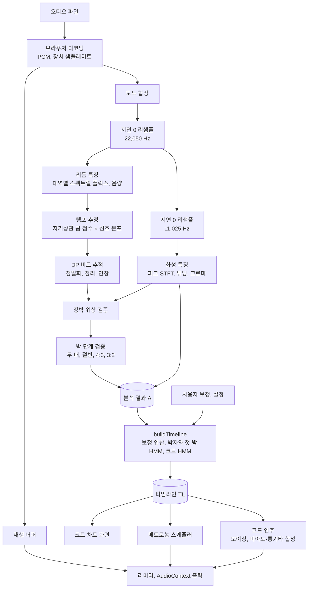
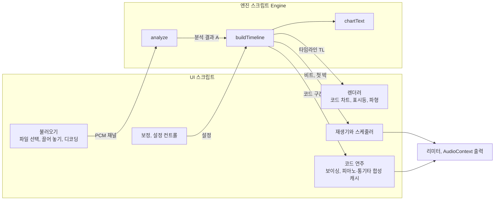
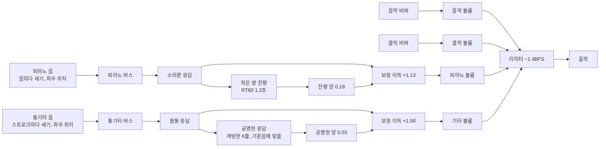

**한국어** · [English](README.en.md) · [日本語](README.ja.md) · [中文](README.zh.md) · [Français](README.fr.md) · [Español](README.es.md)

버전 1.11.11:

기여자 -

* 고쿠라주민(118.220): 박 보정 창이나 하단 창이 열려 있을 때에는, 코드가 진행되어도 포커스가 이동하지 않도록 하는 아이디어 제공.

> 공동작업이나 기여를 해 주셨거나 해 주실 분은 개인적으로 연락 부탁드립니다. 이 프로젝트는 누구나 무료로 쓸 수 있도록 소스를 공개한 소프트웨어입니다. 개인적 · 비영리 목적이라면 비용 없이 그대로 사용할 수 있습니다. 다만 저작권과 소유권은 원작자와 공동작업자와 기여자에게 있어, 원작자의 허락 없이 수정하거나 그 일부를 떼어 자기 프로그램에 넣어 쓸 수 없고(본인만 쓰는 경우도 포함), 이 프로그램을 자기 것으로 주장하거나 다른 곳에 배포 · 판매할 수 없습니다. GitHub 포크에 수정한 내용을 올리는 것도 허용하지 않습니다. 학교, 학원, 동아리, 교회, 종교 단체, 회사 같은 단체에서 쓰는 것은 무조건 무료가 아니니 먼저 연락 부탁드립니다. 자세한 조건은 [LICENSE](LICENSE)에 있습니다.

# Chordity <sup>v1.19.0</sup>

**Chordity는 노래 파일을 넣으면 마디마다 코드를 적어 주고, 노래의 박에 딱 맞춰 메트로놈을 쳐 주는 웹 페이지입니다.**

코드가 바뀌는 순간에는 피아노나 통기타가, 또는 둘이 함께 그 코드를 쳐 줘서, 귀로 확인하며 따라 칠 수 있습니다. 설치도, 회원 가입도, 인터넷 연결도 필요 없습니다. 음악 파일은 내 컴퓨터 밖으로 나가지 않습니다.

결과는 틀릴 수 있습니다. 분석 원리와 판단의 근거, 결과를 확인하고 바로잡는 방법은 [도움말 페이지](information.html)에 정리해 두었습니다. 앱 맨 아래의 안내 문구를 눌러도 열립니다.

*Chordity: per-measure chord recognition, a beat-locked metronome and synthesized piano chord playback in a single offline HTML file. No libraries, no uploads.*


## 목차

- **[1부. 쉽게 알아보기](#1부-쉽게-알아보기)**
  - [이럴 때 쓰면 좋아요](#이럴-때-쓰면-좋아요)
  - [쓰는 법](#쓰는-법)
  - [화면 읽는 법](#화면-읽는-법)
  - [메트로놈이 이상하게 들리면](#메트로놈이-이상하게-들리면)
  - [코드 이름을 다르게 보기](#코드-이름을-다르게-보기)
    - [음이름](#음이름으로-보기), [카멜롯](#카멜롯으로-보기), [로마 숫자](#로마-숫자로-보기)
  - [피아노·통기타로 코드 듣기](#피아노통기타로-코드-듣기)
  - [단축키](#단축키)
  - [잘 되는 노래, 어려운 노래](#잘-되는-노래-어려운-노래)
  - [알아 두면 좋은 것](#알아-두면-좋은-것)
- **[2부. 원리](#2부-원리)**
  - [2-1. 소리를 그림으로 바꾸기](#2-1-소리를-그림으로-바꾸기)
  - [2-2. 박 찾기: 새로 울리는 순간들의 규칙](#2-2-박-찾기-새로-울리는-순간들의-규칙)
  - [2-3. 진짜 박인지 확인하기](#2-3-진짜-박인지-확인하기)
  - [2-4. 마디 나누기](#2-4-마디-나누기)
  - [2-5. 코드 알아내기](#2-5-코드-알아내기)
  - [2-6. 음악의 규칙을 확률로](#2-6-음악의-규칙을-확률로)
  - [2-7. 어긋나지 않는 메트로놈](#2-7-어긋나지-않는-메트로놈)
  - [2-8. 코드를 피아노·통기타로 들려주기](#2-8-코드를-피아노통기타로-들려주기)
  - [2-9. 조가 바뀌는 곳 찾기](#2-9-조가-바뀌는-곳-찾기)
- **[3부. 작동 방식](#3부-작동-방식)**
  - [3-1. 전체 흐름](#3-1-전체-흐름)
  - [3-2. 불러오기와 전처리](#3-2-불러오기와-전처리)
  - [3-3. 리듬 특징](#3-3-리듬-특징)
  - [3-4. 화성 특징](#3-4-화성-특징)
  - [3-5. 템포와 비트](#3-5-템포와-비트)
  - [3-6. 박자, 마디, 코드 (가벼운 단계)](#3-6-박자-마디-코드-가벼운-단계)
  - [3-7. 재생과 메트로놈](#3-7-재생과-메트로놈)
  - [3-8. 보정 버튼이 하는 일](#3-8-보정-버튼이-하는-일)
  - [3-9. 코드 연주](#3-9-코드-연주)
- **[4부. 깊이 들여다보기](#4부-깊이-들여다보기)**
  - [4-1. 알고리즘과 수식](#4-1-알고리즘과-수식)
    - [(1) 지연 0 리샘플링](#1-지연-0-리샘플링), [(2) 실수 FFT](#2-실수-fft), [(3) 대역별 스펙트럴 플럭스와 온셋 포락선](#3-대역별-스펙트럴-플럭스와-온셋-포락선), [(4) 템포 추정](#4-템포-추정), [(5) DP 비트 추적 (Ellis, 2007)](#5-dp-비트-추적-ellis-2007), [(6) 비트 정밀화](#6-비트-정밀화), [(7) 정박 위상 검증](#7-정박-위상-검증), [(8) 박 단계 검증](#8-박-단계-검증), [(9) 박 세분 판정](#9-박-세분-판정), [(10) 스펙트럼 피크, 튜닝, 크로마](#10-스펙트럼-피크-튜닝-크로마), [(11) 박 동기 집계, 베이스 바닥, 조성](#11-박-동기-집계-베이스-바닥-조성), [(12) 코드 템플릿과 방출 점수](#12-코드-템플릿과-방출-점수), [(13) 코드 비터비: O(T·K)](#13-코드-비터비-otk), [(14) 첫 박 증거와 박자 HMM](#14-첫-박-증거와-박자-hmm), [(15) 메트로놈 스케줄링](#15-메트로놈-스케줄링), [(16) 피아노 합성](#16-피아노-합성), [(17) 보이싱과 타건](#17-보이싱과-타건), [(18) 전조 추적](#18-전조-추적), [(19) 카멜롯 표기](#19-카멜롯-표기), [(20) 로마 숫자 화성 분석](#20-로마-숫자-화성-분석), [(21) 곡 종류별 보강](#21-곡-종류별-보강), [(22) 이어짐과 바뀜 위치](#22-이어짐과-바뀜-위치), [(23) 통기타 합성](#23-통기타-합성), [(24) 스트로크 따라](#24-스트로크-따라)
  - [4-2. 물리 세계](#4-2-물리-세계)
    - [소리, 음높이, 평균율](#소리-음높이-평균율), [배음](#배음), [악기별 주파수 대역](#악기별-주파수-대역), [시간과 주파수의 맞바꿈](#시간과-주파수의-맞바꿈), [샘플링과 앨리어싱](#샘플링과-앨리어싱), [음량, 잔향, 로그](#음량-잔향-로그), [사람의 지각](#사람의-지각), [피아노 현](#피아노-현), [통기타 현](#통기타-현), [지연과 거리](#지연과-거리)
  - [4-3. 체계](#4-3-체계)
    - [구성](#구성), [저장소 구성](#저장소-구성), [엔진 API](#엔진-api), [세 개의 시계](#세-개의-시계), [오디오 그래프](#오디오-그래프), [설정 저장](#설정-저장)
  - [4-4. 이슈와 해결](#4-4-이슈와-해결)
  - [4-5. 최적화](#4-5-최적화)
  - [4-6. 검증](#4-6-검증)
    - [단위 시험](#단위-시험), [합성 곡 회귀 시험](#합성-곡-회귀-시험), [전조 시험](#전조-시험), [카멜롯 표기 시험](#카멜롯-표기-시험), [로마 숫자 시험](#로마-숫자-시험), [실제 녹음 시험](#실제-녹음-시험), [실제 브라우저 종단 간 시험](#실제-브라우저-종단-간-시험), [코드 연주 시험](#코드-연주-시험), [통기타와 새 피아노 시험(1.12.0)](#통기타와-새-피아노-시험1120), [무반주 첫머리 시험(1.12.2)](#무반주-첫머리-시험1122), [피아노 소리와 통기타 셈여림 시험(1.13.0)](#피아노-소리와-통기타-셈여림-시험1130), [통기타 스트로크 기호 시험(1.14.0)](#통기타-스트로크-기호-시험1140), [통기타 업 스트로크와 느린 긁기 시험(1.15.0)](#통기타-업-스트로크와-느린-긁기-시험1150), [곡 종류 확장 시험(1.5.0)](#곡-종류-확장-시험150), [박자 변화와 템포 표시 시험(1.6.0)](#박자-변화와-템포-표시-시험160), [이어짐과 바뀜 위치 시험(1.8.4)](#이어짐과-바뀜-위치-시험184)
  - [4-7. 특장점](#4-7-특장점)
  - [4-8. 한계와 앞으로](#4-8-한계와-앞으로)
  - [4-9. 참고 문헌](#4-9-참고-문헌)
- **[업데이트 내역](#업데이트-내역)**
  - [버전 규칙](#버전-규칙)
  - [Chordity 1.x](#chordity-1x)
    - [1.19.0](#1190-2026-10-31), [1.18.0](#1180-2026-10-31), [1.17.0](#1170-2026-10-30), [1.16.1](#1161-2026-10-30), [1.16.0](#1160-2026-10-30), [1.15.1](#1151-2026-10-29), [1.15.0](#1150-2026-10-29), [1.14.0](#1140-2026-10-29), [1.13.0](#1130-2026-10-26), [1.12.2](#1122-2026-10-26), [1.12.1](#1121-2026-10-26), [1.12.0](#1120-2026-10-25), [1.11.11](#11111-2026-10-25), [1.11.10](#11110-2026-10-21), [1.11.9](#1119-2026-10-18), [1.11.8](#1118-2026-10-18), [1.11.7](#1117-2026-10-15), [1.11.6](#1116-2026-10-14), [1.11.5](#1115-2026-10-14), [1.11.4](#1114-2026-10-14), [1.11.3](#1113-2026-10-14), [1.11.2](#1112-2026-10-13), [1.11.1](#1111-2026-10-13), [1.11.0](#1110-2026-10-13), [1.10.5](#1105-2026-10-11), [1.10.4](#1104-2026-10-11), [1.10.3](#1103-2026-10-11), [1.10.2](#1102-2026-10-11), [1.10.1](#1101-2026-10-11), [1.10.0](#1100-2026-10-11), [1.9.4](#194-2026-10-10), [1.9.3](#193-2026-10-10), [1.9.2](#192-2026-10-10), [1.9.1](#191-2026-09-30), [1.9.0](#190-2026-09-30), [1.8.4](#184-2026-09-30), [1.8.3](#183-2026-09-30), [1.8.2](#182-2026-09-30), [1.8.1](#181-2026-09-30), [1.8.0](#180-2026-09-30), [1.7.0](#170-2026-09-30), [1.6.0](#160-2026-09-30), [1.5.0](#150-2026-09-30), [1.4.2](#142-2026-09-27), [1.4.1](#141-2026-09-27), [1.4.0](#140-2026-09-26), [1.3.1](#131-2026-09-26), [1.3.0](#130-2026-09-26), [1.2.0](#120-2026-09-26), [1.1.1](#111-2026-09-26), [1.1.0](#110-2026-09-26), [1.0.0](#100-2026-09-26)
  - [개발판 0.x (마디 코드)](#개발판-0x-마디-코드)
    - [0.4.1](#041-2026-09-26), [0.4.0](#040-2026-09-25), [0.3.1](#031-2026-09-25), [0.3.0](#030-2026-09-25), [0.2.1](#021-2026-09-25), [0.2.0](#020-2026-09-25), [0.1.0](#010-2026-09-25)


---

## 1부. 쉽게 알아보기

### 이럴 때 쓰면 좋아요

- 좋아하는 노래를 기타나 피아노로 따라 치고 싶을 때
- 노래의 코드를 알아내야 하는데 귀로 하나하나 찾기 어려울 때
- 원곡에 맞춰 박자 연습을 하고 싶을 때

### 쓰는 법

1. `chordity.html` 파일을 크롬, 엣지, 사파리, 파이어폭스 같은 브라우저로 엽니다.
2. **파일 열기**를 누르거나, 음악 파일을 창 위로 끌어다 놓습니다. 몇 초 기다리면 코드 차트가 나타납니다.
3. **재생** 버튼을 누릅니다. 음악과 함께 메트로놈이 박마다 "딱" 하고 울리고(마디 첫 박은 높은 "띡", 코드 변화 단위가 ½박이면 박 사이에 작은 "틱"도, 셋잇단 곡의 ⅓박이면 "틱" 둘), 지금 울리는 코드를 노란 형광펜 상자가 감싸고 그 코드 이름이 커집니다. 상자 안은 진행 막대처럼 재생한 만큼 주황색으로 차오르고, 코드가 바뀌면 상자가 용수철처럼 튕기며 다음 코드로 옮겨 갑니다. 피아노가 원곡이 코드를 치는 곳마다 그 코드를 쳐 줍니다(코드가 바뀌거나 같은 코드를 새로 칠 때 다시 치고, 끌어 두는 곳에서는 이어서 울림).

MP3, WAV, M4A, FLAC, OGG처럼 브라우저가 재생할 수 있는 파일이면 됩니다.

### 화면 읽는 법

| 보이는 것 | 뜻 |
|---|---|
| 노란 형광펜 상자 | 지금 울리는 코드. 그 코드를 친 박부터 다음 코드가 나오는 곳까지 감쌈(끌어 두는 회색 코드가 다음 마디로 이어지면 거기까지, 줄이 바뀌면 줄마다 한 조각). 코드가 바뀌면 용수철처럼 튕기며 다음 코드로 옮겨 감 |
| 상자 안 주황 채움 | 그 코드에서 지금까지 연주된 만큼(진행 막대). 채움 끝이 지금 재생 위치이고, 박이 시작할 때 그 박의 빗금 자리에 닿음 |
| 커진 코드 이름 | 지금 울리는 코드의 이름(새로 친 코드). 들어올 때 확 커졌다가 다음 코드로 넘어가면 천천히 제 크기로 줄어듦. 다음 이름에 닿지 않을 만큼만 커짐 |
| 빗금 `/` | 한 박. 진하게 바뀌는 빗금이 지금 박 |
| 두꺼운 빗금 | 코드를 새로 치는 박(검은 글자 코드가 놓인 박). 어느 리듬에서 코드를 치는지 보임. 회색 코드와 `N.C.` 자리는 보통 빗금 |
| 빗금 위 `⊓` `V` (통기타를 켰을 때) | 통기타가 치는 스트로크. `⊓`은 다운(위에서 아래로), `V`는 업(아래에서 위로) 스트로크이고, 놓인 자리가 치는 박이나 박 사이 자리. 통기타 연주 방식을 바꾸면 함께 바뀜. 왼쪽에 세로 물결선이 붙은 `⊓`은 여섯 줄을 천천히 긁는 스트로크(1.15.0). 재생 중에는 치는 순간에 맞춰 기호가 통통 튐(1.15.0) |
| `M`이 붙은 꺾쇠 ┌─┐ | 통기타가 왼손으로 줄을 막고 치는 구간(뮤트·팜뮤트). 꺾쇠의 두 끝이 그 구간의 처음과 끝 스트로크 |
| `C` `Am` `G7` | 코드 이름. 빗금 바로 위에 있으면 그 박에서 코드가 바뀜 |
| `G/B` | G 코드인데 가장 낮은 음이 B |
| 작은 글씨, 위·아래 두 줄로 놓인 코드 이름 | 한 마디에 코드가 많아 이름이 다음 코드에 닿으면 글씨를 줄이고, 그래도 안 들어가면 그 마디의 이름을 위·아래 두 줄로 번갈아 놓음(이름의 왼쪽 끝이 그 코드를 치는 박). 좁은 화면에서 마디 끝 박의 긴 이름이 두 줄로도 안 들어가면 덜 중요한 부분부터 빼고 `…`을 붙임(`Bm7/F♯` → `Bm7…`). 전체 이름은 마우스를 올리거나 재생 중 위쪽 지금 코드 칸에서 보임 |
| 회색 코드 | 앞 마디의 코드를 새로 치지 않고 그대로 끌어 둠. 같은 코드라도 마디 첫 박에 새로 치면 검은 글자 |
| `N.C.` | 코드가 없는 부분 (드럼만 나오거나 조용할 때, 곡 첫머리에 반주 없이 노래만 나올 때) |
| 0번 마디 | 노래가 마디 중간에서 시작하는 부분 (못갖춘마디) |
| 마디 위의 `2박` 같은 표시 | 그 마디만 박 수가 다름 |
| 검은 이름표 `E 장조로` | 그 박부터 조가 바뀜(전조). 위쪽 조성 칸에도 `E♭ 장조 → E 장조`처럼 나옴. 곡 첫 마디에는 시작 조성과 박자가 조사 없이 붙음(`C 장조` `4/4`, 악보의 조표·박자표처럼) |
| 검은 이름표 `3/4으로` | 그 마디부터 박자가 바뀜(박자 변화). 위쪽 박자 칸에도 `4/4 → 3/4 → 4/4`처럼 나옴 |
| 흰 알약 `72` `132로` | 그 박부터의 템포(BPM, 반올림), 슬래시 아래 줄. 곡이 시작하는 박에는 시작 템포를 숫자만, 템포가 갑자기 바뀐 곳에는 새 템포에 `로/으로`를 붙임 |
| 흰 육각형 틀 `여기까지 63` | 템포가 서서히 바뀌는 구간(슬래시 아래 줄). 틀이 걸친 길이가 바뀌는 구간이고, 재생 위치가 틀 안에 있으면 지나온 만큼 형광펜 색으로 차면서 `현재 67`처럼 지금 템포를 보여 줌. 끝까지 차면 흰색으로 옅어지고, 틀 끝 다음 박의 흰 알약(도착한 템포)이 잠깐 켜짐 |
| 템포(위쪽 칸과 재생 막대) | 재생하는 자리의 템포. 템포가 서서히 바뀌면 120, 119, 118 …처럼 따라 움직임. 재생 막대는 스크롤해도 화면 맨 위에 고정돼 늘 보임 |
| `8B`, `9A`에 작은 글자가 붙은 이름 | 카멜롯 표기를 골랐을 때의 코드 이름(아래 "카멜롯으로 보기" 참고) |
| `I`, `vi`, `V7/ii` 같은 로마 숫자 | 로마 숫자 표기를 골랐을 때의 코드 이름(아래 "로마 숫자로 보기" 참고) |
| 동그라미 표시등 | 지금 몇 번째 박인지. 가장 큰 동그라미가 마디의 첫 박 |
| 위쪽의 "다음 G" | 곧 나올 코드 |
| 메트로놈, 피아노, 통기타 버튼 | 누를 때마다 켜고 끔. 피아노와 통기타는 따로 켜고 끄며, 둘 다 켜면 함께 침 |
| 음악, 클릭, 코드 막대 | 원곡, 메트로놈, 코드 연주(피아노·통기타) 소리의 크기를 따로 조절 |

### 메트로놈이 이상하게 들리면

대부분 알아서 맞춰지지만, 노래에 따라 사람마다 박을 다르게 세기도 합니다. **박이 안 맞나요? 보정하기**를 열고 아래 버튼을 눌러 보세요. 누르는 즉시 바뀝니다.

| 이렇게 들리면 | 이 버튼을 |
|---|---|
| 클릭이 박과 박 사이에 들린다 | ½박 옮기기 |
| 클릭이 너무 촘촘하다 | 절반으로 ÷2 |
| 클릭이 너무 드문드문하다 | 두 배 빠르게 ×2 |
| 6/8 느낌의 곡인데 클릭이 너무 많다 | 셋씩 묶기 ÷3 |
| 마디가 시작되는 곳이 한 박 어긋났다 | 한 박 앞당기기, 한 박 늦추기 |
| 클릭이 아주 살짝 이르거나 늦게 느껴진다 | 클릭 타이밍 |
| 박 보정을 처음 상태로 돌리고 싶다 | 박 보정 되돌리기 |
| 코드 종류 같은 설정을 처음 상태로 돌리고 싶다 | 설정 기본값으로 |

지금 무엇을 바꿔 두었는지는 같은 칸의 **적용 중**에 "박 보정"과 "설정"으로 나뉘어 나옵니다. 칸을 접어 두어도 제목 옆에 요약이 보입니다.

코드를 더 간단하게 보고 싶으면 **코드 종류**에서 "기본"을, 한 박 안에서 바뀌는 코드까지 보고 싶으면 "½박 단위"를 고르세요. ½박 단위에서는 메트로놈도 박 사이(8분음표 자리)에 작고 높은 "틱"을 넣어 "띡-틱-딱-틱-딱-틱-딱-틱"처럼 칩니다. 박이 셋으로 나뉘는 셋잇단 곡(12/8·6/8 등)에서는 이 칸이 "⅓박 단위"로 바뀌어 한 박을 셋(8분음표 셋)으로 나누고, 메트로놈도 박 사이에 "틱"을 둘씩 넣어 "띡-틱-틱-딱-틱-틱"처럼 칩니다.

### 코드 이름을 다르게 보기

차트 바로 위의 **코드 표기** 막대에서 같은 코드를 세 가지 방식으로 볼 수 있습니다. 누르는 즉시 차트, 지금·다음 코드, 텍스트 차트가 함께 바뀌고, 고른 방식은 다음에 열어도 그대로입니다. 키보드로는 막대에 초점을 둔 채 ←, →로 바꿉니다.

| 버튼 | 예 | 이럴 때 좋아요 |
|---|---|---|
| 음이름 | E♭, B♭/D, Cm7 | 코드를 보며 바로 따라 치거나, 연주자끼리 코드를 주고받을 때 |
| 카멜롯 | 5B, 6B, 3A⁷ | 잘 어울리는 조성과 코드를 찾거나, DJ 믹스 지점을 고를 때 |
| 로마 숫자 | I, V⁶, ii⁷/IV | 곡의 화성 진행을 분석하거나, 다른 조로 옮겨 칠 때 |

아래 세 그림은 E♭ 장조로 된 같은 11마디를 각 방식으로 본 모습입니다.

#### 음이름으로 보기


가장 익숙한 코드 이름입니다. 근음은 크게, m·sus·dim 같은 성질은 조금 작게, 7·maj7 같은 확장음은 위첨자로 적어 복잡한 코드도 한눈에 읽힙니다.

- **슬래시 코드**: 둘째 마디의 `B♭/D`는 B♭ 코드를 치되 가장 낮은 음을 D로 두라는 뜻입니다. 여섯째 마디의 `B♭7/A♭`처럼 7음을 베이스로 둔 코드도 그대로 적습니다.
- **조성에 맞는 ♯/♭**: 같은 음이라도 그 자리의 조성에 맞게 씁니다. 이 곡은 E♭ 장조라서 A♯ 대신 B♭, G♯ 대신 A♭으로 적고, 곡이 E 장조로 전조하면 그 뒤로는 G♯m7처럼 ♯으로 적습니다.
- 앞 마디에서 새로 치지 않고 끌어 둔 코드는 회색으로, 코드가 없는 곳은 `N.C.`로 적습니다. 같은 코드라도 마디 첫 박에 새로 치면 검은 글자로 적습니다.

#### 카멜롯으로 보기


DJ가 곡과 곡을 이어 붙일 때 쓰는 카멜롯 휠 번호로 적습니다. 조성을 5도권 순서대로 1~12번 자리에 놓고, 장조 계열은 B, 단조 계열은 A를 붙입니다. 번호가 같거나 하나 차이 나는 조성과 코드끼리는 소리가 잘 어울립니다.

- **코드 읽기**: 근음과 성격(장·단)이 같은 조성의 번호로 적고, 코드 종류는 작은 글자로 붙입니다. E♭은 5B, Cm은 5A, B♭7은 6B에 작은 7이 붙습니다.
- **조성 밖 화음이 한눈에 보입니다**: 이 곡의 조성은 E♭ 장조(5B)라서 코드가 대부분 4~6번에 모여 있습니다. 넷째 마디의 `3A⁷`(B♭m7)만 번호가 멀리 떨어져 있는데, IV인 A♭maj7(4B)로 가기 위해 잠시 빌려 온 화음이기 때문입니다.
- 곡의 조성도 `E♭ 장조(5B)`처럼 번호와 함께 보여 줍니다.
- 카멜롯에는 베이스음을 적는 방법이 없어서 슬래시 코드의 베이스음은 생략합니다(`B♭/D` → `6B`). 코드 연주는 베이스음까지 그대로 칩니다.

#### 로마 숫자로 보기


화성학 책에서 쓰는 로마 숫자 화성 분석입니다. 코드를 음이름 대신 **조성 안에서 몇 번째 음 위의 화음인지**로 적어서, 곡이 어떤 뼈대로 움직이는지 드러냅니다. 조가 달라도 같은 진행은 같은 숫자로 보이므로 다른 조로 옮겨 치거나 여러 곡의 진행을 비교하기 좋습니다.

- **그림의 흐름**: 첫 세 마디 `I – V⁶ – vi`는 베이스가 E♭ → D → C로 한 음씩 내려가는 진행입니다. 이어지는 `ii⁷/IV – V⁷/IV – IVᴹ⁷`은 IV(A♭maj7)로 가기 위해 A♭ 장조의 ii–V를 잠시 빌려 오는 진행이고, 마지막 `ii⁷ – V⁷ – I`은 가장 기본적인 마침(종지)입니다.
- **자리바꿈 숫자**: 둘째 마디의 `V⁶`은 3음(D)을, 여섯째 마디의 `V⁴₂`는 7음(A♭)을 베이스로 둔 화음입니다.

| 표기 | 뜻 |
|---|---|
| I, IV, V (대문자) | 장3화음 계열 코드. 숫자는 조성의 몇 번째 음 위의 화음인지 |
| i, ii, vi (소문자) | 단3화음 계열 코드 |
| °, ø, +, M | 감화음(°), 반감7화음(ø), 증3화음(+), 장7화음(M7) |
| 7 | 7화음 |
| 6, ⁶₄ | 3화음의 자리바꿈. 베이스가 3음이면 6, 5음이면 ⁶₄ |
| ⁶₅, ⁴₃, ⁴₂ | 7화음의 자리바꿈. 베이스가 3음, 5음, 7음일 때 |
| V/x, vii°/x, ii/x | x로 가기 위해 잠시 쓰는 화음(부속화음). V7/vi는 vi로 가는 딸림7화음 |
| ♭VI, ♭VII 등 | 조성 음계 밖의 도수. 같은 으뜸음의 단조에서 빌려 온 화음(차용 화음) 등 |

- 숫자는 그 자리의 조성을 기준으로 셉니다. 전조한 뒤에는 새 조성에서 다시 셉니다.
- 전조 직전에 새 조성의 딸림화음이 나오면 새 조성 기준 V로 적습니다(예: E 장조로 넘어가기 직전의 B7은 V7).
- 베이스음 표기를 끄면 자리바꿈 숫자 없이 기본형으로 적습니다.

### 피아노·통기타로 코드 듣기

위쪽의 **피아노**·**통기타** 버튼으로 코드 연주를 켜면 인식한 코드를 쳐 줍니다. 두 버튼은 따로 켜고 끄며, 둘 다 켜면 피아노와 통기타가 함께 칩니다(처음에는 피아노만 켜져 있습니다). 원곡과 겹쳐 들으면 적힌 코드가 맞는지 귀로 바로 확인할 수 있고, 따라 칠 때 길잡이도 됩니다. 소리는 곡의 음높이에 저절로 맞춰지므로 원곡과 음이 어긋나지 않습니다.

- 음악, 클릭, 코드 소리 크기는 위쪽 막대 세 개로 따로 맞춥니다(코드 막대는 피아노와 통기타에 함께).
- 피아노가 치는 때는 **보정하기**의 **피아노 연주**에서 고릅니다: 곡 따라(기본, 원곡에서 새로 친 곳만 다시), 코드가 바뀔 때, 마디마다 다시, 박마다, 그리고 1.19.0부터 **싱어송라이터**(곡에 맞춘 반주)와 **개성 있게**. 싱어송라이터는 통기타 싱어송라이터와 같은 구간 크기를 따라 조용한 곳은 펼침화음, 큰 곳은 왼손 베이스와 오른손 짧은 화음으로 치고, 오른손은 통기타보다 한 옥타브 위에서, 통기타를 함께 켜면 통기타가 치지 않는 자리에 칩니다. 개성 있게는 펼침화음, 4마디 구절 끝의 위로 올라가는 짧은 런, 끝 코드를 한 음씩 굴려 치기로 칩니다.
- 통기타가 치는 방식은 **보정하기**의 **통기타 연주**에서 고릅니다. 기본인 **싱어송라이터**(1.16.0)는 통기타 반주자가 곡을 듣고 치듯 칩니다. 곡의 템포와 느낌으로 8분음표·16분음표·셋잇단 손 흐름을 정하고, 원곡에 맞는 스트럼 그루브(보통 ↓ ↓↑ ↑↓↑, 느린 곡은 16분음표 그루브)를 골라 조용한 구간은 성기게(↓↓↓↓ 등), 큰 구간은 촘촘하게 치며, 되풀이되는 구간은 같은 패턴으로 칩니다. 크게 올라가는 구간 바로 앞에서는 끝 박을 채우고, 박 사이에서 바뀌는 코드는 당겨 치며, 2·4박에 강세를 둡니다. 조용한 구간이라도 원곡에 백비트나 엇박이 살아 있으면 본 그루브를 여리게 이어 치고, 원곡이 비어 있으면 그 구간 전체를 한 가지 밀도(4분음표, 2분음표, 한 번 치고 울려 두기)로 칩니다. 8마디 구절 끝은 원곡의 그 박이 약할 때만 살짝 비우고, 코드가 끊기는 브레이크에서는 한 번 치고 멈추며, 곡의 마지막 코드는 한 번 긁고 끝까지 울려 둡니다. 1.17.0부터는 한 패턴만 되풀이하지 않고, 수준마다 실제 반주자가 쓰는 여러 스트럼 꼴 가운데 마디마다 원곡 리듬에 맞는 것을 고르고, 원곡이 세게 치는 빈칸은 더 치고 아주 빈 칸은 비우며, 같은 꼴이 4마디 넘게 이어지면 구절 끝에서 바꿉니다(되풀이되는 구간은 여전히 같게). **스트로크 따라**는 원곡에서 기타·피아노·드럼 등을 친 리듬을 박마다 16분음표 칸으로 찾아 그 자리에서 다운·업 스트로크로 칩니다. 친 곳을 찾지 못한 마디는 첫 박에 한 번 치고, 원곡의 리듬을 소리로 찾는 것이라 실제 연주와 다를 수 있습니다(4-8). **4비트·8비트·16비트 스트럼**은 기타 교본에서 배우는 스트럼 변주(8비트라면 ↓↑↓↑↓↑↓↑, ↓ ↓ ↓↑↓↑, ↓ ↓↑ ↑↓↑ 등) 가운데 마디마다 원곡 리듬에 가장 잘 맞는 것을 골라 곡의 박에 맞춰 칩니다. 손을 늘 위아래로 흔드는 기본기대로 박 쪽은 다운, 그 사이는 업이고, 고른 패턴은 **분석 정보**의 "통기타 스트럼"에 나옵니다. **스윙 스트럼**은 박마다 8분음표 둘을 셋잇단 첫째·셋째 자리에서 길게·짧게(↓·↑ ↓·↑) 칩니다. 원곡이 스윙이면 엇박이 오는 자리(스윙 비율)를 원곡에서 재서 맞추고, 곧은 곡이나 잴 수 없는 곡은 셋잇단 자리(박의 ⅔)에서 칩니다. 스윙은 변주 없이 이 리듬만 치고, 쓴 비율은 분석 정보의 "통기타 스트럼"에 나옵니다. 어느 방식이든 코드가 새로 바뀌는 곳에서는 늘 치고(칠 칸 사이에서 바뀌면 그 뒤 첫 칸에서: 4비트는 다음 박, 스윙은 그 박의 엇박), 코드가 없는 곳(N.C.)이라도 원곡에 드럼 등 리듬이 있으면 줄을 막고 치는 **뮤트**("칙"), 베이스 음이 뚜렷하면 그 음의 **팜뮤트**로 치며(조용한 곳에서는 치지 않음), 코드는 실제 기타 운지(C는 x32010, G는 320003 등)로 잡습니다. 어느 방식이든 원곡이 조용한 곳에서는 여리게, 큰 곳에서는 세게 치고, 마디 안에서도 원곡에서 세게 친 자리를 세게 칩니다(1.13.0). 1.15.1부터는 원곡이 큰 곳일수록 조금씩 더 세게, 조용한 곳일수록 조금씩 더 여리게 치고, 세게 칠수록 줄을 빠르게(실제 통기타 연주 빠르기의 1.25배까지), 여리게 칠수록 느리게(0.8배까지) 훑습니다. 곡의 끝 구간에서는 곡의 끝 코드, 후주로 넘어가는 마디의 첫 박, 한 마디 넘게 끄는 코드를 "챙" 대신 낮은 줄부터 천천히 긁어 "드르르릉" 울리고, 느린 곡일수록 천천히 긁습니다(한 박의 절반, 0.12~0.5초). 곡 첫머리나 가운데에서는 긁지 않습니다(1.15.1). 스트로크 따라는 16분음표로 촘촘히 긁는 곡에서 드럼에 묻힌 여린 업 스트로크까지 찾아 칩니다. 또 업 스트로크를 손을 위아래로 흔드는 흐름에 맞춰 리듬대로 넣습니다. 빠른 곡(116 BPM 이상)은 8분음표 ↓↑, 느린 곡은 다음 박 바로 앞 16분음표 ↓↑로 치고, 넣은 업 앞에 이어지는 다운이 없으면 함께 넣습니다. 원곡에서 그 자리가 이 곡의 같은 자리들 가운데 센 편인 곳에만 넣어 곡의 리듬을 따릅니다(1.15.0).
- 통기타를 켜면 차트의 코드 이름과 빗금 사이에 통기타가 치는 스트로크가 기호로 나옵니다. 다운 스트로크는 `⊓`, 업 스트로크는 `V`를 치는 자리에 적고, 줄을 막고 치는 뮤트·팜뮤트 구간은 처음과 끝 스트로크를 잇는 꺾쇠 위에 `M`을 적습니다. 통기타 연주 방식을 바꾸면 기호도 그 방식대로 바뀌고, 통기타를 끄면 기호가 사라지고 차트도 원래 높이로 돌아갑니다(1.14.0). 천천히 긁는 스트로크는 `⊓` 왼쪽에 세로 물결선을 붙입니다. 재생 중에는 치기 0.1초 앞에서 그 스트로크 기호가 부풀며 살짝 뛰어올랐다가, 내려앉을 때 용수철처럼 납작해졌다 다시 서며 0.33초 만에 원래 크기로 돌아옵니다(기기의 움직임 줄이기 설정이면 움직이지 않음, 1.15.0).
- 피아노는 P 키, 통기타는 G 키로도 켜고 끕니다.

### 단축키

| 키 | 하는 일 |
|---|---|
| Space | 재생, 일시정지 |
| M | 메트로놈 켜기, 끄기 |
| P | 피아노 코드 연주 켜기, 끄기 |
| G | 통기타 코드 연주 켜기, 끄기 |
| ← → | 이전 마디, 다음 마디 |
| Home | 처음으로 |

마디를 누르면 그 마디로 가고, 위쪽 파형을 누르거나 끌어도 원하는 곳으로 갑니다. 한글 입력 상태에서도 단축키가 동작합니다.

### 잘 되는 노래, 어려운 노래

드럼이 있는 팝, 록, 발라드, 댄스, 힙합, 케이팝, 어쿠스틱 팝처럼 박이 분명한 노래는 잘 됩니다. 곡 중간에 템포가 크게 바뀌는 노래, 5/4·7/4 같은 변박, F/G처럼 베이스가 코드 밖의 음인 코드, 록의 파워 코드(E5)도 알아봅니다. 재즈처럼 텐션과 워킹 베이스가 많은 노래, 보사노바처럼 두 박 단위로 느끼는 노래(마디가 두 배 길이로 적힘), 디스토션이 아주 강한 메탈, 레게처럼 박을 두 가지로 셀 수 있는 노래는 틀릴 수 있습니다. 이럴 때는 위의 보정 버튼을 쓰세요.

### 알아 두면 좋은 것

- 파일은 인터넷으로 보내지지 않습니다. 모든 분석은 브라우저 안에서 합니다.
- 화면 맨 아래의 안내 문구를 누르면, 결과가 틀릴 수 있는 경우와 확인하는 법, 분석 원리와 검증 결과를 정리한 [도움말](information.html)이 새 탭으로 열립니다.
- 메트로놈, 코드 연주, 볼륨, 코드 종류와 코드 표기 방식 같은 설정은 브라우저에 저장되어 다음에도 그대로입니다.
- 블루투스 이어폰을 써도 음악, 클릭, 코드 연주가 함께 늦게 나오기 때문에 서로 어긋나지 않습니다.
- 아이폰에서 소리가 안 나면 무음 모드가 켜져 있는지 확인하세요.
- 재생하면 화면이 지금 마디를 따라 스크롤됩니다. 위쪽의 보정·설정 칸이나 아래쪽의 텍스트 코드 차트·분석 정보 칸을 펼쳐 두면 그 칸을 보는 동안에는 스크롤하지 않고, 칸을 접으면 다시 따라갑니다.

<p align="center"></p>

---

<p align="right"><a href="#목차">↑ 목차로</a></p>

## 2부. 원리

이 프로그램은 미리 학습된 인공지능 모델을 쓰지 않습니다. 소리의 물리적 성질과 음악의 규칙을 수식으로 옮긴 **신호 처리**와 **확률 모델**로 동작합니다. 그래서 판단 근거를 하나하나 설명할 수 있고, 화면 아래 **분석 정보**에서 그 근거를 직접 볼 수 있습니다.

### 2-1. 소리를 그림으로 바꾸기

소리는 공기의 떨림이고, 녹음 파일은 그 떨림을 1초에 수만 번 잰 숫자의 나열입니다. 숫자만 봐서는 어떤 음이 울리는지 알기 어렵기 때문에, 소리를 아주 짧은 조각으로 잘라 조각마다 **어떤 높이의 소리가 얼마나 섞여 있는지**(스펙트럼)를 계산합니다. 이것을 시간 순으로 늘어놓으면 가로가 시간, 세로가 음높이인 소리의 그림(스펙트로그램)이 됩니다. 이후의 분석은 모두 이 그림을 읽는 일입니다.

여기에는 피할 수 없는 맞바꿈이 있습니다. 조각을 짧게 자르면 **언제** 소리가 났는지는 정확하지만 **무슨 음**인지는 흐려지고, 길게 자르면 그 반대입니다. 그래서 박을 찾을 때는 짧은 조각을, 코드를 찾을 때는 긴 조각을 따로 씁니다. 가장 낮은 베이스 음은 반음 사이의 주파수 차이가 아주 작아서 가장 긴 조각이 필요합니다.

### 2-2. 박 찾기: 새로 울리는 순간들의 규칙

드럼을 치거나 건반을 누르면 그 순간 소리 에너지가 갑자기 늘어납니다. 이런 순간을 **온셋**이라고 합니다. 스펙트로그램에서 직전보다 커진 부분만 더하면 온셋마다 뾰족하게 솟는 곡선이 생깁니다.

박은 이 온셋들이 **일정한 간격으로 반복되는 뼈대**입니다. 먼저 곡선을 시간 방향으로 밀어 가며 자기 자신과 겹쳐 보고(자기상관), 가장 잘 겹치는 간격, 즉 템포를 찾습니다. 그다음 "강한 온셋은 최대한 많이 지나가면서 간격은 템포에서 크게 벗어나지 않는" 박의 줄을 곡 전체에 걸쳐 한 번에 찾습니다(동적 계획법). 박을 하나씩 따로 정하지 않고 전체를 한꺼번에 최적화하기 때문에 약한 박이 몇 개 섞여 있어도 줄이 끊기지 않고, 연주 템포가 조금씩 흔들려도 따라갑니다. 이때 "일정한 간격"의 기준은 곡 전체의 템포가 아니라 몇 초 단위로 구한 **국소 템포**입니다. 그래서 필인처럼 잠깐 리듬이 복잡해지는 곳에는 끌려가지 않으면서, 곡이 실제로 느려지거나 빨라지면 따라갑니다.

### 2-3. 진짜 박인지 확인하기

규칙적인 줄을 찾았다고 끝이 아닙니다. 흔한 실수가 두 가지 있습니다.

**엇박을 박으로 잡는 경우.** 하이햇이 박 사이를 강하게 채우면 줄이 반 박 밀려 잡힐 수 있습니다. 그런데 음악에는 규칙이 있습니다. 킥, 스네어, 베이스가 들어오는 순간과 코드가 바뀌는 순간은 대부분 **정박**에 몰립니다. 그래서 찾은 박 위치와 반 박 옮긴 위치에서 이런 사건들의 세기를 비교하고, 반 박 옮긴 쪽이 분명히 강하면 줄 전체를 반 박 옮깁니다.

**템포를 두 배나 절반으로 잡는 경우.** 느린 발라드에 8분음표 아르페지오가 촘촘하면 8분음표 하나하나를 박으로 착각하기 쉽습니다. 이때는 박을 하나씩 걸러 두 무리로 나눠 봅니다. 진짜 박에는 킥과 스네어가 오고 사이에는 건반 소리만 있다면, 한 무리가 다른 무리보다 훨씬 강하게 나옵니다. 그러면 약한 무리를 버리고 템포를 절반으로 고칩니다. 반대로 박 사이 한가운데마다 스네어가 규칙적으로 오면 템포를 너무 느리게 잡은 것이므로 두 배로 고칩니다. 두 배로 늘리는 쪽은 틀리면 곧바로 엇박 클릭이 생기므로 훨씬 엄격한 조건에서만 합니다.

실제 녹음에서는 하이햇과 건반이 엇박을 채워서 두 무리의 세기 차이가 작게 나올 수 있습니다. 그래서 **킥과 스네어가 어느 무리에 오는지**도 봅니다. 제 템포라면 킥(1·3박)과 스네어(2·4박)가 서로 다른 무리에 오고, 두 배로 잡혔다면 둘 다 같은 무리(진짜 박)에 옵니다. 템포를 절반으로 고칠 때는 비트를 하나씩 걸러 내지 않고 새 템포로 처음부터 다시 추적합니다. 8분음표 단계의 추적이 곡 중간 어딘가에서 한 칸만 미끄러져도, 걸러 낸 비트는 그 뒤로 전부 반 박씩 어긋나기 때문입니다.

**빠른 곡을 절반으로 잡는 두 가지 모양.** 160~180 BPM쯤 되는 빠른 곡은 박을 한 층위 느리게, 곧 절반 템포로 잡기 쉽습니다. 이때 느린 박이 어디에 앉았는지에 따라 모양이 다릅니다. 느린 박이 스네어(2·4박)에 앉으면 박 위마다 스네어가 고르게 오고, 킥은 박 사이에 옵니다. 제 템포의 느린 곡이라면 킥이 박 위(1·3박)에 오고 스네어는 한 박 건너 오므로 나오지 않는 모양입니다. 느린 박이 킥에 앉으면(하프타임 느낌) 박 사이에도 스네어가 박 위만큼 옵니다. 두 경우 모두 템포 추정이 두 배 템포를 거의 같은 세기의 후보로 낼 때만 두 배로 고칩니다. 느린 박이 스네어에 앉은 채로 두면 마디 첫 박도 어긋나서, 한 박 안에 두 코드가 섞여 7화음과 슬래시 코드가 많이 나옵니다.

절반으로 줄이는 쪽도 한 번 더 확인합니다. 8분음표를 박으로 잡았다면 박 사이 한가운데는 16분음표 자리라 킥이나 베이스 같은 저음 타격이 드뭅니다. 그래서 박 사이에도 저음이 자주 오면 박이 제 박인 것으로 보고 줄이지 않습니다. 짝·홀 무리의 세기 차이만으로 줄이려 할 때 스네어가 킥의 반대쪽 무리에 몰려 있으면(백비트) 역시 제 박이므로 줄이지 않습니다.

"스네어"를 알아보는 방법이 물리적입니다. 스네어 밑면의 줄이 떨리면 중간 높이부터 아주 높은 소리까지 **한꺼번에** 커지는 잡음이 납니다. 건반의 음은 몇몇 높이에서만 커지고, 하이햇은 높은 쪽에서만 커집니다. 그래서 "중간 높이와 높은 쪽이 동시에 커졌는가"를 두 값의 곱으로 재면 스네어만 골라낼 수 있습니다. 둘 중 하나라도 작으면 곱이 작아지기 때문입니다.

### 2-4. 마디 나누기

박을 몇 개씩 묶어 마디를 만들려면 **마디의 첫 박**이 어디인지 알아야 합니다. 첫 박에는 흔적이 남습니다. 코드가 바뀌고, 베이스 음이 바뀌고, 킥이 세게 들어가고, 소리가 커지기도 합니다. 박마다 이런 흔적에 점수를 매기고, "마디는 보통 같은 길이로 반복된다"는 규칙을 지키면서 점수가 가장 높은 묶음을 찾습니다. 4박과 3박 가운데 어느 쪽이 흔적과 더 잘 맞는지도 이 방법으로 정합니다. 한 박 안이 셋으로 쪼개지는 느낌이 강하면 6/8, 12/8 같은 겹박자로 봅니다.

드럼이 백비트를 치는 곡에서는 **킥은 1·3박, 스네어는 2·4박**이라는 짝·홀 모양도 첫 박의 흔적으로 씁니다. 코드가 마디 첫 박보다 8분음표 먼저 바뀌는 당김 리프에서는 코드 바뀜의 흔적이 한 박 앞으로 끌려가는데, 드럼의 짝·홀 모양은 그대로이므로 마디가 한 박 밀리지 않습니다. 또 3·5·7박은 첫 박의 흔적이 실제로 그 길이마다 되풀이될 때만 고릅니다. 짧은 곡에서 드문 큰 흔적 몇 개만 골라 7박처럼 보이는 것을 막기 위해서입니다.

### 2-5. 코드 알아내기

옥타브가 다른 같은 음(낮은 도와 높은 도)은 화음에서 같은 역할을 합니다. 그래서 모든 음을 도, 도♯, 레 … 시의 **12칸**으로 접어 넣으면, 그 순간 울리는 음들의 지문이 생깁니다(크로마). C 코드라면 도, 미, 솔 칸이 두드러집니다.

실제 악기는 한 음만 내지 않습니다. 도를 치면 한 옥타브 위의 도, 그 위의 솔, 다시 도, 미 … 같은 **배음**이 함께 울립니다. 예를 들어 C 코드의 미에서 나온 배음은 시 칸을 채워서, 배음을 모르는 비교로는 C를 Cmaj7으로 착각합니다. 그래서 코드의 지문도 배음까지 포함해 만들어 두고 비교합니다.

베이스(가장 낮은 음)는 따로 봅니다. 코드는 C인데 베이스가 미라면 `C/E`로 적습니다.

녹음마다 기준음이 조금씩 다릅니다. A음이 정확히 440 Hz가 아닌 곡도 많습니다. 그래서 곡 전체의 음들이 평균적으로 얼마나 높거나 낮은지 먼저 재고, 그만큼 보정한 다음 12칸에 넣습니다.

### 2-6. 음악의 규칙을 확률로

박마다 가장 비슷한 코드를 고르기만 하면 멜로디의 지나가는 음 때문에 코드가 박마다 깜빡이듯 바뀝니다. 그래서 두 가지 상식을 확률로 넣습니다. **코드는 자주 바뀌지 않는다**, 그리고 **바뀐다면 마디 첫 박에서 가장 잘 바뀌고 박 사이에서는 잘 안 바뀐다**. 이 규칙과 소리가 얼마나 비슷한지를 함께 따져, 곡 전체에서 가장 그럴듯한 코드 순서를 한 번에 고릅니다(은닉 마르코프 모델과 비터비 알고리즘). 곡의 조성도 추정해서, 조성에 어울리는 코드에 약간의 가산점을 줍니다.

### 2-7. 어긋나지 않는 메트로놈

이 메트로놈은 "1분에 97번 똑딱"처럼 일정한 간격으로 치지 않고, **찾아낸 박 하나하나의 시각**에 칩니다. 그래서 연주가 조금 빨라지거나 느려져도 따라갑니다.

타이밍도 정밀합니다. 타이머로 "지금 쳐!" 하고 클릭을 내면 컴퓨터가 바쁠 때 수십 ms씩 늦어집니다. 그래서 음악을 재생하는 **오디오 장치의 시계**에 클릭을 0.2초 앞서 예약해 둡니다. 음악과 클릭이 같은 시계와 같은 출력 경로를 쓰므로 샘플 하나 단위로 맞물리고, 출력이 늦는 장치에서도 둘이 함께 늦게 나와 서로는 어긋나지 않습니다.

### 2-8. 코드를 피아노·통기타로 들려주기

녹음된 피아노 소리를 넣으면 파일이 커지고 외부 파일이 필요해집니다. 그래서 피아노 소리를 **물리 법칙으로 직접 만들어** 씁니다. 피아노 현은 이상적인 줄이 아니라 뻣뻣한 강철선이어서, 배음이 정확한 정수배보다 조금씩 높게 울립니다(비조화성). 해머는 현 길이의 1/7쯤 되는 곳을 때리기 때문에, 그 지점에서 움직이지 않는 배음은 약하게 울립니다. 한 음을 두세 가닥의 현이 함께 내는데, 현끼리 음이 아주 미세하게 달라 소리가 천천히 일렁이고(맥놀이), 처음엔 빨리 줄다가 나중엔 오래 남는 두 단계 감쇠가 생깁니다. 높은 배음일수록 빨리 사라져 소리가 점점 부드러워집니다. 이 성질들을 수식으로 쌓아 한 음씩 합성합니다.

1.12.0부터는 실제 피아노에서 재는 성질을 더 넣었습니다. 해머를 세게 칠수록 높은 배음이 많이 남는 음색, 모든 배음에서 생기는 현들의 맥놀이, 해머가 현을 칠 때 소리판을 두드리는 낮은 '쿵' 소리를 넣고, 소리를 피아노 소리판(울림판)의 나무 울림을 흉내 낸 응답에 통과시켜 내보냅니다. 건반을 놓을 때는 음역마다 댐퍼가 다르게 내려오고, 맨 위 음역(댐퍼가 없는 현)은 길게 남습니다.

1.13.0에서는 실제 피아노 녹음에서 잰 값에 맞춰 소리를 다시 다듬었습니다. 해머가 현을 때리는 순간의 소리를 두 가지로 넣었습니다. 펠트가 현에 닿을 때 나는 짧고 높은 잡음과, 그 힘이 소리판을 두드려 나는 나무의 "똑" 소리입니다. 소리가 처음 1초 동안 실제 피아노처럼 빨리 줄어들게 해서, 다음 코드를 칠 때까지 페달을 밟고 있는 것처럼 고르게 울리던 것을 고쳤습니다. 낮게 오래 남는 여음은 그대로 두고, 소리가 충분히 작아진 곳에서 자연스럽게 끝냅니다. 잔향은 작은 방(잔향 시간 1.2초)의 벽에서 처음 돌아오는 반사와 그 뒤에 퍼지는 울림으로 바꿨습니다.

통기타는 퉁긴 현을 흉내 내는 카플러스-스트롱(Karplus-Strong) 방식으로 만듭니다. 현 한 주기 길이의 잡음을 지연선에 넣고 조금씩 어둡게 하며 계속 되돌리면, 실제로 퉁긴 현처럼 높은 성분부터 사라지는 소리가 됩니다. 피크가 현을 치는 위치와 세기, 기타 몸통의 공기·앞판 공명을 더하고, 코드는 표준 조율 6현에서 손으로 잡는 운지로 칩니다. 다운 스트로크는 낮은 현부터 모든 현을, 업 스트로크는 위쪽 현 3~4개를 높은 현부터 몇 ms 간격으로 칩니다. 1.15.1부터 현 사이 간격은 실제 통기타 녹음(GuitarSet)의 중앙값(다운 6.2 ms, 업 7.0 ms)을 기준으로 세게 칠수록 1.25배까지 빠르게, 여리게 칠수록 0.8배까지 느리게 합니다(1.15.0까지는 다운 약 11 ms라 줄을 느리게 훑었음). 치는 때는 원곡의 중역(200~2,500 Hz)에서 소리가 새로 커지는 순간을 박을 넷(겹박자는 셋)으로 나눈 칸마다 찾아 정합니다. 천천히 긁을 때는 모든 현을 낮은 현부터 한 박의 절반(0.12~0.5초)에 걸쳐 고르게 나눈 간격으로 칩니다. 1.15.0부터 이 소리 커짐은 스펙트럼의 봉우리(음높이 있는 배음)에서 커지는 것만 셉니다. 1.15.0부터는 현마다 음색이 다릅니다. 감은 줄(E·A·D·G)은 어둡고 민 줄(B·E)은 밝게, 실제 통기타 녹음(GuitarSet)에서 잰 현별 밝기와 이전 음색의 가운데로 맞춰, 가는 현이 쨍하지 않으면서 스트럼의 어택은 남깁니다. 울림은 방 잔향 대신 기타 자체에서 나옵니다. 몸통 공명에 더해, 치지 않은 개방현 여섯 줄이 치는 음의 배음에 맞춰 함께 울리는 공명현을 넣었습니다(곡의 기준음에 맞춰 조율).

1.13.0부터 통기타는 세기를 조절합니다. 원곡이 조용한 곳(절, 조용한 간주)에서는 여리게, 커지는 곳(후렴)에서는 세게 치고, 한 마디 안에서도 원곡에서 세게 친 자리는 세게, 약하게 친 엇박은 여리게 칩니다. 곡의 크기는 전체 음량과 함께 좌우로 퍼진 반주의 크기(스테레오의 왼쪽과 오른쪽의 차)로 봅니다. 마스터링된 대중음악은 절과 후렴의 전체 음량이 거의 같아도 후렴에서 반주가 좌우로 넓게 퍼지기 때문입니다. 여리게 치는 마디는 부드러운 음색으로 치되, 음색은 마디마다 하나로 두어 스트로크마다 깜빡이지 않게 했습니다.

코드는 왼손 베이스 한 음과 오른손 화음으로 나눠 칩니다. 오른손은 앞 코드에서 손이 가장 적게 움직이는 자리바꿈을 골라, 코드가 바뀌어도 소리가 들쭉날쭉하지 않습니다. 피아노는 분석에서 찾은 곡의 기준음에 맞춰 조율되고, 메트로놈과 같은 오디오 시계에 예약되어 코드가 바뀌는 순간에 정확히 울립니다. 1.16.1부터 피아노는 해머가 줄을 더 단단하게 치듯 높은 배음(2~8 kHz)이 또렷한 쨍한 소리로 울립니다(곡 전체 크기는 그대로). 1.18.0부터는 스타인웨이 그랜드 쪽 소리로, 해머가 줄을 치는 소리가 또렷하고(첫 10 ms 어택 +2~4.5 dB) 울림이 조금 더 깁니다.

### 2-9. 조가 바뀌는 곳 찾기

곡의 조성은 "주로 어떤 음들이 쓰이는가"로 드러납니다. E♭ 장조 곡은 E♭, F, G, A♭, B♭, C, D를 주로 쓰고, E 장조로 옮기면 E, F♯, G♯, A, B, C♯, D♯를 씁니다. 그래서 비트마다 앞뒤 몇 마디의 음 분포를 24개 조성의 전형적인 분포와 비교하고, **조가 잘 바뀌지 않는다**는 규칙을 확률로 넣어 곡 전체에서 가장 그럴듯한 조성의 흐름을 찾습니다. 한두 마디 스쳐 가는 다른 조의 화음(예: C 장조 곡의 E7 → Am)은 전조로 치지 않습니다. 같은 음을 쓰는 나란한 장·단조(C 장조와 A 단조) 사이의 이동도 조표가 바뀌지 않으므로 전조로 치지 않습니다.

전조 위치는 박 단위로 다듬습니다. 새 조의 딸림화음(예: E 장조의 B7)을 거쳐 넘어가면, 악보에서 조표를 바꿔 적는 관례대로 새 으뜸화음이 나오는 자리를 전조 위치로 봅니다. 코드 이름의 ♯/♭ 표기도 그 자리의 조성을 따릅니다. E 장조 구간에서는 A♭m7이 아니라 G♯m7로 적습니다.

---

<p align="right"><a href="#목차">↑ 목차로</a></p>

## 3부. 작동 방식

### 3-1. 전체 흐름



분석은 **무거운 단계**와 **가벼운 단계**로 나뉩니다.

- **무거운 단계** `analyze()` 는 파일을 열 때 한 번만 실행됩니다. 신호 처리 전부와 자동 비트 추적까지 합니다. 보통 몇 초 걸리며, 32 ms마다 화면에 제어권을 넘겨 진행률 표시가 멈추지 않습니다.
- **가벼운 단계** `buildTimeline()` 은 보정 버튼이나 설정을 바꿀 때마다 실행됩니다. 박자, 마디, 코드를 다시 계산하는데 5분짜리 곡도 약 40 ms라서 누르는 즉시 반영됩니다.

### 3-2. 불러오기와 전처리

1. 브라우저 내장 디코더가 파일을 PCM으로 풉니다. 이 버퍼 하나를 **재생과 분석에 함께** 씁니다. 따로 디코딩하거나 브라우저의 리샘플러를 거치면 두 결과의 시간축이 수 ms씩 어긋날 수 있기 때문입니다.
2. 채널을 평균해 모노로 만들고, 직접 구현한 리샘플러로 22,050 Hz(리듬용)와 11,025 Hz(화성용) 신호를 만듭니다. 필터 커널이 좌우 대칭이라 신호가 한 샘플도 밀리지 않습니다.
3. 최대 진폭을 1로 맞춥니다.

### 3-3. 리듬 특징

| 단계 | 하는 일 | 주요 값 |
|---|---|---|
| 단시간 푸리에 변환 | 22,050 Hz 신호를 조각마다 스펙트럼으로 | 창 1024점(46.4 ms), 홉 256점(11.6 ms, 초당 86.13 프레임) |
| 로그 압축 | 조용한 소리의 변화도 드러나게 | log(1 + 1000·\|X\|) |
| 최대값 필터 | 두 프레임 전 스펙트럼을 주파수 방향 ±1칸으로 넓혀 비교 | 비브라토, 음정 미끄러짐을 온셋으로 착각하지 않음 |
| 대역별 플럭스 | 커진 양만 대역별로 평균 | 저역 21–200 Hz(킥, 베이스), 중역 200–2,500 Hz(스네어 몸통, 건반), 고역 2.5–10 kHz(하이햇, 스네어 줄) |
| 온셋 포락선 | 대역마다 표준편차로 나눠 합산 | 고역은 절반 가중(엇박 하이햇의 영향 축소) |
| 음량 | 프레임별 RMS | 소리 구간 판정과 파형 표시에 사용 |

### 3-4. 화성 특징

| 단계 | 하는 일 | 주요 값 |
|---|---|---|
| 트레블 피크 STFT | 코드 구성음용 스펙트럼 피크 | 창 2048점(186 ms), 110–4,200 Hz, 프레임당 최대 36개 |
| 베이스 피크 STFT | 베이스 음과 튜닝용 | 창 4096점(372 ms), 32–1,400 Hz, 프레임당 최대 24개 |
| 피크 조건 | 뚜렷한 봉우리만 | 프레임 최댓값 대비 −45 dB 이상, 주변 ±6칸 평균의 2배 이상 |
| 로그 포물선 보간 | 주파수와 크기를 칸 간격보다 정밀하게 | 피크와 양옆 칸의 로그 크기 사용 |
| 기준음 추정 | 모든 피크의 "반음 소수부"를 원 위에서 평균 | 예: +18 cent → A4 = 444.6 Hz |
| 크로마 | 보정한 음높이를 12칸에 누적 | 반음 중심에 가까울수록 큰 가중치(cos²). 트레블은 MIDI 48–96, 베이스는 28–57 |
| 화성 변화 곡선 | 앞뒤 4프레임 크로마의 코사인 거리 | 정박 위상 검증에 사용 |

### 3-5. 템포와 비트

1. **소리 구간**: 곡의 큰 음량(상위 5%) 대비 −38 dB 이상인 구간을 소리로 봅니다.
2. **템포**: 온셋 곡선을 ±3초 평균 음량으로 나눠 평준화하고 자기상관을 구합니다. 40–240 BPM을 0.25 BPM 간격으로 훑으며 1·2·3·4배 간격을 함께 보는 콤 점수에 110 BPM 중심의 선호 분포를 곱하고, 최댓값 주변을 포물선 보간합니다.
3. **DP 비트 추적**: Ellis(2007)의 방법을 두 가지 바꿔 씁니다. 간격은 8초 창으로 구한 국소 템포 곡선(필인을 거르도록 7초 중앙값)과 비교하고, 벌점 강도는 박 주기의 제곱에 비례하게 두어 느린 곡에서도 같은 ms만큼의 흔들림에 같은 벌점을 줍니다.
4. **정밀화**: 각 비트를 ±2프레임(±23 ms) 안의 온셋 정점으로 옮기고 포물선 보간합니다. 온셋이 약한 비트는 이웃 비트들의 직선 회귀로 채웁니다. 마지막으로 검출 지연 6.5 ms를 보정합니다.
5. **정리**: 소리 구간 밖의 비트를 지우고, 앞뒤로 같은 간격을 이어 붙여 소리 구간 전체를 덮습니다.
6. **검증**: 정박 위상 검증과 박 단계 검증을 차례로 합니다(2-3의 원리). 박 단계를 절반으로 고치면 새 템포로 3~5를 다시 하고 위상도 다시 검증합니다. 박이 셋으로 쪼개져 보이면 4/3배 느린 템포와 3/2배 빠른 템포도 확인합니다(1.11.5·1.11.6, 4-1의 (9)).

### 3-6. 박자, 마디, 코드 (가벼운 단계)

1. **보정 연산 적용**: 사용자가 누른 ½박, ×2, ÷2, ÷3을 누른 순서대로 비트 목록에 적용합니다. ÷2와 ÷3은 어느 박을 남길지 박 강세로 정합니다.
2. **박 단위 집계**: 박 구간의 크로마를 가운데에 가중치를 두어 평균합니다. 베이스 크로마에서는 곡 전체 중앙값의 절반을 빼서, 음정이 있는 킥 드럼처럼 늘 깔린 성분을 없앱니다.
3. **조성과 전조**: 비트마다 앞뒤 ±6박의 음 분포를 Krumhansl–Kessler 조성 프로필과 비교하고, 조표 12종을 상태로 하는 HMM으로 조성 구간을 나눕니다. 24박보다 짧은 구간은 이웃 구간에 흡수합니다. 전조가 없으면 곡 전체 분포로 고른 조성 하나를 씁니다. 코드를 인식한 뒤에는 구간마다 코드로 조성을 다시 정합니다. 코드가 어느 조성 음계에 들어맞는지, 으뜸화음이 차지하는 시간, V → I 종지, 처음과 마지막 코드, 4마디 악구 첫 박의 코드를 음 분포와 함께 봅니다.
4. **예비 코드**: 장3화음과 단3화음만으로 빠르게 한 번 풀어 첫 박 증거로 씁니다.
5. **세분 판정**: 박 안의 1/2 지점과 1/3, 2/3 지점의 온셋 세기를 비교해 겹박자인지 봅니다.
6. **첫 박 HMM**: 박자를 자동으로 고르고(4박 대 3박, 겹박자면 4 대 2), 사용자의 첫 박 이동을 반영합니다.
7. **최종 코드 HMM**: 1박, ½박 또는 ⅓박(셋잇단 곡) 단위로, 전위를 포함해 최대 289개 상태에서 비터비로 풉니다.
8. **마디 구성**: 첫 박마다 마디를 나누고, 마디 안의 코드 변화 위치와 길이, 앞 마디에서 이어지는지 여부, 그 자리의 조성에 맞는 음이름(♯ 또는 ♭), 카멜롯 부호, 로마 숫자를 함께 붙입니다. 화면은 차트 위 코드 표기 막대에서 고른 하나를 보여 주며, 표기를 바꿀 때 다시 분석하지 않습니다. 전조 경계는 마디 첫 박을 조금 선호하도록 박 단위로 다듬고(딸림화음 경유면 으뜸화음 자리로), 몇 마디 몇 박인지 기록합니다.

### 3-7. 재생과 메트로놈

- **음악**: `AudioBufferSourceNode` 를 현재 오디오 시각보다 60 ms 뒤에 시작합니다.
- **스케줄러**: 25 ms마다 깨어나 앞으로 0.2초 안에 올 비트의 클릭을 오디오 시계에 예약합니다. 탭이 백그라운드에 있으면 브라우저가 타이머를 늦추므로 1.5초 앞까지 예약합니다.
- **클릭 소리**: 미리 만들어 둔 짧은 소리입니다(첫 박 1,850 Hz, 나머지 1,250 Hz, 작은박(½박·⅓박) 단위일 때 박 사이 2,600 Hz). 첫 샘플부터 소리가 나서 발음 지연이 없습니다.
- **재동기화**: 위치를 옮기거나 보정, 설정을 바꾸면 예약된 클릭을 모두 취소하고 현재 위치 다음 비트부터 다시 예약합니다.
- **화면**: 매 프레임 재생 위치를 계산하되, 브라우저가 알려 주는 출력 지연만큼 빼서 실제로 들리는 시점에 맞춥니다. 마디, 박, 코드가 바뀔 때만 화면을 고칩니다.
- **자동 스크롤**: 마디가 바뀔 때 지금 마디가 고정 재생 막대 아래 화면 밖에 있으면 부드럽게 스크롤합니다. 접는 칸(`details.panel`)이 하나라도 펼쳐져 있으면 스크롤하지 않습니다(1.11.11).

### 3-8. 보정 버튼이 하는 일

| 버튼 | 내부 연산 | 동작 |
|---|---|---|
| ½박 옮기기 | `half` | 이웃 비트의 중간점으로 새 비트 목록을 만들고 온셋 정점에 다시 맞춤. 음악 시작 전으로 삐져나온 박은 버림 |
| 두 배 빠르게 ×2 | `x2` | 비트 사이마다 중간점을 추가 |
| 절반으로 ÷2, 셋씩 묶기 ÷3 | `d2`, `d3` | 2개(3개)마다 하나를 남김. 남길 위치는 박 강세 합이 큰 쪽 |
| 한 박 앞당기기, 늦추기 | `downShift` ∓1 | 마디 안 위치 번호를 한 칸씩 회전 |
| 박자 | `meter` | 첫 박 HMM을 지정한 박 수로 다시 풂 |

보정은 비트 목록에 대한 **연산 기록**으로 저장되어 매번 처음부터 순서대로 다시 적용됩니다. "박 보정 되돌리기"는 이 기록을 비우는 것입니다. 코드 종류, 코드 연주 방식, 첫 박 강조, 자동 스크롤, 클릭 타이밍은 곡이 아니라 브라우저에 저장되는 **설정**이라 "설정 기본값으로"로 따로 되돌립니다. "적용 중"에는 두 가지 모두 기본값과 다른 것만 나옵니다.

### 3-9. 코드 연주

| 단계 | 하는 일 |
|---|---|
| 코드 구간 | 엔진이 마디의 코드 이벤트마다 구성음(0 = C)과 연주할 베이스 음을 함께 넘깁니다. 슬래시 표기를 끄면 베이스는 근음입니다. |
| 타건 목록 | 피아노는 치는 때에 따라 만듭니다. "곡 따라"는 코드가 바뀌는 곳과, 같은 코드라도 원곡에서 새로 친 마디 첫 박(차트의 검은 글자)에서 치고 끌어 둔 곳(회색)에서는 이어서 울립니다. "코드가 바뀔 때"는 마디를 넘어 이어지는 같은 코드를 한 번만, "마디마다 다시"는 마디 첫 박에서 다시, "박마다"는 모든 박에서 칩니다. N.C.에서는 치지 않고 앞 코드도 멈춥니다. 1.19.0 싱어송라이터·개성 있게: 엔진 `pianoComp(A, TL, mode, {gtr})`가 마디마다 손과 자리를 정합니다(마디 수준은 통기타 `sswStrum`과 같음, 사다리 0 베이스·1~ 오른손 음·그 한 옥타브 위). 싱어송라이터는 수준 1 이하 8분 펼침(오른손 한 옥타브 위), 2 화음 + 3박 오른손, 3 이상 왼손 1·3박(4는 옥타브) + 오른손 스탭 세 번(2박&·4박 / 1박&·3박& / 2박&·3박& / 1박e·3박& 가운데 4마디 구절 안에서 통기타 스트로크와 가장 덜 겹치는 꼴 하나), 느린 곡(90 BPM 아래) 스탭은 30 ms씩 굴리고, 구절 끝 박 &에 위로 두 음 픽업. 개성 있게는 수준 2 이하나 느린 곡은 8분 펼침(겹박자는 박마다 셋, 수준 3 이상이면 오른손 한 옥타브 위), 3은 왼손 1·3박 + 오른손 펼침(110 BPM 이상 4분, 아래 8분, 박 사이 음은 통기타 스트로크 ±0.06박 자리를 피함), 4는 왼손 옥타브 + 스탭, 4마디 구절 끝 박에 위로 16분 런. 마디 가운데 코드가 바뀌면 그 자리에서 새 화음을 침. 끝 코드는 두 방식 모두 아래에서 위로 한 음씩(박의 ¼, 0.06~0.12초 간격). 같은 음을 다시 치면 앞 소리를 30 ms로 막습니다. |
| 스트로크 목록(통기타) | 엔진 `strokes(A, TL)` 이 박을 넷(겹박자는 셋)으로 나눈 칸마다 중역 플럭스의 세기를 재서, 곡 안에서 맞춘 세기가 0.5 이상인 칸(시각은 칸 안 봉우리)과 코드가 새로 바뀐 칸에서 칩니다. 16분음표 엇박(홀수 칸)은 업, 나머지는 다운이고 세기에 따라 세기가 달라집니다. 친 곳이 없는 마디는 첫 박에 다운 한 번. 칸 안 봉우리로 옮긴 스트로크가 코드 경계보다 60 ms 안쪽으로 이르면(앞당겨 치기) 새 코드로 칩니다. 각 현은 같은 현을 다시 치거나 코드가 바뀌거나 N.C.가 될 때까지 울립니다(업 스트로크에서 낮은 현이 끊기지 않음). 4·8·16비트 스트럼을 고르면 엔진 `strumGrid(A, TL, mode)` 가 마디마다 교본 패턴 하나를 골라 그 칸에서 칩니다((24)). 스윙 스트럼은 같은 함수가 박과 엇박 자리(원곡에서 잰 비율, 재지 못하거나 곧은 곡·겹박자는 박의 ⅔)에서 박마다 ↓·↑로 칩니다. 원곡에 리듬이 있는 N.C. 구간에서는 두 함수가 뮤트 스트로크(`mute`: `dead` 뮤트·`palm` 팜뮤트, 팜뮤트는 음 `pc`)를 더합니다((24)). 통기타를 켜면 이 목록(실제로 치는 스트로크)대로 차트의 코드 이름과 빗금 사이 칸에 기호를 그립니다(1.14.0). 스트로크 따라는 봉우리로 옮긴 시각을 박을 4칸(겹박자 3칸)으로 나눈 가장 가까운 칸으로 되돌리고, 다른 방식은 칠 시각 그대로 그 박 안의 자리에 둡니다. 다운은 `⊓`, 업은 `V`이고, 사이에 보통 스트로크 없이 이어지는(2박 넘게 비지 않는) 뮤트 스트로크는 처음과 끝을 꺾쇠로 이어 그 위에 `M`을 적습니다. 꺾쇠가 마디나 줄을 넘으면 조각마다 그리고 끝 조각에만 꺾임을 두며, `M`은 박 길이가 가장 긴 조각에 하나만 둡니다. 1.15.0부터 칸 세기는 스펙트럼 봉우리에서 커지는 것만 세고, 16분음표 엇박이 활발한 곡(엇박 칸 가운데 센 칸의 비율 a)은 16분음표 엇박 칸을 max(0.8, 2.4 − 3.5a) 이상이면 칩니다. 곡의 끝 코드, 후주(곡 끝에서 마디 크기가 곡 중앙값보다 6 dB 넘게 작은 마디가 2마디 넘게, 곡의 4분의 1 안으로 이어지는 꼬리) 앞 마디의 첫 박, 끝 구간(후주 앞 마디부터, 후주가 없으면 마지막 두 마디)에서 한 마디 넘게 끄는 코드는 긁는 시간 `rake`(초)를 붙여 다운으로 치고, 차트에서는 `⊓` 왼쪽에 물결선을 그립니다. 1.15.0의 하이라이트(뒤 4마디가 앞 4마디보다 2.5 dB 넘게 큰 곳) 앞 마디와 곡 가운데서 끄는 코드는 꺼진 스위치(`RAKE_MID_RISE`, `RAKE_MID_HOLD`)로 남겼습니다(1.15.1). 손 흐름 채우기(`ST_FILL`)는 템포가 116 BPM보다 느리거나 16분 엇박이 활발한 곡(a ≥ 0.33)은 16분 손, 아니면 8분 손으로 보고(8분 손인 곡도 16분 엇박을 친 박은 16분 손), 이 박과 다음 박을 다 친 곳에서 다음 박 바로 앞 업 칸(16분 손 칸 3, 8분 손 칸 2)의 세기가 곡 안 같은 칸들의 65% 값 이상이면 업과 그 앞 다운(16분 손 칸 2, 8분 손 박 위)을 넣습니다. 8분 손인 박은 칸 2 스트로크도 업입니다. 재생 중 화면은 스트로크 시각 0.1초 앞에서 그 기호를 0.33초 동안 튀깁니다(아래 가운데를 축으로 0.125초에 1.45배·5px 위, 0.21초에 가로 1.6배·세로 0.7배로 납작, 0.33초에 원래대로). 싱어송라이터(1.16.0, `strumGrid(A, TL, 'ssw')` → `sswStrum`)는 박을 손 흐름 칸(8분 손 2칸, 16분 손 4칸, 셋잇단 손 3칸)으로 나누고 마디마다 수준 0~4 패턴(↓ 한 번, 2분, 4분, 포크 ↓ ↓↑ ↑↓↑ 또는 16분 ↓ ↓·↓↑, 8분 ↓↑↓↑ 또는 16분 ↓·↓↑ ·↑↓↑)을 비터비로 고릅니다(비용 = (수준 − 바람)² − 4 × 맞춤 점수, 바람 = 곡 기본 수준 − 1.5·max(0, 1 − 2r), r = 0.6 × 크기 + 0.4 × 리듬 활발함을 반복 짝 마디끼리 섞음, 바꿈 벌점 2.5·4마디 구절 경계 0.6). 반복 맞추기(`ST_REP`)는 칸 세기를 반복 짝 박의 같은 칸과 섞어 스트로크 따라의 문턱과 4·8·16비트 패턴 점수에 씁니다. 마무리 규칙: 반복 짝 마디끼리 r을 섞는 것은 마디 이득 차이 3 dB 안에서만(`SSW_REPG`). 크기 절대값(`SSW_ABSG`): g ≤ −12 dB면 바람 0.5 이하, ≤ −7 dB면 2 이하, ≥ −3 dB면 곡 기본 수준 이상. g ≤ −7 dB 코드 마디가 이어진 조용한 구간(`SSW_QGROOVE`)은 원곡 16분 칸 격자에서 1·3박 정박 밖의 센 칸(u ≥ 0.83)이 4박당 1.2개(16분 손은 2개, `SSW_QG16`) 이상이고 3마디 이상이면 기본 패턴(3 이하)을 여리게, 아니면 구간 바람을 중앙값 하나로 두되 그 값이 1.5 이하인데 원곡 2·4박 정박이 3박보다 0.5 이상 세면 4분음표(`SSW_QB24`). 1·3박이 2·4박보다 0.5 이상 센 곡은 수준 3을 하프타임 꼴로(`SSW_HALF`). 8마디 구절 끝 박 변화(`SSW_PHRASE`)는 8분 손에서 원곡 그 박 정박이 이 마디 값과 반복 짝과 섞은 값 모두 0.5 미만일 때만 다운을 빼고(`SSW_PHRASE_U`), 브레이크 마디 앞에는 넣지 않음. N.C.로 끝나는 마디는 코드 칸에서 한 번만(`SSW_BREAK`), 마지막 코드 뒤로는 치지 않음(`SSW_END`). 처크(`SSW_CHUCK`, 꺼 둠): 8분 손 곡에서 큰 마디(g ≥ −3 dB, 수준 3 이상)의 원곡 2·4박 평균 세기가 1·3박보다 0.2 이상 크면, 그런 마디가 4마디 이상 이어진 구간의 2·4박 다운을 뮤트로 칩니다(코드가 바뀌는 박은 코드로). 1.17.0 되풀이 줄이기: 수준은 위 비터비 그대로 두고, 수준마다 변주 꼴(`SSW_VARS`, 8분 손 수준 3은 ↓ ↓↑ ↓ ↓↑·↓ ↓ ↓↑↓↑·↓ ↓↑↓↑↓↑ 등, 하프타임 곡은 `SSW_VARS_HALF`) 가운데 마디마다 맞춤 점수가 큰 꼴을 두 번째 비터비로 고릅니다(같은 수준 안 꼴 바꿈 벌점 `SSW_VCHG` 0, 조용한 마디는 변주가 맞춤 점수 0.05 넘게 나아야, `SSW_VAR`). 고른 꼴 위에서 원곡과 되풀이 짝을 섞은 칸 세기 uS ≥ 1.0인 빈칸은 손 흐름 방향으로 더 치고(조용한 마디 제외), uS ≤ −0.6인 칸은 뺍니다(마디 첫 박 정박·코드 바뀌는 칸 제외, `SSW_EDIT`). 같은 수준·꼴이 4마디 넘게 이어지면 4마디 구절 끝 마디를 둘째로 맞는 꼴(맞춤 차이 0.05 안)이나 끝 박 채움으로 바꿉니다(`SSW_RUNBREAK`). 1.18.0: 스트로크 따라는 봉우리로 옮기지 않고 칸 자리(박을 4칸·3칸으로 나눈 자리)에 치고, 곡 하나의 박 느낌(박 위 센 칸 봉우리 − 칸 시각 중앙값, ±15 ms)만큼만 모두 옮기며, 스윙 곡은 8분 엇박을 스윙 자리 φ에 둡니다(`ST_BEAT`, 합성곡에서 박 어긋남 표준편차 8.7 → 0.5 ms). 곡의 끝 코드 긁기는 템포와 관계없이 0.6~0.9초(`RAKE_END_MIN`·`RAKE_END_MAX`)이고, 긁기 첫 줄 시각에 울리던 줄을 40 ms로 막고 긁는 줄은 +3 dB, 다운 바로 뒤가 아닌 따로 나오는 업 스트로크는 +3 dB입니다(화면 쪽 `GUITAR.rakeDamp`·`rakeGain`·`upAlone`). |
| 보이싱 | 피아노: 베이스는 D2~C♯3, 오른손은 구성음 전부를 밀집 배치로 두되 이전 배치의 중심과 가장 가까운 자리바꿈을 고릅니다. 통기타: 표준 조율 6현에서 4프렛 창(개방현 포함) 안의 운지를 찾아, 맨 아래 소리 나는 현이 베이스음이고 그 위 현은 모두 치며, 구성음을 모두 넣는(4음 이상이면 5음은 빼도 됨) 모양 가운데 손가락 수·포지션·개방현으로 고릅니다(코드마다 한 번). |
| 합성과 캐시 | 곡에 쓰이는 음을 처음 나오는 순서대로 한 음씩 미리 합성해 둡니다(피아노는 음마다 한 번. 통기타는 합성이 음마다 약 2 ms라 스트로크마다 칠 세기 층만 미리 만들고(1.13.0부터 셈여림 층, 그 전은 보통 세기) 다른 층은 칠 때 만들며, 들뜸 잡음 2가지, 최근에 쓴 48개까지만 기억). 피아노는 지금 재생 위치부터 나오는 순서로, 배음 단위로 나눠 한 번에 약 10 ms씩만 만들어 화면을 멈추지 않습니다. 아직 다 만들지 못한 코드는 재생 쪽에서 기다렸다가 준비되는 대로 치고, 0.3초 넘게 늦으면 건너뜁니다. 곡의 기준음이 바뀌면 다시 만듭니다. |
| 예약 | 메트로놈과 같은 스케줄러가 0.2초 앞의 타건을 오디오 시계에 예약합니다. 클릭 타이밍 보정은 적용하지 않고 음악 시각 그대로 칩니다. 피아노 타건 목록과 통기타 스트로크 목록은 차례를 따로 세고 켜진 악기만 예약하므로, 둘 다 켜면 함께 칩니다. 꺼진 악기도 차례는 넘겨 두어 켜면 지금 자리부터 이어 칩니다. |
| 소리 끝 | 피아노는 코드 구간이 끝나는 시각(다음 타건이나 N.C.)에 댐퍼가 내려오듯 음역별 시간 상수(70~160 ms, 맨 위 음역은 0.6초)로 줄어듭니다. 통기타는 같은 현을 다시 치면 앞 소리가 8 ms 안에 멈추고(피크가 현을 막음), 다운 스트로크에 없는 현은 30 ms로 손으로 막습니다. |
| 재시작 | 코드 중간에서 재생하거나 이동하면 진행 중인 코드를 곧바로 한 번 울립니다(통기타는 다운 스트로크로). 재생 중에 악기 하나를 켜면 그 악기만 지금 코드를 울리고, 끄면 그 악기 소리만 멈춥니다. |
| 믹싱 | 음악, 클릭, 피아노, 기타 볼륨이 각각 따로 있고(1.15.0부터 피아노와 기타가 따로), 피아노는 소리판 응답을 지난 뒤 작은 방 잔향(RT60 1.2초, 초기 반사 6개)을 섞고, 통기타는 몸통 응답을 지난 뒤 방 잔향 대신 개방현 여섯 줄이 함께 울리는 공명현 응답을 섞어(1.15.0, 곡의 기준음에 맞춤) 고정 보정 이득을 줍니다(두 악기와 1.11의 피아노가 같은 크기가 되게 렌더링으로 맞추고, 1.15.1부터 피아노는 +3 dB, 통기타는 +6 dB). 모든 소리는 출력 직전 리미터(−1 dBFS)를 지나 클리핑 없이 합쳐집니다. |

메트로놈과 코드 연주는 재동기화도 따로 합니다. 메트로놈을 끄고 켜거나 클릭 타이밍을 바꿔도 울리고 있는 피아노 코드는 끊기지 않습니다. 피아노와 통기타도 서로 따로라서, 한쪽을 끄고 켜도 다른 쪽 소리는 끊기지 않습니다.

---

<p align="right"><a href="#목차">↑ 목차로</a></p>

## 4부. 깊이 들여다보기

### 4-1. 알고리즘과 수식

**기호**

| 기호 | 뜻 |
|---|---|
| $F = 22050/256 \approx 86.13$ | 리듬 프레임률(프레임/초) |
| $X(t,k)$ | 프레임 $t$, 주파수 칸 $k$ 의 STFT 값 |
| $\tau$ | 박 주기(프레임 단위) |
| $b_i$ | $i$ 번째 비트 시각(초) |
| $m$ | MIDI 음번호(실수), 마디당 박 수와 문맥으로 구분 |

#### (1) 지연 0 리샘플링

출력/입력 샘플레이트 비를 최대공약수로 약분해 $L/D = f_\text{out}/f_\text{in}$ 로 두면, $n$ 번째 출력 샘플의 입력 위치는 $nD/L = i_n + \phi_n$ 입니다( $i_n$ 정수부, $\phi_n$ 소수부).

```math
y[n] = \sum_{j=0}^{2W-1} x[\,i_n - W + 1 + j\,]\; h(\phi_n + W - 1 - j)
```

```math
h(u) = 2f_c\,\mathrm{sinc}(2f_c u)\,w\!\left(\frac{u}{W+1}\right),\qquad
w(r) = 0.42 + 0.5\cos\,\pi r + 0.08\cos\, 2\pi r
```

```math
f_c = 0.46\,\min\!\left(1, \frac{f_\text{out}}{f_\text{in}}\right),\qquad W = \left\lceil \frac{10}{2f_c} \right\rceil
```

$h$ 가 우함수(좌우 대칭)이므로 위상이 0, 즉 지연이 0입니다. 위상 $\phi_n$ 은 최대 4,096단계 테이블로 미리 계산하고, 입력 위치는 정수 누산기( $D = qL + r$ )로 갱신해 부동소수점 오차가 쌓이지 않습니다.

#### (2) 실수 FFT

$N$ 점 실수 신호를 $N/2$ 점 복소 FFT 한 번으로 계산합니다. $z[m] = x[2m] + i\,x[2m+1]$, $Z = \mathrm{FFT}_{N/2}(z)$ 라 하면

```math
X[k] = \underbrace{\tfrac12\left(Z[k] + \overline{Z[N/2-k]}\right)}_{F_e[k]}
     + e^{-2\pi i k/N}\,\underbrace{\tfrac{-i}{2}\left(Z[k] - \overline{Z[N/2-k]}\right)}_{F_o[k]},\qquad 0 \le k \le N/2
```

$Z$ 의 인덱스는 $N/2$ 주기로 봅니다( $Z[N/2] = Z[0]$ ).

#### (3) 대역별 스펙트럴 플럭스와 온셋 포락선

```math
Y(t,k) = \ln\!\left(1 + \lambda \cdot \tfrac{4}{N}\,|X(t,k)|\right),\qquad \lambda = 1000
```

```math
\Delta(t,k) = \max\!\Big(0,\; Y(t,k) - \max_{|\nu|\le 1} Y(t-2,\,k+\nu)\Big)
```

```math
f_b(t-1) = \frac{1}{|B_b|}\sum_{k \in B_b} \Delta(t,k),\qquad b \in \{\text{low}, \text{mid}, \text{high}\}
```

비교하는 두 프레임( $t$, $t-2$ )의 가운데인 $t-1$ 에 기록합니다. 비트 추적용 온셋 포락선은 다음과 같습니다.

```math
O(t) = \frac{f_\text{low}(t)}{\sigma_\text{low}} + \frac{f_\text{mid}(t)}{\sigma_\text{mid}} + \frac12\,\frac{f_\text{high}(t)}{\sigma_\text{high}}
```

#### (4) 템포 추정

±3초 창의 음량으로 평준화하고 평균을 뺍니다.

```math
E(t) = \frac{O(t)}{\sqrt{\frac{1}{|W_t|}\sum_{s \in W_t} O(s)^2} + \epsilon} - \bar E,\qquad W_t = [\,t - 3F,\ t + 3F\,]
```

자기상관은 겹치는 길이로 나누고 $r(0)$ 으로 정규화한 뒤 $[\tfrac14, \tfrac12, \tfrac14]$ 로 평활해 $\tilde r$ 로 씁니다.

```math
r(\ell) = \frac{1}{n-\ell}\sum_{t=0}^{n-\ell-1} E(t)\,E(t+\ell)
```

BPM 후보 $v$ 마다 박 주기 $\tau_v = 60F/v$ 의 1~4배 지연을 함께 봅니다.

```math
J(v) = \pi(v)\cdot\max\!\Big(0,\ \sum_{k=1}^{4} c_k \max_{|\delta| \le \delta_k} \tilde r(k\tau_v + \delta)\Big),\qquad c = \left(1, \tfrac12, 0.33, \tfrac14\right)
```

```math
\pi(v) = \exp\!\left(-\frac12 \log_2^2\, \frac{v}{110}\right),\qquad
\delta_1 = 0.5,\quad \delta_{k\ge 2} = 0.5 + 0.004\,k\tau_v
```

$v \in [40, 240]$ 을 0.25 간격으로 훑고, 최댓값에서 세 점 포물선 보간으로 소수점 BPM을 얻습니다.

#### (5) DP 비트 추적 (Ellis, 2007)

온셋을 폭 $\sigma = \tau/32$ 의 가우스로 평활한 국소 점수와 누적 점수는 다음과 같습니다.

```math
\ell(t) = \frac{1}{\sigma_O}\sum_{i} O(t+i)\,e^{-\frac12\left(\frac{32 i}{\tau}\right)^2}
```

```math
C(t) = \ell(t) + \max_{\tau(t)/2 \,\le\, d \,\le\, 2\tau(t)}\Big[\,C(t-d) - \alpha \ln^2\,\frac{d}{\tau(t)}\,\Big],\qquad \alpha = \mathrm{clip}\!\left(2000\,T^2,\ 100,\ 1600\right)
```

$T = \tau/F$ 는 박 주기(초)입니다. $\alpha\ln^2(d/\tau) \approx 2000\,(\Delta t)^2$ ( $\Delta t$ 는 간격이 어긋난 초)이므로 벌점이 템포와 상관없이 **절대 시간** 기준이 됩니다. 원래 방법의 고정값 100은 퍼센트 기준이라, 느린 곡에서는 같은 퍼센트가 훨씬 긴 ms가 되어 박이 싱코페이션에 끌려갔습니다.

국소 박 주기 $\tau(t)$ 는 8초 창(1초 간격)의 자기상관 $r_w$ 로 구하고, 7개 창의 중앙값으로 필인 같은 순간적 흔들림을 거른 뒤 프레임마다 선형 보간합니다.

```math
\tau_w = \arg\max_{\ell \in [0.85\tau,\ 1.15\tau]} \Big( r_w(\ell) + \tfrac12\, r_w(2\ell) \Big),\qquad
\tau(t) = \mathrm{clip}\!\Big(\mathrm{interp}_t\big(\mathrm{median}_{7}\,\tau_w\big),\ 0.85\tau,\ 1.15\tau\Big)
```

역추적 시작점은 $C$ 의 국소 최댓값 가운데 그 중앙값의 절반을 넘는 마지막 지점입니다. 경로의 앞뒤에서 평활한 국소 점수가 전체 RMS의 절반에 못 미치는 비트는 잘라 냅니다.

**도입부 격자(1.10.4).** 악기가 적은 도입부에서는 마디 끝에 앞당겨 치는 강세(넷째 박 뒤 8분음표의 베이스·심벌)가 박 사이 온셋보다 훨씬 세서, 동적 계획법이 그 강세를 박으로 삼으며 본 구간보다 몇 % 느린 박으로 흘러가 마디선이 반 박쯤 어긋날 수 있습니다. 그래서 곡 첫 48박 안에서, 어떤 박부터 그 뒤 8박의 주기로 일정하게 거꾸로 이은 격자가 지금 박과 4분의 1박 넘게 벌어지면 두 격자를 견줍니다. 기준은 첫 소리부터 그 박까지의 온셋이 8분음표 자리(정박과 엇박 모두)에 얼마나 맞는지이고, 거꾸로 이은 격자가 0.15 넘게(온셋 무게 평균, 폭 30 ms 가우스) 나을 때만 도입부 박을 그 격자로 바꿉니다. 이때 마디선도 본 구간의 위상을 거꾸로 이어 씁니다. 도입부가 정말 다른 템포나 자유 템포이면 원래 박이 온셋에 더 잘 맞아 그대로 둡니다. 「マリーゴールド」의 도입부(첫 소리 0.55초부터 밴드가 들어오는 7.34초까지)는 0.596초 간격으로 잡혀 3박 못갖춘마디 + 2.55·4.94초 마디선이었는데, 0.566초 간격의 온마디 셋(0.55·2.82·5.08초)으로 바뀌었습니다. 이 마디선은 도입부 리프가 2.26초(4박)마다 되풀이되는 시작점과 5 ms 안에서 맞습니다. GTZAN 1000곡 가운데 이 규칙이 작동한 곡은 레게 한 곡뿐이고 점수는 그대로입니다.

**도입부 국소 어긋남(1.11.7).** 고정 템포로 만든 곡이라도 드럼 없이 피아노 등으로 시작하면, 도입부에서 16분음표만큼 앞당겨 친 음이 박 사이 온셋보다 세서 동적 계획법이 그 음을 박으로 삼을 수 있습니다. 이때는 도입부 전체의 박 수는 맞아 위의 '4분의 1박 넘게 벌어짐' 조건에는 걸리지 않지만, 박이 도입부 거의 내내 1/4박쯤 앞당겨져 간격이 들쭉날쭉하고 코드 구간도 어긋납니다. 그래서 어떤 박부터 그 뒤 8박이 고른 템포(간격이 주기의 ±3% 안)이고, 그 격자를 일정하게 거꾸로 이었을 때 지금 박 가운데 0.15박 넘게 벗어난 박이 있으면, 도입부 온셋이 16분음표 자리에 얼마나 맞는지로 두 격자를 견줍니다. 거꾸로 이은 격자가 더 잘 맞고, 고정 템포로 만든 곡이라는 근거(도입부 온셋 봉우리 30개 이상, 거꾸로 이은 격자의 16분음표 맞춤 0.85 이상)가 있을 때만 도입부 박을 그 격자로 바꿉니다.

#### (6) 비트 정밀화

$\pm 2$ 프레임 안의 온셋 최댓값 $j$ 에서 포물선 보간합니다.

```math
\hat t = j + \frac12\cdot\frac{O(j-1) - O(j+1)}{O(j-1) - 2O(j) + O(j+1)},\qquad b = \frac{\hat t}{F} + t_\text{cal},\quad t_\text{cal} = 6.5\ \text{ms}
```

세기가 중앙값의 0.35배 미만인 비트는 좌우 4개 이웃을 가중치 $1/(1+|j-i|)$ 로 선형 회귀해 위치를 정합니다. 소리 구간이 $[t_s, t_e]$, 박 간격이 $p$ 일 때 비트는 $[\,t_s - p/4,\ t_e + p/4\,]$ 안으로 자르고, 앞쪽은 $b_0 - p \ge \max(0, t_s - p/4)$ 인 동안, 뒤쪽은 $b_\text{last} + p \le t_e - p/2$ 인 동안 같은 간격으로 이어 붙입니다.

#### (7) 정박 위상 검증

화성 변화 곡선 $\nu$ 는 제곱근 압축 후 L2 정규화한 크로마 $\hat c$ 로 만듭니다.

```math
\nu(t) = \left(1 - \cos\!\Big(\sum_{d=0}^{3}\hat c_{t+d},\ \sum_{d=1}^{4}\hat c_{t-d}\Big)\right)\cdot \min\!\left(1, \sqrt{\frac{\min(e_t, e_{t-1})}{e_{70\%}}}\right)
```

박 강세 곡선은 소리 구간 평균 $\mu$ 로 정규화한 네 곡선의 가중합입니다.

```math
S(t) = 1.0\,\frac{f_\text{low}}{\mu_\text{low}} + 0.7\,\frac{f_\text{mid}}{\mu_\text{mid}} + 0.2\,\frac{f_\text{high}}{\mu_\text{high}} + 0.8\,\frac{\nu}{\mu_\nu}
```

```math
\text{on} = \frac1N\sum_i \max_{|\delta|\le 2} S(b_i + \delta),\qquad
\text{off} = \frac1N\sum_i \max_{|\delta|\le 2} S\!\left(\tfrac{b_i + b_{i+1}}{2} + \delta\right)
```

$\text{off} > 1.1\cdot\text{on}$ 이면 비트 전체를 반 박 옮깁니다(비트 8개 이상일 때).

#### (8) 박 단계 검증

킥 곡선 $K$ 와 스네어 곡선 $S_n$ 을 정의합니다. $S_n$ 은 중역과 고역의 기하평균이라 **두 대역이 동시에 오를 때만** 커집니다.

```math
K(t) = \frac{f_\text{low}(t)}{\sigma_\text{low}},\qquad
S_n(t) = \sqrt{\frac{f_\text{mid}(t)}{\sigma_\text{mid}}\cdot\frac{f_\text{high}(t)}{\sigma_\text{high}}}
```

비트마다 $p_i = K + S_n + \tfrac12 S$ (±2프레임 최댓값)를 구해 짝수 번째와 홀수 번째 평균의 비를 봅니다.

```math
r_2 = \frac{\max(\bar p_\text{even}, \bar p_\text{odd})}{\min(\bar p_\text{even}, \bar p_\text{odd})}
```

| 교정 | 조건 | 동작 |
|---|---|---|
| 절반으로 | ( $r_2 \ge 2.4$ 이고 $s_{S_n} > -0.1$ , 또는 같은 쪽 치우침) 이고 $\kappa \ge 2$, BPM ≥ 110, BPM/2 ≥ 55 | 박 주기 $2\tau$ 로 처음부터 다시 추적 |
| 두 배로 | BPM ≤ 100, 2·BPM ≤ 210, $\sigma \ge 1.3$, $\kappa \ge 2$ | 중간점을 추가하고 온셋에 맞춤 |
| 두 배로(뒷박형) | BPM ≤ 100, 2·BPM ≤ 200, $c_2 \ge 0.8$, $\sigma \le 0.8$, $\kappa \le 0.95$, $\lvert d_{S_n}\rvert \le 0.25$ | 같음 |
| 두 배로(하프타임형) | BPM ≤ 100, 2·BPM ≤ 210, $c_2 \ge 0.85$, $\sigma \ge 0.9$, $1 \le \kappa \le 10$ | 같음 |

```math
\sigma = \frac{\sum S_n(\text{mid})}{\sum S_n(\text{beat})},\qquad
\kappa = \frac{\sum K(\text{beat})}{\sum K(\text{mid})},\qquad
d_{S_n} = \frac{S_{n,\text{even}} - S_{n,\text{odd}}}{S_{n,\text{even}} + S_{n,\text{odd}}}
```

mid는 비트 사이 중간점, $c_2$ 는 템포 후보 가운데 지금 템포의 두 배(±8%)인 후보의 점수를 1위 점수로 나눈 값입니다. 뒷박형은 느린 박이 스네어에 앉아 박 위엔 스네어가 박마다 고르게( $d_{S_n} \approx 0$ ), 박 사이엔 킥이 오는 경우이고, 하프타임형은 박 위에 킥, 박 사이에도 스네어가 오는 경우입니다. 하프타임형의 $\kappa \le 10$ 은 박 사이에 저음 타격이 거의 없는 드럼 없는 피아노 곡을 빼기 위한 것입니다. 절반 교정의 $\kappa \ge 2$ 는 비트 사이가 16분음표 자리(저음 타격이 드묾)인지, $s_{S_n} > -0.1$ 은 백비트가 아닌지 확인하는 조건입니다(1.10.0).

**같은 쪽 치우침**은 짝·홀 비트에서 킥이 강한 쪽을 +로 두고 잰 치우침입니다.

```math
s_X = \mathrm{sgn}(K_\text{even} - K_\text{odd})\cdot\frac{X_\text{even} - X_\text{odd}}{X_\text{even} + X_\text{odd}},\qquad
\text{same side} \iff s_K \ge 0.15\ \land\ s_{S_n} \ge 0.15\ \land\ s_\nu > 0\ \land\ r_2 \ge 1.3
```

제 박에서는 백비트 때문에 스네어가 킥의 반대쪽에 오므로 $s_{S_n} < 0$ (합성 곡 −0.28 ~ −0.61)이고, 두 배로 잡힌 경우에는 둘 다 진짜 박 쪽에 오므로 $s_{S_n} > 0$ 입니다.

두 배 교정이 훨씬 엄격한 까닭은 위험이 비대칭이기 때문입니다. 잘못 절반으로 줄이면 클릭이 성겨질 뿐이지만, 잘못 두 배로 늘리면 추가된 클릭 전부가 엇박이 됩니다.

#### (9) 박 세분 판정

비트 구간을 24등분한 위상마다 온셋 최댓값을 평균한 프로필 $P(\varphi)$ 에서

```math
\text{triple} \iff \min\!\big(P(\tfrac13), P(\tfrac23)\big) > 1.15\,P(\tfrac12)\ \ \land\ \ \tfrac12\big(P(\tfrac13) + P(\tfrac23)\big) > 1.1\,\mathrm{median}(P)
```

**4:3 박 단계 확인(1.11.5).** 16분음표가 촘촘한 느린 4/4 곡은 16분음표 셋(점8분음표)마다 온셋이 되풀이되는 것처럼 보여, 템포 선호 분포(110 BPM 중심) 때문에 실제 템포(예: 69 BPM)의 4/3배(92 BPM)가 뽑히고 한 박이 셋으로 쪼개진 12/8로 적힐 수 있습니다. 박 세분 판정이 3분할이면, 지금 비트의 템포 $b$ 의 3/4 근처(±4%)에서 선호 분포를 곱하기 전 콤 점수 $C$ 가 가장 큰 템포 $b'$ 로 비트를 다시 추적해 보고, 다음을 모두 만족할 때만 바꿉니다.

```math
\frac{C(b')}{C(b)} \ge 0.93,\qquad
\frac{C(b')\,\pi(b')}{C(b)\,\pi(b)} \ge 0.85,\qquad
\frac{P'(\tfrac12)}{\tfrac12\big(P'(\tfrac13) + P'(\tfrac23)\big)} \ge 1.4,\qquad
G = \rho(8) + \rho(16) - \rho(12) - \rho(24) \ge 0,\qquad
\pi(x) = e^{-\frac12\log_2^2(x/110)}
```

첫째 조건은 선호 분포를 빼면 느린 템포가 온셋 주기를 지금 템포와 거의 같거나 더 잘 설명한다는 뜻이고, 둘째는 선호 분포를 곱한 처음 템포 추정에서도 두 후보가 거의 비겼다는 뜻입니다. $P'$ 는 새 비트로 잰 박 세분 프로필로, 새 박이 셋잇단이 아니라 8분음표 둘로 뚜렷하게 나뉘어야 합니다. $\rho(L)$ 은 지금 박을 셋으로 나눈 격자(16분음표) 위에서 앞뒤 4칸의 트레블·베이스 크로마 거리로 만든 화음 바뀜 열의 지연 $L$ 자기상관이라, $G$ 는 화음이 8·16칸(4/4의 반 마디·마디)마다 바뀌면 양수, 6·12칸(12/8의 반 마디·마디)마다 바뀌면 지연 12·24에서 되풀이되어 음수입니다. 새 템포는 50~140 BPM이어야 합니다. 다시 잡은 비트가 킥만 따라 엇박에 붙은 경우(박 사이 가운데의 스네어가 박 위보다 세고 킥은 박 위가 셈: $S_n(\text{beat})/S_n(\text{mid}) < 0.9$ 이고 $K(\text{beat})/K(\text{mid}) > 1$)에는 반 박 옮깁니다. 처음에는 첫째 조건만 두었는데 기타 반주 곡과 아주 빠른 곡 8곡이 나빠져 셋째·둘째 조건을 차례로 더해 좁혔고, 넷째 조건은 바뀌는 곡을 줄이지 않는 안전 여유입니다(4-6의 1.11.5 검증).

**3:2 박 단계 확인(1.11.6).** 반대로 8분음표가 고르게 이어지는 곡(독주 기타 반주, 8비트 록 등)은 8분음표 셋(점4분음표)마다 강세가 되풀이되는 것처럼 보여, 실제 템포의 2/3배로 잡히고 12/8·6/8로 적힐 수 있습니다. 4:3 확인으로 바꾸지 않은 곡은 지금 템포 $b$ 의 3/2 근처(±4%)에서 $C$ 가 가장 큰 템포 $b''$ 로 다시 추적해 보고, 다음을 모두 만족할 때만 바꿉니다.

```math
\frac{C(b'')}{C(b)} \ge 0.93,\qquad
\frac{P''(\tfrac12)}{\tfrac12\big(P''(\tfrac13) + P''(\tfrac23)\big)} \ge 1.4,\qquad
G \ge 0.05,\qquad
\frac{\bar S(\text{beat})}{\bar S(\text{mid})} \ge 1.05,\qquad
90 \le b'' \le 240
```

$G$ 는 4:3 확인과 같은 지표입니다(여기서는 지금 박을 셋으로 나눈 칸이 8분음표라, 화음이 4/4의 한 마디·두 마디인 8·16칸마다 바뀌면 양수). 넷째 조건은 다시 잡은 비트 위치의 강세 $S$ 가 비트 사이 가운데보다 5% 넘게 세야 한다는 것으로, 템포는 맞았지만 비트가 엇박에 붙은 경우를 거릅니다. 반 박 옮김 규칙은 4:3 확인과 같습니다. 새 템포가 90 BPM보다 느린 경우(지금 템포가 60 BPM 미만)는 실제로 느린 셋잇단 발라드가 대부분이라 보지 않습니다. 처음에는 범위와 $G$ 조건으로 시작했는데 좋아지는 곡 26곡에 나빠지는 곡이 22곡이라, 점수 비·강세 비·8분음표 나뉨 조건을 차례로 더해 나빠지는 곡이 없을 때까지 좁혔고, 코드 채점에서 장·단이 나빠진 곡이 하나 나와 템포 하한을 90 BPM으로 올렸습니다(4-6의 1.11.6 검증).

#### (10) 스펙트럼 피크, 튜닝, 크로마

로그 크기 $L_-, L_0, L_+ = \ln|X(k-1)|, \ln|X(k)|, \ln|X(k+1)|$ 로

```math
\delta = \frac12\cdot\frac{L_- - L_+}{L_- - 2L_0 + L_+},\qquad
\hat f = (k + \delta)\frac{f_s}{N},\qquad
\hat A = \frac{4}{N}\exp\!\left(L_0 - \tfrac14(L_- - L_+)\,\delta\right),\qquad
m = 69 + 12\log_2\,\frac{\hat f}{440}
```

기준음 편차(반음 단위)는 소수부 $d_j = m_j - \mathrm{round}(m_j)$ 의 원형 평균입니다(베이스 STFT의 MIDI 40–90 피크, 가중치 $\sqrt{A_j}$ ).

```math
\theta = \frac{1}{2\pi}\mathrm{atan2}\!\Big(\sum_j \sqrt{A_j}\sin\, 2\pi d_j,\ \sum_j \sqrt{A_j}\cos\, 2\pi d_j\Big),\qquad
A4 = 440 \cdot 2^{\theta/12}\ \text{Hz}
```

보정한 음높이 $\tilde m = m - \theta$ 로 크로마를 쌓습니다. $w(\cdot)$ 는 트레블과 베이스 각각의 음역 창입니다.

```math
C(t, q) = \sum_{j:\ \mathrm{round}(\tilde m_j) \bmod 12 = q} A_j\, w(\tilde m_j)\, \cos^2\!\big(\pi(\tilde m_j - \mathrm{round}(\tilde m_j))\big)
```

#### (11) 박 동기 집계, 베이스 바닥, 조성

박 구간 $[t_0, t_1)$ 의 프레임을 가운데 가중으로 평균합니다.

```math
\bar C(q) = \frac{\sum_j \omega_j\,C(j, q)}{\sum_j \omega_j},\qquad \omega_j = 0.1 + \sin(\pi u_j),\quad u_j = \frac{j h - t_0}{t_1 - t_0}
```

베이스 크로마의 상시 성분 제거와 조성 추정은 다음과 같습니다. $\vec{K}_\text{mode}$ 는 Krumhansl–Kessler 장조, 단조 프로필이고 $\mathrm{rot}_t$ 는 으뜸음 $t$ 로의 회전입니다.

```math
B'_s(q) = \max\!\Big(0,\ B_s(q) - \tfrac12\mathrm{median}_i B_i(q)\Big)
```

```math
(\hat t, \widehat{\text{mode}}) = \arg\max_{t,\ \text{mode}}\ \mathrm{corr}\!\big(\vec{h},\ \mathrm{rot}_t(\vec{K}_\text{mode})\big),\qquad
h_q = \sum_i \sqrt{\frac{T_i(q)}{\sum_{q'} T_i(q')}} + \frac12\sqrt{\frac{B_i(q)}{\sum_{q'} B_i(q')}}
```

#### (12) 코드 템플릿과 방출 점수

배음 오프셋 $d = (0, 12, 19, 24, 28, 31)$ 반음, 가중치 $0.6^{h-1}$ 로 구성음과 베이스 누설( $\rho = 0.25$ )을 더합니다.

```math
\tilde T(q) = \sum_{p \in \text{chord}}\ \sum_{h=1}^{6} 0.6^{h-1}\,[\,q \equiv p + d_h\,] \;+\; \rho\sum_{h=1}^{6} 0.6^{h-1}\,[\,q \equiv p_\text{bass} + d_h\,]\pmod{12}
```

```math
T = \frac{(\tilde T/\max\tilde T)^{\gamma}}{\left\|(\tilde T/\max\tilde T)^{\gamma}\right\|_2},\qquad \gamma = 0.45
```

관측 $o_s$ 도 트레블 크로마를 같은 방식(최댓값 정규화, $\gamma$ 제곱, L2 정규화)으로 만듭니다. 코드 $c$ 의 방출 점수는 다음과 같습니다.

```math
e_s(c) = \beta\,\langle o_s, T_c\rangle + \pi_q + \pi_\text{inv} + \kappa\,[\,c \subset \text{key}\,]
+ \eta\,g_s\Big(\ln\big(0.06 + \hat b_s(p_\text{bass})\big) - \ln\big(0.06 + \tfrac{1}{12}\big)\Big)
```

$\beta = 30$, $\kappa = 0.6$, $\eta = 1.5$ 이고, $\hat b_s$ 는 합이 1인 베이스 크로마, $g_s = \min\!\big(1, E^\text{bass}_s / (0.5\,E^\text{bass}_{60\%})\big)$ 는 베이스가 약할 때 베이스 항을 줄이는 계수입니다. 코드 없음(N)의 점수는 크로마가 평평할수록, 소리가 작을수록 커집니다.

```math
e_s(\mathrm{N}) = \beta\left(\frac{1}{\sqrt{12}}\sum_q o_s(q) - 0.12\right) + Q_s,\qquad
Q_s = \begin{cases} 12 & r_s < 0.02 \\ 6\,(0.08 - r_s)/0.06 & r_s < 0.08 \\ 0 & \text{otherwise}\end{cases}
```

$r_s$ 는 슬롯의 트레블 에너지를 전체 60백분위수로 나눈 값입니다. 사전 점수 $\pi_q$ 와 전위 사전 점수 $\pi_\text{inv}$ 는 아래와 같습니다.

| 성질 | maj | min | 7 | maj7 | m7 | sus4 | sus2 | dim | aug | m7♭5 | dim7 |
|---|---|---|---|---|---|---|---|---|---|---|---|
| $\pi_q$ | 0 | 0 | −0.4 | −0.6 | −0.4 | −1.2 | −1.4 | −1.3 | −1.8 | −1.2 | −1.6 |

| 베이스 | 근음 | 3음 | 5음 | 7음 |
|---|---|---|---|---|
| $\pi_\text{inv}$ | 0 | −0.7 | −1.0 | −1.0 |

전위는 maj, min, 7, maj7, m7에만 둡니다. 어휘별 상태 수는 기본 73개, 표준 241개, 확장 289개(N 포함)입니다.

**노래 선율 줄이기(1.11.0).** 코드를 틀리는 가장 큰 원인은 노래 선율이 화음 대역에 섞여 공통음이 많은 이웃 코드(C ↔ Am, G7 ↔ Gm7 등)로 읽히는 것입니다. 대중음악 녹음은 보통 노래를 가운데에, 반주를 좌우로 벌려 두므로, 왼쪽에서 오른쪽을 뺀 곁 신호 $S = (L - R)/2$ 에서는 노래가 거의 지워지고 반주가 남습니다. 그래서 곁 신호로 트레블 크로마를 한 번 더 만들어 최종 코드 판정의 트레블 크로마에 더합니다($C_\text{treble} = C_M + C_S$). 베이스도 가운데에 있어 곁 신호에서는 베이스 음의 배음이 빠지므로, 구간 베이스 크로마에서 센 음의 트레블 성분을 반 비중으로 되살립니다. 이렇게 섞은 크로마는 근음과 장·단 갈래를 고를 때만 쓰고, 고른 근음·갈래가 섞기 전 크로마로 읽은 코드와 같으면 7화음·자리바꿈 이름은 섞기 전 쪽을 씁니다. 박·첫 박·박자·조성 추정에는 섞지 않습니다. 모노 파일이나 두 채널이 거의 같은 파일(곁/가운데 에너지 −30 dB 미만)은 곁 신호를 만들지 않으므로 결과가 그대로입니다. 스테레오 파일은 분석 시간이 늘어납니다.

**되풀이 맞추기(1.11.0).** 대중가요는 1·2절과 후렴처럼 같은 코드 진행이 되풀이되고, 그때마다 선율과 필인만 달라집니다. 박마다 트레블·베이스 크로마 단위벡터로 곡 안 유사도를 재고, 8박 창으로 평균한 대각선(16박 이상 떨어진 같은 자리)이 곡 안 상위 3%를 넘으면서 그 자리에서 가장 잘 맞는 곳을 그 박의 '되풀이 짝'으로 삼습니다(마디 안 박 위치가 같은 짝만, 박마다 6개까지). 마지막 후렴이 반음·온음 올라간 곡은 조 차이만큼 옮겨서도 비교합니다. 최종 코드 비터비 전에 박마다 코드 점수를 짝들의 점수와 가중 평균하되(자기 1, 짝 하나 0.7 × 유사도), 짝에게서는 근음별 최고 점수만 빌리고 장·단·7·sus 같은 성질은 그 박 자신의 소리로 정합니다. 한 번의 선율 탓에 이웃 코드로 기운 박을 다른 되풀이가 바로잡고, 다르게 바꿔 친 코드의 성질까지 끌어오지는 않습니다. 유사도 표가 박 수의 제곱 크기라 3,000슬롯이 넘는 아주 긴 입력에는 쓰지 않습니다.

**반감7 이름(1.11.1).** 표준 어휘에는 m7♭5가 없어서(넣으면 다른 곡의 m7·dim이 바뀌어 전체가 나빠짐) 반감7화음(단조 ii°7, 장조 vii°7)이 dim으로 적혔습니다. 코드와 조성을 다 정한 뒤, dim으로 적힌 구간마다 섞기 전 트레블 크로마의 단7음(근음 + 10반음)이 3화음 구성음 평균의 0.5배 이상이면 이름만 m7♭5로 바꿉니다. 근음·장단·경계·조성은 그대로입니다. GuitarSet에서 연주한 코드를 기준으로 성질이 맞는 표본이 59.37%에서 60.28%로 늘었고(+97 / −3, 대중음악 장르는 +69 / −0), 바뀐 표본의 대부분이 연주자가 실제로 친 m7♭5였습니다.

#### (13) 코드 비터비: O(T·K)

전이 점수가 "유지 0, 바꾸면 $-\lambda_s$ (도착 코드와 무관)"이므로 매 단계의 최댓값 하나만으로 모든 도착 상태의 최선 전이를 구할 수 있습니다.

```math
V_s(c) = e_s(c) + \max\!\Big(V_{s-1}(c),\ \max_{c'} V_{s-1}(c') - \lambda_s\Big)
```

| 슬롯 위치 | 마디 첫 박 | 짝수 박자의 가운데 박 | 그 밖의 박 | 박 사이(작은박 해상도) | 예비 코드(모든 박) |
|---|---|---|---|---|---|
| $\lambda_s$ | 1.5 | 3.0 | 4.0 | 6.0 | 3.0 |

**⅓박 해상도(1.12.0).** 박이 셋으로 나뉘는 셋잇단 곡(박 세분 프로필이 셋잇단이라 12/8·6/8로 적는 곡)에서 "½박 단위"(이런 곡에서는 "⅓박 단위"로 바뀜)를 고르면 박을 ½이 아니라 ⅓씩 나눈 슬롯 셋으로 풉니다. 겹박자의 점4분음표 박을 반으로 자르면 8분음표 경계와 어긋나기 때문입니다. 방출 점수는 슬롯 길이와 상관없이 크로마를 정규화해 매기므로 슬롯이 많아지면 박당 바뀜이 상대적으로 싸집니다. 그래서 ⅓박에서는 위 표의 최종 코드 슬롯 네 가지 $\lambda_s$ 에 1.75를 곱합니다(마디 첫 박 2.625, 가운데 박 5.25, 그 밖의 박 7.0, 박 사이 10.5. 예비 코드의 3.0은 그대로). 1.5·1.75·2.0·2.5를 견준 결과는 4-6에 있습니다. 반복 구간 투표는 슬롯 3,000개까지만 하므로 ⅓박에서는 약 1,000박(½박은 1,500박)보다 긴 곡에서 건너뜁니다.

**무반주 첫머리(1.12.2).** 곡 첫머리에 반주 없이 노래(한 줄 선율)와 효과음만 나오면 노래 음과 그 배음이 코드처럼 읽혀 엉뚱한 코드가 붙습니다. 그래서 곡 첫머리(첫 2박 안)에서 시작해 베이스가 거의 없는 박(바닥을 뺀 베이스 크로마 합이 곡 중앙값의 0.2배 밑, 한 박은 튀어도 이어 봄)이 이어진 구간을 보고, 조용하지 않은 박(박 크기가 곡 중앙값보다 15 dB 넘게 작지 않은 박)이 8개 이상이며 그 박들의 중앙값이 다음을 모두 만족하면 그 구간을 N.C.로 둡니다.

- 단선율 정도 0.6 이상: 트레블 피크 STFT 프레임마다 가장 낮은 센 피크(프레임 최댓값의 0.2배 이상)를 기본음으로 보고, 그 배음(1~10배, ±0.35반음)에 걸리는 피크 크기의 몫을 박 안에서 크기 가중 평균한 값. 노래 한 줄이면 1에 가깝고 화음이 섞이면 낮습니다.
- 트레블 크로마에서 센 세 음의 몫 0.7 이상: 드럼만 나오는 도입부(피크가 적어 단선율 정도가 높아도 크로마가 고르게 퍼짐)를 빼기 위해서입니다.
- 킥 세기 0.4 미만: 박 자리의 킥 층 최댓값을 곡의 99% 값으로 나눈 값. 드럼과 함께 나오는 리프·랩을 빼기 위해서입니다.
- 곁 신호(L−R)와 가운데 신호의 트레블 크로마 비 0.3 미만: 스테레오일 때만 보며, 넓게 퍼진 반주를 빼기 위해서입니다.

무반주 칸은 마지막 코드 방출 점수에서 코드 상태를 막아 N만 남깁니다. 반복 구간 투표 뒤에 막으므로 다른 반복이 코드를 되살리지 못하고, 그 뒤의 다듬기는 N을 코드로 바꾸지 않습니다. 박·첫 박·박자·조성은 그대로이고, 통기타는 이 구간에서 뮤트도 치지 않습니다(물방울 같은 효과음을 반주 리듬으로 보지 않게). 곡 가운데 구간은 보지 않습니다. 실제 녹음 키트에서 베이스가 거의 없는 곡 가운데 구간 8곳이 모두 정답에 코드가 있었기 때문입니다(4-6).

#### (14) 첫 박 증거와 박자 HMM

박 $i$ 의 여섯 특징을 각각 표준화( $Z$ )해 더합니다.

```math
z_i = 1.0\,Z(h)_i + 1.0\,Z(l)_i + 0.5\,Z(g)_i + 0.6\,Z(k)_i + 0.3\,Z(e)_i + 0.4\,Z(o)_i
```

| 기호 | 특징 |
|---|---|
| $h_i$ | 트레블 크로마 변화 $1 - \langle \hat t_i, \hat t_{i-1}\rangle$ |
| $l_i$ | 예비 코드가 바뀌었는가 |
| $g_i$ | 베이스 크로마 변화 |
| $k_i$ | 박 위치의 저역 온셋 세기 |
| $e_i$ | 음량 증가량(dB, 양수만) |
| $o_i$ | 으뜸화음으로 새로 진입했는가 |

상태는 마디 안 위치 $p \in \{0, \dots, m-1\}$ 입니다. 방출 점수는 $p = 0$ 에서 $1.5\,z_i$, 짝수 박자( $m \ge 4$ )의 $p = m/2$ 에서 $0.45\,z_i$, 나머지는 0입니다.

```math
P(p \to p+1) = 1 - 2\varepsilon,\qquad P(k \to 0) = \varepsilon\ \ (1 \le k \le m-2),\qquad P(m-1 \to m-1) = \varepsilon,\qquad \varepsilon = 3\times 10^{-4}
```

작은 확률의 마디 단축과 연장을 허용해 변박이나 잘린 마디에도 경로가 무너지지 않습니다. 박자 자동 선택은 대비도 $\Delta_m$ (첫 박으로 고른 박의 $z$ 평균 − 나머지 박의 $z$ 평균)로 합니다. 후보는 4박과 3박(겹박자면 4와 2)이고, 4박보다 대비도가 0.25(겹박자 0.3) 이상 높을 때만 다른 쪽을 고릅니다.

**드럼 짝·홀 사전(1.10.0).** 박마다 킥 세기 $K$ 와 스네어 세기 $S_n$ 을 표준화하고, 앞뒤 8박 안에서 $(-1)^j$ 를 곱해 더한 값을 절댓값 합으로 나눈 국소 일관도를 구합니다(스네어는 부호를 뒤집음).

```math
c^X_i = (-1)^i\,\frac{\sum_{|j-i| \le 8} (-1)^j X_j}{\sum_{|j-i| \le 8} |X_j|} \in [-1, 1],\qquad
z_i \leftarrow z_i + \mathrm{sgn}(c^K_i)\,\min\big(|c^K_i|, |c^{-S_n}_i|\big)\quad \text{if } |c^K_i|, |c^{-S_n}_i| \ge 0.3,\ c^K_i\,c^{-S_n}_i > 0
```

첫 박은 킥 쪽 박(1·3박)이지 스네어 쪽(2·4박)이 아니라는 사전입니다. 1박과 3박의 구분은 여전히 화성 증거가 정합니다. 킥과 스네어가 둘 다 뚜렷하게 엇갈리고 서로 반대쪽일 때만 쓰므로, 독주 기타의 스트로크처럼 한쪽만 엇갈리는 곳에는 0입니다. 곡의 20% 이상 박에서 이렇게 확인되면(드럼 세트가 있음), 저역이 베이스나 당김 강세로 흐린 곳에서는 스네어 일관도(0.5 이상)만으로도 더합니다. GTZAN 팝에서 이 사전이 가리킨 짝·홀은 정답 첫 박의 짝·홀과 99.6% 맞았습니다.

**박자 선택 보강(1.10.0).** 3·5·7박은 대비도 조건에 더해 첫 박 증거의 자기상관이 그 마디 길이에서 4박보다 클 때만 고르고, 드럼 백비트가 곡의 30% 이상에서 확인되면 3·5·7박 후보를 뺍니다(곡 중간의 박자 변화 모델은 그대로). 4박 대 2박(반 마디) 판정은 드럼 사전을 더하기 전의 $z$ 로 합니다. 킥이 1·3박을 똑같이 올려 4/4가 2/4로 읽히지 않게 하기 위해서입니다.

```math
\rho_z(m) + \rho_z(2m) > \rho_z(4) + \rho_z(8)
```

**길이가 다른 마디 다시 보기(1.11.4).** 마디 첫 박 코드를 반 박~한 박 앞당겨 치는 곡은 박 단위 화성 변화 $h, l, g$ 가 넷째 박과 첫 박에 나뉘어, 첫 박 증거가 셋째 박을 첫 박처럼 가리키고 마디선이 반 마디 밀리며 2박짜리 마디가 끼기 쉽습니다. 고정 박자 풀이에 길이가 다른 마디가 있고 곡 중간 박자 변화가 없으면, 박 단위 변화 대신 앞 2박과 뒤 2박 창의 트레블·베이스 크로마 거리 $h^{(2)}_i, g^{(2)}_i$ (앞당긴 바뀜도 첫 박에 모임)로 바꾼 증거로 다시 풉니다.

```math
z'_i = z_i - Z(h)_i - Z(l)_i - 0.5\,Z(g)_i + Z(h^{(2)})_i + Z(g^{(2)})_i,\qquad
h^{(2)}_i = 1 - \cos\Big(\textstyle\sum_{j=i-2}^{i-1} \hat T_j,\ \sum_{j=i}^{i+1} \hat T_j\Big)
```

다시 푼 결과는 세 가지가 모두 맞을 때만 씁니다(박자를 자동으로 고른 4/4 곡과 4/4를 직접 고른 곡. 첫 박 이동은 고친 격자를 그대로 옮김). ① 길이가 다른 마디가 하나도 없음(곡 전체가 한 마디 위상), ② 원래 증거 $z$ 와 새 증거 $z'$ 모두에서 곡 전체를 한 위상으로 볼 때 그 위상의 첫 박 점수가 다른 위상보다 길이가 다른 마디 두 개의 값($2\,|\ln \varepsilon|$) 넘게 높음, ③ 같은 악구가 4·8마디 뒤에 되풀이될 때 새 격자가 고른 같은 자리 박의 화성이 원래 격자가 고른 박보다 더 비슷한 경우가 부호 검정 $z \ge 3$ 으로 많음(같은 악구는 마디 위상도 같아야 하므로, 원래 풀이의 위상 뒤집힘이 가짜라는 근거). 조건 없이 쓰면 GTZAN에서 첫 박이 좋아진 곡(71)보다 적지만 나빠진 곡(34)이 있어, 기존 곡이 하나도 나빠지지 않게 조건을 좁혔습니다.

**곡 첫머리 위상(1.10.3).** 곡이 못갖춘마디로 시작한 것으로 판정됐는데 처음 두 마디 안에 짧은 마디가 끼어 있고, 곡 처음부터 그 짧은 마디 끝까지의 박 수가 마디 길이의 배수이면, 첫 박 위상을 한 박 늦게 잡았다가 짧은 마디로 맞춘 경우입니다(가짜 못갖춘마디 + 가짜 "3박" 마디). 이때는 곡 처음부터 온마디로 다시 셉니다. GTZAN 대중 6장르의 불규칙 마디가 711개에서 695개로 줄고 첫 박 F는 그대로입니다.

#### (15) 메트로놈 스케줄링

오디오 시계에서 음악을 $t_s$ 에 곡 위치 $o_s$ 부터 재생하기 시작했다면, 사용자 보정 $\delta$ 를 더한 $i$ 번째 클릭의 예약 시각과 현재 재생 위치, 화면 표시 위치는 다음과 같습니다.

```math
t^\text{click}_i = t_s + (b_i + \delta - o_s),\qquad
\text{pos} = o_s + \max(0,\ t_\text{now} - t_s),\qquad
\text{pos}_\text{display} = \text{pos} - L_\text{out}
```

스케줄러는 주기 $T_\text{tick} = 25$ ms로 깨어나 $b_i + \delta \le \text{pos} + H$ 인 클릭을 예약합니다( $H = 0.2$ s, 백그라운드 탭은 1.5 s). $H \gg T_\text{tick}$ 이므로 타이머가 한 번에 약 175 ms 이상 늦지 않는 한 클릭은 이미 예약되어 있습니다. 클릭 소리는 다음 파형을 미리 계산해 둔 버퍼입니다(첫 박 $f$ = 1,850 Hz·$A$ = 0.9, 나머지 1,250 Hz·0.6, 앞 2 ms에 선형 감쇠 잡음을 더함). 코드 변화 단위가 ½박이면 박 $b_i$ 를 예약할 때 그 뒤 박 사이 $(b_i + b_{i+1})/2 + \delta$ 에 작은 클릭(2,600 Hz, $A$ = 0.3, 감쇠 8 ms, 잡음 절반)을 함께 예약합니다. 반 박 뒤의 소리라 느린 곡에서도 늦지 않고, 위치를 옮기면 지금 박의 뒤쪽 클릭부터 다시 예약합니다(1.10.0).

```math
x(t) = A\Big[\,0.75\,\big(\sin\, 2\pi f t + 0.3\sin\, 2\pi (2.02 f) t\big)\,e^{-t/16\,\text{ms}}\Big]
```

#### (16) 피아노 합성

1.12.0의 피아노(v2)입니다. MIDI 음 $m$ 과 곡의 기준음 편차 $\theta$ (반음)로 기본 주파수와 비조화 배음을 정합니다. 비조화성 $B$ 는 실제 피아노처럼 저음에서 작고 고음에서 큽니다(Fletcher).

```math
f_0 = 440 \cdot 2^{(m - 69 + \theta)/12},\qquad f_k = k f_0\sqrt{1 + B k^2},\qquad B = \mathrm{clip}\big(2.5\times 10^{-4}\cdot 2^{(m-48)/16},\ 10^{-4},\ 4\times 10^{-3}\big)
```

배음 크기는 해머 타격 위치 $x_h = 0.122$ 의 빗살과, 해머 세기 $v$ (기본 0.55)에 따라 차단 주파수가 바뀌는 펠트 저역 통과로 정합니다. 세게 칠수록 펠트가 짧게 닿아 높은 배음이 남습니다.

```math
a_k = \frac{0.08 + |\sin(\pi k x_h)|}{k^{0.55}\,\big(1 + (f_k/f_c)^{2.6}\big)},\qquad f_c = \mathrm{clip}\big((900 + 9 f_0)(0.55 + 1.1\,v),\ 700,\ 9000\big)\ \text{Hz}
```

각 배음은 빠른 감쇠(즉음, 비율 $p$)와 느린 감쇠(여음)의 합이고, 24번째 배음까지는 한 음을 이루는 현 $S$ 개(1: m < 32, 2: m < 44, 3: 그 밖)가 음마다 고정된 난수로 조금씩 다르게 조율되어(±1.6 cent) 함께 울립니다. 현마다 감쇠도 조금씩 달라($\tau^S/(1 + 0.12 q)$) 맥놀이와 이중 감쇠가 모든 낮은 배음에서 생깁니다.

```math
y(t) = \sum_{k}\ \sum_{q=0}^{S_k-1} \frac{a_k}{S_k}\left(p\,e^{-t/\tau^{F}_k} + (1-p)\,e^{-(1 + 0.12q)\,t/\tau^{S}_k}\right)\sin\!\left(2\pi f_k\, 2^{d_q/1200}\, t + \varphi_k\right)
```

```math
\tau^{S}_k = \max\!\left(0.1,\ \tau_1\Big(\frac{f_0}{f_k}\Big)^{0.75}\right),\quad \tau^{F}_k = \max(0.04,\ 0.12\,\tau^{S}_k),\quad \tau_1 = \mathrm{clip}\!\left(11\cdot 2^{-(m-36)/15},\ 1.2,\ 11\right)\ \text{s},\quad p = \mathrm{clip}\big(0.5 + 0.006(m-60),\ 0.35,\ 0.7\big)
```

배음은 64번째, 12 kHz까지 쓰고 −100 dB 아래로 내려간 뒤는 계산하지 않습니다. 저음(m < 40)은 기본음을 0.55배로 줄여 배음이 큰 실제 저음현처럼 만듭니다. 치는 순간에는 소리판을 두드리는 낮은 노크($f = \mathrm{clip}(f_0/2, 60, 140)$ Hz, 12 ms 감쇠)와 펠트 잡음(4 ms)을 더합니다. 사인은 회전 재귀로 만듭니다.

```math
\begin{pmatrix} c_{i+1} \\ s_{i+1} \end{pmatrix} =
\begin{pmatrix} \cos\,\omega & -\sin\,\omega \\ \sin\,\omega & \cos\,\omega \end{pmatrix}
\begin{pmatrix} c_i \\ s_i \end{pmatrix},\qquad \omega = \frac{2\pi f}{f_s}
```

음을 놓을 때(다음 타건, N.C.) 댐퍼 감쇠는 음역마다 다릅니다. 피아노 소리판은 직접음과 70~4,500 Hz에 로그 간격으로 놓인 160개 감쇠 모드의 합으로 만든 0.35초짜리 응답 $h$ 로 흉내 내고, 모드 부분의 에너지는 직접음의 1.2배, 전체 에너지는 1로 맞춥니다.

```math
\tau_\text{rel}(m) = \begin{cases} 0.6\ \text{s} & m \ge 89\ (\text{댐퍼 없음}) \\ \mathrm{clip}\big(0.16 - 0.0015(m-40),\ 0.07,\ 0.16\big)\ \text{s} & \text{그 밖} \end{cases},\qquad
h(t) = \delta(t) + \sum_{j=1}^{160} A_j\,e^{-t/\tau_j}\sin(2\pi f_j t + \phi_j),\quad \tau_j = 0.09\Big(\frac{70}{f_j}\Big)^{0.5}\cdot U(0.6, 1.4)\ \text{s}
```

음마다 앞 0.3초 RMS를 0.12로 맞추고, 소리판 응답이 피아노 음역을 키우는 만큼(약 +12 dB) 경로의 고정 이득을 낮춰(×0.52) 1.11의 피아노와 같은 크기로 맞췄습니다. 1.11까지의 피아노(v1: 배음 32개·8 kHz, 맥놀이는 6번째 배음까지, 소리판 없음)는 비교용 스위치로 남겨 두었습니다.

**1.13.0 피아노(v3).** v2 위에서 감쇠, 해머 타격음, 소리 끝, 소리판, 방 잔향을 실제 녹음에서 잰 값에 맞췄습니다(합성 스위치를 모두 끄면 1.12와 샘플 단위로 같습니다). 감쇠는 기본음 여음 시간을 줄이고 배음별 기울기를 완만하게 하며, 즉음 비율 $p_k$ 를 음 번호가 아니라 부분음 주파수로 정합니다(250 Hz 아래 0.75에서 1,500 Hz 위 0.2까지 로그로).

```math
\tau_1 = \mathrm{clip}\big(5.5\cdot 2^{-(m-36)/22},\ 1.2,\ 5.5\big)\ \text{s},\quad
\tau^{S}_k = \max\!\Big(0.1,\ \tau_1\Big(\frac{f_0}{f_k}\Big)^{0.6}\Big),\quad
\tau^{F}_k = \mathrm{clip}\big(0.12\,\tau^{S}_k,\ 0.2,\ 0.4\big)\ \text{s},\quad
p_k = 0.75 - 0.55\,\mathrm{clip}\Big(\frac{\ln(f_k/250)}{\ln 6},\ 0,\ 1\Big)
```

해머 타격음은 음을 0.12로 맞춘 뒤에 더하므로 음 크기는 바뀌지 않습니다. ① 접촉 잡음은 백색 잡음을 1,500 Hz 고역 통과와 $\min(7000,\ 1.6 f_c)$ Hz 저역 통과(각 1극)에 지나게 한 뒤 포락선 $n(t)$ 를 곱하고, 처음 5 ms의 RMS가 음 크기보다 1 dB 크게(해머 세기 $v$ 에 비례) 맞춥니다. ② 힘 펄스 $\pi(t)$ 는 폭 $W$ 의 한 주기 사인에 한 창을 곱한 직류 없는 펄스로, 재생 경로에서 소리판 응답과 곱해져 나무의 "똑"이 됩니다(commuted synthesis). 낮은 음일수록 해머가 커서 펄스가 깁니다.

```math
n(t) \propto \big(1 - e^{-t/1.5\,\text{ms}}\big)\,e^{-t/15\,\text{ms}},\qquad
\pi(t) = \sqrt2\cdot 0.12\,\frac{v}{0.55}\,10^{-12/20}\,\sin\frac{2\pi t}{W}\cdot\frac{1 - \cos(2\pi t/W)}{2},\quad
W = \mathrm{clip}\big(2.5\cdot 2^{-(m-60)/36},\ 1,\ 4\big)\ \text{ms}
```

소리 끝은 정해 둔 길이(2.8~6.5초, 끝날 때 아직 음 크기의 −12~−34 dB) 대신, 20 ms 묶음 RMS가 음 크기보다 45 dB 작아진 마지막 곳에서 0.15초 올림 코사인으로 줄여 끝냅니다(길어야 8초). 소리판 응답은 1.12에서 모드의 첫 샘플이 직접음에 더해져 직접음이 6.5 dB 작았던 것을 고치고, 모드 감쇠를 $\tau_j = 0.05\,(70/f_j)^{0.75}\cdot U(0.6, 1.4)$ 초로 짧게, 모드 크기에 $(f_j/70)^{0.225}$ 를 곱해 높은 쪽을 조금 키웠습니다. 방 잔향은 길이 1.3초의 응답입니다. 확산음 $\ell(t)$ 는 저역 통과 계수가 $0.25 + 0.6\,e^{-t/0.72\,\text{s}}$ 로 줄어드는(시간이 갈수록 어두워지는) 잡음으로 20 ms부터 4 ms에 걸쳐 들어오고, 그 앞에 초기 반사 6개($t_r$ = 7, 11, 15, 19, 24, 31 ms, $g_r$ = 0.5, 0.42, 0.36, 0.3, 0.25, 0.2, 오른쪽 채널은 1.07배 + 0.3 ms)를 둡니다. 응답 에너지를 1로 맞추고 잔향 이득 0.18(잔향/건조음 약 −13.5 dB), 경로 보정 이득 0.80으로 1.12와 같은 크기가 되게 했습니다.

```math
h_\text{room}(t) = \ell(t)\,e^{-6.91\,t/1.2\,\text{s}}\,[t \ge 20\,\text{ms}] + \sum_{r=1}^{6} (-1)^{r-1}\, g_r\,\delta(t - t_r)
```

끌어 둔 코드(회색)는 1.12처럼 다음 타건까지 누르고 있습니다. 실제 녹음에서 손을 뗀 곳의 79%가 다음 타건 자리였기 때문이고, 고르게 울리던 느낌은 위의 감쇠로 고쳤습니다.

#### (17) 보이싱과 타건

오른손 후보는 구성음의 자리바꿈마다 맨 아래 음을 F3~E4(53~64)에 두고 위로 쌓은 밀집 배치입니다.

```math
n_\text{bass} = 38 + \big((p_\text{bass} - 38) \bmod 12\big),\qquad
\hat V = \arg\min_{V}\ \big|\bar V - \mu\big| + 2\max(0,\ V_\text{top} - 77),\qquad
\mu \leftarrow 0.7\,\bar{\hat V} + 0.3\cdot 62
```

$\bar V$ 는 배치의 평균 음높이이고, $\mu$ 는 D4(62)에서 시작해 직전 배치를 따라가되 가운데로 조금씩 당겨집니다. 세기는 베이스 0.62, 오른손 음마다 $0.5\sqrt{3/n}$ ( $n$ 은 오른손 음 수), 좌우 위치는 $\mathrm{clip}((m-60)/36,\ -0.5,\ 0.5)$ 입니다. 타건 시각 $t_j$ 는 (15)와 같은 방식으로 오디오 시계에 옮기되 사용자 클릭 보정 $\delta$ 는 더하지 않고, 코드 구간이 끝나는 시각 $t^\text{end}_j$ 부터 음량을 시간 상수 70 ms로 줄입니다.

```math
t^\text{piano}_j = t_s + (t_j - o_s),\qquad g(t) = g_0\,e^{-(t - t^\text{end}_j)/70\,\text{ms}}\quad (t \ge t^\text{end}_j)
```

#### (18) 전조 추적

비트 $i$ 의 음 분포 $h_i$ 와 앞뒤 ±6박을 삼각 가중으로 모은 $H_i$ 를 만듭니다.

```math
h_i(q) = \sqrt{\frac{T_i(q)}{\sum_{q'} T_i(q')}} + \frac12\sqrt{\frac{B_i(q)}{\sum_{q'} B_i(q')}},\qquad
H_i = \sum_{|j-i| \le 6}\Big(1 - \frac{|j-i|}{7}\Big)\,h_j
```

조표 부류 $g$ (장조 으뜸음 $g$, 나란한 단조 $g+9$)의 점수는 두 조성 프로필과의 상관 중 큰 값입니다.

```math
c_i(g) = \max\Big(\mathrm{corr}\big(H_i,\ \vec K_\text{major}(g)\big),\ \mathrm{corr}\big(H_i,\ \vec K_\text{minor}(g+9)\big)\Big),\qquad g = 0, \dots, 11
```

조가 바뀔 때만 벌점 $\Lambda$ 를 주는 12상태 HMM을 코드 비터비와 같은 $O(T \cdot 12)$ 방식으로 풉니다.

```math
V_i(g) = c_i(g) + \max\Big(V_{i-1}(g),\ \max_{g'} V_{i-1}(g') - \Lambda\Big),\qquad \Lambda = 6
```

24박보다 짧은 구간은 $\sum c_i$ 가 더 큰 이웃 구간에 흡수합니다. 구간마다 장조와 나란한 단조 중 구간 전체 분포와 상관이 큰 쪽을 고릅니다. 경계는 창으로 모으지 않은 비트별 점수 $u_j$ 로 ±8박 안에서 다시 찾습니다.

```math
b^\ast = \arg\max_{|b - b_0| \le 8}\ \sum_{j=b-16}^{b-1}\big(u_j(A) - u_j(B)\big) + \sum_{j=b}^{b+15}\big(u_j(B) - u_j(A)\big) + 0.5\,[\,b\ \text{is a downbeat}\,]
```

$b^\ast$ 의 코드가 새 조의 V, V7, Vsus4 이고 8박 안에 새 조의 으뜸화음(장조 I·Imaj7, 단조 i·im7)이 이어지면, 경계를 그 으뜸화음 자리로 옮깁니다. 이렇게 나눈 구간의 조성이 코드 방출 점수 (12)의 조성 가산점과 음이름 표기에 쓰입니다.

코드 인식이 끝나면 구간마다 코드로 조성을 다시 정합니다. 구간의 코드열(같은 코드는 하나로 묶고 길이 $\ell_j$ 박)과 후보 조성 $K$ 에 대해 다음 점수가 가장 큰 조성을 24개 중에서 고릅니다.

```math
J(K) = \frac{\sum_j \ell_j\,[\,c_j \subset K\,]}{\sum_j \ell_j} + 0.5\,\frac{\sum_j \ell_j\,[\,c_j = \mathrm{I}_K\,]}{\sum_j \ell_j} + 0.3\min\!\Big(1, \frac{N_{V \to I}}{3}\Big) + 0.15\,[\,c_1 = \mathrm{I}_K\,] + 0.15\,[\,c_\text{last} = \mathrm{I}_K\,] + 0.4\,\frac{N_\text{phrase}(\mathrm{I}_K)}{N_\text{phrase}} + 1.2\,\mathrm{corr}\Big(\sum_i h_i,\ \vec K\Big)
```

이렇게 다시 정한 조가 이웃한 구간끼리 같으면 한 구간으로 합칩니다(1.10.0). 구간을 나눈 조표 부류는 달라도 코드로 다시 정한 조가 같을 수 있어, 그대로 두면 조가 바뀌지 않았는데 전조로 적히기 때문입니다. 이웃한 구간이 나란한 장·단조(G 장조와 E 단조)로 갈려도 한 구간으로 합쳐 합친 구간의 코드로 조를 다시 정합니다. 나란한조 사이 이동은 전조로 적지 않는다는 관례대로이고, 이렇게 갈린 곡은 장·단조 판단이 애매한 곡이므로 합친 구간에서는 단조 점수가 나란한 장조보다 0.2 넘게 높을 때만 단조로 적습니다(대중음악은 장조가 흔함, 1.10.0).

**거의 동점인 전조 거르기(1.11.1).** 구간마다 코드로 조를 다시 정할 때, 한 구간이 고른 조가 이웃 구간의 조(또는 그 나란한 조 가운데 이 구간에서 점수가 높은 쪽)보다 $J$ 로 0.1 미만만 앞서면 그 구간도 이웃의 조로 봅니다. 근거가 거의 없는 전조가 나란한 조 합치기를 막아 곡 전체의 조 이름이 연쇄로 어긋나는 것을 막기 위해서입니다. 1.11.0에서 「고민중독」 도입부가 D 장조 1.788 대 G 장조 1.781로 갈려 곡 전체가 B 단조 → E 단조 → F 단조로 적히던 것이 이 규칙으로 G 장조 → A♭ 장조(정답)로 돌아옵니다. 시험한 모든 자료에서 이 차이 안에 드는 경우는 세 번(0.007, 0.02, 0.036)뿐이었고, 진짜 전조는 0.7 넘게 앞섰습니다.

**m7과 6화음이 겹치는 조 이름(1.11.4).** 장조 곡의 vi7(F♯ 장조의 D♯m7)은 I6(F♯6)과 구성음이 같아 코드로는 가를 수 없는데, 으뜸화음 점수는 단조 쪽(D♯ 단조의 i7)에만 들어가 vi7이 많은 장조 곡이 나란한 단조 이름으로 적힐 수 있습니다. 코드로 고른 조가 단조이고, 구간의 음 분포가 나란한 장조와 가장 잘 맞으며(24개 조 가운데 1위), 그 차이가 $1.2\,\Delta r$ 로 0.15(거의 동점 폭 0.1의 1.5배) 넘게 크고, 그 단조 근음 위 m7이 구간 코드 시간의 1/3 이상일 때만 그 m7을 나란한 장조의 으뜸화음으로도 세어 다시 비교합니다. 다른 장조로는 옮기지 않습니다. 조건 없이 쓰면 GTZAN에서 맞던 조 29곡이 틀리게 바뀌어(틀리던 26곡이 맞게), 조건을 좁혔습니다.

$[\,c \subset K\,]$ 는 코드 구성음이 모두 조성 음계(단조는 이끎음 포함)에 드는지, $\mathrm{I}_K$ 는 으뜸화음(장조 I·Imaj7, 단조 i·im7), $N_{V \to I}$ 는 V·V7 → I 진행 수, $N_\text{phrase}$ 는 구간의 첫 온마디부터 4마디마다의 첫 박 수입니다. 마지막 항의 비중 1.2는 조성이 분명한 곡 18개로 정했습니다.

**전조 이름 다듬기(1.10.3).** 곡 첫 조성 구간이 8마디 이하이고 다음 구간과 같은 갈래(장·단)의 버금딸림·딸림 조이면 다음 조에 합칩니다. 도입부가 iv나 V에서 시작하면 악구 첫 코드 때문에 도입부만 다른 조로 정해져 "B♭ 단조 → F 단조"처럼 거짓 전조가 적히기 때문입니다. 또 전조가 있는 곡은 조 이름을 가장 긴 구간의 갈래로 통일합니다. 나란한 장·단조는 구성음이 같아 이름만의 선택인데, 구간마다 따로 고르면 한 온음 위로의 전조가 "C 단조 → F 장조"처럼 적혀 무엇이 바뀌었는지 가려지므로 "C 단조 → D 단조"로 적습니다.

**전조 경계 다듬기(1.10.4).** 전조 경계는 음 분포 창으로 정해서, 두 조에 걸친 음이 많은 코드(앞 조의 V7 등) 때문에 새 조 쪽으로 한두 마디 일찍 오기 쉽습니다. 코드를 다 정한 뒤, 경계 뒤 2마디 안의 마디 첫 박마다 '코드 구성음이 앞 조 음계에 드는 비율 − 새 조 음계에 드는 비율'을 박마다 더해, 앞 조 코드를 가장 많이 앞 조에 남기는 마디 첫 박으로 경계를 미룹니다(0.5박 넘게 나을 때만). 앞으로는 옮기지 않습니다. 새 조의 딸림화음을 거쳐 으뜸화음부터 새 조로 둔 자리와 부딪히지 않게 하기 위해서입니다. 또 새 조의 첫 박이 N.C.이고 그 마디의 절반 이상이 N.C.(브레이크)이며 새 조의 으뜸화음이 아직 나오지 않았으면, 그 마디의 소리는 다음 악절의 못갖춘 시작으로 보고 다음 마디 첫 박부터 새 조로 적습니다(1.10.5에서 조건을 좁힘: 짧게 쉬었다가 바로 새 으뜸화음을 치는 마디는 그 마디부터 새 조). 「夜に駆ける」의 B 단조는 102마디(C 단조의 G7)에서 103마디(첫 반 마디가 무음이고 반주 없는 노래 시작음만 있는 브레이크)를 거쳐, 반주가 B 단조로 들어오는 104마디로 옮겨졌습니다. 「고민중독」의 A♭ 장조 전조는 2마디 이른 곳에서 1마디 이른 곳(전조로 넘어가는 경과 마디)으로 옮겨졌습니다.

#### (19) 카멜롯 표기

카멜롯 휠은 조성을 5도권 순서로 1~12번에 놓고 장조에 B, 단조에 A를 붙입니다. 장조 으뜸음 $t$ (C = 0)의 번호와, 나란한 장조(으뜸음 $t+3$)와 번호를 공유하는 단조의 번호는 다음과 같습니다.

```math
n_\text{major}(t) = \big((7t + 7) \bmod 12\big) + 1,\qquad n_\text{minor}(t) = n_\text{major}\big((t + 3) \bmod 12\big)
```

$7t \bmod 12$ 는 C에서 5도를 몇 번 올라간 자리인지를 뜻합니다( $7 \cdot 7 \equiv 1 \pmod{12}$ 이므로 5도 위의 조성은 번호가 1 커짐). 여기에 7을 더해 C 장조가 8B가 되게 합니다.

| 번호 | A (단조) | B (장조) |
|---|---|---|
| 1 | A♭m (G♯m) | B |
| 2 | E♭m (D♯m) | F♯ (G♭) |
| 3 | B♭m | D♭ |
| 4 | Fm | A♭ |
| 5 | Cm | E♭ |
| 6 | Gm | B♭ |
| 7 | Dm | F |
| 8 | Am | C |
| 9 | Em | G |
| 10 | Bm | D |
| 11 | F♯m | A |
| 12 | C♯m (D♭m) | E |

코드는 근음이 같고 3음이 같은 조성의 번호를 쓰고, 코드 종류는 첨자로 남깁니다. 3음이 없는 sus 코드는 B 쪽에 둡니다.

| 코드 종류 | 카멜롯 부호 | 예 |
|---|---|---|
| 장3화음, 7, maj7, aug, sus2, sus4 | 근음 장조의 번호 + B | C → 8B, G7 → 9B7, Fmaj7 → 7Bmaj7, Esus4 → 12Bsus4 |
| 단3화음, m7, dim, m7♭5, dim7 | 근음 단조의 번호 + A | Am → 8A, Dm7 → 7A7, Bdim → 10Adim, Bm7♭5 → 10A7♭5 |

장조 $n$B의 다이아토닉 코드는 I·IV·V가 $n$B·$(n-1)$B·$(n+1)$B, ii·iii·vi가 $(n-1)$A·$(n+1)$A·$n$A로, 모두 $n \pm 1$ 안에 모입니다(12 다음은 1).

#### (20) 로마 숫자 화성 분석

그 자리의 조성(으뜸음 $t$, 장·단조)을 기준으로 근음 $r$ 의 음정 $d = (r - t) \bmod 12$ 를 도수로 바꿉니다. 단조는 자연단음계를 기준으로 하고, 이끎음 위의 감화음은 관례대로 임시표 없이 vii°로 적습니다.

| $d$ | 0 | 1 | 2 | 3 | 4 | 5 | 6 | 7 | 8 | 9 | 10 | 11 |
|---|---|---|---|---|---|---|---|---|---|---|---|---|
| 장조 | I | ♭II | II | ♭III | III | IV | ♯IV | V | ♭VI | VI | ♭VII | VII |
| 단조 | I | ♭II | II | III | ♯III | IV | ♯IV | V | VI | ♯VI | VII | ♯VII |

| 규칙 | 내용 |
|---|---|
| 대·소문자 | 3음이 단3도인 코드(m, m7, dim, m7♭5, dim7)는 소문자 |
| 성질 기호 | dim·dim7 → °, m7♭5 → ø, aug → +, maj7 → M |
| 자리바꿈 숫자 | 3화음은 기본형(없음), 6, ⁶₄. 7화음은 7, ⁶₅, ⁴₃, ⁴₂. 베이스음 표기를 끄면 기본형 |
| 부속 딸림화음 | 조성 밖의 장3화음·딸림7화음이 바로 다음 코드로 완전5도 내려가 해결하고, 그 코드가 으뜸화음이 아닌 조성 안 3화음 x이면 V/x, V7/x. 단조의 VII → III 도 V/III |
| 부속 이끎음 화음 | 조성 밖 감화음이 반음 위의 조성 안 3화음 x로 가면 vii°/x, vii°7/x, viiø7/x |
| 부속 ii | 조성 밖 단3화음·m7·m7♭5가 완전5도 아래의 V/x로 이어지면 ii/x, ii7/x, iiø7/x |
| 전조 직전 | 다음 구간 조성의 V·V7이 그 조성의 으뜸화음으로 가면 새 조성 기준 V |

#### (21) 곡 종류별 보강

**템포 도약.** 8초 창(1초 간격)마다 전체 박 주기의 0.6~1.65배 범위에서 박 주기 점수 $s_w(\ell)$ 를 구하고 템포 상태 비터비로 흐름을 고릅니다. 원래 템포 근처(±4%)의 점수는 창 최댓값의 60% 이상이면 1로 포화해 쉽게 떠나지 않게 하고, 다른 템포는 실제 점수로 비교해 2/3배 같은 가짜 주기로 가지 않게 합니다. 창 사이 이동 비용은 다음과 같습니다.

```math
c(d) = \begin{cases} 0 & d \le 0.005 \\ -6 - 100\,(d - 0.005) & 0.005 < d \le 0.04 \\ -12 - 2d & d > 0.04 \end{cases},\qquad d = \left|\ln\frac{\ell_w}{\ell_{w-1}}\right|
```

서서히 바뀌는 템포는 창마다 0.5% 이내로 비용 없이 따라가고, 작은 걸음을 이어 멀리 가는 길은 한 번의 도약보다 비싸집니다. 경로에 4% 넘는 도약이 없으면 (6)의 국소 템포 곡선을 그대로 쓰고, 있으면 도약 지점으로 구간을 나눠 구간마다 같은 방식(구간 중심 템포 ±15%, 7창 중앙값)으로 곡선을 만듭니다.

**워킹 베이스 층위.** 템포가 85 BPM 이하인데 저역 온셋의 박 위/박 사이 비가 2.5 이하이고 백비트(킥 반대쪽에 몰린 스네어, $s_{S_n} \le -0.15$)가 없으면 한 층위 위로 올리고, 이렇게 올린 곡은 150 BPM 이하에서 한 번 더 확인합니다. 템포 후보는 40~300 BPM입니다.

**박자 후보.** 단박자 곡은 4·3·5·7박을 비교합니다. 4박이 아닌 박자는 첫 박 대비도가 4박보다 (3박은 0.25, 5·7박은 0.3) 넘게 높고, 길이를 억지로 늘이거나 줄여 맞춘 마디가 15% 이하일 때만 고릅니다. 4박 경로에서 셋째 박의 첫 박 증거가 첫째 박의 85% 이상이면 2박으로 봅니다.

**파워 코드.** 파워 코드 상태의 점수에서, 근음 위 2·3·4·5반음 크로마의 합이 근음과 5음의 0.7배를 넘는 만큼 감점합니다.

```math
e_s(c_5) \leftarrow e_s(c_5) - 6\,\max\Big(0,\ \sum_{d \in \{2,3,4,5\}} o_s(r+d) - 0.7\,\big(o_s(r) + o_s(r+7)\big)\Big)
```

또 곡 안에서 파워 코드가 16박 이상, 전체의 8% 이상일 때만 적고, 그보다 적으면 파워 코드를 빼고 다시 판정합니다. 발라드의 sus4가 드문드문 파워 코드로 읽히는 것을 막기 위해서입니다.

**온음 위 베이스.** 장3화음 위에 근음보다 온음 높은 베이스를 둔 상태(F/G, B♭/C, 사전 점수 −1.6)를 두고, 슬롯 베이스 크로마의 30% 이상이 그 음일 때만 인정합니다(아니면 −3). 로마 숫자는 베이스를 근음으로 보아 V11, 카멜롯은 베이스 조성 번호에 11을 붙입니다.

**자리바꿈 다듬기.** 같은 코드 안에서 베이스가 세 번 이상 움직이면(워킹 베이스) 2박보다 짧은 자리바꿈을 앞뒤에 합치고, 5음 베이스는 근음과 오가는 교대 베이스로 보아 합칩니다(구간 전체가 5음 베이스면 남김). 발라드의 한 박짜리 하행 베이스(V⁴₂ → iii7)는 그대로 둡니다.

**박자 변화.** 첫 박 모델의 상태를 (박자, 마디 안 위치)로 넓혀, 마디가 끝날 때만 아주 작은 확률 $\mu = 10^{-7}$ 으로 다른 박자(3·4·5·7박)로 넘어가게 합니다(1.10.0에서 $10^{-6}$ → $10^{-7}$ : 곡 끝맺음에서 코드가 한 박씩 앞서 바뀌는 곳을 3/4로 읽지 않게). 새 박자가 4마디 이상 이어질 때만 박자 변화로 보고(한두 마디짜리는 불규칙 마디), 그런 변화가 없으면 이 모델의 결과를 쓰지 않아 박자가 일정한 곡의 결과는 바뀌지 않습니다.

**박자 변화 확인(1.11.4).** 첫 박 증거가 흐트러진 구간(윗소리가 길게 이어지고 화음은 베이스로 움직이는 후렴 등)에서는 잡음이 다른 마디 길이로 우연히 맞아떨어져, 끝까지 4/4인 곡의 끝 후렴이 5/4·7/4로 적힐 수 있습니다. 그래서 바뀐 박자 구간마다 박별 트레블·베이스 크로마가 마디 길이 $m$ 의 악구 간격(4마디·8마디) 떨어진 박끼리 얼마나 비슷한지 $S(m) = \max_{k \in \{4, 8\}} \overline{\cos}(i,\ i + k m)$ 를 재서, 주 박자의 $S$ 가 새 박자의 $S$ 보다 0.02 넘게 높으면 그 박자 변화는 빼고 다시 풉니다. 대중음악은 4·8마디 악구로 되풀이되어 한두 마디 간격은 박자를 가르지 못하기 때문입니다. 8마디 악구 되풀이를 두 번 볼 수 있도록 구간이 주 박자로 16마디 이상일 때만 씁니다(30초 조각에서는 구간이 짧아 되풀이 평균이 흔들려 첫 박이 나빠지는 곡이 있었음).

**템포 표시.** 박마다 앞뒤 4박 간격의 중앙값으로 템포를 구해 재생 중 화면 위 BPM에 씁니다. 곡 첫 박에는 처음 16박의 템포를, 그 밖에는 앞뒤 8박의 템포가 12% 넘게 갑자기 바뀌고 새 템포(뒤 16박)가 직전 표시보다 8% 넘게 다른 곳에 표시를 붙입니다. 표시 위치는 차이가 최댓값의 절반을 넘기 시작한 박이며, 두 박 안에 마디 첫 박이 있으면 그리로 맞춥니다.

**서서히 바뀌는 템포.** 앞뒤 8박 간격의 중앙값으로 다듬은 템포가 4박 전보다 1% 넘게 한 방향으로 계속 바뀌고, 모두 합쳐 8% 넘게 16박 이상에 걸쳐 바뀐 구간을 찾습니다(갑자기 바뀐 곳이 들어 있는 구간은 제외). 다듬은 곡선은 곡 끝에서 늦게 따라가므로, 구간 끝 뒤 16박 안에서 박마다 템포가 1% 넘게 더 바뀌면 거기까지를 끝으로 봅니다. 시작을 4박 앞으로, 끝을 뒤로 늘려 잡으므로 이웃 구간이 겹칠 수 있는데, 같은 방향으로 겹치거나 맞닿으면 한 구간으로 합치고, 반대 방향으로 겹치면 겹친 박 안의 템포 극점에서 나눈 뒤 위 조건(16박, 8%, 갑자기 바뀐 곳 없음)을 다시 확인합니다(1.10.0). 차트에는 구간 시작 박부터 끝 박 바로 앞까지 육각형 틀을 걸치고, 끝 박에는 도착한 템포를 흰 알약으로 둡니다. 재생 중에는 틀이 재생 위치까지 채워지고, 도착 박에 닿으면 채움이 0.8초 동안 $(1-u)^2$ 로 옅어집니다($u$ 는 도착 뒤 지난 시간 ÷ 0.8초). 도착 알약은 도착 박에서 다음 시간 동안 켜졌다가 바로 꺼집니다($\Delta b$ 는 도착 박의 길이).

```math
T_{\mathrm{on}} = 1.1\,\Delta b + 0.06\,\mathrm{s}
```

1.1배는 다음 박으로 번지는 정도를 템포에 비례하게, 0.06초는 꺼지는 순간이 다음 박의 시작과 겹쳐 보이지 않게 하는 고정 여운입니다. 100 BPM에서 여운이 0.12초이고, 느린 곡일수록 조금 길고 빠른 곡일수록 조금 짧습니다.

```math
r_j = \left|\ln\frac{\mathrm{med}\{\Delta b_{j-8}, \dots, \Delta b_{j-1}\}}{\mathrm{med}\{\Delta b_{j}, \dots, \Delta b_{j+7}\}}\right| \ge 0.12
```

#### (22) 이어짐과 바뀜 위치

**이어짐(회색).** 마디 첫 박의 코드가 앞 칸과 같을 때, 그 코드 구성음의 세기를 박 직전 약 0.12초 평균과 직후 약 0.12초 최대로 비교합니다(트레블 크로마는 구성음 전체, 베이스 크로마는 베이스음). 어느 쪽이든 1.2배 넘게 뛰면 새로 친 것으로 보고 검은 글자로, 아니면 끌어 둔 것으로 보고 회색으로 적습니다.

```math
r = \frac{\max_{t \le \tau \le t + 0.12}\ \sum_{k \in \mathcal{C}} c_\tau(k)}{\operatorname{mean}_{t - 0.12 \le \tau < t}\ \sum_{k \in \mathcal{C}} c_\tau(k) + \epsilon} \ge 1.2
```

**약박 바뀜 다듬기.** 짝수 박자의 약박(2·4박)에서 코드가 바뀐 것으로 판정됐는데, 바로 앞 강박에서 옛 코드에만 있는 음이 새로 쳐지지 않았고(위 비가 1.3 미만) 그 강박에서 새 코드 점수가 옛 코드보다 2.5 이상 낮지 않으면, 바뀜을 앞 강박으로 옮깁니다. 분산화음 반주에서 Esus4 → E의 3음(G♯)이 4박에야 울려 한 박 늦게 판정되던 것을, 악보 관례대로 3박에 적기 위해서입니다. 마디 첫 박 경계와, 옛 코드가 다시 쳐졌거나 그대로 울리는 경계는 옮기지 않습니다.

**마디 첫 박 한 박 코드(1.11.8).** 최종 HMM은 마디 안에서 코드를 바꾸는 데 벌점(둘째 박 4.0)을 매기므로, 마디 첫 박에만 울리는 한 박짜리 코드는 그 박에서 점수가 앞서도 뒤 박의 코드에 합쳐질 수 있습니다. 그래서 마디 첫 박부터 같은 코드 $Y$ 가 적혔을 때(앞 마디에서 이어 온 코드가 아니고 둘째 박도 같은 코드), 첫 박만 보면 가장 잘 맞는 다른 근음의 코드 $Z$ 를 찾아 다음을 모두 만족하면 첫 박을 $Z$ 로 적습니다. $E_b$ 는 박 $b$ 의 코드 점수, $r$ 은 위 이어짐 판정의 세기 비(박 직전 평균 대비 직후 최대)이고, $\mathcal{C}_Z \setminus \mathcal{C}_Y$ 는 $Z$ 에만 있는 음입니다.

```math
E_b(Z) - E_b(Y) \ge 3.5,\qquad
E_{b+1}(Y) > E_{b+1}(Z),\qquad
r_b(\mathcal{C}_Z \setminus \mathcal{C}_Y) \ge 1.2,\qquad
r_{b+1}(\mathcal{C}_Y \setminus \mathcal{C}_Z) \ge 1.2,\qquad
\mathrm{bass}(Z) \ne \mathrm{bass}(Y)
```

첫째·둘째 조건은 첫 박에서는 $Z$, 둘째 박에서는 $Y$ 가 낫다는 것이고, 셋째·넷째 조건은 두 코드를 정말 따로 쳤다는 근거(첫 박에 $Z$ 에만 있는 음이 새로 울리고, 둘째 박에 $Y$ 에만 있는 음을 다시 침)입니다. 점수 조건만 두면 앞 마디 코드의 잔향이 새 코드와 섞여 첫 박에서 다른 코드처럼 보이는 경우까지 바뀌는데, GuitarSet 정답으로 확인해 보니 그런 경우가 더 흔했습니다(4-6의 1.11.8 검증).

**코드 이름 다듬기(1.10.0).** 조성을 확정한 뒤, 경계는 그대로 두고 이름만 다듬습니다. 조성 안의 m7이 3음을 베이스로 둔 채 이어지면(Am7/C, Em7/G, Bm7/D) 같은 음으로 된 베이스 위 6화음(C6, G6, D6)이므로, 악보 관례대로 베이스 위 장3화음(C, G, D)으로 적습니다. 베이스 크로마에서 그 음이 구간 합으로 가장 셀 때만 바꾸고, 바로 앞뒤에 같은 m7이 다른 베이스로 붙어 있으면(Gm7/B♭ → Gm7) 한 코드 안에서 베이스만 움직인 것이라 그대로 둡니다. 베이스를 잘못 들었을 수 있는 곳도 그대로 둡니다. 그 음이 구간 베이스의 절반 미만이면서 박마다 가장 센 음인 칸이 3/4에 못 미치면(여러 음이 섞여 흐릿함) 바꾸지 않고, 같은 코드 사이에 잠깐 낀 m7(Em7 – F♯m7/A – Em7)도 스쳐 가는 화음이라 바꾸지 않습니다. sus4는 구간의 트레블 크로마에서 3음(장·단 중 큰 쪽)이 4음의 0.7배 이상 울리면 같은 근음의 3화음으로 적습니다. 선율이나 음정 있는 드럼에 섞인 4음을 sus4로 읽지 않기 위해서입니다. 정답이 sus4인 알려진 구간(합성 곡, GuitarSet 연주 정답, 실제 녹음)에서 이 비는 0.65를 넘지 않았습니다.

**마디 끝 당김 다듬기(1.10.3).** 마디의 마지막 박에서 바뀐 것으로 판정된 코드가 다음 마디 첫 박까지 같은 근음으로 이어지면, 앞당겨 친 당김(8분음표 앞에서 치는 스트로크)이나 베이스 접근음인 경우가 많습니다. 악보는 이런 바뀜을 다음 첫 박에 적으므로, 그 박에서 새 코드 점수가 옛 코드보다 6.5 넘게 앞서지 않으면 바뀜을 다음 첫 박으로 옮깁니다. 문턱은 실제 녹음 4곡의 후보 11곳을 정렬한 코드 차트와 맞춰 본 값입니다(옮긴 7곳 중 6곳이 차트와 같고, 정말 그 박에 바뀐 2곳은 그대로 둠).

#### (23) 통기타 합성

확장 카플러스-스트롱(Jaffe & Smith, 1983)입니다. 한 주기 길이 $P = f_s/f_0$ 를 지연선 $N$ 샘플, 루프 저역 통과 $H(z) = (1-s) + s z^{-1}$ (위상 지연 $s$ 샘플), 1차 티란 올패스(분수 지연 $d$)로 나눠 조율 오차를 없앱니다.

```math
N = \lfloor P - s - 0.1 \rfloor,\quad d = P - s - N,\quad A(z) = \frac{a + z^{-1}}{1 + a z^{-1}},\ a = \frac{1-d}{1+d},\qquad s = \mathrm{clip}\big(0.5 - 0.004(m-40),\ 0.3,\ 0.5\big)
```

루프 이득 $g$ 는 기본음의 감쇠 시간 $T_{60}$ (저음 7초 → 고음 1.6초)이 되도록 저역 통과의 기본음 크기 $|H(f_0)|$ 를 보정해 정합니다.

```math
g = \frac{10^{-3/(T_{60} f_0)}}{|H(e^{i 2\pi f_0/f_s})|},\qquad T_{60} = 7\cdot\Big(\frac{1.6}{7}\Big)^{\mathrm{clip}((m-40)/36,\,0,\,1)}\ \text{s}
```

들뜸은 한 주기 길이의 잡음을 피크 세기 $v$ 에 따른 차단 주파수 $\mathrm{clip}(1500 + 6000v,\ 1200,\ 9000)$ Hz로 저역 통과하고, 피크 위치 빗살 $x[n] - x[n - \beta N]$ ($\beta = 0.14$, 브리지 쪽에서 침)을 곱한 뒤 직류를 뺍니다. 세기는 3층(0.45, 0.7, 0.95), 잡음은 음마다 2가지를 돌려 써서 같은 스트로크가 기계처럼 똑같이 들리지 않게 합니다. 몸통은 직접음과 80~3,500 Hz의 90개 모드에 공기 공명(약 102 Hz)·앞판(약 205 Hz)·약 420 Hz를 키운 0.25초 응답(모드 에너지 = 직접음의 1.5배)입니다.

스트로크 하나는 운지의 현을 차례로 칩니다. 다운은 낮은 현부터 모든 현, 업은 위쪽 현 최대 4개를 높은 현부터 칩니다. 1.13.0부터 현 $s$ (0이 6번 줄)의 세기는 엔진이 정한 스트로크 세기 $d$ (dB, (24)의 셈여림)를 그대로 진폭으로 쓰고, 그 스트로크에서 실제로 친 현 수 $n$ 으로 나눠 업도 다운과 같은 크기 기준으로 칩니다. 세기 층(0.45, 0.7, 0.95)과 현 사이 간격은 마디마다 하나인 음색 값 $c$ 로 정합니다($c < 0.55$ 면 부드러운 층, 0.82 이상이면 센 층).

```math
a_s = 10^{d/20}\Big(0.62 + 0.08\,\frac{5 - s}{5}\Big)\sqrt{\frac{4}{n}},\qquad
\Delta_\text{down} = 12\ \text{ms}\cdot(1.25 - 0.5c),\qquad \Delta_\text{up} = 8\ \text{ms}\cdot(1.25 - 0.5c)
```

셈여림을 끄면 1.12처럼 세기 $v$ 를 0.3 아래로 자르고, 업은 0.72배, $n$ 은 코드의 현 수, 층과 간격은 $v$ 로 정합니다.

같은 현을 다시 치면 앞 소리를 8 ms 시간 상수로 멈추고(실제로 피크가 현을 막음), 다운 스트로크에 없는 현은 30 ms로 막습니다.

#### (24) 스트로크 따라

원곡에서 화성 악기를 친 순간은 중역(200~2,500 Hz)의 스펙트럴 플럭스 $e_t$ ((3)의 중역 대역)에서 봉우리로 나타납니다. 곡 안의 양수 값 중앙값·90% 값으로 맞춘 뒤, 박 $b_i$ 를 $D$ 칸(4, 겹박자 3)으로 나눈 칸마다 가까운 곳의 최댓값을 칸 세기로 삼고, 칸 세기를 다시 곡 안에서 맞춥니다.

```math
\hat e_t = \frac{e_t - \mathrm{med}^{+}(e)}{q_{0.9}^{+}(e) - \mathrm{med}^{+}(e)},\qquad
v_{ij} = \max_{|t - \tau_{ij}| \le w} \hat e_t,\quad \tau_{ij} = b_i + \frac{j}{D}(b_{i+1} - b_i),\quad w = \min\Big(45\ \text{ms},\ \frac{b_{i+1} - b_i}{2D}\Big),\qquad
u_{ij} = \frac{v_{ij} - \mathrm{med}(v)}{q_{0.9}(v) - \mathrm{med}(v)}
```

박 위 칸($j = 0$)은 $u_{ij} \ge 0.4$, 박 사이 칸은 $u_{ij} \ge 0.3$ 인 칸(시각은 칸 안 봉우리)과 코드가 새로 바뀐 칸(차트의 검은 글자 코드 시작)에서 치고, N.C. 칸에서는 치지 않습니다. 방향은 16분음표 엇박($j$ 홀수)이 업, 나머지가 다운이고, 세기는 $\mathrm{clip}(0.6 + 0.12u,\ 0.45,\ 1)$ 입니다. 친 칸이 없는 마디는 첫 박에 다운 한 번, 30 ms 안에 겹친 두 스트로크는 하나로 합칩니다. 문턱과 방향 규칙은 GuitarSet 180곡의 현별 음 정답과, 거기에 드럼을 섞은 밴드형 음원으로 정했습니다(4-6). 1.12.0은 모든 칸의 문턱이 0.5여서, 엇박 스트로크가 드럼·노래에 묻히는 밴드 곡에서는 엇박을 자주 놓쳐 박마다 다운만 치는 일이 많았습니다.

**4·8·16비트 스트럼 변주(1.12.0).** 칸 크기는 4비트가 박, 8비트가 8분음표(겹박자는 박당 3칸), 16비트가 16분음표(겹박자는 박당 6칸)입니다. 패턴 표는 기타 교본에서 흔히 배우는 것들입니다. 4/4의 8비트는 ↓↑↓↑↓↑↓↑(기본), ↓·↓↑↓↑↓↑, ↓·↓·↓↑↓↑, ↓·↓↑·↑↓↑(고고·칼립소), ↓·↓↑↓·↓↑, ↓·↓·↓·↓↑, ↓·↓↑·↑↓·, ↓↑↓↑↓·↓↑, ↓···↓·↓↑, ↓·↓↑↓··· 열 가지, 16비트도 열 가지(16분음표 모두, 박마다 ↓·↓↑, 슬로우 고고, 3-3-2 당김 등), 4비트는 ↓↓↓↓와 쉼이 섞인 여섯 가지이고, 3/4·2/4와 6/8·12/8(8분음표 셋을 ↓↓↑ 등)의 표도 따로 있습니다. 단박자의 방향은 손을 늘 위아래로 흔드는 진자 규칙(박·반 박 다운, 그 사이 업)을 따르므로 패턴끼리는 칠 칸만 다릅니다. 고른 비트가 들리도록 8비트 패턴은 모두 8분음표 업을, 16비트 패턴은 모두 16분음표 엇박을 한 번 이상 칩니다.

마디(5박 이상은 4·3·2박 묶음)마다, 같은 칸 크기로 잰 원곡 칸 세기 $u_k$ (스트로크 따라와 같은 중역 플럭스를 칸끼리 곡 안에서 맞춘 값)로 패턴 $p$ 의 점수를 매기고, 앞 묶음과 같은 패턴을 이어 치면 더하는 점수와 함께 비터비로 곡 전체에서 가장 높은 패턴 열을 고릅니다.

```math
s_n(p) = \sum_{k \in p} \big(u_k - \theta\big) + \beta\,[p = p_0],\qquad
\max_{p_1, \dots, p_N}\ \sum_n s_n(p_n) + \sigma \sum_{n} |p_n|\,[p_n = p_{n-1}]
```

$k \in p$ 는 패턴이 치는 칸, $p_0$ 은 기본 패턴, $|p|$ 는 칸 수입니다. 문턱 $\theta$ 는 4비트 −0.3, 8비트 0.1, 16비트 0.2(칸이 작을수록 약한 칸이 많아서 높게), $\beta = 0.1$, $\sigma = 0.1$ 입니다. 패턴이 치지 않는 칸에서 코드가 새로 바뀌면 그 칸에서 다운을 더하고(바뀐 곳이 칸 사이면 그 뒤 첫 칸: 4비트는 박에서만 치므로 ½박·⅓박 단위에서 박 사이에 바뀐 코드는 다음 박에서 새 코드로 칩니다), N.C. 칸은 치지 않습니다. 세기는 마디 첫 박 0.84, 다른 박 0.74, 박 사이 다운 0.68, 업 0.66에 $0.06\,\mathrm{clip}(u_k, -1, 2)$ 를 더하고(16비트는 스트로크가 많아 크게 들리지 않도록 다시 ×0.88), 빠른 16분음표에서도 한 스트로크가 다음 칸을 넘지 않도록 현 사이 간격을 칸 길이의 45% 안으로 줄입니다.

**스윙 스트럼(1.12.0).** 셋잇단 리듬 -.--.--.--.-(박마다 셋잇단 첫째·셋째 자리에서 침, `-` 침, `.` 쉼)을 그대로 칩니다. 단박자는 박마다 칸 둘로, 박 $b_i$ 에서 다운, 엇박 $b_i + \varphi\,(b_{i+1} - b_i)$ 에서 업이고 칸 길이는 $\varphi$ 박과 $1 - \varphi$ 박입니다(길게:짧게 = $\varphi : (1 - \varphi)$, 셋잇단이면 2:1). 겹박자(6/8·12/8)는 박이 이미 셋잇단이라 8분음표 칸 셋 가운데 첫째·셋째 칸에서 칩니다($\varphi = \tfrac23$). 스윙 비율 $\varphi$ 는 원곡에서 잽니다. 중역 플럭스를 박 안 위치 $\theta = (t - b_i)/(b_{i+1} - b_i)$ 로 박마다 겹쳐 평균한 박 동기 위상 프로필 $S(\theta)$ (박당 32칸, $\theta \in [-0.25, 1)$)에서 박 위 봉우리 $\theta_\text{on}$ ( $|\theta| \le 0.12$ )와 $\theta_\text{on} + 0.42$ ~ $\theta_\text{on} + 0.76$ 안의 안쪽 극대 $\theta_\text{off}$ 를 찾습니다( $\mathrm{med}\,S$ 는 $\theta \in [0, 1)$ 의 중앙값).

```math
\hat\varphi = \theta_\text{off} - \theta_\text{on},\qquad
\mathrm{sal} = \frac{S(\theta_\text{off}) - \mathrm{med}\,S}{S(\theta_\text{on}) - \mathrm{med}\,S}
```

엇박 자리 $\hat\varphi$ 가 0.70을 넘는데 거울 자리 $\theta_\text{on} + 1 - \hat\varphi$ 와 ½ 자리(각 ±0.04 안 최댓값)도 차 있으면(중앙값 위 높이가 엇박 봉우리의 0.3배 넘게) 곧은 16분음표 곡으로 보고 $\theta_\text{on} + 0.42$ ~ $\theta_\text{on} + 0.70$ 안에서 다시 찾습니다. $\mathrm{sal} \ge 0.2$, 엇박 자리의 맞춘 세기가 0.5 이상인 박이 20% 이상, $\hat\varphi \ge 0.56$ 이면 원곡이 스윙이라 보고 $\hat\varphi$ 를 [0.56, 0.75]로 잘라 씁니다. 그렇지 않으면(곧은 곡이거나 0.56보다 덜 흔들거나 엇박이 뚜렷하지 않음) 셋잇단 자리 $\varphi = \tfrac23$ 로 칩니다. 그래서 0.55쯤 가볍게 흔드는 곡도 2:1로 칩니다. 4·8·16비트와 달리 마디마다 변주를 고르지 않고 늘 박마다 ↓·↑를 칩니다(변주를 넣지 않은 까닭은 4-6). ½박 단위에서 박 사이에 코드가 바뀌면 그 박의 엇박 $\varphi$ 자리에서 새 코드로 치고, 그때까지 앞 코드가 이어 울립니다. 분석 정보에는 엇박 자리(박 길이에 대한 비, 예: 0.63박), 길게:짧게 비, 원곡에서 쟀는지(원곡에서 잼, 또는 기본값 셋잇단을 쓴 까닭: 원곡은 곧음·원곡에서 못 잼)가 나오고, 12/8·6/8 곡은 "스윙(겹박자 셋잇단 ↓·↑)"만 나옵니다.

**N.C. 구간의 뮤트·팜뮤트(1.12.0).** 코드가 없는 곳(N.C.)에서도 원곡에 리듬이 있으면 통기타가 줄을 막고 칩니다. 이어진 N.C. 사건을 한 구간으로 묶고, 스트로크 따라와 같은 칸 세기 $u$ (위 식)로 원곡에 친 소리가 있는지 봅니다. 구간 안 칸 가운데 $u \ge 0.5$ 인 칸의 비율이 0.15 이상이고, 구간을 마디선에서 나눈 조각에 그런 칸이 하나 이상 있으며, 박의 크기(박 rms²의 dB − 곡의 박 크기 중앙값)가 −18 dB 이상인 박에서만 칩니다. 스트로크 따라는 $u \ge 0.5$ 인 칸에서, 4·8·16비트·스윙은 고른 패턴이 치는 칸에서 칩니다(패턴을 고르는 방법은 그대로). 그래서 조용한 첫머리·끝·멈춤에서는 치지 않습니다. 치는 방법은 구간마다 정합니다. 구간 박의 과반이 음높이 있는 베이스(곡 바닥을 뺀 박 베이스 크로마에서 가장 큰 음이 합의 50% 이상이고 합이 곡 중앙값의 0.3배 이상)이고, 그런 박이 3개 이상이며, 가장 많은 베이스 음이 그 박들의 60% 이상이고 그 자리 조의 음계 음이면 그 음의 파워 코드(근음·5음·옥타브, 낮은 현 셋)로 **팜뮤트**를 칩니다. 아니면 **뮤트**(왼손으로 여섯 줄을 막고 치는 '칙')입니다. 소리는 (23)의 줄 모형을 그대로 쓰되, 팜뮤트는 줄 고리 안에 1차 저역 통과를 더해 높은 배음을 빨리 줄이고 기본음 T60을 0.15~0.29초(낮은 음일수록 길게)로, 뮤트는 T60 약 30 ms에 피크·줄 잡음을 더했습니다. 뮤트를 치면 울리던 줄은 모두 멈추고(손이 줄 위에 있으므로), 크기는 보통 스트로크보다 조금 작게(뮤트 ×1.5, 팜뮤트 ×0.8 → 첫 0.1초 RMS가 뮤트 약 7 dB, 팜뮤트 약 6 dB 작음) 맞췄습니다.

**셈여림(1.13.0).** 스트로크마다 세기 $d$ (dB, 0이 가장 셈: 1.12의 세기 1.0 다운)를 마디 이득 $g_b$ 와 강세 $\mu$ 로 정합니다. 마디 크기는 원곡 rms의 크기 $R_b$ (마디 안 rms² 평균의 dB)와 스테레오 곁 신호 $(L - R)/2$ 의 크기 $S_b$ 를 섞어 봅니다. 마스터링된 대중음악은 절과 후렴의 rms가 거의 같지만(「結露」 절 1 − 후렴 0.0 dB) 후렴에서 반주가 좌우로 넓게 퍼져 곁 신호에 차이가 나타나기 때문입니다(곁 신호 중역 −8.7 dB). 기준은 코드 마디(N.C.만 있거나 무반주인 마디가 아닌 마디)의 75% 값 $q_{0.75}$ 입니다.

```math
L_b = (1-w)\big(R_b - q_{0.75}(R)\big) + w\,\max\!\big(S_b - q_{0.75}(S),\ -20\big),\qquad
g_b = \mathrm{clip}\Big(\max\!\big(1.5\,(L_b - q_{0.75}(L)),\ 1.5\min(0,\ R_b - q_{0.75}(R)) - 3\big),\ -15,\ 3\Big)\ \text{dB}
```

$w = 0.5$ 이고 모노·거의 모노(곁/가운데 에너지 −30 dB 미만)는 곁 신호가 없어 $w = 0$ 입니다. 곁 신호로 음악 크기만 따를 때보다 3 dB 넘게 더 줄이지 않아, 조용한 구간에서도 원곡 위로 들립니다. 1.15.1부터는 기준에서 떨어진 만큼을 1.5배로 넓혀(위 식의 1.5), 큰 마디는 0 dB를 넘어 +3 dB까지 더 세게, 조용한 마디는 −15 dB까지 더 여리게 칩니다(1.15.0까지는 1배, −12~0 dB라 기준보다 큰 마디가 모두 0 dB로 같았음). 음색 값도 $g_b > 0$ 이면 그만큼 밝아집니다. 이득은 다듬지 않고 마디선에서 바로 바뀝니다(실제 녹음 12곡에서 4 dB 넘는 구간 크기 변화 42곳 가운데 93%가 2박 안에 70% 넘게 바뀜). 강세는 칸 세기 $u$ ((24)의 식)를 앞뒤 2마디 안 스트로크의 $u$ 중앙값 $\tilde u_b$ 로 가운데 맞춘 것입니다(그 안에 스트로크가 4개 못 되면 앞뒤 4마디, 그래도 못 되면 곡 전체). 곡 전체 중앙값으로 맞추면, 조용한 구간에서 원곡 칸 세기가 상대적으로 커져 오히려 더 세게 칩니다.

```math
\mu = k\,\big(\mathrm{clip}(u,\ u_\text{lo},\ 2) - \tilde u_b\big) + \delta_\text{up},\qquad
d = \mathrm{clip}\big(Y_0 + \mu + g_b,\ -30,\ 3\big),\qquad
c_b = 0.7\cdot 10^{(\min(0,\ g_b + 2) + \max(0,\ g_b))/40}
```

스트로크 따라는 $k = 4$, $u_\text{lo} = -1.25$, 4·8·16비트·스윙은 $k = 3$, $u_\text{lo} = -1$ 이고, 업은 $\delta_\text{up} = -2$ dB, 친 칸이 없는 마디의 첫 박 다운은 $\mu = -2$ dB, N.C. 뮤트도 같은 식입니다. $Y_0$ 은 스트로크 따라 −3.3, 4비트 −2.2, 8비트 −2.15, 16비트 −3.9, 스윙 −3.0 dB로, 실제 녹음 12곡의 큰 마디(코드 마디이면서 $g_b \ge -1$ dB) 다운 스트로크 세기 중앙값이 1.12와 같게 맞췄습니다. 음색 값 $c_b$ 는 마디 안에서 같아, 1.12에서 8비트 이웃 다운의 51%가 세기 층을 바꾸며 음색이 깜빡이던 것이 없어집니다(대신 큰 마디의 센 층(0.95)은 쓰지 않음). 셈여림을 끄면(`DYN`) 1.12의 세기(스트로크 따라 $\mathrm{clip}(0.6 + 0.12u,\ 0.45,\ 1)$, 4·8·16비트·스윙은 마디 첫 박 0.84, 다른 박 0.74, 박 사이 다운 0.68, 업 0.66에 $0.06\,\mathrm{clip}(u, -1, 2)$)를 그대로 씁니다. 박 자리 표(첫 박 −1.5, 셋째 박 −1, 8분음표 엇박 −1.5, 16분음표 엇박 −2.5 dB), 고역 플럭스 더하기, 센 강세를 한 층 위로 치기는 비교만 하고 꺼 두었습니다(4-6).

### 4-2. 물리 세계

#### 소리, 음높이, 평균율

소리는 공기 압력의 떨림이고, 음높이는 떨림의 주파수입니다. 12평균율은 한 옥타브(주파수 2배)를 12개의 같은 비로 나눕니다.

```math
f(m) = 440 \cdot 2^{(m - 69)/12}\ \text{Hz},\qquad
m(f) = 69 + 12\log_2\,\frac{f}{440},\qquad
\text{cent}(f_1, f_2) = 1200\log_2\,\frac{f_1}{f_2}
```

옥타브가 주파수 2배라는 사실이 음들을 12칸(크로마)으로 접는 근거입니다. 녹음의 기준음은 오래된 녹음의 테이프 속도, 악기 조율, 의도적인 튜닝 때문에 440 Hz에서 벗어나곤 합니다. 예를 들어 +18 cent면 $440 \cdot 2^{0.18/12} \approx 444.6$ Hz입니다.

#### 배음

현이나 관의 진동은 기본 주파수 $f_0$ 의 정수배 $h f_0$ 성분(배음)을 함께 냅니다. 배음이 기본음으로부터 떨어진 거리는 $12\log_2\, h$ 반음입니다.

| 배음 $h$ | 반음 거리 | 가장 가까운 평균율 | 차이 | 템플릿 가중치 |
|---|---|---|---|---|
| 1 | 0 | 0 (같은 음) | 0 cent | 1 |
| 2 | 12.00 | 12 (옥타브) | 0 cent | 0.6 |
| 3 | 19.02 | 19 (옥타브 위 5도) | +2.0 cent | 0.36 |
| 4 | 24.00 | 24 (두 옥타브) | 0 cent | 0.216 |
| 5 | 27.86 | 28 (두 옥타브 위 장3도) | −13.7 cent | 0.13 |
| 6 | 31.02 | 31 (두 옥타브 위 5도) | +2.0 cent | 0.078 |
| 7 | 33.69 | 34 | −31.2 cent | 쓰지 않음 |

7번 배음은 평균율에서 31 cent나 벗어나 다른 음 칸에 잘못 들어가므로 템플릿에서 뺐습니다. 배음을 모델에 넣는 효과는 큽니다. C 장3화음(C, E, G)만 쳐도 E의 3배음은 B, G의 3배음은 D가 되어, 배음을 무시하면 Cmaj7이나 Cadd9처럼 보입니다. 단3화음 Cm에서는 C의 5배음이 E(장3도)를 만들어 장조 쪽으로 기울어 보입니다. 템플릿이 이 성분까지 품고 있어야 비교가 공정해집니다.

#### 악기별 주파수 대역

| 소리 | 주요 대역 | 물리적 특징 | 분석에서의 쓰임 |
|---|---|---|---|
| 킥 드럼 | 약 40–100 Hz | 짧은 저음 붐, 음높이가 빠르게 내려감 | 저역 플럭스 → 박, 첫 박 증거 |
| 베이스 | 약 41 Hz(E1)–400 Hz | 정수배 배음, 긴 지속 | 베이스 크로마 → 전위(슬래시 코드) |
| 스네어 | 몸통 약 150–250 Hz, 줄 잡음 약 2–10 kHz | 넓은 대역에 걸친 잡음 | 중역과 고역의 동시 상승 → 백비트 |
| 하이햇 | 약 5–15 kHz | 금속성 잡음 | 고역 플럭스(박 판정에선 가중치를 낮춤) |
| 피아노, 기타, 보컬 | 기본음 약 80 Hz–1 kHz, 배음 수 kHz | 정수배 배음 | 트레블 크로마 → 코드 |

#### 시간과 주파수의 맞바꿈

창 길이 $T$ 의 주파수 분해능은 대략 $1/T$ 이고, 이론적 하한은 $\Delta t\,\Delta f \ge 1/(4\pi)$ 입니다(가우스 창에서 등호). 반면 반음 간격은 주파수에 비례합니다.

```math
\Delta f_\text{semitone}(f) = f\,(2^{1/12} - 1) \approx 0.0595\,f
```

베이스 최저음 E1(41.2 Hz)에서 반음 간격은 2.45 Hz뿐이라, 구분하려면 $T \gtrsim 1/2.45 \approx 0.41$ 초가 필요합니다. A2(110 Hz)에서는 6.5 Hz, A4(440 Hz)에서는 26.2 Hz로 넉넉해집니다. 그래서 용도마다 창을 따로 씁니다.

| 용도 | 샘플레이트 | 창 | 창 길이 | 홉 | 칸 간격 |
|---|---|---|---|---|---|
| 리듬(온셋) | 22,050 Hz | 1024 | 46.4 ms | 11.6 ms | 21.5 Hz |
| 트레블(코드) | 11,025 Hz | 2048 | 185.8 ms | 23.2 ms | 5.38 Hz |
| 베이스, 튜닝 | 11,025 Hz | 4096 | 371.5 ms | 46.4 ms | 2.69 Hz |

베이스 창은 0.41초에 조금 못 미치지만, 한 번에 울리는 베이스 음은 보통 하나이므로 봉우리 위치를 로그 포물선 보간으로 칸 간격보다 훨씬 정밀하게 추정해 보완합니다.

#### 샘플링과 앨리어싱

샘플레이트 $f_s$ 로는 $f_s/2$ (나이퀴스트 주파수)보다 높은 성분을 담을 수 없고, 그대로 줄이면 높은 성분이 낮은 주파수로 접혀 들어옵니다(앨리어싱). 그래서 리샘플러는 새 나이퀴스트의 92%에서 자르는 저역 필터를 겸합니다. 22,050 Hz 신호는 약 10.1 kHz까지 남아 하이햇 대역(2.5–10 kHz)을 담고, 11,025 Hz 신호는 약 5.07 kHz까지 남아 트레블 피크 범위(4.2 kHz까지)를 담습니다. 필요한 정보가 이 아래에 있으므로, 샘플 수를 줄여 계산량을 크게 낮출 수 있습니다.

#### 음량, 잔향, 로그

- 사람의 음량 감각은 대략 로그적이라(베버–페히너 법칙) 데시벨 $L = 20\log_{10}(A/A_\text{ref})$ 로 다룹니다. 소리 구간은 큰 부분 대비 −38 dB 이상으로 정했습니다.
- 스펙트럼을 $\ln(1 + \lambda|X|)$ 로 압축하면 절대 크기보다 **상대 변화**가 드러나, 조용한 기타 스트로크와 큰 킥이 모두 온셋으로 잡힙니다.
- 음이 멈춘 뒤에도 방의 잔향 때문에 에너지가 수백 ms 동안 줄어들며 남습니다. 플럭스는 **증가분만** 더하므로(반파 정류) 잔향의 감쇠는 가짜 온셋을 만들지 않습니다. 곡 끝의 잔향 꼬리에는 박을 무리하게 이어 붙이지 않습니다.

#### 사람의 지각

- **선호 템포**: 사람들이 편하게 박을 세는 템포는 대략 120 BPM 안팎에 몰린다고 알려져 있습니다(Moelants, 2002). 이 프로그램은 느린 발라드를 고려해 중심을 조금 낮춘 110 BPM, 한 옥타브 폭의 선호 분포를 씁니다.
- **박 층위의 모호성**: 음악에는 8분음표, 4분음표, 2분음표 층위의 주기가 물리적으로 모두 존재합니다. 어느 층위를 "박"으로 느끼는지는 지각의 문제라 정답이 하나가 아닐 수 있습니다. 보정 버튼이 있는 이유입니다.
- **타이밍 민감도**: 숙련된 연주자는 수 ms에서 수십 ms의 어긋남도 알아차린다고 알려져 있습니다. 목표 오차를 ±10 ms 안으로 두었고, 실측 평균 오차는 1 ms 안팎입니다(4-6).

#### 피아노 현

코드 연주의 피아노 합성(1.12.0 v2)이 흉내 내는 물리 현상입니다.

| 현상 | 물리 | 합성에서 |
|---|---|---|
| 비조화성 | 강철 현의 굽힘 강성 때문에 높은 배음일수록 정수배보다 높아짐. $B = \pi^3 E d^4 / (64 T L^2)$ ( $E$ 영률, $d$ 지름, $T$ 장력, $L$ 길이) | $f_k = k f_0\sqrt{1 + Bk^2}$, 높은 음역일수록 $B$ 증가 |
| 타격 위치 | 해머가 현 길이의 약 1/7~1/9 지점을 때리면, 그 지점이 마디(움직이지 않는 점)인 배음은 거의 울리지 않음 | $\lvert\sin(\pi k x_h)\rvert$ , $x_h = 0.122$ |
| 해머 펠트 | 부드러운 펠트가 짧게 닿아 아주 높은 성분을 걸러 냄 | $1/(1 + (f_k/f_c)^{2.6})$ |
| 이중 감쇠 | 한 음의 여러 현이 브리지를 통해 에너지를 주고받아, 처음엔 빨리 줄고 나중엔 오래 남음 | 즉음 60%, 여음 40% |
| 맥놀이 | 한 음의 현들이 1 cent 안팎으로 조금씩 다르게 조율되어 소리가 천천히 일렁임 | 24번째 배음까지 현 2~3개로 합성(음마다 고정된 난수로 ±1.6 cent), 같은 배음의 현들은 같은 위상에서 출발시켜 서서히 어긋나게 함 |
| 배음별 감쇠 | 높은 배음일수록 에너지를 빨리 잃어 시간이 갈수록 소리가 어두워짐 | $\tau_k \propto (f_0/f_k)^{0.75}$ |
| 음역별 지속 | 낮은 현은 길고 무거워 오래 울림 | 기본음 여음 1.2~11초 |
| 해머 세기 | 세게 칠수록 펠트가 짧게 닿아 높은 배음이 남음(밝아짐) | 펠트 저역 통과 차단 $f_c \propto 0.55 + 1.1v$ |
| 소리판 | 현의 진동은 브리지를 거쳐 나무 소리판이 공기로 내보냄. 소리판의 수많은 공진이 음색에 나무 울림을 더함 | 70~4,500 Hz 감쇠 모드 160개의 응답을 거침 |
| 댐퍼 | 건반을 놓으면 펠트 댐퍼가 현을 눌러 소리가 빨리 줄어듦. 맨 위 음역에는 댐퍼가 없음 | 음역별 70~160 ms, 맨 위 0.6초 |

#### 통기타 현

통기타(스틸 현) 합성이 흉내 내는 물리 현상입니다.

| 현상 | 물리 | 합성에서 |
|---|---|---|
| 퉁긴 현의 감쇠 | 현이 진동하며 브리지와 공기로 에너지를 잃는데, 높은 성분일수록 빨리 잃음 | 지연선 루프의 저역 통과(카플러스-스트롱) |
| 조율 | 한 주기 길이가 샘플 수의 정수배가 아니면 음이 틀어짐 | 1차 올패스로 분수 지연(오차 0.21 cent 이내) |
| 피크 위치 | 브리지 쪽에서 치면 그 지점이 마디인 배음이 약해짐 | 빗살 $x[n] - x[n - 0.14N]$ |
| 피크 세기 | 세게 칠수록 밝고 큼 | 들뜸 저역 통과 1.2~9 kHz, 세기 3층 |
| 몸통 공명 | 울림통 안 공기(약 100 Hz)와 앞판(약 200 Hz)이 저음을 키움 | 모드 90개 응답, 102·205·420 Hz 강조 |
| 스트로크 | 다운은 낮은 현부터, 업은 높은 현부터 몇 ms 차이로 닿음. 다시 치면 피크가 현을 잠깐 막음 | 현 사이 약 5~9 ms(1.15.1, 세기에 따라), 같은 현 앞 소리 멈춤 |

#### 지연과 거리

- 소리는 공기 중에서 약 343 m/s로 움직여 1 m에 약 2.9 ms가 걸립니다. 스피커가 3 m 떨어져 있으면 약 9 ms 늦게 들리지만, 음악과 클릭이 같은 스피커에서 나오므로 둘 사이의 어긋남은 없습니다.
- 출력 장치의 지연은 유선이 수 ms에서 수십 ms, 블루투스는 흔히 100–300 ms입니다. 음악, 클릭, 코드 연주가 같은 Web Audio 그래프를 지나므로 똑같이 늦어져 상대 정렬이 유지되고(리미터의 짧은 선행 지연도 셋에 똑같이 걸립니다), 화면만 `outputLatency` 로 보정합니다.
- 클릭 타이밍(±50 ms)은 정렬 오류를 고치기보다 연주자 취향(클릭을 살짝 앞에 두는 식)에 맞추기 위한 손잡이입니다.

### 4-3. 체계

#### 구성



#### 저장소 구성

```
.
├── chordity.html             앱 전체: 엔진 스크립트 + UI 스크립트 + 스타일 (단일 파일, 약 230 KB)
├── information.html          도움말: 판단 근거, 분석 원리와 수식, 검증 결과 (단일 파일)
├── LICENSE                   이용 조건
├── README.md
├── README.{en,ja,zh,fr,es}.md  README 번역: English, 日本語, 中文, Français, Español
└── docs/
    ├── screenshot-desktop.png
    ├── screenshot-mobile.png
    ├── notation-name.png
    ├── notation-camelot.png
    └── notation-roman.png
```

#### 엔진 API

`chordity.html` 의 첫 번째 `<script>` 가 전역 `Engine` 을 정의합니다(Node에서 불러 쓸 때는 `module.exports` 로도 내보냄). 아래는 이 프로젝트를 개발하고 검증하는 데 쓰는 설명입니다. 엔진을 떼어 내 자기 프로그램에서 불러 쓰는 것은 수정·일부 사용에 해당해 원작자의 허락 없이는 할 수 없습니다([LICENSE](LICENSE) 2번 가).

```js
// buf: AudioBuffer (예: AudioContext.decodeAudioData 결과)
const channels = Array.from({ length: buf.numberOfChannels }, (_, c) => buf.getChannelData(c));

// 무거운 단계: 한 번만
const A = await Engine.analyze(
  { channels, sampleRate: buf.sampleRate },
  (progress, stage) => console.log(Math.round(progress * 100) + '%', stage ?? '')
);

// 가벼운 단계: 설정이 바뀔 때마다
const TL = Engine.buildTimeline(A, { vocab: 'extended', res: 2, slash: true });

console.log(Engine.chartText(TL, { title: '내 노래' }));
// # 내 노래  |  BPM 97.1  |  박자 4/4  |  조성 C 장조
//   1 | C . / . / . / . | G . / . / . / . | ...

// 카멜롯 표기로 내보내기: 조성은 C 장조(8B), 코드는 8B, 9A7 처럼
console.log(Engine.chartText(TL, { title: '내 노래', notation: 'camelot' }));

// 로마 숫자로 내보내기: I, V7/vi, ii65 처럼(자리바꿈 숫자는 이어서 적음)
console.log(Engine.chartText(TL, { title: '내 노래', notation: 'roman' }));
```

**설정** (`Engine.defaultSettings()`)

| 키 | 값 | 기본값 | 뜻 |
|---|---|---|---|
| `ops` | `'half'`, `'x2'`, `'d2'`, `'d3'` 의 배열 | `[]` | 비트 보정 연산을 순서대로 적용 |
| `meter` | `'auto'` 또는 정수 | `'auto'` | 마디당 박 수 |
| `downShift` | 정수 | `0` | 첫 박 이동(양수면 늦춤) |
| `vocab` | `'basic'`, `'standard'`, `'extended'` | `'standard'` | 코드 어휘 |
| `res` | `1` 또는 `2` | `1` | 코드 변화 단위(1박, 작은박: ½박, 셋잇단 곡은 ⅓박) |
| `slash` | 참, 거짓 | `true` | 베이스음(전위) 표기 |

**분석 결과 `A`** 의 주요 필드

| 필드 | 내용 |
|---|---|
| `duration`, `sampleRate` | 원본 길이(초), 원본 샘플레이트 |
| `fl`, `fm`, `fh`, `rms`, `O` | 저·중·고역 플럭스, 음량, 온셋 포락선 (리듬 프레임 단위) |
| `nov`, `S`, `drum` | 화성 변화, 박 강세, 킥·스네어 곡선 |
| `audible`, `startT`, `endT` | 소리 구간 |
| `harm` | `tuning`(반음), `treble`, `bass` 크로마와 각각의 홉 |
| `tempo` | `bpm`, `tau`, 상위 후보 `cands` |
| `beats` | 자동 비트 시각(초) |
| `phase`, `level` | 위상 검증, 박 단계 검증의 판정값과 근거 |
| `level43` | 4:3·3:2 박 단계 확인: `triple`(박이 셋으로 쪼개져 보였는가), `applied`, 셋으로 보였으면 `curBpm`과 후보별 판정값 `alts`, 바꿨으면 `ratio`(4/3 = 느리게, 2/3 = 빠르게), `toBpm`, `flip`(반 박 옮김) |
| `elapsed` | 분석 시간(초) |

**타임라인 `TL`** 의 주요 필드

| 필드 | 내용 |
|---|---|
| `empty` | 비트가 부족해 차트를 만들지 못했는가 |
| `beats`, `pos`, `barOfBeat` | 비트 시각, 마디 안 위치(0이 첫 박), 비트가 속한 마디 |
| `bars[]` | `num`, `pickup`, `t0`, `t1`, `startBeat`, `nBeats`, `events[]` |
| `events[]` | `off`, `dur`(박 단위), `tied`, `pcs`(구성음, 0 = C), `bassPc`(연주할 베이스), `label`(`root`, `base`, `ext`, `bass`, `text`, `ascii`, `nc`, `cam`: 카멜롯 `code`·`ext`·`text`·`ascii`, `rn`: 로마 숫자 `acc`·`num`·`qual`·`fig`·`sus`·`sec`·`text`·`ascii`) |
| `res`, `subRes` | 실제 코드 슬롯 해상도(1, 2, 3: `settings.res`가 2이고 셋잇단 곡이면 3), 작은박을 고를 때의 해상도(2 또는 3) |
| `bpm` | 비트 간격 중앙값으로 계산한 템포 |
| `meter` | `m`, `triple`, `label`(예: `4/4`, `12/8`), `contrast`, `alt` |
| `key` | 첫 조성: `tonic`, `mode`, `score`, `name`(예: `E♭ 장조`) |
| `keys[]` | 조성 구간: `name`, `cam`(카멜롯 부호), `tonic`, `mode`, `startBeat`, `barNum`(마디 번호), `beat`(몇 박), `t0`(초) |

#### 세 개의 시계

| 시계 | 기준 | 쓰는 곳 |
|---|---|---|
| 샘플 시간 | 디코딩한 버퍼의 샘플 번호 ÷ 샘플레이트 | 분석, 모든 비트 시각(초) |
| 오디오 시계 | `AudioContext.currentTime` | 음악 재생과 클릭 예약 |
| 화면 시계 | `requestAnimationFrame` | 지금 코드 상자와 이름 확대, 표시등, 재생 위치 표시 |

비트 시각은 샘플 시간으로 계산되고, 4-1의 (15) 식으로 오디오 시계에 옮겨집니다. 재생 버퍼와 분석 신호가 같은 디코딩 결과에서 나오고 리샘플러 지연이 0이므로 두 시간축 사이에 오프셋이 없습니다.

**지금 코드 상자와 이름 확대(1.10.1).** 화면 시계의 매 프레임마다 재생 위치가 든 박과 그 박 안의 위치(박 길이에 대한 비)로 마디 안의 코드를 찾습니다. 재생 중 위치는 출력 지연을 빼되 재생을 시작한 곳보다 앞서지 않게 해, 위치를 옮긴 직후 그 앞 코드가 잠깐 비치지 않습니다. 코드 단위는 새로 친 코드(검은 글자, `N.C.`)와 그 뒤에 끌어 둔 회색 코드들이며, 마디를 넘어 이어질 수 있습니다. 단위가 바뀔 때만 화면을 고칩니다. 첫 이름은 0.1초 만에 커지고(CSS 전환, 떠날 때는 0.7초에 걸쳐 줄어듦), 배율은 1.3배(두 줄 마디는 1.15배)를 넘지 않으면서 다음 이름까지 남은 자리 ÷ 이름 폭보다 작게 정해 커진 이름이 이웃 이름에 닿지 않습니다. 커지는 축은 이름 왼쪽(박 자리 그대로), 높이는 한 줄 마디 45%(윗줄 알약과 재생 중 길어지는 빗금 사이), 두 줄 마디 위 끝입니다. 형광펜 상자는 차트 줄마다 하나이며, 단위가 걸친 줄마다 첫 이름 7px 앞(줄을 넘어 이어지면 줄 왼쪽)부터 다음 코드 이름 2px 앞(마디 끝이면 세로줄 바로 앞, 곡 끝은 겹세로줄 앞, 다음 줄로 이어지면 줄 오른쪽)까지 감쌉니다. 상자의 두 끝 $x$ 는 각각 감쇠 진동자 $\ddot x = \omega^2 (x^\ast - x) - 2\zeta\omega\dot x$ 를 따라 목표 $x^\ast$ 로 갑니다. 가는 쪽 끝은 $\omega = 24\ \mathrm{rad/s},\ \zeta = 0.42$ 로 목표를 약 23% 지나쳤다 돌아오고, 반대쪽 끝은 $\omega = 16\ \mathrm{rad/s},\ \zeta = 1$ (임계 감쇠)로 지나치지 않고 뒤따라 0.6초쯤에 멈춥니다. 따라가는 끝이 지나치지 않으므로 짧은 코드로 옮겨도 두 끝이 엇갈리지 않습니다. 새로 생기는 줄의 상자는 코드 시작에서 튀어나오고, 단위가 떠난 줄의 상자는 가는 쪽으로 오므라들며 옅어지다가 두 끝이 만나면 사라집니다. 곡 끝을 지나면 앞으로 오므라듭니다. 차트를 다시 그린 직후(표기·화면 폭 바꿈)와 움직임 줄이기 설정에서는 상자와 이름이 바로 제자리로 갑니다. 상자 안에는 진행 채움(주황)이 조각 왼쪽 끝부터 재생 위치까지 찹니다. 재생 위치의 x는 그 마디의 박 자리(빗금 자리)를 박 안 위치(박 길이에 대한 비)로 나눈 곳이고(1.10.2), 단위가 앞 줄에서 이어 왔으면 앞 줄 조각은 끝까지 찹니다. 채움은 상자 안 좌표로 그려 상자가 스프링으로 움직이는 동안에도 끝이 재생 위치에 머뭅니다. 상자 색은 밝은 테마 `#ffed85`, 어두운 테마 `#4b4219`, 채움은 밝은 테마 `#ffc061`, 어두운 테마 `#5e3110`이고, 회색 코드와 `N.C.`의 회색(밝게 `#4e5662`, 어둡게 `#aab1bb`)까지 채움·상자·차트 면 위 어디서나 4.5:1 이상으로 읽힙니다. 그래서 상자가 움직이는 동안이나 이름이 상자보다 긴 두 줄 마디에서도 글자색을 바꾸지 않습니다.

#### 오디오 그래프



#### 설정 저장

메트로놈 켜기, 첫 박 강조, 코드 이름 표기 방식(음이름, 카멜롯, 로마 숫자), 피아노·통기타 코드 연주 켜기(통기타는 1.12.0)와 피아노가 치는 때, 통기타가 치는 방식(1.12.0), 음악·클릭·피아노·기타 볼륨(1.15.0부터 피아노와 기타가 따로이고, 이전의 코드 볼륨 저장값은 둘이 함께 이어받음), 클릭 타이밍, 자동 스크롤, 테마, 코드 어휘, 해상도, 슬래시 표기를 `localStorage` 의 `chordity-prefs-v1` 에 저장(이전 이름의 저장값이 있으면 옮겨 옴)합니다. 저장할 수 없는 환경에서도 앱은 그대로 동작합니다.

### 4-4. 이슈와 해결

개발하면서 부딪힌 문제와 해결책입니다. 수치는 합성 곡 회귀 테스트와 실제 브라우저 테스트(4-6)에서 확인했습니다.

| 이슈 | 원인 | 해결 | 결과 |
|---|---|---|---|
| 느린 곡이 두 배 템포로 잡혀 8분음표마다 클릭 | 촘촘한 8분 아르페지오와 110 BPM 선호 분포 | 드럼 층 짝·홀 비대칭 검사로 절반 교정 | 68 BPM 발라드: 133 → 67.1 BPM |
| 빠른 곡이 절반 템포로 잡힘 | 킥만 박으로 인식 | 박 위 킥, 박 사이 스네어 교대 검사로 두 배 교정 | 176 BPM 펑크: 88 → 176 BPM |
| 제 템포인 피아노 곡을 절반으로 망칠 위험 | 왼손 베이스가 1·3박에만 있어 짝·홀이 비대칭 | 절반 교정은 110 BPM 이상에서만 | 72 BPM 피아노 유지 |
| 실제 발라드가 두 배 템포로 잡혀 코드가 반 박마다 바뀜(「세월이 가면」: 135 대 68 BPM) | 하이햇과 건반이 엇박을 채워 짝·홀 세기 비가 1.59로 기준 2.4에 못 미침 | 킥과 스네어가 같은 쪽에 몰리는지 보는 조건 추가(제 박이면 백비트 때문에 반대쪽) | 68.1 BPM으로 교정, 합성 곡 판정은 모두 그대로 |
| 절반으로 고친 뒤 가짜 3박·2박 마디 | 8분음표 추적이 필인에서 한 칸 미끄러졌는데, 비트를 하나씩 걸러 내 그 뒤 전체가 영향받음 | 걸러 내지 않고 새 박 주기로 다시 추적 | 불규칙 마디 5 → 1 |
| 느린 곡에서 박이 싱코페이션·필인에 끌려 흔들림 | 간격 벌점(고정 100)이 퍼센트 기준이라 느린 곡에선 100 ms가 넘는 흔들림도 싸게 허용 | 국소 템포 곡선과 비교하고, 벌점을 절대 시간 기준으로(α = 2000·T²) | 구간별 직선 잔차 RMS 96~222 → 6~23 ms, 리타르단도 시험 곡 80/80 |
| 빠른 록이 절반 템포로, 그것도 박이 스네어(2·4박) 위에 잡혀 코드가 반 박씩 섞임(178 BPM 곡이 89 BPM) | 베이스의 8분음표가 저역을 채워 킥이 약하게 잡히고, 템포 점수가 두 층위에 비슷함 | 박 위 스네어·박 사이 킥 모양과 두 배 템포 후보의 세기로 두 배(뒷박형) | 177.9 BPM, 첫 박 F 0 → 0.95, 코드 근음 62% → 86% |
| 하프타임 느낌의 빠른 곡이 절반 템포(170 BPM 곡이 85 BPM) | 느린 박이 킥에 앉고 스네어가 박 사이에도 옴 | 하프타임형 두 배. 박 사이에 저음 타격이 거의 없는 드럼 없는 피아노 곡은 제외 | 170.1 BPM, 합성 피아노 곡 그대로 |
| 110~130 BPM 곡을 절반으로 줄임 | 짝·홀 세기 차만 보고 8분음표를 박으로 잡았다고 판정 | 박 사이 저음(16분음표 자리여야 함)과 백비트를 확인 | GTZAN 대중음악 8곡 바로잡음, 「세월이 가면」 68 BPM 그대로 |
| 4/4 곡을 7/4·5/4·3/4로 적음 | 30초 남짓한 곡에서 드문 큰 첫 박 흔적 몇 개만 골라 대비도가 부풂 | 첫 박 증거의 자기상관 확인, 드럼 백비트가 뚜렷하면 짝수 박자만 | GTZAN에서 홀수 박자로 적은 곡 221 → 104 |
| 당김 리프에서 마디가 한 박 밀리고 가짜 5박·3박 마디가 낌 | 첫 박 증거가 8분음표 앞서 바뀌는 코드를 따라감 | 드럼 짝·홀 사전(킥 1·3박, 스네어 2·4박) | 불규칙 마디 9 → 3(「고민중독」), GTZAN 대중음악 첫 박 F 0.557 → 0.608 |
| 곡 끝맺음이 3/4로 바뀌어 적힘 | 코드가 한 박씩 앞서 바뀌어 3박 간격처럼 보임 | 박자 변화 확률 $10^{-6}$ → $10^{-7}$ | 4/4 유지, 합성 곡 박자 변화 4곡 그대로 |
| Am7/C, Em7/G처럼 3음 베이스 m7이 많이 나옴 | 같은 음으로 된 6화음(C6, G6)을 m7 자리바꿈으로 읽음 | 베이스가 가장 센 그 음이면 베이스 위 3화음으로 | GuitarSet에서 바뀐 13곳 중 12곳이 연주 정답과 맞음 |
| 장조 곡 중간에 나란한 단조로 전조한 것처럼 적힘(G 장조 → E 단조) | vi(Em)로 자주 내려앉는 진행과 B7 → Em 진행이 많은 구간만 따로 단조로 판정 | 나란한 장·단조로 갈린 이웃 구간을 합쳐 다시 판정, 단조가 뚜렷이 앞설 때만 단조 | 「고민중독」 G 장조 → A♭ 장조(정답과 같음), 다른 시험 곡의 조성은 모두 그대로 |
| 3음이 울리는데 sus4로 적음 | 선율이나 음정 있는 드럼(스네어 부분음)에 섞인 4음 | 3음이 4음의 0.7배 이상이면 3화음 | 「고민중독」 sus 오답 10% → 2% |
| 레게처럼 스캥크가 강한 곡에서 두 층위 판정이 갈림 | 두 배 템포 해석이 음악적으로도 통용됨 | 자동으로 강제하지 않고 ÷2 제공 | 의도적 비해결 |
| 비트가 6~8 ms 이르게 찍힘 | 46 ms 창이 어택을 미리 포함해 플럭스 정점이 앞섬 | 6.5 ms 보정 상수 | 평균 오차 0 ± 2 ms |
| 7화음의 61%를 3화음으로 인식 | 7화음 사전 벌점이 과도 | $\beta$, $\gamma$, 벌점을 격자 탐색으로 재조정 | 7화음 누락 0, 3화음의 7화음 오인 0 |
| 전조가 있는 곡도 조성을 하나로만 표시하고, 전조 뒤 코드를 옛 조의 표기로 적음(E 장조 구간의 A♭m7 등) | 조성을 곡 전체에서 한 번만 추정 | 조표 단위 조성 HMM으로 구간을 나누고, 구간마다 ♯/♭ 표기와 조성 가산점을 따로 적용 | 「세월이 가면」 45마디 1박부터 E 장조, 이후 G♯m7·C♯7로 표기 |
| 코드가 분명한 가단조 진행(Am … E7)을 E 단조로 판정 | 음 분포와 조성 프로필의 상관만으로 조성을 정해, 조성 밖 음(F)을 충분히 벌하지 못함 | 인식된 코드로 구간 조성을 다시 정하고(음계 적합, 으뜸화음 시간, V → I, 처음·마지막 코드) 음 분포 상관과 섞음 | A 단조로 판정, 로마 숫자 i v6 VI III6 … |
| 짧은 구간이 나란한 단조로 기움(E 장조 → C♯ 단조) | 구간이 vi로 끝나고 V/vi → vi 가 있으면 코드 단서가 단조 쪽으로 기움 | 4마디 악구 첫 박의 으뜸화음 비율을 단서로 추가하고 음 분포 비중을 18곡 시험으로 정함 | 조성이 분명한 18곡 모두 맞음 |
| 곡 중간에 템포가 크게 바뀌면 후반 박을 놓치고 박자까지 틀림 | 국소 템포를 전체 템포 ±15% 안에서만 찾음 | 템포 상태 비터비로 도약을 찾고, 도약이 없는 곡은 이전 곡선을 그대로 씀 | 비트 64→93/96, 엇박 16→1 |
| 비밥을 한 마디에 한 번(65 BPM)으로 잡음 | 마디 단위 반복이 강해 템포 추정이 느린 층위를 고르고, 두 배 규칙은 백비트 스네어만 봄 | 템포 후보를 300 BPM까지, 박 사이 저음(워킹 베이스)으로 한 층위씩 올림 | 260 BPM, 비트 96/96 |
| 베이스가 C인데 Cm7을 E♭ 또는 E♭maj7로 적음 | 같은 음 구성(Cm7 = E♭6)에서 근음을 가르는 단서가 베이스뿐인데 가중치가 약함 | 베이스 가중치를 올려 보았으나 경과음 때문에 다른 곳에 C♯maj7/C 같은 오답이 생겨 되돌림 | 미해결, 한계에 기록 |
| 음악 시작 전에 가짜 못갖춘마디 | DP 경로가 무음까지 이어지고, 가장자리 정리의 이웃 평활이 이를 살려 둠 | 소리 구간 ±¼박 밖 비트 제거 후 외삽 | 제거 |
| 잡음 바닥이 소리로 판정 | 소리 구간 기준이 느슨함 | −40 dB → −38 dB | 제거 |
| 음정 있는 킥이 베이스 음으로 오인될 위험 | 킥의 저음 붐이 매 박 베이스 크로마에 쌓임 | 곡 전체 중앙값의 절반을 뺌 | 상시 성분 제거 |
| 무음 파일에서 가짜 비트 4개 | 소리 구간이 없을 때도 원래 경로를 유지 | 소리 구간이 없으면 비트 없음 | 빈 타임라인과 안내 문구 |
| ½박 이동 뒤 곡 시작 전에 클릭 | 중간점 계산이 맨 앞에 박을 덧붙임 | 소리 구간 이전 박은 버림 | 제거 |
| 곡 끝 잔향에 1박짜리 마디 | 외삽이 끝 경계만 확인 | 새 박 뒤로 반 박 이상 소리가 남을 때만 연장 | 제거 |
| 분석 중 탭을 바꾸면 크게 느려질 위험 | 백그라운드 탭에서는 `setTimeout` 이 1초 단위까지 늦춰질 수 있음 | 타이머 스로틀링 대상이 아닌 `MessageChannel` 로 제어권 양보 | 타이머 지연의 영향 없음 |
| → 키를 누르고 있으면 다음 마디로 안 넘어감 | 재생 예약(60 ms) 동안 위치가 이동 지점보다 앞으로 읽힘 | 예약 전 위치를 이동 지점으로 고정 | 연속 5회 → 정확히 5마디 |
| 재생, 일시정지 아이콘이 바뀌지 않음 | SVG 요소에는 `.hidden` 속성이 없음 | `hidden` 특성을 직접 토글 | 정상 |
| 클릭 타이밍 슬라이더가 점으로 찌그러짐 | 체크박스용 CSS가 범위 입력에도 적용 | 선택자를 체크박스로 한정 | 정상 |
| 휴대폰에서 고정 재생 막대가 네 줄로 커짐 | 메트로놈 버튼과 볼륨이 줄바꿈된 채 모두 고정됨 | 메트로놈은 아이콘 버튼, 볼륨은 고정 영역 밖으로 | 두 줄(재생 줄과 파형), 높이 125 px |
| 분석과 재생의 시간축이 어긋날 위험 | 브라우저 리샘플러와 별도 디코딩의 지연 | 재생 버퍼를 직접, 지연 0으로 리샘플 | 오프셋 0(임펄스 시험 1.00000 s) |
| 피아노가 녹음보다 18 cent 낮게 울림 | 피아노를 A4 = 440 Hz로 합성 | 분석에서 추정한 기준음으로 합성하고, 기준음이 바뀌면 캐시를 다시 만듦 | 11개 음 모두 +17.7~+18.3 cent (정답 +18) |
| 음악, 클릭, 코드가 겹치면 디지털 클리핑 위험 | 세 소리의 합이 0 dBFS를 넘을 수 있음 | 출력 직전 리미터(−1 dBFS, 20:1, 어택 1 ms) | 셋에 같은 지연이라 정렬 유지, 클릭 시험 결과 변화 없음 |
| 코드 연주 소리가 너무 작음 | 피아노 타건은 첫 순간이 몸통보다 15~20 dB 커서, 피크에 맞춘 음량은 귀에 작게 들림(기본 볼륨에서 첫 1초 RMS −28 dBFS) | 피아노 경로에 고정 보정 이득을 두고, 배음별 시작 위상 난수로 첫 피크를 줄임 | 아래 행에서 최종 값 결정 |
| 보정 이득 +11.4 dB는 너무 큼 | 너무 작은 값(−28 dBFS)과 너무 큰 값(−18 dBFS) 사이에 적정점이 있음 | 두 값의 dB 중간으로 이분해 보정 이득 +6.4 dB | 이전보다 약 1.8~2.1배(+5.1~+6.5 dB). 최대 볼륨에서도 피아노 피크가 −3 dBFS 안팎이라 리미터가 음악을 누르지 않음 |
| 코드 연주의 울림이 짧음 | 즉음 비율이 높아 타건 직후 빠르게 작아짐 | 즉음 72 → 60%, 즉음 감쇠 시간 비 0.12 → 0.15, 여음 감쇠 시간 ×1.13, 음 길이 +0.8초 | 1–2초 꼬리 +2.7~+3.0 dB, 10 dB 감쇠 시간 1.3~1.8배 |
| 압축기로 음량을 올리면 울림이 약 3배로 길어짐 | 느리게 풀리는 압축기가 꼬리까지 끌어올림, 빠른 리미터는 첫 몇 ms 피크를 잡지 못함 | 압축기를 빼고 합성 파라미터와 고정 이득으로 조정 | 목표한 만큼(+3 dB)만 길어짐 |
| 위상을 현마다 무작위로 주면 울림이 과하게 길어짐 | 같은 위상에서 출발한 현들이 서서히 어긋나는 것이 이중 감쇠의 원인인데 이를 깨뜨림 | 배음마다 위상을 다르게, 같은 배음의 현들은 같은 위상 | 위상 변경만의 꼬리 변화 +5.9 → +0.6 dB |

### 4-5. 최적화

| 항목 | 방법 | 효과 |
|---|---|---|
| 단계 분리 | 무거운 신호 처리는 한 번, 박자·코드 추론은 설정마다 | 보정 반영 약 40 ms(5분 곡) |
| 실수 FFT | $N/2$ 점 복소 FFT 한 번 + 후처리, 회전 인자와 비트 역순표 미리 계산 | FFT 계산량 약 절반 |
| 스펙트로그램을 저장하지 않음 | 리듬 플럭스는 3프레임 링 버퍼로 흘려 계산, 화성은 프레임당 상위 피크만 저장 | 4분 곡 기준 전체 스펙트로그램 세 벌(리듬, 트레블, 베이스 각 약 85 MB, 합계 약 254 MB) 대신 피크 약 4 MB |
| 폴리페이즈 리샘플러 | 커널을 위상 테이블로 미리 계산, 정수 누산기, 경계 검사 없는 빠른 경로 | 출력 샘플당 곱셈 약 48회(48 kHz → 22.05 kHz) |
| 누적합 | 음량 평준화와 피크 대비 판정의 구간 평균을 누적합으로 | 창 길이와 무관한 선형 시간 |
| O(T·K) 비터비 | "유지 또는 최댓값에서 전환" 구조 활용, 역추적은 `Int16Array` | 확장 어휘(K = 289)에서 O(T·K²) 대비 289배 적은 연산 |
| 협력적 멀티태스킹 | 32 ms마다 `MessageChannel` 로 양보 | 워커 없이 단일 파일 유지, UI 멈춤 없음 |
| 화면 갱신 최소화 | 마디, 박, 코드가 바뀔 때만 DOM 수정. 파형은 한 번 그린 두 캔버스를 CSS 폭으로 잘라 진행 표시 | 매 프레임 캔버스 재그리기 없음 |
| 클릭 소리 | 버퍼로 미리 만들어 재사용, 예약 목록으로 한꺼번에 취소 | 클릭마다 오실레이터 그래프를 만들지 않음 |
| 타입 배열 | `Float32Array`, `Float64Array`, `Int16Array`, `Int32Array`, `Uint8Array` | 메모리 연속성, JIT 최적화 |
| 피아노·통기타 합성 | 회전 재귀로 사인 생성(`Math.sin` 호출 없음), −100 dB 아래 계산 생략, 음마다 한 번만 합성해 캐시, 곡에 처음 나오는 순서로 미리 합성. 통기타는 지연선 하나라 음마다 약 2 ms(피아노 v2 약 60 ms, v1 약 30 ms, 48 kHz, node) | 재생 중 50 ms 넘는 메인 스레드 작업 0건 |
| 코드 연주 음 메모리 | 피아노는 곡에 쓰이는 음만(시험 곡에서 15개) 2.8~6.5초 모노로, 통기타는 3초 모노 음을 최근에 쓴 48개까지 | 피아노 약 14 MB, 통기타 최대 약 28 MB |

웹 워커를 쓰지 않은 이유도 있습니다. 워커는 별도 스크립트 파일이나 `blob:` URL이 필요해 단일 파일 배포와 엄격한 콘텐츠 보안 정책 환경에서 제약이 생깁니다. 32 ms 단위 양보만으로 5분 곡 분석 중에도 진행률 표시가 부드럽게 유지됩니다.

### 4-6. 검증

#### 단위 시험

| 항목 | 방법 | 결과 |
|---|---|---|
| 실수 FFT | 256점 난수 신호를 직접 계산한 DFT와 비교 | 최대 오차 3.8×10⁻¹³ |
| 리샘플러 정확도 | 48 kHz 1 kHz 사인 → 22,050 Hz, 이상적 사인과 비교 | RMS 오차 7.7×10⁻⁶ |
| 리샘플러 지연 | 1.0초 위치의 임펄스를 변환한 뒤 정점 위치 확인 | 1.00000초 (지연 0) |
| 샘플레이트 | 22.05, 44.1, 96 kHz 입력 | 비트 적중 100%, 평균 오차 0.3 ms 이내 |
| 특수 입력 | 무음 5초, 1.5초, 0.2초 클립 | 오류 없이 빈 타임라인 |

#### 합성 곡 회귀 시험

정답(비트, 첫 박, 코드)을 알고 있는 합성 곡 18개로 시험했습니다. 킥, 스네어, 하이햇, 배음이 있는 베이스와 건반, 비화성음이 20% 섞인 멜로디, 잡음 바닥을 넣었고, 기준음을 18 cent 틀어 놓거나 템포를 ±2% 흔든 곡도 있습니다. 비트 적중은 70 ms 이내 기준이고, 오차는 검출 시각 − 정답 시각입니다. 코드는 박 가운데 시점에서 근음, 성질, 베이스가 **모두** 맞아야 정답으로 쳤습니다.

| 곡 | BPM (정답) | 비트 적중 | 엇박 | 평균 오차 / 평균 절대 오차 | 박자 | 첫 박 | 코드 |
|---|---|---|---|---|---|---|---|
| 팝, 강한 엇박 하이햇, +18 cent | 97.1 (97) | 96/96 | 0 | 0.1 / 1.5 ms | 4/4 | 24/24 | 100% |
| 팝 | 128.1 (128) | 96/96 | 0 | 0.5 / 1.7 ms | 4/4 | 24/24 | 100% |
| 왈츠 | 150.2 (150) | 48/48 | 0 | 0.5 / 1.8 ms | 3/4 | 16/16 | 100% |
| 셋잇단 발라드 | 58.0 (58) | 48/48 | 0 | −1.4 / 2.0 ms | 12/8 | 12/12 | 100% |
| 8분 아르페지오 발라드, 템포 흔들림 | 67.1 (68) | 64/64 | 0 | −1.0 / 1.9 ms | 4/4 | 16/16 | 98.4% |
| 약한 스네어 록 | 118.0 (118) | 96/96 | 0 | 0.0 / 1.6 ms | 4/4 | 24/24 | 100% |
| 댄스(4-on-the-floor, 엇박 오픈햇) | 123.9 (124) | 96/96 | 0 | −0.4 / 1.5 ms | 4/4 | 24/24 | 100% |
| 힙합(16분 하이햇, 싱코페이션 킥) | 87.9 (88) | 64/64 | 0 | 0.7 / 2.0 ms | 4/4 | 16/16 | 100% |
| 펑크 | 176.2 (176) | 96/96 | 0 | 0.4 / 1.7 ms | 4/4 | 24/24 | 100% |
| 피아노 솔로 | 72.0 (72) | 64/64 | 0 | −3.2 / 3.2 ms | 4/4 | 16/16 | 98.4% |
| 피아노 솔로, 3박자 | 84.0 (84) | 48/48 | 0 | −2.6 / 2.7 ms | 3/4 | 16/16 | 100% |
| 발라드, 후반부 15% 느려짐(리타르단도) | 71.6 (72→63) | 80/80 | 0 | −0.8 / 2.0 ms | 4/4 | 20/20 | 88.8% |
| 전조 C → D (A7 경유) | 110.2 (110) | 116/116 | 0 | 0.0 / 1.5 ms | 4/4 | 29/29 | 100% |
| 전조 E♭ → E (B7 경유, 발라드) | 70.0 (70) | 116/116 | 0 | −1.1 / 2.0 ms | 4/4 | 29/29 | 93.1% |
| 전조 G → A♭ (바로) | 100.0 (100) | 112/112 | 0 | 0.0 / 1.4 ms | 4/4 | 28/28 | 100% |
| A 단조 절 → C 장조 후렴(전조 아님) | 96.0 (96) | 64/64 | 0 | −0.2 / 1.5 ms | 4/4 | 16/16 | 100% |
| 드럼만 나오는 인트로 + 못갖춘마디 | 104.0 (104) | 57/57 | 0 | −0.7 / 2.3 ms | 4/4 | 14/14 | 100%, N.C. 9/9 |
| 레게 원드롭 | 151.7 (76) | 48/48 | 47 | −3.8 / 3.8 ms | 4/4 | 두 배 층위 | 100% |

레게는 두 배 층위로 잡혀 나머지 비트가 모두 8분음표 위치에 옵니다. 앞에서 말한 의도적 비해결이며, ÷2 한 번으로 76 BPM이 됩니다. 코드 오답은 `Esus4 → E` 가 마디 가운데에서 바뀌는 곳에서 E가 한 박 늦게 잡힌 경우와, 발라드형 아르페지오 곡 두 개(리타르단도, E♭ → E)에서 아르페지오 속 7음이 약해 maj7·m7을 3화음으로 읽은 경우입니다(국소 템포나 전조 추적을 끄고 켜도 같은 결과라 박·조성 추적과는 무관).

#### 전조 시험

전조가 없는 합성 곡 14개는 모두 조성 하나로 나왔습니다(가짜 전조 0). 전조 위치의 정답은 새 조의 으뜸화음이 시작하는 마디입니다.

| 곡 | 정답 | 결과 |
|---|---|---|
| C 장조 → D 장조, A7 경유 | 18마디부터 D 장조 | 18마디 1박, 오차 0박 |
| E♭ 장조 → E 장조, B7 경유(발라드) | 18마디부터 E 장조 | 18마디 1박, 오차 0박 |
| G 장조 → A♭ 장조, 경유 없이 바로 | 17마디부터 A♭ 장조 | 17마디 1박, 오차 0박 |
| A 단조 절 → C 장조 후렴 | 전조 없음(조표 같음) | 전조 없음 |
| 못갖춘마디로 시작하는 곡 | 시작 조성 위치 | 0마디 4박 (못갖춘마디 안의 실제 박) |

전조 뒤 표기도 확인했습니다. D 장조 구간은 F♯m, E 장조 구간은 G♯m7·C♯m, A♭ 장조 구간은 D♭·B♭m7으로 적습니다.

#### 카멜롯 표기 시험

| 항목 | 결과 |
|---|---|
| 24개 조성의 번호를 표준 카멜롯 휠 표와 대조 | 24/24 일치 |
| 코드 종류별 변환 | C → 8B, Am → 8A, G7 → 9B7, Dm7 → 7A7, Cmaj7 → 8Bmaj7, Esus4 → 12Bsus4, Bdim → 10Adim, Bm7♭5 → 10A7♭5, Bdim7 → 10Adim7, G/B → 9B |
| 실제 녹음(「세월이 가면」)에서 표기 전환 | 조성 E♭ 장조(5B) → E 장조(12B), 전조 이름표 "12B로". 차트, 지금·다음 코드, 텍스트 차트, 스크린 리더용 이름이 모두 카멜롯으로 바뀌고, 음이름을 고르면 돌아옴 |
| 분석 결과 | 표기를 바꿔도 박, 첫 박, 코드 판정은 그대로(합성 곡 18개 결과 동일) |

#### 로마 숫자 시험

코드가 분명한 합성 음원을 분석해, 인식된 코드의 로마 숫자가 화성학 교재의 표기와 같은지 확인했습니다.

| 조성 | 코드 | 결과 |
|---|---|---|
| A 단조 | Am, Em/G, F, C/E, Dm, G, C, E7 | i, v6, VI, III6, iv, V/III, III, V7 |
| C 장조(부속화음, 차용 화음) | C, E7, Am, D7, G7, C, A7, Dm, G7, C, Fm, C, B♭, C | I, V7/vi, vi, V7/V, V7, I, V7/ii, ii, V7, I, iv, I, ♭VII, I |
| E♭ 장조(부속 ii, 자리바꿈) | E♭, B♭/D, Cm, B♭m7, E♭7, A♭maj7, B♭7/A♭, Gm7, Cm7, Fm7, B♭7, E♭ | I, V6, vi, ii7/IV, V7/IV, IVM7, V⁴₂, iii7, vi7, ii7, V7, I |

실제 녹음(「세월이 가면」)의 코드 105개 가운데 10개가 부속화음(ii7/IV, V7/IV, V7/ii 등), 16개가 자리바꿈으로 적혔고, 전조 직전의 B7은 새 조성 E 장조의 V7로 적혔습니다. 조성이 분명한 합성 곡 18개의 조성 판정은 코드와 음 분포를 섞은 지금 방식으로 18곡 모두 맞았습니다(음 분포만 쓰던 이전 방식은 가단조 진행을 E 단조로 골라 17곡).

#### 실제 녹음 시험

상업 녹음 한 곡(기현 「세월이 가면」, 응답하라 1988 OST, 3분 50초)으로 시험했습니다. 정답 박 표시가 없으므로, 템포가 일정한 스튜디오 녹음이라는 점을 이용해 구간마다 비트를 직선에 맞춘 잔차를 추적 오차의 대리 지표로 썼습니다.

| 항목 | 이전 | 지금 |
|---|---|---|
| 박 단계 | 135 BPM(8분음표를 박으로) | 68.1 BPM |
| 36~40초 구간 차트 | A♭maj7 / Gm7 B♭/F │ Fsus4 / B♭ / (반 박마다 바뀜) | A♭maj7 / / B♭/F │ Gm7 / E♭ / |
| 길이가 다른 마디 | 3개(3박, 2박, 3박) + 끝 | 1개 + 끝 |
| 구간별 직선 잔차 RMS | 96~222 ms(고정 벌점 100, 제 템포에서) | 6~23 ms |
| 33~48초 구간 클릭 간격(브라우저) | 0.80~1.02 s | 0.86~0.90 s |
| 전조 | 표시 안 됨, 전조 뒤도 E♭ 기준 표기(A♭m7 등) | 45마디 1박(2:37)부터 E 장조(B♭7 → B7 → E의 E 자리), 이후 G♯m7·C♯7 표기 |

#### 실제 브라우저 종단 간 시험

헤드리스 Chromium에서 페이지를 실제로 조작했습니다. `AudioBufferSourceNode.prototype.start` 를 가로채 **예약되는 클릭을 모두 기록**하고, 직전의 음악 시작 정보로 곡 안 시각( $o_s + t^\text{click} - t_s$ )을 되살려 정답 비트와 대조했습니다. 재생, 마디 건너뛰기, 정지를 섞어 실행했습니다.

| 파일 | 클릭 | 정박 | 엇박 | 평균 / 최대 오차 | 첫 박 강조 위치 |
|---|---|---|---|---|---|
| 팝 97 BPM | 37 | 37 | 0 | 0.1 / 8.1 ms | 22/22 실제 첫 박 |
| 못갖춘마디 104 BPM | 29 | 29 | 0 | 1.9 / 9.7 ms | 16/16 |
| 발라드 68 BPM (자동 절반 교정) | 22 | 22 | 0 | 1.9 / 8.5 ms | 13/13 |

| 보정 조작 | 결과 |
|---|---|
| ½박 옮기기 | 클릭 4/4가 정답 박의 중간점으로 이동, 한 번 더 누르면 5/5 정박 복귀 |
| ×2, 이어서 ÷2 | 간격 310 ms(박 + 중간점) → 622 ms 정박 복귀 |
| 한 박 늦추기 | 첫 박 강조가 2박째로 이동 |
| 클릭 타이밍 +30 ms | 클릭이 29.2 ms 늦게 예약됨 |
| 박자 3으로 지정 | 3/4, 마디마다 빗금 3개 |
| 메트로놈 끄기(M) | 예약된 클릭 0 |

그 밖에 콘솔 오류 0건, 데스크톱과 휴대폰 폭에서 가로 넘침 0 px을 확인했습니다. 63초 곡은 파일 선택부터 차트 표시까지 약 1.6초(헤드리스 Chromium), 5분 곡 분석은 약 2.7초(Node 22)가 걸렸습니다(리눅스 환경에서 측정).

#### 코드 연주 시험

예약되는 피아노 음도 같은 방법으로 가로챘습니다. 음 버퍼마다 음높이를 추정하고(자기상관으로 대략 찾은 뒤 괴르첼(Goertzel) 스캔으로 기본 부분음 주파수를 정밀 측정), 같은 시각에 시작하는 음들을 한 번의 타건으로 묶어 정답 코드와 대조했습니다. 앱 코드에는 시험용 표시를 넣지 않았습니다.

| 항목 | 결과 |
|---|---|
| 코드가 바뀔 때 | 타건 18회 모두 구성음 일치, 베이스 18/18 일치 |
| 타건 시각 | 실제 코드 변화 시각과의 오차 평균 1.4 ms, 최대 8.1 ms |
| 코드 중간에서 재생 시작 | 재시작 타건 10회 모두 그 순간의 정답 코드 |
| 마디마다, 박마다 | 3/3, 5/5 정답, 박 시각 오차 평균 3.0 ms, 0.6 ms |
| 피아노 기준음 | 곡 튜닝 +18 cent에 대해 11개 음의 기본 부분음 +17.7~+18.3 cent |
| P 키로 끄기 | 이후 피아노 음 예약 0, 메트로놈은 계속 |
| 메트로놈 영향 | 리미터를 넣은 뒤에도 클릭 37/37, 29/29, 22/22 정박, 첫 박 강조 모두 정확 |
| 메인 스레드 | 재생 중 50 ms 넘는 작업 0건 |
| 음량과 울림 | 실제 앱의 합성 함수와 소리 경로를 OfflineAudioContext로 렌더링해 이전 버전과 같은 슬라이더에서 비교. 첫 1초 RMS +5.1~+6.5 dB(약 1.8~2.1배), 1–2초 꼬리 +2.7~+3.0 dB, 10 dB 감쇠 시간 1.3~1.8배 (C, G7, Am). 피크는 기본 볼륨 −7 dBFS, 최대 볼륨 −2.3~−3.0 dBFS |

#### 통기타와 새 피아노 시험(1.12.0)

**스트로크 따라 채점.** GuitarSet 180곡의 현별 음 정답에서, 현 3개 이상이 60 ms 안에 울린 묶음을 실제 스트로크(8,551개)로 보고, 낮은 현이 먼저 울렸으면 다운, 높은 현이 먼저면 업으로 정했습니다. 엔진이 고른 스트로크 시각이 ±50 ms 안에 있으면 맞힌 것으로 셌습니다.

| 방법 | 정밀도 | 재현율 | F |
|---|---|---|---|
| 트레블 크로마 상승, 문턱 0.5 | 0.48 | 0.61 | 0.54 |
| 온셋 포락선(전 대역), 문턱 0.5 | 0.53 | 0.64 | 0.58 |
| 중역 플럭스, 문턱 0.3 | 0.50 | 0.73 | 0.59 |
| 중역 플럭스, 문턱 0.5(채택) | 0.54 | 0.64 | 0.59 |
| 중역 플럭스, 문턱 0.7 | 0.55 | 0.55 | 0.55 |
| 중역 플럭스, 앞뒤 2마디 같은 자리 평균 | 0.54 | 0.61 | 0.57 |

곡 종류별 F는 록 0.60, 펑크 0.62, 보사노바 0.64, 재즈 0.65, 싱어송라이터 0.43(손가락으로 뜯는 반주가 많음)입니다. 문턱 0.3은 F가 같지만 정밀도가 낮아(치지 않은 곳에서 치는 일이 많아) 0.5로 정했고, 마디끼리 평균한 반복 패턴은 나아지지 않아 쓰지 않았습니다. 방향은 모두 다운(70.4%)과 16분음표 엇박만 업(70.3%)이 거의 같고 8분음표 엇박을 업으로 하면 66.8%로 낮아, 업이 섞이는 16분음표 규칙을 골랐습니다.

**박 위·박 사이 문턱 나누기(1.12.1).** 실제 곡에서는 기타가 드럼·베이스·노래와 함께 울리므로, GuitarSet 반주 녹음마다 정답 박에 맞춘 합성 드럼(홀수 박 킥, 짝수 박 스네어, 8분 또는 16분음표 하이햇, 드럼 크기 = 기타 크기)을 섞은 밴드형 음원도 만들어 같은 정답으로 채점했습니다(엔진의 스트로크 따라를 그대로). 기타만은 위 표와 같은 방법(180곡)이고, 밴드형은 엔진이 단박자로 본 곡에서 분석한 박 구간 안의 정답 스트로크만 셉니다.

| | 1.12.0 (모든 칸 0.5) | 1.12.1 (박 위 0.4, 박 사이 0.3) |
|---|---|---|
| 기타만 F (정밀도 / 재현율) | 0.587 (0.54 / 0.64) | 0.598 (0.51 / 0.72) |
| 기타만 록 / 펑크 / 싱어송라이터 F | 0.601 / 0.616 / 0.429 | 0.633 / 0.634 / 0.425 |
| 기타만 방향 / 업 비율 (정답 업 36%) | 70.4% / 12% | 69.2% / 16% |
| 밴드형 F (하이햇 8분 / 16분) | 0.583 / 0.582 | 0.596 / 0.595 |
| 실제 녹음 11곡 박당 스트로크 / 업 비율 | 1.04 / 10% | 1.28 / 15% |

박 위 문턱은 0.5·0.4·0.3에서 F가 거의 같고(밴드형 0.595·0.596·0.594) 록은 낮을수록, 싱어송라이터는 높을수록 좋아 가운데인 0.4로, 박 사이는 0.2로 내리면 밴드형은 그대로이고 기타만(단박자 곡)은 0.622 → 0.615로 낮아져 0.3으로 정했습니다. 업이 정답보다 아직 적은 까닭은 8분음표 엇박의 방향입니다. 정답에서 8분음표 엇박을 업으로 친 비율은 록 12%, 펑크 5%인데 싱어송라이터 55%, 보사노바·재즈 70%이고, 이 둘을 원곡 소리(세기, 고역과 중역의 비, 템포, 16분음표 칸의 세기 등)로 가를 수 없었습니다. 곡 안에 16분음표 칸이 적으면 8분음표 엇박을 업으로 치게 하면 업 비율이 40%로 정답에 가깝지만, 방향이 록 84 → 68%, 펑크 88 → 79%로 나빠져 넣지 않았습니다.

**4·8·16비트 스트럼 변주 채점.** 같은 정답으로, 칸 크기마다 기본 패턴만 칠 때와 마디마다 변주를 고를 때를 견줬습니다(바뀜은 묶음마다 패턴이 바뀐 비율).

| 칸 크기 | 기본 패턴만 F | 변주 고름 F | 방향(기본 → 변주) | 바뀜 |
|---|---|---|---|---|
| 4비트 | 0.462 | 0.471 | 75.8% → 75.6% | 0.31 |
| 8비트 | 0.462 | 0.501 | 63.4% → 67.6% | 0.24 |
| 16비트 | 0.314 | 0.415 | 70.0% → 69.8% | 0.18 |

곡 종류(록·펑크·보사노바·재즈·싱어송라이터)마다 모두 기본 패턴만 칠 때와 같거나 높았습니다. 이어 치기 점수 $\sigma$ 가 0이면 F가 0.01 남짓 높지만 거의 마디마다 패턴이 바뀌어(묶음당 0.5~0.7번) 0.1로 두었습니다. 8·16비트 표에 4분·8분음표만 치는 패턴을 넣으면 F가 0.509·0.485로 더 높지만 16비트를 골라도 4분음표만 치는 마디가 가장 많아져 넣지 않았고, 고역 플럭스를 더하기(F ±0.003)와 마디 셈여림으로 밀도를 바꾸기(F −0.007~−0.011)도 비교만 했습니다. 실제 대중음악 녹음 다섯 곡에서는 8비트가 곡마다 6~13가지 패턴을 구간에 따라 바꿔 쳤고(도입부 ↓···↓·↓↑, 절 ↓·↓↑·↑↓· 등), 16비트는 드럼 리듬이 고른 곡에서 ↓·↓·↓·↓↑ 꼴(8분음표 다운에 16분음표 업 하나) 한 가지에 오래 머물렀습니다(4-8).

**소리.** 통기타의 기본음은 E2~E5(MIDI 40~76) 모든 음에서 목표 음높이와 0.21 cent 안에서 맞고, 곡의 기준음 편차(−30, +25 cent)도 그대로 따라갑니다. 앱의 소리 경로를 OfflineAudioContext로 렌더링해 같은 볼륨에서 비교한 크기(RMS)는 GuitarSet 록 반주 12초에서 1.11 피아노 −24.6, 새 피아노 −24.6, 통기타 −25.4 dBFS, 합성 패드 곡에서 −27.1, −26.8, −26.4 dBFS입니다. 새 피아노와 통기타를 함께 켜면 −22.1, −24.0 dBFS이고 최대 −5.5, −5.3 dBFS로 리미터 아래입니다. 코드 운지는 C x32010, G 320003, Am x02210, D xx0232, E 022100, Bm7 x20202, C/E 032010처럼 손으로 잡는 모양이 나옵니다.

**메인 스레드.** 곡을 열자마자 아직 미리 만들지 않은 뒤쪽 마디로 옮겨 6초 재생하는 동안의 50 ms 넘는 작업(longtask)을 쟀습니다. 새 피아노를 한 번에 합성하던 처음 구현은 5개(51~93 ms), 나눠 만들기만 한 다음은 첫 코드를 그 자리에서 마저 만드느라 1개(195~267 ms)였고, 준비되지 않은 코드를 기다리게 한 뒤 피아노·통기타 모두 0개입니다(1.11.11도 0개). 그 대신 곡을 연 직후나 처음 가는 곳으로 옮긴 직후의 첫 코드가 조금 늦게 들어올 수 있습니다(곡 따라 시험에서 한 번 약 70 ms).

**브라우저 시험(`e2e-guitar.js`).** 처음에는 피아노 버튼만 켜져 있고, 통기타 버튼을 켜면 다시 열어도 남습니다. 둘 다 켜고 패드 곡을 7초 재생하면 피아노는 코드 음을 같은 시각에 치고(3번), 통기타는 스트로크 17번, 스트로크마다 4~6현, 현 사이 7.7~11.0 ms로 차례로 쳐서 둘이 함께 울립니다. P 키로 피아노를 끄면 통기타만, G 키로 통기타를 끄고 피아노를 켜면 피아노만 치며, 재생 중에 통기타를 끄면 그 뒤로 통기타 음은 없고 피아노는 계속 칩니다. 코드 경계마다 새 코드로 친 스트로크가 있었습니다(GuitarSet 두 곡과 패드 곡에서 8/8, 15/15, 9/9). 4·8·16비트는 드럼이 있는 합성 팝 곡 9초에서 모든 스트로크가 메트로놈 클릭으로 잰 박·8분음표·16분음표 칸 위(클릭 간격의 2% 안)에 있었고, 첫 현과 끝 현의 음높이로 가린 방향이 진자 규칙과 모두 맞았습니다(4비트 14번 모두 다운, 8비트 17번, 16비트 35번). 회귀 18곡·조성·로마 숫자·합성 곡 37곡·실제 녹음 시험 결과는 1.11.11과 같습니다(분석은 바뀌지 않음).

**스윙 스트럼 채점.** 같은 GuitarSet 정답으로 곡마다 실제 스윙 비율(정답 박 위 스트로크의 엇박 자리)을 재서, 엔진이 정답 템포와 같은 박을 잡은 홑박자 곡 97곡을 스윙 곡 22곡(재즈 15, 싱어송라이터 4, 보사노바 2, 록 1)과 곧은 곡 75곡으로 나눴습니다. 엇박 오차는 짝지은 엇박 스트로크와 정답의 시각 차 중앙값입니다.

| 치는 방식 | 스윙 곡 F(±30 / ±50 ms) | 곧은 곡 F | 스윙 곡 엇박 오차 |
|---|---|---|---|
| 8비트 기본 패턴(엇박이 ½ 자리) | 0.344 / 0.399 | 0.491 / 0.513 | 30.5 ms |
| 8비트 변주(앱 기본값) | 0.408 / 0.461 | 0.519 / 0.538 | 34.0 ms |
| 스윙, 늘 셋잇단 ⅔ 자리 | 0.385 / 0.432 | 0.310 / 0.335 | 22.1 ms |
| 스윙, 원곡에서 잰 비율(채택) | 0.422 / 0.454 | 0.310 / 0.336 | 14.8 ms |

원곡에서 잰 비율은 스윙 곡에서 실제 비율과 중앙값 0.012박 차이였지만, 믿음 조건을 넘어 그 비율로 친 곡은 스윙 곡 22곡 가운데 15곡이었고(나머지 7곡은 엇박이 뚜렷하지 않아 ⅔), 곧은 곡 75곡 가운데 74곡을 곧다고 봤습니다(스윙으로 잘못 본 곡은 보사노바 1곡). 실제 대중음악 녹음 키트 11곡과 셔플을 뺀 시험 WAV 17곡에서도 스윙으로 잘못 잰 곡이 없어 모두 셋잇단 자리로 쳤습니다(12/8 발라드는 겹박자라 정의대로 ⅔). 곧은 곡에서 스윙이 8비트보다 낮고, 스윙 곡에서도 ±50 ms로는 8비트 변주보다 조금 낮은 것은 곧은 곡에서는 원곡에 없는 자리(⅔)에서, 스윙 곡에서는 원곡이 쉬는 엇박에서도 박마다 치기 때문입니다. 스윙은 원곡을 따라 치기보다 셋잇단 리듬으로 바꿔 치는 방식이라 그대로 둡니다. 셔플 합성곡(`shuffle.wav`, 96 BPM, 스윙 비율 0.62, 박마다 ↓·↑)은 4/4, 비율 0.626, 박당 업 0.95로 쳤고, 합성 스윙 재즈 140 BPM과 비밥 260 BPM(라이드 엇박 ⅔)은 0.673·0.661로 쟀습니다.

마디마다 변주(8비트처럼 쉼이 섞인 ↓··↓··↓·↑↓·↑ 등)를 고르게 하면 GuitarSet 스윙 곡(22곡 가운데 재즈 15곡) F가 +0.030 / +0.029, 겹박자 곡이 +0.026 / +0.022 올랐지만, 셔플 합성곡에서는 모든 마디에서 앞 두 박의 업을 뺀 ↓··↓··↓·↑↓·↑를 골라 박당 업 0.95 → 0.48, F(±30 ms) 0.972 → 0.829로 떨어졌고 12/8 합성 발라드도 모든 마디가 ↓·↑ 넷(D-UD-UD-UD-U) 대신 업이 절반인 D--D-UD--D-U가 됐습니다. 업 스트로크가 다운보다 약하면 엇박 칸의 세기가 곡 안 중앙값 아래로 몰리기 때문입니다. 칸 세기를 칸 사이 바닥, 이웃 박에 대한 비, 박 위·엇박 따로 맞추는 방법으로 바꿔 봐도 GuitarSet 곧은 대중음악형 곡에서 엇박을 친 칸과 치지 않은 칸을 가르는 정도(균형 정확도)가 0.69~0.70으로 같아, 스윙은 변주 없이 박마다 ↓·↑만 칩니다. 엇박이 0.70을 넘을 때 ½ 자리만 차 있어도 곧은 16분음표로 보는 규칙은 손으로 만든 트레실로(3-3-2)·뎀보 꼴의 거짓 셔플(0.75)을 막지만 GuitarSet 스윙 록 1곡을 곧다고 봐 스윙 곡 F가 0.422 → 0.411로 떨어져 넣지 않았습니다.

브라우저 시험에서 셔플 합성곡은 박 클릭 간격 14개 모두 박에서 다운 하나, 0.63 자리에서 업 하나를 쳤고, 곧은 팝 곡은 ⅔ 자리에서 14/14, 12/8 발라드는 점4분음표 박의 0·⅔ 자리에서 쳤습니다. ½박 단위에서 박 사이에 바뀌는 코드(G → G7, Esus4 → E)는 그 박의 ⅔ 자리 업 스트로크에 새 코드의 음(F, G♯)이 있고 그 박의 다운에는 없었으며, 반 박 자리에서 따로 친 스트로크는 없었습니다. 4·8·16비트와 스트로크 따라의 스트로크는 GuitarSet 180곡·시험 WAV 18곡·키트 11곡에서 스윙을 넣기 전과 하나도 다르지 않습니다(스트로크 22만여 개).

**⅓박 단위 채점.** 시험곡 가운데 셋잇단으로 분석된 곡은 GuitarSet 38곡(정답 박자는 모두 4/4로, 스윙·셔플 느낌이거나 16곡은 점4분음표를 박으로 잡은 곡), GTZAN 72곡, 합성 37곡 중 1곡(12/8 발라드)이고 실제 녹음 키트 11곡에는 없습니다. 셋잇단이 아닌 곡(GuitarSet 142곡, GTZAN 927곡, 키트 11곡)은 ½박 단위 결과도 1.11.11과 같고, 1박 단위(기본값)는 모든 곡이 같습니다. GuitarSet 셋잇단 38곡의 정답 바뀜 450개 가운데 박 사이 바뀜이 하나도 없어 ⅓ 자리 바뀜이 맞는지는 볼 수 없으므로, 8분음표 자리(⅓·⅔)에서 바뀌는 12/8 합성곡 8곡(박 사이 바뀜 64개, 박 위 바뀜 128개)을 따로 만들어 견줬습니다.

| 코드 변화 단위 | 합성곡 박 사이 바뀜 제자리(±¼ 8분음표) | GuitarSet 셋잇단 대중음악형 29곡 근음 / 장·단 / 바뀜 경계 F | GTZAN 셋잇단 72곡 박 사이 바뀜(마디당) |
|---|---|---|---|
| ½박 | 0 / 64 | 77.3% / 68.1% / 0.418 | 0.385 |
| ⅓박, 벌점 ×1.5 | 56 / 64 | 76.7% / 67.9% / 0.446 | 0.516 |
| ⅓박, 벌점 ×1.75(채택) | 56 / 64 | 77.2% / 68.5% / 0.466 | 0.375 |
| ⅓박, 벌점 ×2.0 | 52 / 64 | 77.3% / 68.6% / 0.468 | 0.288 |
| ⅓박, 벌점 ×2.5 | 40 / 64 | 78.0% / 69.7% / 0.490 | 0.159 |

박 위 바뀜 128개는 모든 설정에서 제자리였습니다. ×1.5는 ½박과 박당 바뀜 비용이 같지만 GTZAN에서 박 사이 바뀜이 34% 늘고 GuitarSet 근음이 약 0.7%p 낮아, ⅓ 자리 바뀜은 ×1.5만큼 잡으면서 박 사이 바뀜 수가 ½박과 비슷한 ×1.75로 정했습니다. ×2.0 이상은 GuitarSet 점수가 더 높지만(정답에 박 사이 바뀜이 없어 바뀜이 적을수록 높게 나옴) 합성곡의 ⅓ 자리 바뀜을 놓칩니다. 박 위 칸은 ×1.5, 박 사이 칸만 ×2.0으로 따로 곱하는 방법은 위 합성곡 가운데 2곡(66·76 BPM, 박 사이 바뀜 16개)에서 제자리가 10개(×1.75는 14개)라 넣지 않았습니다. 브라우저 시험(`e2e-subtick.js`)에서 12/8 발라드를 ⅓박 단위로 하면 이웃 박 사이마다 ⅓·⅔ 자리(5 ms 안)에 "틱"이 둘씩 울리고, 차트의 작은 빗금도 박마다 둘이며, 선택 상자와 적용 중 요약에는 "⅓박 단위", 분석 정보의 코드 변화 단위에는 "⅓박"으로 나옵니다.

**N.C. 뮤트 채점.** 먼저 실제 곡에서 N.C.가 무엇인지 쟀습니다. 실제 대중가요 녹음 11곡에서 N.C.는 5,149박 가운데 26박(0.5%)이고 거의 모두 조용한 첫머리와 끝이었으며, GTZAN 대중음악형 600곡에서는 34,391박 가운데 426박(1.2%, 73곡)으로 드럼만 있는 브레이크와 베이스·드럼만 있는 힙합 구간이 많았습니다. 정답이 있는 합성곡 22곡(66~150 BPM, 팝·어쿠스틱·EDM·힙합·록·왈츠·12/8)에 드럼 도입부, 드럼 브레이크, 완전한 멈춤, 마지막 코드가 울리다 끝남, 여린 페이드아웃, 상승 잡음, 베이스+808·랩 소리 구간 등을 넣고, 박마다 정답(코드·뮤트·팜뮤트와 음·쉼)을 적어 견줬습니다.

| 치는 방식 | 뮤트 수 | 박 정밀도 | 박 재현율 | 쉼 구간 거짓 뮤트 | 팜뮤트 음 맞음 |
|---|---|---|---|---|---|
| 스트로크 따라 | 324 | 1.000 | 0.573 | 0 | 100% |
| 4비트 | 181 | 1.000 | 0.564 | 0 | 100% |
| 8비트 | 273 | 1.000 | 0.579 | 0 | 100% |
| 16비트 | 456 | 1.000 | 0.601 | 0 | 100% |
| 스윙 | 386 | 1.000 | 0.601 | 0 | 100% |

뮤트·팜뮤트 종류는 78~80%가 맞았고, 틀린 것은 모두 걸어 다니는 베이스(박마다 음이 바뀜)를 뮤트로 친 것입니다(틀린 음보다 '칙'이 낫다고 보고 한 음이 60% 넘게 이어질 때만 팜뮤트). 베이스와 킥만 있는 합성 구간 9곳은 엔진이 코드(A, D 등)로 읽어 N.C.가 아니므로 그 코드로 칩니다. 실제 녹음 11곡은 어느 방식에서도 뮤트가 0이고, 시험 WAV에서는 드럼만 있는 도입부 두 곡과 팜뮤트 시험곡에서만 뮤트가 납니다. 실제 녹음에서 리듬이 있지만 막아야 하는 곳은 「시간을 달려서」 끝(센 칸 50%, −23 dB: 크기 문턱이 막음), 「고민중독」 첫머리(센 칸 2/16, 구간 조건이 막음)였고, 문턱 비교는 구간 센 칸 비율 0.10이면 실제 녹음에서 뮤트가 생기고(고민중독·이젠 안녕) 0.20이면 박 재현율이 0.58 → 0.50, 크기 문턱 −24 dB면 「시간을 달려서」 끝에 뮤트가 나서 0.15·−18 dB로 정했습니다. 마디 조각 조건이 없으면 조용한 마디가 다음 브레이크와 한 구간으로 이어질 때 4·8·16비트·스윙이 소리 없는 박에 뮤트를 13개 넣었습니다. 팜뮤트 음을 박마다 따라가게 하면 GTZAN에서 이웃 코드 근음과 반음으로 부딪히는 음이 225개 가운데 20개라, 한 음으로 묶고 조의 음계 음일 때만 쳤습니다(162개 가운데 0개). N.C. 밖 스트로크는 GuitarSet 180곡·GTZAN 999곡·시험 WAV·실제 녹음에서 하나도 바뀌지 않았습니다. 브라우저 시험에서 드럼 도입부는 스트로크 따라 9번·8비트 12번 뮤트를 모두 메트로놈 칸 위에서 진자 규칙대로 쳤고 첫 코드부터 보통 스트로크였으며, 베이스+808 랩 도입부(`ncpalm.wav`)는 A5 팜뮤트(가장 낮은 음 110.3 Hz)만 쳤습니다.

#### 무반주 첫머리 시험(1.12.2)

첫머리 약 28초가 반주 없는 노래와 물방울 소리인 실제 곡에서 엔진은 G, D7, C♯m7, C♯dim, Gm 같은 코드를 붙였습니다. 이 구간의 중앙값은 베이스가 곡 중앙값의 0.04배, 단선율 정도 0.62, 곁 신호 비 0.00, 킥 세기 0.24입니다. 판정이 다른 곡을 건드리지 않는지 다음과 같이 확인했습니다.

| 묶음 | 곡 수 | 무반주 구간이 생긴 곡 |
|---|---|---|
| 실제 녹음 키트(대중가요) | 11 | 0 (코드·박 점수 1.12.1과 같음) |
| 시험 WAV | 19 | 0 |
| GuitarSet | 180 | 0 |
| GTZAN | 999 | 0 |
| 합성곡 채점(`npm run eval`) | 37 | 0 (곡별 차이 없음) |

그 곡은 모노로 섞어도, 48 kHz로 바꿔도, 앞 2초를 잘라도 같은 구간(0.95~28.8초, 마디 0~8)이 N.C.가 되고, 기타가 들어오는 28.8초부터는 1박·½박 단위 모두 1.12.1과 코드가 같습니다. 무반주 구간에서 통기타는 스트로크도 뮤트도 치지 않습니다(1.12.1의 스트로크 따라는 39번, 8비트는 45번 쳤음).

곡 가운데의 비슷한 구간은 보지 않습니다. 키트에서 베이스가 거의 없는 곡 가운데 구간 8곳을 N.C.로 바꾸면 모두 그 곡의 근음 정확도가 1.6~2.9%p 떨어졌고(정답에 코드가 있음), 그중 「恋」 197~206초(노래 밑에 여린 지속음)는 단선율 정도 0.72, 곁 신호 비 0.05로 소리로는 첫머리 무반주와 가를 수 없었습니다. 킥 조건이 없으면 GTZAN blues.00010 첫머리(리프 한 줄과 드럼)가 무반주로 잡히고, 첫 2박 안 시작과 한 박 튐 허용이 없으면 앞 2초를 자른 음원을 놓칩니다. 합성 시험 `tests/acaptest.js`(배음·포먼트·비브라토로 만든 노래 8마디 뒤에 밴드)에서 노래 첫머리는 N.C.(38/38박), 밴드는 코드(47/47박), 통기타 뮤트 0이었고, 드럼(박마다 킥)이나 베이스·화음 반주가 함께 나오는 첫머리와 밴드로 시작하는 곡은 무반주로 보지 않았습니다.

#### 피아노 소리와 통기타 셈여림 시험(1.13.0)

**피아노.** 실제 피아노 녹음에서 앞뒤로 다른 큰 타건이 없는 고립 타건을 골라(피아노 독주 발췌 9곳: GTZAN 클래식 5곡과 실제 녹음 키트 대중가요 3곡의 피아노만 나오는 구간, 타건 81개, 감쇠는 0.8초 넘게 혼자 울린 11개) 어택과 감쇠를 쟀고, 앱과 같은 합성·소리 경로(소리판 응답, 방 잔향, 보정 이득)로 만든 코드 6개(C, Am, F, G7, 오른손 C·F)와 단음 5개(C3, C4, C5, E4, A3)를 2.6초 간격으로 쳐서 같은 방법으로 쟀습니다.

| | 1.12 | 1.13 | 실제 녹음 |
|---|---|---|---|
| 2~5 kHz 상승 시간(10 → 90%) | 12.7 ms | 3.6 ms | 5.3 ms |
| 높은 음의 80~300 Hz 쿵(처음 30 ms가 뒤 감쇠를 거꾸로 이은 선보다 큰 양) | 2.2 dB | 11.4 dB | 5.3 dB |
| 전 대역 감쇠 0.25 / 0.5 / 1초(봉우리 기준) | −2.1 / −4.4 / −7.3 dB | −3.4 / −8.3 / −15.1 dB | −5.6 / −10.4 / −17.1 dB |
| C 코드를 끌어 둘 때 1 / 2초 뒤 | −5.8 / −9.8 dB | −12.3 / −18.6 dB | |
| 방 잔향 RT60 | 2.38초 | 1.10초 | |

1.12는 감쇠가 실제 녹음의 절반쯤이라, 코드를 끌어 두면 다음 타건까지 거의 고르게 울렸습니다. 1.13은 실제 녹음에 가까워졌지만 1초 감쇠는 아직 2 dB 덜 빠릅니다. 피아노와 통기타를 함께 켠 30초 렌더링 크기는 합성 팝 −21.81 → −21.76, 셋잇단 발라드 −24.32 → −24.19, 패드 곡 −23.53 → −23.75 dBFS로 1.12와 같고, 봉우리는 해머 소리 때문에 약 3 dB 높습니다. 원곡을 앱 기본 크기(0.9)로 함께 틀면 출력 리미터(−1 dBFS)가 1 dB 넘게 줄이는 10 ms 구간이 「結露」에서 피아노만 켤 때 1.4 → 3.2%, 피아노와 통기타를 함께 켤 때 5.1 → 5.4%입니다. 1.13 스위치를 모두 끄면 피아노 음과 소리판 응답이 1.12와 샘플 단위로 같습니다(`npm run test:piano`).

**통기타 셈여림: GuitarSet.** GuitarSet 180곡에서 정답 스트로크(현 3개 이상, 8,551개)마다 실제 세기를 녹음에서 쟀습니다(200~2,500 Hz 대역의 −5~+60 ms RMS에서 앞 −30~−5 ms 전력의 절반을 빼 앞 스트로크의 울림을 덜어 냄. 그대로 두면 울림이 섞이고, 다 빼면 지나침). 엔진 스트로크(±50 ms 안에서 정답과 짝지은 것)가 앱에서 들리는 세기와 이 실제 세기의 상관(곡마다 평균을 뺀 r)입니다. 업이 다운보다 들리는 차는 앱 소리 경로로 렌더링해 같은 방법으로 잰 값(1.12 −2.1 dB, 1.13 업 보정 없이 +2.1 dB)을 썼고, 기타만과 GuitarSet 정답 박에 합성 드럼(하이햇 8분음표·16분음표)을 섞은 밴드형을 함께 봤습니다.

| | 스트로크 따라 | 8비트 | 16비트 |
|---|---|---|---|
| 기타만 | 0.34 → 0.55 | 0.24 → 0.58 | 0.28 → 0.59 |
| 하이햇 8분음표 | 0.29 → 0.49 | 0.12 → 0.55 | 0.19 → 0.57 |
| 하이햇 16분음표 | 0.29 → 0.49 | 0.12 → 0.55 | 0.20 → 0.57 |

업 보정 $\delta_\text{up}$ 은 0 / −1 / −2 / −3 / −4 dB에서 9칸 평균 0.517 / 0.542 / 0.549 / 0.537 / 0.511이라 −2 dB로 정했습니다(9칸 중 8칸이 −2에서 가장 높거나 같음). 실제 연주에서 업은 다운보다 1.4 dB 작지만, 엔진의 칸 세기 $u$ 가 이미 업의 여림을 담고 있고 엔진의 방향이 정답과 맞는 비율이 약 70%여서 그보다 덜 줄이는 쪽이 잘 맞습니다. 1.12처럼 곡 전체 칸 세기만 넓히면 조용한 구간을 더 세게 치게 되고(실제 녹음 12곡에서 조용한 4분의 1 마디가 큰 4분의 1보다 +0.88 dB), 앞뒤 2마디로 가운데를 맞추면 +0.20 dB입니다. 박 자리 표는 따로 쓰면 1.12의 고정 세기 표보다 낫지만 $u$ 를 넓힌 뒤 더하면 8비트 r이 0.563 → 0.500으로 낮아지고(실제 연주는 마디 첫 박이 2·4박보다 1.9 dB 작음), 고역 플럭스는 기타만에서 0.476 → 0.561이지만 드럼을 섞으면 하이햇을 따라가 0.413 → 0.328이라 넣지 않았습니다. GuitarSet은 한 곡이 30초쯤이고 크기가 고르므로 마디 이득(구간 셈여림)은 아래 실제 녹음으로 봤습니다.

**통기타 셈여림: 실제 녹음 12곡.** 「結露」와 실제 녹음 키트 11곡을 방식마다 통기타만 처음부터 끝까지 렌더링해 1.12와 견줬습니다. 큰 마디는 코드 마디이면서 마디 이득이 −1 dB 이상인 마디이고, 따라가기는 마디의 통기타 에너지와 원곡 마디 크기 $L_b$ 의 순위 상관, 조용한 곳은 $L_b$ 로 나눈 가장 조용한 4분의 1 마디와 가장 큰 4분의 1 마디의 에너지 차입니다(모두 곡별 값의 중앙값).

| 방식 | 따라가기 1.12 → 1.13 (가장 낮은 곡) | 조용한 곳 − 큰 곳 1.12 → 1.13 | 큰 마디 다운 세기 차 | 큰 마디 에너지 차 | 0 dB에 닿은 스트로크 (가장 많은 곡) |
|---|---|---|---|---|---|
| 스트로크 따라 | −0.13 → +0.60 (+0.19) | +0.41 → −3.88 dB | −0.01 dB | +0.27 dB | 3.2% (5.7%) |
| 4비트 | +0.08 → +0.74 (+0.19) | −0.33 → −4.51 dB | −0.12 dB | +0.21 dB | 3.3% (9.7%) |
| 8비트 | −0.07 → +0.69 (+0.18) | +0.02 → −4.02 dB | −0.10 dB | +0.48 dB | 5.0% (9.2%) |
| 16비트 | −0.01 → +0.77 (+0.13) | +0.10 → −4.37 dB | +0.05 dB | +0.34 dB | 1.2% (2.7%) |
| 스윙 | +0.05 → +0.72 (+0.14) | −0.03 → −3.61 dB | −0.30 dB | +0.47 dB | 3.0% (6.4%) |

1.12는 12곡 가운데 스트로크 따라 8곡에서 조용한 곳을 오히려 더 크게 쳤고(조용한 곳에서 원곡 리듬이 또렷해 스트로크가 많고 세짐), 1.13은 모든 곡·모든 방식에서 조용한 곳이 작습니다. 따라가기가 가장 낮은 곡은 내내 큰 곡(코드 마디 크기 폭 1.9 dB, 마디의 84%가 큰 마디)이라 따라갈 변화가 거의 없습니다. 큰 마디 다운 세기(어택 −5~+60 ms)는 1.12와 같게 맞췄고, 업이 1.4~2.3 dB 커진 만큼 큰 마디 에너지가 조금 늘었습니다(곡마다 −0.3~+0.8 dB). 스윙의 −0.30 dB는 커진 업이 앞 구간 전력 빼기에 들어간 탓이고 전 대역으로는 +0.08 dB입니다. 4·8·16비트·스윙에서 1.12의 고정 세기 표가 마디 첫 박을 0.9~1.8 dB 세게 치던 강세는 없어졌습니다(실제 연주는 마디 첫 박이 오히려 작음). 0 dB(1.12의 세기 1.0)에 닿는 스트로크는 4·8비트에서 곡에 따라 10%쯤이고, 통기타만의 봉우리는 가장 큰 곡에서 −3.6 → −3.0 dBFS(16비트 −5.1 → −3.3)로 높아졌습니다. 같은 세기라도 센 층(1.12)보다 보통 층의 봉우리가 높기 때문입니다.

**「結露」 구간별.** 스트로크 크기(어택 뒤 100 ms의 K 가중 크기 중앙값)를 후렴 1 기준으로 봤습니다.

| 구간 | 스트로크 따라 1.12 → 1.13 | 8비트 1.12 → 1.13 |
|---|---|---|
| 절 1 | +0.4 → −2.0 dB | −0.2 → −2.3 dB |
| 프리코러스 | +0.6 → −2.0 dB | +0.3 → −2.0 dB |
| 간주 | +0.4 → +0.2 dB | +0.1 → +0.6 dB |
| 절 2 | −0.6 → −0.3 dB | 0.0 → +0.5 dB |
| 조용한 구간 | +0.9 → −7.4 dB | −0.5 → −6.0 dB |
| 브레이크 | 0.0 → −12.1 dB | −1.1 → −11.4 dB |
| 마지막 후렴 | −0.4 → −0.3 dB | +0.2 → +0.2 dB |

원곡을 앱 기본 크기(0.9)로 함께 틀 때 스트로크가 원곡 위로 들리는지(첫 100 ms의 100 Hz~8 kHz 1/3옥타브 20칸 가운데 3칸 이상에서 통기타가 원곡보다 6 dB 넘게 작지 않음)도 봤습니다. 8스트로크 이상인 모든 구간에서 원곡 대비 통기타 크기의 중앙값이 −15 dB 이상(가장 낮은 곳 프리코러스 −13.8 dB)이라 조용한 구간도 들립니다. 마디 이득의 상한(음악 크기만 따를 때보다 3 dB 넘게 더 줄이지 않음)을 4 dB로 두면 프리코러스가 −15.3 dB로 이 기준을 넘어 3 dB로 정했습니다. 큰 구간(후렴·간주·절 2)에서 들리는 스트로크는 모두 합해 87.7 → 88.1%로 같고, 스트로크 따라의 다운은 강세가 넓어진 만큼 96.4 → 91.7%로 줄고 업은 63.8 → 78.3%로 늘었습니다. 8비트는 다운이 그대로이고 업이 늘었습니다. 세기 층을 마디마다 하나로 정해 이웃 다운의 층 바뀜이 스트로크 따라 16.1 → 1.0%, 8비트 51.4 → 1.0%로 줄었고, 대신 8비트에서 1.12가 센 층으로 치던 마디 첫 박(큰 구간 다운의 27%)은 첫 50 ms가 0.19옥타브 어두워졌습니다.

셈여림을 끄면 스트로크 목록이 1.12와 JSON 단위로 같고(합성곡 37곡, 실제 녹음 12곡, GuitarSet 180곡, 시험 음원 19곡, 그 밖 14곡 × 5방식) 렌더링 차는 1.5×10⁻⁷ 이하입니다. 켜도 치는 시각·방향·코드 바뀜·뮤트는 그대로이고, 분석 결과(박, 코드, 조성, 차트)는 262곡 모두 같습니다. 곁 신호 크기를 더 재는 데 드는 시간은 5분 곡에서 약 5 ms입니다. `npm run test:dyn` 은 합성곡으로 조용한 구간(−12 dB)의 스트로크가 5방식 모두 6 dB 넘게 작아지는지, 크기가 같은 스테레오 곡에서 좌우로 좁은 구간을 상한(3 dB) 안에서 줄이는지 확인합니다.

#### 통기타 스트로크 기호 시험(1.14.0)

`tests/e2e-gm.js` (`npm run test:ui` 안)가 실제 브라우저에서 확인합니다. 통기타를 끄면 기호가 없고 마디 높이가 86px, 켜면 106px(휴대폰 폭 101px)입니다. 드럼 도입부(N.C.)가 있는 합성 팝에서 8비트는 기호 67개 = 치는 스트로크 67개(업 13, 뮤트 12), 스트로크 따라는 89개 = 89개로 같았고, 박·작은박 자리 기호의 가운데는 빗금 가운데와 최대 0.25px 차이였습니다. 기호·꺾쇠·`M`은 빗금과 코드 이름 칸, 지금 코드 상자에 겹치지 않고, 뮤트 꺾쇠는 구간마다 처음 조각에만 왼쪽, 끝 조각에만 오른쪽 꺾임과 `M` 하나가 있습니다(팜뮤트 곡은 뮤트 40개, 2구간). 명암비는 기호가 밝게 4.59:1, 어둡게 5.47:1(마디에 마우스를 올린 바탕에서 4.23:1, 4.83:1), `M` 글자는 15.14:1, 13.83:1이고, 360·375·390px에서 가로 넘침이 없습니다.

#### 통기타 업 스트로크와 느린 긁기 시험(1.15.0)

스트로크 칸 세기를 스펙트럼 봉우리 플럭스로 바꾸면(`tests/strum/mixscore.js`, GuitarSet 정답 중 분석한 박 구간 안) 기타만 단박자 F가 0.622 → 0.628, 겹박자 0.617 → 0.623, 합성 드럼을 섞은 밴드형(하이햇 8분·16분) 0.596 → 0.612, 0.595 → 0.612로 오르고 다섯 곡 종류 모두 같거나 오릅니다. 4·8·16비트·스윙 스트럼의 F는 0.471 → 0.472, 0.501 → 0.503, 0.415 → 0.414, 0.381 → 0.381로 거의 같습니다. 16분음표 엇박 문턱을 곡에 맞추면 단박자 F는 0.628 → 0.626(밴드형 0.613, 0.614)으로 거의 같고, 록은 0.656 → 0.685로 오르고 싱어송라이터는 0.455 → 0.441로 내려 둘을 합한 대중음악은 0.583 → 0.594로 오릅니다. 업 스트로크는 14 → 20%(정답 36%)로 늘었습니다. 실제 녹음에서 16분음표로 촘촘히 긁는 곡은 업이 26~31%에서 47~54%로 늘고, 나머지 곡은 그대로입니다. 손 흐름에 맞춰 업을 채우면(곡 안 같은 칸의 65% 값 이상인 곳만) 업이 20 → 35%(정답 36%), 방향 71.4 → 72.0%로 정답에 가까워지지만, GuitarSet은 성기게 치는 연주가 많아(정답 박당 0.84번) F는 0.626 → 0.602(밴드형 0.595, 0.592)로 내려가고 록의 방향은 84.5 → 76.4%로 내려갑니다(50% 값이면 F 0.584, 고정 문턱 −0.35면 0.524). 실제 녹음 14곡의 업은 1~31%에서 19~54%로 늘었습니다.
넣지 않은 방법: 고역(하이햇) 플럭스 빼기(기타만 F 0.622 → 0.611), 좌우로 벌린 곁 신호 섞기(8분 연타가 더 촘촘해짐), 마디에 16분음표 엇박이 없으면 8분음표 엇박을 업으로 치기(방향 록 85.1 → 72.7%), 이웃 마디에서 되풀이되지 않는 업 버리기(업 15 → 5%, F 0.622 → 0.616)와 채우기(F 0.610). GuitarSet 정답에서 8분음표 엇박의 업은 록 15%, 펑크 3%, 보사노바·재즈 65~87%이고, 16분음표 엇박이 적은 곡끼리도 곡마다 0~100%라 곡 단위로도 가를 수 없습니다.
느린 긁기는 1.15.0에서 실제 녹음 8곡의 스트로크 따라 곡마다 1~11곳(끝 코드, 하이라이트 앞, 한 마디 넘게 끄는 코드. 곡 첫머리와 가운데 포함)이었고 1.15.1에서는 실제 녹음 14곡 모두 곡마다 1~3곳(모두 곡의 마지막 몇 마디: 끝 코드, 후주 앞 마디, 끝 구간에서 끄는 코드)이며, 긁는 시간은 135 BPM에서 약 0.21초, 68 BPM에서 약 0.44초입니다. `tests/e2e-gm.js` 는 물결선 수가 긁는 스트로크 수와 같고 모두 같은 자리 다운 기호 옆인지(8비트 2 = 2, 스트로크 따라 2 = 2), 빗금·코드 이름 칸과 겹치지 않는지 확인하고, 브라우저 재생에서 5현 긁기의 현 사이 간격은 72 ms(0.288초 ÷ 4)였습니다. 재생 중에는 기호가 치는 시각 0.087~0.098초 앞(0.1초 앞에서 화면 한 장 안)에서 튀기 시작하고, 튀기는 0.33초, 0.125초에 가장 부풀고(1.45배) 5px 위, 0.21초에 세로 0.7배로 납작했다가 원래 크기로 돌아오며, 움직임 줄이기 설정에서는 튀지 않습니다. 분석 결과(박, 코드, 조성, 차트)는 합성곡 37곡 모두 그대로입니다.

통기타 음색은 GuitarSet solo 180곡의 홀로 친 음 4,008개에서 현마다 2~6 kHz 비, 6~12 kHz 비, 첫 30 ms 3~8 kHz 비(어택의 쨍함), 무게 중심을 재고, 합성음(몸통 응답 포함)을 같은 특징으로 재서 현마다 맞췄습니다. 실제 녹음에 그대로 맞추면(현별 오차 537 → 16) 스트럼 어택(GuitarSet 반주 녹음 다운 스트로크 1,834개의 첫 30 ms 3~8 kHz 비 −20.1 dB)까지 그대로 어두워져, 1.15.0은 이전 음색(−6.1 dB)과의 가운데(−13.4 dB)로 정했습니다. 무게 중심은 6번 줄 → 1번 줄 이전 889~1,200 Hz(모든 현이 비슷하게 밝음)에서 380·535·776·926·1,121·1,221 Hz로 갈라지고, 음높이는 기준음 444.6 Hz·432.4 Hz에서 0.1 cent 안입니다. 공명현은 통기타만 렌더링에서 몸통만 지난 소리에 에너지 19~31%를 더하고(이전 방 잔향은 약 2%), 보정 이득으로 전체 크기를 이전과 ±0.3 dB 안으로 맞췄습니다. `tests/e2e-vol.js` (`npm run test:ui` 안)는 기타 슬라이더를 반으로 줄이면 통기타만 −6.02 dB, 피아노 슬라이더를 ¼로 줄이면 피아노만 −12.04 dB 바뀌는지(다른 악기 0.00 dB), 이전 저장값의 코드 볼륨을 둘이 이어받는지, 다시 열어도 그대로인지, 360·375·390px에서 두 줄 두 칸(겹침·넘침 0, 슬라이더 114px 이상)인지 확인합니다. 같은 구간 렌더링은 늘 같은 소리입니다(기타 음의 변형 차례를 렌더링마다 처음부터). 1.15.1: `tests/raketest.js` (`npm run test:rake`)는 첫머리·가운데·끝에 조용한 구간을 둔 합성곡 32마디에서 긁기가 후주 앞 마디(27마디)부터만 붙고, 후주 없이 끝나는 곡은 끝 코드만 긁는지, 1.15.0 자리 스위치를 켜면 3·15마디 긁기가 되살아나는지 5방식 모두 확인합니다. `tests/dyntest.js` 는 보통·큰·여린 세 구간 곡에서 큰 구간의 마디 이득이 +3.0 dB(1.15.0은 0 dB), 여린 구간이 −9.1 dB(−6.1 dB)로 둘의 차가 6.1 → 12.1 dB로 벌어지는지 확인합니다. 현 사이 간격의 기준은 GuitarSet 반주 녹음에서 다섯 현 넘게 친 스트로크(다운 768개, 업 403개)의 현별 음 시작에서 쟀고, 실제 녹음 5곡에서 빠르기는 곡마다 10% 값 0.80~0.93배, 90% 값 1.11~1.13배, 다운 여섯 줄 중앙값 29~30 ms(1.15.0은 54 ms)입니다. 기본 볼륨에서 실제 녹음 3곡 40초를 통기타만·피아노만 렌더링한 K 가중 크기는 음악보다 1.15.0 −9.0~−13.6 LU·−8.8~−13.3 LU에서 1.15.1 −3.0~−7.4 LU·−5.8~−10.3 LU입니다(셈여림 넓히기 포함). 스트로크 시각(1.15.1): 스트로크 따라의 칸 안 봉우리 시각을 프레임 사이 포물선 보간으로 잽니다(`ST_TPCAL`, 1.15.0까지는 11.6 ms 간격 프레임에 끊김: 합성곡 4곡에서 실제 소리 시작과의 차 10%~90% 값이 ±5~7 ms → ±3 ms). 칸 시각 그대로 치기(`ST_GRID`)는 GuitarSet F가 0.580 → 0.554로 떨어져 끈 채 두었습니다. 또 화면이 첫 현을 (현 사이 간격 × 다운 −0.34, 업 1.0)만큼 일찍 쳐서 스트로크 소리가 가장 크게 일어나는 때(1 ms 간격 중역 온셋 봉우리)가 스트로크 시각에 오게 합니다. 실제 녹음 5곡을 통기타만 렌더링해 원곡과 스트로크마다 맞대 보니, 앞당기기 전에는 업이 원곡보다 +8.4 ms 늦은 곡이 있었고, 지금은 곡마다 중앙값이 다운 −5.8~−0.4 ms(5곡 중앙값 −0.6 ms), 업 −7.2~+3.8 ms입니다(`tests/timingdiag.js` 는 합성곡의 박·스트로크 시각 진단). 1.16.0: `tests/sswtest.js` (`npm run test:ssw`)는 합성곡에서 손 흐름(128 BPM 8분, 80 BPM 16분, 12/8 셋잇단), 되풀이되는 큰 구간이 같은 패턴인지(7/8마디), 조용한 구간이 성긴지, 박 위 다운·엇박 업, 코드가 바뀐 박을 모두 치는지, 두 번 불러도 같은지, 끄면 8비트와 같은지 확인합니다. 실제 녹음 14곡(반복 짝 박끼리 칸 상태 일치·박 전체 일치)에서 싱어송라이터는 칸 0.84~0.99·박 0.63~0.97(평균 칸 0.94·박 0.85)이고, 스트로크 따라는 반복 맞추기(`ST_REP`)로 칸 0.747 → 0.921·박 0.354 → 0.763입니다. GuitarSet 180곡(실제 기타 반주)에서 싱어송라이터는 F 0.439·방향 69%(록 0.507·74%, 싱어송라이터 0.333·65%)로 8비트(0.487·68%)보다 F는 조금 낮고 방향은 높으며, 스트로크 따라는 F 0.581 → 0.579입니다. 1.16.0 판정: 통기타 세션 연주자, 싱어송라이터, 편곡자, 기타 강사, 라이브 반주자, 녹음 엔지니어 관점의 AI 판정단 6명에게 원곡 리듬 세기와 두 판의 스트로크 악보만 보여 주고(어느 판인지 모르게) 고르게 했습니다. 싱어송라이터는 1.15.1 스트로크 따라를 39 : 9(8곡)로 이겼고, 크기 절대값·하프타임·곡 끝·구절 끝 규칙을 넣은 판은 넣기 전을 27 : 15(8곡, 같음 6)로, 구절 끝·조용한 구간·브레이크 규칙을 고친 판은 그 전을 52 : 20(12곡)으로 이겼습니다. 이 마지막 비교에서 진 두 곳(16분 손 발라드 도입부를 여린 그루브로 친 곳, 3박이 빈 도입부를 2분음표로 친 곳)은 판정단이 고른 처리가 되도록 `SSW_QG16`·`SSW_QB24`를 넣었습니다. `npm run test:ssw`는 처크 스위치를 켜면 큰 마디 2·4박 정박에만 뮤트로 치고 코드가 바뀌는 박은 코드로 치는지도 확인합니다. 1.17.0: 실제 녹음 14곡에서 앞 마디와 똑같이 친 마디 비율 0.64 → 0.34, 가장 많이 쓴 꼴 비율 0.61 → 0.41, 같은 꼴이 이어진 최장 마디(곡마다, 평균) 12.6 → 5.4, 친 칸 가운데 원곡 칸 세기 0.3 이상 비율 0.59 → 0.64, 원곡 센 칸(1 이상) 가운데 친 비율 0.82 → 0.88, 박당 스트로크 1.49 → 1.46, 반복 짝 박끼리 칸 일치 0.944 → 0.938·박 일치 0.846 → 0.822입니다. GuitarSet 180곡에서 F 0.439 → 0.473·방향 69% → 70%이고, 앞 마디와 똑같이 친 비율은 0.62 → 0.25(싱어송라이터 곡 0.70 → 0.33)로 실제 연주자 0.12(싱어송라이터 곡 0.28)에 가까워졌습니다. `npm run test:ssw`는 리듬이 있는 100 BPM 합성곡에서 같은 꼴이 이어지는 최장 마디가 7 → 3마디로 줄고, 모든 코드 마디의 첫 박을 치는지도 확인합니다. 1.18.0: `npm run test:piano`는 스타인웨이 소리가 해머 어택(첫 10 ms 2~5 kHz)을 C3·C4에서 1.5 dB 넘게(3.1·2.2 dB) 키우고 음 크기는 ±1 dB 안이며 끄면 1.17.0과 같은지 확인합니다. 1.19.0: `tests/e2e-pmode.js`(`npm run test:ui`에 포함)는 피아노 연주에 두 방식이 있고 렌더링에 소리가 나며, 싱어송라이터 오른손이 곡 따라보다 높은 음역(가장 높은 음 중앙값 67 → 79)이고, 개성 있게에 한 음씩 치는 펼침이 섞이며 끝 코드를 아래에서 위로 굴리는지 확인합니다. AI 판정단 6명(통기타 악보와 피아노 악보만 보고 판정)은 1차에서 10점 만점에 개성 있게 7.2점, 싱어송라이터 5.0점, 곡 따라 2.9점을 주었고(곡마다 고른 최고 18개 중 17개가 개성 있게), 지적한 점(기타가 비는 곳의 블록 화음, 기타와 같은 자리의 스탭, 음역 겹침, 끝 코드)을 고친 판은 고치기 전을 두 방식 모두 18 : 0으로 이겼습니다.

#### 곡 종류 확장 시험(1.5.0)

회귀 18곡에 없던 곡 종류 17곡을 더해 1.4.2와 비교했습니다. 대중음악형 10곡(템포 급변, 루바토 피아노, 코드 밖 베이스, 테이프 음높이 변화, 케이팝·EDM, 팝록 파워 코드, R&B 슬래시 발라드, 드럼이 큰 힙합, 드럼이 아주 큰 록, 어쿠스틱 스트로크 팝)과 특수 장르 7곡(5/4, 7/4, 스윙 재즈, 비밥, 보사노바, 메탈, 앰비언트)입니다.

검증 시 기준은 대중음악을 우선하는 것입니다. 대중음악 곡(회귀 18곡, 대중음악형 곡, 실제 녹음)의 결과가 나빠지는 수정은 특수 장르가 좋아져도 넣지 않고, 대중음악 곡의 결과가 좋아지는 수정은 특수 장르가 조금 나빠져도 넣습니다.

| 묶음 | 항목 | 1.4.2 | 1.5.0 |
|---|---|---|---|
| 회귀 18곡 | 비트, 첫 박, 코드, 조성 | 100%, 100%, 98.6%, 18곡 | 같음 |
| 대중음악형 10곡 | 비트 | 95.7% | 99.6% |
| | 엇박 클릭 | 16 | 1 |
| | 첫 박 | 95.7% | 99.5% |
| | 코드(정확) | 88.1% | 97.0% |
| 특수 장르 7곡 | 비트 | 80.0% | 93.8% |
| | 첫 박 | 74.4% | 93.2% |
| | 코드(정확) | 52.7% | 56.0% |
| 실제 녹음 | 1.4.2와 일치 | | 코드 100%, 첫 박 66/66, 비트 257/257 |

곡별로는 템포 급변 곡의 비트가 64→93/96(엇박 16→1), 5/4와 7/4의 박자가 정확히 판정되고(첫 박 16/16, 12/12), 비밥의 비트가 24→96/96, 코드 밖 베이스 곡이 50→100%, R&B 슬래시 발라드가 82→91%, 팝록 파워 코드 곡이 50→88%가 되었습니다.

**비교했지만 넣지 않은 방법**

| 방법 | 대중음악 | 특수 장르 | 판정 |
|---|---|---|---|
| 7화음의 9·13 확장음 변형 | 실제 녹음 코드의 18%가 바뀜(A♭→A♭maj7 등) | 스윙 재즈 계열 일치 28→32% | 넣지 않음 |
| 화성·타악기 분리(HPSS) | 변화 없음, 실제 녹음 코드 3% 바뀜, 분석 시간 2배 | 코드 정확 56→61% | 넣지 않음 |
| NNLS 음 분해 크로마 | 회귀 코드 98.6→97.4%, 대중음악형 97.0→95.7% | 코드 정확 56→63% | 넣지 않음 |
| 바 포인터 모델 | 회귀 엇박 클릭 47→304, 첫 박 100→56.7% | 첫 박 93→44% | 넣지 않음 |

바 포인터 모델은 원래 학습된 신경망이 만든 박·첫 박 활성과 함께 쓰는 방법이라, 손으로 만든 온셋·강세 곡선으로는 박의 층위와 박자를 가르지 못했습니다. 네 방법은 모두 엔진 안에 꺼진 설정으로 남아 있어 같은 비교를 다시 해 볼 수 있습니다.

#### 박자 변화와 템포 표시 시험(1.6.0)

| 곡 | 정답 | 결과 |
|---|---|---|
| 팝, 4/4 → 3/4 → 4/4(각 8마디) | 9마디부터 3/4, 17마디부터 4/4 | 같음, 첫 박 24/24 |
| 왈츠 절 → 4/4 후렴 | 9마디부터 4/4 | 같음, 첫 박 20/20 |
| 템포 급변 96 → 132 | 13마디 1박부터 132 | 같음 |
| 후반부 15% 느려지는 발라드 | 후반부가 서서히 72 → 63 | 11마디 2박부터 20마디 4박까지 서서히 72 → 63(육각형 틀), 20마디 4박에 흰 알약 63 |
| 박자가 일정한 35곡과 실제 녹음 | 박자 변화 없음 | 가짜 박자 변화 0 |
| 나머지 36곡과 실제 녹음 | 서서히 바뀌는 구간 없음 | 육각형 틀 0 |

박자 변화 모델을 켠 뒤에도 1.5.0과 비교한 37곡의 비트, 첫 박, 코드, 조성은 모두 같았고, 실제 녹음은 1.4.2와 코드 100%, 첫 박 66/66, 비트 257/257이 같았습니다. 템포가 무작위로 ±12%까지 흔들리는 루바토 피아노에는 12% 넘게 갑자기 빨라진 곳 한 군데에 표시가 붙었습니다.

#### 실제 녹음 벤치마크(1.10.0)

1.10.0에서 박 단계, 첫 박, 코드 이름 규칙을 고치면서 사람이 단 정답이 있는 실제 녹음으로 1.9.4와 비교했습니다. GTZAN은 10개 장르의 30초 발췌 998곡에 박과 첫 박 정답이 있고, GuitarSet은 독주 기타 반주 180곡에 코드, 박, 첫 박 정답이 있습니다. 비트와 첫 박은 ±70 ms 안의 일대일 짝으로 F값을 쟀고, 코드는 정답 박 가운데 시점에서 근음과 장·단 계열(maj·7·maj7은 장, m·m7은 단)이 맞는지 셌습니다(GuitarSet은 리드시트 정답). 대중음악 무리는 GTZAN의 블루스, 컨트리, 디스코, 메탈, 팝, 록과 GuitarSet의 록, 싱어송라이터, 펑크입니다.

| 자료 | 항목 | 1.9.4 | 1.10.0 |
|---|---|---|---|
| GTZAN 대중음악 600곡 | 비트 F / 첫 박 F | 0.829 / 0.557 | 0.837 / 0.608 |
| | 제 템포·정박으로 잡은 곡 / 절반 템포로 잡은 곡 | 452 / 54 | 465 / 39 |
| GTZAN 998곡 전체 | 비트 F / 첫 박 F | 0.786 / 0.511 | 0.794 / 0.556 |
| | 3·5·7박으로 적은 곡 | 221 | 104 |
| GuitarSet 대중음악 108곡 | 비트 F / 첫 박 F | 0.656 / 0.550 | 0.663 / 0.568 |
| | 코드 근음 / 장·단 | 81.7% / 68.5% | 81.9% / 69.0% |
| GuitarSet 180곡 전체 | 코드 근음 / 장·단 | 77.0% / 66.8% | 77.8% / 67.9% |

GTZAN 장르별 첫 박 F값은 블루스 0.328 → 0.361, 컨트리 0.778 → 0.794, 디스코 0.676 → 0.708, 메탈 0.363 → 0.476, 팝 0.676 → 0.717, 록 0.519 → 0.593, 힙합 0.482 → 0.541, 레게 0.634 → 0.679, 재즈 0.349 → 0.360, 클래식 0.293 → 0.315로 모두 올랐습니다. 곡별로는 대중음악 600곡 가운데 첫 박 F가 0.05 넘게 오른 곡이 61곡, 내린 곡이 34곡입니다. 내린 곡 가운데 22곡은 4/4 곡을 7/4·5/4·3/4로 잘못 적던 것이 4/4로 바로잡히면서 우연히 맞던 첫 박 몇 개를 잃은 경우이고, 박자가 같은 채 첫 박 위치가 나빠진 곡은 8곡입니다. GuitarSet에서는 펑크 두 곡(114 BPM)이 절반 템포에서 제 템포로 바로잡히면서 박이 촘촘해져 코드 근음이 6~9%p 내렸습니다.

대중가요 녹음 세 곡으로도 확인했습니다. 「고민중독」은 공개된 코드 차트를 음원의 드럼과 베이스에 맞춰 마디 단위로 정렬한 정답으로 쟀고(확신할 수 있는 62% 구간만), 「크리스마스의 기억」은 알려진 템포(170 BPM)와 박자만 봤습니다.

| 곡 | 항목 | 1.9.4 | 1.10.0 |
|---|---|---|---|
| QWER 「고민중독」(정답 178 BPM, 4/4 129마디) | 템포 | 89.0(스네어 위 절반 템포) | 177.9 |
| | 비트 F / 첫 박 F / 불규칙 마디 | 0.64 / 0 / 9 | 0.96 / 0.95 / 3 |
| | 코드 근음 / 장·단(박마다) | 61.6% / 50.5% | 85.5% / 83.5% |
| | 마디 단위 코드 | 66.7% | 91.3% |
| | 7·sus 등 꾸밈이 붙은 이름의 비율 | 91% | 67% |
| | 조성 | E 단조 → F 단조 | G 장조 → A♭ 장조(104마디부터, 정답과 같음) |
| Warak 「크리스마스의 기억」(170 BPM) | 템포 / 불규칙 마디 | 85.0 / 3 | 170.1 / 2(곡 첫 마디와 끝 마디) |
| 기현 「세월이 가면」 | 1.4.2와 일치(코드, 첫 박, 비트) | 97.7%, 66/66, 257/257 | 같음 |

합성 곡 37곡(회귀 18곡, 대중음악형 10곡, 특수 장르 9곡)과 처음 보는 합성 곡 37곡의 비트, 첫 박, 코드, 조성은 1.9.4와 곡별로 같습니다.

#### 실제 녹음 5곡 검증(1.10.3)

장르와 언어가 다른 대중가요 다섯 곡으로 템포, 박자, 마디 위치, 조성, 코드를 확인했습니다. 마디 위치는 독립된 분석기(madmom: 학습된 박·첫 박 추적과 장·단 코드 인식)와 비교했고, 코드는 공개된 코드 차트를 음원에 맞춰 박 단위로 정렬하고 차트와 음원이 다른 곳(커버 편곡 등)은 베이스와 화음 대역을 재서 정한 정답으로 0.1초마다 쟀습니다(근음, 장·단 계열). 정답과 madmom 결과는 저작권 때문에 배포하지 않고 점수만 적습니다. 「여래아」는 공개된 코드 차트가 없어 템포·박자·마디·조성만 봤습니다.

| 곡 | 템포(공개 값) | 박자 | 첫 박 일치(madmom) | 조성 | 코드 근음 / 장·단 1.10.2 → 1.10.3 | 같은 채점의 madmom |
|---|---|---|---|---|---|---|
| 여자친구 「시간을 달려서」 | 112.0 (112) | 4/4 | 0.96 → 0.99 | F 단조 | 89.0% / 86.2% → 89.5% / 86.8% | 83.7% / 84.0% |
| 「もう恋なんてしない」 여성 보컬 커버(원곡보다 7반음 높고 약 5% 빠름) | 109.9 | 4/4 | 0.99 | B 장조 | 90.1% / 92.9% → 90.4% / 92.9% | 84.1% / 88.1% |
| あいみょん 「マリーゴールド」 | 106.0 (106) | 4/4 | 0.96 | D 장조 | 89.4% / 88.9% → 90.4% / 89.9% | 92.9% / 92.9% |
| YOASOBI 「夜に駆ける」 | 130.0 (130) | 4/4 | 1.00 | C 단조 → B 단조 → D 단조 | 88.6% / 80.6% → 88.6% / 80.5% | 83.4% / 82.7% |
| 시드 사운드 「여래아」 | 90.0 | 4/4 | 1.00 | C 단조 → D 단조(1.10.2는 C 단조 → F 장조) | 차트 없음 | - |

다섯 곡 모두 템포 층위와 박자가 맞고, 마디 위치는 madmom·코드 차트와 같습니다. 「시간을 달려서」의 첫 두 마디는 1.10.3에서, 「マリーゴールド」의 도입부 마디선은 1.10.4에서 바로잡았습니다. 「マリーゴールド」 도입부는 madmom도 다르게(1.78·4.78초) 잡으므로 첫 박 일치는 그대로 0.96이고, 마디선은 도입부 리프가 되풀이되는 주기와 시작점으로 확인했습니다. 「夜に駆ける」의 반음 내림·올림 전조는 실제로 있으며, 반음 내린 조는 1.10.3까지 두 마디 일찍(102마디) 표시되다가 1.10.4부터 B 단조 후렴이 시작하는 104마디에 표시됩니다. 남은 코드 오류는 대부분 노래 선율이나 지속음이 화음 대역에 섞여 공통음이 많은 이웃 코드(A → Bm7/A, G7 → Gm7, C → Cm7 등)로 읽히는 것, 반 마디·한 박짜리 짧은 코드를 놓치는 것, sus4가 3화음으로 풀리는 것을 한 코드로 합치는 것입니다. 높은 음역의 비중을 낮추는 방법은 이 다섯 곡에서는 근음을 0.6~1.1%p 올렸지만 합성 R&B 발라드, GuitarSet, 「고민중독」을 나쁘게 해 넣지 않았습니다.

1.10.4(도입부 격자, 전조 경계 다듬기)는 다섯 곡의 코드·다른 마디·다른 조 경계를 바꾸지 않았고, 합성 곡 37곡, 회귀 18곡, 조성·로마 숫자 시험, GuitarSet, 「고민중독」·「세월이 가면」의 코드·첫 박·비트, Warak, GTZAN 점수도 모두 그대로입니다. 조 경계는 「고민중독」에서 정답 쪽으로 한 마디 옮겨졌고, 조성 정답이 없는 GTZAN 30초 발췌 1000곡 중 9곳(클래식 3, 메탈 4, 재즈·록 1씩)과 GuitarSet 1곡에서 전조 표시가 1~2마디 뒤로 옮겨졌습니다(짧은 발췌라 대부분 원래 없는 전조로 보임).

1.10.3의 다른 시험 결과: 합성 곡 37곡은 곡별로 같고, 「고민중독」은 근음 85.5% → 85.9%, 장·단 83.5% → 83.8%, GuitarSet 대중음악은 근음 그대로(81.9%)·첫 박 F 0.568 → 0.574, GTZAN 대중 6장르는 비트·첫 박 F 그대로에 불규칙 마디 711 → 695개, 「세월이 가면」은 1.4.2와 97.7%, 66/66, 257/257 그대로입니다.

#### 실제 녹음 10곡 검증 키트(1.11.0)

1.10.3의 다섯 곡에 장르와 빠르기가 다른 다섯 곡(김종국 「이 사람이다」, 015B 「이젠 안녕」, 박명수 「바다의 왕자」 라이브 커버, 디셈버 「별이 될게」·피노키오 「사랑과 우정 사이」 여성 보컬 커버)과 「세월이 가면」(기현, 응답하라 1988 OST)을 더해, 코드 정답이 있는 실제 녹음 10곡으로 검증 키트를 만들었습니다. 곡마다 공개 코드 차트 둘 이상을 음원의 박에 맞춰 정렬하고, 차트와 음원이 다른 곳은 베이스와 화음 대역을 재서 정한 뒤, 따로 의심하며 다시 확인해(곡마다 1~9곳 고침) 박·첫 박·조성 정답과 함께 만들었습니다. 정답은 저작권 때문에 배포하지 않습니다. 「여래아」는 공개 차트가 없어 빠졌고, 「고민중독」은 따로 채점합니다.

규칙과 값은 앞의 네 곡과 「고민중독」, GuitarSet, 합성 곡으로만 골랐고, 새 다섯 곡과 「세월이 가면」은 값을 고를 때 보지 않고 마지막에만 쟀습니다.

| 곡 | 코드 근음 / 장·단 1.10.5 → 1.11.0 | 같은 채점의 madmom |
|---|---|---|
| 여자친구 「시간을 달려서」 | 89.3% / 86.5% → 91.8% / 90.0% | 83.7% / 84.0% |
| 「もう恋なんてしない」 커버 | 90.4% / 92.6% → 92.8% / 94.1% | 84.1% / 88.1% |
| あいみょん 「マリーゴールド」 | 90.4% / 89.8% → 97.0% / 94.9% | 92.9% / 92.9% |
| YOASOBI 「夜に駆ける」 | 88.6% / 80.5% → 90.7% / 85.0% | 83.4% / 82.7% |
| 김종국 「이 사람이다」 | 87.6% / 83.5% → 90.0% / 85.6% | 83.3% / 80.9% |
| 015B 「이젠 안녕」 | 85.8% / 83.2% → 91.0% / 88.8% | 83.2% / 82.7% |
| 박명수 「바다의 왕자」 라이브 커버 | 94.0% / 93.6% → 99.3% / 99.3% | 90.3% / 90.3% |
| 디셈버 「별이 될게」 커버 | 90.4% / 89.8% → 90.9% / 88.5% | 88.6% / 88.5% |
| 피노키오 「사랑과 우정 사이」 커버 | 97.7% / 96.2% → 98.0% / 95.8% | 91.1% / 91.9% |
| 기현 「세월이 가면」 | 88.4% / 84.8% → 94.7% / 91.2% | 90.8% / 89.8% |
| 앞의 4곡(값을 고른 곡) | 89.7% / 87.2% → 93.3% / 91.0% | 86.5% / 87.3% |
| 뒤의 6곡(값을 고를 때 안 본 곡) | 90.8% / 88.6% → 94.0% / 91.5% | 88.0% / 87.5% |
| 10곡 전체 | 90.4% / 88.0% → 93.7% / 91.3% | 87.4% / 87.4% |

채점은 0.1초 표본마다 엔진 코드의 근음과 장·단 계열이 정답 라벨 중 하나와 같은지 보며, 코드가 없는 곳(첫 박 앞, 끝)도 틀림으로 셉니다. 1.10.3 절의 표는 시각에 맞는 코드를 찾는 방식과 이런 표본을 장·단 분모에서 빼는 점이 다른 옛 채점이라 값이 0.1~0.7%p 다릅니다.

10곡 모두 근음이 올랐고, 근음이 틀린 표본은 9.6%에서 6.3%로 줄었습니다(공통음이 많은 이웃 코드로 읽은 것 5.0% → 3.6%). 장·단은 「별이 될게」와 「사랑과 우정 사이」에서 조금 내려갔습니다. 근음과 성질(장·단·7·maj7·m7·sus 등)까지 맞는 비율은 64.3%에서 66.0%로 올랐습니다(정답 차트가 3화음만 적은 앞의 4곡은 이 비율이 원래 낮음). 박·첫 박·조성은 10곡 모두 그대로입니다. 「이젠 안녕」(정답 71 BPM)과 「사랑과 우정 사이」(64 BPM)는 8분음표를 박으로 세는 두 배 템포로 잡히는데, 박 단계 검증의 조건을 넓히면 GTZAN에서 제 템포 곡이 더 많이 절반으로 내려가 고치지 않았습니다(4-8).

**「세월이 가면」 시험 기준을 정답으로 바꿈(1.11.0).** 이전까지 이 곡은 1.4.2 결과와 같은지(코드 일치 97.7%, 첫 박 66/66, 비트 257/257)로 퇴행을 확인했는데, 1.4.2 결과 자체가 정답과 견주면 근음이 약 88%였습니다. 1.11.0부터는 정답과 비교해 기록값(근음 94.7%, 장·단 91.2%, 성질 78.1%, 비트 F 0.948, 첫 박 F 0.937)보다 낮아지면 퇴행으로 보고, 1.4.2와의 일치는 참고로만 둡니다(1.11.0에서 코드 85.9%, 첫 박·비트는 그대로 66/66, 257/257).

1.11.0의 다른 시험 결과: 합성 곡 37곡은 근음 96.52% → 96.81%, 장·단 계열 95.60% → 95.78%(비밥·스윙 재즈·R&B 발라드 세 곡이 나아지고 나머지는 같음, 비트·첫 박 그대로), 「고민중독」 근음 85.9% → 93.3%, 장·단 83.8% → 88.2%, GuitarSet 대중음악 근음 81.87% → 82.47%, 장·단 68.97% → 69.72%, GuitarSet 전체 근음 77.87% → 78.35%, 회귀 18곡·조성·로마 숫자 시험과 GTZAN·Warak의 박·첫 박·박자는 그대로입니다. GTZAN은 1000곡 중 23곡의 조성이 바뀌었는데, 공개된 GTZAN 조성 정답(Lerch)과 견주면 7곡이 맞게, 5곡이 틀리게 바뀌어(나머지는 정답이 없거나 둘 다 틀림) 대중 6장르 조성 정확도가 55.3%에서 56.0%로 올랐습니다(나란한 조·5도 관계에 부분 점수를 주는 MIREX 점수 64.4% → 65.0%). 스테레오 파일은 분석 시간이 곡당 약 40% 늘어납니다(키트 10곡 평균 2.9초 → 4.0초, 같은 컴퓨터).

#### 1.11.8 검증(마디 첫 박 한 박 코드)

「해질녘 예스터데이」 둘째 마디는 첫 박에 A♯m7, 둘째 박부터 D♯m7을 칩니다. 첫 박만 보면 A♯m7이 D♯m7보다 3.79 앞서지만, 둘째 박에서 코드를 바꾸는 벌점(4.0)보다 작아 1.11.7에서는 마디 전체가 `D♯m7`로 나왔습니다.

처음에는 "첫 박에서 다른 코드가 3.5 넘게 앞서고 둘째 박에서는 지금 코드가 나으면 첫 박을 그 코드로"라는 점수 조건만 두었습니다. 그러자 시험곡 1,268곡 가운데 102곡이 바뀌었고, 코드 정답이 있는 GuitarSet에서 점수가 움직인 6곡이 모두 나빠졌습니다. 정답을 보면 그 자리는 모두 새 코드가 첫 박부터 시작하는 곳이었고, 첫 박에서 보인 다른 코드는 앞 코드의 잔향이 새 코드와 섞인 소리였습니다. 점수 차로는 이 곡과 그 곡들을 가를 수 없었습니다(GuitarSet 00_Jazz3-150-C는 3.94 차이로 이 곡보다 컸음). 첫 박을 반으로 나눠 뒤쪽 반 박에서도 앞서는지 보는 조건은 오히려 이 곡의 A♯m7이 뒤쪽에서 약해(0.88) 쓰지 않았습니다.

두 코드를 정말 따로 쳤는지는 소리의 시작(어택)으로 갈렸습니다. 이 곡은 A♯m7에만 있는 음이 첫 박에서 2.25배, D♯m7에만 있는 음이 둘째 박에서 2.03배로 새로 울리고 두 코드의 베이스가 다릅니다. GuitarSet에서 틀렸던 6곳은 첫 박 어택이 약하거나(1.2배 미만 3곳), 둘째 박에 원래 코드를 다시 치지 않았거나(2곳), 두 코드의 베이스가 같았습니다(1곳). 어택 문턱은 이어짐(회색) 판정과 같은 1.2배를 그대로 썼습니다.

| 조건 | 바뀌는 곡(1,268곡 중) | GuitarSet 코드 채점 |
|---|---|---|
| 점수 차 3.5 이상 | 102 | 6곡 나빠짐 |
| + 어택·베이스 조건, 점수 차 3.0 이상 | 51 | 2곡 나빠짐, 1곡 좋아짐 |
| + 어택·베이스 조건, 점수 차 3.25 이상 | 34 | 바뀐 곡 없음 |
| + 어택·베이스 조건, 점수 차 3.5 이상(채택) | 23 | 바뀐 곡 없음 |

3.25도 정답이 있는 곡에서는 나빠진 곳이 없었지만, 나빠지는 곡이 나오는 3.0과 가까워 여유를 두고 3.5로 정했습니다. 최종 조건으로 바뀌는 곡은 23곡(곡마다 한두 마디)입니다. 「해질녘 예스터데이」는 둘째 마디가 `A♯m7 D♯m7`로 돌아왔고, 끝부분 93마디 첫 박에 D♭이 더해졌습니다(`A♭sus4 Fm7/C B♭m7` → `D♭ A♭sus4 Fm7/C B♭m7`). 실제 녹음 키트의 「고민중독」은 2분 21초 무렵 한 마디의 첫 박에 B7/F♯이 더해졌는데, 정답 차트에서 코드가 적히지 않은 칸이라 점수는 그대로입니다(같은 곡의 m4a 파일도 같음). 나머지 20곡은 코드 정답이 없는 GTZAN 곡입니다. 회귀 18곡·조성·로마 숫자 시험, 합성 곡 37곡 채점, 「세월이 가면」 정답 시험, GuitarSet 180곡 코드·박 채점은 1.11.7과 같고, 바뀐 곡도 박·첫 박·박자·조성은 그대로입니다.

#### 1.11.7 검증(도입부 국소 어긋남)

사용자가 알려 준 「해질녘 예스터데이」는 드럼이 들어오는 10.88초까지 피아노 도입부인데, 박이 0.40~0.53초 간격으로 들쭉날쭉하게 잡혀 첫 마디부터 코드가 어긋났습니다. 본 구간 박 주기(0.455초, 132 BPM)를 거꾸로 이으면 첫 소리(3.14초)에 정확히 닿고, 도입부 피아노 온셋이 거의 모두 그 격자의 16분음표 자리에 놓여(온셋 봉우리 58개 중 51개가 ±25 ms 안), 처음부터 132 BPM 고정 템포로 만든 곡임을 확인했습니다. 지금까지는 16분음표 앞당김(5.31·9.40초 등)을 박으로 따라가 박이 최대 0.12초 일렀습니다. 1.11.7에서는 도입부 박이 0.455초 간격으로 놓이고, 셋째 마디가 `G♯m G♯m7`에서 `G♯m7 C♯7`로 바뀌었습니다(5도씩 내려가는 진행). 다만 둘째 마디는 `A♯m7 D♯m7`에서 `D♯m7`로 바뀌었는데, 바른 격자에서는 A♯m7이 첫 박(과 16분음표 하나)만 울려 한 박짜리 짧은 코드가 이웃 코드에 합쳐진 것입니다. 이것은 1.11.8에서 고쳤습니다(아래 1.11.8 검증). 첫 마디는 `B G♯7/F♯`에서 `G♯m7/B`로 바뀌었고, 도입부 밖에서는 되풀이되는 구간끼리 코드 점수를 모을 때 바뀐 도입부 박이 짝으로 쓰여 44마디 넷째 박 하나가 `Em7`에서 `Cmaj7`로 바뀌었습니다(그 박의 음으로는 Em7 쪽이 더 그럴듯함). 나머지 마디는 그대로입니다.

시험곡 1,268곡에서 조건을 하나씩 더하며 바뀌는 곡을 셌습니다. 고른 템포·국소 벗어남·16분음표 맞춤 조건만으로는 4곡이 바뀌었고(GTZAN 2곡은 박·첫 박 점수 그대로), GuitarSet 05_Funk2-119-G는 박·첫 박 점수는 같지만 길이가 다른 마디가 하나 생기고 코드 근음 0.254 → 0.222, 장·단 0.316 → 0.263으로 내려가, 고정 템포 근거 조건(온셋 봉우리 30개 이상, 16분음표 맞춤 0.85 이상)을 더해 뺐습니다. 이 곡은 처음부터 끝까지 기타 혼자 연주해 도입부 온셋이 19개뿐이고 맞춤도 0.84였습니다. 최종 조건으로 바뀌는 곡은 「해질녘 예스터데이」 하나이고, 나머지 1,267곡과 회귀 18곡·조성·로마 숫자 시험, 합성 곡 37곡 채점, 실제 녹음 키트, 「세월이 가면」 정답 시험, GTZAN·GuitarSet 채점은 1.11.6과 같습니다. 같은 모양의 도입부(드럼 없이 시작하는 고정 템포 곡에서 16분음표 앞당김)를 가진 곡이 시험곡에 이 곡 말고는 없어서, 이 규칙이 다른 곡을 얼마나 고치는지는 아직 재지 못했습니다.

#### 1.11.6 검증(3:2 박 단계 확인)

1.11.5와 같은 방법으로, 박이 셋으로 쪼개져 보이는 125곡 가운데 4:3 확인으로 바뀌지 않는 119곡마다 3/2배 빠른 템포로 다시 잡은 결과를 모두 만들어 두고 조건을 하나씩 더했습니다.

| 조건 | 바뀌는 곡 | 좋아짐 | 나빠짐(박 또는 첫 박) |
|---|---|---|---|
| 조건 없이 모두 바꿈 | 119 | 34 | 84 |
| 새 박이 셋잇단이 아니고 60~240 BPM | 107 | 32 | 75 |
| + 화음 바뀜 묶음 $G \ge 0.05$ | 48 | 26 | 22 |
| + 선호 분포 없는 점수 비 0.93 이상 | 12 | 9 | 3 |
| + 새 비트 위치 강세 비 1.05 이상 | 9 | 8 | 1 (기타 반주 1곡, 첫 박) |
| + 새 박이 8분음표 둘로 뚜렷함(1.4배) | 8 | 8 | 0 (박·첫 박 기준) |
| + 새 템포 90 BPM 이상(채택) | 7 | 7 | 0 |

8곡 단계에서 GuitarSet 코드 채점을 돌려 보니 02_BN2-166-Ab(12/8, 56 BPM → 4/4, 83 BPM, 정답 166의 절반)는 박·첫 박이 좋아졌지만 코드 장·단 정확도가 0.44에서 0.22로 내려가, 새 템포 하한을 60에서 90 BPM으로 올려 뺐습니다. 바뀐 곡은 다음 7곡입니다.

| 곡 | 바뀐 것 | 정답과 비교 |
|---|---|---|
| GTZAN metal.00017 | 12/8, 144 BPM → 4/4, 216 BPM(정답 217) | 박 F 0.38 → 0.76, 첫 박 F 0.04 → 0.70 |
| GTZAN metal.00034, metal.00094(같은 음원이 두 번 든 곡) | 12/8, 107 BPM → 4/4, 160 BPM(정답 159) | 박 F 0.38 → 0.88, 0.37 → 1.00 / 첫 박 F 0.12 → 0.35, 0 → 0 |
| GTZAN rock.00064 | 12/8, 102 BPM → 5/4, 152 BPM(정답 152, 정답도 5박 마디) | 박 F 0.39 → 1.00, 첫 박 F 0.21 → 1.00 |
| GuitarSet 01_Rock1-130-A | 12/8, 87 BPM → 4/4, 130 BPM | 박 F 0.40 → 0.99, 첫 박 F 0.29 → 0.96, 코드 근음 0.83 → 0.96, 장·단 0.81 → 0.96 |
| GuitarSet 02_Rock3-148-C | 6/8, 98 BPM → 4/4, 150 BPM | 박 F 0.40 → 0.60, 첫 박 F 0.28 → 0.63, 코드 근음 0.87 → 0.97, 장·단 0.76 → 0.87 |
| GTZAN jazz.00086 | 12/8, 137 BPM → 5/4, 206 BPM(정답 104의 두 배) | 박 F 0.28 → 0.59, 첫 박 F 0.12 → 0.17 |

앞의 6곡은 정답 템포가 되었고, jazz.00086(실제로는 4:3 오류가 있던 곡)은 정답의 두 배가 되어 보정의 ÷2 버튼으로 고칠 수 있게 되었습니다(전에는 12/8이라 버튼으로 고칠 수 없었음). 같은 오류(12/8·6/8로 적히고 템포가 정답의 2/3배)가 있는 시험곡은 GTZAN 10곡, GuitarSet 18곡으로 28곡이고, 그중 6곡이 정답 템포가 되었습니다. 남은 곡은 조건 가운데 하나 이상을 넘지 못했습니다(주로 점수 비 0.93). 이 문턱을 낮추면 템포는 맞아도 비트가 엇박에 붙는 기타 반주 곡(00_BN1-129 등)이 함께 바뀌어 나빠지므로 넓히지 않았습니다. 1,268곡 전체를 1.11.5와 따로 분석해 비교했을 때(하한 60 BPM) 위 7곡과 02_BN2-166 말고는 모두 같았고, 하한을 90으로 올린 뒤 박이 셋으로 쪼개져 보이는 125곡을 다시 돌려 02_BN2-166만 1.11.5로 돌아간 것을 확인했습니다. GuitarSet 180곡 코드 채점은 이 2곡만 좋아지고 나머지는 같으며, 회귀 18곡·조성·로마 숫자 시험, 합성 곡 37곡 채점, 실제 녹음 키트, 「세월이 가면」 정답 시험, GTZAN 조성은 1.11.5와 같습니다.

#### 1.11.5 검증(4:3 박 단계 확인)

1.11.4와 같은 시험곡 1,268곡에서, 박이 셋으로 쪼개져 보이는(12/8·6/8로 적히는) 곡 125곡마다 4/3배 느린 템포로 다시 잡은 결과를 모두 만들어 두고, 조건을 하나씩 더하며 바뀌는 곡을 셌습니다. 정답이 있는 곡은 박 F나 첫 박 F 가운데 하나라도 내려가면 나빠진 것으로 셌습니다.

| 조건 | 바뀌는 곡 | 좋아짐 | 나빠짐(박 또는 첫 박) |
|---|---|---|---|
| 조건 없이 모두 바꿈 | 124 | 26 | 96 |
| 새 박이 셋잇단이 아니고 50~140 BPM | 97 | 25 | 70 |
| + 선호 분포 없는 점수 비 0.93 이상 | 14 | 5 + 정답 없는 1곡 | 8 (기타 반주 7곡, 아주 빠른 곡 1곡) |
| + 새 박이 8분음표 둘로 뚜렷함(1.4배) | 9 | 5 + 정답 없는 1곡 | 3 (기타 반주 2곡, 아주 빠른 곡 1곡) |
| + 처음 추정에서도 거의 비김(0.85) | 6 | 5 + 정답 없는 1곡 | 0 |
| + 화음 바뀜 묶음 $G \ge 0$ (채택) | 6 | 5 + 정답 없는 1곡 | 0 |

바뀐 곡은 다음 6곡입니다.

| 곡 | 바뀐 것 | 정답과 비교 |
|---|---|---|
| 「아주 먼 옛날」(사용자 제보) | 12/8, 92 BPM → 4/4, 69 BPM, 길이가 다른 마디 4개 → 0(끝 마디 빼고) | 정답 파일 없음(코드가 마디 첫 박·셋째 박에 놓이고 C–Em–Dm7–G7처럼 고르게 진행) |
| GTZAN pop.00004 | 6/8, 107 BPM → 4/4, 80 BPM | 박 F 0.30 → 1.00, 첫 박 F 0.17 → 1.00 |
| GTZAN pop.00062 | 6/8, 107 BPM → 2/4, 81 BPM | 박 F 0.30 → 1.00, 첫 박 F 0.11 → 0.67 |
| GTZAN hiphop.00035 | 12/8, 112 BPM → 4/4, 84 BPM | 박 F 0.28 → 1.00, 첫 박 F 0.15 → 1.00 |
| GTZAN rock.00049 | 12/8, 111 BPM → 4/4, 84 BPM | 박 F 0.27 → 0.98, 첫 박 F 0 → 0(같음) |
| GuitarSet 00_Rock2-85-F | 12/8, 113 BPM → 4/4, 85 BPM | 박 F 0.30 → 0.99, 첫 박 F 0.21 → 0.97 |

pop.00004와 pop.00062는 다시 잡은 비트가 킥을 따라 엇박에 붙어(박 F 0) 반 박 옮김 규칙이 있어야 좋아졌습니다. 같은 오류(12/8·6/8로 적히고 템포가 정답의 4/3배)가 있는 곡은 GTZAN 11곡, GuitarSet 7곡과 「아주 먼 옛날」로 19곡인데, 이 중 6곡이 고쳐졌습니다. 나머지 13곡은 위 조건 가운데 하나 이상을 넘지 못했고, 조건을 더 넓히면 정답 템포가 3/2배 빠른 기타 반주 곡이나 템포가 아주 빠른 곡이 반 템포·엇박으로 바뀌어 넓히지 않았습니다. 박이 셋으로 쪼개져 보이지 않는 곡은 이 확인을 하지 않으므로 결과가 1.11.4와 같습니다. 1,268곡 전체를 1.11.4 엔진과 이 엔진으로 따로 분석해 비교한 결과도 위 6곡 말고는 모두 같고, 회귀 18곡·조성·로마 숫자 시험, 합성 곡 37곡 채점, 실제 녹음 키트, 「세월이 가면」 정답 시험은 1.11.4와 같습니다.

#### 1.11.4 검증(기존 곡을 하나도 나쁘게 하지 않기)

1.11.4의 세 규칙(박자 변화 확인, 길이가 다른 마디 다시 보기, m7과 6화음이 겹치는 조 이름)은 시험곡 1,268곡(합성 곡 37곡과 처음 보는 합성 곡 37곡, 실제 녹음 15곡(정답이 있는 대중가요 11곡 포함), GTZAN 999곡, GuitarSet 180곡)에서 한 곡도 나빠지지 않게 조건을 정했습니다. 곡마다 한 번 분석한 결과에 규칙을 켜고 끈 두 설정을 모두 적용해 마디·코드·조성·박자·템포를 비교했습니다. 규칙을 끄면 모든 곡이 1.11.3과 같고, 켜면 결과가 바뀐 곡은 다음 7곡뿐입니다.

| 곡 | 바뀐 것 | 정답과 비교 |
|---|---|---|
| 끝 후렴이 5/4로, 후렴마다 2박 마디가 끼던 4/4 곡(사용자 제보) | 박자 변화 없음, 길이가 다른 마디 27개 → 0, 조 이름 단조 → 장조 | 정답 파일 없음(되풀이·베이스 분석으로 4/4·장조 확인) |
| GTZAN hiphop.00067, reggae.00022, reggae.00077 | 길이가 다른 마디가 줄어듦 | 첫 박 F 0.56·0.89·0.81 → 1.00 |
| GTZAN country.00039, jazz.00074 | 조 이름 F♯ 단조 → A 장조, E 단조 → G 장조 | 틀림 → 맞음 |
| GTZAN blues.00061 | 조 이름 F 단조 → A♭ 장조 | 정답 G 단조, 전후 모두 틀림(MIREX 점수 같음) |

박·첫 박·코드·조성 가운데 나빠진 곡은 없습니다. 조성은 정답과의 거리(MIREX 가중 점수)가 줄어든 곡도 없게 했습니다(문턱을 0.1로 두면 정답의 5도 이웃 조에서 먼 조로 바뀌는 곡이 하나 있어 0.15로). 회귀 18곡·조성·로마 숫자 시험, 합성 곡 37곡 채점, 실제 녹음 11곡 키트, 「세월이 가면」 정답 시험, GuitarSet은 1.11.3과 같습니다.

**조건 없이는 넣지 않은 것.** 세 규칙을 조건 없이 쓰면 바뀌는 곡이 많았습니다. 박자 변화 확인 8곡(첫 박 3곡 나빠짐), 마디 다시 보기 159곡(첫 박 72곡 좋아짐, 34곡 나빠짐), 조 이름 118곡(조성 26곡 맞게, 29곡 틀리게)입니다. 기존 곡을 지키도록 근거가 뚜렷할 때만 쓰게 하면서 좋아지던 곡도 대부분 포기했습니다. 베이스가 근음이 아닌 m7만 장조로 세는 방법(76곡, 조성 17곡 맞게·13곡 틀리게)과, 조성 안 m7의 7음 베이스를 장3화음/베이스로 적는 이름 규칙(D♯m7/C♯ → F♯/C♯, 「바다의 왕자」 근음 99.3% → 99.1%)도 시험했지만 넣지 않았습니다.

#### 1.11.1 검증(코드 시점·성질·속도 점검)

**분석 속도.** 계산 결과는 한 비트도 바꾸지 않고(같은 연산을 같은 순서로) 분석을 약 1.8배 빠르게 했습니다. 표본율 변환은 같은 위상의 출력 8개를 나란히 계산하고, FFT는 두 단계를 한 번에 돌며 쓰는 주파수 칸만 구합니다. 크롬에서 실제 녹음 5곡의 분석과 차트 만들기에 걸린 시간 합이 20.2초에서 11.3초로 줄어(1.11.0에서 늘어난 몫을 되돌리고 1.10.5보다도 빠름), 분석 중 최대 메모리는 1.11.0과 같습니다. 같은 결과인지는 실제 녹음(모노·3채널·48 kHz 판 포함), GuitarSet 90곡, 합성 곡 74곡, 여러 표본율·길이·무음 입력과 꺼진 스위치 조합에서 엔진이 내는 모든 수를 비교해 확인했습니다.

**조성 퇴행 바로잡기.** 1.11.0에서 「고민중독」 조성이 B 단조 → E 단조 → F 단조로 잘못 적히게 됐습니다(1.10.5는 정답과 같은 G 장조 → A♭ 장조). 키트에 이 곡의 조성 정답 파일이 없어 1.11.0 시험에서 놓쳤습니다. 원인은 노래 선율 줄이기가 남긴 7화음 이름 하나(도입부의 C가 C7로) 때문에 도입부 조성이 점수 0.007 차이로 D 장조가 된 것이고, 거의 동점인 전조 거르기로 고쳤습니다. 이 규칙으로 바뀐 곳은 「고민중독」과 GTZAN 1000곡 중 힙합 1곡의 가짜 전조뿐이고(그 곡은 정답과 전후 모두 다름), 키트 10곡, GuitarSet 180곡, 합성 곡, 조성·로마 숫자 시험은 조성까지 그대로입니다.

**성질 이름.** 반감7 이름을 넣어 GuitarSet 연주 기준 성질이 59.37% → 60.28%가 됐고, 키트 10곡의 성질은 66.0% → 66.2%(「이 사람이다」·「もう恋なんてしない」의 m7♭5), 곡당 분석 시간은 같은 컴퓨터의 node에서 평균 4.0초 → 2.1초입니다. 근음·장단·박·조성은 모든 시험 묶음에서 그대로입니다.

**조사했지만 넣지 않은 것.**
- 코드 바뀜 시점: 실제 녹음의 '한 박 안 어긋남' 오류 2.1%를 나눠 보니, 같은 코드 변화가 다른 박에 놓인 진짜 시점 오류는 0.36%p였고 그중 0.21%p는 정답 차트가 당김을 적는 방식 차이였습니다. 나머지는 1~2박짜리 짧은 코드를 놓치거나 이웃 코드로 읽은 것이라, 경계를 옮기는 규칙(바뀜 벌점 조정, 마디 끝 당김 규칙 강화, ½박 해상도)은 모두 대중음악 곡 하나 이상을 나쁘게 해 넣지 않았습니다.
- 장3화음을 7화음으로 적는 경우: 정답 차트가 3화음만 적은 곡에서 엔진이 붙인 m7·7·maj7은 GuitarSet의 실제 연주와 견주면 대부분(77~88%) 맞는 음이었습니다. 분명히 틀린 것은 V 화음 위의 4음(선율·지속음)을 딸림7의 7음 배음으로 잘못 받아들이는 경우인데, 이를 막는 규칙(4음 칸을 7음이 만들 수 있는 몫까지만 인정)은 값을 고른 곡에서는 좋아졌지만 마지막 확인용 6곡 중 「바다의 왕자」에서 진짜 딸림7을 3화음으로 바꿔 성질이 3.07%p 내려가 넣지 않았습니다. 7화음 틀 자체를 바꾸면 오류가 sus4로 옮겨 가 장·단이 크게 떨어졌습니다.
- 반주에 3음이 뚜렷한 sus4를 3화음으로: 값을 고른 곡에서 장·단이 1.1%p 올랐지만 마지막 확인용 6곡 중 「세월이 가면」에서 진짜 sus4를 잃어 넣지 않았습니다.
- 두 규칙의 채택 기준은 마지막 확인용 곡을 돌리기 전에 정해 두었고, 기준을 못 넘어 값을 바꿔 다시 재지 않았습니다.

1.11.1의 다른 시험 결과: 합성 곡 37곡과 처음 보는 합성 곡 37곡, 회귀 18곡·조성·로마 숫자 시험, Warak, GTZAN과 GuitarSet의 박·첫 박·근음·장단은 1.11.0과 같습니다. 「세월이 가면」 정답 시험은 근음 94.7%, 장·단 91.2%, 성질 78.1%로 그대로입니다.

#### 이어짐과 바뀜 위치 시험(1.8.4)

| 항목 | 1.8.3 | 1.8.4 |
|---|---|---|
| 합성곡 마디 첫머리 회색(모두 새로 친 곳) | 49곳 | 8곳, 모두 곡이 끝난 뒤 마지막 코드의 여운 |
| 코드 바뀜이 정답과 같은 박 / 한 박 이름 / 한 박 늦음 / 정답에 없는 바뀜 | 772 / 50 / 19 / 35 | 776 / 46 / 19 / 35 |
| 회귀 18곡 코드 정확 / 계열 | 98.6% / 99.8% | 98.9% / 100% |
| 대중음악형 곡 코드 정확 / 계열 | 97.0% / 99.2% | 97.2% / 99.3% |
| 비트, 첫 박, 조성, 특수 장르, 로마 숫자 시험 | | 같음 |
| 실제 녹음 | | 코드·첫 박·비트 같음. 회색 6곳 중 새로 친 1곳(24마디)만 검은 글자 |
| 끌어 둔 코드가 섞인 패드 곡(같은 코드가 이어지는 8곳) | | 7곳 맞음 |

화면에서 그리는 위치도 확인했습니다. 6곡을 데스크톱과 모바일 폭에서 열었을 때 코드 이름 306개가 모두 자기 박의 슬래시와 같은 거리에 있었습니다.

### 4-7. 특장점

- **곡의 실제 박에 붙는 메트로놈.** 고정 BPM이 아니라 검출한 박 하나하나의 시각에 치므로 템포가 흔들려도 따라갑니다.
- **엇박을 막는 여러 겹의 설계.** 위상 검증, 층위 검증(위험이 큰 두 배 쪽은 더 엄격하게), 검출 지연 보정, 오디오 시계 예약이 겹쳐 있고, 실제 브라우저에서 예약된 클릭을 전수 대조해 확인했습니다.
- **마디 단위의 읽기 쉬운 코드 차트.** 한 마디 여러 코드, 박 위치에 맞춘 배치, 슬래시 코드, 못갖춘마디, N.C., 이어지는 코드 표시, 구간마다 그 조성에 맞는 ♯/♭ 표기, 카멜롯(8B, 8A)과 로마 숫자(I, V7/vi, ii⁶₅) 표기 선택, 전조 위치(몇 마디 몇 박부터 무슨 조) 표시, 텍스트 차트 복사를 지원합니다.
- **노래가 섞여도 덜 틀리는 코드.** 스테레오 녹음에서 가운데 놓인 노래를 덜어 내고, 되풀이되는 절·후렴끼리 코드 증거를 모아, 노래 선율에 끌린 이웃 코드 오류를 줄입니다(실제 대중가요 10곡 근음 90.4% → 93.7%).
- **기준음 자동 보정.** A4가 440 Hz가 아닌 녹음도 튜닝을 추정해 보정한 뒤 코드를 찾습니다.
- **인식한 코드를 귀로 확인.** 피아노나 통기타가(둘 다 켜면 함께) 원곡의 기준음에 맞춰 코드를 쳐 주므로, 원곡과 겹쳐 들으며 코드가 맞는지 바로 판단할 수 있습니다. 통기타는 원곡에서 친 리듬을 찾아 그 리듬대로 스트로크하거나, 교본의 4·8·16비트 스트럼 변주 가운데 마디마다 원곡에 맞는 것을 골라 칩니다. 음악, 클릭, 코드 소리는 따로 조절합니다.
- **즉시 보정.** 사람마다 다르게 느끼는 박 층위와 첫 박을 버튼 하나로 고치고, 재분석 없이 수십 ms 안에 반영됩니다.
- **완전한 오프라인과 사생활 보호.** 업로드가 없고, 외부 라이브러리, CDN, 웹 폰트 없이 HTML 파일 하나로 동작합니다.
- **설명할 수 있는 판단.** 학습된 블랙박스 모델 없이 신호 처리와 확률 모델로 동작하며, 템포 후보, 위상과 층위 검증 근거, 박자 대비도, 조성 상관을 화면에서 볼 수 있습니다.
- **정렬이 무너지지 않는 시계 설계.** 분석과 재생이 같은 버퍼를 쓰고 음악, 클릭, 코드 연주가 같은 오디오 그래프를 지나므로, 블루투스처럼 지연이 큰 장치에서도 모두 함께 움직입니다.
- **쓰기 편한 화면.** 키보드 단축키(한글 입력 상태 포함), 시스템·밝게·어둡게 중에서 고르는 테마(오른쪽 위 막대, 도움말과 함께 적용), 휴대폰 화면, 스크린 리더용 레이블, 움직임 줄이기 설정을 지원하고, 설정은 브라우저에 저장됩니다.
- **다시 쓸 수 있는 엔진.** 엔진은 DOM에 의존하지 않아 Node에서도 그대로 돌아갑니다.

### 4-8. 한계와 앞으로

**한계**

- 정답을 아는 **합성 음원**을 중심으로 검증했고, 실제 녹음은 박·첫 박 정답이 있는 GTZAN 998곡, 코드 정답이 있는 GuitarSet 180곡과 대중가요 몇 곡으로 확인했습니다(4-6). 보컬이 크고 편곡이 빽빽한 실제 녹음에서는 합성 곡보다 정확도가 낮습니다. GTZAN 대중음악 장르의 마디 첫 박 F값은 약 0.61입니다.
- 60~75 BPM의 느린 발라드는 8분음표를 박으로 세어 두 배 템포로 잡힐 수 있습니다(「이젠 안녕」, 「사랑과 우정 사이」). 이때 마디는 실제의 반 마디로 나오므로 보정의 '절반' 버튼으로 고칩니다.
- 16분음표로 쪼개지는 느린 곡에서 점8분음표(16분음표 3개)를 한 박으로 잡아, 템포가 4/3배로 나오고 12/8·6/8로 적히며 코드가 마디 중간의 들쭉날쭉한 자리에 놓일 수 있습니다. 1.11.5부터 근거가 뚜렷하면 4/3배 느린 템포로 다시 잡지만, 시험곡 가운데 이 오류가 있는 19곡 중 6곡만 고쳐지고, 1곡(GTZAN jazz.00086)은 1.11.6의 3:2 확인으로 정답의 두 배 템포가 되었으며(4-6의 1.11.6 검증), 나머지 12곡은 그대로입니다(더 넓히면 진짜 12/8 곡과 기타 반주 곡이 나빠짐). 보정 버튼(×2·÷2·÷3·반 박)으로는 고칠 수 없습니다(분석 정보의 템포 후보에 맞는 템포가 보이기도 함). 반대로 8분음표가 고른 곡(독주 기타 반주 등)이 2/3배 템포의 12/8·6/8로 잡히는 경우는 1.11.6부터 근거가 뚜렷하면 3/2배 빠르게 다시 잡지만, 시험곡 가운데 이 오류가 있는 28곡 중 정답 템포가 되는 곡은 6곡이고 나머지는 그대로입니다(더 넓히면 진짜 12/8 곡과 비트가 엇박에 붙는 기타 반주 곡이 나빠짐). 이것도 보정 버튼으로는 고칠 수 없습니다.
- 템포를 두 배·절반 어느 층위로 잡을지는 곡마다 갈릴 수 있습니다. 160 BPM을 넘는 아주 빠른 곡 가운데 드럼 모양으로 가를 수 없는 곡은 절반 템포로, 75~100 BPM 곡 일부는 두 배로 잡힙니다(÷2, ×2로 고침).
- 코드 어휘에 9, 11, 13 텐션, 6화음, add9가 없어 가까운 3화음이나 7화음으로 단순화됩니다. 텐션과 워킹 베이스가 많은 재즈는 근음을 자주 틀립니다(합성 스윙 재즈 근음 약 32%).
- 파워 코드(E5)는 곡 안에서 충분히 자주 나올 때만 적고, 디스토션이 아주 강한 메탈에서는 3음 대역까지 채워져 알아보지 못합니다. 이때 조성도 장조로 기울 수 있습니다.
- 전조는 대략 6마디(24박) 이상 이어질 때만 표시합니다. 몇 마디짜리 짧은 전조와 나란한 장·단조 사이 이동(C 장조 ↔ A 단조)은 표시하지 않습니다.
- 딸림화음을 거친 전조는 악보 관례대로 으뜸화음 자리에 표시하므로, 딸림화음 마디부터 새 조로 보는 악보와는 한 마디쯤 다를 수 있습니다.
- 카멜롯 표기는 조성을 위한 체계라 베이스음(전위)을 나타내지 못해 생략하고, 3음이 없는 sus 코드는 관례에 따라 B(장조 계열)에 둡니다.
- 로마 숫자는 규칙으로 정합니다. 부속화음은 바로 다음 코드로 해결될 때만 V/x로 적고, 해결되지 않는 조성 밖 화음은 도수대로 적습니다(예: IV로 가지 않는 I7). 나폴리 화음은 N6 대신 ♭II6으로, ♯IV와 ♭V 같은 딴이름 한소리는 표의 한쪽으로만 적습니다. 코드 이름의 철자는 로마 숫자의 도수를 따릅니다(C 장조의 ♭II는 D♭, vii°/ii는 C♯, 자리바꿈 베이스는 구성음 글자대로 E♭7/D♭). 겹임시표가 필요하거나 조에 없는 F♭·C♭·E♯·B♯가 되면 한소리 이름을 씁니다(D♭ 장조의 ♭VI는 B𝄫 대신 A).
- 로마 숫자는 조성 판정에 달려 있어서, 나란한 장·단조를 잘못 고르면 숫자가 모두 달라집니다(예: vi … 대신 i …).
- 박자 변화는 새 박자가 4마디 이상 이어질 때만 표시하고, 한두 마디짜리 변박은 불규칙 마디("3박" 표시)로 둡니다. 자동 후보는 2·3·4·5·7박(겹박자면 4와 2)이며, 단박자와 겹박자(6/8, 12/8)를 오가는 곡은 따르지 못합니다. 두 박 단위로 느끼는 보사노바처럼 한 층위 느리게 잡힌 곡은 마디가 두 배 길이로 적힙니다(×2로 고침).
- 곡 중간의 템포 변화는 새 템포가 10초 넘게 이어질 때 따라갑니다. 몇 초짜리 급변과 심한 루바토는 박을 놓칠 수 있고, 박자 없이 시작하는 도입부는 첫 템포로 외삽됩니다. 도입부가 본 구간과 같은 템포인데 당김 강세 때문에 박이 흘러간 경우는 본 구간 격자로 다시 맞춥니다(1.10.4).
- 코드가 두 박마다 바뀌는 곡은 첫 박이 한 박 어긋날 수 있습니다. 드럼 백비트가 뚜렷한 곡은 드럼의 짝·홀 모양으로 보강하지만, 드럼이 쉬는 리프나 당김이 많은 구간에서는 아직 불규칙 마디가 남을 수 있습니다.
- 8분음표로 당기는(첫 박보다 먼저 들어오는) 코드는 한 박 단위로 적으므로, 당김이 많은 리프에서는 코드 이름이 반 박쯤 이르거나 늦게 보일 수 있습니다.
- 천천히 솟는 패드가 같은 코드를 이음매 없이 다시 치면(앞 소리와 겹쳐 세기가 평평하면) 회색으로 남을 수 있습니다.
- 노래 선율이나 지속음이 화음 대역에 섞이면 공통음이 많은 이웃 코드로 읽힐 수 있습니다(A → Bm7/A, G7 → Gm7, C → Cm7 등). 1.11.0의 노래 선율 줄이기와 되풀이 맞추기로 실제 대중가요 10곡에서 이런 오류가 5.0%에서 3.6%(0.1초 표본)로 줄었지만, 노래 선율 줄이기는 노래가 가운데에 놓인 스테레오 녹음에서만 작동하고, 되풀이 맞추기는 한 번만 나오는 구간이나 되풀이마다 코드를 바꿔 치는 곳에서는 효과가 없거나 반대쪽으로 끌 수 있습니다.
- 무반주 판정은 곡 첫머리만 봅니다. 곡 가운데에 반주 없이 노래만 나오는 곳은 전처럼 노래 음으로 코드를 적습니다. 첫머리라도 노래 밑에 베이스 없이 아주 여린 지속음(패드나 피아노 오른손)만 깔리면 무반주로 보고 N.C.로 적을 수 있습니다(「恋」의 그런 구간을 곡 맨 앞에 붙이면 N.C.). 남성 독창은 기본음이 베이스 대역에 걸려, 잔향이 넓게 퍼진 스테레오 독창은 곁 신호 조건에 걸려 무반주로 잡지 못할 수 있습니다(합성 시험).
- 음 구성이 같은 코드(Cm7과 E♭6, 9화음이 섞인 Cm9와 E♭maj7 등)는 베이스가 유일한 단서인데, 경과음이 많은 베이스 라인과의 균형 때문에 근음을 틀릴 때가 있습니다.
- 파일 전체를 메모리에 디코딩하므로 아주 긴 파일(수십 분)은 브라우저 메모리 한도에 걸릴 수 있습니다.
- 코드 연주의 피아노와 통기타는 녹음 샘플이 아니라 물리 현상을 흉내 낸 합성음이라 실제 악기와 음색이 다릅니다. 피아노 보이싱은 베이스 한 음과 오른손 밀집 배치 한 가지, 통기타는 표준 조율·카포 없음·4프렛 안의 운지 한 가지입니다.
- 새 피아노는 음마다 합성이 수십 ms 걸려 곡에 쓰이는 음을 미리 만들어 둡니다. 곡을 연 직후나 처음 가는 곳으로 옮긴 직후에는 첫 코드가 조금 늦게 들어오거나, 0.3초 넘게 늦으면 건너뛸 수 있습니다.
- 통기타의 셈여림은 원곡 전체의 크기와 좌우로 퍼진 반주의 크기를 따라가는 것이라, 원곡 기타가 실제로 친 세기와 다를 수 있습니다. 모노 음원은 전체 음량만 보므로 마스터링이 강한 곡에서 절과 후렴의 차가 작게 나오고, 조용한 곳도 가장 큰 곳보다 12 dB 넘게 줄이지 않습니다.
- 통기타의 스트로크 따라는 원곡에서 소리가 새로 커지는 순간을 찾는 것이라, 드럼이 센 곡에서는 드럼 리듬을 따라 치고, 손가락으로 뜯는 연주(아르페지오)도 스트로크로 칩니다. GuitarSet 180곡에서 실제 스트로크(현 3개 이상을 60 ms 안에 친 것)와 맞는 정도는 F 0.60, 방향(다운·업)은 69%가 맞았고, 업 스트로크는 손 흐름에 맞춰 채워 넣어 실제(36%)와 비슷하게(35%) 치지만, 원곡에 없는 업도 넣으므로 실제 스트로크와 맞는 정도는 조금 낮아집니다(분석한 박 구간 F 0.63 → 0.60). 8분음표 엇박을 업으로 치는 연주와 다운으로 치는 연주를 소리로 가를 수 없어 템포로 정합니다(116 BPM 이상은 8분 손이라 업, 그보다 느리면 16분 손이라 다운). 그래서 8분음표 엇박을 다운으로 치는 빠른 록에서는 방향이 덜 맞습니다(록 85 → 76%). 4·8·16비트 스트럼은 분석한 박에 맞춰 치므로 박이나 마디 첫 박이 어긋나면 함께 어긋나고, 드럼 리듬이 고른 곡에서는 16비트가 한 패턴에 오래 머물 수 있습니다. N.C.가 아닌 곳에서 코드 사이에 섞어 치는 브러싱(뮤트) 스트로크는 아직 없습니다. N.C.의 팜뮤트는 엔진이 N.C.로 읽은 곳에서만 치므로, 베이스만 있는 리프를 코드(예: A)로 읽으면 그 코드를 치고, 박마다 음이 바뀌는 베이스는 팜뮤트 대신 뮤트로 칩니다. 첫 박 앞과 마지막 박 뒤에서는 치지 않고, 팜뮤트 크기는 근음에 따라 조금 다릅니다(5현 6프렛의 E♭5는 다른 음보다 약 2~4 dB 작음). 8·16비트 변주는 업 스트로크가 다운보다 아주 약한 곡에서 업을 뺀 성긴 패턴을 고를 수 있습니다(박마다 ↓↑로 치는 합성 팝 곡에서 8비트는 ↓·↓·↓·↓↑ 꼴). 스윙 스트럼은 원곡이 스윙이어도 마디마다 변주하지 않고 박마다 ↓·↑만 치며, 엇박이 뚜렷하지 않거나 0.56보다 덜 흔드는 곡(0.55쯤 가볍게 흔드는 곡 포함)은 원곡의 스윙 비율 대신 셋잇단 자리(2:1)로 칩니다. 0.75 근처에 강세가 오는 곧은 16분음표 당김(트레실로·뎀보 등)을 점음표 셔플(3:1)로 잴 수 있고, 120 BPM 이하의 셔플은 12/8로 잡혀 겹박자 셋잇단(⅔ 고정)으로 칠 수 있습니다(합성 셔플 80 BPM 24곡 중 18곡, 120 BPM 24곡 중 8곡, 160 BPM은 없음). ⅓박 단위는 박이 셋으로 나뉘는 겹박자 곡에만 쓰므로, 스윙으로 연주하지만 4/4로 잡힌 곡은 ½박으로 나눕니다. 또 ⅓박에서는 약 1,000박보다 긴 곡에서 반복 구간 투표를 건너뜁니다. 드럼이 크고 16분음표 업 스트로크가 아주 여린 곡에서는 업을 거의 찾지 못해 다운 위주로 칠 수 있습니다(이때는 16비트 스트럼이 패턴대로 업을 칩니다). 느리게 긁는 하이라이트 앞은 원곡 크기가 커지는 곳에서만 찾으므로, 처음부터 끝까지 크기가 고른 곡에서는 끝 코드와 길게 끄는 코드만 천천히 긁습니다.

**앞으로 해 볼 만한 것**

- 실제 녹음을 흔들지 않는 방법으로 6화음, add9, 텐션 어휘 추가
- 재즈의 워킹 베이스와 텐션 대응
- 학습된 박·첫 박 활성과 바 포인터 모델의 결합
- 실제 녹음과 사람이 단 정답으로 구성한 평가 세트 넓히기(지금 대중가요 11곡)
- 느린 발라드의 박 층위(코드가 바뀌는 간격·노래 악구 길이 같은 새 증거)
- 1~2박짜리 짧은 코드 알아보기(남은 근음 오류의 대부분), 곡 중간에 박이 반 박 미끄러지는 경우
- 구간 반복 재생, 음정을 유지한 채 느리게 재생
- 코드 차트 인쇄 레이아웃, 조옮김과 카포 표기
- 코드 연주 음색 더하기(일렉트릭 피아노 등), 손가락으로 뜯는 기타(아르페지오) 따라 하기, 보이싱 스타일 선택

### 4-9. 참고 문헌

- D. P. W. Ellis, "Beat Tracking by Dynamic Programming," *Journal of New Music Research*, 36(1), 2007.
- S. Böck and G. Widmer, "Maximum Filter Vibrato Suppression for Onset Detection," *Proc. DAFx*, 2013.
- E. D. Scheirer, "Tempo and Beat Analysis of Acoustic Musical Signals," *JASA*, 103(1), 1998.
- D. Moelants, "Preferred Tempo Reconsidered," *Proc. ICMPC*, 2002.
- T. Fujishima, "Realtime Chord Recognition of Musical Sound: A System Using Common Lisp Music," *Proc. ICMC*, 1999.
- M. Mauch and S. Dixon, "Simultaneous Estimation of Chords and Musical Context from Audio," *IEEE Trans. Audio, Speech, and Language Processing*, 18(6), 2010.
- C. L. Krumhansl and E. J. Kessler, "Tracing the Dynamic Changes in Perceived Tonal Organization in a Spatial Representation of Musical Keys," *Psychological Review*, 89(4), 1982.
- C. Harte, M. Sandler, S. Abdallah, and E. Gómez, "Symbolic Representation of Musical Chords: A Proposed Syntax for Text Annotations," *Proc. ISMIR*, 2005.
- B. McFee et al., "librosa: Audio and Music Signal Analysis in Python," *Proc. SciPy*, 2015. (비트 추적의 마지막 박 선택과 가장자리 정리 방식을 참고)
- J. O. Smith III, "Digital Audio Resampling Home Page," CCRMA, Stanford University.
- C. Wilson, "A Tale of Two Clocks: Scheduling Web Audio with Precision," 2013.
- H. Fletcher, "Normal Vibration Frequencies of a Stiff Piano String," *JASA*, 36(1), 1964.
- G. Weinreich, "Coupled Piano Strings," *JASA*, 62(6), 1977.
- N. Whiteley, A. T. Cemgil, and S. Godsill, "Bayesian Modelling of Temporal Structure in Musical Audio," *Proc. ISMIR*, 2006.
- F. Krebs, S. Böck, and G. Widmer, "An Efficient State-Space Model for Joint Tempo and Meter Tracking," *Proc. ISMIR*, 2015.
- D. FitzGerald, "Harmonic/Percussive Separation using Median Filtering," *Proc. DAFx*, 2010.
- M. Mauch and S. Dixon, "Approximate Note Transcription for the Improved Identification of Difficult Chords," *Proc. ISMIR*, 2010.
- S. Kostka, D. Payne, and B. Almén, *Tonal Harmony*, 8th ed., McGraw-Hill, 2018. (로마 숫자와 자리바꿈 숫자 표기 관례)
- W3C, *Web Audio API* 명세.

<p align="right"><a href="#목차">↑ 목차로</a></p>

## 업데이트 내역

### 버전 규칙

버전은 `메이저.마이너.빌드` 세 숫자로 적습니다. 지금 버전은 앱과 도움말의 제목 옆에 표시됩니다.

| 자리 | 올리는 때 | 예 |
|---|---|---|
| 메이저 | 앱의 이름이나 쓰는 방식이 크게 바뀔 때. 0은 정식 이름을 정하기 전의 개발판 | 1.0.0 이름을 Chordity로 정함 |
| 마이너 | 새 기능이 더해질 때. 빌드 숫자는 0부터 다시 셈 | 1.3.0 로마 숫자 표기 |
| 빌드 | 기능은 그대로이고 오류 수정, 소리나 수치 조정, 문구와 문서가 바뀔 때 | 1.4.1 안내 문구 다듬기 |

### Chordity 1.x

#### 1.19.0 (2026-10-31)
- 피아노 연주에 **싱어송라이터**(곡에 맞춘 반주)와 **개성 있게**(펼침화음·런·끝 코드 굴리기)를 더했습니다. 통기타와 함께 켜면 피아노는 통기타보다 높은 음역에서 통기타가 치지 않는 자리를 채웁니다.

#### 1.18.0 (2026-10-31)
- 피아노를 스타인웨이 그랜드 쪽 소리로 바꿔 해머가 줄을 치는 소리를 또렷하게 했습니다.
- 스트로크 따라 통기타가 박자에 딱 맞게 칩니다. 곡 끝 코드의 "디리링"이 한 줄씩 천천히 들리게 했고, 다운과 이어지지 않고 따로 나오는 업 스트로크를 조금 키웠습니다.

#### 1.17.0 (2026-10-30)
- 싱어송라이터 통기타가 한 패턴만 너무 오래 되풀이하지 않게 했습니다. 마디마다 원곡 리듬에 맞는 스트럼 꼴을 여러 가지 가운데 고르고, 원곡이 세게 치는 곳은 더 치고 빈 곳은 비웁니다. 앞 마디와 똑같이 치는 비율이 64% → 34%(실제 반주자 28%)로 줄고, 실제 기타 반주와 맞는 정도(GuitarSet F)는 0.439 → 0.473으로 올랐습니다.

#### 1.16.1 (2026-10-30)
- 피아노 소리를 더 쨍하게 했습니다. 높은 배음(2~8 kHz)이 6~10 dB 또렷해지고 크기는 그대로입니다.

#### 1.16.0 (2026-10-30)
- 통기타 반주의 기본이 **싱어송라이터**가 되었습니다. 원곡의 소리를 하나하나 따라 치지 않고, 통기타 반주자처럼 곡의 템포와 느낌에 맞는 스트럼 그루브를 골라 치며, 조용한 구간은 성기게, 큰 구간은 촘촘하게, 되풀이되는 구간은 같게 칩니다. 크게 올라가기 전에는 채워 치고, 박 사이에서 바뀌는 코드는 당겨 칩니다. 조용한 구간은 원곡의 리듬을 따라 그루브를 여리게 이어 가거나 한 가지 밀도로 비우고, 코드가 끊기는 브레이크에서는 멈추며, 마지막 코드는 한 번 울려 둡니다. 이전 방식(스트로크 따라, 4·8·16비트, 스윙)은 보정하기에서 고를 수 있습니다.
- 스트로크 따라도 되풀이되는 구간(1·2절, 후렴)을 같은 리듬으로 칩니다(되풀이 박이 똑같이 쳐지는 비율 35% → 76%).

#### 1.15.1 (2026-10-29)
- 통기타가 줄을 너무 느리게 훑어 "드르륵" 들리던 것을 고쳤습니다. 실제 통기타 연주 빠르기로 치고, 세게 칠수록 1.25배까지 빠르게, 여리게 칠수록 0.8배까지 느리게 훑습니다.
- 천천히 긁는 "드르르릉"은 곡의 끝 구간(끝 코드, 후주로 넘어가는 마디, 끝에서 끄는 코드)에서만 합니다. 곡 첫머리나 가운데에서 긁던 것을 없앴습니다.
- 통기타가 원곡이 큰 곳일수록 조금씩 더 세게, 조용한 곳일수록 조금씩 더 여리게 칩니다. 지금까지는 큰 곳이 모두 같은 세기였습니다.
- 통기타가 원곡보다 조금씩 어긋나게 치던 것을 고쳤습니다. 원곡에서 친 때를 더 잘게 재고(11.6 ms 간격에 끊지 않고 그 사이까지), 가는 줄부터 쳐서 소리가 늦게 일어나던 업 스트로크를 그만큼 앞당겨, 스트로크 소리가 원곡과 딱 맞게 일어납니다.
- 통기타 소리를 키웠고(+6 dB) 피아노도 조금 키웠습니다(+3 dB).

#### 1.15.0 (2026-10-29)
- 통기타가 곡의 끝 코드, 크게 커지는 부분(하이라이트) 바로 앞 마디의 첫 박, 한 마디 넘게 끄는 코드를 "챙" 대신 낮은 줄부터 천천히 긁어 "드르르릉" 울립니다. 느린 곡일수록 천천히 긁고, 차트에는 `⊓` 왼쪽에 세로 물결선을 붙입니다.
- 통기타가 업 스트로크를 손을 위아래로 흔드는 흐름에 맞춰 리듬대로 경쾌하게 넣습니다. 빠른 곡은 8분음표로 ↓↑, 느린 곡은 16분음표로 다음 박 앞에 ↓↑를 넣고, 넣은 업 앞에 이어지는 다운이 없으면 함께 넣습니다. 16분음표로 촘촘히 긁는 곡에서는 드럼에 묻힌 여린 업 스트로크도 찾아 칩니다. 실제 녹음 14곡에서 업 스트로크가 1~31%에서 19~54%로 늘었습니다.
- 재생 중 통기타 스트로크 기호가 치기 0.1초 앞에서 부풀며 살짝 뛰어올랐다가, 내려앉을 때 용수철처럼 납작해졌다 다시 서며 0.33초 만에 원래 크기로 돌아옵니다.
- 통기타 음색을 줄마다 다르게 했습니다. 감은 줄(E·A·D·G)은 어둡고 묵직하게, 민 줄(B·E)은 밝게 울려, 가는 현이 쨍하던 것과 굵은 현이 작게 들리던 것을 고쳤고 스트럼의 어택은 살렸습니다.
- 통기타의 울림을 방 잔향 대신 기타 자체에서 냅니다. 몸통 공명에 더해 치지 않은 개방현이 함께 울리고, 이 울림도 곡의 기준음에 맞춰 조율됩니다.
- 볼륨 슬라이더에서 피아노와 기타를 따로 조절합니다. 이전에 저장한 코드 볼륨은 두 슬라이더가 함께 이어받습니다.

#### 1.14.0 (2026-10-29)
- 통기타를 켜면 차트의 코드 이름과 빗금 사이에 통기타가 치는 스트로크를 기호로 보여 줍니다. 다운 스트로크는 `⊓`, 업 스트로크는 `V`를 치는 자리에 적고, 줄을 막고 치는 뮤트·팜뮤트 구간은 처음과 끝 스트로크를 잇는 꺾쇠 위에 `M`을 적습니다. 통기타 연주 방식(스트로크 따라, 4·8·16비트, 스윙)을 바꾸면 기호도 그 방식대로 바뀝니다.

#### 1.13.0 (2026-10-26)
- 통기타가 세기를 조절합니다. 원곡이 조용한 곳(절, 조용한 간주)에서는 여리게, 커지는 곳(후렴)에서는 세게 치고, 한 마디 안에서도 원곡에서 세게 친 자리는 세게, 약하게 친 엇박은 여리게 칩니다. 1.12까지는 조용한 곳에서 오히려 더 세게 치는 일이 많았습니다. 업 스트로크가 다운보다 지나치게 작던 것도 고쳤고, 스트로크마다 음색이 깜빡이지 않게 세기에 따른 음색을 마디마다 하나로 정합니다.
- 코드 연주 피아노의 소리를 실제 피아노 녹음에 맞춰 다시 다듬었습니다. 해머가 현을 때리는 소리가 들리고, 소리가 처음에 빨리 줄어든 뒤 작은 방의 잔향으로 자연스럽게 사라집니다. 다음 코드를 칠 때까지 페달을 밟은 것처럼 고르게 울리던 것을 고쳤습니다. 소리 크기는 1.12와 같습니다.
- 도움말 페이지의 수식 근처에 `\n` 글자가 보이던 것을 고쳤습니다.

#### 1.12.2 (2026-10-26)
- 곡 첫머리에 반주 없이 노래만 나오는 구간(효과음은 있어도 됨)은 코드를 적지 않고 N.C.로 둡니다. 노래 음을 코드로 읽어 엉뚱한 코드가 붙던 것을 고쳤고, 이 구간에서는 피아노와 통기타도 치지 않습니다. 분석 정보에 "무반주" 줄이 생겼습니다.

#### 1.12.1 (2026-10-26)
- 통기타의 스트로크 따라가 원곡에서 약하게 친 엇박 스트로크도 칩니다. 밴드 곡에서 박마다 다운만 드문드문 치던 것이 줄어, 실제 녹음 11곡에서 스트로크가 박당 1.04번에서 1.28번으로, 업 스트로크가 약 1.7배로 늘었습니다.

#### 1.12.0 (2026-10-25)
- 코드 연주에 통기타를 더했습니다. 위쪽의 피아노·통기타 버튼으로 따로 켜고 끄며(P 키는 피아노, G 키는 통기타), 둘 다 켜면 함께 칩니다. 통기타는 원곡에서 친 리듬을 찾아 그 리듬대로 다운·업 스트로크로 치고(스트로크 따라), 코드는 실제 기타 운지로 잡습니다.
- 통기타는 4비트·8비트·16비트 스트럼으로도 칠 수 있습니다. 기타 교본에서 배우는 여러 스트럼 변주 가운데 마디마다 원곡 리듬에 가장 잘 맞는 것을 골라 곡의 박에 맞춰 다운·업으로 치고, 고른 패턴은 분석 정보에 나옵니다.
- 코드가 없는 곳(N.C.)에서도 원곡에 드럼 등 리듬이 있으면 통기타가 줄을 막고 치는 뮤트("칙")를, 베이스 음이 뚜렷하면 그 음의 팜뮤트를 칩니다. 조용한 첫머리·끝·멈춤에서는 치지 않습니다.
- 통기타에 스윙 스트럼을 더했습니다. 박마다 8분음표 둘을 셋잇단 첫째·셋째 자리에서 길게·짧게(↓·↑) 치고, 원곡이 스윙이면 원곡에서 잰 비율에 맞춥니다.
- 셋잇단으로 분석된 곡(12/8·6/8 등)에서는 코드 변화 단위의 "½박 단위"가 "⅓박 단위"로 바뀌어 한 박을 ⅓씩 나눕니다. 8분음표 자리에서 바뀌는 코드를 그 자리에 적고, 메트로놈도 박 사이에 "틱"을 둘씩 넣습니다.
- 코드 연주 피아노의 소리를 새로 만들었습니다. 해머 세기에 따라 바뀌는 음색, 모든 배음의 맥놀이, 해머가 소리판을 두드리는 소리, 소리판의 나무 울림, 음역마다 다른 댐퍼를 더했습니다.
- 피아노와 통기타는 같은 "코드" 볼륨에서 같은 크기로 들리게 맞췄습니다.

#### 1.11.11 (2026-10-25)
- 위쪽의 보정·설정 칸이나 아래쪽의 텍스트 코드 차트·분석 정보 칸을 펼쳐 둔 채 재생하면 화면이 지금 마디로 스크롤되어 보던 칸이 밀려나던 것을 고쳤습니다. 칸을 하나라도 펼쳐 두면 자동 스크롤을 멈추고, 칸을 접으면 다시 따라갑니다.

#### 1.11.10 (2026-10-21)
- README를 한국어 · English · 日本語 · 中文 · Français · Español의 6개 언어로 볼 수 있게 했습니다. 맨 위의 언어 선택기로 바꿉니다. 앱 화면과 도움말 페이지는 지금처럼 한국어입니다.

#### 1.11.9 (2026-10-18)
- 설정에서 베이스음 표기를 끄면 1.11.8의 마디 첫 박 한 박 코드 판정이 달라질 수 있던 것을 고쳤습니다. 표기를 끄면 자리바꿈 다듬기를 건너뛰어 자리바꿈만 다른 같은 코드를 다른 코드로 보았기 때문입니다. 이제 표기를 켜든 끄든 같은 판정을 하고, 표기를 켠 기본 설정의 결과는 그대로입니다.

#### 1.11.8 (2026-10-18)
- 마디 첫 박에만 울리는 한 박짜리 코드가 뒤 박의 코드에 합쳐져 사라지던 경우를 고쳤습니다(「해질녘 예스터데이」 둘째 마디 `A♯m7 D♯m7`). 첫 박에서 다른 코드가 뚜렷이 앞서고, 그 코드의 음을 첫 박에 새로 치고 둘째 박에 원래 코드를 다시 쳤으며, 두 코드의 베이스가 다를 때만 첫 박을 따로 적습니다. 앞 코드의 잔향이 섞여 다른 코드처럼 들리는 경우는 바꾸지 않습니다.
- 시험곡 1,268곡 가운데 바뀐 곡은 23곡(곡마다 한두 마디)이고, 코드 정답이 있는 곡에서 나빠진 곳은 없었습니다.

#### 1.11.7 (2026-10-15)
- 드럼 없이 피아노 등으로 시작하는 곡에서, 도입부의 앞당겨 친 16분음표를 박으로 잡아 박이 들쭉날쭉하고 첫 마디부터 코드가 어긋나던 경우를 고쳤습니다(「해질녘 예스터데이」). 뒤의 본 구간이 고른 템포이고 도입부 음이 그 템포의 16분음표 자리에 잘 맞을 때만, 도입부 박을 본 구간 템포로 거꾸로 이어 놓습니다.
- 시험곡 1,268곡 가운데 바뀐 곡은 이 곡 하나이고, 다른 곡은 모두 그대로입니다.

#### 1.11.6 (2026-10-14)
- 8분음표가 고르게 이어지는 곡(기타 반주, 8비트 록 등)이 실제의 2/3배 템포인 12/8·6/8박으로 적히던 경우를 고쳤습니다. 한 박이 셋으로 쪼개져 보이고 1.11.5의 4/3배 확인으로 바꾸지 않은 곡만 3/2배 빠른 템포로 다시 잡아 보고, 템포 점수와 새 박의 강세·8분음표 나뉨, 화음이 바뀌는 간격이 모두 그쪽을 가리킬 때만 바꿉니다.
- 시험곡 1,268곡 가운데 바뀐 곡은 7곡이고, 모두 박과 첫 박이 좋아지거나 같았습니다(코드 정답이 있는 2곡은 코드도 좋아짐). 6곡은 정답 템포가 되었고 1곡은 정답의 두 배(보정 버튼으로 고칠 수 있는 상태)가 되었습니다.
- 분석 정보의 '4:3 박 단계' 줄을 '4:3·3:2 박 단계'로 바꾸고, 어느 쪽으로 다시 잡았는지 함께 보여 줍니다.

#### 1.11.5 (2026-10-14)
- 16분음표가 촘촘한 느린 곡이 4/3배 빠른 템포의 12/8박으로 적히던 경우를 고쳤습니다(「아주 먼 옛날」 92 BPM 12/8 → 69 BPM 4/4). 한 박이 셋으로 쪼개져 보이는 곡만 4/3배 느린 템포로 다시 잡아 보고, 템포 점수와 새 박의 8분음표 나뉨, 화음이 바뀌는 간격이 모두 그쪽을 가리킬 때만 바꿉니다.
- 시험곡 1,268곡 가운데 바뀐 곡은 6곡이고, 정답이 있는 5곡은 박이 좋아지고 첫 박은 좋아지거나 같았습니다. 같은 오류가 있는 시험곡 19곡 중 나머지 13곡은 다른 곡을 해치지 않으려고 그대로 두었습니다.
- 분석 정보에 '4:3 박 단계' 줄이 생겼습니다(박이 셋으로 쪼개져 보이는 곡만, 1.11.6부터 '4:3·3:2 박 단계').

#### 1.11.4 (2026-10-14)
- 끝까지 4/4박인 곡의 끝 후렴이 5/4박으로 바뀐다고 적히던 경우를 고쳤습니다. 박자가 바뀐다고 본 구간이 길면 화음이 4·8마디 간격으로 되풀이되는지 확인해, 원래 박자로 더 잘 되풀이되면 박자 변화를 적지 않습니다.
- 코드를 마디 첫 박보다 조금 일찍 치는 곡에서 마디선이 반 마디 밀리고 2박짜리 짧은 마디가 끼던 경우를 고쳤습니다. 길이가 다른 마디가 생긴 곡만 2박 단위 화음 변화로 마디 첫 박을 다시 찾고, 곡 전체가 고르게 묶이며 되풀이되는 구간과도 맞을 때만 그 결과를 씁니다.
- 장조 곡에 vi7 코드(예: F♯ 장조의 D♯m7)가 많으면 조 이름이 나란한 단조(D♯ 단조)로 적히던 경우를 고쳤습니다. 음 분포가 장조를 뚜렷하게 가리킬 때만 장조 이름으로 적습니다.
- 위 세 가지는 시험곡 1,268곡 가운데 어느 곡도 나빠지지 않는 범위에서만 작동합니다. 바뀐 곡은 7곡이고, 정답이 있는 곡은 모두 좋아지거나 같았습니다.

#### 1.11.3 (2026-10-14)
- 브라우저 탭과 즐겨찾기에 앱 머리의 Chordity 로고가 아이콘(파비콘)으로 나옵니다(사파리는 26부터). 앱과 도움말이 같은 아이콘을 쓰고, 아이콘도 페이지 안에 들어 있어 따로 받는 파일은 없습니다.
- 아이콘 색은 페이지의 테마 선택이 아니라 브라우저 · 운영체제의 밝은 · 어두운 모드를 따라, 밝은 모드에서는 진한 선, 어두운 모드에서는 밝은 선으로 그립니다. 모드를 바꾼 뒤에는 페이지를 다시 불러와야 아이콘 색이 바뀔 수 있습니다. 사파리(26 기준)는 모드와 관계없이 진한 선으로 그립니다. 그래서 선 둘레에 바탕색 테두리를 둘러, 탭 색과 선 색이 비슷할 때도 아이콘이 보이게 했습니다.

#### 1.11.2 (2026-10-13)
- 앱과 도움말 맨 아래 안내 문구의 "Chordity는 AI이며"를 "Chordity는 소리를 자동으로 분석하므로 틀릴 수 있습니다"로 바로잡았습니다. Chordity는 학습된 인공지능 모델을 쓰지 않고 신호 처리와 확률 모델로 분석합니다.
- 이용 조건이 바뀌었습니다. 개인 · 비영리 사용은 그대로 무료이지만, 이 소프트웨어를 수정하거나 그 일부(분석 엔진 등)를 떼어 자기 프로그램에 넣어 쓰는 것은 본인만 쓰는 경우를 포함해 원작자의 허락이 필요합니다. 자세한 내용은 [LICENSE](LICENSE)에 있습니다.

#### 1.11.1 (2026-10-13)
- 분석이 약 1.8배 빨라졌습니다. 계산 순서를 바꾸지 않고 빠르게 해서 이 부분은 결과가 같고, 1.11.0에서 늘어난 시간을 되돌리고 1.10.5보다도 빠릅니다.
- 1.11.0에서 일부 곡의 조성이 나란한 단조 쪽으로 잘못 적히던 것을 바로잡았습니다(「고민중독」 B 단조 → E 단조 → F 단조를 G 장조 → A♭ 장조로).
- 반감7화음을 dim 대신 m7♭5(로마 숫자 ø)로 적습니다.
- 검증 절에 코드 시점·성질 점검 결과를 실었습니다.

#### 1.11.0 (2026-10-13)
- 노래 선율이 화음에 섞여 공통음이 많은 이웃 코드(C ↔ Am, G7 ↔ Gm7 등)로 잘못 읽던 것을 크게 줄였습니다. 스테레오 녹음에서는 가운데에 놓인 노래를 덜어 내고 반주를 더 크게 들어 코드를 정하고, 1·2절과 후렴처럼 되풀이되는 곳끼리 코드 증거를 모아 한 번의 선율에 끌린 오류를 바로잡습니다. 실제 대중가요 10곡에서 코드 근음이 90.4%에서 93.7%로 올랐고, 10곡 모두 나아졌습니다.
- 박·첫 박·박자는 그대로입니다. 조성은 실제 녹음 10곡에서 그대로이고, 코드가 바뀌면서 GTZAN 1000곡 중 23곡의 조성이 바뀌었습니다(정답과 견주어 7곡은 맞게, 5곡은 틀리게).
- 스테레오 파일은 분석이 약 40% 더 걸립니다.
- 도움말과 이 문서의 검증 절에 실제 녹음 10곡 검증 결과를 실었습니다.

#### 1.10.5 (2026-10-11)
- 전조 위치를 다듬는 규칙이, 새 조의 첫 마디에서 잠깐 쉬었다가 바로 새 조의 으뜸화음을 치는 경우까지 한 마디 늦게 적던 것을 고쳤습니다. 마디의 절반 이상이 쉼이고 새 으뜸화음이 아직 나오지 않을 때만 다음 마디부터 새 조로 적습니다.
- 도입부 박을 본 구간에 맞춰 다시 이은 곡에서, 도입부에 다른 박자가 함께 잡혀 있으면 박자 표시가 마디와 어긋나거나 없는 박자 변화가 적힐 수 있던 것을 고쳤습니다.
- 보정에서 첫 박을 앞당기거나 늦춰도, 다시 이은 도입부의 마디선이 본 구간과 함께 옮겨집니다.
- 곡이 곧바로 소리로 시작하는 파일에서 도입부를 다시 이을 때 0초보다 앞에 박이 생길 수 있던 것을 막았습니다.

#### 1.10.4 (2026-10-11)
- 악기가 적은 도입부에서 마디 끝에 앞당겨 치는 강세에 끌려 박이 조금 느리게 흘러가고 마디선이 반 박쯤 어긋나던 것을 고쳤습니다. 도입부가 본 구간과 같은 템포로 이어지면 그 박과 마디선을 도입부 끝까지 거꾸로 이어 씁니다(예: 「マリーゴールド」 도입부가 온마디 세 개로).
- 전조 표시가 새 조의 악절보다 한두 마디 일찍 나오던 것을 다듬었습니다. 앞 조의 딸림화음(V7)처럼 앞 조에 속한 코드는 앞 조에 두고, 새 조의 첫 마디가 쉼(브레이크)으로 시작하면 다음 마디부터 새 조로 적습니다(예: 「夜に駆ける」의 B 단조가 후렴이 시작하는 마디부터).

#### 1.10.3 (2026-10-11)
- 여러 장르의 실제 대중가요 다섯 곡으로 템포·박자·마디·조성·코드를 검증했습니다(4-6의 "실제 녹음 5곡 검증"). 다섯 곡 모두 템포와 박자가 맞고, 코드는 공개 차트와 맞춰 근음이 약 90% 맞습니다.
- 마디의 마지막 박에 앞당겨 친 코드(당김, 베이스 접근음)를 악보처럼 다음 마디 첫 박에서 바뀐 것으로 적습니다.
- 곡 첫머리에서 첫 박을 한 박 늦게 잡아 가짜 못갖춘마디와 "3박" 마디가 생기던 것을 고쳤습니다.
- 도입부만 다른 조로 정해져 곡 초반에 거짓 전조가 적히던 것을 막았습니다. 또 전조가 있는 곡에서 조 이름이 "C 단조 → F 장조"처럼 장·단이 섞여 적히던 것을 곡의 주된 장·단으로 맞춰 "C 단조 → D 단조"처럼 적습니다.

#### 1.10.2 (2026-10-11)
- 지금 코드를 감싼 노란 상자 안이 진행 막대처럼 재생한 만큼 주황색으로 차오릅니다. 채움 끝이 지금 재생 위치이고, 박이 시작할 때 그 박의 빗금 자리에 닿습니다. 끌어 두는 코드가 다음 마디·다음 줄로 이어지면 그 상자도 이어서 찹니다.
- 밝은 테마의 회색 코드와 `N.C.` 글자를 조금 진하게 해, 주황 채움 위에서도 읽히게 했습니다.

#### 1.10.1 (2026-10-11)
- 재생 중 지금 울리는 코드를 연한 노란 형광펜 상자로 감쌉니다. 상자는 그 코드를 친 박부터 다음 코드가 나오는 곳까지 걸치고, 같은 코드를 끌어 두는 동안(회색 코드)은 다음 마디까지 이어집니다. 줄이 바뀌면 줄마다 한 조각씩 그립니다. 마디 전체를 칠하던 형광펜 대신입니다. 어두운 테마에서는 흰 글자가 잘 읽히도록 차분한 노란색 상자입니다. 회색 코드와 `N.C.`는 상자 위와 바탕 위 어디서나 읽히도록 회색을 조금 조정했습니다.
- 코드가 바뀌면 상자가 용수철처럼 튕기며 다음 코드로 옮겨 갑니다. 가는 쪽 끝이 먼저 튀어 나가 목표를 조금 지나쳤다 돌아오고, 반대쪽 끝이 뒤따라옵니다.
- 지금 울리는 코드의 이름이 들어올 때 확 커지고, 다음 코드로 넘어가면 천천히 제 크기로 줄어듭니다. 다음 코드 이름이나 마디 위·아래 표시에 닿지 않을 만큼만 커집니다.
- 기기의 움직임 줄이기 설정을 켜 두면 상자와 이름이 움직임 없이 바로 바뀝니다.
- 재생 중 다른 마디를 누르거나 방향키로 옮긴 직후, 옮긴 곳 바로 앞의 코드와 마디가 잠깐 지금 위치로 표시되던 것을 고쳤습니다.

#### 1.10.0 (2026-10-11)
- 코드를 새로 치는 박의 빗금을 두껍게 그려, 어느 리듬에서 코드를 치는지 보이게 했습니다. 검은 글자 코드가 놓인 박(½박 단위에서는 반 박)의 빗금이 두꺼워지고, 앞 코드를 끌어 둔 회색 코드와 `N.C.` 자리는 보통 빗금입니다.
- 템포가 서서히 바뀌는 구간이 둘셋으로 나뉘어 잡힐 때 육각형 틀이 서로 겹쳐 그려지고, 도착 템포 알약이 다른 틀 위에 놓이거나 같은 자리에 두 번 찍히던 것을 고쳤습니다. 같은 방향으로 겹치거나 맞닿은 구간은 한 구간으로 합치고, 빨라지다가 느려지는 것처럼 방향이 바뀌면서 겹치면 가장 빠른(또는 가장 느린) 박에서 나눕니다.
- 차트를 그린 뒤 화면 폭에 맞춰 마디 위·아래 이름표의 실제 폭을 재고, 흰 알약·육각형 틀·검은 알약(조성·박자)·`N박` 표시가 서로 겹치거나 줄 밖으로 나가지 않게 놓습니다. 알약끼리 가까우면 도착 알약이 조금 비켜 서고, 틀은 알약에 닿는 쪽 끝을 줄이며, 틀이 아주 짧아 `여기까지 63`이 다 들어가지 않으면 숫자만 적습니다.
- 곡 끝 마디의 마지막 박에 놓인 흰 알약이 좁은 화면에서 끝 겹세로줄 밖으로 나가던 것과, `N박` 표시의 바탕이 코드 이름 칸 위쪽에 걸치던 것을 고쳤습니다. 줄 끝 박의 알약이 줄 밖으로 나가 좁은 화면이 가로로 넘치거나, 줄 첫머리의 전조 알약이 윗줄 슬래시 아래 줄에 닿거나, 전조 알약이 `N박` 표시와 겹칠 수 있던 배치도 막았습니다.
- 한 마디에 코드가 많을 때 코드 이름끼리 겹치던 것을 고쳤습니다. 글씨 크기를 글자 수로 어림하지 않고 그린 뒤 실제 폭을 재서 정하므로, 곡에 따라 몇몇 마디의 코드 이름 크기가 이전과 조금 다를 수 있습니다. 가장 작은 글씨로도 안 들어가는 마디는 이름을 위·아래 두 줄로 번갈아 놓고, 좁은 화면에서 마디 끝 박의 긴 이름이 두 줄로도 안 들어가는 드문 경우에는 베이스음(`/F♯`)부터 빼고 `…`을 붙입니다.
- 조가 바뀌지 않았는데 `C 장조 → C 장조`처럼 같은 조로 전조한 것으로 적히던 것을 고쳤습니다. 조성 구간을 나눈 뒤 코드로 조를 다시 정했을 때 이웃한 두 구간이 같은 조가 되면 한 구간으로 합칩니다.
- 빠른 곡(160~180 BPM)을 절반 템포로 잡던 경우를 고쳤습니다. 특히 느린 박이 스네어(2·4박) 위에 놓여 마디 첫 박이 어긋나고, 한 박 안에 두 코드가 섞여 7화음과 슬래시 코드가 많이 나오던 곡(예: 178 BPM 록을 89 BPM으로)이 제 템포와 제 마디로 잡힙니다. 하프타임 느낌의 빠른 곡(예: 170 BPM을 85 BPM으로)도 두 배로 고칩니다.
- 템포를 절반으로 줄이는 판정을 더 엄격하게 해서, 110~130 BPM 곡을 8분음표를 박으로 잡은 것으로 오인해 절반으로 줄이던 경우를 줄였습니다.
- 드럼이 백비트를 치는 곡에서는 킥(1·3박)과 스네어(2·4박)의 짝·홀 모양을 마디 첫 박 판단에 함께 씁니다. 코드가 첫 박보다 먼저 바뀌는 당김 리프에서 마디가 한 박 밀리거나 가짜 3박·5박 마디가 끼던 것이 줄었고, 4/4 곡을 7/4·5/4·3/4로 잘못 적는 경우가 크게 줄었습니다. 곡 끝맺음에서 코드가 한 박씩 앞서 바뀌는 곳을 3/4로 바꿔 적던 것도 고쳤습니다.
- 코드 변화 단위를 ½박으로 하면 메트로놈이 박 사이에도 작고 높은 "틱"을 넣어 "띡-틱-딱-틱-딱-틱-딱-틱"처럼 칩니다.
- 장조 곡 중간에 나란한 단조로 전조한 것처럼(예: G 장조 → E 단조) 적히던 것을 고쳤습니다. 나란한 장·단조로 갈린 이웃 구간은 한 구간으로 합쳐 다시 판정하고, 단조가 뚜렷이 앞설 때만 단조로 적습니다.
- Am7/C, Em7/G처럼 베이스가 3음인 m7은 같은 음으로 된 6화음이므로 C, G로 적습니다. 베이스가 흐릿해 잘못 들었을 수 있는 곳과, 같은 코드 사이에 잠깐 끼어 스쳐 가는 m7은 원래 이름 그대로 둡니다. 3음이 뚜렷하게 울리는데 sus4로 적던 것도 3화음으로 고쳤습니다.
- 실제 녹음(GTZAN 998곡, GuitarSet 180곡, 대중가요 세 곡)으로 확인한 결과를 4-6에 더했습니다. 바뀐 곡 가운데 일부는 마디 첫 박 위치나 코드 이름이 이전과 다를 수 있습니다.

#### 1.9.4 (2026-10-10)
- 아주 좁은 화면(320px 이하)에서 곡을 열면 앱이 가로로 넘치던 것을 고쳤습니다. 볼륨 슬라이더 셋이 폭을 나눠 한 줄에 들어가고, 보정 패널의 선택 상자가 칸 안에 맞습니다. 그보다 더 좁은 화면(약 310px 미만)에서는 테마 막대가 다음 줄로 내려갑니다.
- 텍스트 코드 차트 상자가 패널 오른쪽 테두리를 넘던 것을 고쳤습니다.
- 패널 제목이 좁은 화면에서 낱말 중간에서 줄이 바뀌지 않게 했습니다.

#### 1.9.3 (2026-10-10)
- 도움말 머리글이 아주 좁은 화면(320px)에서 가로로 조금 넘치던 것과, 휴대폰 폭(375~410px)에서 '도움말' 딱지가 세로로 눌려 머리글이 두세 줄로 커지던 것을 고쳤습니다. 휴대폰 폭에서는 '도움말' 딱지를 숨기고, 더 좁은 화면에서는 테마 막대가 다음 줄로 내려갑니다.

#### 1.9.2 (2026-10-10)
- 앱과 도움말 맨 아래에 저작권과 이용 조건 안내를 넣었습니다. 자세한 조건은 저장소의 LICENSE 파일에 있습니다.
- 맨 아래 안내 글자를 조금 진하게 해, 밝은 테마에서도 읽기 기준(4.5:1)을 넘깁니다.

#### 1.9.1 (2026-09-30)
- 오른쪽 위의 테마 버튼을 시스템·밝게·어둡게 세 칸 막대로 바꿨습니다. 고른 칸이 채워져 지금 상태가 보이고, 시스템을 고르면 다시 기기 설정을 따릅니다.
- 앱과 도움말이 같은 테마를 함께 씁니다. 키보드 방향키로도 고를 수 있고, 움직임 줄이기 설정을 따릅니다.

#### 1.9.0 (2026-09-30)
- 코드 연주에 "곡 따라" 방식을 더하고 기본으로 했습니다. 원곡에서 새로 친 곳(차트의 검은 글자)은 다시 치고, 끌어 둔 곳(회색)은 이어서 울려 원곡의 치는 짜임을 따릅니다.
- 설정에서 전처럼 "코드가 바뀔 때", "마디마다 다시", "박마다"를 고를 수 있습니다.

#### 1.8.4 (2026-09-30)
- 회색(이어짐)은 앞 마디의 코드를 새로 치지 않고 끌어 둔 경우에만 적습니다. 같은 코드라도 마디 첫 박에 새로 치면 검은 글자로 적습니다.
- 약박에서 코드가 바뀐 것으로 판정됐지만 앞 강박에서 이미 바뀐 것으로 보는 게 맞는 경우(예: 분산화음 반주의 Esus4 → E), 바뀜을 앞 강박으로 옮깁니다.

#### 1.8.3 (2026-09-30)
- 스크롤해도 화면 맨 위에 고정되는 재생 막대에 지금 템포를 표시합니다. 차트를 내려 보는 동안에도 템포가 바뀌는 것을 볼 수 있습니다.
- 좁은 화면(375px 이상)에서도 재생 막대가 두꺼워지지 않게 간격을 맞췄습니다.

#### 1.8.2 (2026-09-30)
- 코드 이름의 철자가 화음의 기능(로마 숫자)을 따릅니다. C 장조의 나폴리 화음은 C♯/F가 아니라 D♭/F로, 자리바꿈 베이스는 구성음 글자대로(E♭7/C♯가 아니라 E♭7/D♭) 적습니다.
- 겹임시표가 필요하거나 조에 없는 F♭·C♭·E♯·B♯가 되는 경우에는 한소리 이름을 씁니다.

#### 1.8.1 (2026-09-30)
- 곡 첫 마디에 시작 조성과 박자를 악보의 조표·박자표처럼 표시합니다(`C 장조` `4/4`).
- 바뀐 곳의 이름표는 새 값에 맞춤법대로 `로/으로`를 붙입니다(`D 장조로`, `3/4으로`, `132로`, `63으로`). 곡 시작점의 이름표에는 조사를 붙이지 않습니다.

#### 1.8.0 (2026-09-30)
- 템포 표시(흰 알약, 육각형 틀)를 슬래시 아래 줄로 옮겨, 템포가 서서히 바뀌는 구간에서도 슬래시와 지금 박이 보입니다.
- 재생하는 동안 육각형 틀이 지나온 만큼 형광펜 색으로 차고, 끝까지 차면 0.8초 동안 흰색으로 옅어집니다.
- 틀 끝의 도착 알약이 도착 박에서 한 박 × 1.1 + 0.06초 동안 켜졌다가 꺼집니다.

#### 1.7.0 (2026-09-30)
- 템포가 서서히 바뀌는 구간에 흰 육각형 틀(양 끝 삼각형, 가운데 사각형)을 걸쳐 그립니다. 틀이 걸친 길이가 템포가 바뀌는 구간입니다.
- 틀 안에는 평소 `여기까지 63`처럼 도착하는 템포를 적고, 재생 위치가 틀 안에 있으면 `현재 67`처럼 지금 템포를 보여 줍니다.
- 다 바뀐 박에는 도착한 템포를 흰 알약으로 적습니다.
- 분석 정보와 텍스트 차트에 서서히 바뀐 구간을 적습니다.

#### 1.6.0 (2026-09-30)
- 곡 중간에 박자가 바뀌면 위쪽 박자 칸에 `4/4 → 3/4 → 4/4`처럼 표시하고, 바뀌는 마디에 `3/4로` 이름표를 붙입니다.
- 곡이 시작하는 박과 템포가 갑자기 바뀐 곳의 슬래시 자리에 템포를 흰 알약(`120`)으로 적습니다.
- 재생하는 동안 위쪽 템포 칸이 그 자리의 템포를 따라 움직입니다. 템포가 서서히 바뀌면 숫자도 한 단계씩 바뀝니다.
- 텍스트 차트와 분석 정보에도 박자 변화와 템포 변화를 적습니다.

#### 1.5.0 (2026-09-30)
- 곡 중간에 템포가 크게 바뀌는 곡을 따라갑니다. 템포가 일정한 곡의 결과는 이전과 같습니다.
- 5/4, 7/4 박자를 자동으로 알아봅니다.
- 워킹 베이스가 있는 빠른 스윙을 한 마디에 한 번씩 치던 문제를 고쳤습니다(템포 후보 300 BPM까지).
- F/G, B♭/C처럼 베이스가 코드 밖의 음(온음 위)인 코드와, 록의 파워 코드(E5)를 알아봅니다.
- 워킹 베이스나 근음·5음을 오가는 베이스를 자리바꿈으로 잘못 적던 것을 줄였습니다.
- 대중음악 곡의 결과를 우선하는 기준으로 검증했습니다. 확장음 변형, 화성·타악기 분리, NNLS 크로마, 바 포인터 모델은 비교했지만 대중음악 결과가 나빠지거나 나아지지 않아 넣지 않았습니다.

#### 1.4.2 (2026-09-27)
- 앱과 도움말의 제목 옆에 버전을 표시합니다.
- README에 버전 규칙과 업데이트 내역을 더했습니다.

#### 1.4.1 (2026-09-27)
- 맨 아래 안내 문구를 "Chordity는 AI이며 실수할 수 있습니다. 중요한 부분은 귀로 들어 다시 한번 확인해 주세요."로 다듬었습니다.
- README 첫머리에 모든 항목으로 가는 목차를 두었습니다.

#### 1.4.0 (2026-09-26)
- 판단 근거를 정리한 도움말 페이지(`information.html`)를 새로 만들었습니다. 결과가 틀릴 수 있는 경우와 확인하는 법, 분석 정보 읽는 법, 원리, 수식, 소리의 물리, 구조, 검증, 용어, 참고 문헌을 담았고, 목차와 찾기, 밝은·어두운 테마를 갖췄습니다.
- 화면 맨 아래에 안내 문구를 두고, 누르면 도움말이 열리게 했습니다.
- 분석 정보에서 각 항목의 뜻을 설명하는 도움말로 이어지게 했습니다.

#### 1.3.1 (2026-09-26)
- 코드 표기 선택(음이름, 카멜롯, 로마 숫자)을 설정 패널에서 차트 바로 위의 막대로 옮겼습니다. 막대에 초점을 두고 ←, →로도 바꿉니다.
- 설정 패널에 남은 코드 인식 설정의 이름을 "코드 종류"로 바꿨습니다.
- README에 표기별 그림과 설명을 더했습니다.

#### 1.3.0 (2026-09-26)
- 로마 숫자 화성 분석 표기를 더했습니다. 도수와 장·단3화음 계열(대·소문자), °·ø·+·M, 자리바꿈 숫자(6, ⁶₄, ⁶₅, ⁴₃, ⁴₂), 부속화음(V/x, vii°/x, ii/x), 차용 화음(♭VI 등)을 적습니다.
- 조성을 인식된 코드로 한 번 더 확인합니다. 코드가 들어맞는 음계, 으뜸화음이 나오는 시간, V → I 마침, 처음과 마지막 코드, 4마디 악구의 첫 코드를 음 분포와 함께 봅니다. 조성이 분명한 합성 곡 18곡의 조성이 모두 맞게 되었습니다(이전 17곡).

#### 1.2.0 (2026-09-26)
- 코드와 조성을 카멜롯 휠 번호(8B, 8A)로 볼 수 있습니다. 텍스트 차트도 카멜롯으로 내보냅니다.

#### 1.1.1 (2026-09-26)
- "적용 중"에 박 보정뿐 아니라 기본값과 다른 설정도 나눠 보여 줍니다.
- 되돌리기를 "박 보정 되돌리기"와 "설정 기본값으로" 둘로 나눴습니다.

#### 1.1.0 (2026-09-26)
- 곡 안에서 조가 바뀌면 몇 마디 몇 박부터 무슨 조인지 찾아 차트, 조성 칸, 텍스트 차트, 분석 정보에 표시합니다.
- 구간마다 그 조성에 맞는 ♯/♭으로 코드를 적습니다(E 장조 구간은 A♭m7 대신 G♯m7).
- 새 조의 딸림화음을 거쳐 넘어가는 전조는 악보 관례대로 새 으뜸화음이 나오는 자리를 전조 위치로 봅니다.

#### 1.0.0 (2026-09-26)
- 이름을 Chordity로 정했습니다. 로고, 제목, 문서를 새 이름으로 바꾸고, 저장된 설정은 그대로 이어 씁니다.

### 개발판 0.x (마디 코드)

정식 이름을 정하기 전에는 "마디 코드"라는 이름으로 만들었습니다.

#### 0.4.1 (2026-09-26)
- README 수식이 GitHub에서 제대로 보이도록 고쳤습니다.
- 스크린샷이 README에 보이도록 저장소 구성(`docs` 폴더)을 정리했습니다.

#### 0.4.0 (2026-09-25)
- 몇 초 단위의 국소 템포를 따라가는 비트 추적으로, 필인처럼 리듬이 복잡한 구간에서도 박이 밀리지 않습니다.
- 킥과 스네어가 같은 쪽 박에 몰리면 8분음표를 박으로 잡은 것으로 보고 새 템포로 다시 추적합니다. 느린 발라드를 두 배 템포로 잡던 문제를 고쳤습니다.

#### 0.3.1 (2026-09-25)
- 코드 연주의 음량을 키우고 여음을 길게 다듬었습니다.
- 피아노를 곡의 기준음에 맞춰 조율합니다.

#### 0.3.0 (2026-09-25)
- 코드가 바뀌는 순간 피아노로 코드를 연주합니다(바뀔 때, 마디마다, 박마다).
- 음악, 클릭, 코드 볼륨을 따로 조절하고, 셋이 겹쳐도 소리가 깨지지 않게 리미터를 두었습니다.
- 피아노 음은 현의 물리를 흉내 내 직접 합성합니다.

#### 0.2.1 (2026-09-25)
- README를 썼습니다. 쉬운 설명, 원리, 작동 방식, 알고리즘과 수식을 담았습니다.

#### 0.2.0 (2026-09-25)
- 화면을 만들었습니다. 파일 열기와 끌어 놓기, 마디별 코드 차트와 형광펜, 음악에 맞춘 메트로놈, 박 보정, 텍스트 차트 복사, 분석 정보, 밝은·어두운 테마, 단축키를 갖췄습니다.

#### 0.1.0 (2026-09-25)
- 분석 엔진을 만들었습니다. 지연 없는 리샘플링, 실수 FFT, 대역별 온셋, 템포 추정, 동적 계획법 비트 추적, 정박과 박 단계 검증, 기준음과 크로마, 마디 첫 박 추론, 자리바꿈을 포함한 코드 추론, 합성 음원 회귀 시험을 갖췄습니다.

<p align="right"><a href="#목차">↑ 목차로</a></p>
