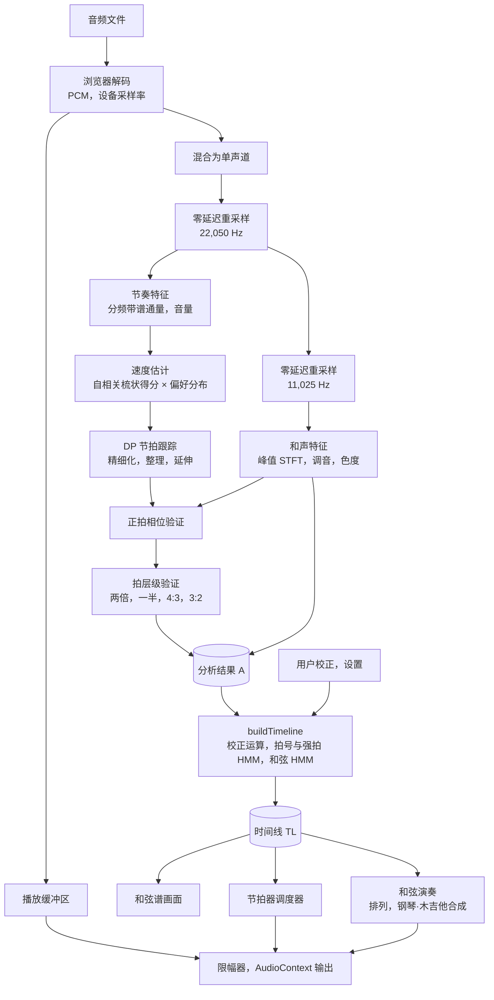
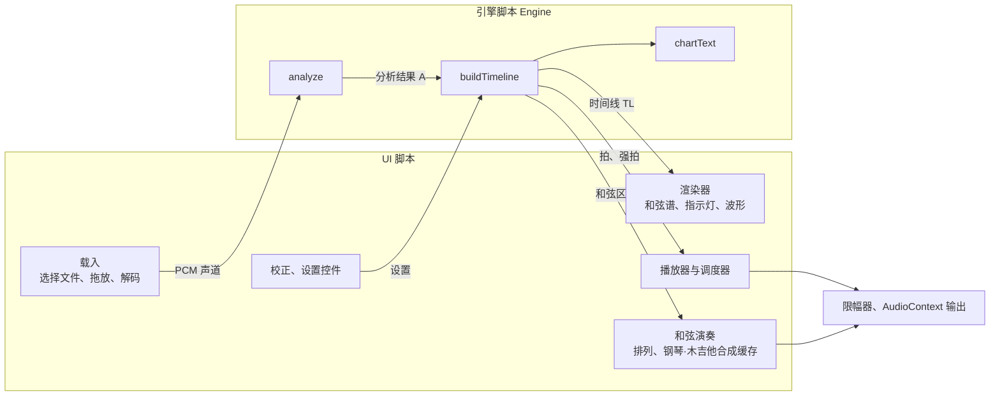
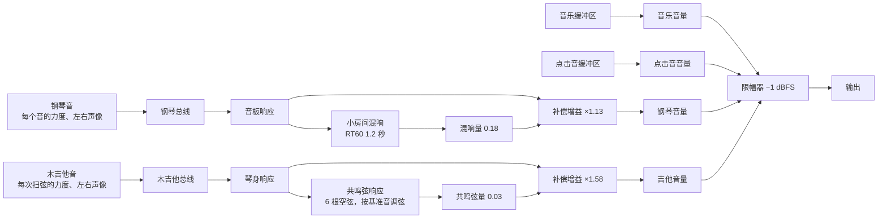

[한국어](README.md) · [English](README.en.md) · [日本語](README.ja.md) · **中文** · [Français](README.fr.md) · [Español](README.es.md)

版本 1.11.11：

贡献者 -

* 고쿠라주민（118.220）：提出了在节拍校正窗口或底部窗口打开时，即使和弦继续推进焦点也不移动的想法。

> 已经或有意参与协作、做出贡献的朋友，请私下与我联系。本项目是公开源代码、任何人都可以免费使用的软件。用于个人、非营利目的时，可以不付费照原样使用。但著作权和所有权归原作者、协作者和贡献者所有：未经原作者许可，不得修改本程序，也不得将其中一部分拆出放进自己的程序中使用（包括仅供本人使用的情况），不得声称本程序归自己所有，也不得在其他地方分发或销售。也不允许把修改后的内容上传到 GitHub 分叉（fork）中。学校、培训机构、社团、教会、宗教团体、公司等团体使用时并非一律免费，请先与我联系。详细条件见 [LICENSE](LICENSE)。

# Chordity <sup>v1.21.0</sup>

**Chordity 是一个网页：放入歌曲文件，它就会在每个小节上标出和弦，并紧跟歌曲的拍子打节拍器。**

在和弦变化的瞬间，钢琴或木吉他（或两者一起）会弹出那个和弦，你可以边用耳朵确认边跟着弹。无需安装，无需注册，也无需联网。音乐文件不会离开你的电脑。

结果可能有误。分析原理、判断依据，以及检查和修正结果的方法，都整理在[帮助页面](information.html)中。点击应用最下方的说明文字也能打开。

*Chordity: per-measure chord recognition, a beat-locked metronome and synthesized piano chord playback in a single offline HTML file. No libraries, no uploads.*


## 目录

- **[第 1 部分 轻松了解](#第-1-部分-轻松了解)**
  - [适合这些时候使用](#适合这些时候使用)
  - [使用方法](#使用方法)
  - [如何看懂画面](#如何看懂画面)
  - [节拍器听起来不对劲时](#节拍器听起来不对劲时)
  - [用不同方式显示和弦名称](#用不同方式显示和弦名称)
    - [音名](#用音名显示)、[Camelot](#用-camelot-显示)、[罗马数字级数](#用罗马数字级数显示)
  - [用钢琴·木吉他听和弦](#用钢琴木吉他听和弦)
  - [快捷键](#快捷键)
  - [效果好的歌曲与困难的歌曲](#效果好的歌曲与困难的歌曲)
  - [值得了解的事项](#值得了解的事项)
- **[第 2 部分 原理](#第-2-部分-原理)**
  - [2-1. 把声音变成图](#2-1-把声音变成图)
  - [2-2. 寻找拍：新发声瞬间的规律](#2-2-寻找拍新发声瞬间的规律)
  - [2-3. 确认是不是真正的拍](#2-3-确认是不是真正的拍)
  - [2-4. 划分小节](#2-4-划分小节)
  - [2-5. 识别和弦](#2-5-识别和弦)
  - [2-6. 用概率表达音乐规律](#2-6-用概率表达音乐规律)
  - [2-7. 不跑偏的节拍器](#2-7-不跑偏的节拍器)
  - [2-8. 用钢琴·木吉他弹出和弦](#2-8-用钢琴木吉他弹出和弦)
  - [2-9. 找出调性变化的位置](#2-9-找出调性变化的位置)
- **[第 3 部分 工作方式](#第-3-部分-工作方式)**
  - [3-1. 整体流程](#3-1-整体流程)
  - [3-2. 载入与预处理](#3-2-载入与预处理)
  - [3-3. 节奏特征](#3-3-节奏特征)
  - [3-4. 和声特征](#3-4-和声特征)
  - [3-5. 速度与节拍](#3-5-速度与节拍)
  - [3-6. 拍号、小节、和弦（轻量阶段）](#3-6-拍号小节和弦轻量阶段)
  - [3-7. 播放与节拍器](#3-7-播放与节拍器)
  - [3-8. 校正按钮的作用](#3-8-校正按钮的作用)
  - [3-9. 和弦演奏](#3-9-和弦演奏)
- **[第 4 部分 深入探究](#第-4-部分-深入探究)**
  - [4-1. 算法与公式](#4-1-算法与公式)
    - [(1) 零延迟重采样](#1-零延迟重采样)、[(2) 实数 FFT](#2-实数-fft)、[(3) 分频带谱通量与起音包络](#3-分频带谱通量与起音包络)、[(4) 速度估计](#4-速度估计)、[(5) DP 节拍跟踪 (Ellis, 2007)](#5-dp-节拍跟踪-ellis-2007)、[(6) 节拍精细化](#6-节拍精细化)、[(7) 正拍相位验证](#7-正拍相位验证)、[(8) 拍层级验证](#8-拍层级验证)、[(9) 拍细分判定](#9-拍细分判定)、[(10) 频谱峰值、调音、色度](#10-频谱峰值调音色度)、[(11) 拍同步汇总、低音下限、调性](#11-拍同步汇总低音下限调性)、[(12) 和弦模板与发射分数](#12-和弦模板与发射分数)、[(13) 和弦维特比：O(T·K)](#13-和弦维特比otk)、[(14) 强拍证据与拍号 HMM](#14-强拍证据与拍号-hmm)、[(15) 节拍器调度](#15-节拍器调度)、[(16) 钢琴合成](#16-钢琴合成)、[(17) 排列（voicing）与击键](#17-排列voicing与击键)、[(18) 转调跟踪](#18-转调跟踪)、[(19) Camelot 标记](#19-camelot-标记)、[(20) 罗马数字和声分析](#20-罗马数字和声分析)、[(21) 按曲风的增强](#21-按曲风的增强)、[(22) 延续与变化位置](#22-延续与变化位置)、[(23) 木吉他合成](#23-木吉他合成)、[(24) 跟随扫弦](#24-跟随扫弦)
  - [4-2. 物理世界](#4-2-物理世界)
    - [声音、音高、平均律](#声音音高平均律)、[泛音](#泛音)、[各乐器的频带](#各乐器的频带)、[时间与频率的取舍](#时间与频率的取舍)、[采样与混叠](#采样与混叠)、[音量、混响、对数](#音量混响对数)、[人的感知](#人的感知)、[钢琴琴弦](#钢琴琴弦)、[木吉他琴弦](#木吉他琴弦)、[延迟与距离](#延迟与距离)
  - [4-3. 体系](#4-3-体系)
    - [组成](#组成)、[仓库结构](#仓库结构)、[引擎 API](#引擎-api)、[三个时钟](#三个时钟)、[音频图](#音频图)、[设置保存](#设置保存)
  - [4-4. 问题与解决](#4-4-问题与解决)
  - [4-5. 优化](#4-5-优化)
  - [4-6. 验证](#4-6-验证)
    - [单元测试](#单元测试)、[合成曲目回归测试](#合成曲目回归测试)、[转调测试](#转调测试)、[Camelot 标记测试](#camelot-标记测试)、[罗马数字级数测试](#罗马数字级数测试)、[真实录音测试](#真实录音测试)、[真实浏览器端到端测试](#真实浏览器端到端测试)、[和弦演奏测试](#和弦演奏测试)、[木吉他与新钢琴测试(1.12.0)](#木吉他与新钢琴测试1120)、[无伴奏开头测试(1.12.2)](#无伴奏开头测试1122)、[钢琴声音与木吉他强弱测试(1.13.0)](#钢琴声音与木吉他强弱测试1130), [木吉他扫弦记号测试（1.14.0）](#木吉他扫弦记号测试1140)、[木吉他上扫与慢速扫弦测试（1.15.0）](#木吉他上扫与慢速扫弦测试1150)、[曲风扩展测试(1.5.0)](#曲目类型扩展测试150)、[拍号变化与速度显示测试(1.6.0)](#拍号变化与速度显示测试160)、[延续与变化位置测试(1.8.4)](#延续与变化位置测试184)
  - [4-7. 特点与优势](#4-7-特点与优势)
  - [4-8. 局限与展望](#4-8-局限与未来)
  - [4-9. 参考文献](#4-9-参考文献)
- **[更新记录](#更新记录)**
  - [版本规则](#版本规则)
  - [Chordity 1.x](#chordity-1x)
    - [1.21.0](#1210-2026-10-31), [1.20.0](#1200-2026-10-31), [1.19.0](#1190-2026-10-31), [1.18.0](#1180-2026-10-31), [1.17.0](#1170-2026-10-30), [1.16.1](#1161-2026-10-30), [1.16.0](#1160-2026-10-30), [1.15.1](#1151-2026-10-29), [1.15.0](#1150-2026-10-29), [1.14.0](#1140-2026-10-29), [1.13.0](#1130-2026-10-26), [1.12.2](#1122-2026-10-26), [1.12.1](#1121-2026-10-26), [1.12.0](#1120-2026-10-25), [1.11.11](#11111-2026-10-25), [1.11.10](#11110-2026-10-21), [1.11.9](#1119-2026-10-18), [1.11.8](#1118-2026-10-18), [1.11.7](#1117-2026-10-15), [1.11.6](#1116-2026-10-14), [1.11.5](#1115-2026-10-14), [1.11.4](#1114-2026-10-14), [1.11.3](#1113-2026-10-14), [1.11.2](#1112-2026-10-13), [1.11.1](#1111-2026-10-13), [1.11.0](#1110-2026-10-13), [1.10.5](#1105-2026-10-11), [1.10.4](#1104-2026-10-11), [1.10.3](#1103-2026-10-11), [1.10.2](#1102-2026-10-11), [1.10.1](#1101-2026-10-11), [1.10.0](#1100-2026-10-11), [1.9.4](#194-2026-10-10), [1.9.3](#193-2026-10-10), [1.9.2](#192-2026-10-10), [1.9.1](#191-2026-09-30), [1.9.0](#190-2026-09-30), [1.8.4](#184-2026-09-30), [1.8.3](#183-2026-09-30), [1.8.2](#182-2026-09-30), [1.8.1](#181-2026-09-30), [1.8.0](#180-2026-09-30), [1.7.0](#170-2026-09-30), [1.6.0](#160-2026-09-30), [1.5.0](#150-2026-09-30), [1.4.2](#142-2026-09-27), [1.4.1](#141-2026-09-27), [1.4.0](#140-2026-09-26), [1.3.1](#131-2026-09-26), [1.3.0](#130-2026-09-26), [1.2.0](#120-2026-09-26), [1.1.1](#111-2026-09-26), [1.1.0](#110-2026-09-26), [1.0.0](#100-2026-09-26)
  - [开发版 0.x（小节和弦）](#开发版-0x마디-코드)
    - [0.4.1](#041-2026-09-26), [0.4.0](#040-2026-09-25), [0.3.1](#031-2026-09-25), [0.3.0](#030-2026-09-25), [0.2.1](#021-2026-09-25), [0.2.0](#020-2026-09-25), [0.1.0](#010-2026-09-25)


---

## 第 1 部分 轻松了解

### 适合这些时候使用

- 想用吉他或钢琴跟着弹喜欢的歌时
- 需要扒出歌曲的和弦，却很难靠耳朵一个个找出来时
- 想跟着原曲练习节拍时

### 使用方法

1. 用 Chrome、Edge、Safari、Firefox 等浏览器打开 `chordity.html` 文件。
2. 点击**打开文件**（“파일 열기”），或把音乐文件拖到窗口上。稍等几秒，和弦谱就会出现。
3. 点击**播放**（“재생”）按钮。节拍器会随音乐在每一拍发出“哒”的一声（小节第一拍是较高的“嘀”；如果和弦变化单位是 ½ 拍，拍与拍之间还会有轻轻的“嗒”，如果是三连音曲子的 ⅓ 拍，则有两声“嗒”），黄色荧光笔框圈住当前正在响的和弦，该和弦名称随之放大。框内像进度条一样按已播放的部分填成橙色；和弦一变，框会像弹簧一样弹跳着移到下一个和弦。原曲在哪里弹和弦，钢琴就在哪里弹出那个和弦（和弦变化或重新弹奏同一和弦时重新弹，在延留的地方则继续鸣响）。

MP3、WAV、M4A、FLAC、OGG 等浏览器能播放的文件都可以。

### 如何看懂画面

| 看到的内容 | 含义 |
|---|---|
| 黄色荧光笔框 | 当前正在响的和弦。从弹奏该和弦的那一拍一直圈到下一个和弦出现的位置（如果延留的灰色和弦延续到下一小节，就圈到那里；换行时每行一段）。和弦一变，框会像弹簧一样弹跳着移到下一个和弦 |
| 框内的橙色填充 | 该和弦到目前为止已演奏的部分（进度条）。填充的末端就是当前播放位置，每拍开始时正好到达该拍斜线的位置 |
| 放大的和弦名称 | 当前正在响的和弦（新弹奏的和弦）的名称。出现时一下子放大，进入下一个和弦后慢慢缩回原来的大小。放大程度以不碰到下一个名称为限 |
| 斜线 `/` | 一拍。变深的斜线就是当前拍 |
| 粗斜线 | 重新弹奏和弦的拍（黑字和弦所在的拍）。可以看出和弦是按什么节奏弹的。灰色和弦和 `N.C.` 的位置通常是普通斜线 |
| 斜线上方的 `⊓` `V`（打开木吉他时） | 木吉他弹奏的扫弦。`⊓` 是下扫（从上往下），`V` 是上扫（从下往上），所在位置就是弹奏的拍或拍与拍之间的位置。更改木吉他演奏方式时随之改变。左侧带竖向波浪线的 `⊓` 表示把六根弦慢慢扫过的扫弦（1.15.0）。播放时记号会在扫弦弹奏的瞬间弹跳一下（1.15.0）从 1.21.0 起，播放时下扫 `⊓` 向下跳、上扫 `V` 向上跳，慢扫波浪线在两拍内随拍子摇摆着跳动。 |
| 标有 `M` 的折线 ┌─┐ | 木吉他用左手按住琴弦弹奏的段落（闷音、手掌闷音）。折线两端就是该段落第一次和最后一次扫弦 |
| `C` `Am` `G7` | 和弦名称。位于某条斜线正上方时，表示和弦在那一拍变化 |
| `G/B` | G 和弦，但最低音是 B |
| 小号字、分上下两行排列的和弦名称 | 一个小节里和弦太多、名称碰到下一个和弦时会缩小字号；仍然放不下时，就把该小节的名称上下两行交替排列（名称的左端就是弹奏该和弦的拍）。在窄屏上，如果小节最后一拍的长名称分两行也放不下，就从次要部分开始省略并加上 `…`（`Bm7/F♯` → `Bm7…`）。完整名称可以把鼠标悬停其上查看，或在播放时于上方的当前和弦栏中查看 |
| 灰色和弦 | 不重新弹奏，原样延留前一小节的和弦。即使是同一和弦，只要在小节第一拍重新弹奏，就显示为黑字 |
| `N.C.` | 没有和弦的部分（只有鼓或安静的时候，以及歌曲开头没有伴奏、只有歌声的时候） |
| 第 0 小节 | 歌曲从小节中间开始的部分（弱起小节） |
| 小节上方的 `2박` 之类标记 | 只有这一小节的拍数不同（`2박` 意为“2 拍”） |
| 黑色标签 `E 장조로` | 从这一拍起调性改变（转调）。上方的调性栏中也会显示为 `E♭ 장조 → E 장조`（장조 即“大调”）。歌曲第一小节会标出起始调性和拍号，不带助词（`C 장조` `4/4`，就像乐谱的调号、拍号） |
| 黑色标签 `3/4으로` | 从这一小节起拍号改变（拍号变化）。上方的拍号栏中也会显示为 `4/4 → 3/4 → 4/4` |
| 白色胶囊 `72` `132로` | 从这一拍起的速度（BPM，四舍五入），位于斜线下方一行。歌曲开始的那一拍只显示起始速度的数字；速度突然变化的地方，在新速度后加上韩语助词 `로/으로`（意为“变为……”） |
| 白色六边形框 `여기까지 63` | 速度逐渐变化的区段（斜线下方一行）。框覆盖的长度就是变化的区段；播放位置在框内时，已经过的部分会填上荧光笔颜色，并像 `현재 67` 这样显示当前速度（`여기까지` 意为“到此为止”，`현재` 意为“当前”）。填满后会淡化成白色，框末端下一拍的白色胶囊（到达的速度）会短暂亮起 |
| 速度（上方栏和播放条） | 正在播放位置的速度。速度逐渐变化时会像 120、119、118 … 这样跟着变动。播放条即使滚动也固定在屏幕最上方，始终可见 |
| `8B`、`9A` 加小字的名称 | 选择 Camelot 标记时的和弦名称（见下文“用 Camelot 显示”） |
| `I`、`vi`、`V7/ii` 之类的罗马数字 | 选择罗马数字级数标记时的和弦名称（见下文“用罗马数字级数显示”） |
| 圆形指示灯 | 当前是第几拍。最大的圆表示小节第一拍 |
| 上方的“下一个 G”（“다음 G”） | 即将出现的和弦 |
| 节拍器（“메트로놈”）、钢琴（“피아노”）、木吉他（“통기타”）按钮 | 每按一次切换开/关。钢琴和木吉他分别开关，两者都打开时会一起弹奏 |
| 音乐（“음악”）、咔嗒声（“클릭”）、和弦（“코드”）滑条 | 分别调节原曲、节拍器和和弦演奏（钢琴·木吉他）声音的音量 |

### 节拍器听起来不对劲时

大多数情况下会自动对齐，但有些歌曲每个人数拍的方式也不同。请打开**拍子不对吗？校正**（“박이 안 맞나요? 보정하기”），试着按下面的按钮。按下立即生效。

| 如果听起来是这样 | 就按这个按钮 |
|---|---|
| 咔嗒声落在拍与拍之间 | 移动 ½ 拍（“½박 옮기기”） |
| 咔嗒声太密 | 减半 ÷2（“절반으로 ÷2”） |
| 咔嗒声太稀 | 加倍 ×2（“두 배 빠르게 ×2”） |
| 是 6/8 感觉的歌，咔嗒声却太多 | 三个一组 ÷3（“셋씩 묶기 ÷3”） |
| 小节开始的位置偏了一拍 | 提前一拍（“한 박 앞당기기”）、推后一拍（“한 박 늦추기”） |
| 咔嗒声感觉略早或略晚 | 咔嗒时机（“클릭 타이밍”） |
| 想把拍子校正恢复到初始状态 | 撤销拍子校正（“박 보정 되돌리기”） |
| 想把和弦类型等设置恢复到初始状态 | 恢复默认设置（“설정 기본값으로”） |

当前改动了哪些内容，会在同一栏的**生效中**（“적용 중”）里分成“拍子校正”（“박 보정”）和“设置”（“설정”）两部分显示。即使把这一栏收起，标题旁也能看到摘要。

从 1.20.0 起，**和弦类型**（“코드 종류”）默认为“扩展”（“확장”，标到 sus2、aug、m7♭5、dim7），1.19.0 之前的默认“标准”（“표준”，到 7、maj7、m7、sus4、dim）仍可选择。如果想让和弦显示得更简单，请在**和弦类型**（“코드 종류”）中选择“基本”（“기본”）。从 1.20.0 起，**和弦变化单位**（“코드 변화 단위”）默认为“½ 拍单位”（一拍之内变化的和弦也显示）；每拍最多只看一个和弦时选择“1 拍单位”（“1박 단위”），想看到在十六分音符位置变化的短和弦时选择“¼ 拍单位”（“¼박 단위”）（几乎保留 ½ 拍找到的和弦，再加上短和弦）。在 ½ 拍单位下，节拍器也会在拍与拍之间（八分音符的位置）加入轻而高的“嗒”，听起来像“嘀-嗒-哒-嗒-哒-嗒-哒-嗒”。在拍分成三份的三连音曲子（12/8·6/8 等）中，这一选项会变为“⅓ 拍单位”（“⅓박 단위”），把一拍分成三份（三个八分音符），节拍器也会在拍与拍之间各加入两声“嗒”，听起来像“嘀-嗒-嗒-哒-嗒-嗒”。三连音曲子更细的单位是“⅙ 拍单位”（“⅙박 단위”）。在“¼ 拍单位”下节拍器在拍与拍之间加入三声“嗒”，在“⅙ 拍单位”下加入五声。

### 用不同方式显示和弦名称

在和弦谱正上方的**和弦标记**（“코드 표기”）条中，可以用三种方式查看同一个和弦。按下后，和弦谱、当前与下一个和弦、文本和弦谱会一同立即改变，所选方式下次打开时也会保留。用键盘时，把焦点放在该条上按 ←、→ 切换。

| 按钮 | 示例 | 适合这些时候 |
|---|---|---|
| 音名（“음이름”） | E♭, B♭/D, Cm7 | 看着和弦直接跟弹，或演奏者之间交流和弦时 |
| Camelot（“카멜롯”） | 5B, 6B, 3A⁷ | 寻找相配的调性与和弦，或选择 DJ 混音衔接点时 |
| 罗马数字级数（“로마 숫자”） | I, V⁶, ii⁷/IV | 分析歌曲的和声进行，或移到其他调演奏时 |

下面三张图是同一段 E♭ 大调的 11 个小节分别用各种方式显示的样子。

#### 用音名显示


这是最熟悉的和弦名称。根音写得大，m、sus、dim 等性质写得稍小，7、maj7 等扩展音用上标，复杂的和弦也能一眼读懂。

- **斜线和弦**：第二小节的 `B♭/D` 表示弹 B♭ 和弦，但把最低音放在 D。像第六小节的 `B♭7/A♭` 这样以七音作低音的和弦也照样写出。
- **符合调性的 ♯/♭**：同一个音也会按该处的调性来写。这首歌是 E♭ 大调，所以写 B♭ 而不写 A♯，写 A♭ 而不写 G♯；歌曲转到 E 大调后，就会像 G♯m7 这样用 ♯ 来写。
- 不重新弹奏、从前一小节延留下来的和弦显示为灰色，没有和弦的地方写作 `N.C.`。即使是同一和弦，在小节第一拍重新弹奏时也写成黑字。

#### 用 Camelot 显示


用 DJ 衔接曲目时使用的 Camelot 轮编号来标记。把调性按五度圈顺序放在 1～12 号位置上，大调一系加 B，小调一系加 A。编号相同或相差一的调性与和弦之间，声音相互协调。

- **和弦的读法**：用与该和弦根音及性质（大、小）相同的调性的编号来标记，和弦类型以小字附加。E♭ 是 5B，Cm 是 5A，B♭7 是 6B 加一个小小的 7。
- **调外和弦一目了然**：这首歌的调性是 E♭ 大调（5B），所以和弦大多集中在 4～6 号。只有第四小节的 `3A⁷`（B♭m7）编号离得较远，这是因为它是为了走向 IV 级的 A♭maj7（4B）而暂时借来的和弦。
- 歌曲的调性也会像 `E♭ 장조(5B)` 这样连同编号一起显示（장조 即“大调”）。
- Camelot 没有标记低音的方法，因此省略斜线和弦的低音（`B♭/D` → `6B`）。和弦演奏时仍会连低音一起弹出。

#### 用罗马数字级数显示


这是和声学教材中使用的罗马数字和声分析。它不用音名标记和弦，而是标出**该和弦建立在调内第几个音上**，从而揭示歌曲以怎样的骨架行进。调不同时，相同的进行也会显示为相同的数字，便于移到其他调演奏，或比较多首歌曲的进行。

- **图中的走向**：前三小节 `I – V⁶ – vi` 是低音按 E♭ → D → C 逐音下行的进行。接下来的 `ii⁷/IV – V⁷/IV – IVᴹ⁷` 是为了走向 IV（A♭maj7）而暂时借用 A♭ 大调的 ii–V 的进行，最后的 `ii⁷ – V⁷ – I` 则是最基本的终止。
- **转位数字**：第二小节的 `V⁶` 是以三音（D）作低音的和弦，第六小节的 `V⁴₂` 是以七音（A♭）作低音的和弦。

| 标记 | 含义 |
|---|---|
| I, IV, V（大写） | 大三和弦一系的和弦。数字表示建立在调性第几个音上的和弦 |
| i, ii, vi（小写） | 小三和弦一系的和弦 |
| °, ø, +, M | 减三和弦（°）、半减七和弦（ø）、增三和弦（+）、大七和弦（M7） |
| 7 | 七和弦 |
| 6, ⁶₄ | 三和弦的转位。低音为三音时是 6，为五音时是 ⁶₄ |
| ⁶₅, ⁴₃, ⁴₂ | 七和弦的转位。分别对应低音为三音、五音、七音时 |
| V/x, vii°/x, ii/x | 为了走向 x 而暂时使用的和弦（副属和弦等）。V7/vi 是通向 vi 的属七和弦 |
| ♭VI, ♭VII 等 | 调内音阶以外的级数。例如从同主音小调借来的和弦（借用和弦）等 |

- 数字以该处的调性为基准来数。转调之后，按新调重新计数。
- 如果转调前紧接着出现新调的属和弦，就按新调写成 V（例：即将转入 E 大调前的 B7 写作 V7）。
- 关闭低音标记（斜线和弦）后，不写转位数字，以原位形式标记。

### 用钢琴·木吉他听和弦

用上方的**钢琴**（“피아노”）和**木吉他**（“통기타”）按钮打开和弦演奏后，会弹出识别出的和弦。两个按钮分别开关，两者都打开时钢琴和木吉他会一起弹奏（最初只打开了钢琴）。与原曲叠在一起听，就能立刻用耳朵确认标出的和弦是否正确，跟弹时也能作为向导。声音会自动对齐歌曲的音高，因此不会与原曲走音。

- 音乐、咔嗒声、和弦的音量可用上方的三条滑条分别调节（和弦滑条同时作用于钢琴和木吉他）。
- 钢琴的弹奏时机在**校正**（“보정하기”）的**钢琴演奏**（“피아노 연주”）中选择：跟随歌曲（“곡 따라”，1.20.0 之前的默认，只在原曲重新弹奏的地方重弹）、和弦变化时（“코드가 바뀔 때”）、每小节重弹（“마디마다 다시”）、每拍（“박마다”），以及从 1.19.0 起的**创作歌手**（“싱어송라이터”，配合歌曲的伴奏）和**有个性**（“개성 있게”）。创作歌手跟随与吉他创作歌手模式相同的段落音量：安静处弹分解和弦，响亮处左手低音配右手短和弦，右手比吉他高一个八度，同时打开吉他时弹在吉他不弹的位置。有个性弹分解和弦，在 4 小节乐句结尾加一段上行短跑音，并把最后一个和弦一个音一个音地滚奏。从 1.21.0 起默认为**自动**（“자동”）：打开歌曲后查看原曲的节奏，拍子摇摆（自由速度）或每拍弹奏的声音很少时跟随歌曲，拍子稳定且原曲在拍与拍之间很忙时为创作歌手，拍与拍之间有余裕时为有个性。所选方式和原因显示在选项名称和分析信息中。钢琴实际弹奏的节奏型显示在分析信息的“피아노 패턴”中，按小节的拍格节奏型（● 两个以上的音、○ 一个音、· 休止）从多到少排列；创作歌手和有个性还会显示分解和弦、和弦、低音的次数。
- 木吉他的弹奏方式在**校正**的**木吉他演奏**（“통기타 연주”）中选择。1.20.0 之前默认的**创作歌手**（“싱어송라이터”，1.16.0）像木吉他伴奏者听完歌曲后那样弹奏。它根据曲子的速度和感觉决定八分音符、十六分音符或三连音的手部摆动，选择适合原曲的扫弦律动（通常为 ↓ ↓↑ ↑↓↑，慢歌为十六分音符律动），在安静的段落弹得稀疏（如 ↓↓↓↓），在响亮的段落弹得密集，重复的段落用相同的模式弹奏。在明显变响的段落之前填满最后一拍，在拍与拍之间变化的和弦提前弹出，并在第 2、4 拍加重音。即使在安静的段落，只要原曲仍有反拍或弱拍律动，就轻轻延续主律动；原曲稀疏时，整个段落用同一种密度（四分音符、二分音符，或弹一次后让其延音）弹奏。8 小节乐句的结尾只在原曲该拍较弱时才稍作留空，和弦中断的停顿处只弹一次就停，歌曲的最后一个和弦慢扫一次并让它一直延音。从 1.17.0 起不再只重复一个模式：每个级别都从真实伴奏者常用的几种扫弦型中，逐小节选出最符合原曲节奏的一种；原曲重击的空格会补弹，几乎无声的格则空出；同一形态连续超过 4 小节时，会在乐句结尾换掉（重复的段落仍然弹得一样）。**跟随扫弦**（“스트로크 따라”）按每拍的十六分音符格找出原曲中吉他、钢琴、鼓等弹奏的节奏，在这些位置以下扫、上扫弹奏。找不到弹奏位置的小节在第一拍弹一次；这是凭声音找出原曲的节奏，因此可能与实际演奏不同（4-8）。**4 Beat·8 Beat·16 Beat 扫弦**（“4비트·8비트·16비트 스트럼”）从吉他教程中学到的扫弦变奏（8 Beat 如 ↓↑↓↑↓↑↓↑、↓ ↓ ↓↑↓↑、↓ ↓↑ ↑↓↑ 等）中，逐小节选出最贴合原曲节奏的一种，按歌曲的拍弹奏。按照手始终上下摆动的基本功，拍点一侧为下扫，其间为上扫；选出的节奏型显示在**分析信息**（“분석 정보”）的“木吉他扫弦”（“통기타 스트럼”）一项中。**摇摆扫弦**（“스윙 스트럼”）每拍把两个八分音符放在三连音的第一·第三个位置上，以长·短（↓·↑ ↓·↑）弹奏。原曲是摇摆节奏时，从原曲中测出反拍所在的位置（摇摆比例）来对齐；直拍的曲子或无法测量的曲子则在三连音位置（拍的 ⅔）弹奏。摇摆扫弦不做变奏，只弹这一种节奏，所用的比例显示在分析信息的“木吉他扫弦”一项中。无论哪种方式，和弦新变化的地方总会弹（如果在要弹的格之间变化，就在其后的第一格弹：4 Beat 为下一拍，摇摆为该拍的反拍）；即使在没有和弦的地方（N.C.），只要原曲中有鼓等节奏，也会以捂住琴弦来弹的**闷音**（“嚓”）弹奏，低音清晰时以该音的**手掌闷音**弹奏（安静的地方不弹）；和弦用真实的吉他指法（C 为 x32010，G 为 320003 等）按出。无论哪种方式，都会在原曲安静的地方弹得轻、在响亮的地方弹得重，在小节内也会把原曲中弹得重的位置弹得重（1.13.0）。自 1.15.1 起，原曲越响的地方弹得越重一些，越安静的地方弹得越轻一些；弹得越重扫弦越快（最快到真实木吉他扫弦速度的 1.25 倍），弹得越轻扫弦越慢（最慢到 0.8 倍）。在曲子的结尾部分，曲子的最后一个和弦、进入尾奏的小节的第一拍、以及延续超过一小节的和弦，不再“锵”地一下弹出，而是从低音弦起慢慢扫过，发出“哗啦啦啦”的琶音式声音；曲子越慢扫得越慢（半拍，0.12～0.5 秒）。在曲子的开头和中间不慢扫（1.15.1）。跟随扫弦在用十六分音符密集扫弦的曲子中，也会找出被鼓声盖住的轻上扫来弹。此外，还会按手不停上下摆动的节奏顺着节拍加入上扫：快歌（116 BPM 及以上）用八分音符 ↓↑，慢歌在下一拍前用十六分音符 ↓↑；如果加入的上扫前面缺少与之相连的下扫，也一并加入。只在原曲中该位置在本曲同类位置里偏响的地方加入，因此会跟着曲子的节奏（1.15.0）。从 1.21.0 起默认为**自动**（“자동”）：打开歌曲后查看原曲的节奏，原曲的扫弦型在小节之间反复或拍子摇摆时跟随扫弦，扫弦型每小节都变时为创作歌手。从 1.21.0 起，跟随扫弦也会把实际弹出的扫弦按小节整理成拍格节奏型（↓ 下扫、↑ 上扫、M 闷音、✗ 不弹的格；4·8·16 拍、创作歌手和摇摆的节奏型也用 ✗ 表示不弹的格，用 M 表示闷音），按使用次数从多到少显示在“통기타 스트럼”中。
- 打开木吉他后，图表中和弦名与斜线之间会用记号显示木吉他弹奏的扫弦。下扫在弹奏位置标 `⊓`，上扫标 `V`；按住琴弦弹奏的闷音、手掌闷音段落，在连接其第一次和最后一次扫弦的折线上方标 `M`。更改木吉他演奏方式时记号也随之改变，关闭木吉他时记号消失，图表也恢复原来的高度（1.14.0）。慢速扫弦在其 `⊓` 左侧加一条竖向波浪线。播放时，在弹奏前 0.1 秒该扫弦记号会鼓起并轻轻跳起，落地时像弹簧一样被压扁，再重新立起，0.33 秒内恢复原来的大小（设备设置了减弱动态效果时不动，1.15.0）。
- 也可以用 P 键开关钢琴，用 G 键开关木吉他。

### 快捷键

| 键 | 作用 |
|---|---|
| Space | 播放、暂停 |
| M | 打开、关闭节拍器 |
| P | 打开、关闭钢琴和弦演奏 |
| G | 打开、关闭木吉他和弦演奏 |
| ← → | 上一小节、下一小节 |
| Home | 回到开头 |

点击某个小节就会跳到该小节；点击或拖动上方的波形也能跳到想去的位置。韩文输入法状态下快捷键同样有效。

### 效果好的歌曲与困难的歌曲

有鼓的流行、摇滚、抒情、舞曲、嘻哈、K-pop、原声流行等拍子清晰的歌曲效果很好。曲中速度大幅变化的歌曲、5/4·7/4 之类的变拍子、像 F/G 这样低音不在和弦内的和弦，以及摇滚的强力和弦（E5）也都能识别。像爵士那样张力音和行走低音很多的歌曲、像波萨诺瓦那样以两拍为单位感受的歌曲（小节会被记成两倍长度）、失真极强的金属乐，以及像雷鬼那样拍子可以有两种数法的歌曲，结果可能出错。这时请使用上面的校正按钮。

### 值得了解的事项

- 文件不会通过网络发送。所有分析都在浏览器内完成。
- 点击屏幕最下方的说明文字，会在新标签页中打开[帮助页面](information.html)，其中整理了结果可能出错的情况、确认方法、分析原理和验证结果（帮助页面仅有韩文）。
- 节拍器、和弦演奏、音量、和弦类型、和弦标记方式等设置会保存在浏览器中，下次依然有效。
- 即使使用蓝牙耳机，音乐、咔嗒声和和弦演奏也会一起延迟输出，因此彼此不会错开。
- 如果 iPhone 上没有声音，请检查是否开启了静音模式。
- 播放时页面会跟随当前小节滚动。上方的校正·设置面板或下方的文本和弦谱、分析信息面板展开时不会滚动，方便您继续查看面板；把面板收起后会重新跟随。从 1.20.0 起，播放时屏幕不会变暗或熄灭（浏览器支持保持屏幕常亮时）。暂停或歌曲结束后恢复正常。

<p align="center"></p>

---

<p align="right"><a href="#목차">↑ 返回目录</a></p>

## 第 2 部分 原理

本程序不使用预先训练好的人工智能模型。它依靠把声音的物理性质和音乐规律转化为公式的**信号处理**与**概率模型**来工作。因此每一个判断依据都可以解释清楚，并且可以在画面下方的**分析信息**（“분석 정보”）中直接查看这些依据。

### 2-1. 把声音变成图

声音是空气的振动，录音文件则是每秒对这种振动测量数万次所得的一串数字。只看数字很难知道响的是什么音，因此要把声音切成非常短的片段，对每个片段计算**各种高度的声音混合了多少**（频谱）。把它们按时间顺序排列，就得到横轴为时间、纵轴为音高的声音图像（频谱图）。之后的所有分析，都是在读这张图。

这里存在一个无法回避的取舍。片段切得短，就能准确知道声音**何时**发出，但**是什么音**会变得模糊；切得长则正好相反。因此找拍时用短片段，找和弦时另用长片段。最低的低音，相邻半音之间的频率差非常小，所以需要最长的片段。

### 2-2. 寻找拍：新发声瞬间的规律

打鼓或按下琴键时，那一瞬间声音能量会突然增大。这样的瞬间称为**起音（onset）**。在频谱图中只把比前一刻变大的部分加起来，就得到一条在每个起音处尖尖突起的曲线。

拍就是这些起音**以固定间隔反复出现的骨架**。首先把曲线沿时间方向平移并与自身重叠比较（自相关），找出重叠得最好的间隔，也就是速度。然后在整首歌中一次性找出“尽可能多地经过强起音，同时间隔不大幅偏离速度”的一串拍（动态规划）。由于不是一个个单独确定拍，而是整体一次性优化，即使夹杂几个弱拍，拍串也不会断开，演奏速度略有起伏也能跟上。这时“固定间隔”的基准不是整首歌的速度，而是以几秒为单位求出的**局部速度**。因此在加花之类节奏暂时变复杂的地方不会被带偏，而歌曲真正变慢或变快时又能跟上。

### 2-3. 确认是不是真正的拍

找到规律的拍串并不算结束。常见的错误有两种。

**把反拍当成拍。** 踩镲把拍与拍之间填得很强时，拍串可能被抓偏半拍。但音乐是有规律的：底鼓、军鼓、低音进入的瞬间，以及和弦变化的瞬间，大多集中在**正拍**上。因此在找到的拍位置和移动半拍后的位置上比较这些事件的强度，如果移动半拍的一方明显更强，就把整串拍移动半拍。

**把速度抓成两倍或一半。** 慢抒情歌中八分音符琶音很密时，很容易把每个八分音符都误认为拍。这时把拍隔一个分成两组来看。如果真正的拍上有底鼓和军鼓，中间只有琴键声，那么一组会比另一组强得多。于是丢掉弱的一组，把速度改为一半。反过来，如果每两拍正中间都规律地出现军鼓，说明速度抓得太慢，就改为两倍。加倍这一方向一旦出错，立刻就会出现反拍咔嗒声，因此只在严格得多的条件下才执行。

在真实录音中，踩镲和琴键会填满反拍，两组的强度差可能很小。因此还要看**底鼓和军鼓落在哪一组**。如果速度正确，底鼓（第 1·3 拍）和军鼓（第 2·4 拍）会落在不同的组；如果被抓成两倍，两者都会落在同一组（真正的拍）。把速度改为一半时，不是把节拍隔一个剔除，而是用新速度从头重新跟踪。因为八分音符层级的跟踪哪怕在曲中某处只滑了一格，剔除后的节拍从那以后就会全部错开半拍。

**快歌被抓成一半的两种形态。** 160～180 BPM 左右的快歌，很容易把拍抓慢一个层级，也就是抓成一半速度。这时形态取决于慢拍落在哪里。如果慢拍落在军鼓上（第 2·4 拍），每拍上都会均匀地出现军鼓，底鼓则出现在拍与拍之间。如果是速度正确的慢歌，底鼓落在拍上（第 1·3 拍），军鼓隔一拍出现，因此不会出现这种形态。如果慢拍落在底鼓上（半速感觉），拍与拍之间出现的军鼓会和拍上一样多。两种情况都只在速度估计给出几乎同等强度的两倍速度候选时才改为两倍。如果让慢拍一直落在军鼓上，小节第一拍也会错位，一拍内混入两个和弦，就会出现大量七和弦和斜线和弦。

减半这一方向也要再确认一次。如果把八分音符当成了拍，两拍正中间就是十六分音符的位置，底鼓或低音之类的低频击打很少。因此如果两拍之间也经常出现低音，就认为拍是正确的，不减半。只凭奇偶两组的强度差想要减半时，如果军鼓集中在与底鼓相反的那一组（反拍军鼓，backbeat），同样说明拍是正确的，不减半。

识别“军鼓”的方法是物理性的。军鼓底面的响弦振动时，会产生从中频到极高频**一起**变大的噪声。琴键的音只在少数几个高度上变大，踩镲只在高频一侧变大。因此用两个值的乘积来衡量“中频和高频是否同时变大”，就能单独挑出军鼓。因为两者只要有一个小，乘积就会变小。

### 2-4. 划分小节

要把拍按几个一组组成小节，就得知道**小节第一拍**（强拍）在哪里。第一拍会留下痕迹：和弦改变、低音改变、底鼓重重打进，声音有时也会变大。给每一拍的这些痕迹打分，在遵守“小节通常以相同长度反复”这一规律的前提下，找出得分最高的分组方式。4 拍和 3 拍哪一种与痕迹更吻合，也用这个方法决定。如果一拍内分成三份的感觉很强，就视为 6/8、12/8 之类的复拍子。

在鼓打反拍军鼓（backbeat）的歌曲中，**底鼓在第 1·3 拍、军鼓在第 2·4 拍**这一奇偶形态也被用作强拍的痕迹。在和弦比小节第一拍早一个八分音符变化的切分 riff 中，和弦变化的痕迹会被拉向前一拍，但鼓的奇偶形态不变，因此小节不会错开一拍。另外，3·5·7 拍只有在第一拍的痕迹确实按那个长度反复出现时才会选用。这是为了防止在短歌中仅凭少数几个罕见的大痕迹就看成 7 拍。

### 2-5. 识别和弦

八度不同的同一个音（低音的 do 和高音的 do）在和声中起相同的作用。因此把所有音折叠进 do、do♯、re … si 这 **12 格**，就得到那一刻所响各音的指纹（色度，chroma）。如果是 C 和弦，do、mi、sol 三格会很突出。

真实乐器不会只发出一个音。弹 do 时，高八度的 do、再上面的 sol、再上面的 do、mi …… 这样的**泛音**会一起鸣响。例如 C 和弦中 mi 产生的泛音会填进 si 那一格，不懂泛音的比较方法就会把 C 误认为 Cmaj7。因此和弦的指纹也要把泛音包括在内做好，再拿来比较。

低音（最低的音）单独来看。和弦是 C 而低音是 mi 时，写成 `C/E`。

每段录音的基准音都略有不同。很多歌曲的 A 音并不正好是 440 Hz。因此先测出整首歌的音平均偏高或偏低多少，按此校正后再放进 12 格。

### 2-6. 用概率表达音乐规律

如果只在每一拍选出最相似的和弦，旋律的经过音会让和弦每拍都像闪烁一样变来变去。因此把两条常识用概率加进去：**和弦不会频繁变化**，以及**如果变化，最常在小节第一拍变，很少在两拍之间变**。综合考虑这些规律和声音的相似程度，一次性选出整首歌中最合理的和弦序列（隐马尔可夫模型与维特比算法）。同时也估计歌曲的调性，给与调性相配的和弦一点加分。

### 2-7. 不跑偏的节拍器

这个节拍器不是像“每分钟嘀嗒 97 次”那样按固定间隔敲击，而是在**找出的每一拍的时刻**上敲击。因此演奏稍微变快或变慢也能跟上。

时机也很精确。如果用计时器发出“现在敲！”来发出咔嗒声，电脑繁忙时就会晚几十 ms。因此把咔嗒声提前 0.2 秒预约到播放音乐的**音频设备时钟**上。音乐和咔嗒声使用同一个时钟和同一条输出路径，因此以单个采样为单位咬合；即使在输出有延迟的设备上，两者也一起延迟，彼此不会错开。

### 2-8. 用钢琴·木吉他弹出和弦

如果放入录好的钢琴声音，文件会变大，还需要外部文件。因此钢琴声音是**按物理定律直接生成**的。钢琴弦不是理想弦，而是坚硬的钢丝，泛音会比精确的整数倍略高一些（非谐性）。琴槌敲击在弦长约 1/7 处，因此在该点不振动的泛音会响得较弱。一个音由两三根弦一起发出，弦与弦之间音高有极细微的差异，声音会缓慢起伏（拍音），并产生先快速衰减、后长久余留的两段式衰减。越高的泛音消失得越快，声音逐渐变得柔和。把这些性质用公式叠加起来，逐个音地合成。

从 1.12.0 起，又加入了在真实钢琴上测得的性质：琴槌敲得越重、高泛音留得越多的音色，所有泛音上都会出现的弦间拍音，以及琴槌击弦时敲击音板发出的低沉“咚”声；声音还要通过模拟钢琴音板（共鸣板）木质共鸣的响应再输出。松开琴键时，各音区的制音器落下方式不同，最高音区（没有制音器的弦）会留得较长。

1.13.0 中，按照在真实钢琴录音中测得的数值重新润色了声音。加入了琴槌击弦瞬间的两种声音：毛毡碰到琴弦时发出的短促而高的噪声，以及这股力敲击音板发出的木质“笃”声。让声音在最初 1 秒内像真实钢琴那样快速衰减，修正了此前直到弹下一个和弦为止都像踩着踏板一样均匀鸣响的问题。低沉而长久余留的余音保持不变，并在声音变得足够小的地方自然结束。混响改为小房间（混响时间 1.2 秒）的墙壁最先反射回来的声音，以及其后扩散开来的余响。

木吉他用模拟拨弦的 Karplus-Strong（卡普拉斯-斯特朗）方法生成。把一个琴弦周期长度的噪声送入延迟线，一边让它逐渐变暗一边不断反馈，就会像真正拨动的弦那样，从高频成分开始消失。再加上拨片击弦的位置和力度、吉他琴身内空气与面板的共鸣；和弦按标准调弦 6 弦上用手按出的指法弹奏。下扫从低音弦起弹所有弦，上扫从高音弦起弹高音侧的 3～4 根弦，弦与弦相隔几 ms。自 1.15.1 起，弦间间隔以真实木吉他录音（GuitarSet）的中位数（下扫 6.2 ms，上扫 7.0 ms）为基准，弹得越重最快加快到 1.25 倍，弹得越轻最慢减到 0.8 倍（1.15.0 及以前下扫约 11 ms，扫弦偏慢）。弹奏时机是把拍分成四格（复拍子为三格），在每一格中寻找原曲中频（200～2,500 Hz）声音新变大的瞬间来确定。慢速扫弦时，从低音弦起按把半拍（0.12～0.5 秒）均分的间隔弹所有弦。从 1.15.0 起，这里的声音变大只计算频谱峰（有音高的泛音）处的变大。从 1.15.0 起每根弦的音色不同：缠弦（E·A·D·G）较暗，裸弦（B·E）较亮，取真实木吉他录音（GuitarSet）中测得的各弦亮度与以前音色的中间值，使细弦不再刺耳，同时保留扫弦的起音。余韵不再来自房间混响，而来自吉他本身：除琴身共鸣外，未弹奏的 6 根空弦会随弹奏音的泛音一同振动（按歌曲的基准音调弦）。

从 1.13.0 起，木吉他会调节力度。在原曲安静的地方（主歌、安静的间奏）弹得轻，在变响的地方（副歌）弹得重；在一个小节内，也会把原曲中弹得重的位置弹得重，把弹得轻的反拍弹得轻。歌曲的响度由整体音量和向左右展开的伴奏的响度（立体声左声道与右声道之差）一起判断。这是因为经过母带处理的流行音乐中，即使主歌与副歌的整体音量几乎相同，副歌中的伴奏也会向左右展开得更宽。弹得轻的小节用柔和的音色弹奏，但每个小节只用一种音色，使音色不会随每次扫弦而闪烁。

和弦分为左手低音一个音和右手和音来弹。右手选择从前一个和弦出发手移动最少的转位，因此和弦变化时声音也不会忽高忽低。钢琴按照分析中找到的歌曲基准音来调音，并与节拍器预约在同一个音频时钟上，在和弦变化的瞬间准确鸣响。从 1.16.1 起，钢琴像琴槌更用力击弦那样，高次泛音（2～8 kHz）更清晰，声音更明亮（整体音量不变）。从 1.18.0 起音色接近施坦威三角钢琴：琴槌击弦声更清晰（最初 10 ms 的起音 +2～4.5 dB），延音也稍长。

### 2-9. 找出调性变化的位置

歌曲的调性体现在“主要使用哪些音”上。E♭ 大调的歌主要用 E♭、F、G、A♭、B♭、C、D，转到 E 大调后则用 E、F♯、G♯、A、B、C♯、D♯。因此在每一拍上把前后几个小节的音分布与 24 个调性的典型分布进行比较，并用概率加入**调性不常变化**这条规律，找出整首歌中最合理的调性走向。只掠过一两个小节的其他调的和弦（例如 C 大调歌曲中的 E7 → Am）不算转调。使用相同音的关系大小调（C 大调与 A 小调）之间的移动，由于调号不变，也不算转调。

转调位置按拍来细化。如果经由新调的属和弦（例如 E 大调的 B7）转过去，就按照乐谱上更换调号的惯例，把新的主和弦出现的位置当作转调位置。和弦名称的 ♯/♭ 写法也随该处的调性。在 E 大调区段中写成 G♯m7 而不是 A♭m7。

---

<p align="right"><a href="#목차">↑ 返回目录</a></p>

## 第 3 部分 工作方式

### 3-1. 整体流程



分析分为**重量级阶段**和**轻量级阶段**。

- **重量级阶段** `analyze()` 只在打开文件时执行一次。它完成全部信号处理，直到自动节拍跟踪。通常需要几秒钟，每 32 ms 把控制权交还给画面一次，所以进度显示不会卡住。
- **轻量级阶段** `buildTimeline()` 在每次按校正按钮或更改设置时执行。它重新计算拍号、小节和和弦，即使是 5 分钟的歌曲也只需约 40 ms，所以按下即可反映。

### 3-2. 载入与预处理

1. 浏览器内置解码器把文件解码为 PCM。这一个缓冲区**同时用于播放和分析**。因为如果分别解码，或经过浏览器的重采样器，两个结果的时间轴可能相差几 ms。
2. 把各声道取平均得到单声道，并用自行实现的重采样器生成 22,050 Hz（节奏用）和 11,025 Hz（和声用）信号。滤波器核左右对称，因此信号一个采样也不会偏移。
3. 把最大振幅归一化为 1。

### 3-3. 节奏特征

| 步骤 | 作用 | 主要数值 |
|---|---|---|
| 短时傅里叶变换 | 把 22,050 Hz 信号逐段变为频谱 | 窗 1024 点（46.4 ms），跳步 256 点（11.6 ms，每秒 86.13 帧） |
| 对数压缩 | 让安静声音的变化也显现出来 | log(1 + 1000·\|X\|) |
| 最大值滤波 | 把两帧之前的频谱沿频率方向扩宽 ±1 格后再比较 | 不会把颤音、滑音误认为起音 |
| 分频带通量 | 只把增大的量按频带取平均 | 低频 21–200 Hz（底鼓、贝斯），中频 200–2,500 Hz（军鼓鼓身、琴键），高频 2.5–10 kHz（踩镲、军鼓响弦） |
| 起音包络 | 每个频带除以标准差后求和 | 高频按一半加权（减小反拍踩镲的影响） |
| 音量 | 每帧的 RMS | 用于判定有声区段和显示波形 |

### 3-4. 和声特征

| 步骤 | 作用 | 主要数值 |
|---|---|---|
| 高音部峰值 STFT | 用于和弦组成音的频谱峰值 | 窗 2048 点（186 ms），110–4,200 Hz，每帧最多 36 个 |
| 低音部峰值 STFT | 用于低音和调音 | 窗 4096 点（372 ms），32–1,400 Hz，每帧最多 24 个 |
| 峰值条件 | 只取明显的峰 | 相对帧最大值 −45 dB 以上，且为周围 ±6 格平均的 2 倍以上 |
| 对数抛物线插值 | 以比格间距更精细的精度求频率和幅度 | 使用峰值及其两侧格的对数幅度 |
| 基准音估计 | 把所有峰值的“半音小数部分”在圆上取平均 | 例：+18 cent → A4 = 444.6 Hz |
| 色度 | 把校正后的音高累加到 12 格中 | 越接近半音中心权重越大（cos²）。高音部为 MIDI 48–96，低音部为 28–57 |
| 和声变化曲线 | 前后 4 帧色度的余弦距离 | 用于正拍相位验证 |

### 3-5. 速度与节拍

1. **有声区段**：把相对歌曲的大音量（前 5%）在 −38 dB 以上的区段视为有声。
2. **速度**：用 ±3 秒平均音量去除起音曲线以使其平稳，然后求自相关。在 40–240 BPM 范围内以 0.25 BPM 间隔扫描，把同时考察 1·2·3·4 倍间隔的梳状得分乘以以 110 BPM 为中心的偏好分布，再对最大值附近做抛物线插值。
3. **DP 节拍跟踪**：对 Ellis（2007）的方法做了两处修改后使用。间隔与以 8 秒窗求出的局部速度曲线（为滤除加花取 7 秒中位数）比较；惩罚强度与拍周期的平方成正比，使慢歌中同样多少 ms 的晃动也得到同样的惩罚。
4. **精细化**：把每个节拍移到 ±2 帧（±23 ms）内的起音峰值上，并做抛物线插值。起音较弱的节拍用相邻节拍的线性回归来填补。最后校正 6.5 ms 的检测延迟。
5. **整理**：删除有声区段之外的节拍，并在前后以相同间隔接续，覆盖整个有声区段。
6. **验证**：依次进行正拍相位验证和拍层级验证（原理见 2-3）。如果把拍层级改为一半，就用新速度重新执行 3～5，并再次验证相位。如果拍看起来被分成三份，还会检查慢 4/3 倍的速度和快 3/2 倍的速度（1.11.5·1.11.6，见 4-1 的 (9)）。

### 3-6. 拍号、小节、和弦（轻量阶段）

1. **应用校正运算**：把用户按下的 ½ 拍、×2、÷2、÷3 按按下的顺序应用到节拍列表上。÷2 和 ÷3 根据拍的重音来决定保留哪一拍。
2. **按拍汇总**：对拍区间内的色度以中间为重进行加权平均。低音色度减去整首歌中位数的一半，以去除像有音高的底鼓那样一直垫在下面的成分。
3. **调性与转调**：在每一拍上，把前后 ±6 拍的音分布与 Krumhansl–Kessler 调性轮廓进行比较，并用以 12 种调号为状态的 HMM 划分调性区段。短于 24 拍的区段并入相邻区段。如果没有转调，就使用一个按整首歌分布选出的调性。识别出和弦后，再按区段用和弦重新确定调性：连同音分布一起，考察和弦符合哪个调的音阶、主和弦所占的时间、V → I 终止、开头和结尾的和弦，以及四小节乐句第一拍的和弦。
4. **预备和弦**：只用大三和弦和小三和弦快速求解一遍，作为强拍证据。
5. **细分判定**：比较拍内 1/2 处与 1/3、2/3 处的起音强度，判断是否为复拍子。
6. **强拍 HMM**：自动选择拍号（4 拍对 3 拍；复拍子时为 4 对 2），并反映用户对强拍的移动。
7. **最终和弦 HMM**：以 1 拍、½ 拍或 ⅓ 拍（三连音曲子）为单位，在包括转位在内最多 289 个状态上用维特比求解。
8. **小节构成**：在每个强拍处划分小节，并一并附上小节内和弦变化的位置与长度、是否延续自前一小节、符合该处调性的音名（♯ 或 ♭）、Camelot 代码和罗马数字级数。画面显示在和弦谱上方和弦标记条中所选的一种，更换标记时不会重新分析。转调边界按拍细化，略微偏向小节第一拍（经由属和弦时则放在主和弦处），并记录是第几小节第几拍。

### 3-7. 播放与节拍器

- **音乐**：`AudioBufferSourceNode` 在比当前音频时刻晚 60 ms 时开始。
- **调度器**：每 25 ms 醒来一次，把今后 0.2 秒内将到来的节拍的咔嗒声预约到音频时钟上。标签页处于后台时浏览器会放慢计时器，因此预约到 1.5 秒之后。
- **咔嗒声**：预先生成的短促声音（强拍 1,850 Hz，其余 1,250 Hz，细分拍（½ 拍·⅓ 拍）单位时拍与拍之间为 2,600 Hz）。从第一个采样就开始发声，没有起音延迟。
- **重新同步**：移动位置或更改校正、设置时，取消所有已预约的咔嗒声，从当前位置的下一拍起重新预约。
- **画面**：每一帧都计算播放位置，但会减去浏览器报告的输出延迟，以对准实际听到的时刻。只在小节、拍、和弦改变时才更新画面。
- **自动滚动**：小节切换时，如果当前小节不在固定播放栏下方的可视范围内，就平滑滚动过去。只要有一个折叠面板（`details.panel`）展开，就不滚动（1.11.11）。**保持屏幕常亮**（1.20.0）：开始播放时获取 Screen Wake Lock（`navigator.wakeLock.request('screen')`），使屏幕不会变暗或熄灭，暂停或歌曲结束时释放。标签页被隐藏时浏览器会自行释放，因此再次可见且仍在播放时会重新获取。不支持或被拒绝（省电模式等）时，屏幕照常。

### 3-8. 校正按钮的作用

| 按钮 | 内部运算 | 动作 |
|---|---|---|
| 移动 ½ 拍（“½박 옮기기”） | `half` | 用相邻节拍的中点生成新的节拍列表，并重新对齐到起音峰值。超出到音乐开始之前的拍会被丢弃 |
| 加倍 ×2（“두 배 빠르게 ×2”） | `x2` | 在每两个节拍之间加入中点 |
| 减半 ÷2（“절반으로 ÷2”）、三个一组 ÷3（“셋씩 묶기 ÷3”） | `d2`, `d3` | 每 2 个（3 个）保留一个。保留的位置取拍重音之和较大的一侧 |
| 提前一拍、推后一拍（“한 박 앞당기기”“늦추기”） | `downShift` ∓1 | 把小节内的位置编号逐格轮转 |
| 拍号（“박자”） | `meter` | 用指定的拍数重新求解强拍 HMM |

校正以对节拍列表的**运算记录**形式保存，每次都从头按顺序重新应用。“撤销拍子校正”（“박 보정 되돌리기”）就是清空这份记录。和弦类型、和弦演奏方式、强调强拍（“첫 박 강조”）、自动滚动（“자동 스크롤”）、咔嗒时机（“클릭 타이밍”）不是保存在歌曲上，而是保存在浏览器中的**设置**，因此用“恢复默认设置”（“설정 기본값으로”）另行恢复。“生效中”（“적용 중”）里只显示这两类中与默认值不同的项目。

### 3-9. 和弦演奏

| 步骤 | 作用 |
|---|---|
| 和弦区间 | 引擎对小节中的每个和弦事件，同时传出组成音（0 = C）和要弹奏的低音。关闭斜线标记时，低音为根音。 |
| 击键列表 | 钢琴按弹奏时机生成。“跟随歌曲”（“곡 따라”）在和弦变化处，以及即使是同一和弦但在原曲中重新弹奏的小节第一拍（谱上的黑字）弹奏，在延留处（灰色）则继续鸣响。“和弦变化时”（“코드가 바뀔 때”）对跨小节延续的同一和弦只弹一次，“每小节重弹”（“마디마다 다시”）在小节第一拍重弹，“每拍”（“박마다”）在所有拍上弹奏。在 N.C. 处不弹，并停止前一个和弦。 1.19.0 创作歌手、有个性：引擎 `pianoComp(A, TL, mode, {gtr})` 按小节决定用哪只手和弹的位置（小节级别与吉他 `sswStrum` 相同；阶梯 0 为低音，1 起为右手音，再往上为高八度）。创作歌手在级别 1 及以下弹八分分解和弦（右手高八度），级别 2 弹和弦 + 第 3 拍右手，级别 3 及以上左手第 1、3 拍（级别 4 为八度）+ 右手三次短和弦（在 4 小节乐句内，从 2拍&·4拍 / 1拍&·3拍& / 2拍&·3拍& / 1拍e·3拍& 中选出与吉他扫弦重叠最少的一种）；慢歌（低于 90 BPM）的短和弦每音错开 30 ms 滚奏，乐句最后一拍的 & 上加两个上行音的弱起。有个性在级别 2 及以下或慢歌中弹八分分解和弦（复拍子每拍三个，级别 3 及以上右手高八度），级别 3 为左手第 1、3 拍 + 右手分解（110 BPM 及以上为四分，以下为八分；拍间的音避开吉他扫弦 ±0.06 拍的位置），级别 4 为左手八度 + 短和弦，4 小节乐句最后一拍加上行十六分跑音。小节中途换和弦时在该位置弹新和弦。两种方式的最后一个和弦都从下往上逐音滚奏（间隔为拍的 ¼，0.06～0.12 秒）。重弹同一个音时，前一个音在 30 ms 内止住。 1.21.0 自动：引擎 `autoModes(A, TL)` 只凭原曲的节奏来选。拍子摇摆 J（拍间隔与前后 4 拍中位数的 |对数比| 的中位数）达到 0.8% 以上，或速度变化 D8（相邻 8 拍窗口中位数的 |对数比| 的中位数）达到 3% 以上时跟随歌曲；不换新和弦的拍上格中，中频通量超过全曲 90% 值的比例（拍上起音）低于 60% 时跟随歌曲；拍间格的同一比例（拍间起音）达到 35% 以上时为创作歌手，否则为有个性。实际录音《Rough》（J 0.44%，拍间起音 43%）为创作歌手（用户确认），IU 上传曲（28%）为有个性，合成的自由速度钢琴（D8 6.8%）和氛围铺底（J 1.46%）为跟随歌曲。 |
| 扫弦列表（木吉他） | 引擎 `strokes(A, TL)` 把拍分成四格（复拍子为三格），在每一格测量中频通量的强度，在曲内归一化后的强度达到 0.5 以上的格（时刻取格内的峰）以及和弦新变化的格弹奏。十六分音符反拍（奇数格）为上扫，其余为下扫，扫弦力度随格的强度变化。没有弹奏位置的小节在第一拍下扫一次。移到格内峰处的扫弦如果比和弦边界早不到 60 ms（提前弹奏），就用新和弦弹奏。每根弦一直鸣响，直到同一根弦再次被弹、和弦改变或进入 N.C.（上扫时低音弦不会被切断）。选择 4·8·16 Beat 扫弦时，引擎 `strumGrid(A, TL, mode)` 逐小节选出一种教程节奏型，在其格上弹奏（见 (24)）。选择摇摆扫弦时，同一函数在拍和反拍位置（原曲中测得的比例；无法测量时或直拍的曲子·复拍子为拍的 ⅔）每拍以 ↓·↑ 弹奏。在原曲有节奏的 N.C. 区间中，两个函数会加入闷音扫弦（`mute`：`dead` 闷音·`palm` 手掌闷音，手掌闷音附带音 `pc`）（见 (24)）。 打开木吉他时，按照这份列表（实际弹奏的扫弦）在图表中和弦名与斜线之间的栏里绘制记号（1.14.0）。跟随扫弦会把移到峰值的时刻放回把一拍分成 4 格（复合拍子 3 格）后最近的格；其他方式按弹奏时刻放在该拍内的位置。下扫为 `⊓`，上扫为 `V`；中间没有普通扫弦、连续（间隔不超过 2 拍）的闷音扫弦，用折线把第一次和最后一次连起来，并在上方标 `M`。折线跨过小节或行时分段绘制，只在两端的分段上弯折，`M` 只放在拍长最长的一段上。从 1.15.0 起，格的强度只计算频谱峰处的变大；在十六分音符反拍活跃的曲子中（反拍格中响的格所占比例 a），十六分音符反拍格只要达到 max(0.8, 2.4 − 3.5a) 也会弹。曲子的最后一个和弦、尾奏（曲末小节响度比全曲中位数小 6 dB 以上的小节连续超过 2 小节、且在全曲最后四分之一以内的部分）前一小节的第一拍、以及结尾部分（从尾奏前一小节起，没有尾奏时为最后两小节）中延续超过一小节的和弦，会附上扫弦时间 `rake`（秒）并以下扫弹奏，图表在其 `⊓` 左侧画波浪线。1.15.0 的高潮（后 4 小节比前 4 小节响 2.5 dB 以上的地方）前一小节和曲子中间延续的和弦，作为关闭的开关（`RAKE_MID_RISE`、`RAKE_MID_HOLD`）保留（1.15.1）。按手的摆动补入（`ST_FILL`）：速度低于 116 BPM 或十六分音符反拍活跃（a ≥ 0.33）的曲子视为十六分音符摆手，其余视为八分音符摆手（即使在后者中，弹了十六分音符反拍的那一拍也按十六分音符摆手）；在这一拍和下一拍都弹奏的地方，如果下一拍前的上扫格（十六分音符摆手为第 3 格，八分音符摆手为第 2 格）的强度达到曲内同类格的 65% 分位以上，就加入上扫以及它前面的下扫（十六分音符摆手为第 2 格，八分音符摆手为拍头）。八分音符摆手的拍中，第 2 格的扫弦也为上扫。播放时画面从扫弦时刻前 0.1 秒起让该记号弹跳 0.33 秒（以底部中央为轴：0.125 秒时放大到 1.45 倍并上移 5px，0.21 秒时压扁为宽 1.6 倍、高 0.7 倍，0.33 秒时恢复）。 创作歌手（1.16.0，`strumGrid(A, TL, 'ssw')` → `sswStrum`）把拍分成手部摆动的格（八分手 2 格、十六分手 4 格、三连音手 3 格），每小节用维特比选择 0～4 级模式（↓ 一次、二分、四分、民谣 ↓ ↓↑ ↑↓↑ 或十六分 ↓ ↓·↓↑、八分 ↓↑↓↑ 或十六分 ↓·↓↑ ·↑↓↑）（代价 = (等级 − 期望)² − 4 × 契合分，期望 = 曲子基本等级 − 1.5·max(0, 1 − 2r)，r = 0.6 × 响度 + 0.4 × 节奏活跃度并在重复配对的小节之间混合，变更惩罚 2.5、4 小节乐句边界 0.6）。重复对齐（`ST_REP`）把格强度与重复配对拍的同一格混合，用于跟随扫弦的阈值和 4·8·16 拍的模式得分。 收尾规则：重复配对小节之间只在小节增益相差 3 dB 以内时混合 r（`SSW_REPG`）。音量绝对值（`SSW_ABSG`）：g ≤ −12 dB 时目标不超过 0.5，≤ −7 dB 时不超过 2，≥ −3 dB 时不低于全曲基本级别。g ≤ −7 dB 的和弦小节连续构成的安静段落（`SSW_QGROOVE`），如果在原曲十六分音符格上第 1、3 拍正拍以外的强格（u ≥ 0.83）每 4 拍有 1.2 个以上（十六分音符手法为 2 个，`SSW_QG16`）且持续 3 小节以上，就轻轻弹基本模式（不超过 3）；否则整个段落取目标的中位数，若该值不超过 1.5 而原曲第 2、4 拍正拍比第 3 拍强 0.5 以上，则弹四分音符（`SSW_QB24`）。第 1、3 拍比第 2、4 拍强 0.5 以上的歌曲，把级别 3 弹成半速形态（`SSW_HALF`）。8 小节乐句结尾的变化（`SSW_PHRASE`）在八分音符手法下，只有当原曲该拍正拍在本小节以及与重复配对混合后的值都低于 0.5 时才去掉下扫（`SSW_PHRASE_U`），且不用在停顿小节之前。以 N.C. 结尾的小节只在和弦开始的格弹一次（`SSW_BREAK`），最后一个和弦之后不再弹（`SSW_END`）。切音（`SSW_CHUCK`，关闭）：八分音符手法的歌曲中，若响亮小节（g ≥ −3 dB，级别 3 以上）原曲第 2、4 拍的平均强度比第 1、3 拍大 0.2 以上，就把这类小节连续 4 小节以上的段落中第 2、4 拍的下扫弹成切音（和弦变化的拍仍弹和弦）。 1.17.0 减少重复：级别保持上面维特比的结果，再用第二个维特比在该级别的变奏型（`SSW_VARS`，八分音符手法级别 3 有 ↓ ↓↑ ↓ ↓↑、↓ ↓ ↓↑↓↑、↓ ↓↑↓↑↓↑ 等，半速歌曲用 `SSW_VARS_HALF`）中逐小节选出匹配分最高的一种（同一级别内换型的罚分 `SSW_VCHG` 为 0，安静小节只有变奏的匹配分高出 0.05 以上才选，`SSW_VAR`）。在选定的型上，原曲与重复配对混合后的格强度 uS ≥ 1.0 的空格按手部摆动方向补弹（安静小节除外），uS ≤ −0.6 的格去掉（小节第 1 拍正拍和和弦变化的格除外，`SSW_EDIT`）。同一级别、同一型连续超过 4 小节时，把 4 小节乐句结尾的小节换成匹配分第二的型（差 0.05 以内）或在最后一拍加填充（`SSW_RUNBREAK`）。 1.18.0：跟随扫弦不再把扫弦移到峰值，而是弹在格位置（把拍分成 4 格或 3 格的位置），只按整首歌的一个拍感偏移（拍上强格的峰值减格时刻的中位数，±15 ms）整体平移，摇摆歌曲把八分反拍放在摇摆位置 φ（`ST_BEAT`；合成曲上拍偏差的标准差从 8.7 降到 0.5 ms）。歌曲最后一个和弦的慢扫与速度无关，为 0.6～0.9 秒（`RAKE_END_MIN`、`RAKE_END_MAX`）；慢扫第一根弦响起时，仍在鸣响的弦在 40 ms 内止住，慢扫的弦 +3 dB；不紧跟下扫、单独出现的上扫 +3 dB（页面一侧的 `GUITAR.rakeDamp`、`rakeGain`、`upAlone`）。 1.21.0 自动（`autoModes`）：跟随扫弦所弹格子的集合与相邻小节相同的程度（杰卡德中位数）达到 60% 以上或拍子摇摆时跟随扫弦，否则为创作歌手（扫弦型每小节都变时视为混入了鼓和弦乐的起音）。《Rough》45% → 创作歌手（用户确认），IU 上传曲 67% → 跟随扫弦。 1.21.0 跳动方向：下扫（包括闷音、慢扫的下扫）以同样的形状向下跳 5px，并以上边中点为轴压扁。慢扫波浪线在提前量 + 两拍（歌曲的拍长）内运动：击弦瞬间向下 4px、放大 1.35 倍，第一拍中间 −12°，下一拍回到中间并再跳 3px，第二拍中间 +9°，最后恢复原状（以下边中点为轴）。 |
| 排列（voicing） | 钢琴：低音在 D2～C♯3，右手把全部组成音密集排列，选择最接近上一排列中心的转位。木吉他：在标准调弦 6 弦上，于 4 品范围（含空弦）内寻找指法，最低的发声弦为低音，其上的弦全部弹奏；在包含全部组成音（4 音以上时可省略五音）的形状中，按手指数、把位、空弦来选择（每个和弦一次）。 |
| 合成与缓存 | 把歌曲中用到的音按首次出现的顺序逐个预先合成（钢琴每个音一次；木吉他每个音合成只需约 2 ms，因此只预先生成每次扫弦要弹的力度层（1.13.0 起为由强弱决定的层，此前为普通力度），其他层在弹奏时生成，激励噪声 2 种，只保留最近使用的 48 个）。钢琴从当前播放位置起按出现顺序生成，并以泛音为单位拆分，每次只做约 10 ms，因此不会让画面卡住。尚未生成完的和弦由播放端等待，一准备好就弹奏，晚了 0.3 秒以上则跳过。歌曲的基准音改变时重新生成。 |
| 预约 | 与节拍器相同的调度器把 0.2 秒之后的击键预约到音频时钟上。不应用咔嗒时机校正，按音乐时刻原样弹奏。钢琴的击键列表和木吉他的扫弦列表各自计数进度，只预约已打开的乐器，因此两者都打开时会一起弹奏。关闭的乐器也照样推进进度，所以打开后会从当前位置接着弹。 |
| 声音结束 | 钢琴在和弦区间结束的时刻（下一次击键或 N.C.），像制音器落下一样以各音区的时间常数（70～160 ms，最高音区为 0.6 秒）衰减。木吉他再次弹同一根弦时，前一个声音在 8 ms 内停止（拨片止住琴弦），下扫中没有的弦以 30 ms 用手止音。 |
| 重新开始 | 从和弦中间开始播放或跳转时，立即把正在进行的和弦弹响一次（木吉他用下扫）。播放中打开某一种乐器时，只有该乐器弹响当前和弦；关闭时只停止该乐器的声音。 |
| 混音 | 音乐、咔嗒声、钢琴、吉他各有独立的音量（自 1.15.0 起钢琴与吉他分开）；钢琴经过音板响应后混入少量小房间混响（RT60 1.2 秒，早期反射 6 个），木吉他经过琴身响应后不再混入房间混响，而是混入 6 根空弦一同振动的共鸣弦响应（1.15.0，按歌曲的基准音调弦），再施加固定补偿增益（通过渲染校准，使两种乐器与 1.11 的钢琴音量相同；自 1.15.1 起钢琴 +3 dB，木吉他 +6 dB）。所有声音在输出前经过限幅器（−1 dBFS），无削波地合在一起。 |

节拍器和和弦演奏也各自分别重新同步。即使开关节拍器或更改咔嗒时机，正在鸣响的钢琴和弦也不会中断。钢琴和木吉他之间也彼此独立，开关其中一个时，另一个的声音不会中断。

---

<p align="right"><a href="#목차">↑ 返回目录</a></p>

## 第 4 部分 深入探究

### 4-1. 算法与公式

**符号**

| 符号 | 含义 |
|---|---|
| $F = 22050/256 \approx 86.13$ | 节奏帧率（帧/秒） |
| $X(t,k)$ | 帧 $t$、频率格 $k$ 处的 STFT 值 |
| $\tau$ | 拍周期（以帧为单位） |
| $b_i$ | 第 $i$ 个节拍的时刻（秒） |
| $m$ | MIDI 音符号（实数），与每小节拍数按上下文区分 |

#### (1) 零延迟重采样

把输出/输入采样率之比用最大公约数约分，记作 $L/D = f_\text{out}/f_\text{in}$，则第 $n$ 个输出采样在输入中的位置为 $nD/L = i_n + \phi_n$（ $i_n$ 为整数部分，$\phi_n$ 为小数部分）。

```math
y[n] = \sum_{j=0}^{2W-1} x[\,i_n - W + 1 + j\,]\; h(\phi_n + W - 1 - j)
```

```math
h(u) = 2f_c\,\mathrm{sinc}(2f_c u)\,w\!\left(\frac{u}{W+1}\right),\qquad
w(r) = 0.42 + 0.5\cos\,\pi r + 0.08\cos\, 2\pi r
```

```math
f_c = 0.46\,\min\!\left(1, \frac{f_\text{out}}{f_\text{in}}\right),\qquad W = \left\lceil \frac{10}{2f_c} \right\rceil
```

由于 $h$ 是偶函数（左右对称），相位为 0，即延迟为 0。相位 $\phi_n$ 用最多 4,096 级的表预先计算，输入位置用整数累加器（ $D = qL + r$ ）更新，因此不会累积浮点误差。

#### (2) 实数 FFT

用一次 $N/2$ 点复数 FFT 计算 $N$ 点实数信号。设 $z[m] = x[2m] + i\,x[2m+1]$，$Z = \mathrm{FFT}_{N/2}(z)$，则

```math
X[k] = \underbrace{\tfrac12\left(Z[k] + \overline{Z[N/2-k]}\right)}_{F_e[k]}
     + e^{-2\pi i k/N}\,\underbrace{\tfrac{-i}{2}\left(Z[k] - \overline{Z[N/2-k]}\right)}_{F_o[k]},\qquad 0 \le k \le N/2
```

$Z$ 的下标按 $N/2$ 为周期来看（ $Z[N/2] = Z[0]$ ）。

#### (3) 分频带谱通量与起音包络

```math
Y(t,k) = \ln\!\left(1 + \lambda \cdot \tfrac{4}{N}\,|X(t,k)|\right),\qquad \lambda = 1000
```

```math
\Delta(t,k) = \max\!\Big(0,\; Y(t,k) - \max_{|\nu|\le 1} Y(t-2,\,k+\nu)\Big)
```

```math
f_b(t-1) = \frac{1}{|B_b|}\sum_{k \in B_b} \Delta(t,k),\qquad b \in \{\text{low}, \text{mid}, \text{high}\}
```

结果记录在所比较的两帧（ $t$、$t-2$ ）的中间 $t-1$ 处。用于节拍跟踪的起音包络如下。

```math
O(t) = \frac{f_\text{low}(t)}{\sigma_\text{low}} + \frac{f_\text{mid}(t)}{\sigma_\text{mid}} + \frac12\,\frac{f_\text{high}(t)}{\sigma_\text{high}}
```

#### (4) 速度估计

用 ±3 秒窗的音量进行平准化，并减去平均值。

```math
E(t) = \frac{O(t)}{\sqrt{\frac{1}{|W_t|}\sum_{s \in W_t} O(s)^2} + \epsilon} - \bar E,\qquad W_t = [\,t - 3F,\ t + 3F\,]
```

自相关除以重叠长度，用 $r(0)$ 归一化后，再以 $[\tfrac14, \tfrac12, \tfrac14]$ 平滑，记为 $\tilde r$。

```math
r(\ell) = \frac{1}{n-\ell}\sum_{t=0}^{n-\ell-1} E(t)\,E(t+\ell)
```

对每个 BPM 候选 $v$，同时考察拍周期 $\tau_v = 60F/v$ 的 1～4 倍延迟。

```math
J(v) = \pi(v)\cdot\max\!\Big(0,\ \sum_{k=1}^{4} c_k \max_{|\delta| \le \delta_k} \tilde r(k\tau_v + \delta)\Big),\qquad c = \left(1, \tfrac12, 0.33, \tfrac14\right)
```

```math
\pi(v) = \exp\!\left(-\frac12 \log_2^2\, \frac{v}{110}\right),\qquad
\delta_1 = 0.5,\quad \delta_{k\ge 2} = 0.5 + 0.004\,k\tau_v
```

以 0.25 为间隔扫描 $v \in [40, 240]$，在最大值处用三点抛物线插值得到带小数的 BPM。

#### (5) DP 节拍跟踪 (Ellis, 2007)

用宽度 $\sigma = \tau/32$ 的高斯函数平滑起音后得到的局部得分和累积得分如下。

```math
\ell(t) = \frac{1}{\sigma_O}\sum_{i} O(t+i)\,e^{-\frac12\left(\frac{32 i}{\tau}\right)^2}
```

```math
C(t) = \ell(t) + \max_{\tau(t)/2 \,\le\, d \,\le\, 2\tau(t)}\Big[\,C(t-d) - \alpha \ln^2\,\frac{d}{\tau(t)}\,\Big],\qquad \alpha = \mathrm{clip}\!\left(2000\,T^2,\ 100,\ 1600\right)
```

$T = \tau/F$ 是拍周期（秒）。由于 $\alpha\ln^2(d/\tau) \approx 2000\,(\Delta t)^2$（ $\Delta t$ 为间隔偏差的秒数），惩罚与速度无关，以**绝对时间**为基准。原方法的固定值 100 是以百分比为基准的，在慢歌中同样的百分比对应长得多的 ms，拍就会被切分音带偏。

局部拍周期 $\tau(t)$ 由 8 秒窗（1 秒间隔）的自相关 $r_w$ 求出，取 7 个窗的中位数以滤除加花之类的瞬时晃动，再逐帧线性插值。

```math
\tau_w = \arg\max_{\ell \in [0.85\tau,\ 1.15\tau]} \Big( r_w(\ell) + \tfrac12\, r_w(2\ell) \Big),\qquad
\tau(t) = \mathrm{clip}\!\Big(\mathrm{interp}_t\big(\mathrm{median}_{7}\,\tau_w\big),\ 0.85\tau,\ 1.15\tau\Big)
```

回溯的起点是 $C$ 的局部最大值中超过其中位数一半的最后一个点。在路径的首尾，平滑后的局部得分不到整体 RMS 一半的节拍会被裁掉。

**前奏网格（1.10.4）。** 在乐器较少的前奏中，小节末尾提前打出的重音（第四拍之后八分音符处的贝斯·镲片）比拍与拍之间的起音强得多，动态规划可能把这些重音当成拍，滑向比正段慢百分之几的拍，使小节线偏差约半拍。因此，在歌曲前 48 拍内，如果从某一拍开始、以其后 8 拍的周期等间隔向前反推出的网格与当前拍相差超过四分之一拍，就比较两个网格。标准是从第一个声音到该拍为止的起音与八分音符位置（正拍和反拍都算）吻合的程度；只有反推网格好出 0.15 以上（起音加权平均，宽 30 ms 的高斯）时，才把前奏的拍换成该网格。这时小节线也沿用正段相位的反推结果。如果前奏确实是不同的速度或自由速度，原来的拍与起音更吻合，就保持不变。「マリーゴールド」的前奏（从第一个声音 0.55 秒到乐队进入的 7.34 秒）原先被抓成 0.596 秒间隔，即 3 拍弱起小节 + 2.55·4.94 秒处的小节线，现在改为 0.566 秒间隔的三个完整小节（0.55·2.82·5.08 秒）。这些小节线与前奏 riff 每 2.26 秒（4 拍）重复一次的起点在 5 ms 以内吻合。GTZAN 1000 首中，此规则只对一首雷鬼起作用，得分不变。

**前奏局部偏移（1.11.7）。** 即使是以固定速度制作的歌曲，如果不用鼓而以钢琴等开头，前奏中提前十六分音符弹出的音可能比拍与拍之间的起音更强，动态规划就可能把这些音当成拍。这时前奏整体的拍数是对的，因此不会触发上面“相差超过四分之一拍”的条件，但拍在前奏中几乎一直提前约 1/4 拍，间隔参差不齐，和弦区间也会错位。因此，如果从某一拍开始其后 8 拍速度均匀（间隔在周期的 ±3% 以内），并且把该网格等间隔向前反推时，当前拍中有偏离超过 0.15 拍的拍，就用前奏起音与十六分音符位置的吻合程度比较两个网格。只有当反推网格更吻合，并且有证据表明这是以固定速度制作的歌曲（前奏起音峰值 30 个以上，反推网格的十六分音符吻合度 0.85 以上）时，才把前奏的拍换成该网格。

#### (6) 节拍精细化

在 $\pm 2$ 帧内的起音最大值 $j$ 处做抛物线插值。

```math
\hat t = j + \frac12\cdot\frac{O(j-1) - O(j+1)}{O(j-1) - 2O(j) + O(j+1)},\qquad b = \frac{\hat t}{F} + t_\text{cal},\quad t_\text{cal} = 6.5\ \text{ms}
```

强度不到中位数 0.35 倍的节拍，用左右各 4 个邻居以权重 $1/(1+|j-i|)$ 做线性回归来确定位置。有声区段为 $[t_s, t_e]$、拍间隔为 $p$ 时，把节拍裁剪到 $[\,t_s - p/4,\ t_e + p/4\,]$ 内；前方在 $b_0 - p \ge \max(0, t_s - p/4)$ 期间、后方在 $b_\text{last} + p \le t_e - p/2$ 期间，以相同间隔接续。

#### (7) 正拍相位验证

和声变化曲线 $\nu$ 由经平方根压缩后 L2 归一化的色度 $\hat c$ 构成。

```math
\nu(t) = \left(1 - \cos\!\Big(\sum_{d=0}^{3}\hat c_{t+d},\ \sum_{d=1}^{4}\hat c_{t-d}\Big)\right)\cdot \min\!\left(1, \sqrt{\frac{\min(e_t, e_{t-1})}{e_{70\%}}}\right)
```

拍重音曲线是用有声区段平均值 $\mu$ 归一化后的四条曲线的加权和。

```math
S(t) = 1.0\,\frac{f_\text{low}}{\mu_\text{low}} + 0.7\,\frac{f_\text{mid}}{\mu_\text{mid}} + 0.2\,\frac{f_\text{high}}{\mu_\text{high}} + 0.8\,\frac{\nu}{\mu_\nu}
```

```math
\text{on} = \frac1N\sum_i \max_{|\delta|\le 2} S(b_i + \delta),\qquad
\text{off} = \frac1N\sum_i \max_{|\delta|\le 2} S\!\left(\tfrac{b_i + b_{i+1}}{2} + \delta\right)
```

若 $\text{off} > 1.1\cdot\text{on}$，就把全部节拍移动半拍（节拍数 8 个以上时）。

#### (8) 拍层级验证

定义底鼓曲线 $K$ 和军鼓曲线 $S_n$。$S_n$ 是中频和高频的几何平均，因此**只有两个频带同时升高时**才会变大。

```math
K(t) = \frac{f_\text{low}(t)}{\sigma_\text{low}},\qquad
S_n(t) = \sqrt{\frac{f_\text{mid}(t)}{\sigma_\text{mid}}\cdot\frac{f_\text{high}(t)}{\sigma_\text{high}}}
```

对每个节拍求 $p_i = K + S_n + \tfrac12 S$（±2 帧内的最大值），考察偶数号与奇数号平均值之比。

```math
r_2 = \frac{\max(\bar p_\text{even}, \bar p_\text{odd})}{\min(\bar p_\text{even}, \bar p_\text{odd})}
```

| 校正 | 条件 | 动作 |
|---|---|---|
| 减半 | （ $r_2 \ge 2.4$ 且 $s_{S_n} > -0.1$ ，或同侧偏向）且 $\kappa \ge 2$、BPM ≥ 110、BPM/2 ≥ 55 | 以拍周期 $2\tau$ 从头重新跟踪 |
| 加倍 | BPM ≤ 100、2·BPM ≤ 210、$\sigma \ge 1.3$、$\kappa \ge 2$ | 加入中点并对齐起音 |
| 加倍（后拍型） | BPM ≤ 100、2·BPM ≤ 200、$c_2 \ge 0.8$、$\sigma \le 0.8$、$\kappa \le 0.95$、$\lvert d_{S_n}\rvert \le 0.25$ | 同上 |
| 加倍（半速型） | BPM ≤ 100、2·BPM ≤ 210、$c_2 \ge 0.85$、$\sigma \ge 0.9$、$1 \le \kappa \le 10$ | 同上 |

```math
\sigma = \frac{\sum S_n(\text{mid})}{\sum S_n(\text{beat})},\qquad
\kappa = \frac{\sum K(\text{beat})}{\sum K(\text{mid})},\qquad
d_{S_n} = \frac{S_{n,\text{even}} - S_{n,\text{odd}}}{S_{n,\text{even}} + S_{n,\text{odd}}}
```

mid 是节拍之间的中点，$c_2$ 是速度候选中为当前速度两倍（±8%）的候选得分除以第一名得分的值。后拍型是慢拍落在军鼓上，拍上每拍都均匀出现军鼓（ $d_{S_n} \approx 0$ ）、拍与拍之间出现底鼓的情况；半速型是拍上有底鼓、拍与拍之间也有军鼓的情况。半速型的 $\kappa \le 10$ 是为了排除拍与拍之间几乎没有低频击打、没有鼓的钢琴曲。减半校正中的 $\kappa \ge 2$ 是确认节拍之间是否为十六分音符位置（低频击打很少）的条件，$s_{S_n} > -0.1$ 是确认不是反拍军鼓（backbeat）的条件（1.10.0）。

**同侧偏向**是以奇偶节拍中底鼓较强的一侧为 + 来测量的偏向。

```math
s_X = \mathrm{sgn}(K_\text{even} - K_\text{odd})\cdot\frac{X_\text{even} - X_\text{odd}}{X_\text{even} + X_\text{odd}},\qquad
\text{same side} \iff s_K \ge 0.15\ \land\ s_{S_n} \ge 0.15\ \land\ s_\nu > 0\ \land\ r_2 \ge 1.3
```

在正确的拍上，由于反拍军鼓，军鼓落在底鼓的另一侧，因此 $s_{S_n} < 0$（合成曲目为 −0.28 ～ −0.61）；被抓成两倍时，两者都落在真正的拍一侧，因此 $s_{S_n} > 0$。

加倍校正之所以严格得多，是因为风险不对称。错误地减半只会让咔嗒声变稀，而错误地加倍会让新增的咔嗒声全部落在反拍上。

#### (9) 拍细分判定

把节拍区间 24 等分，在每个相位上对起音最大值取平均得到轮廓 $P(\varphi)$，则

```math
\text{triple} \iff \min\!\big(P(\tfrac13), P(\tfrac23)\big) > 1.15\,P(\tfrac12)\ \ \land\ \ \tfrac12\big(P(\tfrac13) + P(\tfrac23)\big) > 1.1\,\mathrm{median}(P)
```

**4:3 拍层级确认（1.11.5）。** 十六分音符很密的慢速 4/4 歌曲，看起来像是每三个十六分音符（附点八分音符）起音就重复一次，受速度偏好分布（以 110 BPM 为中心）影响，可能选出实际速度（例：69 BPM）的 4/3 倍（92 BPM），并被记成一拍分为三份的 12/8。如果拍细分判定为三分，就在当前节拍速度 $b$ 的 3/4 附近（±4%）找到乘偏好分布之前梳状得分 $C$ 最大的速度 $b'$，用它重新跟踪节拍，只有同时满足以下所有条件时才更换。

```math
\frac{C(b')}{C(b)} \ge 0.93,\qquad
\frac{C(b')\,\pi(b')}{C(b)\,\pi(b)} \ge 0.85,\qquad
\frac{P'(\tfrac12)}{\tfrac12\big(P'(\tfrac13) + P'(\tfrac23)\big)} \ge 1.4,\qquad
G = \rho(8) + \rho(16) - \rho(12) - \rho(24) \ge 0,\qquad
\pi(x) = e^{-\frac12\log_2^2(x/110)}
```

第一个条件的意思是：去掉偏好分布后，慢速度对起音周期的解释与当前速度几乎相同或更好；第二个条件的意思是：在乘以偏好分布的最初速度估计中，两个候选也几乎打平。$P'$ 是用新节拍测得的拍细分轮廓，新拍必须明显分为两个八分音符而不是三连音。$\rho(L)$ 是在把当前拍三等分的网格（十六分音符）上，用前后 4 格高音部·低音部色度距离构成的和声变化序列在延迟 $L$ 处的自相关；因此和声每 8·16 格（4/4 的半小节·一小节）变化时 $G$ 为正，每 6·12 格（12/8 的半小节·一小节）变化时在延迟 12·24 处重复，$G$ 为负。新速度必须在 50～140 BPM。如果重新抓到的节拍只跟着底鼓贴在了反拍上（拍间中点的军鼓比拍上强、底鼓则拍上更强：$S_n(\text{beat})/S_n(\text{mid}) < 0.9$ 且 $K(\text{beat})/K(\text{mid}) > 1$），就移动半拍。最初只设了第一个条件，结果吉他伴奏歌曲和极快的歌曲共 8 首变差，于是依次加入第三、第二个条件加以收窄；第四个条件是不减少被更改歌曲数的安全余量（见 4-6 中 1.11.5 的验证）。

**3:2 拍层级确认（1.11.6）。** 反过来，八分音符均匀连续的歌曲（独奏吉他伴奏、八拍摇滚等），看起来像是每三个八分音符（附点四分音符）重音就重复一次，可能被抓成实际速度的 2/3 倍，并被记成 12/8·6/8。对未经 4:3 确认更改的歌曲，在当前速度 $b$ 的 3/2 附近（±4%）找到 $C$ 最大的速度 $b''$ 重新跟踪，只有同时满足以下所有条件时才更换。

```math
\frac{C(b'')}{C(b)} \ge 0.93,\qquad
\frac{P''(\tfrac12)}{\tfrac12\big(P''(\tfrac13) + P''(\tfrac23)\big)} \ge 1.4,\qquad
G \ge 0.05,\qquad
\frac{\bar S(\text{beat})}{\bar S(\text{mid})} \ge 1.05,\qquad
90 \le b'' \le 240
```

$G$ 与 4:3 确认中的指标相同（这里把当前拍三等分的格是八分音符，因此和声每 8·16 格即 4/4 的一小节·两小节变化时为正）。第四个条件要求重新抓到的节拍位置上的重音 $S$ 比节拍间中点强 5% 以上，用来排除速度对了但节拍贴在反拍上的情况。移动半拍的规则与 4:3 确认相同。新速度慢于 90 BPM 的情况（当前速度低于 60 BPM）大多确实是慢速三连音抒情歌，因此不予考察。最初以范围和 $G$ 条件起步，结果变好的歌曲 26 首、变差的 22 首，于是依次加入得分比、重音比、八分音符划分条件，收窄到没有变差的歌曲为止；后来在和弦评分中出现一首大小调变差的歌曲，于是把速度下限提高到 90 BPM（见 4-6 中 1.11.6 的验证）。

#### (10) 频谱峰值、调音、色度

用对数幅度 $L_-, L_0, L_+ = \ln|X(k-1)|, \ln|X(k)|, \ln|X(k+1)|$ 得到

```math
\delta = \frac12\cdot\frac{L_- - L_+}{L_- - 2L_0 + L_+},\qquad
\hat f = (k + \delta)\frac{f_s}{N},\qquad
\hat A = \frac{4}{N}\exp\!\left(L_0 - \tfrac14(L_- - L_+)\,\delta\right),\qquad
m = 69 + 12\log_2\,\frac{\hat f}{440}
```

基准音偏差（以半音为单位）是小数部分 $d_j = m_j - \mathrm{round}(m_j)$ 的圆周平均（低音部 STFT 中 MIDI 40–90 的峰值，权重 $\sqrt{A_j}$ ）。

```math
\theta = \frac{1}{2\pi}\mathrm{atan2}\!\Big(\sum_j \sqrt{A_j}\sin\, 2\pi d_j,\ \sum_j \sqrt{A_j}\cos\, 2\pi d_j\Big),\qquad
A4 = 440 \cdot 2^{\theta/12}\ \text{Hz}
```

用校正后的音高 $\tilde m = m - \theta$ 累积色度。$w(\cdot)$ 分别是高音部和低音部的音域窗。

```math
C(t, q) = \sum_{j:\ \mathrm{round}(\tilde m_j) \bmod 12 = q} A_j\, w(\tilde m_j)\, \cos^2\!\big(\pi(\tilde m_j - \mathrm{round}(\tilde m_j))\big)
```

#### (11) 拍同步汇总、低音下限、调性

对拍区间 $[t_0, t_1)$ 内的帧以中间为重取加权平均。

```math
\bar C(q) = \frac{\sum_j \omega_j\,C(j, q)}{\sum_j \omega_j},\qquad \omega_j = 0.1 + \sin(\pi u_j),\quad u_j = \frac{j h - t_0}{t_1 - t_0}
```

低音色度中常驻成分的去除和调性估计如下。$\vec{K}_\text{mode}$ 是 Krumhansl–Kessler 大调、小调轮廓，$\mathrm{rot}_t$ 是旋转到主音 $t$。

```math
B'_s(q) = \max\!\Big(0,\ B_s(q) - \tfrac12\mathrm{median}_i B_i(q)\Big)
```

```math
(\hat t, \widehat{\text{mode}}) = \arg\max_{t,\ \text{mode}}\ \mathrm{corr}\!\big(\vec{h},\ \mathrm{rot}_t(\vec{K}_\text{mode})\big),\qquad
h_q = \sum_i \sqrt{\frac{T_i(q)}{\sum_{q'} T_i(q')}} + \frac12\sqrt{\frac{B_i(q)}{\sum_{q'} B_i(q')}}
```

#### (12) 和弦模板与发射分数

以泛音偏移 $d = (0, 12, 19, 24, 28, 31)$ 半音、权重 $0.6^{h-1}$ 累加组成音，并加上低音泄漏（ $\rho = 0.25$ ）。

```math
\tilde T(q) = \sum_{p \in \text{chord}}\ \sum_{h=1}^{6} 0.6^{h-1}\,[\,q \equiv p + d_h\,] \;+\; \rho\sum_{h=1}^{6} 0.6^{h-1}\,[\,q \equiv p_\text{bass} + d_h\,]\pmod{12}
```

```math
T = \frac{(\tilde T/\max\tilde T)^{\gamma}}{\left\|(\tilde T/\max\tilde T)^{\gamma}\right\|_2},\qquad \gamma = 0.45
```

观测 $o_s$ 也用同样的方式（最大值归一化、$\gamma$ 次幂、L2 归一化）由高音部色度生成。和弦 $c$ 的发射分数如下。

```math
e_s(c) = \beta\,\langle o_s, T_c\rangle + \pi_q + \pi_\text{inv} + \kappa\,[\,c \subset \text{key}\,]
+ \eta\,g_s\Big(\ln\big(0.06 + \hat b_s(p_\text{bass})\big) - \ln\big(0.06 + \tfrac{1}{12}\big)\Big)
```

$\beta = 30$、$\kappa = 0.6$、$\eta = 1.5$；$\hat b_s$ 是总和为 1 的低音色度，$g_s = \min\!\big(1, E^\text{bass}_s / (0.5\,E^\text{bass}_{60\%})\big)$ 是低音较弱时缩小低音项的系数。无和弦（N）的分数在色度越平坦、声音越小时越大。

```math
e_s(\mathrm{N}) = \beta\left(\frac{1}{\sqrt{12}}\sum_q o_s(q) - 0.12\right) + Q_s,\qquad
Q_s = \begin{cases} 12 & r_s < 0.02 \\ 6\,(0.08 - r_s)/0.06 & r_s < 0.08 \\ 0 & \text{otherwise}\end{cases}
```

$r_s$ 是该时隙的高音部能量除以整体第 60 百分位数的值。先验分数 $\pi_q$ 和转位先验分数 $\pi_\text{inv}$ 如下。

| 性质 | maj | min | 7 | maj7 | m7 | sus4 | sus2 | dim | aug | m7♭5 | dim7 |
|---|---|---|---|---|---|---|---|---|---|---|---|
| $\pi_q$ | 0 | 0 | −0.4 | −0.6 | −0.4 | −1.2 | −1.4 | −1.3 | −1.8 | −1.2 | −1.6 |

| 低音 | 根音 | 三音 | 五音 | 七音 |
|---|---|---|---|---|
| $\pi_\text{inv}$ | 0 | −0.7 | −1.0 | −1.0 |

转位只对 maj、min、7、maj7、m7 设置。各词汇的状态数为：基本 73 个、标准 241 个、扩展 289 个（含 N）。

**削弱歌声旋律（1.11.0）。** 和弦识别出错的最大原因，是歌声旋律混入和声频带，被读成共同音多的相邻和弦（C ↔ Am、G7 ↔ Gm7 等）。流行音乐录音通常把人声放在中间、伴奏向左右展开，因此在左声道减右声道得到的侧信号 $S = (L - R)/2$ 中，人声几乎被消去，伴奏保留下来。于是用侧信号再生成一次高音部色度，加到最终和弦判定的高音部色度上（$C_\text{treble} = C_M + C_S$）。低音也在中间，侧信号中会缺少低音音符的泛音，因此从区间低音色度中把强音的高音部成分以一半的比重补回来。这样混合后的色度只用于选择根音和大/小调类别；如果选出的根音·类别与用混合前色度读出的和弦相同，七和弦·转位的名称就采用混合前的结果。拍、强拍、拍号、调性的估计不使用混合。单声道文件或两个声道几乎相同的文件（侧/中能量低于 −30 dB）不生成侧信号，结果不变。立体声文件的分析时间会增加。

**对齐重复段（1.11.0）。** 流行歌曲中，像第一、二段主歌和副歌那样，同样的和弦进行会反复出现，每次只有旋律和加花不同。在每一拍上用高音部·低音部色度单位向量度量曲内相似度，当以 8 拍窗平均的对角线（相隔 16 拍以上的相同位置）超过曲内前 3%，就把该处最吻合的位置作为这一拍的“重复配对”（只取小节内拍位置相同的配对，每拍最多 6 个）。最后一段副歌升高半音·全音的歌曲，也会按调差移位后进行比较。在最终和弦维特比之前，把每一拍的和弦得分与配对的得分进行加权平均（自身 1，每个配对 0.7 × 相似度），但从配对那里只借用各根音的最高分，大、小、7、sus 之类的性质则由该拍自身的声音决定。这样，因一次旋律而偏向相邻和弦的拍会由其他重复段纠正，而不会把改弹成不同和弦的性质也拉过来。相似度表的大小是拍数的平方，因此超过 3,000 个时隙的超长输入不使用。

**半减七和弦的名称（1.11.1）。** 标准词汇中没有 m7♭5（加入后其他歌曲的 m7·dim 会改变，整体变差），因此半减七和弦（小调 ii°7、大调 vii°7）被写成了 dim。在和弦与调性全部确定之后，对每个写成 dim 的区间，如果混合前高音部色度中的小七度音（根音 + 10 半音）达到三和弦组成音平均值的 0.5 倍以上，就只把名称改为 m7♭5。根音、大小调、边界、调性均不变。以 GuitarSet 中实际演奏的和弦为基准，性质正确的样本从 59.37% 增加到 60.28%（+97 / −3，流行音乐类为 +69 / −0），被更改的样本大部分是演奏者实际弹奏的 m7♭5。

#### (13) 和弦维特比：O(T·K)

由于转移得分是“保持为 0，改变为 $-\lambda_s$（与到达的和弦无关）”，只需每一步的一个最大值，就能求出所有到达状态的最佳转移。

```math
V_s(c) = e_s(c) + \max\!\Big(V_{s-1}(c),\ \max_{c'} V_{s-1}(c') - \lambda_s\Big)
```

| 时隙位置 | 小节第一拍 | 偶数拍子的中间拍 | 其他拍 | 拍与拍之间（细分拍分辨率） | 预备和弦（所有拍） |
|---|---|---|---|---|---|
| $\lambda_s$ | 1.5 | 3.0 | 4.0 | 6.0 | 3.0 |

**⅓ 拍分辨率（1.12.0）。** 在拍分成三份的三连音曲子（拍细分轮廓为三连音、因而记为 12/8·6/8 的曲子）中选择“½ 拍单位”（“½박 단위”，在这类曲子中变为“⅓ 拍单位”）时，不是把拍按 ½ 而是按 ⅓ 分成三个时隙来求解。这是因为把复拍子的附点四分音符拍切成两半，会与八分音符的边界错开。发射分数不论时隙长短，都是把色度归一化后打分，因此时隙变多时，每拍的变化代价会相对变低。所以在 ⅓ 拍下，把上表中最终和弦时隙的四种 $\lambda_s$ 乘以 1.75（小节第一拍 2.625，中间拍 5.25，其他拍 7.0，拍与拍之间 10.5；预备和弦的 3.0 不变）。比较 1.5·1.75·2.0·2.5 的结果见 4-6。重复段投票只在时隙不超过 3,000 个时进行，因此在 ⅓ 拍下，长于约 1,000 拍（½ 拍为 1,500 拍）的曲子会跳过这一步。**更细的细分拍（1.20.0）。**“¼ 拍单位”（三连音曲子为“⅙ 拍单位”）把时隙分成细分拍的两倍，对同一首歌先按细分拍读出的和弦给 1.5 的发射加分（`RESF_KEEP`），并把所有变化罚分乘以 0.5（`RESF_LAMK`，⅙ 拍再乘 1.75）。单独读取时（加分 0，罚分 ×2），在一首实际录音（133 小节）中只保留了 ½ 拍和弦的 81%，和弦数也比 ½ 拍少（227 对 232 个）；这样做则保留 ½ 拍和弦的 95%，共 297 个（与 1 拍 181 个 → ½ 拍的 +28% 比例相同，十六分位置 26 处）。重复段投票只到 3,000 个时隙，因此 ¼ 拍下长于约 750 拍、⅙ 拍下长于约 500 拍的曲子会跳过，但先读出的细分拍和弦已包含投票。

**无伴奏开头（1.12.2）。** 如果歌曲开头没有伴奏，只有歌声（单一旋律线）和音效，歌声的音及其泛音会被当作和弦读出，标上毫不相干的和弦。因此考察从歌曲开头（前 2 拍以内）开始、由几乎没有低音的拍（减去下限后的低音色度之和低于全曲中位数的 0.2 倍；中间夹有一拍跳高也视为连续）连成的区间：如果其中不安静的拍（拍的响度低于全曲中位数不超过 15 dB 的拍）有 8 个以上，且这些拍的中位数满足以下全部条件，就把该区间记为 N.C.。

- 单旋律度 0.6 以上：在高音部峰值 STFT 的每一帧中，把最低的强峰（帧内最大值的 0.2 倍以上）视为基音，求落在其泛音（1~10 倍，±0.35 半音）上的峰值幅度所占的比例，再在拍内按幅度加权平均得到的值。只有一条歌声旋律时接近 1，混有和声时较低。
- 高音部色度中最强三个音所占比例 0.7 以上：用来排除只有鼓的前奏（峰值少，即使单旋律度高，色度也均匀分散）。
- 底鼓强度低于 0.4：拍位置上底鼓层的最大值除以全曲 99% 分位值所得的值。用来排除与鼓一起出现的 riff·说唱。
- 侧信号（L−R）与中信号的高音部色度之比低于 0.3：只在立体声时考察，用来排除向左右宽广展开的伴奏。

对无伴奏的格，在最终的和弦发射分数中屏蔽所有和弦状态，只留下 N。屏蔽在重复段投票之后进行，因此其他重复段无法把和弦救回来，之后的整理也不会把 N 改成和弦。拍、强拍、拍号、调性不变；木吉他在该区间连闷音也不弹（以免把水滴声之类的音效当作伴奏节奏）。歌曲中段的区间不予考察。这是因为在真实录音套件中，几乎没有低音的 8 处曲中区间，正确答案里全都有和弦（4-6）。

#### (14) 强拍证据与拍号 HMM

把拍 $i$ 的六个特征分别标准化（ $Z$ ）后相加。

```math
z_i = 1.0\,Z(h)_i + 1.0\,Z(l)_i + 0.5\,Z(g)_i + 0.6\,Z(k)_i + 0.3\,Z(e)_i + 0.4\,Z(o)_i
```

| 符号 | 特征 |
|---|---|
| $h_i$ | 高音部色度变化 $1 - \langle \hat t_i, \hat t_{i-1}\rangle$ |
| $l_i$ | 预备和弦是否改变 |
| $g_i$ | 低音色度变化 |
| $k_i$ | 拍位置上的低频起音强度 |
| $e_i$ | 音量增量（dB，只取正值） |
| $o_i$ | 是否新进入主和弦 |

状态是小节内的位置 $p \in \{0, \dots, m-1\}$。发射分数在 $p = 0$ 处为 $1.5\,z_i$，在偶数拍子（ $m \ge 4$ ）的 $p = m/2$ 处为 $0.45\,z_i$，其余为 0。

```math
P(p \to p+1) = 1 - 2\varepsilon,\qquad P(k \to 0) = \varepsilon\ \ (1 \le k \le m-2),\qquad P(m-1 \to m-1) = \varepsilon,\qquad \varepsilon = 3\times 10^{-4}
```

以很小的概率允许小节缩短和延长，因此遇到变拍子或被截断的小节，路径也不会崩溃。拍号的自动选择依据对比度 $\Delta_m$（被选为强拍的拍的 $z$ 平均 − 其余拍的 $z$ 平均）。候选为 4 拍和 3 拍（复拍子时为 4 和 2），只有在对比度比 4 拍高出 0.25（复拍子 0.3）以上时才选另一方。

**鼓的奇偶先验（1.10.0）。** 对每一拍把底鼓强度 $K$ 和军鼓强度 $S_n$ 标准化，在前后 8 拍内乘以 $(-1)^j$ 后求和，再除以绝对值之和，得到局部一致度（军鼓取反号）。

```math
c^X_i = (-1)^i\,\frac{\sum_{|j-i| \le 8} (-1)^j X_j}{\sum_{|j-i| \le 8} |X_j|} \in [-1, 1],\qquad
z_i \leftarrow z_i + \mathrm{sgn}(c^K_i)\,\min\big(|c^K_i|, |c^{-S_n}_i|\big)\quad \text{if } |c^K_i|, |c^{-S_n}_i| \ge 0.3,\ c^K_i\,c^{-S_n}_i > 0
```

这一先验表示：强拍是底鼓一侧的拍（第 1·3 拍），而不是军鼓一侧（第 2·4 拍）。第 1 拍和第 3 拍的区分仍由和声证据决定。只有当底鼓和军鼓都明显交替且彼此相反时才使用，因此像独奏吉他扫弦那样只有一方交替的地方为 0。如果在歌曲 20% 以上的拍上得到这样的确认（有架子鼓），那么在低频被贝斯或切分重音弄模糊的地方，仅凭军鼓一致度（0.5 以上）也会加分。在 GTZAN pop 中，这一先验所指的奇偶与正确强拍的奇偶 99.6% 一致。

**拍号选择的增强（1.10.0）。** 3·5·7 拍除了满足对比度条件外，还要求强拍证据在该小节长度上的自相关大于 4 拍时才选用；如果在歌曲 30% 以上的部分确认了鼓的反拍军鼓，就去掉 3·5·7 拍候选（曲中拍号变化模型保持不变）。4 拍对 2 拍（半小节）的判定使用加入鼓先验之前的 $z$。这是为了防止底鼓同样抬高第 1·3 拍而使 4/4 被读成 2/4。

```math
\rho_z(m) + \rho_z(2m) > \rho_z(4) + \rho_z(8)
```

**重新审视长度不同的小节（1.11.4）。** 在把小节第一拍的和弦提前半拍～一拍弹奏的歌曲中，按拍计算的和声变化 $h, l, g$ 被分散到第四拍和第一拍，强拍证据容易把第三拍当成第一拍，小节线错开半个小节，并夹进 2 拍长的小节。如果固定拍号的求解结果中有长度不同的小节且没有曲中拍号变化，就改用前 2 拍与后 2 拍窗的高音部·低音部色度距离 $h^{(2)}_i, g^{(2)}_i$（提前的变化也会汇集到第一拍）替代按拍的变化，构成新证据重新求解。

```math
z'_i = z_i - Z(h)_i - Z(l)_i - 0.5\,Z(g)_i + Z(h^{(2)})_i + Z(g^{(2)})_i,\qquad
h^{(2)}_i = 1 - \cos\Big(\textstyle\sum_{j=i-2}^{i-1} \hat T_j,\ \sum_{j=i}^{i+1} \hat T_j\Big)
```

重新求解的结果只有在以下三条全部满足时才采用（适用于自动选择拍号得到 4/4 的歌曲和直接选择 4/4 的歌曲；强拍移动则原样移动修正后的网格）。① 没有一个长度不同的小节（整首歌为同一小节相位）；② 无论用原证据 $z$ 还是新证据 $z'$，把整首歌视为同一相位时，该相位的强拍得分都比其他相位高出两个长度不同小节的值（$2\,|\ln \varepsilon|$）以上；③ 同一乐句在 4·8 小节后重复时，新网格所选同位置拍的和声比原网格所选拍更相似的情况，按符号检验 $z \ge 3$ 显著更多（同一乐句的小节相位也应相同，这说明原解的相位翻转是假的）。如果无条件采用，在 GTZAN 中虽然强拍变好的歌曲（71）更多，但也有变差的歌曲（34），因此收窄条件，使现有歌曲一首也不变差。

**歌曲开头的相位（1.10.3）。** 如果歌曲被判定为以弱起小节开始，而前两个小节内夹着一个短小节，且从歌曲开头到该短小节末尾的拍数是小节长度的倍数，那就是把强拍相位晚抓了一拍、再用短小节凑齐的情况（假弱起小节 + 假“3 拍”小节）。这时从歌曲开头起按完整小节重新计数。GTZAN 流行 6 类的不规则小节从 711 个减少到 695 个，强拍 F 值不变。

#### (15) 节拍器调度

如果在音频时钟的 $t_s$ 时刻从歌曲位置 $o_s$ 开始播放音乐，那么加上用户校正 $\delta$ 后第 $i$ 个咔嗒声的预约时刻、当前播放位置和画面显示位置如下。

```math
t^\text{click}_i = t_s + (b_i + \delta - o_s),\qquad
\text{pos} = o_s + \max(0,\ t_\text{now} - t_s),\qquad
\text{pos}_\text{display} = \text{pos} - L_\text{out}
```

调度器以周期 $T_\text{tick} = 25$ ms 醒来，预约满足 $b_i + \delta \le \text{pos} + H$ 的咔嗒声（ $H = 0.2$ s，后台标签页为 1.5 s）。由于 $H \gg T_\text{tick}$，只要计时器单次延迟不超过约 175 ms，咔嗒声就早已预约好了。咔嗒声是预先计算好以下波形的缓冲区（强拍 $f$ = 1,850 Hz·$A$ = 0.9，其余 1,250 Hz·0.6，在前 2 ms 加入线性衰减的噪声）。和弦变化单位为 ½ 拍时，在预约拍 $b_i$ 的同时，也在其后的拍间位置 $(b_i + b_{i+1})/2 + \delta$ 预约一个小咔嗒声（2,600 Hz，$A$ = 0.3，衰减 8 ms，噪声减半）。由于是半拍之后的声音，慢歌中也不会迟到；移动位置时，从当前拍后面的咔嗒声开始重新预约（1.10.0）。

```math
x(t) = A\Big[\,0.75\,\big(\sin\, 2\pi f t + 0.3\sin\, 2\pi (2.02 f) t\big)\,e^{-t/16\,\text{ms}}\Big]
```

#### (16) 钢琴合成

这是 1.12.0 的钢琴（v2）。由 MIDI 音符 $m$ 和歌曲的基准音偏差 $\theta$（半音）确定基频和非谐泛音。非谐性 $B$ 与真实钢琴一样，低音区小、高音区大（Fletcher）。

```math
f_0 = 440 \cdot 2^{(m - 69 + \theta)/12},\qquad f_k = k f_0\sqrt{1 + B k^2},\qquad B = \mathrm{clip}\big(2.5\times 10^{-4}\cdot 2^{(m-48)/16},\ 10^{-4},\ 4\times 10^{-3}\big)
```

泛音幅度由琴槌敲击位置 $x_h = 0.122$ 形成的梳状滤波，以及截止频率随琴槌力度 $v$（默认 0.55）变化的毛毡低通确定。敲得越重，毛毡接触时间越短，高泛音留得越多。

```math
a_k = \frac{0.08 + |\sin(\pi k x_h)|}{k^{0.55}\,\big(1 + (f_k/f_c)^{2.6}\big)},\qquad f_c = \mathrm{clip}\big((900 + 9 f_0)(0.55 + 1.1\,v),\ 700,\ 9000\big)\ \text{Hz}
```

每个泛音是快速衰减（瞬时音，比例 $p$）与慢速衰减（余音）之和；直到第 24 个泛音，构成一个音的 $S$ 根弦（1：m < 32，2：m < 44，3：其他）用每个音固定的随机数调成略有差异的音高（±1.6 cent）一起鸣响。每根弦的衰减也略有不同（$\tau^S/(1 + 0.12 q)$），因此所有低泛音上都会产生拍音和双重衰减。

```math
y(t) = \sum_{k}\ \sum_{q=0}^{S_k-1} \frac{a_k}{S_k}\left(p\,e^{-t/\tau^{F}_k} + (1-p)\,e^{-(1 + 0.12q)\,t/\tau^{S}_k}\right)\sin\!\left(2\pi f_k\, 2^{d_q/1200}\, t + \varphi_k\right)
```

```math
\tau^{S}_k = \max\!\left(0.1,\ \tau_1\Big(\frac{f_0}{f_k}\Big)^{0.75}\right),\quad \tau^{F}_k = \max(0.04,\ 0.12\,\tau^{S}_k),\quad \tau_1 = \mathrm{clip}\!\left(11\cdot 2^{-(m-36)/15},\ 1.2,\ 11\right)\ \text{s},\quad p = \mathrm{clip}\big(0.5 + 0.006(m-60),\ 0.35,\ 0.7\big)
```

泛音用到第 64 个、12 kHz 为止，降到 −100 dB 以下之后不再计算。低音（m < 40）把基音减为 0.55 倍，使其像泛音较强的真实低音弦。击弦瞬间加入敲击音板的低沉敲击声（$f = \mathrm{clip}(f_0/2, 60, 140)$ Hz，12 ms 衰减）和毛毡噪声（4 ms）。正弦用旋转递推生成。

```math
\begin{pmatrix} c_{i+1} \\ s_{i+1} \end{pmatrix} =
\begin{pmatrix} \cos\,\omega & -\sin\,\omega \\ \sin\,\omega & \cos\,\omega \end{pmatrix}
\begin{pmatrix} c_i \\ s_i \end{pmatrix},\qquad \omega = \frac{2\pi f}{f_s}
```

松开音时（下一次击键、N.C.），制音器的衰减因音区而异。钢琴音板用 0.35 秒的响应 $h$ 来模拟，它由直达声与在 70～4,500 Hz 上按对数间隔放置的 160 个衰减模态之和构成；模态部分的能量为直达声的 1.2 倍，总能量归一为 1。

```math
\tau_\text{rel}(m) = \begin{cases} 0.6\ \text{s} & m \ge 89\ (\text{댐퍼 없음}) \\ \mathrm{clip}\big(0.16 - 0.0015(m-40),\ 0.07,\ 0.16\big)\ \text{s} & \text{그 밖} \end{cases},\qquad
h(t) = \delta(t) + \sum_{j=1}^{160} A_j\,e^{-t/\tau_j}\sin(2\pi f_j t + \phi_j),\quad \tau_j = 0.09\Big(\frac{70}{f_j}\Big)^{0.5}\cdot U(0.6, 1.4)\ \text{s}
```

每个音把前 0.3 秒的 RMS 调到 0.12，并按音板响应抬高钢琴音区的幅度（约 +12 dB）相应降低通路的固定增益（×0.52），使音量与 1.11 的钢琴相同。1.11 之前的钢琴（v1：32 个泛音·8 kHz，拍音只到第 6 个泛音，无音板）作为对比用开关保留。

**1.13.0 钢琴（v3）。** 在 v2 的基础上，把衰减、琴槌击弦音、声音结尾、音板、房间混响调整为与真实录音中测得的数值一致（关闭所有合成开关时，与 1.12 逐采样相同）。衰减方面，缩短了基音的余音时间，使各泛音之间的斜率更平缓，并把瞬时音比例 $p_k$ 改为不按音符编号、而按分音频率确定（从 250 Hz 以下的 0.75 到 1,500 Hz 以上的 0.2，按对数过渡）。

```math
\tau_1 = \mathrm{clip}\big(5.5\cdot 2^{-(m-36)/22},\ 1.2,\ 5.5\big)\ \text{s},\quad
\tau^{S}_k = \max\!\Big(0.1,\ \tau_1\Big(\frac{f_0}{f_k}\Big)^{0.6}\Big),\quad
\tau^{F}_k = \mathrm{clip}\big(0.12\,\tau^{S}_k,\ 0.2,\ 0.4\big)\ \text{s},\quad
p_k = 0.75 - 0.55\,\mathrm{clip}\Big(\frac{\ln(f_k/250)}{\ln 6},\ 0,\ 1\Big)
```

琴槌击弦音是在把音调到 0.12 之后才加上的，因此音的响度不变。① 接触噪声是让白噪声通过 1,500 Hz 高通和 $\min(7000,\ 1.6 f_c)$ Hz 低通（各为单极点）后乘以包络 $n(t)$，并把最初 5 ms 的 RMS 调到比音的响度大 1 dB（与琴槌力度 $v$ 成正比）。② 力脉冲 $\pi(t)$ 是宽度为 $W$ 的一个周期正弦乘以汉宁窗得到的无直流脉冲，在播放通路中与音板响应卷积，成为木质的“笃”声（commuted synthesis）。音越低，琴槌越大，脉冲越长。

```math
n(t) \propto \big(1 - e^{-t/1.5\,\text{ms}}\big)\,e^{-t/15\,\text{ms}},\qquad
\pi(t) = \sqrt2\cdot 0.12\,\frac{v}{0.55}\,10^{-12/20}\,\sin\frac{2\pi t}{W}\cdot\frac{1 - \cos(2\pi t/W)}{2},\quad
W = \mathrm{clip}\big(2.5\cdot 2^{-(m-60)/36},\ 1,\ 4\big)\ \text{ms}
```

声音结尾不再用预先定好的长度（2.8～6.5 秒，结束时仍处于音的响度的 −12～−34 dB），而是在以 20 ms 为一组的 RMS 降到比音的响度小 45 dB 的最后位置，用 0.15 秒的升余弦渐弱结束（最长 8 秒）。音板响应修正了 1.12 中模态的第一个采样被加到直达声上、使直达声小了 6.5 dB 的问题，把模态衰减缩短为 $\tau_j = 0.05\,(70/f_j)^{0.75}\cdot U(0.6, 1.4)$ 秒，并在模态幅度上乘以 $(f_j/70)^{0.225}$，使高频一侧略微增大。房间混响是长 1.3 秒的响应。扩散声 $\ell(t)$ 是低通系数按 $0.25 + 0.6\,e^{-t/0.72\,\text{s}}$ 减小（随时间推移越来越暗）的噪声，从 20 ms 起用 4 ms 渐入；在它之前放置 6 个早期反射（$t_r$ = 7、11、15、19、24、31 ms，$g_r$ = 0.5、0.42、0.36、0.3、0.25、0.2，右声道为 1.07 倍 + 0.3 ms）。把响应能量归一为 1，用混响增益 0.18（混响/干声约 −13.5 dB）和通路补偿增益 0.80，使响度与 1.12 相同。

```math
h_\text{room}(t) = \ell(t)\,e^{-6.91\,t/1.2\,\text{s}}\,[t \ge 20\,\text{ms}] + \sum_{r=1}^{6} (-1)^{r-1}\, g_r\,\delta(t - t_r)
```

延留的和弦（灰色）与 1.12 一样，一直按住到下一次击键。这是因为在真实录音中，松开手的位置有 79% 正是下一次击键的位置；均匀鸣响的感觉则通过上面的衰减来修正。

#### (17) 排列（voicing）与击键

右手候选是对组成音的每种转位，把最低音放在 F3～E4（53～64）并向上叠置的密集排列。

```math
n_\text{bass} = 38 + \big((p_\text{bass} - 38) \bmod 12\big),\qquad
\hat V = \arg\min_{V}\ \big|\bar V - \mu\big| + 2\max(0,\ V_\text{top} - 77),\qquad
\mu \leftarrow 0.7\,\bar{\hat V} + 0.3\cdot 62
```

$\bar V$ 是排列的平均音高，$\mu$ 从 D4（62）开始跟随上一排列，但会逐渐被拉向中间。力度为低音 0.62，右手每个音 $0.5\sqrt{3/n}$（ $n$ 为右手音数）；左右声像为 $\mathrm{clip}((m-60)/36,\ -0.5,\ 0.5)$。击键时刻 $t_j$ 以与 (15) 相同的方式换算到音频时钟上，但不加用户咔嗒校正 $\delta$；从和弦区间结束的时刻 $t^\text{end}_j$ 起，以 70 ms 的时间常数降低音量。

```math
t^\text{piano}_j = t_s + (t_j - o_s),\qquad g(t) = g_0\,e^{-(t - t^\text{end}_j)/70\,\text{ms}}\quad (t \ge t^\text{end}_j)
```

#### (18) 转调跟踪

生成节拍 $i$ 的音分布 $h_i$，以及对前后 ±6 拍做三角加权汇总得到的 $H_i$。

```math
h_i(q) = \sqrt{\frac{T_i(q)}{\sum_{q'} T_i(q')}} + \frac12\sqrt{\frac{B_i(q)}{\sum_{q'} B_i(q')}},\qquad
H_i = \sum_{|j-i| \le 6}\Big(1 - \frac{|j-i|}{7}\Big)\,h_j
```

调号类 $g$（大调主音 $g$，关系小调 $g+9$）的得分是与两个调性轮廓相关系数中的较大者。

```math
c_i(g) = \max\Big(\mathrm{corr}\big(H_i,\ \vec K_\text{major}(g)\big),\ \mathrm{corr}\big(H_i,\ \vec K_\text{minor}(g+9)\big)\Big),\qquad g = 0, \dots, 11
```

用与和弦维特比相同的 $O(T \cdot 12)$ 方式求解只在调性改变时给惩罚 $\Lambda$ 的 12 状态 HMM。

```math
V_i(g) = c_i(g) + \max\Big(V_{i-1}(g),\ \max_{g'} V_{i-1}(g') - \Lambda\Big),\qquad \Lambda = 6
```

短于 24 拍的区段并入 $\sum c_i$ 较大的相邻区段。每个区段在大调和关系小调中选择与区段整体分布相关性较大的一方。边界用未经窗口汇总的逐拍得分 $u_j$ 在 ±8 拍内重新寻找。

```math
b^\ast = \arg\max_{|b - b_0| \le 8}\ \sum_{j=b-16}^{b-1}\big(u_j(A) - u_j(B)\big) + \sum_{j=b}^{b+15}\big(u_j(B) - u_j(A)\big) + 0.5\,[\,b\ \text{is a downbeat}\,]
```

如果 $b^\ast$ 处的和弦是新调的 V、V7、Vsus4，并且 8 拍内接着出现新调的主和弦（大调 I·Imaj7，小调 i·im7），就把边界移到该主和弦处。这样划分出的区段调性，用于和弦发射分数 (12) 中的调性加分和音名标记。

和弦识别结束后，按区段用和弦重新确定调性。对区段的和弦序列（相同和弦合并为一个，长度 $\ell_j$ 拍）和候选调性 $K$，从 24 个调中选出下列得分最大的调性。

```math
J(K) = \frac{\sum_j \ell_j\,[\,c_j \subset K\,]}{\sum_j \ell_j} + 0.5\,\frac{\sum_j \ell_j\,[\,c_j = \mathrm{I}_K\,]}{\sum_j \ell_j} + 0.3\min\!\Big(1, \frac{N_{V \to I}}{3}\Big) + 0.15\,[\,c_1 = \mathrm{I}_K\,] + 0.15\,[\,c_\text{last} = \mathrm{I}_K\,] + 0.4\,\frac{N_\text{phrase}(\mathrm{I}_K)}{N_\text{phrase}} + 1.2\,\mathrm{corr}\Big(\sum_i h_i,\ \vec K\Big)
```

如果相邻区段重新确定的调相同，就合并为一个区段（1.10.0）。因为划分区段的调号类不同，用和弦重新确定的调却可能相同，若不处理，调性没变也会被记为转调。相邻区段分属关系大小调（G 大调与 E 小调）时，也合并为一个区段，并用合并后区段的和弦重新确定调性。这遵循关系调之间的移动不记为转调的惯例；而这样分开的歌曲属于大小调判断模棱两可的歌曲，因此在合并后的区段中，只有小调得分比关系大调高出 0.2 以上时才记为小调（流行音乐中大调更常见，1.10.0）。

**过滤几乎打平的转调（1.11.1）。** 按区段用和弦重新确定调性时，如果某区段所选的调在 $J$ 上只比相邻区段的调（或其关系调中在本区段得分较高的一方）领先不到 0.1，就把该区段也视为相邻区段的调。这是为了防止几乎没有根据的转调阻碍关系调合并，进而使整首歌的调名连锁出错。在 1.11.0 中，「고민중독」（Gomin Jungdok）的前奏以 D 大调 1.788 对 G 大调 1.781 被分开，整首歌被记成 B 小调 → E 小调 → F 小调；借助这条规则，恢复为 G 大调 → A♭ 大调（正确答案）。在测试的所有资料中，落在这一差距内的情况只有三次（0.007、0.02、0.036），真正的转调都领先 0.7 以上。

**m7 与六和弦重叠时的调名（1.11.4）。** 大调歌曲中的 vi7（F♯ 大调的 D♯m7）与 I6（F♯6）组成音相同，仅凭和弦无法区分，但主和弦得分只计入小调一方（D♯ 小调的 i7），因此 vi7 较多的大调歌曲可能被记成关系小调的名称。只有当用和弦选出的调是小调、区段的音分布与关系大调最吻合（24 个调中排第一）、其差距按 $1.2\,\Delta r$ 计超过 0.15（几乎打平幅度 0.1 的 1.5 倍），且该小调根音上的 m7 占区段和弦时间的 1/3 以上时，才把该 m7 也算作关系大调的主和弦重新比较。不会改到其他大调。如果无条件使用，在 GTZAN 中原本正确的 29 首调会被改错（原本错误的 26 首被改对），因此收窄了条件。

$[\,c \subset K\,]$ 表示和弦组成音是否全部属于调性音阶（小调包括导音），$\mathrm{I}_K$ 是主和弦（大调 I·Imaj7，小调 i·im7），$N_{V \to I}$ 是 V·V7 → I 进行的次数，$N_\text{phrase}$ 是从区段第一个完整小节起每 4 小节的第一拍数。最后一项的比重 1.2 是用 18 首调性明确的歌曲确定的。

**转调名称的整理（1.10.3）。** 如果歌曲第一个调性区段不超过 8 小节，且是下一区段同类（大·小）的下属调·属调，就并入下一个调。因为前奏从 iv 或 V 开始时，乐句第一个和弦会使前奏单独被定为另一个调，从而记出“B♭ 小调 → F 小调”这样的虚假转调。另外，有转调的歌曲把调名统一为最长区段的类别。关系大小调的组成音相同，只是名称上的选择；若每个区段各自选择，向上一个全音的转调就会被记成“C 小调 → F 大调”，掩盖了究竟改变了什么，因此记为“C 小调 → D 小调”。

**转调边界的整理（1.10.4）。** 转调边界由音分布窗口决定，因此容易因横跨两个调的音较多的和弦（前一调的 V7 等）而向新调一侧提前一两个小节。在和弦全部确定后，对边界之后 2 小节内的每个小节第一拍，逐拍累加“和弦组成音属于前一调音阶的比例 − 属于新调音阶的比例”，把边界推迟到使前一调的和弦最多地留在前一调中的小节第一拍（仅当好出 0.5 拍以上时）。不向前移动。这是为了不与“经由新调属和弦、从主和弦起记为新调”的位置相冲突。另外，如果新调的第一拍是 N.C.，该小节一半以上是 N.C.（间歇，break），且新调的主和弦尚未出现，就把该小节的声音视为下一乐段的弱起，从下一小节第一拍起记为新调（1.10.5 收窄了条件：短暂停顿后立即弹出新主和弦的小节，从该小节起即为新调）。「夜に駆ける」的 B 小调从第 102 小节（C 小调的 G7）经过第 103 小节（前半小节无声、只有无伴奏的歌声起始音的间歇），移到了伴奏以 B 小调进入的第 104 小节。「고민중독」的 A♭ 大调转调从提前 2 小节的位置移到了提前 1 小节的位置（通向转调的过渡小节）。

#### (19) Camelot 标记

Camelot 轮把调性按五度圈顺序放在 1～12 号上，大调加 B，小调加 A。大调主音 $t$（C = 0）的编号，以及与关系大调（主音 $t+3$）共用编号的小调编号如下。

```math
n_\text{major}(t) = \big((7t + 7) \bmod 12\big) + 1,\qquad n_\text{minor}(t) = n_\text{major}\big((t + 3) \bmod 12\big)
```

$7t \bmod 12$ 表示从 C 向上走了几次五度（由于 $7 \cdot 7 \equiv 1 \pmod{12}$，上方五度的调性编号加 1）。再加上 7，使 C 大调成为 8B。

| 编号 | A（小调） | B（大调） |
|---|---|---|
| 1 | A♭m (G♯m) | B |
| 2 | E♭m (D♯m) | F♯ (G♭) |
| 3 | B♭m | D♭ |
| 4 | Fm | A♭ |
| 5 | Cm | E♭ |
| 6 | Gm | B♭ |
| 7 | Dm | F |
| 8 | Am | C |
| 9 | Em | G |
| 10 | Bm | D |
| 11 | F♯m | A |
| 12 | C♯m (D♭m) | E |

和弦使用根音相同、三音相同的调性的编号，和弦类型以角标保留。没有三音的 sus 和弦放在 B 一侧。

| 和弦类型 | Camelot 代码 | 示例 |
|---|---|---|
| 大三和弦、7、maj7、aug、sus2、sus4 | 根音大调的编号 + B | C → 8B, G7 → 9B7, Fmaj7 → 7Bmaj7, Esus4 → 12Bsus4 |
| 小三和弦、m7、dim、m7♭5、dim7 | 根音小调的编号 + A | Am → 8A, Dm7 → 7A7, Bdim → 10Adim, Bm7♭5 → 10A7♭5 |

大调 $n$B 的自然音阶和弦中，I·IV·V 为 $n$B·$(n-1)$B·$(n+1)$B，ii·iii·vi 为 $(n-1)$A·$(n+1)$A·$n$A，全部集中在 $n \pm 1$ 之内（12 之后是 1）。

#### (20) 罗马数字和声分析

以该处的调性（主音 $t$，大调·小调）为基准，把根音 $r$ 的音程 $d = (r - t) \bmod 12$ 换算为级数。小调以自然小调音阶为基准，导音上的减三和弦按惯例不加临时记号，写作 vii°。

| $d$ | 0 | 1 | 2 | 3 | 4 | 5 | 6 | 7 | 8 | 9 | 10 | 11 |
|---|---|---|---|---|---|---|---|---|---|---|---|---|
| 大调 | I | ♭II | II | ♭III | III | IV | ♯IV | V | ♭VI | VI | ♭VII | VII |
| 小调 | I | ♭II | II | III | ♯III | IV | ♯IV | V | VI | ♯VI | VII | ♯VII |

| 规则 | 内容 |
|---|---|
| 大小写 | 三音为小三度的和弦（m、m7、dim、m7♭5、dim7）用小写 |
| 性质记号 | dim·dim7 → °，m7♭5 → ø，aug → +，maj7 → M |
| 转位数字 | 三和弦为原位（无）、6、⁶₄。七和弦为 7、⁶₅、⁴₃、⁴₂。关闭低音标记时为原位 |
| 副属和弦 | 调外的大三和弦·属七和弦紧接着下行纯五度解决到下一个和弦，而该和弦是主和弦以外的调内三和弦 x 时，记为 V/x、V7/x。小调的 VII → III 也记为 V/III |
| 副导和弦 | 调外的减和弦进行到上方半音的调内三和弦 x 时，记为 vii°/x、vii°7/x、viiø7/x |
| 副 ii 级和弦 | 调外的小三和弦·m7·m7♭5 接到下方纯五度的 V/x 时，记为 ii/x、ii7/x、iiø7/x |
| 转调之前 | 下一区段调性的 V·V7 进行到该调的主和弦时，按新调记为 V |

#### (21) 按曲风的增强

**速度跳变。** 在每个 8 秒窗（1 秒间隔）中，于整体拍周期 0.6～1.65 倍的范围内求出拍周期得分 $s_w(\ell)$，再用以速度为状态的维特比选择走向。原速度附近（±4%）的得分若达到窗内最大值的 60% 以上就饱和为 1，使其不轻易离开；其他速度按实际得分比较，以免走向 2/3 倍之类的虚假周期。窗与窗之间的移动成本如下。

```math
c(d) = \begin{cases} 0 & d \le 0.005 \\ -6 - 100\,(d - 0.005) & 0.005 < d \le 0.04 \\ -12 - 2d & d > 0.04 \end{cases},\qquad d = \left|\ln\frac{\ell_w}{\ell_{w-1}}\right|
```

逐渐变化的速度在每窗 0.5% 以内可以免费跟随，而用一连串小步走到远处的路径会比一次跳变更昂贵。如果路径中没有超过 4% 的跳变，就直接使用 (6) 的局部速度曲线；如果有，就在跳变点把区段分开，对每个区段用同样的方式（区段中心速度 ±15%，7 窗中位数）生成曲线。

**行走低音的层级。** 当速度在 85 BPM 以下，而低频起音的拍上/拍间之比不超过 2.5，且没有反拍军鼓（集中在底鼓另一侧的军鼓，$s_{S_n} \le -0.15$）时，就上调一个层级；这样上调的歌曲在 150 BPM 以下时再确认一次。速度候选为 40～300 BPM。

**拍号候选。** 单拍子歌曲比较 4·3·5·7 拍。非 4 拍的拍号只有在强拍对比度比 4 拍高出（3 拍 0.25，5·7 拍 0.3）以上，并且被强行拉长或缩短来凑数的小节不超过 15% 时才选用。在 4 拍路径中，如果第三拍的强拍证据达到第一拍的 85% 以上，就视为 2 拍。

**强力和弦。** 在强力和弦状态的得分中，根音上方 2·3·4·5 半音的色度之和超过根音与五音之和 0.7 倍的部分予以扣分。

```math
e_s(c_5) \leftarrow e_s(c_5) - 6\,\max\Big(0,\ \sum_{d \in \{2,3,4,5\}} o_s(r+d) - 0.7\,\big(o_s(r) + o_s(r+7)\big)\Big)
```

另外，只有当曲中强力和弦达到 16 拍以上、且占整体 8% 以上时才写出；少于此数时就去掉强力和弦重新判定。这是为了防止抒情歌中的 sus4 零星地被读成强力和弦。

**高全音的低音。** 设置在大三和弦上放置比根音高全音的低音的状态（F/G、B♭/C，先验分数 −1.6），只有当时隙低音色度的 30% 以上是该音时才予以承认（否则为 −3）。罗马数字级数把低音视为根音，记作 V11；Camelot 则在低音调性的编号后加 11。

**转位的整理。** 在同一和弦内低音移动三次以上时（行走低音），把短于 2 拍的转位并入前后；以五音为低音的情况视为与根音交替的交替低音而予以合并（整个区间都是五音低音时保留）。抒情歌中一拍长的下行低音（V⁴₂ → iii7）保持不变。

**拍号变化。** 把强拍模型的状态扩展为（拍号，小节内位置），只在小节结束时以极小的概率 $\mu = 10^{-7}$ 转到其他拍号（3·4·5·7 拍）（1.10.0 中由 $10^{-6}$ → $10^{-7}$：为了不把歌曲结尾处和弦逐拍提前变化的地方读成 3/4）。只有新拍号持续 4 小节以上时才视为拍号变化（一两小节的属于不规则小节）；如果没有这样的变化，就不使用该模型的结果，因此拍号恒定的歌曲结果不变。

**拍号变化的确认（1.11.4）。** 在强拍证据混乱的区段（上声部长时间延续、和声靠低音移动的副歌等），噪声可能恰巧与其他小节长度吻合，使一首始终是 4/4 的歌曲最后的副歌被记成 5/4·7/4。因此对每个改变了拍号的区段，测量逐拍高音部·低音部色度在相隔小节长度 $m$ 的乐句间隔（4 小节·8 小节）的拍之间有多相似，即 $S(m) = \max_{k \in \{4, 8\}} \overline{\cos}(i,\ i + k m)$；如果主拍号的 $S$ 比新拍号的 $S$ 高出 0.02 以上，就去掉该拍号变化重新求解。因为流行音乐以 4·8 小节的乐句反复，一两小节的间隔无法区分拍号。为了能看到两次 8 小节乐句的重复，只在区段按主拍号计有 16 小节以上时使用（在 30 秒片段中区段较短，重复平均值不稳定，曾有歌曲的强拍因此变差）。

**速度显示。** 对每一拍取前后 4 拍间隔的中位数求速度，用于播放时画面上方的 BPM。在歌曲第一拍显示前 16 拍的速度；其他地方，在前后 8 拍的速度突然变化超过 12%、且新速度（后 16 拍）与上一个显示相差超过 8% 的位置加上标记。标记位置是差值开始超过最大值一半的那一拍；如果两拍之内有小节第一拍，就对齐到那里。

**逐渐变化的速度。** 寻找用前后 8 拍间隔中位数平滑后的速度比 4 拍前持续朝同一方向变化超过 1%、合计变化超过 8% 并跨越 16 拍以上的区段（包含突变位置的区段除外）。平滑后的曲线在歌曲末尾跟随得较慢，因此如果在区段末尾之后 16 拍内每拍速度又变化超过 1%，就把那里视为终点。由于起点向前延长 4 拍、终点向后延长，相邻区段可能重叠：同方向重叠或相接时合并为一个区段；反方向重叠时，在重叠拍内的速度极值点处分开，再重新确认上述条件（16 拍、8%、无突变位置）（1.10.0）。在和弦谱上，从区段起始拍到终点拍之前覆盖一个六边形框，在终点拍放置显示到达速度的白色胶囊。播放时框会填充到播放位置，到达终点拍后，填充在 0.8 秒内按 $(1-u)^2$ 淡化（$u$ 为到达后经过的时间 ÷ 0.8 秒）。到达胶囊在到达拍上亮起以下时长后立即熄灭（$\Delta b$ 为到达拍的长度）。

```math
T_{\mathrm{on}} = 1.1\,\Delta b + 0.06\,\mathrm{s}
```

1.1 倍使延伸到下一拍的程度与速度成正比，0.06 秒是固定的余韵，使熄灭的瞬间看起来不与下一拍的开始重叠。在 100 BPM 时余韵为 0.12 秒；歌曲越慢略长，越快略短。

```math
r_j = \left|\ln\frac{\mathrm{med}\{\Delta b_{j-8}, \dots, \Delta b_{j-1}\}}{\mathrm{med}\{\Delta b_{j}, \dots, \Delta b_{j+7}\}}\right| \ge 0.12
```

#### (22) 延续与变化位置

**延续（灰色）。** 当小节第一拍的和弦与前一格相同时，比较其组成音的强度：拍之前约 0.12 秒的平均值与拍之后约 0.12 秒的最大值（高音部色度看全部组成音，低音色度看低音）。只要任一方跳升超过 1.2 倍，就视为重新弹奏，写成黑字；否则视为延留，写成灰色。

```math
r = \frac{\max_{t \le \tau \le t + 0.12}\ \sum_{k \in \mathcal{C}} c_\tau(k)}{\operatorname{mean}_{t - 0.12 \le \tau < t}\ \sum_{k \in \mathcal{C}} c_\tau(k) + \epsilon} \ge 1.2
```

**弱拍变化的整理。** 在偶数拍子的弱拍（第 2·4 拍）上被判定为和弦变化时，如果紧邻的前一个强拍上只属于旧和弦的音没有被重新弹奏（上述比值低于 1.3），并且在该强拍上新和弦的得分并不比旧和弦低 2.5 以上，就把变化移到前一个强拍。这是为了在分解和弦伴奏中，Esus4 → E 的三音（G♯）到第 4 拍才响、因而被晚一拍判定的情况，按乐谱惯例写在第 3 拍上。小节第一拍的边界，以及旧和弦被重新弹奏或仍在鸣响的边界，不做移动。

**小节第一拍的一拍和弦（1.11.8）。** 最终 HMM 对小节内的和弦变化施加惩罚（第二拍为 4.0），因此只在小节第一拍响的一拍和弦，即使在该拍得分领先，也可能被并入后面拍的和弦。因此，当从小节第一拍起写的是同一个和弦 $Y$ 时（不是从前一小节延续来的和弦，且第二拍也是同一和弦），找出只看第一拍时最吻合的、根音不同的和弦 $Z$；若满足以下全部条件，就把第一拍写成 $Z$。$E_b$ 是拍 $b$ 的和弦得分，$r$ 是上面延续判定中的强度比（拍后最大值相对拍前平均值），$\mathcal{C}_Z \setminus \mathcal{C}_Y$ 是只属于 $Z$ 的音。

```math
E_b(Z) - E_b(Y) \ge 3.5,\qquad
E_{b+1}(Y) > E_{b+1}(Z),\qquad
r_b(\mathcal{C}_Z \setminus \mathcal{C}_Y) \ge 1.2,\qquad
r_{b+1}(\mathcal{C}_Y \setminus \mathcal{C}_Z) \ge 1.2,\qquad
\mathrm{bass}(Z) \ne \mathrm{bass}(Y)
```

第一、二个条件表示第一拍上 $Z$ 更好、第二拍上 $Y$ 更好；第三、四个条件是两个和弦确实分别弹奏的证据（第一拍上只属于 $Z$ 的音新响起，第二拍上只属于 $Y$ 的音被再次弹奏）。如果只设得分条件，就连前一小节和弦的余响与新和弦混在一起、使第一拍看起来像另一个和弦的情况也会被改动；用 GuitarSet 的正确答案检查后发现，这样的情况反而更常见（见 4-6 中 1.11.8 的验证）。

**和弦名称的整理（1.10.0）。** 确定调性后，边界保持不变，只整理名称。调内的 m7 以三音为低音持续时（Am7/C、Em7/G、Bm7/D），它等同于由相同音构成的、低音上的六和弦（C6、G6、D6），因此按乐谱惯例写成低音上的大三和弦（C、G、D）。只有当该音在低音色度中按区间总和最强时才更改；如果紧邻前后有同一个 m7 以不同低音相连（Gm7/B♭ → Gm7），说明只是同一和弦内低音在移动，保持不变。可能听错低音的地方也保持不变：该音不到区间低音的一半，且每拍最强音为该音的格不到 3/4 时（多个音混在一起而模糊），不做更改；夹在相同和弦之间的短暂 m7（Em7 – F♯m7/A – Em7）也是经过和弦，不做更改。对于 sus4，如果区间高音部色度中三音（大·小中较大者）达到四音的 0.7 倍以上，就写成同根音的三和弦。这是为了不把混在旋律或有音高的鼓中的四音读成 sus4。在正确答案为 sus4 的已知区间（合成曲目、GuitarSet 演奏正确答案、真实录音）中，这一比值没有超过 0.65。

**小节末切分的整理（1.10.3）。** 在小节最后一拍被判定为变化的和弦，如果以相同根音一直延续到下一小节第一拍，多半是提前弹奏的切分（提前一个八分音符的扫弦）或低音的经过性接近音。乐谱会把这样的变化写在下一个第一拍上，因此如果该拍上新和弦的得分领先旧和弦不超过 6.5，就把变化移到下一个第一拍。这一阈值是把 4 首真实录音中的 11 个候选位置与对齐的和弦谱对照得出的（移动的 7 处中有 6 处与和弦谱相同，确实在该拍变化的 2 处保持不变）。

#### (23) 木吉他合成

这是扩展 Karplus-Strong（Jaffe & Smith, 1983）。把一个周期长度 $P = f_s/f_0$ 分为 $N$ 个采样的延迟线、环路低通 $H(z) = (1-s) + s z^{-1}$（相位延迟 $s$ 个采样）和一阶 Thiran 全通（分数延迟 $d$），以消除调音误差。

```math
N = \lfloor P - s - 0.1 \rfloor,\quad d = P - s - N,\quad A(z) = \frac{a + z^{-1}}{1 + a z^{-1}},\ a = \frac{1-d}{1+d},\qquad s = \mathrm{clip}\big(0.5 - 0.004(m-40),\ 0.3,\ 0.5\big)
```

环路增益 $g$ 这样确定：按低通在基频处的幅度 $|H(f_0)|$ 加以补偿，使基音的衰减时间为 $T_{60}$（低音 7 秒 → 高音 1.6 秒）。

```math
g = \frac{10^{-3/(T_{60} f_0)}}{|H(e^{i 2\pi f_0/f_s})|},\qquad T_{60} = 7\cdot\Big(\frac{1.6}{7}\Big)^{\mathrm{clip}((m-40)/36,\,0,\,1)}\ \text{s}
```

激励是把一个周期长度的噪声，用随拨片力度 $v$ 变化的截止频率 $\mathrm{clip}(1500 + 6000v,\ 1200,\ 9000)$ Hz 低通滤波，再施加拨弦位置梳状滤波 $x[n] - x[n - \beta N]$（$\beta = 0.14$，在靠近琴桥处拨弦），然后去掉直流。力度分 3 层（0.45、0.7、0.95），噪声每个音轮流使用 2 种，使同样的扫弦听起来不会像机器一样完全相同。琴身是在直达声上加上 80～3,500 Hz 的 90 个模态构成的 0.25 秒响应，其中加强了空气共鸣（约 102 Hz）、面板（约 205 Hz）和约 420 Hz（模态能量 = 直达声的 1.5 倍）。

一次扫弦按指法依次弹各弦。下扫从低音弦起弹所有弦，上扫从高音弦起弹高音侧最多 4 根弦。从 1.13.0 起，弦 $s$（0 为第 6 弦）的力度直接以引擎确定的扫弦力度 $d$（dB，(24) 中的强弱）作为振幅，并除以该次扫弦实际弹奏的弦数 $n$，使上扫也按与下扫相同的响度基准弹奏。力度层（0.45、0.7、0.95）与弦间隔由每小节一个的音色值 $c$ 决定（$c < 0.55$ 时为柔和层，0.82 以上为强层）。

```math
a_s = 10^{d/20}\Big(0.62 + 0.08\,\frac{5 - s}{5}\Big)\sqrt{\frac{4}{n}},\qquad
\Delta_\text{down} = 12\ \text{ms}\cdot(1.25 - 0.5c),\qquad \Delta_\text{up} = 8\ \text{ms}\cdot(1.25 - 0.5c)
```

关闭强弱后，与 1.12 一样把力度 $v$ 的下限截为 0.3，上扫为 0.72 倍，$n$ 为和弦的弦数，层和间隔由 $v$ 决定。

再次弹同一根弦时，前一个声音以 8 ms 的时间常数停止（实际上是拨片止住了琴弦），下扫中没有的弦以 30 ms 止音。

#### (24) 跟随扫弦

原曲中和声乐器弹奏的瞬间，会在中频（200～2,500 Hz）的谱通量 $e_t$（(3) 中的中频频带）中表现为峰。用曲内正值的中位数和 90% 分位值归一化后，把拍 $b_i$ 分成 $D$ 格（4，复拍子为 3），在每格附近取最大值作为格强度，再把格强度在曲内归一化。

```math
\hat e_t = \frac{e_t - \mathrm{med}^{+}(e)}{q_{0.9}^{+}(e) - \mathrm{med}^{+}(e)},\qquad
v_{ij} = \max_{|t - \tau_{ij}| \le w} \hat e_t,\quad \tau_{ij} = b_i + \frac{j}{D}(b_{i+1} - b_i),\quad w = \min\Big(45\ \text{ms},\ \frac{b_{i+1} - b_i}{2D}\Big),\qquad
u_{ij} = \frac{v_{ij} - \mathrm{med}(v)}{q_{0.9}(v) - \mathrm{med}(v)}
```

在达到阈值的格（拍上的格 $j = 0$ 为 $u_{ij} \ge 0.4$，拍之间的格为 $u_{ij} \ge 0.3$；时刻取格内的峰）和和弦新变化的格（谱上黑字和弦的开始）弹奏，在 N.C. 格不弹。方向为十六分音符反拍（$j$ 为奇数）上扫、其余下扫，力度为 $\mathrm{clip}(0.6 + 0.12u,\ 0.45,\ 1)$。没有弹奏格的小节在第一拍下扫一次，30 ms 以内重叠的两次扫弦合并为一次。阈值和方向规则是根据 GuitarSet 180 首的逐弦音符正确答案，以及在其中混入鼓声的乐队形音频确定的（4-6）。1.12.0 中所有格的阈值都是 0.5，因此在反拍扫弦被鼓声和人声掩盖的乐队歌曲中，常常漏掉反拍，只在每拍下扫。

**4·8·16 Beat 扫弦变奏（1.12.0）。** 格的大小：4 Beat 为拍，8 Beat 为八分音符（复拍子每拍 3 格），16 Beat 为十六分音符（复拍子每拍 6 格）。节奏型表收录的是吉他教程中常学的节奏型。4/4 的 8 Beat 有 ↓↑↓↑↓↑↓↑（基本）、↓·↓↑↓↑↓↑、↓·↓·↓↑↓↑、↓·↓↑·↑↓↑（Go-Go·卡利普索）、↓·↓↑↓·↓↑、↓·↓·↓·↓↑、↓·↓↑·↑↓·、↓↑↓↑↓·↓↑、↓···↓·↓↑、↓·↓↑↓··· 十种，16 Beat 也有十种（全部十六分音符、每拍 ↓·↓↑、慢 Go-Go、3-3-2 切分等），4 Beat 有 ↓↓↓↓ 及夹有休止的共六种，另有 3/4·2/4 和 6/8·12/8（三个八分音符为 ↓↓↑ 等）的表。单拍子的方向遵循手始终上下摆动的钟摆规则（拍与半拍下扫，其间上扫），因此节奏型之间只有弹奏的格不同。为了让所选的 Beat 听得出来，8 Beat 的节奏型都至少弹一次八分音符上扫，16 Beat 的节奏型都至少弹一次十六分音符反拍。

每个小节（5 拍以上按 4·3·2 拍分组），用同样格大小测得的原曲格强度 $u_k$（与跟随扫弦相同的中频通量，在曲内按格归一化后的值）给节奏型 $p$ 打分，再加上与前一组延续相同节奏型时的加分，用维特比选出全曲得分最高的节奏型序列。

```math
s_n(p) = \sum_{k \in p} \big(u_k - \theta\big) + \beta\,[p = p_0],\qquad
\max_{p_1, \dots, p_N}\ \sum_n s_n(p_n) + \sigma \sum_{n} |p_n|\,[p_n = p_{n-1}]
```

$k \in p$ 为节奏型弹奏的格，$p_0$ 为基本节奏型，$|p|$ 为格数。阈值 $\theta$ 为 4 Beat −0.3、8 Beat 0.1、16 Beat 0.2（格越小弱格越多，因此取得越高），$\beta = 0.1$，$\sigma = 0.1$。若和弦在节奏型不弹的格上新变化，就在该格加一次下扫（变化处在格与格之间时，在其后的第一格：4 Beat 只在拍上弹，因此在 ½ 拍·⅓ 拍单位下于拍与拍之间变化的和弦，会在下一拍用新和弦弹奏）；N.C. 格不弹。力度为小节第一拍 0.84、其他拍 0.74、拍间下扫 0.68、上扫 0.66，再加上 $0.06\,\mathrm{clip}(u_k, -1, 2)$（16 Beat 扫弦次数多，为免听起来更响，再乘 ×0.88）；为了在快速的十六分音符中一次扫弦也不越过下一格，弦间隔缩短到格长的 45% 以内。

**摇摆扫弦（1.12.0）。** 原样弹奏三连音节奏 -.--.--.--.-（每拍在三连音的第一·第三个位置弹，`-` 为弹，`.` 为休止）。单拍子每拍分为两格，在拍 $b_i$ 下扫，在反拍 $b_i + \varphi\,(b_{i+1} - b_i)$ 上扫，格长为 $\varphi$ 拍和 $1 - \varphi$ 拍（长:短 = $\varphi : (1 - \varphi)$，三连音时为 2:1）。复拍子（6/8·12/8）的拍本来就是三连音，因此在三个八分音符格中的第一·第三格弹奏（$\varphi = \tfrac23$）。摇摆比例 $\varphi$ 从原曲中测量：把中频通量按拍内位置 $\theta = (t - b_i)/(b_{i+1} - b_i)$ 逐拍叠加平均，得到拍同步相位轮廓 $S(\theta)$（每拍 32 格，$\theta \in [-0.25, 1)$），在其中找出拍上的峰 $\theta_\text{on}$（ $|\theta| \le 0.12$ ）以及 $\theta_\text{on} + 0.42$ ~ $\theta_\text{on} + 0.76$ 范围内的内部极大值 $\theta_\text{off}$（ $\mathrm{med}\,S$ 为 $\theta \in [0, 1)$ 上的中位数）。

```math
\hat\varphi = \theta_\text{off} - \theta_\text{on},\qquad
\mathrm{sal} = \frac{S(\theta_\text{off}) - \mathrm{med}\,S}{S(\theta_\text{on}) - \mathrm{med}\,S}
```

反拍位置 $\hat\varphi$ 超过 0.70，而镜像位置 $\theta_\text{on} + 1 - \hat\varphi$ 和 ½ 位置（各取 ±0.04 以内的最大值）也有能量时（高出中位数的高度超过反拍峰的 0.3 倍），就视为直拍的十六分音符曲子，在 $\theta_\text{on} + 0.42$ ~ $\theta_\text{on} + 0.70$ 范围内重新寻找。当 $\mathrm{sal} \ge 0.2$、反拍位置归一化后强度达到 0.5 以上的拍占 20% 以上、且 $\hat\varphi \ge 0.56$ 时，视原曲为摇摆节奏，把 $\hat\varphi$ 截取到 [0.56, 0.75] 后使用。否则（直拍的曲子、摇摆程度不到 0.56，或反拍不明显）在三连音位置 $\varphi = \tfrac23$ 弹奏。因此 0.55 左右轻微摇摆的曲子也按 2:1 弹奏。与 4·8·16 Beat 不同，不逐小节选择变奏，始终每拍弹 ↓·↑（不加入变奏的原因见 4-6）。在 ½ 拍单位下，和弦在拍与拍之间变化时，在该拍反拍 $\varphi$ 的位置用新和弦弹奏，在此之前前一个和弦继续鸣响。分析信息中会显示反拍位置（相对拍长的比例，例：0.63 拍）、长:短之比，以及是否从原曲测得（从原曲测得，或使用默认三连音的原因：原曲为直拍·无法从原曲测得）；12/8·6/8 曲子只显示“摇摆（复拍子三连音 ↓·↑）”（“스윙(겹박자 셋잇단 ↓·↑)”）。

**N.C. 区间的闷音·手掌闷音（1.12.0）。** 在没有和弦的地方（N.C.），只要原曲中有节奏，木吉他也会捂住琴弦弹奏。把相连的 N.C. 事件归为一个区间，用与跟随扫弦相同的格强度 $u$（上式）判断原曲中是否有弹奏的声音。只在满足以下条件的拍上弹奏：区间内各格中 $u \ge 0.5$ 的格所占比例在 0.15 以上，把区间在小节线处切开的片段中至少有一个这样的格，且拍的响度（拍 rms² 的 dB − 全曲拍响度的中位数）在 −18 dB 以上。跟随扫弦在 $u \ge 0.5$ 的格弹奏，4·8·16 Beat·摇摆在所选节奏型要弹的格弹奏（节奏型的选择方法不变）。因此在安静的开头·结尾·停顿处不弹。弹奏方法按区间决定。如果区间内过半数的拍是有音高的低音（在减去全曲下限后的拍低音色度中，最大的音占总和的 50% 以上，且总和在全曲中位数的 0.3 倍以上），这样的拍有 3 个以上，出现最多的低音占这些拍的 60% 以上，并且是该处调的音阶音，就用该音的强力和弦（根音·五音·八度，低音侧 3 根弦）弹**手掌闷音**。否则弹**闷音**（左手捂住六根弦弹出的“嚓”）。声音直接沿用 (23) 的琴弦模型，但手掌闷音在琴弦环路中加入一阶低通，让高泛音迅速衰减，并把基音 T60 设为 0.15～0.29 秒（音越低越长）；闷音则把 T60 设为约 30 ms，并加入拨片·琴弦噪声。弹闷音时，正在鸣响的弦全部停止（因为手放在弦上）；音量调得比普通扫弦略小（闷音 ×1.5、手掌闷音 ×0.8 → 最初 0.1 秒的 RMS 闷音约小 7 dB、手掌闷音约小 6 dB）。

**强弱（1.13.0）。** 每次扫弦的力度 $d$（dB，0 为最强：相当于 1.12 中力度 1.0 的下扫）由小节增益 $g_b$ 和重音 $\mu$ 确定。小节的响度由原曲 rms 的响度 $R_b$（小节内 rms² 平均值的 dB）与立体声侧信号 $(L - R)/2$ 的响度 $S_b$ 混合来判断。这是因为经过母带处理的流行音乐中，主歌与副歌的 rms 几乎相同（「結露」主歌 1 − 副歌 0.0 dB），但副歌中伴奏向左右展开得更宽，侧信号上会出现差异（侧信号中频 −8.7 dB）。基准是和弦小节（不是只有 N.C. 或无伴奏的小节）的 75% 分位值 $q_{0.75}$。

```math
L_b = (1-w)\big(R_b - q_{0.75}(R)\big) + w\,\max\!\big(S_b - q_{0.75}(S),\ -20\big),\qquad
g_b = \mathrm{clip}\Big(\max\!\big(1.5\,(L_b - q_{0.75}(L)),\ 1.5\min(0,\ R_b - q_{0.75}(R)) - 3\big),\ -15,\ 3\Big)\ \text{dB}
```

$w = 0.5$；单声道·近似单声道（侧/中能量低于 −30 dB）没有侧信号，因此 $w = 0$。侧信号不会使音量比只跟随音乐响度时再多减小 3 dB 以上，因此在安静的段落中也能在原曲之上听到。自 1.15.1 起，把与基准的差放大 1.5 倍（上式中的 1.5），响的小节越过 0 dB 最多到 +3 dB 弹得更重，安静的小节最低到 −15 dB 弹得更轻（1.15.0 及以前为 1 倍、−12～0 dB，比基准响的小节都是同样的 0 dB）。$g_b > 0$ 时音色值也相应变亮。增益不做平滑，在小节线处直接改变（在 12 首真实录音中，超过 4 dB 的段落响度变化 42 处里，有 93% 在 2 拍内完成了 70% 以上的变化）。重音是把格强度 $u$（(24) 中的公式）以前后 2 小节内扫弦的 $u$ 中位数 $\tilde u_b$ 为中心对齐后的值（其中扫弦不足 4 个时取前后 4 小节，仍不足时取全曲）。如果以全曲中位数对齐，安静段落中原曲的格强度会相对变大，反而弹得更重。

```math
\mu = k\,\big(\mathrm{clip}(u,\ u_\text{lo},\ 2) - \tilde u_b\big) + \delta_\text{up},\qquad
d = \mathrm{clip}\big(Y_0 + \mu + g_b,\ -30,\ 3\big),\qquad
c_b = 0.7\cdot 10^{(\min(0,\ g_b + 2) + \max(0,\ g_b))/40}
```

跟随扫弦为 $k = 4$、$u_\text{lo} = -1.25$，4·8·16 Beat·摇摆为 $k = 3$、$u_\text{lo} = -1$；上扫为 $\delta_\text{up} = -2$ dB，没有弹奏格的小节的第一拍下扫为 $\mu = -2$ dB，N.C. 闷音也用同样的公式。$Y_0$ 为跟随扫弦 −3.3、4 Beat −2.2、8 Beat −2.15、16 Beat −3.9、摇摆 −3.0 dB，使 12 首真实录音中响亮小节（和弦小节且 $g_b \ge -1$ dB）的下扫力度中位数与 1.12 相同。音色值 $c_b$ 在小节内相同，因此 1.12 中 8 Beat 相邻下扫有 51% 换了力度层、音色随之闪烁的现象消失了（代价是响亮小节不再使用强层（0.95））。关闭强弱（`DYN`）时，原样使用 1.12 的力度（跟随扫弦为 $\mathrm{clip}(0.6 + 0.12u,\ 0.45,\ 1)$，4·8·16 Beat·摇摆为小节第一拍 0.84、其他拍 0.74、拍间下扫 0.68、上扫 0.66，再加上 $0.06\,\mathrm{clip}(u, -1, 2)$）。拍位置表（第一拍 −1.5、第三拍 −1、八分音符反拍 −1.5、十六分音符反拍 −2.5 dB）、加入高频通量、把强重音提高一层弹奏，都只做了比较，保持关闭（4-6）。

### 4-2. 物理世界

#### 声音、音高、平均律

声音是空气压力的振动，音高是振动的频率。十二平均律把一个八度（频率 2 倍）分为 12 个相等的比。

```math
f(m) = 440 \cdot 2^{(m - 69)/12}\ \text{Hz},\qquad
m(f) = 69 + 12\log_2\,\frac{f}{440},\qquad
\text{cent}(f_1, f_2) = 1200\log_2\,\frac{f_1}{f_2}
```

八度为频率 2 倍这一事实，是把各音折叠进 12 格（色度）的依据。由于老录音的磁带速度、乐器调音、有意为之的调音方式等原因，录音的基准音常常偏离 440 Hz。例如 +18 cent 就是 $440 \cdot 2^{0.18/12} \approx 444.6$ Hz。

#### 泛音

弦或管的振动会同时发出基频 $f_0$ 的整数倍 $h f_0$ 成分（泛音）。泛音与基音相距 $12\log_2\, h$ 个半音。

| 泛音 $h$ | 半音距离 | 最近的平均律音 | 差值 | 模板权重 |
|---|---|---|---|---|
| 1 | 0 | 0（同音） | 0 cent | 1 |
| 2 | 12.00 | 12（八度） | 0 cent | 0.6 |
| 3 | 19.02 | 19（八度上方五度） | +2.0 cent | 0.36 |
| 4 | 24.00 | 24（两个八度） | 0 cent | 0.216 |
| 5 | 27.86 | 28（两个八度上方大三度） | −13.7 cent | 0.13 |
| 6 | 31.02 | 31（两个八度上方五度） | +2.0 cent | 0.078 |
| 7 | 33.69 | 34 | −31.2 cent | 不使用 |

第 7 泛音偏离平均律达 31 cent，会错误地落入其他音格，因此从模板中去掉。把泛音纳入模型的效果很大。即使只弹 C 大三和弦（C、E、G），E 的第 3 泛音是 B，G 的第 3 泛音是 D，忽略泛音就会看起来像 Cmaj7 或 Cadd9。在小三和弦 Cm 中，C 的第 5 泛音形成 E（大三度），看起来会偏向大调一侧。模板必须把这些成分也包含进去，比较才公平。

#### 各乐器的频带

| 声音 | 主要频带 | 物理特征 | 在分析中的用途 |
|---|---|---|---|
| 底鼓 | 约 40–100 Hz | 短促的低音轰鸣，音高迅速下降 | 低频通量 → 拍、强拍证据 |
| 贝斯 | 约 41 Hz（E1）–400 Hz | 整数倍泛音，持续时间长 | 低音色度 → 转位（斜线和弦） |
| 军鼓 | 鼓身约 150–250 Hz，响弦噪声约 2–10 kHz | 宽频带噪声 | 中频与高频同时上升 → 反拍军鼓（backbeat） |
| 踩镲 | 约 5–15 kHz | 金属性噪声 | 高频通量（在拍判定中降低权重） |
| 钢琴、吉他、人声 | 基音约 80 Hz–1 kHz，泛音达数 kHz | 整数倍泛音 | 高音部色度 → 和弦 |

#### 时间与频率的取舍

窗长 $T$ 的频率分辨率大约为 $1/T$，理论下限为 $\Delta t\,\Delta f \ge 1/(4\pi)$（高斯窗时取等号）。而半音间隔与频率成正比。

```math
\Delta f_\text{semitone}(f) = f\,(2^{1/12} - 1) \approx 0.0595\,f
```

在贝斯最低音 E1（41.2 Hz）处，半音间隔只有 2.45 Hz，要区分就需要 $T \gtrsim 1/2.45 \approx 0.41$ 秒。在 A2（110 Hz）处为 6.5 Hz，在 A4（440 Hz）处为 26.2 Hz，就宽裕了。因此按用途分别使用不同的窗。

| 用途 | 采样率 | 窗 | 窗长 | 跳步 | 格间距 |
|---|---|---|---|---|---|
| 节奏（起音） | 22,050 Hz | 1024 | 46.4 ms | 11.6 ms | 21.5 Hz |
| 高音部（和弦） | 11,025 Hz | 2048 | 185.8 ms | 23.2 ms | 5.38 Hz |
| 低音、调音 | 11,025 Hz | 4096 | 371.5 ms | 46.4 ms | 2.69 Hz |

低音窗略短于 0.41 秒，但一次响起的低音通常只有一个，因此用对数抛物线插值以远比格间距精细的精度估计峰的位置，加以弥补。

#### 采样与混叠

采样率 $f_s$ 无法容纳高于 $f_s/2$（奈奎斯特频率）的成分；如果直接降采样，高频成分会折叠进低频（混叠）。因此重采样器同时充当在新奈奎斯特频率的 92% 处截止的低通滤波器。22,050 Hz 信号保留到约 10.1 kHz，涵盖踩镲频带（2.5–10 kHz）；11,025 Hz 信号保留到约 5.07 kHz，涵盖高音部峰值范围（至 4.2 kHz）。所需信息都在这以下，因此可以减少采样数，大幅降低计算量。

#### 音量、混响、对数

- 人对音量的感觉大致是对数式的（韦伯–费希纳定律），因此用分贝 $L = 20\log_{10}(A/A_\text{ref})$ 来处理。有声区段定为相对响亮部分 −38 dB 以上。
- 用 $\ln(1 + \lambda|X|)$ 压缩频谱后，显现的是**相对变化**而非绝对大小，安静的吉他扫弦和响亮的底鼓都能被当作起音抓住。
- 音停止后，由于房间混响，能量还会在几百 ms 内逐渐衰减地残留。通量**只累加增量**（半波整流），因此混响的衰减不会产生虚假起音。不会勉强在歌曲末尾的混响尾音上接续拍子。

#### 人的感知

- **偏好速度**：一般认为，人们轻松数拍的速度大致集中在 120 BPM 上下（Moelants, 2002）。本程序考虑到慢抒情歌，使用中心略低的 110 BPM、宽度为一个八度的偏好分布。
- **拍层级的模糊性**：音乐中八分音符、四分音符、二分音符各层级的周期在物理上同时存在。把哪个层级感受为“拍”是感知问题，正确答案可能不止一个。这就是设置校正按钮的原因。
- **时机敏感度**：一般认为熟练的演奏者能察觉几 ms 到几十 ms 的偏差。目标误差设在 ±10 ms 以内，实测平均误差在 1 ms 上下（4-6）。

#### 钢琴琴弦

这是和弦演奏中的钢琴合成（1.12.0 v2）所模拟的物理现象。

| 现象 | 物理 | 合成中的处理 |
|---|---|---|
| 非谐性 | 由于钢弦的弯曲刚度，泛音越高就越高于整数倍。$B = \pi^3 E d^4 / (64 T L^2)$（ $E$ 杨氏模量，$d$ 直径，$T$ 张力，$L$ 长度） | $f_k = k f_0\sqrt{1 + Bk^2}$，音区越高 $B$ 越大 |
| 敲击位置 | 琴槌敲击在弦长约 1/7～1/9 处时，以该点为波节（不动点）的泛音几乎不响 | $\lvert\sin(\pi k x_h)\rvert$ ，$x_h = 0.122$ |
| 琴槌毛毡 | 柔软的毛毡短暂接触，滤掉极高的成分 | $1/(1 + (f_k/f_c)^{2.6})$ |
| 双重衰减 | 一个音的多根弦通过琴马交换能量，先快速衰减，后长久余留 | 瞬时音 60%，余音 40% |
| 拍音 | 一个音的几根弦调音彼此相差 1 cent 左右，声音缓慢起伏 | 直到第 24 个泛音用 2～3 根弦合成（每个音用固定随机数取 ±1.6 cent），同一泛音的各弦从相同相位起振，使其逐渐错开 |
| 各泛音的衰减 | 泛音越高能量损失越快，声音随时间变暗 | $\tau_k \propto (f_0/f_k)^{0.75}$ |
| 各音区的持续 | 低音弦又长又重，鸣响更久 | 基音余音 1.2～11 秒 |
| 琴槌力度 | 敲得越重，毛毡接触越短，高泛音留得越多（变亮） | 毛毡低通截止 $f_c \propto 0.55 + 1.1v$ |
| 音板 | 弦的振动经琴马传到木质音板，由音板辐射到空气中。音板的众多共振给音色加上木质的共鸣 | 通过 70～4,500 Hz 的 160 个衰减模态构成的响应 |
| 制音器 | 松开琴键后，毛毡制音器压住琴弦，声音迅速衰减。最高音区没有制音器 | 各音区 70～160 ms，最高音区 0.6 秒 |

#### 木吉他琴弦

这是木吉他（钢弦）合成所模拟的物理现象。

| 现象 | 物理 | 合成中的处理 |
|---|---|---|
| 拨弦的衰减 | 弦在振动中通过琴桥和空气失去能量，成分越高失去得越快 | 延迟线环路中的低通（Karplus-Strong） |
| 调音 | 一个周期的长度不是整数个采样时，音高会走调 | 用一阶全通实现分数延迟（误差在 0.21 cent 以内） |
| 拨弦位置 | 在靠近琴桥处拨弦时，以该点为波节的泛音变弱 | 梳状滤波 $x[n] - x[n - 0.14N]$ |
| 拨弦力度 | 拨得越重，声音越亮越大 | 激励低通 1.2～9 kHz，3 层力度 |
| 琴身共鸣 | 音箱内的空气（约 100 Hz）和面板（约 200 Hz）放大低音 | 90 个模态的响应，强调 102·205·420 Hz |
| 扫弦 | 下扫从低音弦、上扫从高音弦起，相差几 ms 依次触弦。再次弹奏时拨片会短暂止住琴弦 | 弦间约 5～9 ms（1.15.1，随力度变化），同一根弦的前一个声音停止 |

#### 延迟与距离

- 声音在空气中以约 343 m/s 传播，每 1 m 约需 2.9 ms。扬声器在 3 m 外时会晚约 9 ms 听到，但音乐和咔嗒声从同一个扬声器发出，两者之间没有偏差。
- 输出设备的延迟，有线为几 ms 到几十 ms，蓝牙通常为 100–300 ms。音乐、咔嗒声、和弦演奏经过同一个 Web Audio 图，延迟相同，相对对齐得以保持（限幅器短暂的前视延迟也同样作用于三者），只有画面用 `outputLatency` 校正。
- 咔嗒时机（±50 ms）与其说是用来修正对齐错误，不如说是迎合演奏者喜好（比如让咔嗒声稍微靠前）的调节旋钮。

### 4-3. 体系

#### 组成



#### 仓库结构

```
.
├── chordity.html             整个应用：引擎脚本 + UI 脚本 + 样式（单个文件，约 230 KB）
├── information.html          帮助页（韩语）：判断依据、分析原理与公式、验证结果（单个文件）
├── LICENSE                   使用条款
├── README.md
├── README.{en,ja,zh,fr,es}.md  README 译文：English, 日本語, 中文, Français, Español
└── docs/
    ├── screenshot-desktop.png
    ├── screenshot-mobile.png
    ├── notation-name.png
    ├── notation-camelot.png
    └── notation-roman.png
```

#### 引擎 API

`chordity.html` 的第一个 `<script>` 定义全局 `Engine`（在 Node 中调用时也通过 `module.exports` 导出）。以下说明用于本项目的开发与验证。把引擎拆出来在自己的程序中调用，属于修改·部分使用，未经原作者许可不得进行（[LICENSE](LICENSE) 第 2 条第 가 项）。

```js
// buf: AudioBuffer (예: AudioContext.decodeAudioData 결과)
const channels = Array.from({ length: buf.numberOfChannels }, (_, c) => buf.getChannelData(c));

// 무거운 단계: 한 번만
const A = await Engine.analyze(
  { channels, sampleRate: buf.sampleRate },
  (progress, stage) => console.log(Math.round(progress * 100) + '%', stage ?? '')
);

// 가벼운 단계: 설정이 바뀔 때마다
const TL = Engine.buildTimeline(A, { vocab: 'extended', res: 2, slash: true });

console.log(Engine.chartText(TL, { title: '내 노래' }));
// # 내 노래  |  BPM 97.1  |  박자 4/4  |  조성 C 장조
//   1 | C . / . / . / . | G . / . / . / . | ...

// 카멜롯 표기로 내보내기: 조성은 C 장조(8B), 코드는 8B, 9A7 처럼
console.log(Engine.chartText(TL, { title: '내 노래', notation: 'camelot' }));

// 로마 숫자로 내보내기: I, V7/vi, ii65 처럼(자리바꿈 숫자는 이어서 적음)
console.log(Engine.chartText(TL, { title: '내 노래', notation: 'roman' }));
```

**设置**（`Engine.defaultSettings()`）

| 键 | 值 | 默认值 | 含义 |
|---|---|---|---|
| `ops` | `'half'`、`'x2'`、`'d2'`、`'d3'` 组成的数组 | `[]` | 按顺序应用节拍校正运算 |
| `meter` | `'auto'` 或整数 | `'auto'` | 每小节拍数 |
| `downShift` | 整数 | `0` | 强拍移动（正数为推后） |
| `vocab` | `'basic'`、`'standard'`、`'extended'` | `'standard'` | 和弦词汇（应用从 1.20.0 起默认为 `'extended'`） |
| `res` | `1`、`2`、`4` | `1` | 和弦变化单位（1 拍、细分拍：½ 拍，三连音曲子为 ⅓ 拍，更细的细分拍（1.20.0）：¼ 拍，三连音曲子为 ⅙ 拍）。应用从 1.20.0 起默认为 `2` |
| `slash` | 真、假 | `true` | 低音（转位）标记 |

**分析结果 `A`** 的主要字段

| 字段 | 内容 |
|---|---|
| `duration`, `sampleRate` | 原始长度（秒）、原始采样率 |
| `fl`, `fm`, `fh`, `rms`, `O` | 低·中·高频通量、音量、起音包络（以节奏帧为单位） |
| `nov`, `S`, `drum` | 和声变化、拍重音、底鼓·军鼓曲线 |
| `audible`, `startT`, `endT` | 有声区段 |
| `harm` | `tuning`（半音）、`treble`、`bass` 色度及各自的跳步 |
| `tempo` | `bpm`、`tau`、靠前的候选 `cands` |
| `beats` | 自动节拍时刻（秒） |
| `phase`, `level` | 相位验证、拍层级验证的判定值与依据 |
| `level43` | 4:3·3:2 拍层级确认：`triple`（拍是否看起来被分成三份）、`applied`；看起来分成三份时有 `curBpm` 和各候选的判定值 `alts`；更换时有 `ratio`（4/3 = 变慢，2/3 = 变快）、`toBpm`、`flip`（移动半拍） |
| `elapsed` | 分析时间（秒） |

**时间线 `TL`** 的主要字段

| 字段 | 内容 |
|---|---|
| `empty` | 是否因节拍不足而无法生成和弦谱 |
| `beats`, `pos`, `barOfBeat` | 节拍时刻、小节内位置（0 为强拍）、节拍所属的小节 |
| `bars[]` | `num`, `pickup`, `t0`, `t1`, `startBeat`, `nBeats`, `events[]` |
| `events[]` | `off`、`dur`（以拍为单位）、`tied`、`pcs`（组成音，0 = C）、`bassPc`（要弹奏的低音）、`label`（`root`, `base`, `ext`, `bass`, `text`, `ascii`, `nc`, `cam`：Camelot `code`·`ext`·`text`·`ascii`，`rn`：罗马数字级数 `acc`·`num`·`qual`·`fig`·`sus`·`sec`·`text`·`ascii`） |
| `res`, `subRes` | 实际的和弦时隙分辨率（1、2、3：`settings.res` 为 2 且为三连音曲子时为 3）、选择细分拍时的分辨率（2 或 3）从 1.20.0 起，`settings.res` 为 4 时为 4 或 6。 |
| `bpm` | 用节拍间隔中位数计算的速度 |
| `meter` | `m`、`triple`、`label`（例：`4/4`、`12/8`）、`contrast`、`alt` |
| `key` | 起始调性：`tonic`、`mode`、`score`、`name`（例：`E♭ 장조`，即 E♭ 大调） |
| `keys[]` | 调性区段：`name`、`cam`（Camelot 代码）、`tonic`、`mode`、`startBeat`、`barNum`（小节编号）、`beat`（第几拍）、`t0`（秒） |

#### 三个时钟

| 时钟 | 基准 | 用途 |
|---|---|---|
| 采样时间 | 解码后缓冲区的采样编号 ÷ 采样率 | 分析、所有节拍时刻（秒） |
| 音频时钟 | `AudioContext.currentTime` | 音乐播放与咔嗒声预约 |
| 画面时钟 | `requestAnimationFrame` | 当前和弦框与名称放大、指示灯、播放位置显示 |

节拍时刻按采样时间计算，再用 4-1 中 (15) 的公式换算到音频时钟。播放缓冲区和分析信号来自同一个解码结果，且重采样器延迟为 0，因此两条时间轴之间没有偏移。

**当前和弦框与名称放大（1.10.1）。** 在画面时钟的每一帧，根据播放位置所在的拍及其在拍内的位置（相对拍长的比例）找到小节内的和弦。播放中的位置减去输出延迟，但不早于开始播放的位置，因此移动位置后不会短暂闪现前面的和弦。和弦单位是新弹奏的和弦（黑字、`N.C.`）及其后延留的灰色和弦，可以跨小节延续。只在单位改变时更新画面。第一个名称在 0.1 秒内放大（CSS 过渡，离开时用 0.7 秒缩小）；倍率不超过 1.3 倍（两行小节为 1.15 倍），且小于“到下一个名称为止的剩余空间 ÷ 名称宽度”，因此放大的名称不会碰到相邻名称。放大的基准轴是名称左侧（保持在拍的位置），高度在单行小节为 45%（上方一行的胶囊与播放时变长的斜线之间），在两行小节为上端。荧光笔框每行和弦谱一个；对单位所跨的每一行，从第一个名称前 7px（跨行延续时为行的左端）圈到下一个和弦名称前 2px（小节末尾时为小节线紧前，歌曲末尾为双小节线前，延续到下一行时为行的右端）。框的两端 $x$ 各自按阻尼振子 $\ddot x = \omega^2 (x^\ast - x) - 2\zeta\omega\dot x$ 移向目标 $x^\ast$。前进方向的一端以 $\omega = 24\ \mathrm{rad/s},\ \zeta = 0.42$ 越过目标约 23% 再返回，另一端以 $\omega = 16\ \mathrm{rad/s},\ \zeta = 1$（临界阻尼）不越过目标，跟在后面约 0.6 秒时停下。由于跟随的一端不会越过目标，即使移到短和弦上两端也不会交错。新出现的行上的框从和弦起点弹出；单位离开的行上的框向前进方向收拢并逐渐变淡，两端相遇时消失。越过歌曲末尾时向前收拢。重新绘制和弦谱之后（更改标记、画面宽度）以及在减少动态效果的设置下，框和名称会立即归位。框内的进度填充（橙色）从片段左端填到播放位置。播放位置的 x 是该小节的拍位置（斜线位置）按拍内位置（相对拍长的比例）分割的地方（1.10.2）；如果单位是从前一行延续来的，前一行的片段会填满到底。填充以框内坐标绘制，因此即使框在以弹簧方式移动，填充末端也停留在播放位置。框的颜色为浅色主题 `#ffed85`、深色主题 `#4b4219`，填充为浅色主题 `#ffc061`、深色主题 `#5e3110`；包括灰色和弦和 `N.C.` 的灰色（浅色 `#4e5662`，深色 `#aab1bb`）在内，在填充、框和和弦谱底面上的任何位置都能以 4.5:1 以上的对比度读出。因此在框移动期间，或在名称比框长的两行小节中，也不改变文字颜色。

#### 音频图



#### 设置保存

节拍器开关、强拍重音、和弦名称的标记方式（音名、Camelot、罗马数字级数）、钢琴·木吉他和弦演奏开关（木吉他自 1.12.0 起）与钢琴的弹奏时机、木吉他的弹奏方式（1.12.0）、音乐/点击音/钢琴/吉他音量（自 1.15.0 起钢琴与吉他分开，以前保存的和弦音量由两者共同继承）、点击音时机、自动滚动、主题、和弦词汇、分辨率、斜线标记，都保存在 `localStorage` 的 `chordity-prefs-v1` 中（若存在旧名称下的保存值，会迁移过来）。即使在无法保存的环境中，应用也能照常运行。

### 4-4. 问题与解决

以下是开发过程中遇到的问题及其解决办法。数值通过合成曲目回归测试和真实浏览器测试（4-6）确认。

| 问题 | 原因 | 解决 | 结果 |
|---|---|---|---|
| 慢歌被识别为两倍速度，每个八分音符都响一次点击 | 密集的八分音符琶音，以及偏好 110 BPM 的先验分布 | 通过检查鼓声层奇偶拍的不对称来做减半校正 | 68 BPM 抒情曲：133 → 67.1 BPM |
| 快歌被识别为一半速度 | 只把底鼓识别为拍 | 检查“拍上底鼓、拍间军鼓”的交替来做加倍校正 | 176 BPM 朋克：88 → 176 BPM |
| 速度本来正确的钢琴曲有被错误减半的风险 | 左手低音只在第 1、3 拍出现，奇偶拍不对称 | 减半校正只在 110 BPM 以上进行 | 72 BPM 钢琴曲保持不变 |
| 真实的抒情曲被识别为两倍速度，和弦每半拍就变一次（「세월이 가면」（Sewori gamyeon，《岁月流逝》）：135 对 68 BPM） | 踩镲和键盘填满了反拍，奇偶强度比为 1.59，未达到阈值 2.4 | 增加一个条件：看底鼓和军鼓是否集中在同一侧（若拍子正确，由于反拍军鼓，两者应在相反一侧） | 校正为 68.1 BPM，合成曲目的判定全部不变 |
| 减半校正后出现假的 3 拍、2 拍小节 | 八分音符跟踪在加花处滑了一格，而逐个隔拍剔除节拍会让之后的全部受影响 | 不再剔除，而是按新的拍周期重新跟踪 | 不规则小节 5 → 1 |
| 慢歌中拍子被切分音和加花拉扯而摇摆 | 间隔惩罚（固定 100）以百分比为基准，慢歌中超过 100 ms 的摇摆也被廉价地容许 | 与局部速度曲线比较，并把惩罚改为以绝对时间为基准（α = 2000·T²） | 分段直线残差 RMS 96~222 → 6~23 ms，渐慢测试曲 80/80 |
| 快速摇滚被识别为一半速度，而且拍落在军鼓（第 2、4 拍）上，和弦以半拍错位混在一起（178 BPM 的曲子识别为 89 BPM） | 贝斯的八分音符填满了低频，底鼓被检测得较弱，两个层级的速度得分又相近 | 根据“拍上军鼓、拍间底鼓”的形态以及两倍速度候选的强度来加倍（反拍型） | 177.9 BPM，强拍 F 0 → 0.95，和弦根音 62% → 86% |
| 半拍感（halftime）的快歌被识别为一半速度（170 BPM 的曲子识别为 85 BPM） | 慢拍落在底鼓上，军鼓在拍间也出现 | 半拍型加倍。拍间几乎没有低音敲击的无鼓钢琴曲除外 | 170.1 BPM，合成钢琴曲不变 |
| 把 110~130 BPM 的曲子减半 | 只看奇偶强度差，就判定把八分音符当成了拍 | 检查拍间低音（应位于十六分音符位置）和反拍军鼓 | 纠正了 GTZAN 流行音乐 8 首，「세월이 가면」保持 68 BPM |
| 把 4/4 拍的曲子记成 7/4、5/4、3/4 | 在 30 秒左右的曲子里，只挑出少数几个罕见的强烈强拍痕迹，导致对比度虚高 | 检查强拍证据的自相关，鼓的反拍明显时只取偶数拍号 | GTZAN 中记为奇数拍号的曲目 221 → 104 |
| 切分 riff 中小节错位一拍，并夹入假的 5 拍、3 拍小节 | 强拍证据跟随了提前一个八分音符变化的和弦 | 鼓的奇偶先验（底鼓在第 1、3 拍，军鼓在第 2、4 拍） | 不规则小节 9 → 3（「고민중독」（Gomin jungdok，《烦恼中毒》）），GTZAN 流行音乐强拍 F 0.557 → 0.608 |
| 曲子结尾被记成变为 3/4 拍 | 和弦每次提前一拍变化，看起来像 3 拍间隔 | 拍号变化概率 $10^{-6}$ → $10^{-7}$ | 保持 4/4，合成曲目中 4 首拍号变化不变 |
| 大量出现 Am7/C、Em7/G 这类三音在低音的 m7 | 把由相同音构成的六和弦（C6、G6）读成了 m7 的转位 | 若低音正是最强的那个音，则改为低音上的三和弦 | GuitarSet 中改变的 13 处里有 12 处与演奏正确答案一致 |
| 大调曲子中途被记成转到关系小调（G 大调 → E 小调） | 只有频繁落到 vi（Em）的进行和 B7 → Em 进行较多的段落被单独判为小调 | 合并被分为关系大调/小调的相邻段落后重新判定，只有小调明显占优时才判为小调 | 「고민중독」G 大调 → A♭ 大调（与正确答案相同），其他测试曲目的调性全部不变 |
| 三音在响却记成 sus4 | 旋律或有音高的鼓（军鼓的分音）中混入的四音 | 三音达到四音的 0.7 倍以上即判为三和弦 | 「고민중독」sus 错误 10% → 2% |
| 雷鬼这类 skank 很强的曲子，两个层级的判定会分歧 | 两倍速度的解读在音乐上也说得通 | 不自动强制，而是提供“÷2”按钮 | 有意不解决 |
| 节拍标记提前 6~8 ms | 46 ms 的窗口提前包含了起音（attack），通量峰值偏前 | 6.5 ms 校正常数 | 平均误差 0 ± 2 ms |
| 61% 的七和弦被识别为三和弦 | 七和弦的先验惩罚过大 | 用网格搜索重新调整 $\beta$、$\gamma$ 和惩罚 | 七和弦漏检 0，三和弦误判为七和弦 0 |
| 有转调的曲子也只显示一个调性，并把转调后的和弦按旧调的写法标记（E 大调段落中的 A♭m7 等） | 只对全曲估计一次调性 | 用以调号为单位的调性 HMM 划分段落，各段分别应用 ♯/♭ 写法和调性加分 | 「세월이 가면」从第 45 小节第 1 拍起为 E 大调，之后标为 G♯m7、C♯7 |
| 和弦清晰的 A 小调进行（Am … E7）被判为 E 小调 | 仅凭音分布与调性轮廓的相关来定调，对调外音（F）惩罚不足 | 用识别出的和弦重新确定段落调性（音阶契合度、主和弦时长、V → I、首尾和弦），并与音分布相关混合 | 判为 A 小调，罗马数字级数 i v6 VI III6 … |
| 短段落偏向关系小调（E 大调 → C♯ 小调） | 段落以 vi 结束且有 V/vi → vi 时，和弦线索会偏向小调 | 增加“4 小节乐句第一拍的主和弦比例”作为线索，并用 18 首曲目的测试确定音分布的权重 | 调性明确的 18 首全部正确 |
| 曲子中途速度大幅变化时，漏掉后半段的拍，连拍号也出错 | 只在全曲速度 ±15% 范围内寻找局部速度 | 用速度状态维特比找出跳变，没有跳变的曲子沿用以前的曲线 | 节拍 64→93/96，反拍 16→1 |
| 把比波普识别为每小节一拍（65 BPM） | 小节级重复很强，速度估计选中了慢层级，而加倍规则只看反拍军鼓 | 速度候选扩展到 300 BPM，并依据拍间低音（行走贝斯）逐级上调一个层级 | 260 BPM，节拍 96/96 |
| 低音是 C，却把 Cm7 记成 E♭ 或 E♭maj7 | 在音组成相同（Cm7 = E♭6）时，区分根音的线索只有低音，而其权重偏弱 | 尝试提高低音权重，但经过音导致别处出现 C♯maj7/C 之类的错误，于是撤回 | 未解决，记入局限 |
| 音乐开始前出现假的弱起小节 | DP 路径延伸到了静音处，边缘整理中的邻域平滑又把它保留了下来 | 删除发声区间 ±¼ 拍以外的节拍后再外推 | 已消除 |
| 噪声底被判为声音 | 发声区间的阈值过松 | −40 dB → −38 dB | 已消除 |
| 有音高的底鼓可能被误认作贝斯音 | 底鼓的低频轰鸣每拍都累积到低音色度（chroma）中 | 减去全曲中位数的一半 | 去除了恒定成分 |
| 静音文件中出现 4 个假节拍 | 没有发声区间时也保留了原路径 | 没有发声区间则不输出节拍 | 空时间轴和提示文字 |
| ½ 拍移动后，曲子开始前出现点击音 | 中点计算在最前面附加了一拍 | 丢弃发声区间之前的拍 | 已消除 |
| 曲尾混响中出现只有 1 拍的小节 | 外推只检查了末端边界 | 只有在新拍之后仍有半拍以上的声音时才延长 | 已消除 |
| 分析过程中切换标签页可能会大幅变慢 | 在后台标签页中，`setTimeout` 可能被延迟到以 1 秒为单位 | 用不受计时器节流影响的 `MessageChannel` 让出控制权 | 不受计时器延迟影响 |
| 按住 → 键时不会跳到下一小节 | 播放调度（60 ms）期间，位置被读成在跳转点之前 | 调度前把位置固定为跳转点 | 连续 5 次 → 恰好 5 个小节 |
| 播放、暂停图标不切换 | SVG 元素没有 `.hidden` 属性 | 直接切换 `hidden` 特性 | 正常 |
| 点击音时机滑块被压成一个点 | 复选框用的 CSS 也作用到了范围输入上 | 把选择器限定为复选框 | 正常 |
| 手机上固定播放栏变成四行 | 节拍器按钮和音量换行后全部被固定 | 节拍器改为图标按钮，音量移到固定区域之外 | 两行（播放行和波形），高度 125 px |
| 分析与播放的时间轴可能错位 | 浏览器重采样器与单独解码带来的延迟 | 直接以零延迟对播放缓冲区重采样 | 偏移 0（脉冲测试 1.00000 s） |
| 钢琴比录音低 18 cent | 钢琴按 A4 = 440 Hz 合成 | 按分析估计的基准音合成，基准音变化时重建缓存 | 11 个音全部为 +17.7~+18.3 cent（正确答案 +18） |
| 音乐、点击音、和弦重叠时有数字削波的风险 | 三种声音之和可能超过 0 dBFS | 输出前加限幅器（−1 dBFS，20:1，起音 1 ms） | 三者延迟相同，因此保持对齐，点击音测试结果不变 |
| 和弦演奏的声音太小 | 钢琴击键的最初瞬间比主体大 15~20 dB，按峰值设定的音量听起来偏小（默认音量下前 1 秒 RMS −28 dBFS） | 在钢琴通路上加固定补偿增益，并对各泛音的起始相位随机化以降低初始峰值 | 最终值由下一行确定 |
| 补偿增益 +11.4 dB 过大 | 合适点位于过小值（−28 dBFS）与过大值（−18 dBFS）之间 | 在两者的 dB 中点二分，补偿增益定为 +6.4 dB | 比以前约大 1.8~2.1 倍（+5.1~+6.5 dB）。即使在最大音量下钢琴峰值也在 −3 dBFS 左右，限幅器不会压低音乐 |
| 和弦演奏的余音太短 | 瞬时衰减成分比例高，击键后迅速变小 | 瞬时成分 72 → 60%，瞬时衰减时间比 0.12 → 0.15，余音衰减时间 ×1.13，音长 +0.8 秒 | 1–2 秒尾音 +2.7~+3.0 dB，10 dB 衰减时间 1.3~1.8 倍 |
| 用压缩器提高音量时，余音变长约 3 倍 | 释放缓慢的压缩器连尾音也抬高了，而快速限幅器抓不住最初几 ms 的峰值 | 去掉压缩器，改用合成参数和固定增益来调整 | 只延长了目标的量（+3 dB） |
| 每根弦随机给相位时，余音过度变长 | 从同一相位出发的各弦逐渐错开正是双重衰减的成因，随机相位破坏了这一点 | 每个泛音相位不同，同一泛音的各弦相位相同 | 仅改相位带来的尾音变化 +5.9 → +0.6 dB |

### 4-5. 优化

| 项目 | 方法 | 效果 |
|---|---|---|
| 阶段分离 | 繁重的信号处理只做一次，拍号、和弦推断按每次设置重新进行 | 校正生效约 40 ms（5 分钟的曲子） |
| 实数 FFT | 一次 $N/2$ 点复数 FFT + 后处理，旋转因子和位反转表预先计算 | FFT 计算量约减半 |
| 不保存频谱图 | 节奏通量以 3 帧环形缓冲区流式计算，和声部分每帧只保存前几个峰值 | 以 4 分钟曲子计，原本需要三套完整频谱图（节奏、高音、低音各约 85 MB，合计约 254 MB），现在只需约 4 MB 的峰值 |
| 多相重采样器 | 把卷积核预先计算为相位表，整数累加器，无边界检查的快速路径 | 每个输出采样约 48 次乘法（48 kHz → 22.05 kHz） |
| 累积和 | 响度均衡和峰值对比判定中的区间平均用累积和计算 | 与窗口长度无关的线性时间 |
| O(T·K) 维特比 | 利用“保持或从最大值切换”的结构，回溯用 `Int16Array` | 在扩展词汇（K = 289）下比 O(T·K²) 少 289 倍运算 |
| 协作式多任务 | 每 32 ms 通过 `MessageChannel` 让出控制权 | 不用 Worker 也能保持单文件，界面不卡顿 |
| 最小化画面更新 | 只在小节、拍、和弦变化时修改 DOM。波形是把画好一次的两张画布按 CSS 宽度裁剪来显示进度 | 不必每帧重绘画布 |
| 点击音 | 预先生成为缓冲区并复用，用调度列表一次性取消 | 无需为每次点击构建振荡器图 |
| 类型化数组 | `Float32Array`、`Float64Array`、`Int16Array`、`Int32Array`、`Uint8Array` | 内存连续、利于 JIT 优化 |
| 钢琴·木吉他合成 | 用旋转递推生成正弦（不调用 `Math.sin`），低于 −100 dB 的部分省略计算，每个音只合成一次并缓存，按曲中首次出现的顺序预先合成。木吉他只有一条延迟线，每个音约 2 ms（钢琴 v2 约 60 ms，v1 约 30 ms，48 kHz，node） | 播放中超过 50 ms 的主线程任务 0 次 |
| 和弦演奏音内存 | 钢琴只合成曲中用到的音（测试曲目中为 15 个），2.8~6.5 秒单声道；木吉他为 3 秒单声道音，最多保留最近使用的 48 个 | 钢琴约 14 MB，木吉他最多约 28 MB |

不使用 Web Worker 也有原因。Worker 需要单独的脚本文件或 `blob:` URL，在单文件分发和严格内容安全策略的环境中会受到限制。仅靠以 32 ms 为单位让出控制权，就能在分析 5 分钟曲子的过程中保持进度显示流畅。

### 4-6. 验证

#### 单元测试

| 项目 | 方法 | 结果 |
|---|---|---|
| 实数 FFT | 与直接计算 256 点随机信号的 DFT 比较 | 最大误差 3.8×10⁻¹³ |
| 重采样器精度 | 48 kHz 的 1 kHz 正弦 → 22,050 Hz，与理想正弦比较 | RMS 误差 7.7×10⁻⁶ |
| 重采样器延迟 | 转换位于 1.0 秒处的脉冲后确认峰值位置 | 1.00000 秒（延迟 0） |
| 采样率 | 22.05、44.1、96 kHz 输入 | 节拍命中 100%，平均误差 0.3 ms 以内 |
| 特殊输入 | 静音 5 秒、1.5 秒、0.2 秒片段 | 无错误，显示空时间轴 |

#### 合成曲目回归测试

用 18 首已知正确答案（节拍、强拍、和弦）的合成曲目进行测试。曲目中加入了底鼓、军鼓、踩镲、带泛音的贝斯和键盘、混有 20% 非和弦音的旋律以及噪声底，也有把基准音偏移 18 cent 或让速度 ±2% 摇摆的曲目。节拍命中以 70 ms 以内为准，误差为检测时刻 − 正确时刻。和弦在拍的中点处，根音、性质、低音**全部**正确才算正确。

| 曲目 | BPM（正确答案） | 节拍命中 | 反拍 | 平均误差 / 平均绝对误差 | 拍号 | 强拍 | 和弦 |
|---|---|---|---|---|---|---|---|
| 流行，强反拍踩镲，+18 cent | 97.1 (97) | 96/96 | 0 | 0.1 / 1.5 ms | 4/4 | 24/24 | 100% |
| 流行 | 128.1 (128) | 96/96 | 0 | 0.5 / 1.7 ms | 4/4 | 24/24 | 100% |
| 华尔兹 | 150.2 (150) | 48/48 | 0 | 0.5 / 1.8 ms | 3/4 | 16/16 | 100% |
| 三连音抒情曲 | 58.0 (58) | 48/48 | 0 | −1.4 / 2.0 ms | 12/8 | 12/12 | 100% |
| 八分音符琶音抒情曲，速度摇摆 | 67.1 (68) | 64/64 | 0 | −1.0 / 1.9 ms | 4/4 | 16/16 | 98.4% |
| 弱军鼓摇滚 | 118.0 (118) | 96/96 | 0 | 0.0 / 1.6 ms | 4/4 | 24/24 | 100% |
| 舞曲（4-on-the-floor，反拍开镲） | 123.9 (124) | 96/96 | 0 | −0.4 / 1.5 ms | 4/4 | 24/24 | 100% |
| 嘻哈（十六分踩镲，切分底鼓） | 87.9 (88) | 64/64 | 0 | 0.7 / 2.0 ms | 4/4 | 16/16 | 100% |
| 朋克 | 176.2 (176) | 96/96 | 0 | 0.4 / 1.7 ms | 4/4 | 24/24 | 100% |
| 钢琴独奏 | 72.0 (72) | 64/64 | 0 | −3.2 / 3.2 ms | 4/4 | 16/16 | 98.4% |
| 钢琴独奏，三拍子 | 84.0 (84) | 48/48 | 0 | −2.6 / 2.7 ms | 3/4 | 16/16 | 100% |
| 抒情曲，后半段放慢 15%（渐慢） | 71.6 (72→63) | 80/80 | 0 | −0.8 / 2.0 ms | 4/4 | 20/20 | 88.8% |
| 转调 C → D（经 A7） | 110.2 (110) | 116/116 | 0 | 0.0 / 1.5 ms | 4/4 | 29/29 | 100% |
| 转调 E♭ → E（经 B7，抒情曲） | 70.0 (70) | 116/116 | 0 | −1.1 / 2.0 ms | 4/4 | 29/29 | 93.1% |
| 转调 G → A♭（直接） | 100.0 (100) | 112/112 | 0 | 0.0 / 1.4 ms | 4/4 | 28/28 | 100% |
| A 小调主歌 → C 大调副歌（非转调） | 96.0 (96) | 64/64 | 0 | −0.2 / 1.5 ms | 4/4 | 16/16 | 100% |
| 只有鼓的前奏 + 弱起小节 | 104.0 (104) | 57/57 | 0 | −0.7 / 2.3 ms | 4/4 | 14/14 | 100%，N.C. 9/9 |
| 雷鬼 one drop | 151.7 (76) | 48/48 | 47 | −3.8 / 3.8 ms | 4/4 | 两倍层级 | 100% |

雷鬼被识别在两倍层级，多出的节拍全部落在八分音符位置。这就是前面所说的有意不解决，按一次“÷2”按钮即变为 76 BPM。和弦错误包括：`Esus4 → E` 在小节中间变化处，E 晚了一拍才被识别；以及两首抒情琶音曲（渐慢、E♭ → E）中，琶音里的七音较弱，maj7、m7 被读成了三和弦（开关局部速度或转调跟踪结果都相同，因此与拍和调性跟踪无关）。

#### 转调测试

没有转调的 14 首合成曲目全部只得出一个调性（假转调 0）。转调位置的正确答案是新调主和弦开始的小节。

| 曲目 | 正确答案 | 结果 |
|---|---|---|
| C 大调 → D 大调，经 A7 | 第 18 小节起为 D 大调 | 第 18 小节第 1 拍，误差 0 拍 |
| E♭ 大调 → E 大调，经 B7（抒情曲） | 第 18 小节起为 E 大调 | 第 18 小节第 1 拍，误差 0 拍 |
| G 大调 → A♭ 大调，不经过渡直接转 | 第 17 小节起为 A♭ 大调 | 第 17 小节第 1 拍，误差 0 拍 |
| A 小调主歌 → C 大调副歌 | 无转调（调号相同） | 无转调 |
| 以弱起小节开始的曲子 | 起始调性位置 | 第 0 小节第 4 拍（弱起小节中的实际拍） |

转调后的写法也已确认。D 大调段落写作 F♯m，E 大调段落写作 G♯m7、C♯m，A♭ 大调段落写作 D♭、B♭m7。

#### Camelot 标记测试

| 项目 | 结果 |
|---|---|
| 将 24 个调性的编号与标准 Camelot 轮表对照 | 24/24 一致 |
| 按和弦种类转换 | C → 8B, Am → 8A, G7 → 9B7, Dm7 → 7A7, Cmaj7 → 8Bmaj7, Esus4 → 12Bsus4, Bdim → 10Adim, Bm7♭5 → 10A7♭5, Bdim7 → 10Adim7, G/B → 9B |
| 真实录音（「세월이 가면」（Sewori gamyeon，《岁月流逝》））中的标记切换 | 调性 E♭ 大调（5B）→ E 大调（12B），转调标签为“12B로”（韩语助词 로 表示“转到”）。和弦谱、当前/下一个和弦、文本和弦谱、屏幕阅读器用的名称全部变为 Camelot，选择音名则恢复原状 |
| 分析结果 | 切换标记后，拍、强拍、和弦判定均不变（18 首合成曲目结果相同） |

#### 罗马数字级数测试

分析和弦清晰的合成音频，确认识别出的和弦的罗马数字级数与和声学教材的写法一致。

| 调性 | 和弦 | 结果 |
|---|---|---|
| A 小调 | Am, Em/G, F, C/E, Dm, G, C, E7 | i, v6, VI, III6, iv, V/III, III, V7 |
| C 大调（副属和弦、借用和弦） | C, E7, Am, D7, G7, C, A7, Dm, G7, C, Fm, C, B♭, C | I, V7/vi, vi, V7/V, V7, I, V7/ii, ii, V7, I, iv, I, ♭VII, I |
| E♭ 大调（副 ii、转位） | E♭, B♭/D, Cm, B♭m7, E♭7, A♭maj7, B♭7/A♭, Gm7, Cm7, Fm7, B♭7, E♭ | I, V6, vi, ii7/IV, V7/IV, IVM7, V⁴₂, iii7, vi7, ii7, V7, I |

真实录音（「세월이 가면」）的 105 个和弦中，有 10 个被标为副属类和弦（ii7/IV、V7/IV、V7/ii 等），16 个被标为转位，转调前的 B7 被标为新调 E 大调的 V7。对 18 首调性明确的合成曲目，现在混合和弦与音分布的方式判定调性，18 首全部正确（以前只用音分布的方式把 A 小调进行判成了 E 小调，为 17 首）。

#### 真实录音测试

用一首商业录音（기현（Kihyun）「세월이 가면」，응답하라 1988（《请回答1988》）OST，3 分 50 秒）进行了测试。由于没有标注正确拍位，利用其为速度恒定的录音室录音这一点，把各段节拍拟合直线后的残差作为跟踪误差的替代指标。

| 项目 | 以前 | 现在 |
|---|---|---|
| 拍的层级 | 135 BPM（把八分音符当作拍） | 68.1 BPM |
| 36~40 秒段落的和弦谱 | A♭maj7 / Gm7 B♭/F │ Fsus4 / B♭ / （每半拍就变） | A♭maj7 / / B♭/F │ Gm7 / E♭ / |
| 长度不同的小节 | 3 个（3 拍、2 拍、3 拍）+ 结尾 | 1 个 + 结尾 |
| 分段直线残差 RMS | 96~222 ms（固定惩罚 100，在正确速度下） | 6~23 ms |
| 33~48 秒段落的点击间隔（浏览器） | 0.80~1.02 s | 0.86~0.90 s |
| 转调 | 不显示，转调后仍按 E♭ 写法标记（A♭m7 等） | 从第 45 小节第 1 拍（2:37）起为 E 大调（B♭7 → B7 → E 中 E 的位置），之后标为 G♯m7、C♯7 |

#### 真实浏览器端到端测试

在无头 Chromium 中实际操作页面。拦截 `AudioBufferSourceNode.prototype.start`，**记录所有被调度的点击音**，再用最近一次音乐开始的信息还原出曲中时刻（ $o_s + t^\text{click} - t_s$ ），与正确节拍对照。测试中混合执行了播放、跳小节和停止。

| 文件 | 点击 | 正拍 | 反拍 | 平均 / 最大误差 | 强拍重音位置 |
|---|---|---|---|---|---|
| 流行 97 BPM | 37 | 37 | 0 | 0.1 / 8.1 ms | 22/22 位于实际强拍 |
| 弱起小节 104 BPM | 29 | 29 | 0 | 1.9 / 9.7 ms | 16/16 |
| 抒情曲 68 BPM（自动减半校正） | 22 | 22 | 0 | 1.9 / 8.5 ms | 13/13 |

| 校正操作 | 结果 |
|---|---|
| 移动 ½ 拍（“½박 옮기기”） | 点击 4/4 移到正确拍的中点，再按一次则 5/5 回到正拍 |
| “×2”，接着“÷2” | 间隔 310 ms（拍 + 中点）→ 622 ms 回到正拍 |
| 推迟一拍（“한 박 늦추기”） | 强拍重音移到第 2 拍 |
| 点击音时机 +30 ms | 点击音被推迟 29.2 ms 调度 |
| 将拍号指定为 3 | 3/4，每小节 3 条斜线 |
| 关闭节拍器（M） | 被调度的点击音为 0 |

此外还确认了控制台错误 0 条，桌面和手机宽度下横向溢出 0 px。63 秒的曲子从选择文件到显示和弦谱约需 1.6 秒（无头 Chromium），5 分钟曲子的分析约需 2.7 秒（Node 22）（在 Linux 环境下测量）。

#### 和弦演奏测试

被调度的钢琴音也用同样方法拦截。对每个音的缓冲区估计音高（先用自相关粗略找出，再用 Goertzel 扫描精确测量基本分音频率），把同一时刻开始的音归为一次击键，与正确和弦对照。应用代码中没有加入任何测试专用标记。

| 项目 | 结果 |
|---|---|
| 和弦变化时 | 18 次击键全部构成音一致，低音 18/18 一致 |
| 击键时刻 | 与实际和弦变化时刻的误差平均 1.4 ms，最大 8.1 ms |
| 从和弦中途开始播放 | 10 次重新击键全部为该时刻的正确和弦 |
| 每小节、每拍 | 3/3、5/5 正确，拍时刻误差平均 3.0 ms、0.6 ms |
| 钢琴基准音 | 相对曲子调音 +18 cent，11 个音的基本分音为 +17.7~+18.3 cent |
| 用 P 键关闭 | 此后钢琴音调度为 0，节拍器继续 |
| 对节拍器的影响 | 加入限幅器后，点击 37/37、29/29、22/22 仍在正拍，强拍重音全部准确 |
| 主线程 | 播放中超过 50 ms 的任务 0 次 |
| 音量与余音 | 用 OfflineAudioContext 渲染实际应用的合成函数和声音通路，在与旧版本相同的滑块位置下比较。前 1 秒 RMS +5.1~+6.5 dB（约 1.8~2.1 倍），1–2 秒尾音 +2.7~+3.0 dB，10 dB 衰减时间 1.3~1.8 倍（C、G7、Am）。峰值在默认音量下为 −7 dBFS，最大音量下为 −2.3~−3.0 dBFS |

#### 木吉他与新钢琴测试（1.12.0）

**跟随扫弦评分。** 在 GuitarSet 180 首的逐弦音符正确答案中，把 3 根以上的弦在 60 ms 内响起的组视为实际扫弦（8,551 个）；低音弦先响为下扫，高音弦先响为上扫。引擎选出的扫弦时刻在 ±50 ms 以内即算命中。

| 方法 | 精确率 | 召回率 | F |
|---|---|---|---|
| 高音部色度上升，阈值 0.5 | 0.48 | 0.61 | 0.54 |
| 起音包络（全频带），阈值 0.5 | 0.53 | 0.64 | 0.58 |
| 中频通量，阈值 0.3 | 0.50 | 0.73 | 0.59 |
| 中频通量，阈值 0.5（采用） | 0.54 | 0.64 | 0.59 |
| 中频通量，阈值 0.7 | 0.55 | 0.55 | 0.55 |
| 中频通量，前后 2 小节同一位置平均 | 0.54 | 0.61 | 0.57 |

各曲风的 F 值为：摇滚 0.60、放克 0.62、波萨诺瓦 0.64、爵士 0.65、创作歌手 0.43（用手指拨奏的伴奏较多）。阈值 0.3 的 F 值相同，但精确率较低（在没有弹奏的地方弹奏的情况较多），因此定为 0.5；在小节之间取平均的重复模式没有改善，因此未采用。方向方面，全部下扫（70.4%）与只有十六分音符反拍为上扫（70.3%）几乎相同，而把八分音符反拍设为上扫则降到 66.8%，因此选择了会混入上扫的十六分音符规则。

**拍上与拍之间的阈值分开（1.12.1）。** 实际歌曲中吉他与鼓、贝斯、人声一起发声，因此还为 GuitarSet 的每段伴奏录音混入与正确拍点对齐的合成鼓（奇数拍底鼓、偶数拍军鼓、八分或十六分音符踩镲，鼓的音量 = 吉他的音量），制作成乐队形音频，并用同样的正确答案打分（原样使用引擎的跟随扫弦）。仅吉他与上表方法相同（180 首）；乐队形只在引擎分析为单拍子的曲子中，统计分析出的拍区间内的正确扫弦。

| | 1.12.0（所有格 0.5） | 1.12.1（拍上 0.4，拍之间 0.3） |
|---|---|---|
| 仅吉他 F（精确率 / 召回率） | 0.587（0.54 / 0.64） | 0.598（0.51 / 0.72） |
| 仅吉他 摇滚 / 放克 / 创作歌手 F | 0.601 / 0.616 / 0.429 | 0.633 / 0.634 / 0.425 |
| 仅吉他 方向 / 上扫比例（正确答案上扫 36%） | 70.4% / 12% | 69.2% / 16% |
| 乐队形 F（踩镲 八分 / 十六分） | 0.583 / 0.582 | 0.596 / 0.595 |
| 11 首实际录音 每拍扫弦次数 / 上扫比例 | 1.04 / 10% | 1.28 / 15% |

拍上阈值取 0.5、0.4、0.3 时 F 几乎相同（乐队形 0.595、0.596、0.594），摇滚越低越好、创作歌手越高越好，因此取中间的 0.4；拍之间降到 0.2 时乐队形不变，而仅吉他（单拍子曲子）从 0.622 降到 0.615，因此定为 0.3。上扫仍比正确答案少，原因在于八分音符反拍的方向。在正确答案中，八分音符反拍用上扫弹的比例为摇滚 12%、放克 5%，而创作歌手为 55%、波萨诺瓦和爵士为 70%，无法从原曲的声音（强度、高频与中频之比、速度、十六分音符格的强度等）区分这两类。若在曲中十六分音符格较少时把八分音符反拍改为上扫，上扫比例为 40%，接近正确答案，但方向在摇滚从 84% 降到 68%、放克从 88% 降到 79%，因此未采用。

**4·8·16 Beat 扫弦变奏评分。** 用同样的正确答案，按每种格大小比较只弹基本节奏型与逐小节选择变奏两种情况（变换为每组节奏型发生变化的比例）。

| 格大小 | 仅基本节奏型 F | 选择变奏 F | 方向（基本 → 变奏） | 变换 |
|---|---|---|---|---|
| 4 Beat | 0.462 | 0.471 | 75.8% → 75.6% | 0.31 |
| 8 Beat | 0.462 | 0.501 | 63.4% → 67.6% | 0.24 |
| 16 Beat | 0.314 | 0.415 | 70.0% → 69.8% | 0.18 |

各曲风（摇滚·放克·波萨诺瓦·爵士·创作歌手）都与只弹基本节奏型时相同或更高。延续加分 $\sigma$ 为 0 时 F 高出 0.01 多一点，但几乎每小节都换节奏型（每组 0.5～0.7 次），因此定为 0.1。在 8·16 Beat 的表中加入只弹四分·八分音符的节奏型时，F 为 0.509·0.485，更高，但即使选了 16 Beat，只弹四分音符的小节也会最多，因此没有加入；加入高频通量（F ±0.003）和用小节强弱改变密度（F −0.007～−0.011）也只做了比较。在 5 首真实流行音乐录音中，8 Beat 每首按段落换用 6～13 种节奏型（前奏 ↓···↓·↓↑、主歌 ↓·↓↑·↑↓· 等），16 Beat 则在鼓节奏均匀的曲子中长时间停留在 ↓·↓·↓·↓↑ 型（八分音符下扫加一个十六分音符上扫）这一种上（4-8）。

**声音。** 木吉他的基音在 E2～E5（MIDI 40～76）的所有音上与目标音高相差都在 0.21 cent 以内，也会照样跟随歌曲的基准音偏差（−30、+25 cent）。用 OfflineAudioContext 渲染应用的声音通路，在相同音量下比较响度（RMS）：在 GuitarSet 摇滚伴奏 12 秒中，1.11 钢琴 −24.6、新钢琴 −24.6、木吉他 −25.4 dBFS；在合成 pad 曲目中分别为 −27.1、−26.8、−26.4 dBFS。同时打开新钢琴和木吉他时为 −22.1、−24.0 dBFS，峰值最大为 −5.5、−5.3 dBFS，低于限幅器。和弦指法会得到 C x32010、G 320003、Am x02210、D xx0232、E 022100、Bm7 x20202、C/E 032010 这样用手按的形状。

**主线程。** 打开歌曲后立刻移到尚未预先生成的后面小节，测量了播放 6 秒期间超过 50 ms 的任务（longtask）。最初一次性合成新钢琴的实现有 5 次（51～93 ms）；只改为分段生成后，因为要当场补完第一个和弦，仍有 1 次（195～267 ms）；让未准备好的和弦等待之后，钢琴和木吉他都是 0 次（1.11.11 也是 0 次）。代价是，刚打开歌曲或刚移到第一次去的位置时，第一个和弦可能稍晚进入（在“跟随歌曲”（“곡 따라”）测试中有一次约 70 ms）。

**浏览器测试（`e2e-guitar.js`）。** 最初只打开钢琴按钮；打开木吉他按钮后，重新打开页面仍会保留。两者都打开并播放 pad 曲目 7 秒时，钢琴在同一时刻弹出和弦的各音（3 次），木吉他扫弦 17 次，每次扫弦 4～6 根弦，以 7.7～11.0 ms 的弦间隔依次弹奏，两者一起鸣响。用 P 键关闭钢琴后只有木吉他弹奏，用 G 键关闭木吉他并打开钢琴后只有钢琴弹奏；播放中关闭木吉他后，此后不再有木吉他的音，钢琴继续弹奏。每个和弦边界处都有用新和弦弹出的扫弦（GuitarSet 的 2 首曲目和 pad 曲目中分别为 8/8、15/15、9/9）。4·8·16 Beat 在带鼓的合成流行曲 9 秒中，所有扫弦都落在用节拍器点击声测得的拍·八分音符·十六分音符格上（点击间隔的 2% 以内），根据第一根弦和最后一根弦的音高判断的方向全部符合钟摆规则（4 Beat 14 次全部下扫，8 Beat 17 次，16 Beat 35 次）。回归 18 首、调性、罗马数字级数、37 首合成曲目、真实录音测试的结果与 1.11.11 相同（分析没有改变）。

**摇摆扫弦评分。** 用同样的 GuitarSet 正确答案逐曲测出实际的摇摆比例（以正确答案的拍为基准的扫弦反拍位置），把引擎所抓的拍与正确答案速度相同的单拍子曲子 97 首，分为摇摆曲 22 首（爵士 15、创作歌手 4、波萨诺瓦 2、摇滚 1）和直拍曲 75 首。反拍误差是配对的反拍扫弦与正确答案之间时刻差的中位数。

| 弹奏方式 | 摇摆曲 F（±30 / ±50 ms） | 直拍曲 F | 摇摆曲反拍误差 |
|---|---|---|---|
| 8 Beat 基本节奏型（反拍在 ½ 位置） | 0.344 / 0.399 | 0.491 / 0.513 | 30.5 ms |
| 8 Beat 变奏（应用默认值） | 0.408 / 0.461 | 0.519 / 0.538 | 34.0 ms |
| 摇摆，始终在三连音 ⅔ 位置 | 0.385 / 0.432 | 0.310 / 0.335 | 22.1 ms |
| 摇摆，原曲中测得的比例（采用） | 0.422 / 0.454 | 0.310 / 0.336 | 14.8 ms |

在摇摆曲中，从原曲测得的比例与实际比例之差的中位数为 0.012 拍，但通过可信度条件、按该比例弹奏的曲子，在 22 首摇摆曲中有 15 首（其余 7 首反拍不明显，用 ⅔）；75 首直拍曲中有 74 首被判为直拍（误判为摇摆的是 1 首波萨诺瓦）。在 11 首真实流行音乐录音套件和去掉 Shuffle 曲后的 17 首测试 WAV 中，也没有误测为摇摆的曲子，全部按三连音位置弹奏（12/8 抒情曲是复拍子，按定义为 ⅔）。在直拍曲中摇摆低于 8 Beat，在摇摆曲中按 ±50 ms 也略低于 8 Beat 变奏，这是因为它每拍都弹：在直拍曲中弹在原曲没有的位置（⅔），在摇摆曲中连原曲休止的反拍也弹。摇摆扫弦与其说是跟着原曲弹，不如说是把原曲改成三连音节奏来弹的方式，因此保持原样。Shuffle 合成曲（`shuffle.wav`，96 BPM，摇摆比例 0.62，每拍 ↓·↑）被弹成 4/4、比例 0.626、每拍上扫 0.95 次；合成摇摆爵士 140 BPM 和比波普 260 BPM（叮叮镲反拍 ⅔）分别测得 0.673·0.661。

如果让它逐小节选择变奏（像 8 Beat 那样夹有休止的 ↓··↓··↓·↑↓·↑ 等），GuitarSet 摇摆曲（22 首中爵士 15 首）的 F 提高 +0.030 / +0.029，复拍子曲子提高 +0.026 / +0.022；但在 Shuffle 合成曲中，所有小节都选了去掉前两拍上扫的 ↓··↓··↓·↑↓·↑，每拍上扫 0.95 → 0.48、F（±30 ms）0.972 → 0.829，均有下降；12/8 合成抒情曲也不再是所有小节都弹四组 ↓·↑（D-UD-UD-UD-U），而是变成了上扫只有一半的 D--D-UD--D-U。这是因为上扫比下扫弱时，反拍格的强度会集中在曲内中位数以下。即使把格强度改为按格间谷底、相对相邻拍的比例、拍上·反拍分别归一化等方法计算，在 GuitarSet 直拍的流行音乐型曲子中，区分弹了反拍的格与没弹的格的程度（平衡准确率）仍同为 0.69~0.70，因此摇摆扫弦不加变奏，每拍只弹 ↓·↑。反拍超过 0.70 时即使只有 ½ 位置有能量也视为直拍十六分音符的规则，可以防止手工制作的 tresillo（3-3-2）·dembow 型伪 Shuffle（0.75），但会把 GuitarSet 的 1 首摇摆摇滚判为直拍，使摇摆曲 F 下降（0.422 → 0.411），因此未采用。

在浏览器测试中，Shuffle 合成曲在全部 14 个拍点击间隔中，都是在拍上下扫一次、在 0.63 位置上扫一次；直拍流行曲在 ⅔ 位置弹奏 14/14，12/8 抒情曲在附点四分音符拍的 0·⅔ 位置弹奏。在 ½ 拍单位下于拍与拍之间变化的和弦（G → G7、Esus4 → E），在该拍 ⅔ 位置的上扫中有新和弦的音（F、G♯），而该拍的下扫中没有；也没有在半拍位置另外弹出的扫弦。4·8·16 Beat 和跟随扫弦的扫弦，在 GuitarSet 180 首·测试 WAV 18 首·套件 11 首中与加入摇摆扫弦之前完全相同（扫弦 22 万多个）。

**⅓ 拍单位评分。** 测试曲目中被分析为三连音的曲子有 GuitarSet 38 首（正确答案的拍号都是 4/4；这些曲子或带有摇摆·Shuffle 感觉，或是把附点四分音符当作了拍，后者有 16 首）、GTZAN 72 首、37 首合成曲目中的 1 首（12/8 抒情曲），11 首真实录音套件中则没有。非三连音的曲子（GuitarSet 142 首、GTZAN 927 首、套件 11 首）在 ½ 拍单位下的结果也与 1.11.11 相同，1 拍单位（默认值）下所有曲子都相同。GuitarSet 38 首三连音曲子的 450 个正确答案和弦变化中，没有一个在拍与拍之间，无法检验 ⅓ 位置的变化是否正确，因此另外制作了在八分音符位置（⅓·⅔）变化的 12/8 合成曲 8 首（拍间变化 64 个、拍上变化 128 个）进行比较。

| 和弦变化单位 | 合成曲拍间变化位置正确（±¼ 八分音符） | GuitarSet 三连音流行音乐型 29 首根音 / 大小调 / 变化边界 F | GTZAN 三连音 72 首拍间变化（每小节） |
|---|---|---|---|
| ½ 拍 | 0 / 64 | 77.3% / 68.1% / 0.418 | 0.385 |
| ⅓ 拍，惩罚 ×1.5 | 56 / 64 | 76.7% / 67.9% / 0.446 | 0.516 |
| ⅓ 拍，惩罚 ×1.75（采用） | 56 / 64 | 77.2% / 68.5% / 0.466 | 0.375 |
| ⅓ 拍，惩罚 ×2.0 | 52 / 64 | 77.3% / 68.6% / 0.468 | 0.288 |
| ⅓ 拍，惩罚 ×2.5 | 40 / 64 | 78.0% / 69.7% / 0.490 | 0.159 |

拍上变化 128 个在所有设置下位置都正确。×1.5 与 ½ 拍的每拍变化代价相同，但在 GTZAN 中拍间变化增加 34%，GuitarSet 根音约低 0.7 个百分点；因此选定 ×1.75：抓到的 ⅓ 位置变化与 ×1.5 一样多，拍间变化数又与 ½ 拍相近。×2.0 以上 GuitarSet 得分更高（正确答案中没有拍间变化，变化越少得分越高），但会漏掉合成曲中 ⅓ 位置的变化。拍上格乘 ×1.5、只有拍间格乘 ×2.0 的分别相乘方法，在上述合成曲中的 2 首（66·76 BPM，拍间变化 16 个）里位置正确的只有 10 个（×1.75 为 14 个），因此未采用。在浏览器测试（`e2e-subtick.js`）中，把 12/8 抒情曲设为 ⅓ 拍单位后，每对相邻拍之间都在 ⅓·⅔ 位置（5 ms 以内）响起两声“嗒”，和弦谱上的小斜线也是每拍两条；选择框和“生效中”（“적용 중”）摘要中显示“⅓ 拍单位”（“⅓박 단위”），分析信息的和弦变化单位中显示“⅓ 拍”（“⅓박”）。

**N.C. 闷音评分。** 首先测量了真实歌曲中的 N.C. 是什么样的。在 11 首真实流行歌曲录音中，N.C. 在 5,149 拍中占 26 拍（0.5%），几乎都是安静的开头和结尾；在 GTZAN 流行音乐型 600 首中，N.C. 在 34,391 拍中占 426 拍（1.2%，73 首），多为只有鼓的 break 和只有贝斯·鼓的嘻哈段落。在有正确答案的 22 首合成曲（66～150 BPM，流行·原声·EDM·嘻哈·摇滚·华尔兹·12/8）中加入鼓前奏、鼓 break、完全停顿、最后一个和弦鸣响至结束、轻柔的淡出、上升噪声、贝斯+808·说唱人声段落等，逐拍写下正确答案（和弦·闷音·手掌闷音及其音·休止）进行对照。

| 弹奏方式 | 闷音数 | 拍精确率 | 拍召回率 | 休止段的误闷音 | 手掌闷音的音正确 |
|---|---|---|---|---|---|
| 跟随扫弦 | 324 | 1.000 | 0.573 | 0 | 100% |
| 4 Beat | 181 | 1.000 | 0.564 | 0 | 100% |
| 8 Beat | 273 | 1.000 | 0.579 | 0 | 100% |
| 16 Beat | 456 | 1.000 | 0.601 | 0 | 100% |
| 摇摆 | 386 | 1.000 | 0.601 | 0 | 100% |

闷音·手掌闷音的种类有 78～80% 正确，错误的全部是把行走贝斯（每拍换音）弹成了闷音（考虑到“嚓”比弹错音好，只在一个音持续超过 60% 时才弹手掌闷音）。只有贝斯和底鼓的合成段落 9 处被引擎读成和弦（A、D 等），不是 N.C.，因此按该和弦弹奏。真实录音 11 首在任何方式下闷音都为 0；在测试 WAV 中，只有两首前奏只有鼓的曲子和手掌闷音测试曲会出现闷音。真实录音中有节奏但必须挡住的地方是「시간을 달려서」的结尾（强格 50%，−23 dB：由响度阈值挡住）和「고민중독」的开头（强格 2/16，由区间条件挡住）；比较阈值时，区间强格比例为 0.10 会在真实录音中产生闷音（고민중독·이젠 안녕），为 0.20 则拍召回率 0.58 → 0.50，响度阈值为 −24 dB 时「시간을 달려서」的结尾会出现闷音，因此定为 0.15·−18 dB。如果没有小节片段条件，安静的小节与下一个 break 连成一个区间时，4·8·16 Beat·摇摆会在没有声音的拍上加入 13 个闷音。如果让手掌闷音的音逐拍跟随，在 GTZAN 中与相邻和弦根音形成半音冲突的音在 225 个中有 20 个，因此归并为一个音，只在它是调的音阶音时才弹（162 个中 0 个）。N.C. 之外的扫弦在 GuitarSet 180 首·GTZAN 999 首·测试 WAV·真实录音中一个也没有改变。在浏览器测试中，鼓前奏里跟随扫弦的 9 次、8 Beat 的 12 次闷音全部按钟摆规则落在节拍器格上，从第一个和弦起是普通扫弦；贝斯+808 说唱前奏（`ncpalm.wav`）只弹了 A5 手掌闷音（最低音 110.3 Hz）。

#### 无伴奏开头测试（1.12.2）

在一首开头约 28 秒只有无伴奏歌声和水滴声的真实歌曲中，引擎标上了 G、D7、C♯m7、C♯dim、Gm 之类的和弦。该区间的中位数为：低音为全曲中位数的 0.04 倍，单旋律度 0.62，侧信号比 0.00，底鼓强度 0.24。按如下方式确认了这一判定不会影响其他歌曲。

| 分组 | 曲目数 | 出现无伴奏区间的曲目 |
|---|---|---|
| 真实录音套件（流行歌曲） | 11 | 0（和弦·拍得分与 1.12.1 相同） |
| 测试 WAV | 19 | 0 |
| GuitarSet | 180 | 0 |
| GTZAN | 999 | 0 |
| 合成曲目评分（`npm run eval`） | 37 | 0（逐曲无差异） |

这首歌无论混成单声道、转换为 48 kHz，还是剪掉开头 2 秒，都是同一区间（0.95~28.8 秒，第 0~8 小节）成为 N.C.；从吉他进入的 28.8 秒起，1 拍单位和 ½ 拍单位下的和弦都与 1.12.1 相同。在无伴奏区间中，木吉他既不扫弦也不弹闷音（1.12.1 中跟随扫弦弹了 39 次，8 Beat 弹了 45 次）。

歌曲中段的类似区间不予考察。若把套件中几乎没有低音的 8 处曲中区间改为 N.C.，每一处都使该曲的根音准确率下降了 1.6~2.9 个百分点（正确答案中有和弦）；其中「恋」的 197~206 秒（歌声下垫着微弱的持续音）单旋律度为 0.72、侧信号比为 0.05，单凭声音无法与开头的无伴奏区分。如果没有底鼓条件，GTZAN blues.00010 的开头（一条 riff 加鼓）会被判为无伴奏；如果没有“前 2 拍以内开始”和“允许一拍跳高”这两条，就会漏掉剪掉开头 2 秒的音源。在合成测试 `tests/acaptest.js`（用泛音·共振峰·颤音合成的 8 小节歌声之后接乐队）中，歌声开头为 N.C.（38/38 拍），乐队部分为和弦（47/47 拍），木吉他闷音为 0；伴有鼓（每拍底鼓）或低音·和声伴奏的开头，以及以乐队开始的歌曲，都没有被视为无伴奏。

#### 钢琴声音与木吉他强弱测试（1.13.0）

**钢琴。** 从真实钢琴录音中挑出前后没有其他强击键的孤立击键（钢琴独奏摘录 9 处：GTZAN 古典 5 首和真实录音套件中 3 首流行歌曲里只有钢琴的段落，击键 81 个，衰减用的是单独鸣响超过 0.8 秒的 11 个），测量了起音和衰减；并用与应用相同的合成·声音通路（音板响应、房间混响、补偿增益）生成 6 个和弦（C、Am、F、G7、右手 C·F）和 5 个单音（C3、C4、C5、E4、A3），以 2.6 秒的间隔弹奏，用同样的方法测量。

| | 1.12 | 1.13 | 真实录音 |
|---|---|---|---|
| 2～5 kHz 上升时间（10 → 90%） | 12.7 ms | 3.6 ms | 5.3 ms |
| 高音的 80～300 Hz“咚”声（最初 30 ms 高出后段衰减反向延长线的量） | 2.2 dB | 11.4 dB | 5.3 dB |
| 全频带衰减 0.25 / 0.5 / 1 秒（以峰值为基准） | −2.1 / −4.4 / −7.3 dB | −3.4 / −8.3 / −15.1 dB | −5.6 / −10.4 / −17.1 dB |
| 延留 C 和弦时 1 / 2 秒后 | −5.8 / −9.8 dB | −12.3 / −18.6 dB | |
| 房间混响 RT60 | 2.38 秒 | 1.10 秒 | |

1.12 的衰减约为真实录音的一半，因此延留和弦时，直到下一次击键几乎都在均匀鸣响。1.13 已接近真实录音，但 1 秒处的衰减仍慢 2 dB。同时打开钢琴和木吉他的 30 秒渲染响度为合成流行曲 −21.81 → −21.76、三连音抒情曲 −24.32 → −24.19、pad 曲目 −23.53 → −23.75 dBFS，与 1.12 相同；峰值因琴槌声约高 3 dB。以应用默认音量（0.9）同时播放原曲时，输出限幅器（−1 dBFS）压低超过 1 dB 的 10 ms 区段，在「結露」中只开钢琴时为 1.4 → 3.2%，钢琴与木吉他同开时为 5.1 → 5.4%。关闭所有 1.13 开关时，钢琴音和音板响应与 1.12 逐采样相同（`npm run test:piano`）。

**木吉他强弱：GuitarSet。** 在 GuitarSet 180 首中，对每个正确答案扫弦（3 根弦以上，8,551 个）从录音中测量实际力度（在 200～2,500 Hz 频带 −5～+60 ms 的 RMS 中，减去前面 −30～−5 ms 功率的一半，以削减前一次扫弦的余响。原样保留会混入余响，全部减去则会过头）。指标是引擎扫弦（在 ±50 ms 内与正确答案配对的扫弦）在应用中听到的力度与这一实际力度的相关（每首减去平均值后的 r）。上扫比下扫听起来的差，采用的是以应用的声音通路渲染、用同样方法测得的值（1.12 −2.1 dB，1.13 不加上扫补正时 +2.1 dB）；同时考察了仅吉他，以及在 GuitarSet 正确答案的拍上混入合成鼓（踩镲八分音符·十六分音符）的乐队形。

| | 跟随扫弦 | 8 Beat | 16 Beat |
|---|---|---|---|
| 仅吉他 | 0.34 → 0.55 | 0.24 → 0.58 | 0.28 → 0.59 |
| 踩镲八分音符 | 0.29 → 0.49 | 0.12 → 0.55 | 0.19 → 0.57 |
| 踩镲十六分音符 | 0.29 → 0.49 | 0.12 → 0.55 | 0.20 → 0.57 |

上扫补正 $\delta_\text{up}$ 在 0 / −1 / −2 / −3 / −4 dB 时，9 个单元格的平均为 0.517 / 0.542 / 0.549 / 0.537 / 0.511，因此定为 −2 dB（9 个单元格中有 8 个在 −2 时最高或持平）。实际演奏中上扫比下扫小 1.4 dB，但引擎的格强度 $u$ 已经包含了上扫的轻弱，而且引擎的方向与正确答案一致的比例约为 70%，因此减得比这少更吻合。如果像 1.12 那样只拉宽全曲的格强度，安静段落会被弹得更重（在 12 首真实录音中，安静的四分之一小节相对响亮的四分之一为 +0.88 dB），以前后 2 小节为中心对齐时为 +0.20 dB。拍位置表单独使用时优于 1.12 的固定力度表，但在拉宽 $u$ 之后再加上，8 Beat 的 r 会降低为 0.563 → 0.500（实际演奏中小节第一拍比第 2·4 拍小 1.9 dB）；高频通量在仅吉他时为 0.476 → 0.561，但混入鼓后会跟着踩镲走，变为 0.413 → 0.328，因此都没有加入。GuitarSet 每首约 30 秒，响度均匀，因此小节增益（段落强弱）用下面的真实录音来考察。

**木吉他强弱：12 首真实录音。** 把「結露」和真实录音套件 11 首按每种方式从头到尾只渲染木吉他，与 1.12 比较。响亮小节是和弦小节且小节增益在 −1 dB 以上的小节；跟随度是小节的木吉他能量与原曲小节响度 $L_b$ 的秩相关；安静处是按 $L_b$ 划分的最安静的四分之一小节与最响的四分之一小节的能量差（都取各曲数值的中位数）。

| 方式 | 跟随度 1.12 → 1.13（最低的曲子） | 安静处 − 响亮处 1.12 → 1.13 | 响亮小节下扫力度差 | 响亮小节能量差 | 达到 0 dB 的扫弦（最多的曲子） |
|---|---|---|---|---|---|
| 跟随扫弦 | −0.13 → +0.60（+0.19） | +0.41 → −3.88 dB | −0.01 dB | +0.27 dB | 3.2%（5.7%） |
| 4 Beat | +0.08 → +0.74（+0.19） | −0.33 → −4.51 dB | −0.12 dB | +0.21 dB | 3.3%（9.7%） |
| 8 Beat | −0.07 → +0.69（+0.18） | +0.02 → −4.02 dB | −0.10 dB | +0.48 dB | 5.0%（9.2%） |
| 16 Beat | −0.01 → +0.77（+0.13） | +0.10 → −4.37 dB | +0.05 dB | +0.34 dB | 1.2%（2.7%） |
| 摇摆 | +0.05 → +0.72（+0.14） | −0.03 → −3.61 dB | −0.30 dB | +0.47 dB | 3.0%（6.4%） |

1.12 的跟随扫弦在 12 首中有 8 首反而把安静处弹得更响（安静处原曲的节奏清晰，扫弦多且重），1.13 则在所有曲子、所有方式中安静处都更小。跟随度最低的曲子是始终响亮的曲子（和弦小节的响度幅度 1.9 dB，84% 的小节为响亮小节），几乎没有可跟随的变化。响亮小节的下扫力度（起音 −5～+60 ms）调成与 1.12 相同，上扫增大了 1.4～2.3 dB，响亮小节的能量也相应略有增加（各曲 −0.3～+0.8 dB）。摇摆的 −0.30 dB 是因为增大的上扫进入了前段功率的减除，按全频带则为 +0.08 dB。在 4·8·16 Beat·摇摆中，1.12 的固定力度表把小节第一拍多弹重 0.9～1.8 dB 的那种重音已经消失（实际演奏中小节第一拍反而更小）。达到 0 dB（1.12 的力度 1.0）的扫弦在 4·8 Beat 中因曲而异，约为 10%；仅木吉他时的峰值在最响的曲子中升高为 −3.6 → −3.0 dBFS（16 Beat −5.1 → −3.3）。这是因为即使力度相同，普通层的峰值也比强层（1.12）高。

**「結露」各段落。** 以副歌 1 为基准，考察扫弦响度（起音后 100 ms 的 K 加权响度中位数）。

| 段落 | 跟随扫弦 1.12 → 1.13 | 8 Beat 1.12 → 1.13 |
|---|---|---|
| 主歌 1 | +0.4 → −2.0 dB | −0.2 → −2.3 dB |
| 预副歌 | +0.6 → −2.0 dB | +0.3 → −2.0 dB |
| 间奏 | +0.4 → +0.2 dB | +0.1 → +0.6 dB |
| 主歌 2 | −0.6 → −0.3 dB | 0.0 → +0.5 dB |
| 安静段落 | +0.9 → −7.4 dB | −0.5 → −6.0 dB |
| break | 0.0 → −12.1 dB | −1.1 → −11.4 dB |
| 最后的副歌 | −0.4 → −0.3 dB | +0.2 → +0.2 dB |

还考察了以应用默认音量（0.9）同时播放原曲时，扫弦能否在原曲之上被听到（在最初 100 ms 中 100 Hz～8 kHz 的 1/3 倍频程 20 个频带里，有 3 个以上频带木吉他不比原曲小 6 dB 以上）。在扫弦达 8 次以上的所有段落中，木吉他相对原曲响度的中位数都在 −15 dB 以上（最低处为预副歌 −13.8 dB），因此安静段落也听得到。如果把小节增益的上限（不比只跟随音乐响度时再多减 3 dB 以上）设为 4 dB，预副歌会变为 −15.3 dB，超出这一标准，因此定为 3 dB。在响亮段落（副歌·间奏·主歌 2）中，听得到的扫弦合计为 87.7 → 88.1%，基本相同；跟随扫弦的下扫随重音拉宽而减少（96.4 → 91.7%），上扫增加（63.8 → 78.3%）。8 Beat 下扫不变，上扫增加。由于力度层按每小节一个来确定，相邻下扫的换层减少了（跟随扫弦 16.1 → 1.0%，8 Beat 51.4 → 1.0%）；代价是 8 Beat 中 1.12 用强层弹奏的小节第一拍（响亮段落下扫的 27%）最初 50 ms 暗了 0.19 个八度。

关闭强弱时，扫弦列表与 1.12 在 JSON 层面相同（37 首合成曲目、12 首真实录音、GuitarSet 180 首、19 首测试音源、其他 14 首 × 5 种方式），渲染差在 1.5×10⁻⁷ 以下。打开时，弹奏时刻·方向·和弦变化·闷音也都不变，分析结果（拍、和弦、调性、和弦谱）在全部 262 首中都相同。额外测量侧信号响度所需的时间，在 5 分钟的曲子中约为 5 ms。`npm run test:dyn` 用合成曲确认：安静段落（−12 dB）的扫弦在 5 种方式中都减小 6 dB 以上；在响度相同的立体声曲子中，左右较窄的段落在上限（3 dB）内被减小。

#### 木吉他扫弦记号测试（1.14.0）

`tests/e2e-gm.js`（包含在 `npm run test:ui` 中）在真实浏览器中检查。关闭木吉他时没有记号，小节高度为 86px；打开时为 106px（手机宽度 101px）。在带鼓前奏（N.C.）的合成流行曲中，8 拍的记号 67 个 = 弹奏的扫弦 67 次（上扫 13、闷音 12），跟随扫弦为 89 个 = 89 次，两者一致；拍和小拍位置上记号的中心与斜线中心最多相差 0.25px。记号、折线和 `M` 不与斜线、和弦名栏、当前和弦框重叠；闷音折线每段只在第一段有左弯折、最后一段有右弯折，并有一个 `M`（手掌闷音曲为闷音 40 次、2 段）。对比度为记号浅色 4.59:1、深色 5.47:1（鼠标悬停在小节上的背景下为 4.23:1、4.83:1），`M` 字为 15.14:1、13.83:1；在 360、375、390px 下没有横向溢出。

#### 木吉他上扫与慢速扫弦测试（1.15.0）

把扫弦格的强度改用频谱峰通量测量后（`tests/strum/mixscore.js`，GuitarSet 标准答案中位于分析出的拍区间内的部分），仅吉他单拍子 F 从 0.622 → 0.628，复拍子 0.617 → 0.623，混入合成鼓的乐队型（踩镲八分、十六分）0.596 → 0.612、0.595 → 0.612，五种曲风全部持平或提高。4·8·16 Beat 与摇摆扫弦的 F 为 0.471 → 0.472、0.501 → 0.503、0.415 → 0.414、0.381 → 0.381，几乎相同。按曲子调整十六分音符反拍的阈值后，单拍子 F 为 0.628 → 0.626（乐队型 0.613、0.614），几乎相同；摇滚从 0.656 升到 0.685，创作歌手从 0.455 降到 0.441，两者合起来的流行音乐从 0.583 升到 0.594。上扫从 14% 增加到 20%（标准答案 36%）。在真实录音中，用十六分音符密集扫弦的曲子上扫从 26～31% 增加到 47～54%，其余曲子不变。按手的摆动补入上扫后（只在达到曲内同类格 65% 分位以上的地方），上扫从 20% 增加到 35%（标准答案 36%），方向从 71.4% 提高到 72.0%，更接近标准答案；但 GuitarSet 中稀疏弹奏的演奏较多（标准答案每拍 0.84 次），F 从 0.626 降到 0.602（乐队型 0.595、0.592），摇滚的方向从 84.5% 降到 76.4%（取中位数时 F 0.584，固定阈值 −0.35 时 0.524）。14 首真实录音的上扫从 1～31% 增加到 19～54%。
未采用的方法：减去高频（踩镲）通量（仅吉他 F 0.622 → 0.611）、混入左右展开的侧信号（八分连打变得更密）、小节中没有十六分音符反拍时把八分音符反拍弹成上扫（方向 摇滚 85.1 → 72.7%）、去掉在相邻小节中不重复的上扫（上扫 15 → 5%，F 0.622 → 0.616）以及补上（F 0.610）。在 GuitarSet 标准答案中，八分音符反拍的上扫在摇滚中占 15%、放克 3%、波萨诺瓦·爵士 65～87%，即使在十六分音符反拍少的曲子之间也因曲而异，从 0 到 100%，因此也无法按曲区分。
在 1.15.0 中，8 首真实录音的跟随扫弦里慢速扫弦每首出现 1～11 处（最后一个和弦、高潮前、延续超过一小节的和弦，包括曲子开头和中间）；在 1.15.1 中，14 首真实录音每首都只有 1～3 处，全部在曲子最后几小节（最后一个和弦、尾奏前一小节、结尾部分延续的和弦）；扫弦时间在 135 BPM 时约 0.21 秒，68 BPM 时约 0.44 秒。`tests/e2e-gm.js` 检查波浪线数等于慢速扫弦数、且都在同一位置的下扫记号旁（8 拍 2 = 2，跟随扫弦 2 = 2），并且不与斜线和和弦名栏重叠；在浏览器播放中，5 弦慢速扫弦的弦间间隔为 72 ms（0.288 秒 ÷ 4）。播放时，记号在扫弦时刻前 0.087～0.098 秒（提前 0.1 秒，误差在一帧画面以内）开始弹跳；弹跳持续 0.33 秒，0.125 秒时最大（1.45 倍）并上移 5px，0.21 秒时压扁到高度的 0.7 倍，然后恢复原样；在减弱动态效果的设置下不弹跳。分析结果（拍、和弦、调、图表）在全部 37 首合成曲中都不变。

木吉他音色以 GuitarSet solo 180 首中单独弹奏的 4,008 个音为依据逐弦调整：对每根弦测量 2～6 kHz 占比、6～12 kHz 占比、前 30 ms 的 3～8 kHz 占比（起音的刺耳程度）和频谱重心，再用同样的特征测量合成音（含琴身响应）逐弦匹配。若完全匹配真实录音（逐弦误差 537 → 16），扫弦起音（GuitarSet 伴奏录音中 1,834 次下扫前 30 ms 的 3～8 kHz 占比 −20.1 dB）也会同样变暗，因此 1.15.0 取与以前音色（−6.1 dB）的中间值（−13.4 dB）。频谱重心从 6 弦到 1 弦由以前的 889～1,200 Hz（各弦亮度几乎相同）分开为 380、535、776、926、1,121、1,221 Hz，音高在基准音 444.6 Hz、432.4 Hz 下都在 0.1 cent 以内。在只渲染木吉他时，共鸣弦为只经过琴身响应的声音增加 19～31% 的能量（以前的房间混响约 2%），并用补偿增益使整体音量与以前相差 ±0.3 dB 以内。`tests/e2e-vol.js`（包含在 `npm run test:ui` 中）检查：把吉他滑块减半时只有木吉他变化 −6.02 dB、把钢琴滑块减到 ¼ 时只有钢琴变化 −12.04 dB（另一种乐器 0.00 dB），以前保存的和弦音量由两者继承，重新打开后数值保持不变，并且在 360、375、390px 下滑块排成两行两列（无重叠、无溢出，滑块至少 114px）。同一段落的渲染总是同样的声音（吉他音的变化顺序在每次渲染时从头开始）。1.15.1：`tests/raketest.js`（`npm run test:rake`）在开头、中间和结尾各有安静段落的 32 小节合成曲上，以全部 5 种方式检查：慢速扫弦只出现在尾奏前一小节（第 27 小节）及之后；没有尾奏就结束的曲子只慢扫最后一个和弦；重新打开 1.15.0 位置的开关后，第 3、15 小节的慢扫会恢复。`tests/dyntest.js` 在含普通、响、安静三段的曲子上检查：响段的小节增益为 +3.0 dB（1.15.0 为 0 dB），安静段为 −9.1 dB（−6.1 dB），两者之差从 6.1 dB 扩大到 12.1 dB。弦间间隔的基准取自 GuitarSet 伴奏录音中弹到 5 根以上弦的扫弦（下扫 768 次，上扫 403 次）的各弦起音；在 5 首真实录音中，每首的速度 10% 值为 0.80～0.93 倍、90% 值为 1.11～1.13 倍，下扫 6 根弦的中位数为 29～30 ms（1.15.0 为 54 ms）。以默认音量把 3 首真实录音各 40 秒只渲染吉他、只渲染钢琴，其相对音乐的 K 加权响度从 1.15.0 的 −9.0～−13.6 LU、−8.8～−13.3 LU 变为 1.15.1 的 −3.0～−7.4 LU、−5.8～−10.3 LU（含力度范围扩大）。 扫弦时刻（1.15.1）：跟随扫弦中每格内峰值的时刻改用帧间抛物线插值测量（`ST_TPCAL`；1.15.0 及以前被截断到间隔 11.6 ms 的帧上：在 4 首合成曲上，与实际声音起点之差的 10%～90% 值从 ±5～7 ms 变为 ±3 ms）。直接按格的时刻弹奏（`ST_GRID`）会使 GuitarSet F 从 0.580 降到 0.554，因此保持关闭。界面还会把第一根弦提前（弦间间隔 × 下扫 −0.34、上扫 1.0）弹出，使扫弦声最响地起来的时刻（1 ms 间隔的中频起音峰）落在扫弦时刻上。把 5 首真实录音只渲染吉他并与原曲逐次比对，提前之前有的曲子上扫比原曲晚 +8.4 ms，现在每首的中位数下扫为 −5.8～−0.4 ms（5 首中位数 −0.6 ms），上扫为 −7.2～+3.8 ms（`tests/timingdiag.js` 诊断合成曲的拍与扫弦时刻）。1.16.0：`tests/sswtest.js`（`npm run test:ssw`）在合成曲上检查：手部摆动（128 BPM 为八分、80 BPM 为十六分、12/8 为三连音）、重复的响亮段落是否用相同模式（8 小节中 7 小节）、安静段落是否更稀疏、拍上下扫与反拍上扫、所有和弦变化的拍是否都弹到、调用两次结果是否相同、关闭后是否与八拍相同。在 14 首真实录音（重复配对的拍之间格状态一致与整拍一致）上，创作歌手为格 0.84～0.99、拍 0.63～0.97（平均格 0.94、拍 0.85），跟随扫弦通过重复对齐（`ST_REP`）从格 0.747 → 0.921、拍 0.354 → 0.763。在 GuitarSet 180 首（真实吉他伴奏）上，创作歌手为 F 0.439、方向 69%（摇滚 0.507、74%，创作歌手 0.333、65%），F 比八拍（0.487、68%）略低而方向更高，跟随扫弦为 F 0.581 → 0.579。 1.16.0 评判：请 6 位分别以木吉他录音乐手、创作歌手、编曲者、吉他老师、现场伴奏者和录音工程师视角评判的 AI 评委，只看原曲的节奏强度和两个版本的扫弦谱（不告知是哪个版本）进行选择。创作歌手以 39 : 9（8 首）胜过 1.15.1 的跟随扫弦；加入音量绝对值、半速、曲尾和乐句结尾规则的版本以 27 : 15（8 首，相同 6 票）胜过加入之前；修改乐句结尾、安静段落和停顿规则的版本以 52 : 20（12 首）胜过之前的版本。在最后这次比较中输掉的两处（十六分音符手法的抒情曲前奏用轻柔律动弹奏之处，以及第 3 拍为空的前奏用二分音符弹奏之处），通过 `SSW_QG16`、`SSW_QB24` 改为评委选择的处理。`npm run test:ssw` 还会检查：打开切音开关时，只在响亮小节第 2、4 拍的正拍上弹切音，和弦变化的拍仍弹和弦。 1.17.0：在 14 首真实录音上，与前一小节完全相同的小节比例 0.64 → 0.34，最常用型的比例 0.61 → 0.41，同一型连续的最长小节数（每首歌，平均）12.6 → 5.4，所弹格中原曲格强度不低于 0.3 的比例 0.59 → 0.64，原曲强格（不低于 1）中被弹到的比例 0.82 → 0.88，每拍扫弦 1.49 → 1.46，重复配对拍之间格一致 0.944 → 0.938、整拍一致 0.846 → 0.822。在 GuitarSet 180 首上 F 0.439 → 0.473、方向 69% → 70%，与前一小节相同的比例 0.62 → 0.25（创作歌手曲 0.70 → 0.33），接近真实演奏者的 0.12（0.28）。`npm run test:ssw` 还会检查：在有节奏的 100 BPM 合成曲中，同一型连续的最长小节数从 7 降到 3，并且每个和弦小节都弹第 1 拍。 1.18.0：`npm run test:piano` 检查施坦威音色在 C3、C4 上把琴槌起音（最初 10 ms 的 2～5 kHz）提高 1.5 dB 以上（3.1、2.2 dB），音量在 ±1 dB 以内，关掉后与 1.17.0 相同。 1.19.0：`tests/e2e-pmode.js`（包含在 `npm run test:ui` 中）检查钢琴演奏有这两种方式、渲染时有声音、创作歌手的右手比跟随歌曲更高（最高音中位数 67 → 79）、有个性中混有单音分解和弦并把最后一个和弦从下往上滚奏。6 位 AI 评委（只看吉他和钢琴的谱面评判）在第一轮给出 10 分制的有个性 7.2 分、创作歌手 5.0 分、跟随歌曲 2.9 分（每首歌选出的 18 个最佳中 17 个是有个性）；修改了他们指出的问题（吉他留空处的柱式和弦、与吉他同位置的短和弦、音区重叠、结尾）后，两种方式的新版都以 18 : 0 胜过旧版。`tests/e2e-wake.js`（包含在 `npm run test:ui` 中）用假的 wakeLock 检查：播放时获取一个，暂停或歌曲结束时释放，浏览器释放后再次可见时重新获取，播放中跳转或快速连按也不会同时持有一个以上，没有 wakeLock 或被拒绝时也能无错误地播放。`tests/e2e-vocab.js`（包含在 `npm run test:ui` 中）检查首次打开时和弦类型为扩展，选择标准后“当前应用”中显示“코드 표준”且重新打开后保持不变，1.19.0 之前保存的标准只迁移一次到扩展，而基本（三和弦）保持不变。`tests/e2e-res.js`（包含在 `npm run test:ui` 中）检查和弦变化单位为 1 拍·½ 拍·¼ 拍（三连音曲子为 1 拍·⅓ 拍·⅙ 拍）且默认为 ½ 拍（⅓ 拍），选择 ¼ 拍（⅙ 拍）时时隙为 4（6）、每拍斜线为 4（6）条，和弦数为 1 拍 ≤ ½ 拍 ≤ ¼ 拍，并且 1.19.0 之前保存的 1 拍只迁移一次到 ½ 拍。`tests/e2e-auto.js`（包含在 `npm run test:ui` 中）检查两个演奏选项的第一项都是自动且为默认，自动选项名称和分析信息中显示所选方式和原曲节奏数值，自动时的钢琴弹奏和扫弦与直接选择该方式时相同，自由速度合成曲的钢琴为跟随歌曲、吉他为跟随扫弦，并且只有 1.20.0 之前保存的默认值（跟随歌曲、创作歌手）迁移为自动。从 1.21.0 起，`tests/e2e-gm.js` 还检查上扫 `V` 向上跳、下扫 `⊓` 向下跳（以上边中点为轴）且与各扫弦方向一致，以及慢扫波浪线在提前量 + 两拍内向下跳并在 −12° 与 +9° 之间摇摆。`tests/e2e-auto.js` 还检查分析信息中是否显示“피아노 패턴”（自动时带“자동: ”）以及跟随扫弦的“통기타 스트럼”一行。

#### 曲目类型扩展测试（1.5.0）

在回归 18 首之外，新增 17 首此前没有的曲目类型，与 1.4.2 比较。其中流行音乐型 10 首（速度突变、自由速度（rubato）钢琴、和弦外低音、磁带音高变化、K-pop·EDM、流行摇滚强力和弦、R&B 斜线和弦抒情曲、鼓声很大的嘻哈、鼓声极大的摇滚、原声扫弦流行），特殊风格 7 首（5/4、7/4、摇摆爵士、比波普、波萨诺瓦、金属、氛围音乐）。

验证的标准是流行音乐优先。会让流行音乐曲目（回归 18 首、流行音乐型曲目、真实录音）结果变差的修改，即使特殊风格变好也不采用；能让流行音乐曲目结果变好的修改，即使特殊风格略微变差也采用。

| 分组 | 项目 | 1.4.2 | 1.5.0 |
|---|---|---|---|
| 回归 18 首 | 节拍、强拍、和弦、调性 | 100%、100%、98.6%、18 首 | 相同 |
| 流行音乐型 10 首 | 节拍 | 95.7% | 99.6% |
| | 反拍点击 | 16 | 1 |
| | 强拍 | 95.7% | 99.5% |
| | 和弦（精确） | 88.1% | 97.0% |
| 特殊风格 7 首 | 节拍 | 80.0% | 93.8% |
| | 强拍 | 74.4% | 93.2% |
| | 和弦（精确） | 52.7% | 56.0% |
| 真实录音 | 与 1.4.2 一致 | | 和弦 100%，强拍 66/66，节拍 257/257 |

按曲目看，速度突变曲目的节拍为 64→93/96（反拍 16→1），5/4 和 7/4 的拍号被准确判定（强拍 16/16、12/12），比波普的节拍为 24→96/96，和弦外低音曲目为 50→100%，R&B 斜线和弦抒情曲为 82→91%，流行摇滚强力和弦曲目为 50→88%。

**比较过但未采用的方法**

| 方法 | 流行音乐 | 特殊风格 | 判定 |
|---|---|---|---|
| 七和弦的 9·13 扩展音变体 | 真实录音中 18% 的和弦发生变化（A♭→A♭maj7 等） | 摇摆爵士类一致率 28→32% | 不采用 |
| 和声·打击乐分离（HPSS） | 无变化，真实录音和弦变化 3%，分析时间 2 倍 | 和弦精确 56→61% | 不采用 |
| NNLS 音分解色度 | 回归和弦 98.6→97.4%，流行音乐型 97.0→95.7% | 和弦精确 56→63% | 不采用 |
| Bar pointer 模型 | 回归反拍点击 47→304，强拍 100→56.7% | 强拍 93→44% | 不采用 |

Bar pointer 模型本来是与训练好的神经网络生成的拍、强拍激活一起使用的方法，用手工构造的起音·重音曲线无法区分拍的层级和拍号。这四种方法都作为关闭的设置保留在引擎中，可以重新进行同样的比较。

#### 拍号变化与速度显示测试（1.6.0）

| 曲目 | 正确答案 | 结果 |
|---|---|---|
| 流行，4/4 → 3/4 → 4/4（各 8 小节） | 第 9 小节起为 3/4，第 17 小节起为 4/4 | 相同，强拍 24/24 |
| 华尔兹主歌 → 4/4 副歌 | 第 9 小节起为 4/4 | 相同，强拍 20/20 |
| 速度突变 96 → 132 | 第 13 小节第 1 拍起为 132 | 相同 |
| 后半段放慢 15% 的抒情曲 | 后半段逐渐 72 → 63 | 从第 11 小节第 2 拍到第 20 小节第 4 拍逐渐 72 → 63（六边形框），第 20 小节第 4 拍显示白色药丸标签 63 |
| 拍号恒定的 35 首和真实录音 | 无拍号变化 | 假拍号变化 0 |
| 其余 36 首和真实录音 | 无渐变区间 | 六边形框 0 |

开启拍号变化模型后，与 1.5.0 比较的 37 首曲目的节拍、强拍、和弦、调性全部相同，真实录音与 1.4.2 也同样为和弦 100%、强拍 66/66、节拍 257/257。在速度随机摇摆至 ±12% 的自由速度钢琴曲中，只在一处突然加快超过 12% 的地方出现了标记。

#### 真实录音基准测试（1.10.0）

1.10.0 修改了拍的层级、强拍和和弦名称规则，因此用带人工标注正确答案的真实录音与 1.9.4 进行了比较。GTZAN 是 10 种风格、998 首 30 秒节选，带有拍和强拍的正确答案；GuitarSet 是 180 首独奏吉他伴奏，带有和弦、拍和强拍的正确答案。节拍和强拍以 ±70 ms 以内的一一配对计算 F 值；和弦在正确拍的中点处统计根音和大小调类别（maj·7·maj7 为大，m·m7 为小）是否正确（GuitarSet 以 lead sheet 为正确答案）。流行音乐组为 GTZAN 的布鲁斯、乡村、迪斯科、金属、流行、摇滚，以及 GuitarSet 的摇滚、创作歌手、放克。

| 数据 | 项目 | 1.9.4 | 1.10.0 |
|---|---|---|---|
| GTZAN 流行音乐 600 首 | 节拍 F / 强拍 F | 0.829 / 0.557 | 0.837 / 0.608 |
| | 以正确速度且在正拍上识别的曲目 / 识别为一半速度的曲目 | 452 / 54 | 465 / 39 |
| GTZAN 全部 998 首 | 节拍 F / 强拍 F | 0.786 / 0.511 | 0.794 / 0.556 |
| | 记为 3·5·7 拍的曲目 | 221 | 104 |
| GuitarSet 流行音乐 108 首 | 节拍 F / 强拍 F | 0.656 / 0.550 | 0.663 / 0.568 |
| | 和弦根音 / 大小调 | 81.7% / 68.5% | 81.9% / 69.0% |
| GuitarSet 全部 180 首 | 和弦根音 / 大小调 | 77.0% / 66.8% | 77.8% / 67.9% |

GTZAN 各风格的强拍 F 值为：布鲁斯 0.328 → 0.361，乡村 0.778 → 0.794，迪斯科 0.676 → 0.708，金属 0.363 → 0.476，流行 0.676 → 0.717，摇滚 0.519 → 0.593，嘻哈 0.482 → 0.541，雷鬼 0.634 → 0.679，爵士 0.349 → 0.360，古典 0.293 → 0.315，全部上升。按曲目看，流行音乐 600 首中强拍 F 上升超过 0.05 的有 61 首，下降的有 34 首。下降的曲目中，有 22 首是原本把 4/4 曲子错记成 7/4、5/4、3/4，纠正为 4/4 后失去了几个碰巧对上的强拍；拍号不变而强拍位置变差的有 8 首。在 GuitarSet 中，两首放克（114 BPM）从一半速度被纠正为正确速度，拍变密后和弦根音下降了 6~9 个百分点。

还用三首流行歌曲录音做了确认。「고민중독」（Gomin jungdok，《烦恼中毒》）以公开的和弦谱按音源的鼓和贝斯逐小节对齐后作为正确答案来测量（只取有把握的 62% 区间）；「크리스마스의 기억」（Keuriseumaseu-ui gieok，《圣诞节的记忆》）只看已知的速度（170 BPM）和拍号。

| 曲目 | 项目 | 1.9.4 | 1.10.0 |
|---|---|---|---|
| QWER 「고민중독」（正确答案 178 BPM，4/4 129 小节） | 速度 | 89.0（落在军鼓上的一半速度） | 177.9 |
| | 节拍 F / 强拍 F / 不规则小节 | 0.64 / 0 / 9 | 0.96 / 0.95 / 3 |
| | 和弦根音 / 大小调（每拍） | 61.6% / 50.5% | 85.5% / 83.5% |
| | 小节级和弦 | 66.7% | 91.3% |
| | 带 7、sus 等修饰的名称所占比例 | 91% | 67% |
| | 调性 | E 小调 → F 小调 | G 大调 → A♭ 大调（从第 104 小节起，与正确答案相同） |
| Warak 「크리스마스의 기억」（170 BPM） | 速度 / 不规则小节 | 85.0 / 3 | 170.1 / 2（曲子的第一小节和最后一小节） |
| 기현 「세월이 가면」（Sewori gamyeon，《岁月流逝》） | 与 1.4.2 一致（和弦、强拍、节拍） | 97.7%，66/66，257/257 | 相同 |

37 首合成曲目（回归 18 首、流行音乐型 10 首、特殊风格 9 首）以及 37 首未见过的合成曲目，其节拍、强拍、和弦、调性与 1.9.4 逐曲相同。

#### 5 首真实录音验证（1.10.3）

用风格和语言各不相同的五首流行歌曲，确认了速度、拍号、小节位置、调性和和弦。小节位置与独立的分析器（madmom：经过训练的拍·强拍跟踪和大小调和弦识别）比较；和弦则以如下方式得到的正确答案每 0.1 秒测量一次（根音、大小调类别）：把公开的和弦谱按拍对齐到音源，和弦谱与音源不同之处（翻唱编曲等）则测量低音和和声频段来确定。由于版权原因，正确答案和 madmom 结果不予分发，只列出得分。「여래아」（Yeoraea）没有公开的和弦谱，因此只看了速度、拍号、小节和调性。

| 曲目 | 速度（公开值） | 拍号 | 强拍一致（madmom） | 调性 | 和弦根音 / 大小调 1.10.2 → 1.10.3 | 同一评分下的 madmom |
|---|---|---|---|---|---|---|
| 여자친구 「시간을 달려서」（Sigan-eul dallyeoseo，《穿越时间》） | 112.0 (112) | 4/4 | 0.96 → 0.99 | F 小调 | 89.0% / 86.2% → 89.5% / 86.8% | 83.7% / 84.0% |
| 「もう恋なんてしない」女声翻唱（比原曲高 7 个半音，快约 5%） | 109.9 | 4/4 | 0.99 | B 大调 | 90.1% / 92.9% → 90.4% / 92.9% | 84.1% / 88.1% |
| あいみょん 「マリーゴールド」 | 106.0 (106) | 4/4 | 0.96 | D 大调 | 89.4% / 88.9% → 90.4% / 89.9% | 92.9% / 92.9% |
| YOASOBI 「夜に駆ける」 | 130.0 (130) | 4/4 | 1.00 | C 小调 → B 小调 → D 小调 | 88.6% / 80.6% → 88.6% / 80.5% | 83.4% / 82.7% |
| 시드 사운드 「여래아」 | 90.0 | 4/4 | 1.00 | C 小调 → D 小调（1.10.2 为 C 小调 → F 大调） | 无和弦谱 | - |

五首曲子的速度层级和拍号全部正确，小节位置与 madmom 和和弦谱一致。「시간을 달려서」的前两小节在 1.10.3 中、「マリーゴールド」前奏的小节线在 1.10.4 中得到纠正。「マリーゴールド」的前奏 madmom 也识别得不同（1.78、4.78 秒），因此强拍一致仍为 0.96，小节线则通过前奏 riff 反复的周期和起点来确认。「夜に駆ける」中降半音、升半音的转调确实存在；降半音的调在 1.10.3 之前会提前两小节（第 102 小节）显示，从 1.10.4 起显示在 B 小调副歌开始的第 104 小节。剩余的和弦错误大多是：人声旋律或持续音混入和声频段，被读成共同音较多的相邻和弦（A → Bm7/A、G7 → Gm7、C → Cm7 等）；漏掉半小节、一拍长的短和弦；以及把 sus4 解决到三和弦的过程合并为一个和弦。降低高音区权重的方法在这五首中使根音提高了 0.6~1.1 个百分点，但让合成 R&B 抒情曲、GuitarSet 和「고민중독」（Gomin jungdok，《烦恼中毒》）变差，因此未采用。

1.10.4（前奏网格、转调边界修整）没有改变五首曲子的和弦、其他小节和其他调性边界；37 首合成曲目、回归 18 首、调性·罗马数字级数测试、GuitarSet、「고민중독」与「세월이 가면」（Sewori gamyeon，《岁月流逝》）的和弦·强拍·节拍、Warak、GTZAN 的得分也都不变。调性边界在「고민중독」中向正确答案方向移动了一个小节；在没有调性正确答案的 GTZAN 30 秒节选 1000 首中有 9 处（古典 3、金属 4、爵士和摇滚各 1），以及 GuitarSet 中 1 首，转调标记向后移动了 1~2 小节（由于是短节选，大多看起来是本不存在的转调）。

1.10.3 的其他测试结果：37 首合成曲目逐曲相同；「고민중독」根音 85.5% → 85.9%，大小调 83.5% → 83.8%；GuitarSet 流行音乐根音不变（81.9%）、强拍 F 0.568 → 0.574；GTZAN 流行 6 种风格的节拍、强拍 F 不变，不规则小节 711 → 695 个；「세월이 가면」与 1.4.2 的一致仍为 97.7%、66/66、257/257。

#### 10 首真实录音验证套件（1.11.0）

在 1.10.3 的五首基础上，加入风格和速度不同的另外五首（김종국 「이 사람이다」（I saramida，《就是这个人》）、015B 「이젠 안녕」（Ijen annyeong，《如今再见》）、박명수 「바다의 왕자」（Bada-ui wangja，《大海的王子》）现场翻唱、디셈버 「별이 될게」（Byeori doelge，《我会成为星星》）与 피노키오 「사랑과 우정 사이」（Saranggwa ujeong sai，《爱情与友情之间》）的女声翻唱）以及「세월이 가면」（기현，응답하라 1988（《请回答1988》）OST），做成了一套带和弦正确答案的 10 首真实录音验证套件。每首曲子把两份以上的公开和弦谱对齐到音源的拍，和弦谱与音源不同之处测量低音和和声频段来确定，再另行带着怀疑重新确认（每首修正 1~9 处），与拍、强拍、调性的正确答案一起制作。由于版权原因，正确答案不予分发。「여래아」因没有公开和弦谱而未纳入，「고민중독」另行评分。

规则和参数只根据前面四首、「고민중독」、GuitarSet 和合成曲目来选定；新增的五首和「세월이 가면」在选参数时没有看过，只在最后测量。

| 曲目 | 和弦根音 / 大小调 1.10.5 → 1.11.0 | 同一评分下的 madmom |
|---|---|---|
| 여자친구 「시간을 달려서」 | 89.3% / 86.5% → 91.8% / 90.0% | 83.7% / 84.0% |
| 「もう恋なんてしない」翻唱 | 90.4% / 92.6% → 92.8% / 94.1% | 84.1% / 88.1% |
| あいみょん 「マリーゴールド」 | 90.4% / 89.8% → 97.0% / 94.9% | 92.9% / 92.9% |
| YOASOBI 「夜に駆ける」 | 88.6% / 80.5% → 90.7% / 85.0% | 83.4% / 82.7% |
| 김종국 「이 사람이다」 | 87.6% / 83.5% → 90.0% / 85.6% | 83.3% / 80.9% |
| 015B 「이젠 안녕」 | 85.8% / 83.2% → 91.0% / 88.8% | 83.2% / 82.7% |
| 박명수 「바다의 왕자」现场翻唱 | 94.0% / 93.6% → 99.3% / 99.3% | 90.3% / 90.3% |
| 디셈버 「별이 될게」翻唱 | 90.4% / 89.8% → 90.9% / 88.5% | 88.6% / 88.5% |
| 피노키오 「사랑과 우정 사이」翻唱 | 97.7% / 96.2% → 98.0% / 95.8% | 91.1% / 91.9% |
| 기현 「세월이 가면」 | 88.4% / 84.8% → 94.7% / 91.2% | 90.8% / 89.8% |
| 前 4 首（用于选参数的曲目） | 89.7% / 87.2% → 93.3% / 91.0% | 86.5% / 87.3% |
| 后 6 首（选参数时未看的曲目） | 90.8% / 88.6% → 94.0% / 91.5% | 88.0% / 87.5% |
| 全部 10 首 | 90.4% / 88.0% → 93.7% / 91.3% | 87.4% / 87.4% |

评分方式是：每 0.1 秒取一个样本，看引擎和弦的根音和大小调类别是否与正确答案标签之一相同，没有和弦的地方（强拍之前、结尾）也计为错误。1.10.3 一节的表格使用的是旧评分，在查找与时刻对应的和弦的方式上不同，并且会把这类样本从大小调的分母中排除，因此数值相差 0.1~0.7 个百分点。

10 首的根音全部上升，根音错误的样本从 9.6% 降到 6.3%（读成共同音较多的相邻和弦：5.0% → 3.6%）。大小调在「별이 될게」和「사랑과 우정 사이」中略有下降。根音和性质（大、小、7、maj7、m7、sus 等）都正确的比例从 64.3% 升到 66.0%（正确答案和弦谱只写三和弦的前 4 首，这一比例本来就低）。10 首的拍、强拍、调性全部不变。「이젠 안녕」（正确答案 71 BPM）和「사랑과 우정 사이」（64 BPM）被识别为把八分音符当作拍的两倍速度，但若放宽拍层级验证的条件，GTZAN 中会有更多正确速度的曲子被降为一半，因此没有修改（4-8）。

**将「세월이 가면」的测试基准改为正确答案（1.11.0）。** 此前这首曲子以是否与 1.4.2 的结果相同（和弦一致 97.7%、强拍 66/66、节拍 257/257）来检查退化，但 1.4.2 的结果本身与正确答案相比根音只有约 88%。从 1.11.0 起改为与正确答案比较，低于记录值（根音 94.7%、大小调 91.2%、性质 78.1%、节拍 F 0.948、强拍 F 0.937）即视为退化，与 1.4.2 的一致只作参考（1.11.0 中和弦 85.9%，强拍、节拍仍为 66/66、257/257）。

1.11.0 的其他测试结果：37 首合成曲目根音 96.52% → 96.81%，大小调类别 95.60% → 95.78%（比波普、摇摆爵士、R&B 抒情曲三首变好，其余相同，节拍、强拍不变）；「고민중독」根音 85.9% → 93.3%，大小调 83.8% → 88.2%；GuitarSet 流行音乐根音 81.87% → 82.47%，大小调 68.97% → 69.72%；GuitarSet 全部根音 77.87% → 78.35%；回归 18 首、调性·罗马数字级数测试以及 GTZAN、Warak 的拍、强拍、拍号不变。GTZAN 1000 首中有 23 首的调性改变，与公开的 GTZAN 调性正确答案（Lerch）相比，7 首改对、5 首改错（其余无正确答案或两者都错），流行 6 种风格的调性准确率从 55.3% 升到 56.0%（对关系调、五度关系给部分分的 MIREX 得分 64.4% → 65.0%）。立体声文件的分析时间每首约增加 40%（套件 10 首平均 2.9 秒 → 4.0 秒，同一台电脑）。

#### 1.11.8 验证（小节第一拍上一拍长的和弦）

「해질녘 예스터데이」（Haejilnyeok yeseuteodei，《黄昏的 Yesterday》）第二小节在第一拍弹 A♯m7，从第二拍起弹 D♯m7。只看第一拍，A♯m7 比 D♯m7 领先 3.79，但这小于在第二拍换和弦的惩罚（4.0），因此在 1.11.7 中整个小节都显示为 `D♯m7`。

起初只设了一个得分条件：“第一拍上另一个和弦领先超过 3.5，而第二拍上当前和弦更好，就把第一拍改为那个和弦”。结果 1,268 首测试曲目中有 102 首发生变化，在带和弦正确答案的 GuitarSet 中，得分有变动的 6 首全部变差。对照正确答案，那些位置都是新和弦从第一拍就开始的地方，第一拍上出现的另一个和弦，其实是前一和弦的余响与新和弦混在一起的声音。仅凭得分差无法区分这首曲子和那些曲子（GuitarSet 00_Jazz3-150-C 相差 3.94，比这首曲子还大）。把第一拍分成两半、看后半拍是否也领先的条件，反而因为这首曲子的 A♯m7 在后半拍较弱（0.88）而没有采用。

两个和弦是否真的分别弹奏，是靠声音的起始（起音（attack））区分的。这首曲子中，只属于 A♯m7 的音在第一拍以 2.25 倍、只属于 D♯m7 的音在第二拍以 2.03 倍重新响起，并且两个和弦的低音不同。GuitarSet 中出错的 6 处，要么第一拍的起音较弱（低于 1.2 倍的 3 处），要么第二拍没有重新弹原来的和弦（2 处），要么两个和弦的低音相同（1 处）。起音阈值直接沿用了延续（灰色）判定中的 1.2 倍。

| 条件 | 发生变化的曲目（1,268 首中） | GuitarSet 和弦评分 |
|---|---|---|
| 得分差 3.5 以上 | 102 | 6 首变差 |
| + 起音·低音条件，得分差 3.0 以上 | 51 | 2 首变差，1 首变好 |
| + 起音·低音条件，得分差 3.25 以上 | 34 | 无变化曲目 |
| + 起音·低音条件，得分差 3.5 以上（采用） | 23 | 无变化曲目 |

3.25 在带正确答案的曲目中也没有出现变差之处，但它离会出现变差曲目的 3.0 较近，因此留出余量定为 3.5。最终条件下发生变化的曲目为 23 首（每首一两个小节）。「해질녘 예스터데이」第二小节恢复为 `A♯m7 D♯m7`，结尾部分第 93 小节第一拍增加了 D♭（`A♭sus4 Fm7/C B♭m7` → `D♭ A♭sus4 Fm7/C B♭m7`）。真实录音套件中的「고민중독」在 2 分 21 秒左右某一小节的第一拍增加了 B7/F♯，但那是正确答案和弦谱中未写和弦的格子，因此得分不变（同一首曲子的 m4a 文件也相同）。其余 20 首是没有和弦正确答案的 GTZAN 曲目。回归 18 首、调性·罗马数字级数测试、37 首合成曲目评分、「세월이 가면」正确答案测试、GuitarSet 180 首和弦·拍评分都与 1.11.7 相同，发生变化的曲目其拍、强拍、拍号、调性也都不变。

#### 1.11.7 验证（前奏的局部错位）

用户告知的「해질녘 예스터데이」（Haejilnyeok yeseuteodei，《黄昏的 Yesterday》）在鼓进入的 10.88 秒之前是钢琴前奏，但拍以 0.40~0.53 秒的间隔参差不齐地被识别，从第一小节起和弦就错位了。把正曲段落的拍周期（0.455 秒，132 BPM）往前延伸，正好落在第一个声音（3.14 秒）上，前奏钢琴的起音几乎全部落在该网格的十六分音符位置（58 个起音峰中有 51 个在 ±25 ms 以内），由此确认这首曲子从一开始就是以 132 BPM 固定速度制作的。此前，拍会跟随十六分音符的提前（5.31、9.40 秒等），最多提前了 0.12 秒。在 1.11.7 中，前奏的拍以 0.455 秒间隔排列，第三小节由 `G♯m G♯m7` 变为 `G♯m7 C♯7`（逐五度下行的进行）。不过第二小节由 `A♯m7 D♯m7` 变成了 `D♯m7`：在正确的网格上，A♯m7 只在第一拍（加一个十六分音符）上响，这个一拍长的短和弦被合并进了相邻和弦。这一点在 1.11.8 中修正（见下方 1.11.8 验证）。第一小节由 `B G♯7/F♯` 变为 `G♯m7/B`；在前奏之外，汇总反复段落之间的和弦得分时，改变后的前奏拍被用作配对，第 44 小节第四拍的一个拍由 `Em7` 变为 `Cmaj7`（就该拍的音而言，Em7 更合理）。其余小节不变。

在 1,268 首测试曲目上逐个增加条件并统计发生变化的曲目。只靠均匀速度、局部偏离、十六分音符契合这几个条件时，有 4 首发生变化（GTZAN 2 首的拍、强拍得分不变）；GuitarSet 05_Funk2-119-G 的拍、强拍得分相同，但多出一个长度不同的小节，和弦根音 0.254 → 0.222，大小调 0.316 → 0.263 下降，因此增加固定速度依据条件（起音峰 30 个以上、十六分音符契合 0.85 以上）将其排除。这首曲子从头到尾只有吉他独奏，前奏起音只有 19 个，契合度也只有 0.84。最终条件下发生变化的只有「해질녘 예스터데이」一首，其余 1,267 首以及回归 18 首、调性·罗马数字级数测试、37 首合成曲目评分、真实录音套件、「세월이 가면」（Sewori gamyeon，《岁月流逝》）正确答案测试、GTZAN 和 GuitarSet 评分均与 1.11.6 相同。测试曲目中除这首外没有同样形态前奏（无鼓开始的固定速度曲目中出现十六分音符提前）的曲子，因此这条规则能改善多少其他曲目，目前还未能测量。

#### 1.11.6 验证（3:2 拍层级确认）

采用与 1.11.5 相同的方法，对看起来拍被三分的 125 首中、4:3 确认后不变的 119 首，逐首预先生成以 3/2 倍快速度重新识别的结果，然后逐个增加条件。

| 条件 | 发生变化的曲目 | 变好 | 变差（拍或强拍） |
|---|---|---|---|
| 无条件全部改变 | 119 | 34 | 84 |
| 新拍不是三连音且在 60~240 BPM | 107 | 32 | 75 |
| + 和声变化分组 $G \ge 0.05$ | 48 | 26 | 22 |
| + 无先验分布的得分比 0.93 以上 | 12 | 9 | 3 |
| + 新节拍位置的重音比 1.05 以上 | 9 | 8 | 1（吉他伴奏 1 首，强拍） |
| + 新拍明显分为两个八分音符（1.4 倍） | 8 | 8 | 0（以拍、强拍为准） |
| + 新速度 90 BPM 以上（采用） | 7 | 7 | 0 |

在 8 首阶段运行 GuitarSet 和弦评分，发现 02_BN2-166-Ab（12/8，56 BPM → 4/4，83 BPM，为正确答案 166 的一半）虽然拍、强拍变好，但和弦大小调准确率从 0.44 降到 0.22，于是把新速度下限从 60 BPM 提高到 90 BPM 将其排除。发生变化的是以下 7 首。

| 曲目 | 变化内容 | 与正确答案比较 |
|---|---|---|
| GTZAN metal.00017 | 12/8，144 BPM → 4/4，216 BPM（正确答案 217） | 拍 F 0.38 → 0.76，强拍 F 0.04 → 0.70 |
| GTZAN metal.00034、metal.00094（同一音源出现两次的曲目） | 12/8，107 BPM → 4/4，160 BPM（正确答案 159） | 拍 F 0.38 → 0.88、0.37 → 1.00 / 强拍 F 0.12 → 0.35、0 → 0 |
| GTZAN rock.00064 | 12/8，102 BPM → 5/4，152 BPM（正确答案 152，正确答案也是 5 拍小节） | 拍 F 0.39 → 1.00，强拍 F 0.21 → 1.00 |
| GuitarSet 01_Rock1-130-A | 12/8，87 BPM → 4/4，130 BPM | 拍 F 0.40 → 0.99，强拍 F 0.29 → 0.96，和弦根音 0.83 → 0.96，大小调 0.81 → 0.96 |
| GuitarSet 02_Rock3-148-C | 6/8，98 BPM → 4/4，150 BPM | 拍 F 0.40 → 0.60，强拍 F 0.28 → 0.63，和弦根音 0.87 → 0.97，大小调 0.76 → 0.87 |
| GTZAN jazz.00086 | 12/8，137 BPM → 5/4，206 BPM（正确答案 104 的两倍） | 拍 F 0.28 → 0.59，强拍 F 0.12 → 0.17 |

前 6 首变成了正确速度；jazz.00086（实际上是存在 4:3 错误的曲目）变成正确答案的两倍，可以用校正中的“÷2”按钮修正（以前是 12/8，无法用按钮修正）。存在同样错误（记为 12/8、6/8，速度为正确答案的 2/3 倍）的测试曲目有 GTZAN 10 首、GuitarSet 18 首，共 28 首，其中 6 首变成了正确速度。其余曲目至少有一项条件未通过（主要是得分比 0.93）。降低这一阈值后，速度虽对但节拍落在反拍上的吉他伴奏曲（00_BN1-129 等）也会一起改变而变差，因此没有放宽。把全部 1,268 首与 1.11.5 分别分析比较时（下限 60 BPM），除上述 7 首和 02_BN2-166 外全部相同；把下限提高到 90 后，重新运行看起来拍被三分的 125 首，确认只有 02_BN2-166 回到了 1.11.5 的结果。GuitarSet 180 首和弦评分中只有这 2 首变好，其余相同；回归 18 首、调性·罗马数字级数测试、37 首合成曲目评分、真实录音套件、「세월이 가면」正确答案测试、GTZAN 调性均与 1.11.5 相同。

#### 1.11.5 验证（4:3 拍层级确认）

在与 1.11.4 相同的 1,268 首测试曲目中，对看起来拍被三分（记为 12/8、6/8）的 125 首，逐首预先生成以 4/3 倍慢速度重新识别的结果，再逐个增加条件并统计发生变化的曲目。对有正确答案的曲目，只要拍 F 或强拍 F 中任一下降，即计为变差。

| 条件 | 发生变化的曲目 | 变好 | 变差（拍或强拍） |
|---|---|---|---|
| 无条件全部改变 | 124 | 26 | 96 |
| 新拍不是三连音且在 50~140 BPM | 97 | 25 | 70 |
| + 无先验分布的得分比 0.93 以上 | 14 | 5 + 无正确答案的 1 首 | 8（吉他伴奏 7 首，极快的曲目 1 首） |
| + 新拍明显分为两个八分音符（1.4 倍） | 9 | 5 + 无正确答案的 1 首 | 3（吉他伴奏 2 首，极快的曲目 1 首） |
| + 最初估计中也几乎持平（0.85） | 6 | 5 + 无正确答案的 1 首 | 0 |
| + 和声变化分组 $G \ge 0$（采用） | 6 | 5 + 无正确答案的 1 首 | 0 |

发生变化的是以下 6 首。

| 曲目 | 变化内容 | 与正确答案比较 |
|---|---|---|
| 「아주 먼 옛날」（Aju meon yennal，《很久很久以前》）（用户反馈） | 12/8，92 BPM → 4/4，69 BPM，长度不同的小节 4 个 → 0（结尾小节除外） | 无正确答案文件（和弦落在小节第一拍、第三拍，像 C–Em–Dm7–G7 那样均匀进行） |
| GTZAN pop.00004 | 6/8，107 BPM → 4/4，80 BPM | 拍 F 0.30 → 1.00，强拍 F 0.17 → 1.00 |
| GTZAN pop.00062 | 6/8，107 BPM → 2/4，81 BPM | 拍 F 0.30 → 1.00，强拍 F 0.11 → 0.67 |
| GTZAN hiphop.00035 | 12/8，112 BPM → 4/4，84 BPM | 拍 F 0.28 → 1.00，强拍 F 0.15 → 1.00 |
| GTZAN rock.00049 | 12/8，111 BPM → 4/4，84 BPM | 拍 F 0.27 → 0.98，强拍 F 0 → 0（相同） |
| GuitarSet 00_Rock2-85-F | 12/8，113 BPM → 4/4，85 BPM | 拍 F 0.30 → 0.99，强拍 F 0.21 → 0.97 |

pop.00004 和 pop.00062 重新识别后的节拍跟随底鼓落在反拍上（拍 F 0），需要半拍移动规则才变好。存在同样错误（记为 12/8、6/8，速度为正确答案的 4/3 倍）的曲目有 GTZAN 11 首、GuitarSet 7 首和「아주 먼 옛날」，共 19 首，其中 6 首被修正。其余 13 首至少有一项上述条件未通过；若进一步放宽条件，正确速度为 3/2 倍快的吉他伴奏曲或速度极快的曲目会变成半速、反拍，因此没有放宽。看起来拍未被三分的曲目不做这一确认，因此结果与 1.11.4 相同。用 1.11.4 引擎和本引擎分别分析全部 1,268 首并比较，结果除上述 6 首外也全部相同；回归 18 首、调性·罗马数字级数测试、37 首合成曲目评分、真实录音套件、「세월이 가면」正确答案测试与 1.11.4 相同。

#### 1.11.4 验证（不让任何现有曲目变差）

1.11.4 的三条规则（拍号变化确认、重新审视长度不同的小节、m7 与六和弦重叠时的调名）的条件，是按照在 1,268 首测试曲目（37 首合成曲目和 37 首未见过的合成曲目、15 首真实录音（包括 11 首带正确答案的流行歌曲）、GTZAN 999 首、GuitarSet 180 首）中一首也不变差来确定的。对每首曲子分析一次，把规则开、关两种设置都应用到结果上，比较小节、和弦、调性、拍号和速度。关闭规则时所有曲目与 1.11.3 相同；开启后结果发生变化的只有以下 7 首。

| 曲目 | 变化内容 | 与正确答案比较 |
|---|---|---|
| 最后的副歌被记成 5/4、每段副歌都夹入 2 拍小节的 4/4 曲子（用户反馈） | 无拍号变化，长度不同的小节 27 个 → 0，调名小调 → 大调 | 无正确答案文件（通过反复和低音分析确认为 4/4、大调） |
| GTZAN hiphop.00067、reggae.00022、reggae.00077 | 长度不同的小节减少 | 强拍 F 0.56、0.89、0.81 → 1.00 |
| GTZAN country.00039、jazz.00074 | 调名 F♯ 小调 → A 大调，E 小调 → G 大调 | 错 → 对 |
| GTZAN blues.00061 | 调名 F 小调 → A♭ 大调 | 正确答案 G 小调，前后都错（MIREX 得分相同） |

拍、强拍、和弦、调性中没有变差的曲目。调性方面，也没有与正确答案距离（MIREX 加权得分）变大的曲目（阈值设为 0.1 时，有一首会从正确答案的五度相邻调变为较远的调，因此定为 0.15）。回归 18 首、调性·罗马数字级数测试、37 首合成曲目评分、11 首真实录音套件、「세월이 가면」正确答案测试、GuitarSet 与 1.11.3 相同。

**无条件时未采用的内容。** 无条件使用三条规则时，发生变化的曲目很多：拍号变化确认 8 首（强拍 3 首变差），重新审视小节 159 首（强拍 72 首变好、34 首变差），调名 118 首（调性 26 首改对、29 首改错）。为保护现有曲目，只在依据明确时才使用，同时也放弃了大多数原本会变好的曲目。还测试了只把低音不是根音的 m7 计为大调的方法（76 首，调性 17 首改对、13 首改错），以及把调内 m7 的七音低音写成大三和弦/低音的命名规则（D♯m7/C♯ → F♯/C♯，「바다의 왕자」（Bada-ui wangja，《大海的王子》）根音 99.3% → 99.1%），但都没有采用。

#### 1.11.1 验证（和弦时机、性质、速度检查）

**分析速度。** 在计算结果一位不变（相同运算、相同顺序）的前提下，把分析提速约 1.8 倍。采样率转换并行计算同一相位的 8 个输出，FFT 一次执行两级并只求用到的频率格。在 Chrome 中，5 首真实录音的分析加生成和弦谱所用时间合计从 20.2 秒降到 11.3 秒（抵消了 1.11.0 增加的部分，甚至比 1.10.5 还快），分析过程中的最大内存与 1.11.0 相同。结果是否相同，通过比较引擎在真实录音（包括单声道、3 声道、48 kHz 版本）、GuitarSet 90 首、合成曲目 74 首、多种采样率·长度·静音输入以及关闭的开关组合下输出的全部数值来确认。

**修正调性退化。** 在 1.11.0 中，「고민중독」（Gomin jungdok，《烦恼中毒》）的调性被错记为 B 小调 → E 小调 → F 小调（1.10.5 为与正确答案相同的 G 大调 → A♭ 大调）。由于套件中没有这首曲子的调性正确答案文件，1.11.0 的测试漏掉了这一点。原因是人声旋律削减留下的一个七和弦名称（前奏的 C 变成 C7），使前奏调性以 0.007 的得分差变成了 D 大调；通过过滤几乎持平的转调修正了这个问题。这条规则改变的只有「고민중독」以及 GTZAN 1000 首中 1 首嘻哈曲目的假转调（那首曲子前后都与正确答案不同）；套件 10 首、GuitarSet 180 首、合成曲目、调性·罗马数字级数测试连调性都不变。

**性质名称。** 加入半减七和弦名称后，以 GuitarSet 演奏为准的性质从 59.37% 升到 60.28%，套件 10 首的性质从 66.0% 升到 66.2%（「이 사람이다」（I saramida，《就是这个人》）、「もう恋なんてしない」中的 m7♭5），每首曲子的分析时间在同一台电脑的 node 上平均从 4.0 秒降到 2.1 秒。根音、大小调、拍、调性在所有测试组中都不变。

**调查过但未采用的内容。**
- 和弦变化时机：拆分真实录音中“一拍以内错位”的 2.1% 错误后发现，同一和弦变化落在不同拍上的真正时机错误只有 0.36 个百分点，其中 0.21 个百分点是正确答案和弦谱记写切分的方式不同所致。其余是漏掉 1~2 拍长的短和弦，或读成相邻和弦，因此移动边界的规则（调整变化惩罚、加强小节末切分规则、½ 拍分辨率）都会让至少一首流行音乐曲目变差，未予采用。
- 把大三和弦写成七和弦的情况：在正确答案和弦谱只写三和弦的曲目中，引擎附加的 m7、7、maj7 与 GuitarSet 的实际演奏相比，大多（77~88%）是确实存在的音。明显出错的情况是把 V 和弦上的四音（旋律、持续音）误当成属七和弦七音的泛音；防止这一点的规则（四音格只认可到七音所能产生的份额）在用于选参数的曲目中有所改善，但在最终确认用的 6 首中，把「바다의 왕자」（Bada-ui wangja，《大海的王子》）里真正的属七和弦改成了三和弦，性质下降 3.07 个百分点，因此未采用。改变七和弦模板本身，错误会转移到 sus4，大小调大幅下降。
- 把伴奏中三音明显的 sus4 改为三和弦：在用于选参数的曲目中大小调提高 1.1 个百分点，但在最终确认用的 6 首中，「세월이 가면」（Sewori gamyeon，《岁月流逝》）失去了真正的 sus4，因此未采用。
- 两条规则的采用标准在运行最终确认用曲目之前就已定好，未达标后也没有改参数重新测量。

1.11.1 的其他测试结果：37 首合成曲目和 37 首未见过的合成曲目、回归 18 首、调性·罗马数字级数测试、Warak，以及 GTZAN 和 GuitarSet 的拍、强拍、根音、大小调与 1.11.0 相同。「세월이 가면」正确答案测试为根音 94.7%、大小调 91.2%、性质 78.1%，保持不变。

#### 延续与变化位置测试（1.8.4）

| 项目 | 1.8.3 | 1.8.4 |
|---|---|---|
| 合成曲目小节开头的灰色（实际都是重新弹奏处） | 49 处 | 8 处，全部是曲子结束后最后一个和弦的余韵 |
| 和弦变化与正确答案同拍 / 早一拍 / 晚一拍 / 正确答案中没有的变化 | 772 / 50 / 19 / 35 | 776 / 46 / 19 / 35 |
| 回归 18 首和弦精确 / 类别 | 98.6% / 99.8% | 98.9% / 100% |
| 流行音乐型曲目和弦精确 / 类别 | 97.0% / 99.2% | 97.2% / 99.3% |
| 节拍、强拍、调性、特殊风格、罗马数字级数测试 | | 相同 |
| 真实录音 | | 和弦、强拍、节拍相同。6 处灰色中只有重新弹奏的 1 处（第 24 小节）变为黑色字 |
| 混有延续和弦的 pad 曲目（同一和弦相连的 8 处） | | 7 处正确 |

还确认了画面上的绘制位置。在桌面和移动设备宽度下打开 6 首曲子，306 个和弦名称全部与各自所在拍的斜线保持相同距离。

### 4-7. 特点与优势

- **贴合曲子实际节拍的节拍器。** 不按固定 BPM，而是在检测到的每一拍的时刻发声，因此速度摇摆也能跟上。
- **多重设计防止落在反拍。** 相位验证、层级验证（风险较大的两倍方向更严格）、检测延迟校正、按音频时钟调度层层叠加，并在真实浏览器中对所有被调度的点击音逐一对照确认。
- **以小节为单位、易读的和弦谱。** 支持一个小节内多个和弦、按拍位排布、斜线和弦、弱起小节、N.C.、延续和弦显示、每个段落按其调性使用 ♯/♭ 写法、可选 Camelot（8B、8A）和罗马数字级数（I、V7/vi、ii⁶₅）标记、显示转调位置（从第几小节第几拍起转到什么调）、复制文本和弦谱。
- **混有人声也不易出错的和弦。** 在立体声录音中削减位于中央的人声，并汇集反复出现的主歌、副歌之间的和弦证据，减少被人声旋律带偏的相邻和弦错误（10 首真实流行歌曲根音 90.4% → 93.7%）。
- **自动校正基准音。** 对 A4 不是 440 Hz 的录音也会估计调音并校正，然后再识别和弦。
- **用耳朵确认识别出的和弦。** 钢琴或木吉他（两者都打开时一起）会按原曲的基准音弹出和弦，可以叠加原曲一起听，立即判断和弦是否正确。木吉他会找出原曲中弹奏的节奏，按这个节奏扫弦，或从教程的 4·8·16 Beat 扫弦变奏中逐小节选出贴合原曲的一种来弹。音乐、点击音和和弦声音可分别调节。
- **即时校正。** 每个人感受不同的拍层级和强拍，一个按钮就能修正，无需重新分析，几十 ms 内生效。
- **完全离线，保护隐私。** 无需上传，不依赖外部库、CDN 或网络字体，一个 HTML 文件即可运行。
- **可解释的判断。** 不使用训练出的黑箱模型，而是以信号处理和概率模型运行，速度候选、相位与层级验证依据、拍号对比度、调性相关都可以在画面上查看。
- **不会失去对齐的时钟设计。** 分析与播放使用同一个缓冲区，音乐、点击音、和弦演奏经过同一个音频图，因此即使在蓝牙这类延迟大的设备上也会一起移动。
- **易用的界面。** 支持键盘快捷键（包括韩文输入状态）、在系统·浅色·深色中选择的主题（右上方的条，与帮助页面一同生效）、手机屏幕、屏幕阅读器标签、减少动态效果设置，设置保存在浏览器中。
- **可复用的引擎。** 引擎不依赖 DOM，在 Node 中也能原样运行。

### 4-8. 局限与未来

**局限**

- 验证以已知正确答案的**合成音频**为主，真实录音则用带拍·强拍正确答案的 GTZAN 998 首、带和弦正确答案的 GuitarSet 180 首以及少数几首流行歌曲确认（4-6）。在人声响亮、编曲密集的真实录音中，准确率低于合成曲目。GTZAN 流行音乐风格的小节强拍 F 值约为 0.61。
- 60~75 BPM 的慢抒情曲可能把八分音符当作拍，被识别为两倍速度（「이젠 안녕」（Ijen annyeong，《如今再见》）、「사랑과 우정 사이」（Saranggwa ujeong sai，《爱情与友情之间》））。此时小节显示为实际的半个小节，可用校正中的“减半”（“절반”）按钮修正。
- 在被十六分音符细分的慢歌中，可能把附点八分音符（3 个十六分音符）当作一拍，速度显示为 4/3 倍，记为 12/8、6/8，和弦落在小节中间参差不齐的位置。从 1.11.5 起，依据明确时会以 4/3 倍慢的速度重新识别，但测试曲目中存在这一错误的 19 首里只有 6 首被修正，1 首（GTZAN jazz.00086）经 1.11.6 的 3:2 确认变成正确答案的两倍速度（4-6 的 1.11.6 验证），其余 12 首不变（若再放宽，真正的 12/8 曲目和吉他伴奏曲目会变差）。用校正按钮（“×2”、“÷2”、“÷3”、“半拍”（“반 박”））无法修正（分析信息的速度候选中有时能看到正确速度）。反过来，八分音符均匀的曲子（独奏吉他伴奏等）被识别为 2/3 倍速度的 12/8、6/8 时，从 1.11.6 起依据明确时会以 3/2 倍快的速度重新识别，但测试曲目中存在这一错误的 28 首里只有 6 首变成正确速度，其余不变（若再放宽，真正的 12/8 曲目和节拍落在反拍上的吉他伴奏曲目会变差）。这同样无法用校正按钮修正。
- 速度识别在两倍还是一半的层级，可能因曲而异。超过 160 BPM 的极快曲目中，无法凭鼓的形态区分的会被识别为一半速度，部分 75~100 BPM 的曲目会被识别为两倍（用 ÷2、×2 修正）。
- 和弦词汇中没有 9、11、13 张力音、六和弦、add9，会被简化为相近的三和弦或七和弦。张力音和行走贝斯多的爵士经常认错根音（合成摇摆爵士根音约 32%）。
- 强力和弦（E5）只在曲中出现得足够频繁时才会标出，在失真极强的金属中三音频段也被填满，无法识别。此时调性也可能偏向大调。
- 转调只在持续约 6 小节（24 拍）以上时显示。几个小节的短暂转调以及关系大小调之间的移动（C 大调 ↔ A 小调）不显示。
- 经由属和弦的转调按乐谱惯例标在主和弦的位置，因此与从属和弦小节就视为新调的乐谱可能相差约一个小节。
- Camelot 标记是为调性设计的体系，无法表示低音（转位），因此省略；没有三音的 sus 和弦按惯例归入 B（大调类）。
- 罗马数字级数按规则确定。副属和弦只在紧接着解决到下一个和弦时才写成 V/x，不解决的调外和弦按级数书写（例：不走向 IV 的 I7）。那不勒斯和弦写作 ♭II6 而非 N6，♯IV 与 ♭V 这类等音异名只写成表中的一种。和弦名称的拼写跟随罗马数字的级数（C 大调的 ♭II 写作 D♭，vii°/ii 写作 C♯，转位低音按构成音字母写作 E♭7/D♭）。需要重升降号或出现调中没有的 F♭、C♭、E♯、B♯ 时，使用等音名称（D♭ 大调的 ♭VI 写作 A 而非 B𝄫）。
- 罗马数字级数取决于调性判定，关系大小调选错时，数字会全部不同（例：i … 而非 vi …）。
- 拍号变化只在新拍号持续 4 小节以上时显示，一两个小节的变拍作为不规则小节（显示“3박”，即“3 拍”）保留。自动候选为 2、3、4、5、7 拍（复拍子时为 4 和 2），无法跟随在单拍子与复拍子（6/8、12/8）之间切换的曲子。像以两拍为单位感受的波萨诺瓦那样被识别慢一个层级的曲子，小节会记成两倍长度（用 ×2 修正）。
- 曲中的速度变化在新速度持续 10 秒以上时才会跟随。几秒钟的突变和强烈的自由速度可能漏拍，没有节拍的前奏会按起始速度外推。前奏与正曲速度相同、但因切分重音而使拍漂移的情况，会按正曲网格重新对齐（1.10.4）。
- 和弦每两拍变化一次的曲子，强拍可能错位一拍。鼓的反拍明显的曲子会借助鼓的奇偶形态加强判断，但在鼓停下来的 riff 或切分较多的段落，仍可能残留不规则小节。
- 以八分音符提前（比强拍更早进入）的和弦按一拍为单位记写，因此在切分较多的 riff 中，和弦名称可能看起来早或晚约半拍。
- 缓慢升起的 pad 无缝地重新弹奏同一和弦时（与前一声音重叠、强度平坦），可能仍显示为灰色。
- 人声旋律或持续音混入和声频段时，可能被读成共同音较多的相邻和弦（A → Bm7/A、G7 → Gm7、C → Cm7 等）。借助 1.11.0 的人声旋律削减和反复对齐，10 首真实流行歌曲中的这类错误从 5.0% 降到 3.6%（0.1 秒样本），但人声旋律削减只对人声位于中央的立体声录音起作用，反复对齐对只出现一次的段落或每次反复都改变和弦的地方无效，甚至可能往反方向拉。
- 无伴奏判定只看歌曲开头。歌曲中段没有伴奏、只有歌声的地方，仍和以前一样按歌声的音写出和弦。即使在开头，如果歌声下面没有低音、只垫着非常微弱的持续音（pad 或钢琴右手），也可能被视为无伴奏而记为 N.C.（把「恋」中这样的区间接到歌曲最前面时会成为 N.C.）。男声独唱因基音落入低音频段，混响宽广扩散的立体声独唱因侧信号条件不满足，都可能无法被识别为无伴奏（合成测试）。
- 音组成相同的和弦（Cm7 与 E♭6、混有九和弦的 Cm9 与 E♭maj7 等）唯一的线索是低音，但为了与经过音较多的低音线条保持平衡，有时会认错根音。
- 整个文件解码到内存中，因此极长的文件（几十分钟）可能触及浏览器内存上限。
- 和弦演奏的钢琴和木吉他不是录音采样，而是模拟物理现象的合成音，音色与真实乐器不同。钢琴的配置方式只有一种：一个低音加右手密集排列；木吉他也只有一种：标准调弦、不用变调夹、4 品以内的指法。
- 新钢琴每个音的合成需要几十 ms，因此会预先生成歌曲中用到的音。刚打开歌曲或刚移到第一次去的位置时，第一个和弦可能稍晚进入，晚了 0.3 秒以上时则可能被跳过。
- 木吉他的强弱是跟随原曲整体的响度和向左右展开的伴奏的响度，因此可能与原曲吉他实际弹奏的力度不同。单声道音源只看整体音量，因此在母带处理较强的曲子中，主歌与副歌的差会显得较小；即使是安静的地方，也不会比最响的地方减小超过 12 dB。
- 木吉他的跟随扫弦是寻找原曲中声音新变大的瞬间，因此在鼓声强的曲子中会跟着鼓的节奏弹，用手指拨奏的演奏（琶音）也会当作扫弦来弹。在 GuitarSet 180 首中，与实际扫弦（3 根以上的弦在 60 ms 内弹响）的吻合程度为 F 0.60，方向（下扫·上扫）有 69% 正确，上扫按手的摆动补入，因此与实际（36%）差不多（35%），但也会补入原曲中没有的上扫，与实际扫弦的吻合程度会略有下降（分析出的拍区间内 F 0.63 → 0.60）。由于无法从声音区分八分音符反拍是用上扫还是下扫弹，改由速度决定：116 BPM 及以上按八分音符摆手，弹上扫；更慢时按十六分音符摆手，弹下扫。因此在用下扫弹八分音符反拍的快速摇滚中，方向正确率会降低（摇滚 85 → 76%）。4·8·16 Beat 扫弦按分析出的拍弹奏，因此拍或强拍（小节第一拍）错位时也会一起错位；在鼓节奏均匀的曲子中，16 Beat 可能长时间停留在一种节奏型上。在 N.C. 以外的地方夹在和弦之间弹的刷弦（闷音）扫弦尚未提供。N.C. 的手掌闷音只在引擎读成 N.C. 的地方弹，因此只有贝斯的 riff 被读成和弦（例：A）时就弹该和弦，每拍换音的贝斯则不弹手掌闷音而弹闷音。第一拍之前和最后一拍之后不弹；手掌闷音的音量随根音略有不同（5 弦 6 品的 E♭5 比其他音小约 2～4 dB）。8·16 Beat 变奏在上扫比下扫弱得多的曲子中，可能选出去掉上扫的稀疏节奏型（在每拍以 ↓↑ 弹奏的合成流行曲中，8 Beat 为 ↓·↓·↓·↓↑ 型）。摇摆扫弦即使原曲是摇摆节奏，也不逐小节变奏，每拍只弹 ↓·↑；反拍不明显或摇摆程度不到 0.56 的曲子（包括 0.55 左右轻微摇摆的曲子），会按三连音位置（2:1）弹奏，而不用原曲的摇摆比例。重音落在 0.75 附近的直拍十六分音符切分（tresillo·dembow 等）可能被测成附点音符 Shuffle（3:1），120 BPM 以下的 Shuffle 可能被识别为 12/8，按复拍子三连音（固定 ⅔）弹奏（合成 Shuffle 80 BPM 24 首中 18 首，120 BPM 24 首中 8 首，160 BPM 没有）。⅓ 拍单位只用于拍分成三份的复拍子曲子，因此以摇摆演奏但被识别为 4/4 的曲子按 ½ 拍划分。另外，在 ⅓ 拍下，长于约 1,000 拍的曲子会跳过重复段投票。在鼓声大而十六分音符上扫很轻的曲子中，可能几乎找不到上扫而以下扫为主（这时 16 Beat 扫弦会按节奏型弹出上扫）。慢速扫弦所在的高潮前只在原曲变响的地方才能找到，因此从头到尾音量一致的曲子只在最后一个和弦和长时间延续的和弦处慢速扫弦。

**今后值得尝试的方向**

- 以不影响真实录音的方式加入六和弦、add9、张力音词汇
- 应对爵士的行走贝斯和张力音
- 结合经过训练的拍·强拍激活与 bar pointer 模型
- 扩大由真实录音和人工标注正确答案组成的评测集（目前为 11 首流行歌曲）
- 慢抒情曲的拍层级（和弦变化间隔、人声乐句长度等新证据）
- 识别 1~2 拍长的短和弦（剩余根音错误的大部分），以及曲子中途拍滑移半拍的情况
- 段落循环播放、保持音高的慢速播放
- 和弦谱打印版式、移调与变调夹（capo）标记
- 增加和弦演奏音色（电钢琴等）、跟随手指拨奏的吉他（琶音）、配置风格选择

### 4-9. 参考文献

- D. P. W. Ellis, "Beat Tracking by Dynamic Programming," *Journal of New Music Research*, 36(1), 2007.
- S. Böck and G. Widmer, "Maximum Filter Vibrato Suppression for Onset Detection," *Proc. DAFx*, 2013.
- E. D. Scheirer, "Tempo and Beat Analysis of Acoustic Musical Signals," *JASA*, 103(1), 1998.
- D. Moelants, "Preferred Tempo Reconsidered," *Proc. ICMPC*, 2002.
- T. Fujishima, "Realtime Chord Recognition of Musical Sound: A System Using Common Lisp Music," *Proc. ICMC*, 1999.
- M. Mauch and S. Dixon, "Simultaneous Estimation of Chords and Musical Context from Audio," *IEEE Trans. Audio, Speech, and Language Processing*, 18(6), 2010.
- C. L. Krumhansl and E. J. Kessler, "Tracing the Dynamic Changes in Perceived Tonal Organization in a Spatial Representation of Musical Keys," *Psychological Review*, 89(4), 1982.
- C. Harte, M. Sandler, S. Abdallah, and E. Gómez, "Symbolic Representation of Musical Chords: A Proposed Syntax for Text Annotations," *Proc. ISMIR*, 2005.
- B. McFee et al., "librosa: Audio and Music Signal Analysis in Python," *Proc. SciPy*, 2015.（参考了节拍跟踪中最后一拍的选择和边缘整理方式）
- J. O. Smith III, "Digital Audio Resampling Home Page," CCRMA, Stanford University.
- C. Wilson, "A Tale of Two Clocks: Scheduling Web Audio with Precision," 2013.
- H. Fletcher, "Normal Vibration Frequencies of a Stiff Piano String," *JASA*, 36(1), 1964.
- G. Weinreich, "Coupled Piano Strings," *JASA*, 62(6), 1977.
- N. Whiteley, A. T. Cemgil, and S. Godsill, "Bayesian Modelling of Temporal Structure in Musical Audio," *Proc. ISMIR*, 2006.
- F. Krebs, S. Böck, and G. Widmer, "An Efficient State-Space Model for Joint Tempo and Meter Tracking," *Proc. ISMIR*, 2015.
- D. FitzGerald, "Harmonic/Percussive Separation using Median Filtering," *Proc. DAFx*, 2010.
- M. Mauch and S. Dixon, "Approximate Note Transcription for the Improved Identification of Difficult Chords," *Proc. ISMIR*, 2010.
- S. Kostka, D. Payne, and B. Almén, *Tonal Harmony*, 8th ed., McGraw-Hill, 2018.（罗马数字级数与转位数字标记的惯例）
- W3C, *Web Audio API* 规范。

<p align="right"><a href="#목차">↑ 返回目录</a></p>

## 更新记录

### 版本规则

版本号写作 `主版本.次版本.构建` 三个数字。当前版本显示在应用和帮助页面的标题旁。

| 位置 | 何时递增 | 例 |
|---|---|---|
| 主版本 | 应用名称或使用方式发生重大变化时。0 表示确定正式名称之前的开发版 | 1.0.0 名称定为 Chordity |
| 次版本 | 新增功能时。构建号从 0 重新计数 | 1.3.0 罗马数字级数标记 |
| 构建 | 功能不变，修正错误、调整声音或数值、修改文字和文档时 | 1.4.1 润色提示文字 |

### Chordity 1.x

#### 1.21.0 (2026-10-31)
- 钢琴和木吉他演奏新增**自动**并设为默认。打开歌曲后查看原曲的节奏，钢琴在跟随歌曲、创作歌手、有个性中选择，吉他在创作歌手、跟随扫弦中选择。
- 播放时下扫记号（⊓）向下跳，慢扫波浪线随拍子缓慢摇摆着跳动。
- 分析信息中显示钢琴实际弹奏的节奏型（“피아노 패턴”）和跟随扫弦的节奏型（“통기타 스트럼”）。吉他节奏型中不弹的格写作 ✗，闷音写作 M。

#### 1.20.0 (2026-10-31)
- 播放时屏幕不再变暗或熄灭。
- **和弦类型**的默认改为“扩展”（到 sus2、aug、m7♭5、dim7）。1.19.0 之前以旧默认值（标准）保存的设置会迁移一次到扩展，选择了基本（三和弦）的设置保持不变。
- **和弦变化单位**新增“¼ 拍单位”（三连音曲子为“⅙ 拍单位”），默认改为“½ 拍单位”（三连音曲子为“⅓ 拍单位”）。¼ 拍几乎保留 ½ 拍找到的和弦并加上短和弦，因此和弦更多。

#### 1.19.0 (2026-10-31)
- 钢琴演奏新增**创作歌手**（配合歌曲的伴奏）和**有个性**（分解和弦、跑音、最后和弦滚奏）。与吉他一起打开时，钢琴在比吉他高的音区填补吉他不弹的位置。

#### 1.18.0 (2026-10-31)
- 钢琴音色改为接近施坦威三角钢琴，琴槌击弦声更清晰。
- 跟随扫弦的吉他现在正好落在拍子上。歌曲最后一个和弦的“滴哩铃”能一根弦一根弦地慢慢听到，不紧跟下扫、单独出现的上扫也调大了一点。

#### 1.17.0 (2026-10-30)
- 创作歌手吉他不再长时间重复同一个模式。每个小节从多种扫弦型中选出符合原曲节奏的一种，原曲重击处补弹，空处留空。与前一小节完全相同的比例从 64% 降到 34%（真实伴奏者为 28%），与真实吉他伴奏的一致度（GuitarSet F）从 0.439 升到 0.473。

#### 1.16.1 (2026-10-30)
- 钢琴声音更加明亮清脆。高次泛音（2～8 kHz）清晰了 6～10 dB，音量不变。

#### 1.16.0 (2026-10-30)
- 木吉他伴奏的默认方式改为**创作歌手**。它不再逐一跟随原曲的声音，而是像木吉他伴奏者那样选择适合曲子速度和感觉的扫弦律动，在安静的段落弹得稀疏、响亮的段落弹得密集，重复的段落弹得一样。在明显变响之前会填满弹奏，在拍与拍之间变化的和弦会提前弹出。安静的段落会按原曲的节奏轻轻延续律动或用同一种密度留空，在和弦中断的停顿处停下，最后一个和弦弹一次后让它延音。以前的方式（跟随扫弦、4·8·16 拍、摇摆）仍可在校正中选择。
- 跟随扫弦也会用相同的节奏弹奏重复的段落（主歌第 1、2 段、副歌）（重复的拍弹得完全相同的比例 35% → 76%）。

#### 1.15.1 (2026-10-29)
- 修正了木吉他扫弦过慢、每次扫弦都拖长的问题。现在以真实木吉他的扫弦速度弹奏，弹得越重最快到 1.25 倍，弹得越轻最慢到 0.8 倍。
- 慢速的“哗啦啦啦”扫弦只在曲子的结尾部分（最后一个和弦、进入尾奏的小节、结尾延续的和弦）出现，去掉了曲子开头和中间的慢扫。
- 木吉他会在原曲越响的地方弹得越重一些，越安静的地方弹得越轻一些。以前所有响亮的地方都是同样的力度。
- 修正了木吉他扫弦与原曲稍有错位的问题。现在把原曲扫弦的时刻测到分析帧之间（不再以 11.6 ms 为间隔截断），并把从细弦开始、起音偏晚的上扫相应提前，使扫弦声与原曲准确对齐。
- 调大了木吉他的音量（+6 dB），钢琴也稍微调大（+3 dB）。

#### 1.15.0 (2026-10-29)
- 木吉他在曲子的最后一个和弦、明显变响的段落（高潮）前一小节的第一拍、以及延续超过一小节的和弦处，不再“锵”地一下弹出，而是从低音弦起慢慢扫过，发出“哗啦啦啦”的声音。曲子越慢扫得越慢，图表在 `⊓` 左侧加竖向波浪线。
- 木吉他按手不停上下摆动的节奏，顺着节拍轻快地加入上扫。快歌用八分音符 ↓↑，慢歌在下一拍前用十六分音符 ↓↑；如果加入的上扫前面缺少与之相连的下扫，也一并加入。在用十六分音符密集扫弦的曲子中，也会找出被鼓声盖住的轻上扫来弹。14 首真实录音的上扫从 1～31% 增加到 19～54%。
- 播放时，木吉他扫弦记号在弹奏前 0.1 秒鼓起并轻轻跳起，落地时像弹簧一样被压扁，再重新立起，0.33 秒内恢复原来的大小。
- 木吉他每根弦的音色各不相同。缠弦（E·A·D·G）较暗较厚重，裸弦（B·E）较明亮，修正了细弦刺耳、粗弦听起来太小的问题，同时保留了扫弦的起音。
- 木吉他的余韵改为来自吉他本身，而不是房间混响。除琴身共鸣外，未弹奏的空弦也会一同振动，并按歌曲的基准音调弦。
- 音量滑块可以分别调节钢琴和吉他。以前保存的和弦音量由两个滑块共同继承。

#### 1.14.0 (2026-10-29)
- 打开木吉他后，图表中和弦名与斜线之间会用记号显示木吉他弹奏的扫弦。下扫在弹奏位置标 `⊓`，上扫标 `V`；按住琴弦弹奏的闷音、手掌闷音段落，在连接其第一次和最后一次扫弦的折线上方标 `M`。更改木吉他演奏方式（跟随扫弦、4·8·16 拍、摇摆）时，记号也随之改变。

#### 1.13.0 (2026-10-26)
- 木吉他会调节力度了。在原曲安静的地方（主歌、安静的间奏）弹得轻，在变响的地方（副歌）弹得重；在一个小节内，也会把原曲中弹得重的位置弹得重，把弹得轻的反拍弹得轻。到 1.12 为止，常常在安静的地方反而弹得更重。还修正了上扫比下扫小得过多的问题，并且按每小节确定一种随力度变化的音色，使音色不会随每次扫弦而闪烁。
- 按照真实钢琴录音重新润色了和弦演奏中钢琴的声音。可以听到琴槌击弦的声音，声音先快速衰减，然后随小房间的混响自然消失。修正了直到弹下一个和弦为止都像踩着踏板一样均匀鸣响的问题。音量与 1.12 相同。
- 修正了帮助页面中公式附近出现 `\n` 字符的问题。

#### 1.12.2 (2026-10-26)
- 歌曲开头没有伴奏、只有歌声的区间（可以有音效）不再写出和弦，而是记为 N.C.。修正了把歌声的音读成和弦、标上毫不相干的和弦的问题；在该区间中钢琴和木吉他也不弹奏。分析信息中新增了“无伴奏”（“무반주”）一项。

#### 1.12.1 (2026-10-26)
- 木吉他的跟随扫弦现在也会弹原曲中弹得较轻的反拍扫弦。在乐队歌曲中只在每拍稀疏地下扫的情况减少了：在 11 首实际录音中，扫弦从每拍 1.04 次增加到 1.28 次，上扫增加到约 1.7 倍。

#### 1.12.0 (2026-10-25)
- 和弦演奏新增了木吉他（“통기타”）。用上方的钢琴·木吉他按钮分别开关（P 键对应钢琴，G 键对应木吉他），两者都打开时会一起弹奏。木吉他会找出原曲中弹奏的节奏，按这个节奏以下扫、上扫弹奏（跟随扫弦，“스트로크 따라”），和弦用真实的吉他指法按出。
- 木吉他也可以用 4 Beat·8 Beat·16 Beat 扫弦来弹。从吉他教程中学到的多种扫弦变奏中，逐小节选出最贴合原曲节奏的一种，按歌曲的拍以下扫·上扫弹奏，选出的节奏型显示在分析信息中。
- 在没有和弦的地方（N.C.），只要原曲中有鼓等节奏，木吉他也会弹捂住琴弦的闷音（“嚓”），低音清晰时则弹该音的手掌闷音。安静的开头·结尾·停顿处不弹。
- 木吉他新增了摇摆扫弦（“스윙 스트럼”）。每拍把两个八分音符放在三连音的第一·第三个位置，以长·短（↓·↑）弹奏；原曲是摇摆节奏时，按从原曲测得的比例对齐。
- 在被分析为三连音的曲子（12/8·6/8 等）中，和弦变化单位的“½ 拍单位”（“½박 단위”）会变为“⅓ 拍单位”（“⅓박 단위”），把一拍按 ⅓ 划分。在八分音符位置变化的和弦会记在该位置，节拍器也会在拍与拍之间各加入两声“嗒”。
- 重新制作了和弦演奏的钢琴声音。加入了随琴槌力度变化的音色、所有泛音上的拍音、琴槌敲击音板的声音、音板的木质共鸣，以及因音区而异的制音器。
- 让钢琴和木吉他在同一个“和弦”（“코드”）音量下听起来一样大。

#### 1.11.11 (2026-10-25)
- 修正了展开上方的校正·设置面板或下方的文本和弦谱、分析信息面板时播放，页面会滚动到当前小节、把正在看的面板挤走的问题。只要有面板展开就暂停自动滚动，收起后重新跟随。

#### 1.11.10 (2026-10-21)
- README 现在提供 한국어 · English · 日本語 · 中文 · Français · Español 六种语言版本，可用最上方的语言选择器切换。应用界面和帮助页面仍为韩语。

#### 1.11.9 (2026-10-18)
- 修正了在设置中关闭低音标记（斜线和弦）（“베이스음 표기”）时，1.11.8 的小节第一拍一拍长和弦判定可能不同的问题。原因是关闭标记后会跳过转位整理，把只有转位不同的同一和弦当作了不同和弦。现在无论开关标记都做出相同判定，开启标记的默认设置结果不变。

#### 1.11.8 (2026-10-18)
- 修正了只在小节第一拍上响的一拍长和弦被并入后面拍的和弦而消失的情况（「해질녘 예스터데이」（Haejilnyeok yeseuteodei，《黄昏的 Yesterday》）第二小节 `A♯m7 D♯m7`）。只有当第一拍上另一个和弦明显领先、该和弦的音在第一拍重新弹奏、第二拍又重新弹奏原来的和弦、且两个和弦的低音不同时，才把第一拍单独记出。前一和弦的余响混入而听起来像另一个和弦的情况不会改变。
- 1,268 首测试曲目中发生变化的有 23 首（每首一两个小节），在带和弦正确答案的曲目中没有变差之处。

#### 1.11.7 (2026-10-15)
- 修正了不带鼓、以钢琴等开始的曲子中，把前奏里提前弹奏的十六分音符当作拍，导致拍参差不齐、从第一小节起和弦就错位的情况（「해질녘 예스터데이」）。只有当后面的正曲段落速度均匀、前奏的音很好地落在该速度的十六分音符位置时，才把前奏的拍按正曲速度向前延伸排列。
- 1,268 首测试曲目中只有这一首发生变化，其他曲目全部不变。

#### 1.11.6 (2026-10-14)
- 修正了八分音符均匀连续的曲子（吉他伴奏、8 beat 摇滚等）被记为实际 2/3 倍速度的 12/8、6/8 拍的情况。只对看起来一拍被三分、且未被 1.11.5 的 4/3 倍确认改变的曲子，尝试以 3/2 倍快的速度重新识别，只有当速度得分、新拍的重音与八分音符划分、和声变化间隔都指向这一边时才改变。
- 1,268 首测试曲目中发生变化的有 7 首，拍和强拍全部变好或不变（带和弦正确答案的 2 首和弦也变好）。6 首变成正确速度，1 首变成正确答案的两倍（可用校正按钮修正的状态）。
- 分析信息中的“4:3 拍层级”（“4:3 박 단계”）一行改为“4:3·3:2 拍层级”（“4:3·3:2 박 단계”），并同时显示向哪一边重新识别。

#### 1.11.5 (2026-10-14)
- 修正了十六分音符密集的慢歌被记为 4/3 倍快速度的 12/8 拍的情况（「아주 먼 옛날」（Aju meon yennal，《很久很久以前》）92 BPM 12/8 → 69 BPM 4/4）。只对看起来一拍被三分的曲子尝试以 4/3 倍慢的速度重新识别，只有当速度得分、新拍的八分音符划分、和声变化间隔都指向这一边时才改变。
- 1,268 首测试曲目中发生变化的有 6 首，有正确答案的 5 首拍变好，强拍变好或不变。存在同样错误的 19 首测试曲目中，其余 13 首为了不损害其他曲目而保持原样。
- 分析信息中新增了“4:3 拍层级”一行（仅限看起来拍被三分的曲子，从 1.11.6 起为“4:3·3:2 拍层级”）。

#### 1.11.4 (2026-10-14)
- 修正了从头到尾都是 4/4 拍的曲子，其最后的副歌被记为变成 5/4 拍的情况。若判为拍号变化的段落较长，会检查和声是否以 4、8 小节为间隔反复；如果按原拍号反复得更好，就不记拍号变化。
- 修正了在比小节第一拍稍早弹和弦的曲子中，小节线错开半个小节并夹入 2 拍短小节的情况。只对出现长度不同小节的曲子，以 2 拍为单位的和声变化重新寻找小节第一拍，只有当全曲能均匀划分且与反复段落也吻合时才采用该结果。
- 修正了大调曲子中 vi7 和弦（例：F♯ 大调的 D♯m7）较多时，调名被记为关系小调（D♯ 小调）的情况。只有当音分布明确指向大调时才记为大调名称。
- 以上三项只在 1,268 首测试曲目中任何一首都不变差的范围内起作用。发生变化的有 7 首，有正确答案的曲目全部变好或不变。

#### 1.11.3 (2026-10-14)
- 浏览器标签页和书签中会以应用页头的 Chordity 标志作为图标（favicon）显示（Safari 从 26 起）。应用和帮助页面使用同一个图标，图标也嵌在页面内，无需另行下载文件。
- 图标颜色不跟随页面的主题选择，而是跟随浏览器 · 操作系统的浅色 · 深色模式：浅色模式下用深色线条，深色模式下用浅色线条绘制。切换模式后，可能需要重新加载页面图标颜色才会改变。Safari（以 26 为准）无论何种模式都用深色线条绘制。因此在线条周围加了背景色描边，使标签页颜色与线条颜色相近时图标也能看清。

#### 1.11.2 (2026-10-13)
- 把应用和帮助页面最下方提示文字中的“Chordity는 AI이며”（“Chordity 是 AI”）更正为“Chordity는 소리를 자동으로 분석하므로 틀릴 수 있습니다”（“Chordity 自动分析声音，因此可能出错”）。Chordity 不使用训练出的人工智能模型，而是以信号处理和概率模型进行分析。
- 使用条件有所变更。个人 · 非商业使用仍然免费，但修改本软件，或把其一部分（分析引擎等）拆出来放入自己的程序中使用，即使仅供本人使用，也需要原作者许可。详细内容见 [LICENSE](LICENSE)。

#### 1.11.1 (2026-10-13)
- 分析提速约 1.8 倍。在不改变计算顺序的前提下加速，因此这部分结果相同，抵消了 1.11.0 增加的时间，甚至比 1.10.5 还快。
- 修正了 1.11.0 中部分曲目的调性被错误地记向关系小调一侧的问题（「고민중독」（Gomin jungdok，《烦恼中毒》）由 B 小调 → E 小调 → F 小调改为 G 大调 → A♭ 大调）。
- 半减七和弦不再写作 dim，而写作 m7♭5（罗马数字级数为 ø）。
- 在验证一节中加入了和弦时机、性质检查的结果。

#### 1.11.0 (2026-10-13)
- 大幅减少了人声旋律混入和声、被错读成共同音较多的相邻和弦（C ↔ Am、G7 ↔ Gm7 等）的情况。在立体声录音中削减位于中央的人声、把伴奏听得更清楚来确定和弦，并汇集第 1、2 段主歌与副歌这类反复之处的和弦证据，纠正被某一次旋律带偏的错误。在 10 首真实流行歌曲中，和弦根音从 90.4% 升到 93.7%，10 首全部有所改善。
- 拍、强拍、拍号不变。调性在 10 首真实录音中不变；由于和弦改变，GTZAN 1000 首中有 23 首的调性改变（与正确答案相比，7 首改对，5 首改错）。
- 立体声文件的分析时间约多 40%。
- 在帮助页面和本文档的验证一节中加入了 10 首真实录音的验证结果。

#### 1.10.5 (2026-10-11)
- 修正了修整转调位置的规则，在新调的第一小节稍作休止后马上弹新调主和弦的情况下，也会晚一小节记写的问题。只有当小节一半以上为休止且新主和弦尚未出现时，才从下一小节起记为新调。
- 修正了在按正曲重新衔接前奏拍的曲子中，如果前奏还同时识别出了其他拍号，拍号显示可能与小节错开、或记出不存在的拍号变化的问题。
- 在校正中提前或推迟强拍时，重新衔接的前奏小节线也会与正曲一起移动。
- 防止了在一开始就有声音的文件中重新衔接前奏时，可能在 0 秒之前生成拍的问题。

#### 1.10.4 (2026-10-11)
- 修正了在乐器较少的前奏中，被小节末尾提前弹奏的重音拉扯，拍略微变慢漂移、小节线错开约半拍的问题。如果前奏与正曲以相同速度相连，就把正曲的拍和小节线向前一直延伸到前奏开头（例：「マリーゴールド」的前奏变为三个完整小节）。
- 改善了转调标记比新调乐段早出现一两个小节的问题。像前一调的属和弦（V7）这样属于前一调的和弦留在前一调中；新调的第一小节若以休止（break）开始，则从下一小节起记为新调（例：「夜に駆ける」的 B 小调从副歌开始的小节起）。

#### 1.10.3 (2026-10-11)
- 用多种风格的五首真实流行歌曲验证了速度、拍号、小节、调性和和弦（4-6 的“5 首真实录音验证”）。五首曲子的速度和拍号全部正确，和弦与公开和弦谱对照，根音正确率约 90%。
- 小节最后一拍上提前弹奏的和弦（切分、低音经过音）像乐谱一样记为在下一小节第一拍变化。
- 修正了曲子开头把强拍晚识别一拍，从而产生假弱起小节和“3박”（“3 拍”）小节的问题。
- 防止了只有前奏被判为另一个调、在曲子开头记出假转调的问题。另外，有转调的曲子中，调名像“C 단조 → F 장조”（“C 小调 → F 大调”）这样大小调混杂的情况，现在会统一为曲子主要的大调或小调，记为“C 단조 → D 단조”（“C 小调 → D 小调”）这样的形式。

#### 1.10.2 (2026-10-11)
- 包围当前和弦的黄色框内部会像进度条一样，按已播放的部分被橙色填满。填充的末端就是当前播放位置，每拍开始时到达该拍斜线的位置。延续的和弦跨到下一小节、下一行时，那里的框也会接着填充。
- 把浅色主题下的灰色和弦和 `N.C.` 文字稍微加深，使其在橙色填充上也能看清。

#### 1.10.1 (2026-10-11)
- 播放时用淡黄色荧光笔框包围当前正在响的和弦。框从弹奏该和弦的拍一直延伸到下一个和弦出现的位置，在延续同一和弦（灰色和弦）期间会延伸到下一小节。换行时每一行各画一段。这取代了以前涂满整个小节的荧光笔效果。深色主题下是沉稳的黄色框，以便白色文字易于阅读。灰色和弦和 `N.C.` 的灰色略作调整，在框上和背景上都能看清。
- 和弦变化时，框会像弹簧一样弹跳着移到下一个和弦。前进方向的一端先弹出去，稍微越过目标再回来，另一端随后跟上。
- 当前正在响的和弦名称出现时会骤然放大，进入下一个和弦后再慢慢缩回原大小。放大的程度以不碰到下一个和弦名称或小节上下方的标记为限。
- 打开设备的减少动态效果设置后，框和名称会不带动画直接切换。
- 修正了播放中点击其他小节或用方向键移动后，移动目标正前方的和弦和小节会短暂显示为当前位置的问题。

#### 1.10.0 (2026-10-11)
- 把重新弹奏和弦的拍的斜线画粗，使人能看出和弦是以什么节奏弹奏的。黑色字和弦所在的拍（在“½ 拍单位”（“½박 단위”）下为半拍）的斜线变粗，延续前一和弦的灰色和弦和 `N.C.` 的位置则为普通斜线。
- 修正了速度渐变的区间被分成两三段识别时，六边形框相互重叠绘制，到达速度药丸标签落在其他框上或在同一位置出现两次的问题。同一方向重叠或相接的区间合并为一个区间；像先加快后减慢这样方向改变而重叠时，在最快（或最慢）的拍处分开。
- 绘制和弦谱后，按画面宽度测量小节上下方标签的实际宽度，使白色药丸标签、六边形框、黑色药丸标签（调性、拍号）、`N박` 标记互不重叠、也不超出行外。药丸标签彼此靠近时，到达药丸标签会稍微让开；框会缩短碰到药丸标签的一端；框非常短、放不下 `여기까지 63`（“到这里为止 63”）时，只写数字。
- 修正了曲子最后一小节最后一拍上的白色药丸标签在窄屏上超出结尾双竖线的问题，以及 `N박` 标记的背景压到和弦名称格上方的问题。也防止了行末拍的药丸标签超出行外导致窄屏横向溢出、行首的转调药丸标签碰到上一行斜线下方的行、或转调药丸标签与 `N박` 标记重叠的布局。
- 修正了一个小节中和弦较多时和弦名称相互重叠的问题。字号不再按字符数估算，而是绘制后测量实际宽度来确定，因此根据曲子不同，部分小节的和弦名称大小可能与以前略有不同。用最小字号也放不下的小节，会把名称上下两行交替排列；在窄屏上小节末拍的长名称两行也放不下的少数情况下，会先去掉低音（`/F♯`）并加上 `…`。
- 修正了调性没有变化却记为 `C 장조 → C 장조`（“C 大调 → C 大调”）这样转到同一个调的问题。划分调性区间后再用和弦重新确定调性时，如果相邻两个区间成了同一个调，就合并为一个区间。
- 修正了把快歌（160~180 BPM）识别为一半速度的情况。特别是慢拍落在军鼓（第 2、4 拍）上导致小节强拍错位、一拍内混入两个和弦而出现大量七和弦和斜线和弦的曲子（例：把 178 BPM 的摇滚识别为 89 BPM），现在能以正确的速度和小节识别。半拍感的快歌（例：把 170 BPM 识别为 85 BPM）也会加倍修正。
- 让减半速度的判定更严格，减少了把 110~130 BPM 的曲子误认为把八分音符当作拍而减半的情况。
- 在鼓打反拍的曲子中，底鼓（第 1、3 拍）和军鼓（第 2、4 拍）的奇偶形态也一并用于判断小节强拍。在和弦比强拍更早变化的切分 riff 中，小节错开一拍或夹入假的 3 拍、5 拍小节的情况减少了，把 4/4 曲子错记成 7/4、5/4、3/4 的情况也大幅减少。还修正了曲子结尾处和弦每次提前一拍变化时被改记为 3/4 的问题。
- 把和弦变化单位设为 ½ 拍时，节拍器会在拍与拍之间也加入小而高的“嘀”声，听起来像“叮-嘀-嗒-嘀-嗒-嘀-嗒-嘀”。
- 修正了大调曲子中途被记成转到关系小调（例：G 大调 → E 小调）的问题。被分为关系大调/小调的相邻区间合并为一个区间重新判定，只有小调明显占优时才记为小调。
- 像 Am7/C、Em7/G 这样低音为三音的 m7，是由相同音构成的六和弦，因此记为 C、G。低音模糊、可能听错的地方，以及在相同和弦之间短暂夹入、一闪而过的 m7，保留原名。三音明显在响却记为 sus4 的情况也改为三和弦。
- 在 4-6 中加入了用真实录音（GTZAN 998 首、GuitarSet 180 首、三首流行歌曲）确认的结果。发生变化的曲目中，部分曲目的小节强拍位置或和弦名称可能与以前不同。

#### 1.9.4 (2026-10-10)
- 修正了在极窄屏幕（320px 以下）上打开曲子时应用横向溢出的问题。三个音量滑块分摊宽度排在一行内，校正面板的选择框也能放进格子里。在更窄的屏幕（约 310px 以下）上，主题条会移到下一行。
- 修正了文本和弦谱框超出面板右边框的问题。
- 让面板标题在窄屏上不会在词语中间换行。

#### 1.9.3 (2026-10-10)
- 修正了帮助页面的页头在极窄屏幕（320px）上略微横向溢出的问题，以及在手机宽度（375~410px）上“帮助”（“도움말”）标签被竖向挤压、页头变成两三行的问题。在手机宽度下隐藏“帮助”标签，在更窄的屏幕上主题条移到下一行。

#### 1.9.2 (2026-10-10)
- 在应用和帮助页面的最下方加入了版权与使用条件说明。详细条件见仓库中的 LICENSE 文件。
- 把最下方的说明文字稍微加深，使其在浅色主题下也超过可读性标准（4.5:1）。

#### 1.9.1 (2026-09-30)
- 把右上方的主题按钮改为系统·浅色·深色三格条。所选的格子会被填满以显示当前状态，选择系统则重新跟随设备设置。
- 应用和帮助页面共用同一个主题。也可以用键盘方向键选择，并遵循减少动态效果设置。

#### 1.9.0 (2026-09-30)
- 和弦演奏新增“跟随原曲”（“곡 따라”）方式并设为默认。原曲中重新弹奏之处（和弦谱中的黑色字）会重新弹奏，延续之处（灰色）则继续保持发声，从而跟随原曲的弹奏织体。
- 设置中仍可像以前一样选择“和弦变化时”（“코드가 바뀔 때”）、“每小节重弹”（“마디마다 다시”）、“每拍”（“박마다”）。

#### 1.8.4 (2026-09-30)
- 灰色（延续）只在前一小节的和弦未重新弹奏而延续下来时才标出。即使是同一和弦，只要在小节第一拍重新弹奏，就以黑色字标出。
- 当判定和弦在弱拍变化、但视为在前面的强拍已经变化更合适时（例：分解和弦伴奏中的 Esus4 → E），把变化移到前面的强拍。

#### 1.8.3 (2026-09-30)
- 在滚动时也固定于画面最上方的播放栏中显示当前速度。向下浏览和弦谱时也能看到速度的变化。
- 调整了间距，使播放栏在窄屏（375px 以上）上也不会变厚。

#### 1.8.2 (2026-09-30)
- 和弦名称的拼写跟随和弦的功能（罗马数字级数）。C 大调的那不勒斯和弦写作 D♭/F 而非 C♯/F，转位低音按构成音字母书写（写作 E♭7/D♭ 而非 E♭7/C♯）。
- 需要重升降号或出现调中没有的 F♭、C♭、E♯、B♯ 时，使用等音名称。

#### 1.8.1 (2026-09-30)
- 在曲子的第一小节像乐谱的调号、拍号一样显示起始调性和拍号（`C 장조` `4/4`，即“C 大调”“4/4”）。
- 变化处的标签按韩语拼写规则在新值后加上助词 `로/으로`（意为“转到”）（`D 장조로`、`3/4으로`、`132로`、`63으로`）。曲子起点的标签不加助词。

#### 1.8.0 (2026-09-30)
- 把速度显示（白色药丸标签、六边形框）移到斜线下方的一行，使速度渐变区间中也能看到斜线和当前拍。
- 播放期间六边形框会按已经过的部分填上荧光笔颜色，填满后在 0.8 秒内淡为白色。
- 框末端的到达药丸标签在到达拍上亮起 一拍 × 1.1 + 0.06 秒，然后熄灭。

#### 1.7.0 (2026-09-30)
- 在速度渐变的区间上横跨绘制白色六边形框（两端为三角形，中间为矩形）。框横跨的长度就是速度变化的区间。
- 框内平时写着像 `여기까지 63`（“到这里为止 63”）这样的到达速度，播放位置在框内时则像 `현재 67`（“当前 67”）这样显示当前速度。
- 在变化完成的拍上用白色药丸标签写出到达的速度。
- 在分析信息和文本和弦谱中记录渐变区间。

#### 1.6.0 (2026-09-30)
- 曲子中途拍号变化时，在上方的拍号栏中显示为 `4/4 → 3/4 → 4/4`，并在变化的小节上加 `3/4로`（“转为 3/4”）标签。
- 在曲子开始的拍和速度突变处的斜线位置，用白色药丸标签（`120`）写出速度。
- 播放期间，上方的速度栏会跟随当前位置的速度变化。速度渐变时，数字也会逐级变化。
- 文本和弦谱和分析信息中也记录拍号变化和速度变化。

#### 1.5.0 (2026-09-30)
- 能跟随曲子中途速度大幅变化的曲子。速度恒定的曲子结果与以前相同。
- 自动识别 5/4、7/4 拍。
- 修正了把带行走贝斯的快速摇摆乐识别为每小节一拍的问题（速度候选扩展到 300 BPM）。
- 能识别 F/G、B♭/C 这类低音是和弦外音（全音之上）的和弦，以及摇滚的强力和弦（E5）。
- 减少了把行走贝斯或在根音、五音之间往返的低音错记为转位的情况。
- 以流行音乐曲目结果优先的标准进行了验证。扩展音变体、和声·打击乐分离、NNLS 色度、bar pointer 模型都做了比较，但由于流行音乐结果变差或没有改善，未予采用。

#### 1.4.2 (2026-09-27)
- 在应用和帮助页面的标题旁显示版本。
- 在 README 中加入了版本规则和更新记录。

#### 1.4.1 (2026-09-27)
- 把最下方的提示文字润色为“Chordity는 AI이며 실수할 수 있습니다. 중요한 부분은 귀로 들어 다시 한번 확인해 주세요.”（“Chordity 是 AI，可能会出错。重要的部分请用耳朵再确认一遍。”）。
- 在 README 开头加入了通往所有条目的目录。

#### 1.4.0 (2026-09-26)
- 新建了整理判断依据的帮助页面（`information.html`）。内容包括结果可能出错的情况及确认方法、分析信息的读法、原理、公式、声音的物理、结构、验证、术语、参考文献，并配有目录、搜索以及浅色·深色主题。
- 在画面最下方放置提示文字，点击即可打开帮助页面。
- 分析信息中的各项会链接到解释其含义的帮助内容。

#### 1.3.1 (2026-09-26)
- 把和弦标记选择（音名、Camelot、罗马数字级数）从设置面板移到和弦谱正上方的条上。聚焦在条上时也可以用 ←、→ 切换。
- 把设置面板中剩下的和弦识别设置更名为“和弦种类”（“코드 종류”）。
- 在 README 中加入了各种标记的图示和说明。

#### 1.3.0 (2026-09-26)
- 新增罗马数字级数和声分析标记。标出级数与大小三和弦类别（大小写）、°·ø·+·M、转位数字（6、⁶₄、⁶₅、⁴₃、⁴₂）、副属和弦（V/x、vii°/x、ii/x）、借用和弦（♭VI 等）。
- 用识别出的和弦再次确认调性。把和弦契合的音阶、主和弦出现的时间、V → I 终止、首尾和弦、4 小节乐句的第一个和弦与音分布一起考察。调性明确的 18 首合成曲目的调性全部正确（以前为 17 首）。

#### 1.2.0 (2026-09-26)
- 可以用 Camelot 轮编号（8B、8A）查看和弦与调性。文本和弦谱也能以 Camelot 导出。

#### 1.1.1 (2026-09-26)
- “生效中”（“적용 중”）除了拍校正外，也会分开显示与默认值不同的设置。
- 把撤销分为“撤销拍校正”（“박 보정 되돌리기”）和“恢复默认设置”（“설정 기본값으로”）两项。

#### 1.1.0 (2026-09-26)
- 曲中调性变化时，找出从第几小节第几拍起转到什么调，并在和弦谱、调性栏、文本和弦谱、分析信息中显示。
- 每个区间按其调性用相应的 ♯/♭ 记写和弦（E 大调区间写作 G♯m7 而非 A♭m7）。
- 经由新调属和弦过渡的转调，按乐谱惯例把新主和弦出现之处视为转调位置。

#### 1.0.0 (2026-09-26)
- 名称定为 Chordity。标志、标题、文档都改为新名称，已保存的设置继续沿用。

### 开发版 0.x（마디 코드）

在确定正式名称之前，以“마디 코드”（意为“小节和弦”）这一名称开发。

#### 0.4.1 (2026-09-26)
- 修正了 README 中的公式，使其在 GitHub 上正确显示。
- 整理了仓库结构（`docs` 文件夹），使截图能在 README 中显示。

#### 0.4.0 (2026-09-25)
- 借助跟随几秒级局部速度的节拍跟踪，在加花这类节奏复杂的段落中拍也不会错位。
- 底鼓和军鼓集中在同一侧拍上时，视为把八分音符当作了拍，按新速度重新跟踪。修正了把慢抒情曲识别为两倍速度的问题。

#### 0.3.1 (2026-09-25)
- 加大了和弦演奏的音量，并把余音调得更长。
- 钢琴按曲子的基准音调音。

#### 0.3.0 (2026-09-25)
- 在和弦变化的瞬间用钢琴演奏和弦（变化时、每小节、每拍）。
- 音乐、点击音、和弦音量可分别调节，并加入限幅器，使三者重叠时声音也不会破音。
- 钢琴音模拟琴弦的物理特性直接合成。

#### 0.2.1 (2026-09-25)
- 撰写了 README，包含浅显的说明、原理、工作方式、算法与公式。

#### 0.2.0 (2026-09-25)
- 制作了界面，具备打开文件与拖放、逐小节和弦谱与荧光笔、贴合音乐的节拍器、拍校正、复制文本和弦谱、分析信息、浅色·深色主题、快捷键。

#### 0.1.0 (2026-09-25)
- 制作了分析引擎，具备零延迟重采样、实数 FFT、分频段起音检测、速度估计、动态规划节拍跟踪、正拍与拍层级验证、基准音与色度、小节强拍推断、含转位的和弦推断、合成音频回归测试。

<p align="right"><a href="#목차">↑ 返回目录</a></p>
